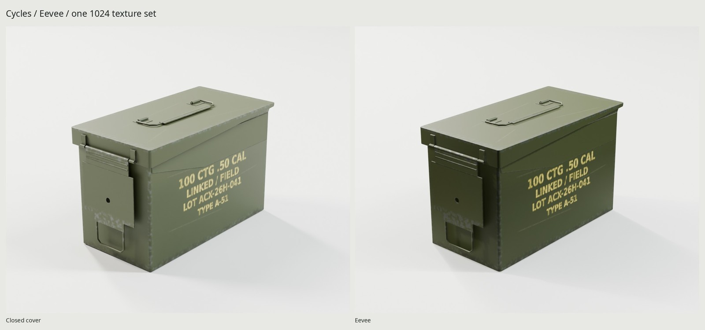
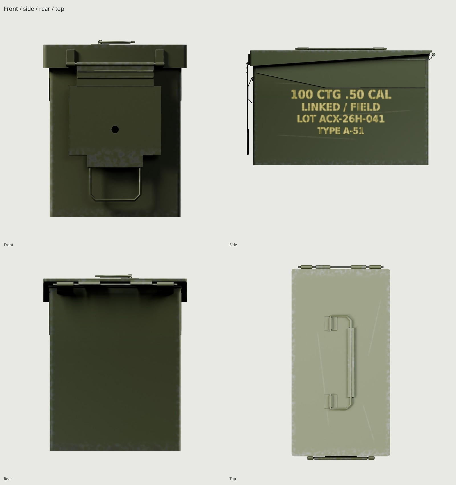
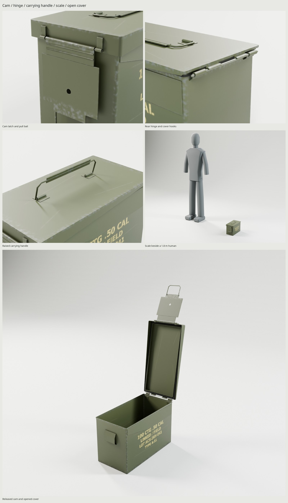

# .50 caliber steel ammo can

An original M2A1-style stamped steel container with olive drab paint, fictional
lot stencils, a retained rubber gasket, removable hinged cover, cam latch and
folding carrying handle. Every vertex and texel comes from the scripts.





The [manufacturer sheet](https://enigmatechnicalsolutions.com/files/Ammunition/Small%20Arms%20Ammunition/M2A1%20METAL%20AMMUNITION%20BOX.pdf)
gives **305.6 × 154.8 × 190.5 mm** length × width × height and minimum
**0.8 / 1.2 mm** casing / cover gauges. These control the model; its closed
envelope matches to float precision. [REFERENCE.md](REFERENCE.md) separates
published dimensions from authored hardware estimates and explains the
MIL-DTL-3060G / drawing 7553296 reference. [Sources](refs/SOURCES.md) records
photographs, drawings, authors and usage. No military load or seal certification
is claimed, and no real contractor or arsenal markings are reproduced.

The hollow shell has sheet thickness and a folded mouth. The cover carries its
gasket in a continuous retainer; the cam reacts against a body-mounted hasp.
Bent rear leaves support a secured pin and open cover hooks. Wire ends pass
through actual retaining sleeves. Upper side reinforcements, cover folds and
cam neck ribs describe the stamped construction. `WEAR` controls exposed-fold
chips, sparse rack-contact scrapes, rubbed latch steel and low-edge grime.
At the default `WEAR=.35`, abrasion is visible in the full hero: the cover
lip, cam grip and bottom lose paint while the broad panel retains its coating.
The cover mask follows its hinge-local frame; stencil pigment fades and breaks
where the same contact scratches cross it. Original stencil bridges and worn
ink are generated using the installed open-license DejaVu font.

The delivery is **2,784 triangles**, inside the 1,000–3,000 budget, in four mesh
objects with one material. One **1024²** BaseColor (sRGB), OpenGL +Y Normal and
ORM (R occlusion, G roughness, B metallic) atlas serves the assembly. Budgeted
GPU residency is approximately **4 MB** with block compression and mipmaps.
All channels are baked at 4096 before filtering to delivery size. The kit
isolates the lid, latch and handle during projection, retaining stationary
contact AO and each part's rest coordinates.

The GLB is **2,398,092 bytes**; delivered PNG sizes are BaseColor **693,539**,
Normal **418,129**, ORM **1,064,760** bytes. Atlas coverage is **53.17%**, with
zero measured overlap/outside/degenerate triangles and density p5/median/p95
**887/976/980 px/m** at 1024.

| Part | Pivot in closed Blender world meters | Motion |
| --- | --- | --- |
| `AmmoCan` | (0, 0, 0) | Ground-footprint center; +Z up, front −Y, length along Y |
| `Lid` | (0, 0.1498, 0.1785) | Local X, 0 to −110°, after releasing the cam |
| `Latch` | (0, −0.1503, 0.1640) | Local X, 0 to −105°; child of `Lid` |
| `Handle` | (−0.0160, 0, 0.1880) | Local Y, 0 to −90°; child of `Lid` |

Release the cam, open the lid, then withdraw the cover 25 mm along its local
+Z through the open rear hooks. The retained body pin stays fixed. The kit
checks actual evaluated high/game surfaces: 54 cam samples, 46 handle samples,
111 lid-opening samples at 1°, 101 withdrawal samples at 0.25 mm, and another
46 handle samples with the lid open. All measure zero solid penetration.
Only named sleeve/shaft bearing pairs have intended-contact allowances.
Independent construction checks measure 22 support/contact pairs, including
approximately 0.300 mm radial pin/wire clearance. These are sampled physical
checks, distinct from the GLB verifier's geometry/pivot serialization checks.

```sh
make                        # references, bake, GLB, renders, docs and checks
make check                  # geometry, UVs, normals, re-import, contacts, motion
make WEAR=.65               # more handling and edge wear
make match PASS=source-review WIDTH=1000 SAMPLES=24
make match-final PASS=delivery-review WIDTH=1000 SAMPLES=32
make clean && make          # regenerate delivery from scripts
```

Requires Blender 5.2, Python/Pillow/NumPy and `flock`. The unified kit rules
control texture size and density; Cycles uses the shared GPU lock and OptiX or
CUDA. The photo-comparison studio adds a broad wash facing the far seamless
for the low, oblique calibrated camera. Lighting is procedural. No downloaded geometry, material, texture or HDRI
is used, and reference images never enter the generated maps.

Delivery: `export/AmmoCan.glb`, `textures/ship/`. Cycles views are in
`renders/final/`; Eevee is in `renders/final-eevee/`. The full contact sheet is
`renders/final/contact.jpg`. Exported photographic comparisons are
`renders/photo-final-glb/match_closed-pair.jpg` and
`renders/photo-final-glb/match_latch-pair.jpg`. JSON evidence is in `build/`;
[REVIEW.md](REVIEW.md) records the critiques and final results.

The weakest areas are close-up pressed-edge detail and the small stencil:
1024 filtering softens both. The used-surplus reference is darker under different
lighting; this original olive finish now shows concentrated fold and rack wear. Hardware sizes
beyond the published envelope/gauges are authored estimates, and the cam face
and folded corners are simpler than a formed production part.

Phase 2 used-surplus calibration: `renders/wear-pass3-glb/used_surplus-pair.jpg`
compares the shipped atlas with an actual used M2A1 (source and rights in
`refs/SOURCES.md`). The corresponding source pair is under
`renders/wear-pass3-source/`. The fitted envelope residual is 4.84 px at
900×600; paint shade and fictional markings intentionally differ.
