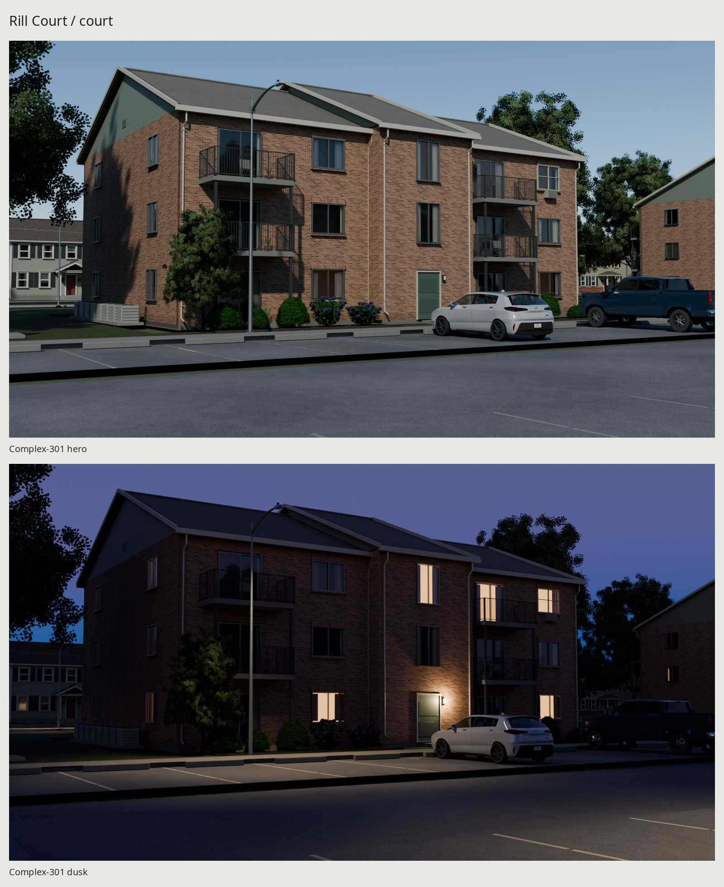
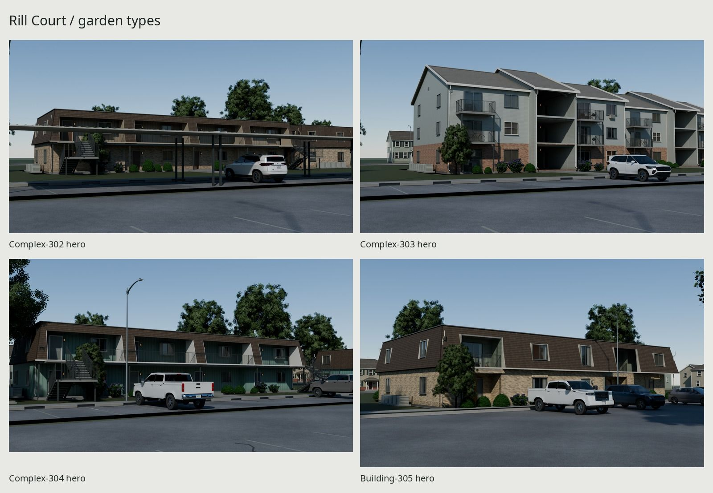
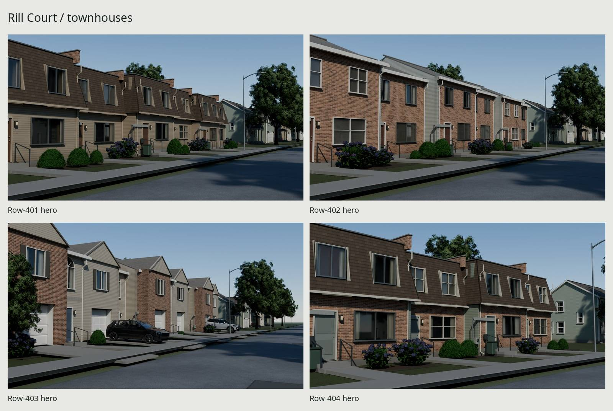
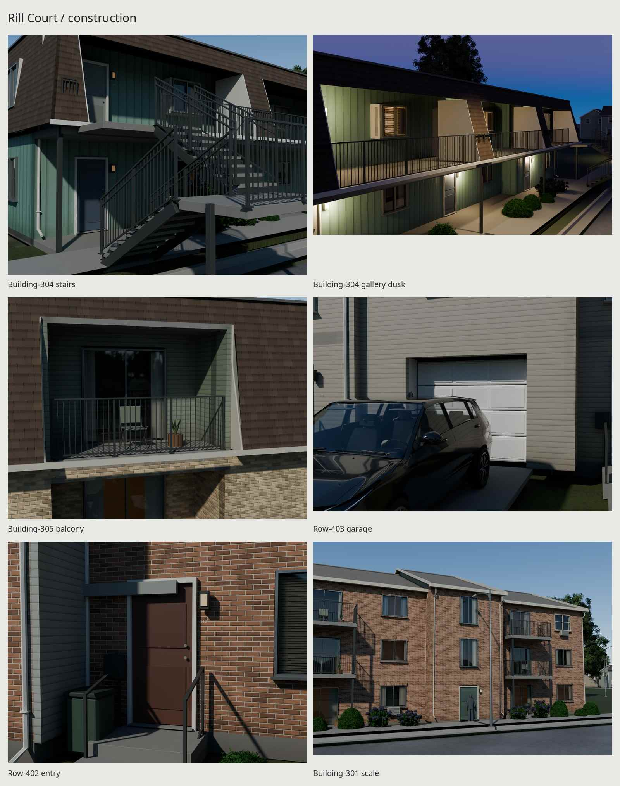
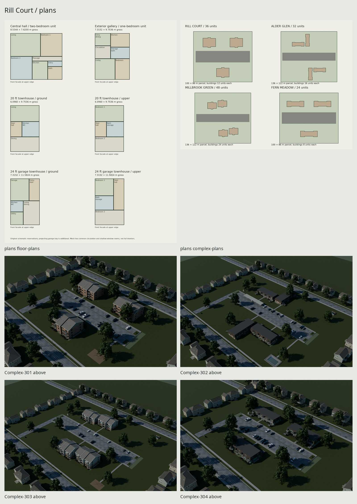

# Rill Court / garden apartments and townhouse rows

Original American rental housing, maintained and occupied around 2005, with
the 2002 garage row shown around 2015. Four complexes, their standalone
buildings, an additional brick/mansard comparison seed, and four townhouse
rows use the houses' baked PBR vocabulary and external-image glTF delivery.
The final images below are rendered from the exported glTF packages with
baked textures. The first plate includes the parking-court dusk; the details
include the gallery at dusk and human scale. A separate Eevee hero is in
`renders/eevee/Complex-301/hero.png`.







Full-size final images live in `renders/final/`: every complex and row has
an eye-height hero, above, ground and rear view. Building 305 adds the
brick/mansard hero; Building 301 has a 1.8 m human and four orthographic views.
The gallery night close-up is `Building-304/gallery_dusk.png`, and the garage
bay is `Row-403/garage.png`. The contact sheet, type sheets and three balanced
color pairs are in `renders/review/`; native pairs are in `renders/matches/`.
Source comparison witnesses remain separate in `renders/source-matches/`.
Floor and parcel diagrams live in `renders/plans/`. These are schematic room
reservations, consistent with the accepted plan grammar, not a full interior.

The four native before/after plates are in `renders/delivery-fixes/`:
`asphalt-before-after.jpg`, `dormer-before-after.jpg`,
`planting-before-after.jpg`, and `dusk-before-after.jpg`. Each side is at
least 900 native pixels wide. Review and value measurements are documented
in [REVIEW.md](REVIEW.md); the plates and references stay local and ignored.

## Plans and construction

| Seed | Plan and period | Units per building / row |
| --- | --- | ---: |
| 301 | 1967 three-story brick, enclosed stair hall, gable | 12 |
| 302 | 1978 two-story L, exterior galleries, brick lower story and continuous mansard | 16 |
| 303 | 1986 three-story offset wings, open halls, brick/siding and gables | 24 |
| 304 | 1973 two-story straight gallery, faded board siding and mansard | 8 |
| 305 | Additional two-story buff brick/mansard with recessed balcony wells | 8 |
| 401 | 1974 six-unit siding/mansard row | 6 |
| 402 | 1985 six-unit brick/gable row | 6 |
| 403 | 2002 six-unit garage row, projecting front gables, alternating brick/siding | 6 |
| 404 | 1979 compact brick/siding/mansard row | 4 |

`src/plans.py` supplies `garden(seed, **overrides)`, `row(seed, **overrides)`
and `complex_plan(seed)` without Blender. Controls retain era, floors, access,
skin, roof, straight/L/offset form, unit dimensions and palette; garden seeds
also select articulation and recessed balconies. Rows retain count, width,
depth, garage and roof/fire-wall options. Unsupported parameters fail. This
is a bounded grammar, not a full habitable interior or parcel solver.

The four parcels contain **36 / 32 / 48 / 24 units** in 3 / 2 / 2 / 3 buildings.
The row seeds produce 6 / 6 / 6 / 4 homes. A building's two linked wings are
one independently placed building. Seed 305 is the additional eight-unit
brick/mansard comparator; its unit reservation is an authored 38 × 25 ft.

Expressed central halls project under their own broken roof. Gallery units
recess in pairs; separate stepped roof envelopes follow the facade. Rows
alternate 3/4 ft depth steps and retain six-inch floor changes. Garage bays
project another meter, with their own front gables, shutters and arched stair
fanlights. Accepted leaf/sash/section geometry and poses remain intact.

Mansards are a full shingled upper story on front, rear and exposed ends,
including gallery fins, balcony openings and window wells. The upper framed
body recedes behind the slope. Door reveals are splayed to clear the 100°
opening. The earlier pale brick stripes were coplanar interior floor edges
and wall ends; they are now concealed behind the veneer. Actual soldier and
rowlock courses use the same brick manufacture as the wall.

The linked L/offset wings retain the accepted 3.048 m connecting gap and
supported open canopy. Conservative measured service passages opposite their
meter banks are 1.295 / 1.564 m through 2.1 m height. Those are geometric
reservations, not code certification.

## Dimensions, moving parts and sockets

[REFERENCE.md](REFERENCE.md) distinguishes cited dimensions from authored
choices; [refs/SOURCES.md](refs/SOURCES.md) records authors, URLs, rights and
uses. The NBS 1977 20 × 32 ft townhouse plan anchors row 401. Sacramento's
garden-housing survey and DAHP's c.1970–1978 photographs establish construction
types. Modern published Access Board criteria are stair/guard comparators;
no historical permit compliance is claimed.

| Element | Real-scale dimension |
| --- | --- |
| Core unit reservation | 8.5344 × 7.620 m / 28 × 25 ft gross |
| Gallery unit reservation | 7.3152 × 9.7536 m / 24 × 32 ft gross |
| Townhouse modules | 18/20/24 ft wide; 32/34/38 ft deep |
| Floors / central hall | 2.7432 m / 4.8768 m |
| Shared stairs | 16 × 171.45 mm rises, 279.4 mm going, 1.1176 m width |
| Landings / guards | 1.2192 m / 1.0668 m |
| Grasp rail | 914.4 mm high, 38.1 mm diameter |
| Typical sash / entry leaf | 1.524 × 1.2192 m / .9144 × 2.032 m |
| Slider / balcony depth | 1.8288 × 2.032 m / 1.524 m |
| Stall / main walk | 2.7432 × 5.4864 m / 1.524 m |

Nominal townhouse party-wall lengths are 36.576 / 36.576 / 43.8912 / 21.9456 m.
Measured authored garden wall-footprint bounds are 21.9456 × 17.0688 m (301),
42.0624 × 29.2608 m (302), 46.9392 × 22.2504 m (303),
29.2608 × 9.7536 m (304), and 28.0416 × 15.2400 m (305).
Export metadata independently records the full mesh envelope, including roofs,
services, stairs and balconies.

Meters, condensers/pads, AC sleeves, sills, thresholds, gutters, downspouts,
vents, unit lights/numbers and tenant dressing are modeled. Window rooms are
shallow backings behind actual glazing, with varying folded curtains and
32 mm blind spacing. Furnished walkable unit interiors are outside this build.

Meters, +Z up, front −Y. Roots sit at the wall-footprint/parcel center on grade;
stepped wall-footprint, walk and party-wall sockets survive export. Entry and
hall doors pivot 0–100° about Blender Z / glTF Y. Sliders travel 0–.7864 m on
their own X tracks. Garage doors retain four separate sections and hinge
origins per unit; `src/garage_motion.py:pose(t)` follows the houses' existing
chord-constrained guide for t=0–1. Dumpster lids pivot −95–0° about X, and the
pool gate opens outward 0–100° about Z. No armature is required.

## Baked materials, age and memory

Six building roles: Siding, Shingles, Veneer, Concrete, Trim, Glass. Gable
shingles, siding, brick and the trim sheet retain the houses' original baked
image bytes and canonical relative URIs. The trim sheet supplies painted
steel, aluminum, plumbing and shutter relief. Glass is untextured dielectric
transmission; curtains/blinds sit behind it. Repeated UV tile/strip overlap
is intentional. Standard glTF PBR and COLOR_0 carry the result.

| Shared source / apartment map | Shipped size | Assumed compressed GPU MiB, full mips |
| --- | --- | ---: |
| HouseSiding, three maps | 1024² | 4 |
| RanchRoof, three maps on gables | 1024² | 4 |
| HouseTrim, three maps | 2048² | 16 |
| RanchBrick red/tan/buff/red-brown alternatives | 512² per applicable three-map set | 1 per set |
| Mansard cedar color + canonical cedar normal | 512 × 256, scalar ORM | .3333 |
| ApartmentsConcrete, three maps | 512² | 1 |
| Apartment emission routing mask | 128² | .0208 |

The source families bake manufacture at 4096. Concrete filters Ground's own
4K concrete bake, avoiding the house foundation's form-tie pattern and a
16 MiB large concrete load. Mansard stain is an authored brown remapping of
the houses' 4K cedar color, filtered in linear light; relief and scalar ORM
are the exact existing cedar bytes. Only its 1/6 MiB color is new. Total new
apartment image allocation is **1.1875 MiB**: concrete 1, stain color 1/6,
emission 1/48. Steel requires no new set. No photographic pixel enters any map.

Gable building image loads are 26.0208 MiB; brick/mansard buildings 22.3542;
all-siding mansard 21.3542. Native parcel asphalt, lawn, ground trim and fence
maps add 64 MiB to complexes, or 32 MiB lawn/fence to rows. These are cold
loads, not incremental allocations when canonical images are already cached.
The complete apartment export family references **35 unique images,
63,166,694 encoded image bytes, 91.6875 MiB** at assumed 8 bpp with full mips.
This estimate assumes engine block compression; PNG is the delivery encoding.

Landlord upkeep is localized: rain splash at grade, runoff at exposed wall
ends, sheltered deposits, south-face fade, dirt on slab undersides and risers,
small rust at low steel cuts/bases, garage bottom splash, absorbed engine oil
in selected stalls, tire paths and a narrow lawn desire line. Structural
coordinates drive COLOR_0 fields, so dirt remains attached to its cause and
materials retain their color. It is maintained housing, not blanket rust/noise.

## Parcel and presentation

Private stalls/paint/stops/islands, branching walks, carports, cluster mailbox,
dumpster and fence enclosure, fictional signs, pool/deck/gate and swing
playground remain from the accepted construction checkpoint. Parcels use
continuous lawn regions; stretched native mineral surfaces receive metric
world-phase UVs rather than stretching the grain.

Cars, mature trees, mixed foundation beds and neighboring town geometry are
**presentation only**. The renderer imports canonical exported Ground roads,
curbs and walks, two seeded houses, utility poles and sagging conductors from
their measured sockets, street/lot lights, maple/boxwood/hydrangea, and the
pickup/crossover/hatchback. Factory colors use each car's baked paint coverage
and published decoder metadata. Existing exports and maps are never rewritten.
Cars and vegetation are placement markers in the apartment package, so their
triangles and images do not silently inflate the delivered building budgets.

Foundation borders use the shrubs' native **Boxwood 419** and **Hydrangea 815**,
grouped with varied size and yaw from the building/placement seed. Clipped and
larger shrubs, empty mulch stations, aged bark beds, low steel edging and a
small maple at a corner replace the identical evenly spaced spheres. The
same shared shrub atlas serves every instance; these are two botanical
species, not claimed new species or independently rebaked variants.

The type heroes use a 40 mm lens with eyes 1.68 m above an actual
ray-measured surface, under raking procedural sun. Dusk uses a procedural
blue-hour sky, selected warm room backings behind curtains, entry pools and
street-light emitter sockets. The delivered emission route remains ordinary
PBR; the night renderer raises its emission strength and adds real light
sources. No downloaded environment/HDRI is used.
Each modeled entry light and stair bulkhead has an `engine_light` socket at
its actual fixture, with `light_kind` and a presentation `render_power_w`.
The renderer uses 65 W Blender points for entries, 95 W for stair bulkheads,
and 950 W broad pole spots. These are presentation energies, not measured
photometric watts/lux. Street/lot sockets retain their native local −Z axis.
Gallery doors light the walking deck and adjacent exit flights. Dusk uses
the unchanged blue-hour sky/exposure and selected warm room circuit.
Eevee enables ray-traced transmission with the modeled 12 mm pane gauge;
that renderer setup prevents joined-building bounds from hiding the rooms.

## Measured delivery budgets

Counts are raw glTF instances. Geometry bytes are glTF + BIN; cold bytes also
include referenced images, deduplicated within that asset. Materials include
site roles on complexes/rows; standalone buildings use at most six.

| Building | Units | Triangles | Materials | Geometry bytes | Cold bytes | GPU MiB |
| --- | ---: | ---: | ---: | ---: | ---: | ---: |
| 301 | 12 | 70,855 | 6 | 11,333,344 | 18,549,384 | 26.021 |
| 302 | 16 | 118,556 | 6 | 18,439,881 | 22,984,116 | 22.354 |
| 303 | 24 | 142,990 | 6 | 23,015,173 | 30,231,213 | 26.021 |
| 304 | 8 | 58,106 | 5 | 9,042,082 | 12,869,858 | 21.354 |
| 305 | 8 | 46,244 | 6 | 6,873,260 | 11,428,049 | 22.354 |

| Complex | Triangles | Materials | Geometry bytes | Cold bytes | GPU MiB |
| --- | ---: | ---: | ---: | ---: | ---: |
| 301 | 232,567 | 10 | 35,126,884 | 97,369,258 | 90.021 |
| 302 | 279,034 | 10 | 40,995,187 | 100,565,756 | 86.354 |
| 303 | 318,267 | 10 | 48,714,487 | 110,956,861 | 90.021 |
| 304 | 192,974 | 9 | 28,642,471 | 87,496,581 | 85.354 |

| Row | Units | Architecture / whole row triangles | Materials | Geometry bytes | Cold bytes | GPU MiB |
| --- | ---: | ---: | ---: | ---: | ---: | ---: |
| 401 | 6 | 45,346 / 52,274 | 8 | 6,990,313 | 44,060,869 | 54.354 |
| 402 | 6 | 42,494 / 49,422 | 8 | 6,627,944 | 46,377,481 | 58.021 |
| 403 | 6 | 55,634 / 63,012 | 8 | 8,434,760 | 48,173,773 | 58.021 |
| 404 | 4 | 30,208 / 35,112 | 8 | 4,754,587 | 41,825,143 | 54.354 |

All forms stay within their proportional brief allowances. Whole-family cold
storage is **312,157,067 bytes** across 26 glTF/BIN files and 35 shared images;
metadata and editable source scenes are excluded. Presentation dependencies
are separate library loads. Individual asset cold-byte rows cannot be summed
as a family total because their image sets overlap.

## Rebuild and verification

To place a parcel, import its `export/Complex-301.gltf` (or another complex)
and move/rotate its single `Complex_301` root. Keep its scale at one. Native
glTF coordinates are Y up; the frontage is +Z after export. A parcel's root
is its ground-centered footprint; its ground and circulation move with it.
Use the standalone `Building-*.gltf` roots for a custom site, align their
`Footprint_*` and wing `Front_walk`/`Rear_walk` sockets to your paving, and use
the townhouse unit `Party_wall_*` sockets to attach compatible seeded units.
The supplied parcels are authored clear arrangements, not an arbitrary
collision-solving parcel generator. Dress them with the library scenes in
`src/presentation.py` if desired; those objects do not ship inside the parcel.

```sh
make                       # dependencies, models, checks, finals, review and five docs JPGs
make check                 # physical measurements, raw PBR/UVs, fresh imports, preservation
make repeat                # independent geometry re-export, compare every external byte
make check-repo            # repository rules
make render                # regenerate the final Cycles set
make matches               # three export pairs plus three source witnesses
make clean                 # removes this family's build, export, textures and renders
```

`make bake` prepares missing baked dependencies and the small derived maps;
`make export` builds the external packages. Dependencies build serially and
only when missing. Preserve the repository-relative texture paths in each
glTF, or package those exact shared images with a URI remap. The six-role
layout follows the house delivery exception to the general one-atlas rule.

`build/check.json` reports actual pan-crown intervals, leaf/casing surface
intersections at eleven angles, nine slider positions, 21 garage poses per
section, service bounds, facade depth planes, mansard height, and downward
gallery support probes at entry approaches. Serialization is checked
separately: raw counts, zero collapsed geometry/UV0 triangles, unit normals,
actual image-weighted UV density, and fresh-import points/pivot/socket frames.
These are sampled relationships, not continuous whole-building collision or
historical-code certification. Tiling/trim UV overlap is intentional; no
unique lightmap unwrap is claimed.

Existing delivery, docs and texture hashes are preserved, with additional
library-image snapshots in `build/dependencies.json`. `build/repeat.json`
records byte identity; the accepted bakes are cached inputs to that repeat.
All Cycles work uses the shared GPU lock. Image provenance names actual source
hashes, cameras, lights and presentation dependencies. The source comparisons
are separate from the exported comparisons. Reference neutral assumptions,
critique passes, tonal facts and honest remaining differences are recorded in
[REVIEW.md](REVIEW.md).

Editable per-asset scenes are `build/<stem>.blend`; the aggregate report is
`build/family.json`. Generated deliveries, references, textures and review
renders are ignored by Git. No kit file, other family source or top-level README is changed. Five final
JPGs are committed separately after the native review; there is no GIF.

The main remaining visual limits are shared botanical silhouettes, orderly repairs,
simple meter faces, repetitive tenant props and shallow room backings. The
photo pairs compare original buildings of the same construction type, not
replicas; exact window rhythm, landscaping and roof proportions still differ.
No LOD, game collision mesh, full unit interior, fire rating or accessibility
certification is claimed.

## Credits

All geometry, procedural surfaces, masks and plan diagrams are authored by
repository scripts. Canonical baked materials and presentation assets come
from this library's houses, Ground, fences, shrubs, trees, utility poles,
street light and car families; their existing exports are read-only inputs.
The photo and dimensional authors, rights and source URLs are listed in
[refs/SOURCES.md](refs/SOURCES.md). Reference pixels are used only for visual
measurement and comparison. Installed open-license DejaVu/Noto/Liberation
fonts are resolved with the shared font finder. No real brand or property
identity is reproduced in the original apartment markings.
