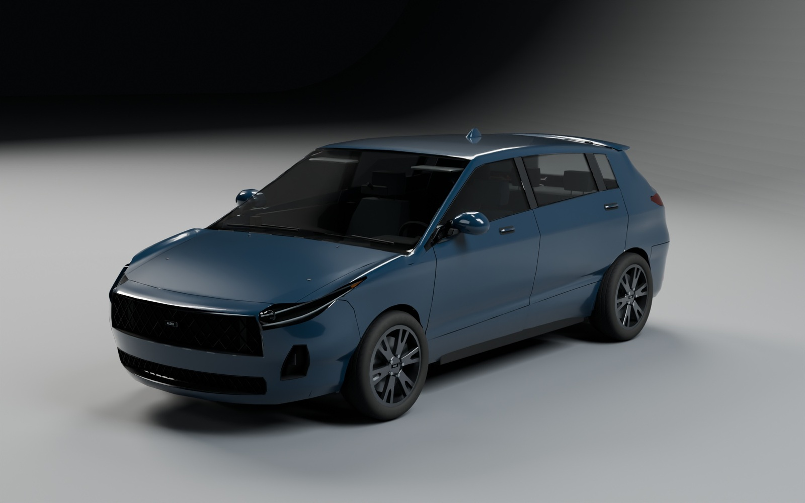
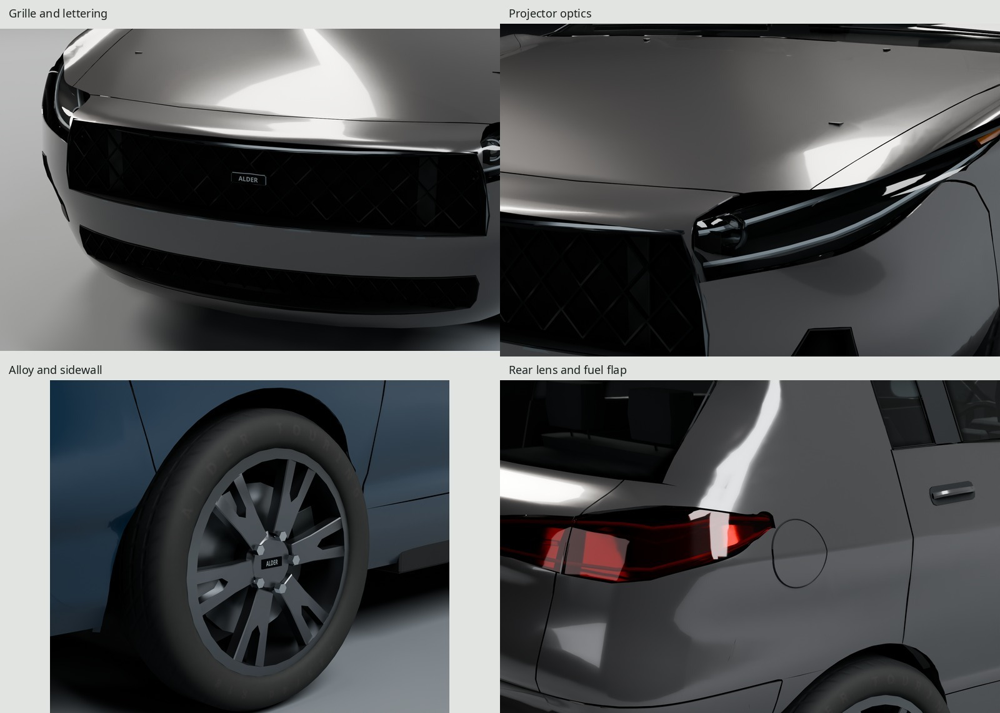
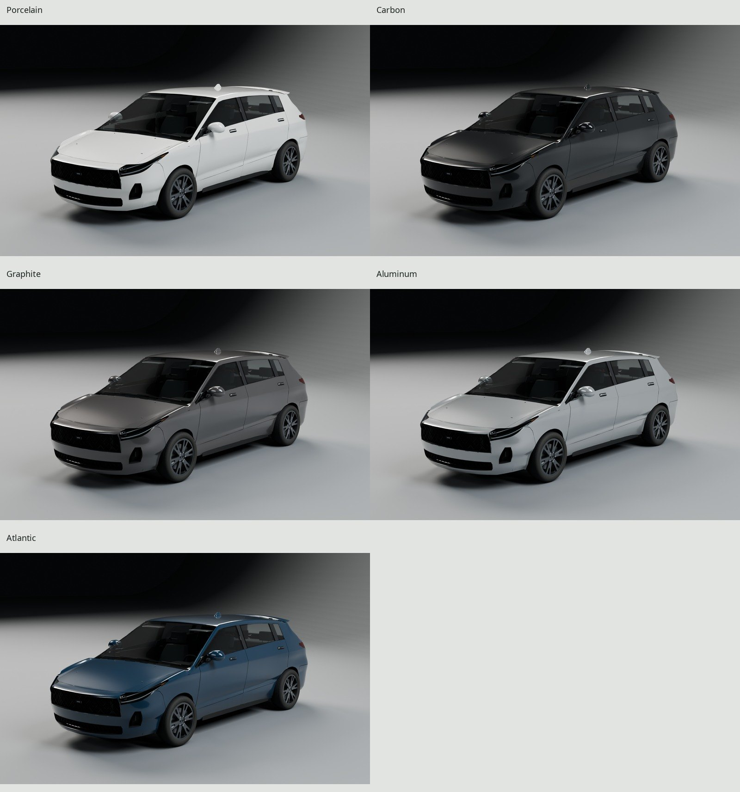
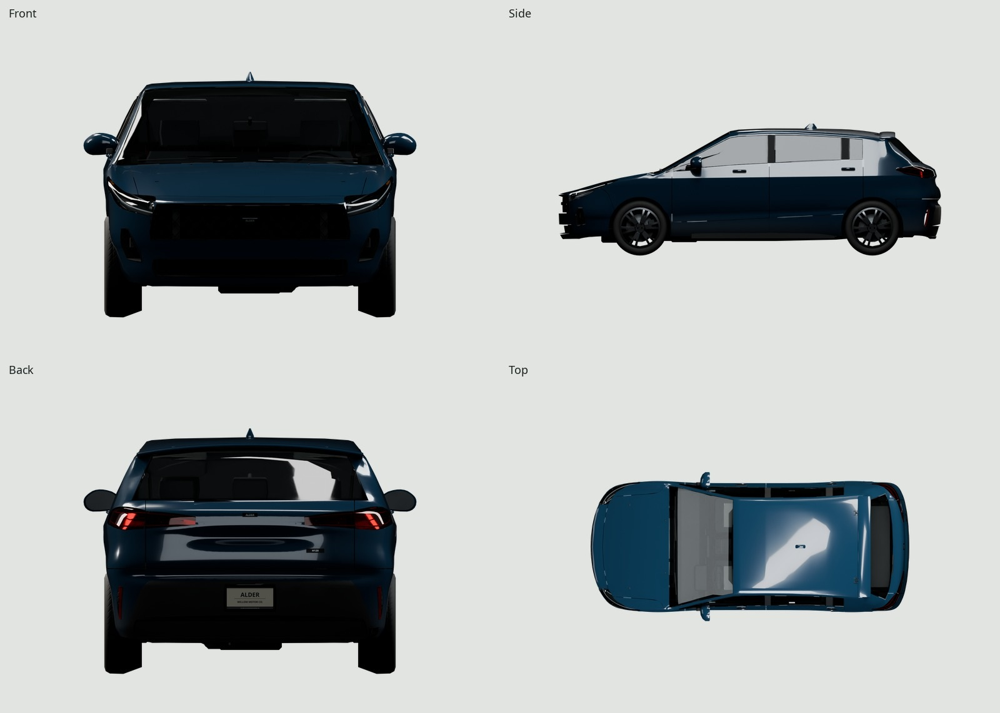
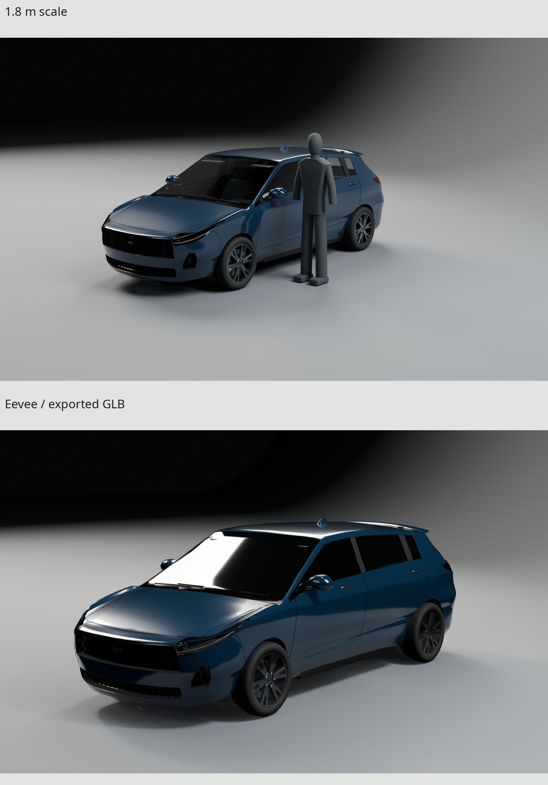

# Alder H120 — compact five-door hatchback

An original late-2010s compact hatchback, with four working doors, a hinged
hood and liftgate, steering and rolling wheels, a five-seat cabin and a cargo
well. Five factory finishes share one baked atlas. This is a four-season daily
driver, with wheel-wake road film, brake dust, hem chips, gap residue and
localized loading scuffs.



| | |
| --- | --- |
|  |  |
|  |  |

All gallery images come from a fresh import of the exported GLB and its three
embedded textures. The studio, lights, reflection flags and AgX setup are the
accepted C150 recipe; only the cameras fit the smaller car. The scale figure
is measured at 1.8 m. [Native finals and contact sheet](renders/hatch-final/contact-sheet.jpg),
[matched front](renders/hatch-final-pairs/used_front-pair.jpg),
[matched rear](renders/hatch-final-pairs/used_rear-pair.jpg), and
[delivery critique](REVIEW.md#h120-delivery) retain the full review evidence.

## Dimensions and construction

The package is an original design between the manufacturer-published
[MY2019 Corolla hatchback](https://newsroom.toyota.eu/download/647310/2019-toyota-corolla-dpl-en-983710.pdf)
and [November 2018 i30 five-door](https://www.hyundai.news/newsroom/dam/uk/press-kits/20181001_i30/hyundai_i30_fivedoor_and_tourer_press_kit_november2018_technical_specifications.pdf).
The later [same-generation Australian i30 sheet](https://www.hyundai.com/content/dam/hyundai/au/en/models/i30/docs/Hyundai_i30_Hatch_Specifications.pdf)
cross-checks the 225/40R18, 18 × 7.5 wheel package and upper-trim track class.
[REFERENCE.md](REFERENCE.md) separates published dimensions, original choices,
photographic estimates and their uncertainties; [SOURCES.md](refs/SOURCES.md)
records the reference authors and licenses.

| Measurement | Actual H120 |
| --- | ---: |
| Length × body width × body height | 4363.0 × 1796.5 × 1450.6 mm |
| Width across mirrors | 2039.3 mm; Hyundai sheet 2039 mm |
| Height with antenna | 1505.0 mm |
| Wheelbase | 2650 mm |
| Front / rear track | 1550 / 1560 mm |
| Tire / wheel | 225/40R18 / 18 × 7.5; 5 × 114.3 mm studs |
| Rolling diameter / tire-to-arch gap | 629.2 / 40.0 mm |
| Lowest underbody surface | 146.5 mm above ground |
| Door reveals | 4.5 mm |

The outer panels originate in one connected all-quad subdivision sheet,
separated on that surface into closures and genuine recessed openings. Gauge,
returns, arch hems and liners remain separate construction. Local reflection
sampling resolves the hood and quarters; the lower gate follows its continuous
die field where radial control-net fitting had underresolved the narrow draw.
Its painted outer game vertices move at most 2.333 mm in the delivery correction,
blended back to the held lamp boundary, crease and hem. Crease-aligned rows
retain all 81 patch boundary vertices, with 20 mm transverse samples in the
central draw, 40 mm outside it and 10 mm vertical samples. Smooth parent and
die derivatives avoid importing the parent triangles' faceted slopes. A rounded
local die ridge resolves its remaining reflection step. Buried reverse chords
and the molded inner card are seated behind the actual outer skin: the game
source independently measures minimum Y gaps of 0.662 and 18.629 mm on a
7 mm offset grid, with no piercing samples. Those hidden reverse chords are
an economical occlusion surface; their variable depth is not a reconstruction
of uniform steel gauge. Visible cuts and hems retain their gauge. The
windshield header and lower backlight use pane-local mold normal
approximations to keep reflected cards coherent. The lower backlight correction
is at most 8.05° on the game pane; its positions, cuts and material values
are byte-held. The convex derivative fit has a 15.55 mm diagnostic positional
residual and is not an exact reconstruction of the pane. The accepted package,
profile, D-pillar, spoiler, shoulder and lower character line are retained.
[HATCH_FORM.md](HATCH_FORM.md) preserves the accepted form and its raw proofs.

An open gloss-black diamond lattice sits over the dark grille cavity, with a
dark-chrome surround and original ALDER emblem; a finer lattice fills the
lower intake and seated blanks fill the corner wells. Smooth optical shells
enclose projector bowls and twin guides. Split red rear covers articulate
with the gate. Spokes carry physical casting chamfers, tires retain their
bulged passenger-car profile, and the fuel reveal follows a compound flap.
The dealer insert reads **ALDER / WILLOW MOTOR CO. / ALDER AUTHORIZED RETAILER**.
All brands and markings are fictional.

Five compound seats, a dash/cluster/screen, console, steering wheel, door
cards and headliner fill the cabin. The rear has a carpeted cargo well,
wheelhouse trim, load sill and parcel cover. Stamped rails/floor, subframes,
halfshafts, suspension, tank, catalyst and a hollow exhaust outlet fill low
views. These sheltered parts use less geometry than the exterior.

## Mechanisms and coordinates

Meters, Blender +Z up, front −Y; origin at the center of the footprint on the
ground. Export applies mesh transforms. Moving assemblies remain separate;
positive rotations follow each local axis. No armature or canned animation is
required: the game can drive these nodes directly.

| Node | Rest pivot in Blender meters / local axis | Range |
| --- | --- | --- |
| Door_FL / Door_FR | (∓.838, −.902, .740); normalized (∓.10, 0, 1) | left 0…62°, right −62…0° |
| Door_RL / Door_RR | (∓.820, +.225, .740); normalized (∓.10, 0, 1) | left 0…66°, right −66…0° |
| Hood | (0, −1.080, .977); X | −62…0° |
| Liftgate | (0, +1.455, 1.385); X | 0…82° |
| Wheel_FL / Wheel_FR | (∓.775, −1.255, .3146); local X | full revolution |
| Wheel_RL / Wheel_RR | (∓.780, +1.395, .3146); local X | full revolution |
| Steer_FL / Steer_FR | (∓.710703, −1.264156, .3146); local Z | −35…+35° |

Front kingpin axes in vehicle space are (±.257266, .109393, .960129): original
15° SAI, 6.5° caster and −20 mm scrub choices. Formed leaves, bored sleeves,
backing pads and jambs support the doors. Roof pins/ears support the gate.
Paired gas supports carry the hood and gate; their exported endpoint nodes
and `support_target` extras let the runtime re-aim each sleeve/rod, as
`hatch_lookdev.supports()` does for the final cargo pose. Fuel flap and parked
wipers are static accessories.

Kit solid sweeps test closures every 2°, wheels every 10° and steering every
1°, on game and high sources at 0.5 mm tolerance. Independent one-degree
coupled-strut sweeps and 42 measured support contacts supplement them.
Construction/travel measurements and GLB serialization are separate reports;
sampled travel is not a continuous collision proof.

## Delivery budget

| Exported mesh assembly | Triangles |
| --- | ---: |
| Fixed body / AlderH120Mesh | 36,249 |
| Liftgate | 6,028 |
| Door_FL | 1,782 |
| Door_FR | 1,815 |
| Door_RL | 1,802 |
| Door_RR | 1,926 |
| Hood | 1,706 |
| Wheel_FL / FR / RL / RR | 1,966 each |
| Steer_FL / FR | 148 each |
| Four support sleeves | 64 each |
| Four support rods | 32 each |
| **Total: 21 meshes, four materials** | **59,852** |

The 60,000 cap is unchanged. This is 674 triangles above the accepted
59,178-triangle surface checkpoint, spent on visible optical/casting samples
and the corrected gate draw while retiring hidden lower-fascia/back chords. Construction categories include 3,600 cabin,
260 cargo, 1,792 underbody and 1,912 hinge/support triangles. Visible casting,
optical and gate samples use the remaining budget. Lower fascia retiling
retires 2,024 nearly coplanar triangles without moving retained vertices;
original-surface center/edge probes measure at most 0.683 / 0.648 mm of
chord deviation, front/rear. These are sampled measurements.


One H120 texture set: **2048² sRGB BaseColor RGBA, OpenGL +Y Normal RGB, and
linear ORM RGB** (R occlusion, G roughness, B metallic). GPU Cycles bakes at
4096² and filters to 2048² in linear color, normalized vectors and RMS
roughness. Three 8-bpp block-compressed maps with full mip chains cost about
**16 MiB**; three RGBA8 allocations with mips cost 64 MiB. File bytes are a
separate measure.

Four delivery surfaces — Paint, Opaque, Glass and Lamps — retain the existing
family material exception. All four reuse the same three images. Paint and
Glass use normal scale zero to preserve their continuous mesh normal fields;
Opaque and Lamps retain geometric/tread/hardware normal detail. Micron paint
peel is below this atlas's normal-map resolution; the roughness map retains
the filtered flake and wash response.

The atlas occupies **40.96%** of the square after chart gutters.
Actual polygon clipping reports zero UV overlap, outside or degenerate triangles.
Painted panels measure **177.3–221.7 px/m**: doors/hood/front fascia 221.7,
fenders/quarters/gate 206.9, rear fascia 192.1, roof/spoiler 177.3. The
whole-asset p5/median/p95 is 73.9 / 225.1 / 1182.3 px/m, deliberately unequal
to prioritize lettering over buried structure.

The badge fault was anisotropic print packing: the old grille chart allocated
about 14 pixels along the word and 57 vertically. Restoring physical print
metrics and square target-aspect packing yields **167 × 43 px** for ALDER,
**137 × 47 px** for each wheel cap, **197 × 47 px** for H120, **164 × 48 px**
for the rear ALDER, and **360 × 180 px** for the dealer insert. Independent
U/V measurements agree within 0.01%; the bake does not need exaggerated
normal strength.

The GLB is **7,892,240 bytes (7.53 MiB)**. The three shipped PNGs total
3,818,900 bytes: BaseColor 841,126; Normal 1,166,380; ORM 1,811,394. All
images are embedded once and shared by the four material surfaces.
`delivery-check.json` records the independent GLB accessor and fresh-import
checks; `uv-report.json` records chart-axis measurements.

## Finishes, colors and bake loss

Porcelain, Carbon, Graphite, Aluminum and Atlantic use the family's
`reference_plus_coverage_delta` extras. Atlantic is the stock glTF fallback;
factory RGB changes decode `baked RGB + alpha × (new tint − reference tint)`
in linear light, with the corresponding metallic factor. Paint-coverage alpha
keeps road film and chips their own color. The selected five North American
production-color weights normalize to 31:19:21:8:10, an original spawn proxy
rather than a used-fleet census. `WEAR=.65` produces the daily driver shown.

The matched photographs show a white MY2018 hatchback, photographed by
Elise240SX on 2022-08-06, CC BY-SA 4.0. The front white siding and rear gray garage mullion
are the stated white-balance neutrals. Native wheel-anchor fit RMS remains
9.24 / 9.76 px, with estimated 88.7 / 71.2 mm focal lengths; Blender agrees
with the solver within 0.004 px. Procedural diffuse sun/sky, asphalt and the
rear comparison facade retain the accepted context. Photo pixels never
enter a model, texture or environment.

The same-camera source/export patches measure upper painted panels unchanged
at display precision; road film changes by 0.00–0.93 display levels. Rear side
glass remains 122.52 against the neutral-balanced photo's 123.68; backlight is
122.01 against 121.16. Source-to-export shifts are +0.72 for the backlight,
+3.79 for the windshield and +5 / +7 for front/rear tire patches. The tire
shift is the largest measured bake loss and remains visible in the daylight
pair. These are lit sRGB patch measurements, not inferred material albedos.
The gallery audit also checks the full surfaces, lettering, road film and
reflection edges; patch medians alone cannot certify appearance.

## Rebuild and verification

Needs installed Blender 5.2, GNU Make, Python with Pillow/NumPy, fontconfig and
an installed Noto Sans Bold. Fonts resolve through `kit/fonts.py`; every
Cycles bake/render acquires `ASSETS_GPU_LOCK` through the kit wrapper.

```sh
make -C cars BODY=hatch                 # complete delivery, native gallery and checks
make -C cars BODY=hatch check
make -C cars BODY=hatch docs            # bounded docs, after inspecting native finals
make -C cars BODY=hatch checkpoint      # retained diagnostic studio and surface proofs
make -C cars BODY=hatch STAGE=form      # accepted form evidence
python3 kit/repo_check.py
```

`build/hatch-detail/` contains source counts, independent construction and
motion reports, deterministic regeneration, UV and projection checks, export
expectations and fresh-import verification. `renders/hatch-final/` contains
native gallery PNGs, tone statistics, `bake-loss.json`, sheets and GLB-hash
provenance; `hatch-final-pairs/` and `hatch-source-pairs/` retain the distinct
matched-light comparisons. [Before/after crops](renders/hatch-delivery-comparisons/comparisons.json)
record the identical cameras, paint and exposure used for each correction.

A separate archive checkout with no build, export, texture, render or downloaded
reference outputs completes `make` and `make check`. Source arrays match across
471 objects / 442 meshes; UV reports and all 174 exported accessors match
exactly. The independent GPU rebake differs by one 8-bit level in 30 Normal,
three ORM and two BaseColor pixels; the raw source-blend provenance hash also
differs. Therefore the hatch GLBs are not claimed byte-identical across fresh
GPU builds. The pickup's complete GLB remains byte-identical at 11,530,720 bytes,
SHA-256 `58661d0c2e11c2050e10677e12fabdf61570a3d25dc53837b485fee5c55a85ea`.
All 24 kit regression modules pass sequentially from clean scratch builds.

The native audit rejects and fixes the windshield header shard, stepped front
roll, hooked rear-glass reflection and gate self-occlusion before generating
five documentation JPGs. The hero has no clipped RGB channels; 25.89% of the
vehicle mask lies below 0.10 display luminance, with the floor excluded. The
remaining CG tells are economical headrests/cabin trim, the wheel lip at
extreme close range and small grazing reflection changes near held patch
margins. Eevee's thin-sheet/screen-traced glazing is visibly less convincing
than Cycles' nested transmission. Tire patches brighten most in the bake.
These limitations are visible in the delivered views, not hidden by a new
lighting setup.

Reference photos and manufacturer PDFs are look/measurement sources only.
Noto Sans is licensed under SIL OFL. Every vertex, marking, material texel,
light and final image is generated by this repository's scripts. No downloaded
models, textures, materials, HDRIs or photographic projection are used.
