# Cars family

Original late-2010s vehicles, generated entirely by scripts in Blender 5.2. Each body ships as one GLB on one baked
2048 atlas in five factory colors, with opening doors and closures, steering and turning wheels. `make` builds the
pickup, `make BODY=suv` the crossover, `make BODY=hatch` the hatchback and `make BODY=sedan` the sedan.

<table>
<tr>
<td align="center" width="50%"><a href="#alder-c150--crew-cab-pickup"></a><br><a href="#alder-c150--crew-cab-pickup"><b>Alder C150</b></a><br>crew-cab 4×4 pickup</td>
<td align="center" width="50%"><a href="#alder-x220--compact-crossover">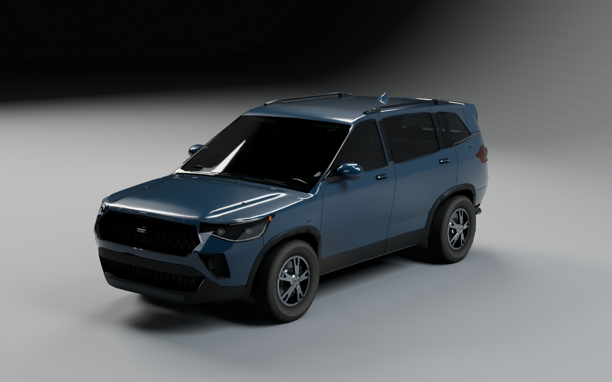</a><br><a href="#alder-x220--compact-crossover"><b>Alder X220</b></a><br>compact crossover SUV</td>
</tr>
<tr>
<td align="center" width="50%"><a href="#alder-h120--compact-five-door-hatchback">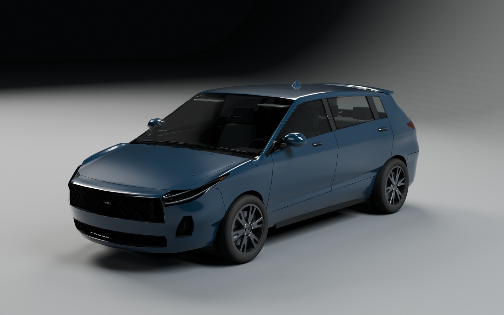</a><br><a href="#alder-h120--compact-five-door-hatchback"><b>Alder H120</b></a><br>compact five-door hatchback</td>
<td align="center" width="50%"><a href="#alder-s240--midsize-sedan">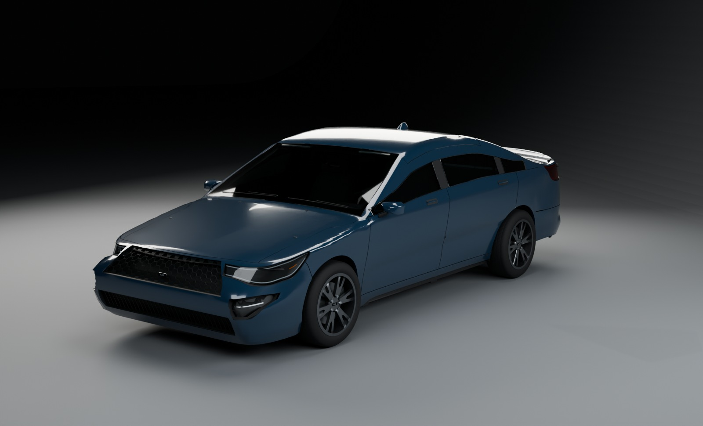</a><br><a href="#alder-s240--midsize-sedan"><b>Alder S240</b></a><br>midsize four-door sedan</td>
</tr>
</table>

## Alder C150 — crew-cab pickup

An original late-2010s crew-cab 4×4 pickup on 275/65R18 all-terrain tires.
Five factory paints share one baked atlas and four delivery surfaces. The
body, fictional lamps, grille, badges and markings are generated entirely
from scripts; reference pixels never enter the asset.


GLB (`export/AlderC150.glb`) · Contact sheet (`renders/final/contact.jpg`) ·
Turnaround (`renders/final/turnaround.jpg`) · Scale (`renders/final/scale.jpg`) ·
Eevee (`renders/final-eevee/hero.jpg`) · Lit lamps (`renders/final/lamps_lit.jpg`) ·
Used-truck pairs (`renders/final-pairs/used-pairs-contact.jpg`) ·
[Critique log](REVIEW.md)

Every final view starts with a fresh import of the exported GLB and its three
embedded baked maps. The factory paint/lamp uniforms are decoded by
[src/delivery_materials.py](src/delivery_materials.py); the high source and its
procedural manufacturing shaders are never loaded for finals. View metadata,
GLB hashes, paint/geometry masks and measured tonal ranges accompany the renders.

### Dimensions and construction

[REFERENCE.md](REFERENCE.md) distinguishes published dimensions from original
construction estimates. [refs/SOURCES.md](refs/SOURCES.md) records the authors,
URLs and reference licenses. The envelope follows Ford's MY2018 short-bed
SuperCrew specification, cross-checked against GM and Ford body-builder data;
the design is fictional.

| Measurement | Actual game surfaces / pivot centers |
| --- | ---: |
| Length | 5889.26 mm; 5890.26 mm published target |
| Body width / full mirror width | 2029.57 / 2458.72 mm |
| Height | 1960.88 mm |
| Wheelbase / front and rear track | 3683.00 / 1716.00 mm |
| Clear bed floor length | 1704.34 mm |
| Door seams / cab-to-bed gap | 4.500 / 16.000 mm |
| Lower door-to-sill reveal | 4.924 mm |
| Tire width / top / ground | 275.00 / 802.70 / 0.00 mm |
| Arch crown / tire-top clearance | 893.00 / 90.30 mm |
| Lowest underbody surface | 226.00 mm, differential |
| Face sweep at x = 950 mm / rearward rake | about 121 mm / 8.00° |
| Headlamp front projection | 387 × 154 mm, tapering to 58 mm |
| Lamp corner return / developed centerline | 178 / 553 mm |

Analytic side sections share position and normal derivatives across the 4.5 mm
reveals. Stamped outer panels have 0.9 mm gauge, inward returns and arch lips;
the separate bed has inner wheelhouses, tie-downs and a lined cargo floor.
The broad grille occupies about 61% of the face width. Its 70 mm lands have a
rounded face and a real return; dark blades and original diamond relief sit
82–84 mm behind it. The surround is **satin dark chrome**, with a dim sky
reflection along the top. Mirror caps are textured black. The separate 250 mm
painted bumper has a crisp upper highlight and lower return, a plate pocket,
and a black valance with recovery hooks and intake below.

Curved lamp covers enclose a projector, broad reflector and original 16 mm
running guide. Vertical rear optics, reverse windows and a third brake lamp
have separate lit controls. Six Y spokes, deep barrels, six lugs, rotor hats,
friction rings and actual U-section calipers sit inside the wheels. Five seats,
a formed dash, gauges/display, console, door cards and headliner fill the cab.
Boxed rails, suspension, drivetrain, tank, exhaust and a supported spare fill
low views. Driver controls are at +X, behind `Door_FR`; side suffixes follow
the authored coordinate labels.

The moving meshes needed several functional corrections: a real caliper slot,
inner wheelhouse steering clearance, rear hood/cowl clearance, tailgate corner
and rail clearance, true mirror fold bearings and upward wiper sweeps. These
retain the accepted body fields, factory colors and causal wear. Static support,
gauge, brake and optical-seat measurements are in `build/detail-check.json`.

### Delivery budget

The delivery mesh is **59,838 triangles**, below the 60,000 limit. Detailed
counts are rebuilt in `build/form-check.json` and `build/export-report.json`.
Static manufacturing pieces consolidate by their moving parent; doors,
mirrors, glass, wheels and their fittings stay attached to the proper pivots.

| Source construction group | Triangles |
| --- | ---: |
| Body panels, bumpers and liners | 25,466 |
| Four wheels, tires and brakes | 15,112 |
| Lamps, grille, mirrors, trim and bed hardware | 8,412 |
| Interior | 4,856 |
| Glazing, including protective headlamp covers | 1,444 |
| Underbody, including spare | 4,548 |
| **Total** | **59,838** |

The 195,738-triangle high source is used only for baking. The shipped rigid
mesh allocation is:

| Exported part | Triangles |
| --- | ---: |
| Static body/interior/underbody assembly | 34,608 |
| Hood / tailgate | 792 / 1,098 |
| Each front / rear door | 1,792 / 1,584 |
| Each mirror | 516 |
| Each spinning wheel/tire/rotor assembly | 3,678 |
| Each front steering knuckle/caliper assembly | 176 |
| Fuel door / each wiper | 108 / 192 |

| Delivery resource | Budget / actual |
| --- | --- |
| Materials | 4: Paint, Opaque, Glass, Lamps |
| Textures | One shared 2048² sRGB BaseColor RGBA, linear OpenGL +Y Normal RGB, linear ORM RGB |
| Bake | 4096², GPU Cycles, 24 samples; linear-light downsample to 2048² |
| GLB | 11,530,736 bytes, embedded PNGs and moving hierarchy |
| Raw mesh buffers | 5,389,908 bytes; 30 mesh primitives |
| Texture GPU estimate | **16 MiB** with three 8-bpp compressed maps and full mip chains |
| Texture GPU estimate, RGBA8 | 64 MiB with full mip chains |

The GPU figures describe texture allocation after engine upload, not PNG file
size or measured renderer residency. The five paints add only uniform values. Raw mesh buffers add about 5.14 MiB
before engine packing/overhead, for roughly 21.14 MiB with the compressed maps.
The normal bake carries tread, sipes, lettering, grille relief and manufacturing
microstructure; no extra geometry is added for these details. UVs have zero
overlap or outside/degenerate triangles; density is weighted toward exposed
body panels, optics, wheels and markings, with structural undersides lower.

### Paint, wear and factory colors


The fifth color costs no additional texture set. This delivery uses a **factory
factor over neutral coverage**, rather than `KHR_materials_variants` or five
material copies. The shared RGB is a correct Atlantic fallback. Paint-island
alpha stores remaining neutral paint coverage, so changing a factory tint in
linear light is:

```glsl
paint_rgb = max(vec3(0), base.rgb + base.a * (factory_tint - atlantic_tint));
```

This is equivalent to `factory_tint * coverage + contamination`: brown road
film and gray chips keep their colors. The five linear tints and metallic
factors live in the Paint material's GLB extras. [src/paint.glsl](src/paint.glsl)
contains the engine decode, including coverage-dependent clear coat and lamp
power. [src/delivery_materials.py](src/delivery_materials.py) implements the
same delivery operation in Blender for validation and finals.

| Preset | Linear tint | Factory metallic factor |
| --- | --- | ---: |
| Porcelain | .780 / .790 / .760 | 0 |
| Carbon | .009 / .011 / .013 | 0 |
| Aluminum | .460 / .480 / .490 | .55 |
| Graphite | .160 / .153 / .141 | .42 |
| Atlantic | .012 / .037 / .071 | .12 |

The four surfaces share the same three images. Paint has clear coat; Glass
has transmission/IOR; Lamps has an emission sampler and scalar control.
Lamp-island alpha stores each emitter's power divided by 80, independently of
paint coverage. The helper selects unlit or calibrated lit states from those
embedded values. A stock glTF viewer shows Atlantic with uniform coat and the
emission fallback; the supplied decoder enables the five paints, localized
coat contamination and individual lamp powers. No source shader is reconstructed. The Eevee preview uses an explicit thin-sheet
Fresnel/colored-transparency fallback for the stacked cover and projector panes,
reading the same embedded tint, roughness and normal maps. Cycles follows their
nested refraction; the screen-space preview approximates it. The adapter is
included in the delivery helper, and this difference is recorded in view metadata.

Default wear `.65` represents a four- or five-year daily driver: dilute road
film fans behind wheels and stays low, brake dust sits toward wheel interiors,
stone chips occur at the leading edge, cargo scrapes follow the bed floor,
dust collects in bed corners and on the tailgate rail, and water-spot rims
vary chrome roughness. These are separate physically located masks. Baked
coverage reduces the paint coat where contamination sits. Fine flake response
is filtered into the undercoat roughness/normal at the shared atlas density.

### Articulation and clearance

Meters, Blender +Z up, front −Y; glTF +Y up, front +Z. Origin is the bumper
footprint center on the ground. Ranges below are local-axis rotations from the
closed/rest transform, expressed in Blender authoring axes. In the GLB,
local X stays X and local Z becomes Y. Door and wheel assemblies are rigid children of named
pivots; front calipers steer but never spin.

| Pivot nodes | Local axis | Full range | Clearance sample spacing |
| --- | --- | --- | --- |
| `Door_FL`, `Door_RL` | Z | 0…72° | 2° |
| `Door_FR`, `Door_RR` | Z | −72…0° | 2° |
| `Hood` | X | −62…0° | 2° |
| `Tailgate` | X | −90…0° | 2° |
| `Wheel_FL/FR/RL/RR` | X | full revolution, 0…360° checked | 15° |
| `Steer_FL/FR` | tilted Z | −35…35° | 1° |
| `Mirror_L` / `Mirror_R` | Z | −50…0° / 0…50° | 2° |
| `Fuel_Door` | Z | 0…95° | 2° nominal |
| `Wiper_0/1` | tilted Z | −80…0° | 2° |

Front door hinge lines pass through `(±.944, −1.40275, 1.040)` m; rear door
hinges through `(±.944, −.05275, 1.040)` m. Hood hinge is
`(0, −1.4495, 1.408)` m; tailgate hinge is `(0, 2.824, .905)` m.
Each front wheel is nested under its kingpin pivot: actual exported axes
measure 12.00° inward inclination, 6.50° caster, 40.00 mm scrub and 45.00 mm trail.
Wipers sweep about their own axes normal to the windshield, rather than world Z.

`make check` runs **17 full-range BVH clearance sweeps on both game and high
assemblies**, with a 0.5 mm tolerance. Only named bearing, CV/ball-joint and
mirror-hinge interfaces permit intentional contact. Tires/liners and
rotors/calipers have no collision exemption. These tests establish mechanical
clearance at the stated angular samples; they are not continuous-time physics.

`build/car-delivery-check.json` independently checks the GLB's parenting,
kingpin geometry, preserved panel normals, actual atlas contents and every
sampled rigid articulation against the source transforms. The kit's delivery
check also compares re-imported vertices/pivot matrices and validates UVs,
normal vectors, materials, texture sizes and bounds. Serialization agreement
and mechanical clearance are reported separately.

The circular tire is a **mean loaded-envelope approximation**: 401.35 mm rolling
radius, without a rotating parked flat spot. A separate fixture checks ground
support through a full revolution. It does not simulate tire carcass squirm,
suspension travel or road contact physics.

### Rebuild and evidence

```sh
make -C cars                    # references, source, UV/bake, GLB, all finals,
                                # photo pairs, three docs JPGs, and checks
make -C cars check              # source construction, both motion sweeps,
                                # re-import and independent car delivery checks
make -C cars final-render       # GLB Cycles views and Eevee
make -C cars final-colors final-pairs
make -C cars docs               # provenance/tone/contact sheets and docs
make -C cars face PASS=face-checkpoint WIDTH=1500 SAMPLES=64
                                # archived source face checkpoint
```

All Cycles work holds the kit's shared GPU lock. The asset builds from clean
scripts with the repository tools, Blender, NumPy, Pillow and installed Noto
Sans fonts resolved by `kit/fonts.py`. No downloaded code, models, materials,
textures or HDRIs are used. Generated blends, GLBs, maps and renders remain
ignored; only the three final bounded docs JPGs are committed.

The four final photo pairs use the original used-truck camera solver and
procedural daylight conditions. Ford supplemental RMS is 44.88 / 26.60 native
pixels; the five-year Ram RMS is 19.57 / 19.83 pixels. These measure class
camera registration, not design identity. Cropped framing, trim, tire and
wheelbase differences remain disclosed uncertainties.


The shipping critiques are at the top of [REVIEW.md](REVIEW.md). Reflections
remain simpler than the photographed street and parking lots; the low-detail
interior and tiny filtered markings are the weakest close-range areas.
The shared atlas averages microscopic flakes and limits sidewall-type detail.
The script source and shader behavior are available for engine integration.

<!-- LOD checkpoint: begin -->
The pickup keeps its established LOD1/LOD2 settings and original materials.
The failed far proxy is excluded from the optional build.
[LOD history and verification scope](REVIEW.md#car-lod-round-2--s240-budget-stop).
<!-- LOD checkpoint: end -->

## Alder X220 — compact crossover

An original late-2010s two-row crossover, generated entirely by scripts. The
stamped body, molded cladding, laminate glazing, chevron grille, projector lamps,
five-seat cabin, covered cargo floor and AWD underbody share one baked atlas.
The delivery preserves the accepted body lines, detail, colors and articulation.


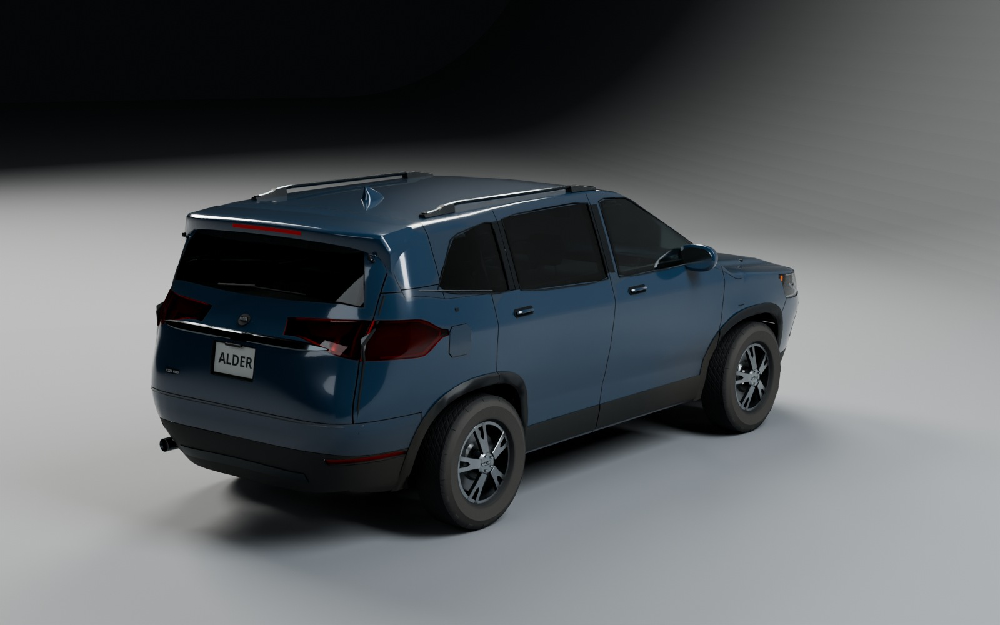
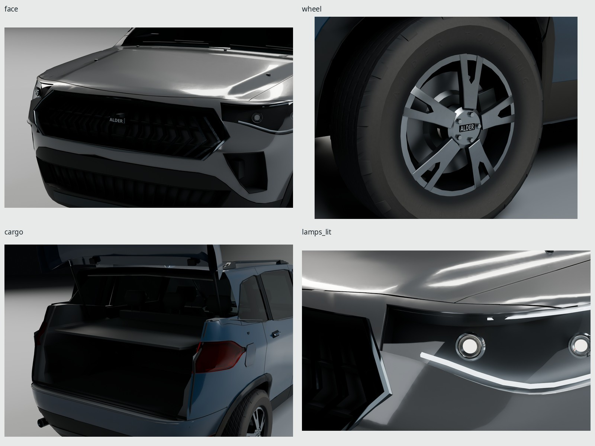
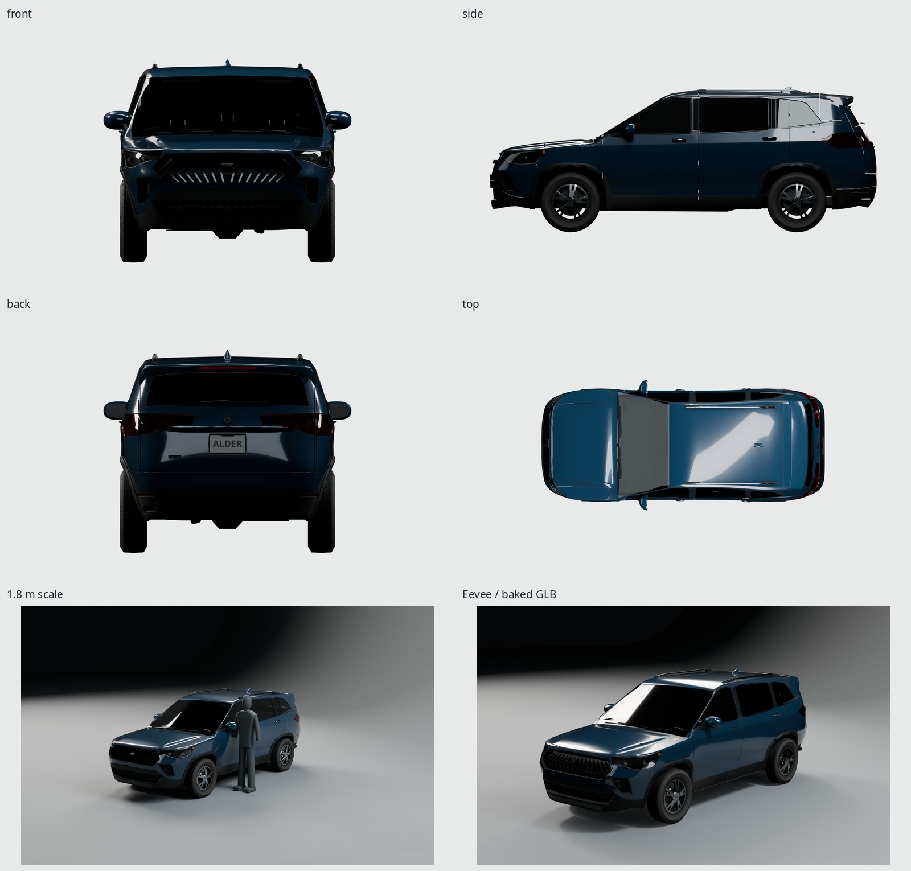
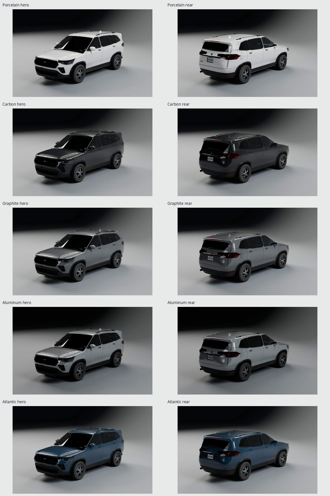
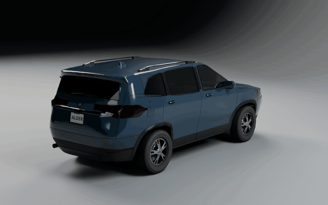

Every final starts with a fresh import of `export/AlderX220.glb` and its three
embedded maps in the unchanged C150 gallery. Source shaders are used only for
separately labeled bake-loss controls. Full-size contact sheet (`renders/suv-final/contact.jpg`),
matched front (`renders/suv-final-pairs/used_front-pair.jpg`),
matched rear (`renders/suv-final-pairs/used_rear-pair.jpg`),
bake-loss measurements (`renders/suv-final/bake-loss.json`), and
[critique passes](REVIEW.md) accompany the delivery.

| Actual game measurement | Value |
| --- | ---: |
| Length / wheelbase | 4598.8 / 2690.0 mm |
| Body / full mirror width | 1842.0 / 2117.0 mm |
| Roof / rails / antenna height | 1679.0 / 1700.0 / 1735.0 mm |
| Front / rear track | 1600.0 / 1610.0 mm |
| Tires / lowest underbody surface | 225/65R17 / 205 mm |

The package is measured against Toyota's MY2020 US RAV4 brochure and Honda's
MY2020 CR-V specifications; the UK CR-V brochure cross-checks mirror width.
These are reference classes, not reproduced designs. [REFERENCE.md](REFERENCE.md)
and [SOURCES.md](refs/SOURCES.md) distinguish published dimensions, original
construction estimates and photographic authors/licenses.

| Delivery resource | Actual |
| --- | ---: |
| Triangles | **64,933 / 65,000** |
| Materials / embedded maps | **4 / 3**, family Paint, Opaque, Glass, Lamps |
| Shipped maps | **2048²** BaseColor / OpenGL Normal / ORM, baked at 4096² |
| Compressed texture allocation with mip chain | **about 16 MiB** |
| GLB | 9,061,968 bytes |
| Unique atlas / shared tyre tile / total occupied area | 30.39% / 24.75% / **55.14%** |
| Exterior painted-panel density | 137 / 195 / 206 px/m (p5 / median / p95, UV-area weighted) |

The four family surfaces share the same images: paint needs clearcoat and
factory factors, glazing transmission/IOR, lamps controlled emission, and
opaque fittings their own response (source dielectric specular level .33). This retains the family's four-material
exception to the general three-material target. The four identical tyre
carcasses reuse one tile at 854–1099 px/m; all other charts are unique. The
trade is four separate carcass primitives, parented to their spinning wheels.

Five factory presets cost no extra maps. The family coverage decoder keeps
colored dirt/chips while changing paint. SUV Graphite is linear RGB
`.150 / .1540545 / .160`, metallic `.42`; the other four family factors are
unchanged. [suv_delivery_materials.py](src/suv_delivery_materials.py) reads only
embedded images and material extras. Smooth glass has normal-texture scale
zero. The lamp extras specify the warm white projector/guide emission color
independently of its dark unlit substrate. Cycles follows nested refraction;
Eevee uses the family's documented thin-sheet fallback. A stock glTF viewer
shows the Atlantic fallback; runtime factors enable the other colors and lamps.

Doors open 60°, hood 65°, liftgate 75°, front steering ±35°, fuel flap 85°;
wheels spin continuously. Each is a separate rigid node with its actual pivot,
axis and range in extras. Eight endpoint-driven telescoping strut meshes stay
separate. [SUV.md](SUV.md) lists all local-axis conventions, per-part triangles,
UV measurements, measured bake loss and remaining limits.

```sh
make -C cars BODY=suv clean
make -C cars BODY=suv WIDTH=1600 FINAL_SAMPLES=64
make -C cars BODY=suv check
make -C cars BODY=suv check-detail-repeat
python3 kit/repo_check.py
```

`export`, `verify`, `final-render`, `final-pairs` and `docs` are separately
rebuildable targets. The default makes the complete SUV delivery. All GPU
bakes/renders use the shared kit lock. No kit or other body generator changed;
the existing C150 GLB remains byte-identical.


## Alder H120 — compact five-door hatchback


An original late-2010s five-door, with four working doors, hood, liftgate,
steering, rolling wheels, a five-seat cabin and a cargo well. Projector optics,
split red rear covers, an open diamond grille, Alder badges and a Willow
Motor Co. dealer insert distinguish the hatch. Five factory paints share one
H120 atlas; wheel-wake film, brake dust, hem chips and loading scuffs describe
a daily driver a few seasons old.

[Complete delivery report and per-part counts](HATCH.md) ·
Native gallery/contact sheet (`renders/hatch-final/contact-sheet.jpg`) ·
Matched front (`renders/hatch-final-pairs/used_front-pair.jpg`) ·
Matched rear (`renders/hatch-final-pairs/used_rear-pair.jpg`) ·
[Delivery critiques](REVIEW.md#h120-delivery)

| | |
| --- | --- |
| 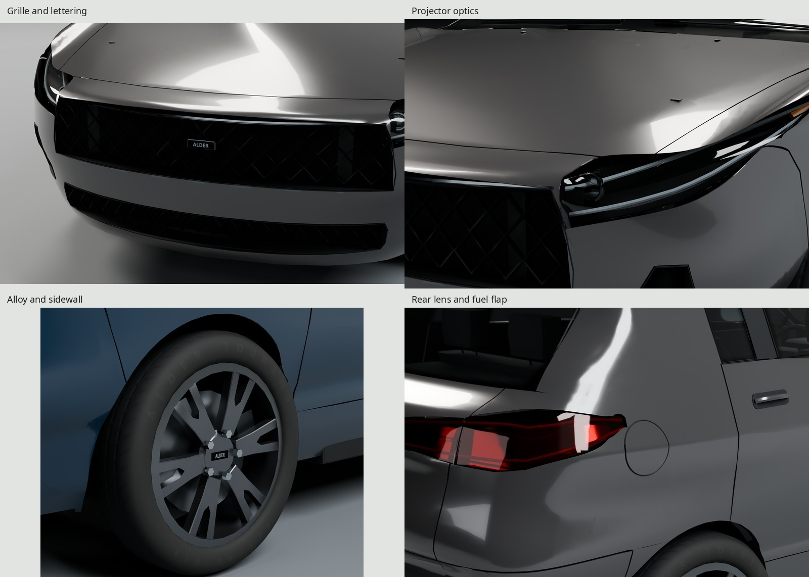 | 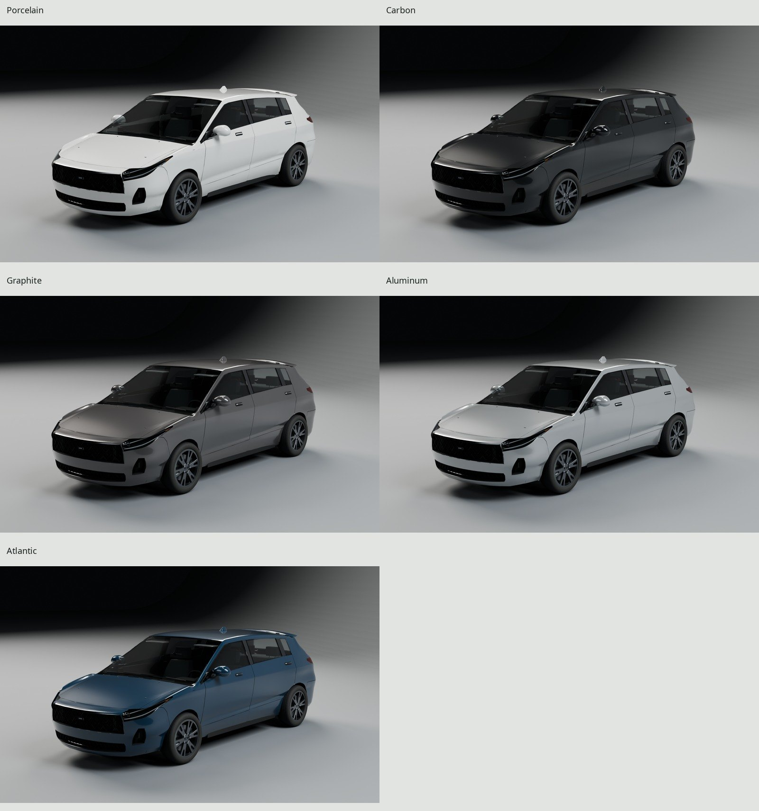 |
| 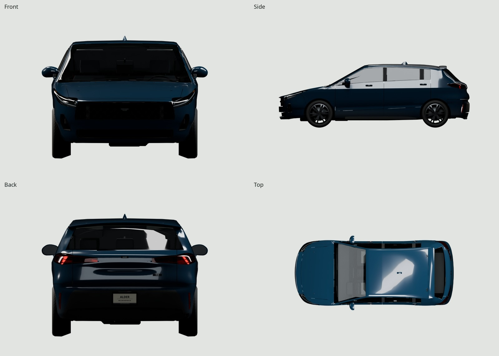 | 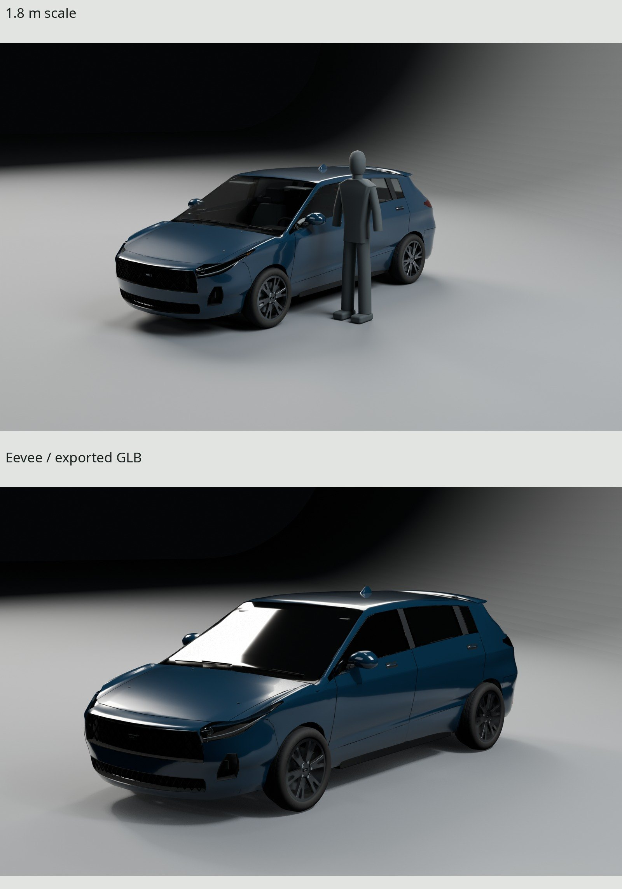 |

Every final starts with a fresh import of `export/AlderH120.glb` and its three
embedded maps. The studio, lights, reflection flags and AgX settings are the
accepted pickup gallery recipe; the hatch supplies its camera framing.
Native images, source hashes, paint/geometry masks, tone statistics and
source-versus-export measurements accompany the sheets. Documentation images
are generated only after the native audit.

| Measurement / delivery | Actual H120 |
| --- | ---: |
| Length × body width × body height | 4363.0 × 1796.5 × 1450.6 mm |
| Mirror width / antenna height | 2039.3 / 1505.0 mm |
| Wheelbase / front and rear track | 2650 / 1550 / 1560 mm |
| Tires / wheels | 225/40R18 / 18 × 7.5; 5 × 114.3 mm studs |
| Ground clearance / tire-to-arch gap | 146.5 / 40.0 mm |
| Game triangles / export meshes | 59,852 / 21 |
| Delivery materials | Four; existing family exception |
| Shared maps | 2048² BaseColor RGBA / OpenGL +Y Normal RGB / ORM RGB |
| Compressed memory, including mipmaps | About 16 MiB |
| GLB | 7,892,240 bytes |
| UV coverage / painted-panel density | 40.96% / 177.3–221.7 px/m |

The original package sits between Toyota's
[MY2019 Corolla hatchback specification](https://newsroom.toyota.eu/download/647310/2019-toyota-corolla-dpl-en-983710.pdf)
and Hyundai's
[November 2018 i30 five-door specification](https://www.hyundai.news/newsroom/dam/uk/press-kits/20181001_i30/hyundai_i30_fivedoor_and_tourer_press_kit_november2018_technical_specifications.pdf).
The later [same-generation Australian sheet](https://www.hyundai.com/content/dam/hyundai/au/en/models/i30/docs/Hyundai_i30_Hatch_Specifications.pdf)
cross-checks mirror width and the tire/wheel class. [REFERENCE.md](REFERENCE.md)
distinguishes published dimensions, original choices and photographic estimates.
[HATCH_FORM.md](HATCH_FORM.md) retains the accepted form evidence.

One connected subdivision parent supplies real panel cuts, gauge, returns,
arch hems and liners. Independent smooth optical molds, physical spoke
chamfers and the passenger-tire carcass supply the visible construction. The
atlas prioritizes original printed type over buried structure; the grille
badge and center caps retain their physical aspect and legibility. Paint,
Opaque, Glass and Lamps share all three maps. Atlantic is the stock glTF
fallback; the family decoder applies Porcelain, Carbon, Graphite, Aluminum
and Atlantic without five texture copies.

Meters, Blender +Z up, front −Y; origin at the footprint center on the ground.
Separate nodes expose these ranges:

| Assembly | Local motion |
| --- | --- |
| Front doors | 62° outward; canted hinge axes |
| Rear doors | 66° outward; canted hinge axes |
| Hood | X, −62…0° |
| Liftgate | X, 0…82° |
| Wheels | Local X, full revolution |
| Front kingpins | Local Z, −35…+35° |

[HATCH.md](HATCH.md#mechanisms-and-coordinates) lists pivot coordinates, signs,
world-space kingpin axes and the endpoint extras used to articulate the gas
supports. Source construction/contact measurements and sampled motion sweeps
are independent of the exported-GLB serialization check. The scale silhouette
measures 1.8 m from its actual vertices.

```sh
make -C cars BODY=hatch
make -C cars BODY=hatch check
make -C cars BODY=hatch docs       # after inspecting native finals
```

`make` rebuilds source, checks, 4096 GPU bakes, 2048 maps, the GLB, the gallery,
Eevee and matched-light pairs. `checkpoint` retains the earlier diagnostic
studio; `STAGE=form` retains the accepted form graph. The default cars build
remains the pickup. Its regenerated source and complete re-exported GLB bytes
remain identical. Hatch delivery changes stay in the hatch modules; the kit's
Smart UV target-aspect option and missing-MIME PDF signature fallback are
backward compatible and covered by all 24 kit test modules.

Photographs by Elise240SX, CC BY-SA 4.0, and manufacturer documents are
reference-only; [SOURCES.md](refs/SOURCES.md) records URLs, authors, licenses
and use. Noto Sans is SIL OFL. Every vertex, material texel, marking and light
is original and scripted. The remaining limits and measured bake loss are
reported in [HATCH.md](HATCH.md#finishes-colors-and-bake-loss).

## Alder S240 — midsize sedan

An original 2018–2022 FWD midsize sedan on 235/45R18 touring tires. Its six-light
greenhouse, continuous stamped surfaces, swept lamps and hexagonal mesh grille are
Alder's own design. Five factory colors share one sedan atlas. The C150's GLB
and atlas remain independent and unchanged.


| Rear | Factory colors |
| --- | --- |
| 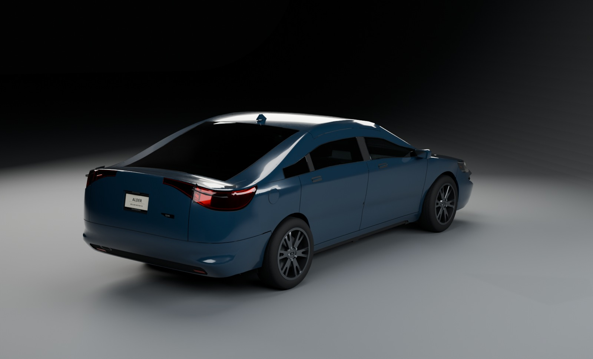 | 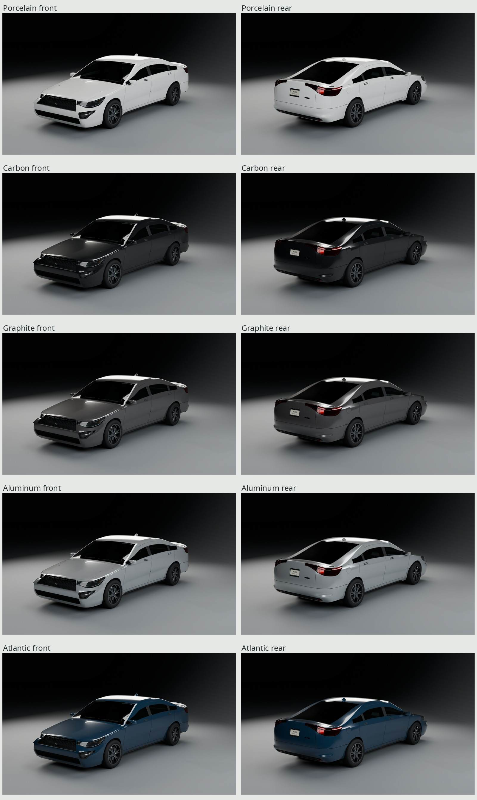 |

[Details](docs/sedan-details.jpg) · [Turnaround](docs/sedan-turnaround.jpg) ·
GLB (`export/AlderS240.glb`) · Studio contact (`renders/sedan-detail/contact.jpg`) ·
Scale (`renders/sedan-detail/scale.jpg`) · Eevee (`renders/sedan-eevee/`) ·
[Critique and limitations](REVIEW.md)

Every gallery view imports the exported GLB and its embedded baked textures.
No high scene, source material or reference photograph supplies the finals.
The runtime factory/coat/lamp decoder is the same method as the pickup's.

### Dimensions and construction

The class envelope is measured against Toyota's MY2019 Camry US eBrochure and
Honda's MY2019 Accord metric specifications, cross-checked with Toyota UK's
2021 Camry brochure. [REFERENCE.md](REFERENCE.md#alder-s240--original-20182022-midsize-sedan--form-gate)
and [refs/SOURCES.md](refs/SOURCES.md) distinguish published figures from original
construction estimates and record the reference URLs, authors and licenses.
The table below measures our actual surfaces and pivot centers.

| Measurement | Delivered asset |
| --- | ---: |
| Length × body width × body height | 4885.1 × 1849.6 × 1449.7 mm |
| Including mirrors / antenna | 2104.6 mm wide / 1483.7 mm high |
| Wheelbase / front and rear tracks | 2830 / 1590, 1600 mm |
| Tires / mean rolling diameter / crown gap | 235/45R18 / 660.7 / 44 mm |
| Tire bead width / overall rim metal width | 190.5 / 208.0 mm |
| Studs / pitch circle / hub-cap recess | five / 114.3 / 24.0 mm |
| Lowest underbody point | 146.5 mm, engine sump |
| Nominal door reveals | 4.5 mm, including the physical sill cut |
| Hood front / nose's leading height / chin | 755.2 / 504.0 / 174.9 mm |
| Front lower tuck / rear lower tuck | 133.7 / 189.5 mm |
| Rear departure ground tangent | 18.04°, against the cited 17.5° class cross-check |

The upper stamping is rebuilt as one C2 die through fair longitudinal
sections. A regular chart evaluates that die before the roof, sail, backlight,
deck, hood and lamps are cut; the accepted lower construction retains its
subdivision sheet. Steel gauge is nominally 0.9 mm, fascias 3 mm and glazing
4.8 mm. The game mesh samples the nose/deck rolls and shoulder in physical
coordinates aligned with their bends. Fine lower molding allocation preserves
cut boundaries and bounds sampled deviation against the original sheet.
Both sails and front pillars receive fresh physical rows on that die; the
front pillar's old diagonal chords no longer step its macro reflection.

The windshield has its accepted physical base/header outline, independent of
cage column widths, and its own smooth optical crown. Both laminate faces
share its analytic derivatives. An inward collar and injective triangulation
avoid border fans. The backlight and swept lamp covers also use their own
optical molds; glass and coated paint retain continuous mesh normals without
a quantized tangent-normal texture binding. The material factors, road film,
five paints and gallery lighting are unchanged.

Lamp footprints use physical perspective charts. The front panels receive one
constrained triangulation of the complete opening, with reflection rows and
one shared C2 fender/fascia parting line. Their transverse crown is convex; the center
and 800 mm draw datum are preserved. The transparent front covers have their
own raked optical mold with a further 1.5 mm convex crown inside its held
perimeter, rather than copying the steel's tight bend. Rear cut
intersections on the quarters use perspective-correct weights on the original
game edges. Trunk lamp lands use the same complete aperture triangulation as
the front, retaining their deck-roll section edges.
Molded lips and overlapping mounting lands seat the covers on the real cut
steel; the cassette's black molded back closes its actual rim. The grille's
connected perforated web follows one mirror-symmetric die. Shared-corner normal continuity, actual
facet winding, gauge containment and measured grille mirror pairs are checked
independently on source and imported delivery geometry. These measurements
prove construction and serialization. Native before/after crops and evenly
spaced gallery reflection lights separately judge the appearance.

The 1214 / 1270 mm backlight, broad sails, integrated deck lip, convex bumper,
tail lamps reaching 168 mm at the corner and 320 × 170 × 26 mm plate pocket
retain the accepted construction. A gloss-black web of 23 × 4 open hexagons
sits behind a narrow molded lip, with a 32-slot lower intake and an ALDER badge
supported directly on the web. It uses the H120's recessed-bed construction
with a separate pattern. The
plate carries an original ALDER / WILLOW MOTOR CO. dealer insert with dark
frame, without a registration format or serial. Its molded return contacts the
insert within 0.25 µm numerical error and has 2.22 mm sampled pocket clearance.

The reveal channels have 2 mm gauge, with their structural faces 35 mm behind
the sheet. Actual aperture liners, jambs, sill closures, a short moving hood
hem and a rear seam strip close the remaining grazing paths. The lower bumper
die and a common post-cut nose mold fair the intake, lip and cheek as one
profile. The mold holds the accepted upper sheets at Z ≥ 0.66 m. Concealed
fascia backings stay 3 mm inside the actual painted profile. Molded
returns are measured 3.61–4.50 mm inside their actual cut steel; the exhaust lip
is 3.00 mm inside the painted rear profile. The accepted headlamp perimeter,
its lower-rail rake and the surrounding painted steel stay fixed. The hidden
hood/fascia returns fit behind that mold. Each front opening has its own fitted
closure instead of a broad backing fan across the insert. Closed 1.5 mm bucket walls,
an opaque rim, a fitted inner mask and actual projector returns stay behind the
shell. A 3–6 mm black border follows the true lens perimeter. The projector
aperture is fitted from its actual optic mesh. The corner lamps have molded
front masks, fitted bonded gaskets and 2 mm side returns under their wrapped
fascia lands. Area-weighted 70 mm neighborhoods fair the painted cut-land
normals while holding every body vertex and triangle. An independent export
audit checks full-face winding, individual corner normals, duplicates within
and across parts, minimum area/altitude and exact lens-to-body/cassette/backing
triangle intersections.

The clear headlamp covers seat on molded bucket lips across their reveals.
Projectors, reflector bowls, swept light guides, side markers, reverse windows,
pull handles, seals/brightwork, wipers, nozzles, antenna and fuel flap complete
the exterior. The five-place cabin has separate seats/headrests, dash/cluster,
screen, console/shifter, wheel, cards, headliner and rear shelf. The low-detail
underbody carries the FWD powertrain approximation, stepped floor, subframes,
suspension, CV shafts, tank/straps and supported exhaust. Fine tread, lettering,
flake, coating and machining detail are scripted/baked. No downloaded model,
material, texture, decal or HDRI enters the asset.

### Delivery budget

| Manufactured group | Triangles |
| --- | ---: |
| Body skins / molded fascias | 12,060 / 6,880 |
| Pillars / door skins | 2,856 / 2,934 |
| Glass / mirrors | 5,636 / 660 |
| Arch flanges / liners | 384 / 1,168 |
| Recesses and grille / optical assemblies | 5,664 / 8,466 |
| Tires / wheels / brakes | 4,096 / 5,800 / 1,120 |
| Exterior trim / hinge hardware | 3,180 / 1,176 |
| Interior / underbody | 5,818 / 1,760 |
| **Delivered total** | **69,658** |

| Moving parent, including attached detail | Triangles |
| --- | ---: |
| Front doors L / R | 1,824 / 1,838 |
| Rear doors L / R | 1,616 / 1,618 |
| Hood / trunk | 1,258 / 3,940 |
| Each spinning wheel assembly | 2,654 |
| Each front steering carrier | 148 |
| Hood support sleeves / rods, both sides | 128 / 64 |
| Static assembly | 46,460 |

Both source densities are itemized in `build/sedan/detail-game.counts.json`
and `build/sedan/detail-high.counts.json`; independent source checks and GLB
re-import reports separate construction from serialization. Delivery remains
342 triangles below the 70,000 limit. Hidden web backs and protected bead rings
fund sealed optical construction, 128-station outer rim lips and the accepted
96-station tire shoulders. Guide reduction measures every authored station
against its final chord; maximum error stays below 0.30 mm.
The embedded-texture GLB is **10,140,724 bytes**.

Four delivery surfaces match the pickup: **Paint, Opaque, Glass and Lamps**.
Separate recoloring/coat, transmission and switchable emission responses need
four materials; this is the brief-authorized exception to the three-material
preference. All four reference one three-map **2048²** set, baked at **4096²**:

- `T_AlderS240_BaseColor.png`: sRGB, with independent paint-coverage/lamp data in alpha.
- `T_AlderS240_Normal.png`: OpenGL +Y tangent normal.
- `T_AlderS240_ORM.png`: linear occlusion, roughness, metallic in R/G/B.

The set costs **16 MiB** with full mips at 8 bpp per map (for example BC7/BC5/BC7),
or 64 MiB expanded to three RGBA8 mip chains. Loading both cars costs about
32 MiB compressed. These bodies share methods, rather than atlas pixels.
A common family repack would require a coordinated change to the accepted pickup.

Porcelain, Carbon, near-neutral Graphite, Aluminum and Atlantic use the family's
coverage-delta decoder in [delivery_materials.py](src/delivery_materials.py):
linear `RGB + coverage * (factory tint - reference tint)`. It preserves colored
deposits without five texture copies. The standard GLB fallback is Atlantic;
other colors need that documented decoder, not a simple whole-material tint.
Spawn weights are 31/19/21/8/10 out of 89 from Axalta's 2025 North American new-car
color shares for these five choices; they are not used-fleet measurements.

The clearcoat's unresolved peel, flakes and hairline swirls are integrated into
the mean finish instead of point-sampled into a noisy normal atlas. Road film
rises softly from the rocker and follows elongated rearward tire wakes; it keeps
the paint's hue. Chips and residue stay at leading edges and actual shut lines.
Wear defaults to `--wear .65` on the detail generator.
ORM blue stores clean coverage before the factory metallic factor, so road
deposits retain a dielectric response in every color. The pickup preparation
and shader remain unchanged. Glazing is dark/transmissive with edge frit and
lower residue. Continuous carcass normals and 96 circumferential stations on the visible shoulders keep
the touring tires smooth; native-size molded type gets extra atlas space. The
rim lips use 128 circumferential stations, with graded concealed rings. Wheels
have a charcoal alloy response, caliper-centered brake dust and darker radial
tire dust.

BaseColor/ORM and shader normals bake directly on the prepared finalized skin.
Original coordinates survive UV packing. High-source normals replace direct
normals only where independent partwise rays pass; the bake report records the
coverage and neutral tangent fallbacks: 305 parts, or 8.98% of the atlas,
receive high-source normals. Grille vanes and arch returns use their direct
normals. Paint and glass use their continuous exported corner normals, without
an unresolved tangent-normal texture binding.

The final UV pass logs 17 chart splits for overlapping or subtexel fragments. Its
direct bake has zero missing interior texels among 5,804,371 checked samples.
The existing hemisphere fallback neutralizes 14,538 backward samples, including
346 interior samples (0.0060%, within the unchanged 0.01% gate). The final layout has 5,206 islands and **39.37%** coverage, with zero overlap/outside/degenerate
triangles; measured p5/median/p95 density is **57.0 / 253.0 / 398.5 px/m**.
Hidden gauge receives less space; painted panels, tire sidewalls, plates and
markings receive extra density. A square UV context prevents source-image
aspect from stretching charts. The six planar marking charts have measured
UV Jacobian condition numbers below 1.00003; area-only density would miss that
failure.

### Pivots and measured motion

Coordinates are meters in Blender: +Z up, front −Y, origin at the authored
footprint center. Doors rotate about **custom unit vectors**, stored in each
node's `hinge_axis_vehicle`; use an axis-angle quaternion, not a local-Z Euler
rotation. Their mesh frames stay aligned with the vehicle at rest.

| Node | Pivot (x, y, z) | Axis / tested range |
| --- | --- | --- |
| Door_FL / FR | (±0.880, −1.060, 0.740) | normalized (±0.14, 0, 1); L 0…60°, R −60…0° |
| Door_RL / RR | (±0.865, 0.125, 0.740) | normalized (±0.14, 0, 1); L 0…68°, R −68…0° |
| Hood | (0, −1.080, 0.977) | local X, −62…0° |
| Trunk | (0, 1.720, 1.010) | local X, 0…72° |
| Wheel_FL / FR | (±0.795, −1.475, 0.33035) | local X, full revolution |
| Wheel_RL / RR | (±0.800, 1.355, 0.33035) | local X, full revolution |
| Steer_FL / FR | (±0.68478, −1.48236, 0.33035) | inclined local Z, −35…35° |

In this table negative x is L; the door-axis x sign follows its side. The
steering unit vectors are L (+0.20663, +0.11076, +0.97213) and R
(−0.20663, +0.11076, +0.97213), an original 12° SAI / 6.5° caster package.
Four wheels spin independently; calipers stay on their steering/rear carriers.
The hollow hubs have minimum 70.4 mm bores around 70.0 mm journals, measured
0.20 mm radial clearance and 31.0 mm axial engagement through a full revolution.

Eight concealed hinges have measured 8.0 mm pins, minimum 8.4 mm bores and
approximately 0.20 mm radial clearance. Moving leaves contact their barrels
and lie within 0.48 mm of the supporting sheet; fixed leaves meet their pins.
Front jamb channels, inner B posts and sill reinforcements carry the loads.
The hood uses two telescoping hollow gas supports. Measured member overlap
stays **67.0–283.1 mm** through the range. Trunk goosenecks clear the backlight,
rear shelf and tub. Their lid ends are measured within 0.30 mm of the actual
inner sheet, and their fixed supports meet both bearing and tub. Tank straps,
exhaust hangers and upper dampers are seated on measured supporting surfaces.
The 1.2 mm stepped floor rises over the tank and joins the trunk; front rails
and engine-mount gussets carry the front structure.

The kit tests all 12 mechanisms on both game and high sources: door/hood/trunk
steps 2°, steering 1°, wheel spin 10°, **491 sampled poses per source** at
0.5 mm penetration tolerance. Independently evaluated hood-support sweeps cover
all 32 hood poses, including the real hollow rod/sleeve pair. These are sampled
surface-collision tests; GLB re-import separately proves geometry and pivot
serialization, not mechanical correctness between samples. Intended CV, lower
ball-joint and coaxial strut/knuckle contacts use explicitly named composite
joint proxies; they are not unrelated-panel collision exceptions.
Across the measured grille mouth, 8,070 rays find zero painted obstructions
through its recessed well. This independently detects the old uncut triangles.
Front-cover chart orientation and rays along the real cover normals check the wrapped
optical seats. The open game arch returns have an additional 290-pose check of
exact tire intersections and solid containment; the solid-only sweep cannot
certify an open sheet. Sampled vertex distances are labeled as samples.

After changing the hood pose, re-aim each support frame toward its exported
`support_target` endpoint, as `supports()` in `src/sedan_lookdev.py` demonstrates.
The rigid members telescope; glTF does not serialize Blender tracking constraints.

### Rebuild and inspect

```sh
make -C cars BODY=sedan WIDTH=1600 SAMPLES=256
make -C cars BODY=sedan WIDTH=1600 SAMPLES=256 check
make -C cars BODY=sedan WIDTH=1600 SAMPLES=256 panel-diagnostics
make -C cars BODY=sedan form       # archived clay/stripes/overlay presentation
make -C cars                      # independent pickup delivery path
```

The default sedan graph fetches the recorded image/PDF references, builds both
source densities and markings, checks scale/topology/construction and motion,
packs/bakes/downsamples the atlas, exports/re-imports the GLB, renders the studio,
five colors, scale, Eevee, motion and used-car pairs, and creates five bounded
`sedan-` docs JPGs. Cycles work uses the shared GPU lock. No downloaded code or
additional packages are needed. This round changes no kit or pickup source file.

| Generated image location | Contents |
| --- | --- |
| `renders/sedan-detail/contact.jpg` | Cycles gallery and Eevee, all from the delivered GLB |
| `renders/sedan-detail/turnaround.jpg` | Front, side, rear, top |
| `renders/sedan-detail/details.jpg` | Grille/lamps, wheel, cabin through glass |
| `renders/sedan-detail/factory-colors.jpg` | Five colors, front and rear three-quarters |
| `renders/sedan-detail/scale.jpg` | Real-scale car and 1.8 m human silhouette |
| `renders/sedan-motion/*-sweep.jpg` | Five poses each for doors, hood, trunk, steering, wheel spin |
| `renders/sedan-used-pairs/` | Sun/sky-matched, white-balanced used-class pairs and measured patches |
| `renders/sedan-panels/*-comparison.jpg` | Actual GLB curvature and both reflection directions, seven views including face and wheel |
| `renders/sedan-panels/source/` | The same expanded measurements and views on the source |
| `renders/sedan-face-repair/` | Native R10/R11 front, lamp, rim and badge pairs, each side at least 800 px; H120 face at the same framing |
| `renders/sedan-final-tells/` | Native R9/R10 crops of the four final tells, camera and export hashes, and before/after magenta counts |
| `renders/sedan-seethrough/` | Six saturated-magenta tests of the imported GLB; cabin glass excepted, optical covers transmit into the cassettes |
| `renders/sedan-surface-repair/` | Native R8/R9 export comparisons, each crop at least 800 px wide, with camera/provenance records |
| `renders/sedan-reflection-lines/` | Gallery-camera zebra lights on the actual source and exported surfaces |
| `renders/sedan-eevee/` | Eevee export view |
| `renders/sedan-detail/checkpoint.jpg` | Combined gallery, pairs and motion review |

The used-photo lighting uses a procedural scattering sky and an estimated 27°
front / 30° rear sun, with approximately ±6° elevation uncertainty. Asphalt and
original facade reflectors supply the observed ground/building reflections.
No studio softbox is present in the matched pairs. Their assumed-neutral white
balance uses front plaster and a background white-car trunk; neither is a gray
card. Patch values measure displayed appearance, including lighting, shape and
class differences, rather than material albedo. Final figures are in
`renders/sedan-used-pairs/appearance-patches.json` and [REVIEW.md](REVIEW.md).
The front upper-door median is RGB **150/148/148** against **153/147/151**;
rear upper door **125/126/128** against **121/119/131**. Across ten paint/wear
patches, median absolute displayed-luma difference is **12.8/255**, worst
**29.4/255** on the rear quarter's sky reflection. Source/export pairs and
their separate bake-loss measurements regenerate with the default build; the
maximum measured patch-channel bake difference is 1/255.

### Limits and credits

The accepted wheelbase-scaled side overlay retains its reported class mismatch:
118.8 mm front / 71.8 mm rear raw holdout extremes. Those are not hidden by
fitting the body outline. Construction is original; the reference cars have
different optical graphics and panel shapes. Broad door/quarter reflections do
not match every photographic patch. The estimated procedural surroundings are
simpler than the photographed building. Raw curvature/stripes expose remaining
cut-cell and tire-section discretization under extreme inspection lighting.
Hard mirror/wheel bevels, simple cabin/underbody forms, coarse opened-hood inner
reflections, tight lower-fascia highlights and small reflector facets remain
the main CG tells. Thin trim and
the hood reveal retain small steps at macro distance. Molded tire type stays
faint; the small rear model badge reads correctly but remains soft at 2048².
Road film remains subtler than the used photographs. Eevee transmits less
nested glass depth than Cycles.

Reference photographs and manufacturer specifications: authors, URLs, licenses
and exact uses in [refs/SOURCES.md](refs/SOURCES.md). Markings use installed Noto
Sans under the SIL Open Font License. All geometry, shaders and graphics are
original scripts; photographs remain comparison material in ignored folders.

## Factory paint on LODs

The optional factory adapter carries all five paint presets, metallic factors
and lamp controls into a rebaked proxy. Its extra 512² coverage map costs
0.333 MiB with compressed mipmaps. Near levels use the original materials and
maps directly. The adapter is opt-in; each proxy still needs its own visual
acceptance. [Decoder](src/delivery_materials.py) · [Engine shader](src/paint.glsl).
The kit can optionally give proxy glass a second material and draw, sharing
the same maps.

S240 uses its original LOD0; a reduced chain is deferred.
[LOD review](REVIEW.md#car-lod-round-2--s240-budget-stop).

X220 currently uses its original LOD0. [LOD review](REVIEW.md).

H120 currently uses its original LOD0. [LOD review](REVIEW.md).
