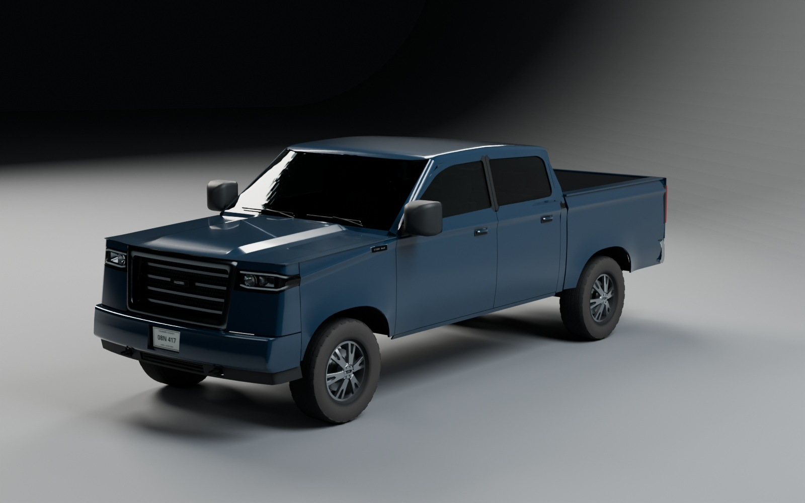
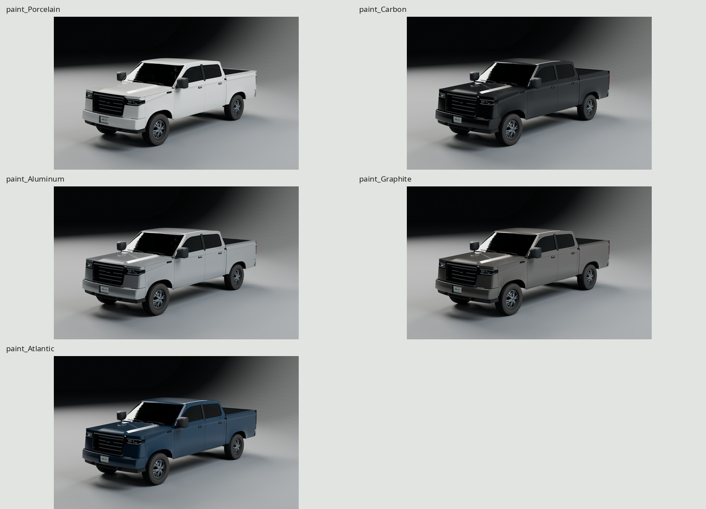
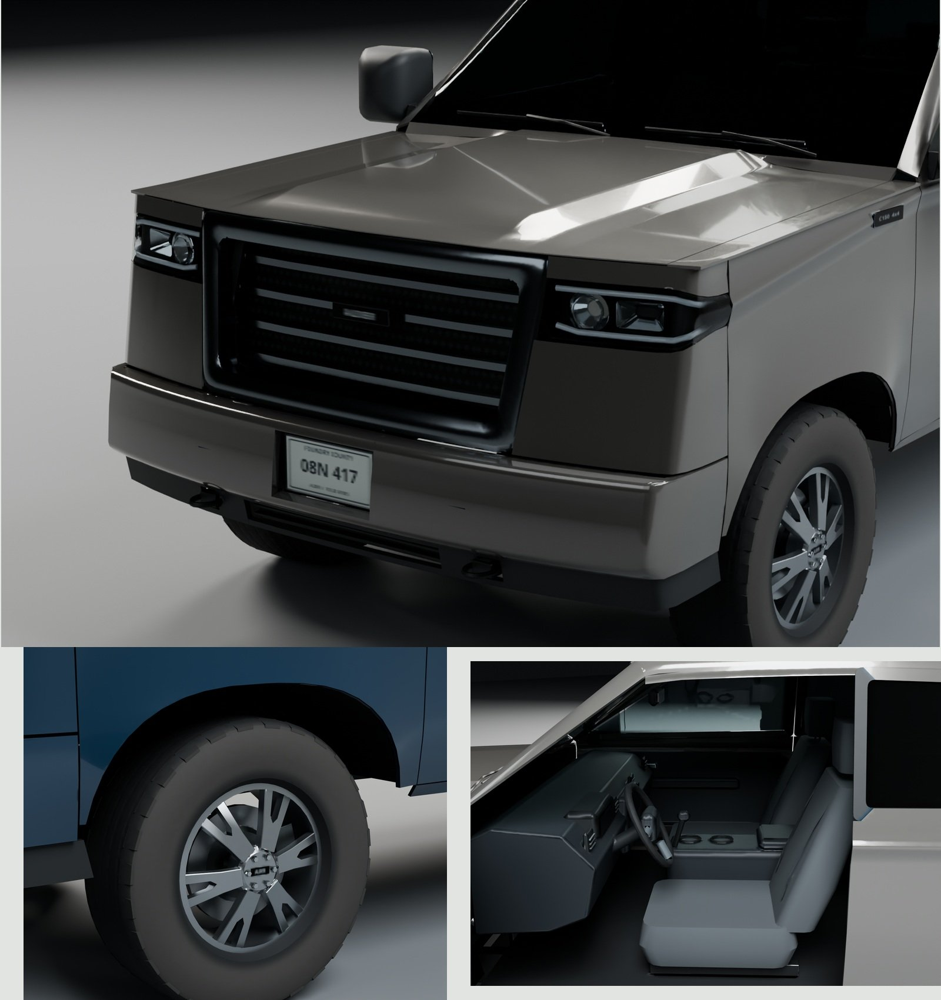

# Alder C150 / cars family

An original late-2010s crew-cab 4×4 pickup on 275/65R18 all-terrain tires.
Five factory paints share one baked atlas and four delivery surfaces. The
body, fictional lamps, grille, badges and markings are generated entirely
from scripts; reference pixels never enter the asset.



GLB (`export/AlderC150.glb`) · Contact sheet (`renders/final/contact.jpg`) ·
Turnaround (`renders/final/turnaround.jpg`) · Scale (`renders/final/scale.jpg`) ·
Eevee (`renders/final-eevee/hero.jpg`) · Lit lamps (`renders/final/lamps_lit.jpg`) ·
Used-truck pairs (`renders/final-pairs/used-pairs-contact.jpg`) ·
[Critique log](REVIEW.md)

Every final view starts with a fresh import of the exported GLB and its three
embedded baked maps. The factory paint/lamp uniforms are decoded by
[src/delivery_materials.py](src/delivery_materials.py); the high source and its
procedural manufacturing shaders are never loaded for finals. View metadata,
GLB hashes, paint/geometry masks and measured tonal ranges accompany the renders.

## Dimensions and construction

[REFERENCE.md](REFERENCE.md) distinguishes published dimensions from original
construction estimates. [refs/SOURCES.md](refs/SOURCES.md) records the authors,
URLs and reference licenses. The envelope follows Ford's MY2018 short-bed
SuperCrew specification, cross-checked against GM and Ford body-builder data;
the design is fictional.

| Measurement | Actual game surfaces / pivot centers |
| --- | ---: |
| Length | 5889.26 mm; 5890.26 mm published target |
| Body width / full mirror width | 2029.57 / 2458.72 mm |
| Height | 1960.88 mm |
| Wheelbase / front and rear track | 3683.00 / 1716.00 mm |
| Clear bed floor length | 1704.34 mm |
| Door seams / cab-to-bed gap | 4.500 / 16.000 mm |
| Lower door-to-sill reveal | 4.924 mm |
| Tire width / top / ground | 275.00 / 802.70 / 0.00 mm |
| Arch crown / tire-top clearance | 893.00 / 90.30 mm |
| Lowest underbody surface | 226.00 mm, differential |
| Face sweep at x = 950 mm / rearward rake | about 121 mm / 8.00° |
| Headlamp front projection | 387 × 154 mm, tapering to 58 mm |
| Lamp corner return / developed centerline | 178 / 553 mm |

Analytic side sections share position and normal derivatives across the 4.5 mm
reveals. Stamped outer panels have 0.9 mm gauge, inward returns and arch lips;
the separate bed has inner wheelhouses, tie-downs and a lined cargo floor.
The broad grille occupies about 61% of the face width. Its 70 mm lands have a
rounded face and a real return; dark blades and original diamond relief sit
82–84 mm behind it. The surround is **satin dark chrome**, with a dim sky
reflection along the top. Mirror caps are textured black. The separate 250 mm
painted bumper has a crisp upper highlight and lower return, a plate pocket,
and a black valance with recovery hooks and intake below.

Curved lamp covers enclose a projector, broad reflector and original 16 mm
running guide. Vertical rear optics, reverse windows and a third brake lamp
have separate lit controls. Six Y spokes, deep barrels, six lugs, rotor hats,
friction rings and actual U-section calipers sit inside the wheels. Five seats,
a formed dash, gauges/display, console, door cards and headliner fill the cab.
Boxed rails, suspension, drivetrain, tank, exhaust and a supported spare fill
low views. Driver controls are at +X, behind `Door_FR`; side suffixes follow
the authored coordinate labels.

The moving meshes needed several functional corrections: a real caliper slot,
inner wheelhouse steering clearance, rear hood/cowl clearance, tailgate corner
and rail clearance, true mirror fold bearings and upward wiper sweeps. These
retain the accepted body fields, factory colors and causal wear. Static support,
gauge, brake and optical-seat measurements are in `build/detail-check.json`.

## Delivery budget

The delivery mesh is **59,838 triangles**, below the 60,000 limit. Detailed
counts are rebuilt in `build/form-check.json` and `build/export-report.json`.
Static manufacturing pieces consolidate by their moving parent; doors,
mirrors, glass, wheels and their fittings stay attached to the proper pivots.

| Source construction group | Triangles |
| --- | ---: |
| Body panels, bumpers and liners | 25,466 |
| Four wheels, tires and brakes | 15,112 |
| Lamps, grille, mirrors, trim and bed hardware | 8,412 |
| Interior | 4,856 |
| Glazing, including protective headlamp covers | 1,444 |
| Underbody, including spare | 4,548 |
| **Total** | **59,838** |

The 195,738-triangle high source is used only for baking. The shipped rigid
mesh allocation is:

| Exported part | Triangles |
| --- | ---: |
| Static body/interior/underbody assembly | 34,608 |
| Hood / tailgate | 792 / 1,098 |
| Each front / rear door | 1,792 / 1,584 |
| Each mirror | 516 |
| Each spinning wheel/tire/rotor assembly | 3,678 |
| Each front steering knuckle/caliper assembly | 176 |
| Fuel door / each wiper | 108 / 192 |

| Delivery resource | Budget / actual |
| --- | --- |
| Materials | 4: Paint, Opaque, Glass, Lamps |
| Textures | One shared 2048² sRGB BaseColor RGBA, linear OpenGL +Y Normal RGB, linear ORM RGB |
| Bake | 4096², GPU Cycles, 24 samples; linear-light downsample to 2048² |
| GLB | 11,530,724 bytes, embedded PNGs and moving hierarchy |
| Raw mesh buffers | 5,389,908 bytes; 30 mesh primitives |
| Texture GPU estimate | **16 MiB** with three 8-bpp compressed maps and full mip chains |
| Texture GPU estimate, RGBA8 | 64 MiB with full mip chains |

The GPU figures describe texture allocation after engine upload, not PNG file
size or measured renderer residency. The five paints add only uniform values. Raw mesh buffers add about 5.14 MiB
before engine packing/overhead, for roughly 21.14 MiB with the compressed maps.
The normal bake carries tread, sipes, lettering, grille relief and manufacturing
microstructure; no extra geometry is added for these details. UVs have zero
overlap or outside/degenerate triangles; density is weighted toward exposed
body panels, optics, wheels and markings, with structural undersides lower.

## Paint, wear and factory colors



The fifth color costs no additional texture set. This delivery uses a **factory
factor over neutral coverage**, rather than `KHR_materials_variants` or five
material copies. The shared RGB is a correct Atlantic fallback. Paint-island
alpha stores remaining neutral paint coverage, so changing a factory tint in
linear light is:

```glsl
paint_rgb = max(vec3(0), base.rgb + base.a * (factory_tint - atlantic_tint));
```

This is equivalent to `factory_tint * coverage + contamination`: brown road
film and gray chips keep their colors. The five linear tints and metallic
factors live in the Paint material's GLB extras. [src/paint.glsl](src/paint.glsl)
contains the engine decode, including coverage-dependent clear coat and lamp
power. [src/delivery_materials.py](src/delivery_materials.py) implements the
same delivery operation in Blender for validation and finals.

| Preset | Linear tint | Factory metallic factor |
| --- | --- | ---: |
| Porcelain | .780 / .790 / .760 | 0 |
| Carbon | .009 / .011 / .013 | 0 |
| Aluminum | .460 / .480 / .490 | .55 |
| Graphite | .160 / .153 / .141 | .42 |
| Atlantic | .012 / .037 / .071 | .12 |

The four surfaces share the same three images. Paint has clear coat; Glass
has transmission/IOR; Lamps has an emission sampler and scalar control.
Lamp-island alpha stores each emitter's power divided by 80, independently of
paint coverage. The helper selects unlit or calibrated lit states from those
embedded values. A stock glTF viewer shows Atlantic with uniform coat and the
emission fallback; the supplied decoder enables the five paints, localized
coat contamination and individual lamp powers. No source shader is reconstructed. The Eevee preview uses an explicit thin-sheet
Fresnel/colored-transparency fallback for the stacked cover and projector panes,
reading the same embedded tint, roughness and normal maps. Cycles follows their
nested refraction; the screen-space preview approximates it. The adapter is
included in the delivery helper, and this difference is recorded in view metadata.

Default wear `.65` represents a four- or five-year daily driver: dilute road
film fans behind wheels and stays low, brake dust sits toward wheel interiors,
stone chips occur at the leading edge, cargo scrapes follow the bed floor,
dust collects in bed corners and on the tailgate rail, and water-spot rims
vary chrome roughness. These are separate physically located masks. Baked
coverage reduces the paint coat where contamination sits. Fine flake response
is filtered into the undercoat roughness/normal at the shared atlas density.

## Articulation and clearance

Meters, Blender +Z up, front −Y; glTF +Y up, front +Z. Origin is the bumper
footprint center on the ground. Ranges below are local-axis rotations from the
closed/rest transform, expressed in Blender authoring axes. In the GLB,
local X stays X and local Z becomes Y. Door and wheel assemblies are rigid children of named
pivots; front calipers steer but never spin.

| Pivot nodes | Local axis | Full range | Clearance sample spacing |
| --- | --- | --- | --- |
| `Door_FL`, `Door_RL` | Z | 0…72° | 2° |
| `Door_FR`, `Door_RR` | Z | −72…0° | 2° |
| `Hood` | X | −62…0° | 2° |
| `Tailgate` | X | −90…0° | 2° |
| `Wheel_FL/FR/RL/RR` | X | full revolution, 0…360° checked | 15° |
| `Steer_FL/FR` | tilted Z | −35…35° | 1° |
| `Mirror_L` / `Mirror_R` | Z | −50…0° / 0…50° | 2° |
| `Fuel_Door` | Z | 0…95° | 2° nominal |
| `Wiper_0/1` | tilted Z | −80…0° | 2° |

Front door hinge lines pass through `(±.944, −1.40275, 1.040)` m; rear door
hinges through `(±.944, −.05275, 1.040)` m. Hood hinge is
`(0, −1.4495, 1.408)` m; tailgate hinge is `(0, 2.824, .905)` m.
Each front wheel is nested under its kingpin pivot: actual exported axes
measure 12.00° inward inclination, 6.50° caster, 40.00 mm scrub and 45.00 mm trail.
Wipers sweep about their own axes normal to the windshield, rather than world Z.

`make check` runs **17 full-range BVH clearance sweeps on both game and high
assemblies**, with a 0.5 mm tolerance. Only named bearing, CV/ball-joint and
mirror-hinge interfaces permit intentional contact. Tires/liners and
rotors/calipers have no collision exemption. These tests establish mechanical
clearance at the stated angular samples; they are not continuous-time physics.

`build/car-delivery-check.json` independently checks the GLB's parenting,
kingpin geometry, preserved panel normals, actual atlas contents and every
sampled rigid articulation against the source transforms. The kit's delivery
check also compares re-imported vertices/pivot matrices and validates UVs,
normal vectors, materials, texture sizes and bounds. Serialization agreement
and mechanical clearance are reported separately.

The circular tire is a **mean loaded-envelope approximation**: 401.35 mm rolling
radius, without a rotating parked flat spot. A separate fixture checks ground
support through a full revolution. It does not simulate tire carcass squirm,
suspension travel or road contact physics.

## Rebuild and evidence

```sh
make -C cars                    # references, source, UV/bake, GLB, all finals,
                                # photo pairs, three docs JPGs, and checks
make -C cars check              # source construction, both motion sweeps,
                                # re-import and independent car delivery checks
make -C cars final-render       # GLB Cycles views and Eevee
make -C cars final-colors final-pairs
make -C cars docs               # provenance/tone/contact sheets and docs
make -C cars face PASS=face-checkpoint WIDTH=1500 SAMPLES=64
                                # archived source face checkpoint
```

All Cycles work holds the kit's shared GPU lock. The asset builds from clean
scripts with the repository tools, Blender, NumPy, Pillow and installed Noto
Sans fonts resolved by `kit/fonts.py`. No downloaded code, models, materials,
textures or HDRIs are used. Generated blends, GLBs, maps and renders remain
ignored; only the three final bounded docs JPGs are committed.

The four final photo pairs use the original used-truck camera solver and
procedural daylight conditions. Ford supplemental RMS is 44.88 / 26.60 native
pixels; the five-year Ram RMS is 19.57 / 19.83 pixels. These measure class
camera registration, not design identity. Cropped framing, trim, tire and
wheelbase differences remain disclosed uncertainties.



The shipping critiques are at the top of [REVIEW.md](REVIEW.md). Reflections
remain simpler than the photographed street and parking lots; the low-detail
interior and tiny filtered markings are the weakest close-range areas.
The shared atlas averages microscopic flakes and limits sidewall-type detail.
The script source and shader behavior are available for engine integration.
