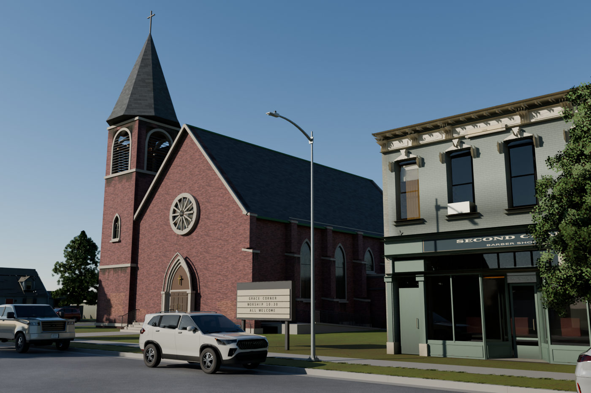
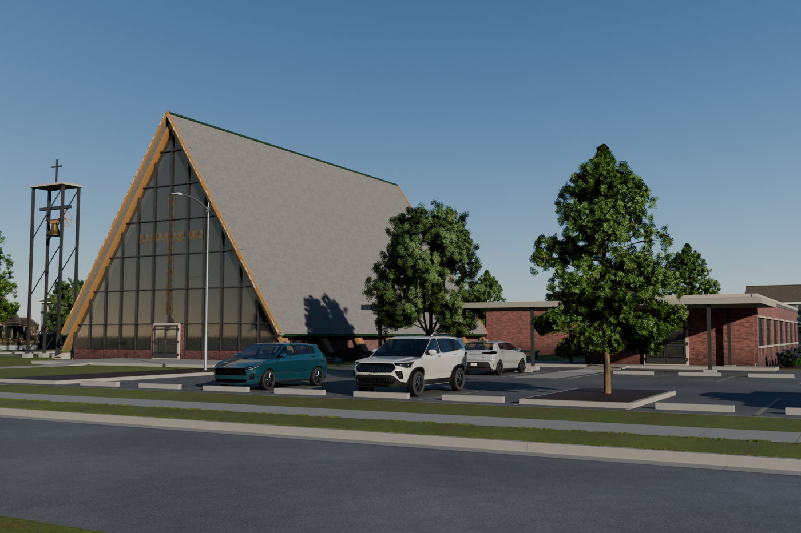
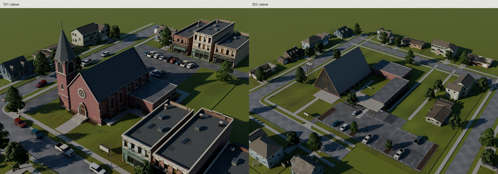
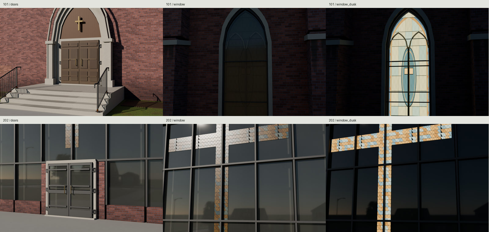
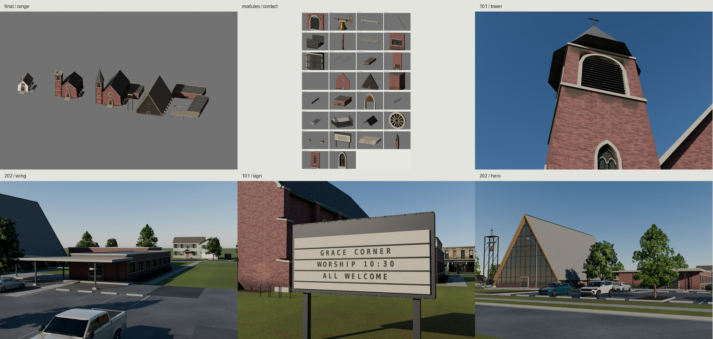

# Town churches







Two fictional American congregations in a 2010 town: a 1908 brick Gothic
church one block from Main Street, and a 1963 glulam A-frame church on a
residential arterial. Both are assembled from original scripted modules and
exported as glTF with shared external images. The gallery renders the exports
with their shipped maps. This is the family's final delivery, including the
partial fixes named in **Known flaws** below.

[All full-size finals](renders/final/contact.jpg) ·
[Matched-light photographs](renders/matches/contact.jpg) ·
[Last-round correction crops](renders/last-fixes/contact.jpg) ·
[Visual critiques](REVIEW.md)

Seed 101 has a six-bay nave, corner bell tower and spire, rose, deep paired
portal, later brick hall and a 1996 side ramp. Its rear lot is full for Sunday
morning, with ten more cars along its curbs. Seed 202 has seven bays and eight A bents,
low masonry walls, glazed ends, steel campanile, fellowship/education wings,
garden, covered drop-off and a lightly occupied weekday lot. Their plans,
circulation and neighbors differ. There is no playable interior.
The three annex-side lancets retain their arch heads above lower infill,
so the later hall roof clears actual glazing instead of cutting through it.

## Dimensions and evidence

The designs are originals, not reconstructions. [REFERENCE.md](REFERENCE.md)
distinguishes authored dimensions from evidence. [SOURCES.md](refs/SOURCES.md)
records every downloaded reference, author, rights and use.

- HABS IL-1223 sheets 3/5/9/11/14 establish measured plan/section discipline,
  wall gauge, recessed portals and window construction. The entry detail's
  graphic scale puts its door height at approximately 2.0–2.1m; our replacement
  leaves are 2.134m high with a wider paired opening. Neither the HABS church's
  complete plan nor its identity is copied.
- The Roanoke First Baptist National Register nomination describes an
  1898–1900 six-bay brick church with slate, tower and later hall. PHMC's
  Gothic and Romanesque guides distinguish lancets/buttresses from round
  arches and heavy masonry.
- The 1961 Chapel for the Children nomination documents 9ft brick sidewalls,
  glulam, glazed roof ends, flat wings and a garden. Connecticut's Shepherd
  of the Sea nomination supplies the principal A-frame/arrival-drive photo.
  DAHP supplies the postwar type guide. The abandoned 2024 photograph is
  used for form, not the maintained age target.
- The MDAH April 2009 color street photograph supplies brick/slate/trim and
  town-age comparison. NPS NCPTT's credited protective-glazing photograph
  supplies actual cloudy plastic over a brick church's lancet. The earlier
  monochrome HABS pairs remain form evidence only. No photograph is projected,
  traced or used in a texture.

| Dimension | Historic 101 | Mid-century 202 |
| --- | ---: | ---: |
| Nave outside width × length | 13.106 × 25.603m | 17.678 × 29.870m |
| Clear-width design target | 12.192m / 40ft | 17.069m / 56ft |
| Bay count / pitch | 6 / 4.2672m | 7 / 4.2672m |
| Masonry gauge | .4572m | .3048m |
| Sidewall / pitch | 8.2296m / 48° | 2.7432m / 57° |
| Nave ridge | 15.508m | 16.354m |
| Tower cross top | 28.95m | 15.10m |
| Entrance level | .6096m | .1524m |
| Stair rise / tread | .1524 / .3302m | one entrance level change |
| Fitted door leaf width × height | .984 × 2.1336m | .984 × 2.1336m |
| Side lancet width / stem / crown | 1.40 / 3.10 / 1.212m | panelized gable |
| Glulam section | — | .620 × .240m |
| Ramp rise / run | .6096 / 7.9248m | curb ramp .1474 / 2m |
| Stall width × depth | 2.7432 × 5.4864m | same |

The historic ramp's fresh imported surfaces measure .609600m rise, 1:13.0000
grade and 1.552000m between grasp-height rail vertices. Landings are authored
at 1.8288m length; this is not a measured compliance certificate. ADA 1991
guides the fictional 1996 retrofit. IBC assembly provisions motivate outward
doors, panic hardware and separated exits; no interior egress calculation is
claimed. A filled ramp base reaches below grade rather than spanning in air.

## Generator

`src/plan.py:church()` is the pure grammar; `src/build.py` constructs and
packages it in Blender. Seeded plans and placement offsets are written to
`build/plan-101.json` and `build/plan-202.json`.

| Parameter | Values |
| --- | --- |
| `seed` | integer, deterministic occupancy, placement and variation |
| `style` | `gothic`, `romanesque`, `aframe`, `chapel` |
| `bays` | 3–18 at 4.2672m pitch |
| `width` | 5–42m outside masonry |
| `pitch` | 25–65 degrees |
| `tower` | `corner`, `center`, `freestanding`, `none` |
| `top` | `spire`, `belfry`, `cross` |
| `wings` | comma-separated `hall`, `education`, `transepts`; empty for none |

The range export places a white frame chapel, a smaller Romanesque church,
the Gothic church and the A-frame beside one another. The white chapel uses
the native house siding. Wider/longer naves are supported by the grammar;
arbitrary parameter combinations have not received the two sites' complete
circulation review. Town parcel layouts are authored for seeds 101 and 202.
An additional standalone smoke build used 12 bays, 24.384m width, 50° roof,
center-front crenellated tower and hall/education wings: 99,814 triangles.
Its raw geometry/normals/resources pass; it has not received a site or
photo review. Its receipt is `build/grammar-smoke/check.json`.

For a custom standalone church, start in this directory and use a separate
directory under `build/`:

```sh
church_root="$(pwd)"
mkdir -p build/custom
cd build/custom
python3 "$church_root/src/textures.py"
blender -b -t 4 --factory-startup --python-exit-code 1 \
  --python "$church_root/src/build.py" -- --seeds 909 --style gothic \
  --bays 12 --width 24.384 --pitch 50 --tower center --top belfry \
  --wings hall,education --no-sites --no-modules --out build/variant.blend
```

## Packages and interaction

`export/Church-{101,202}.gltf` contains each building. The corresponding
`ChurchSite-*.gltf` adds roads, sidewalks, lots, signs, town hosts, cars and
plants. `export/modules/*.gltf` contains the reusable pieces; `Range.gltf`
shows the grammar. Their `.bin` files contain geometry only. Images use
relative shared URIs within the library; move the resource dependencies
with the packages. `build/glb/` contains embedded inspection copies.

Origins are centered on each complete building's horizontal footprint at
grade; the nave offset is recorded in node extras. Blender is meters, +Z up,
front −Y. glTF is +Y up, front +Z. Moving parts retain their local pivots:

- Door leaves: local Z, left −90..0°, right 0..90°, opening outward. Named
  `Door_Left`/`Door_Right` beneath each entrance frame.
- Bell/yoke/wheel: local X, ±30°, at the axle, independently of the tower.
- Each sign character: `socket_kind=sign_letter`, with row, column and glyph.
  `build/letters.json` gives atlas rectangles for A–Z, 0–9, `&-:.`.
- Stall empties: `socket_kind=parked_car`, center, width/depth, occupied and
  accessible flags. 101 has 17 stalls/15 occupied plus ten street cars; 202
  has 27 stalls/six occupied after landscape islands and circulation gaps.
  Household driveway cars are separately placed town context. Native car colors
  vary without new texture sets.
- Walk empties contain ordered `points`; the drop-off empty contains driving
  points, `interpolation=CATMULL_ROM` and 7m lane width. Extras point arrays
  remain in authored Blender axes; convert them when using a glTF engine.
  Axis labels in extras also use Blender axes: Z becomes glTF Y; X stays X.

To spell a new sign message, retain the case and horizontal tracks, remove
the existing character quads, then instance one quad per non-space character
using its rectangle from `letters.json`. Character centers are .137m apart;
rows are .25m apart. Each .13 × .225m quad sits at local Y = −.1615m, with
the existing transparent letter material. Center a line by subtracting half
its character count from its column positions; spaces advance without a quad.
Keep the original open-license atlas or regenerate it with `src/textures.py`.

`Church_stained` retains the authored emissive color map with strength zero
by day; the dusk preview sets strength 4.5. A game can drive that material's
emissive intensity. The protective storm sheet is separate and non-emissive.

Historic windows have pale cathedral fields, blue/amber borders and one original
memorial symbol panel. The modern gable is predominantly clear glass over a dim
unplayable nave, with one amber/smoke-blue faceted cross. Fresh-import areas measure
144.126m² clear glazing and 8.035m² faceted cross (5.28% of their combined face area).
The exported lower protective-glazing air slot is 20mm.

The downtown parcel has six distinct native Downtown storefronts, a rear alley,
nearby houses/parsonage, street trees and Sunday curb parking. The A-frame stands
in a subdivision of individually placed native houses, 23–25m lot widths, drives,
fences and yard trees; a local street and two adjacent eastern lots close the
previous field. Parking islands hold smaller trees and poles. Imported wheel
stops measure 2.1m from stall centers toward their heads; clear aisles measure
9.7136m downtown and 7.3136m at the A-frame.

Weathering follows splash, rising damp, sill/course and copper runoff, repairs,
rail feet, roof exposure and timber ends. July lawn reuses the community garden's
albedo recipe with Ground's original blade normal/ORM, clipped fine blades,
mulched foundation beds and corner traffic. Existing deliveries stay read-only.

## Geometry and resources

All counts are expanded instance triangles unless explicitly described as
unique. A site budget includes its church, paving, signs, street equipment
and reduced town buildings; cars and vegetation are reported separately.
`build/check.json` is the independent raw-glTF ledger; `build/metrics.json`
is the source/export ledger.

| Expanded triangles | Downtown 101 | Mid-century 202 |
| --- | ---: | ---: |
| Complete church | 65,246 | 27,217 |
| Paving, roads and site equipment | 110,344 | 117,700 |
| Context buildings, drives, fences and lawns | 53,216 | 99,261 |
| **Budgeted site, excluding cars/plants** | **228,806** | **244,178** |
| Native cars | 1,656,512 (27) | 668,464 (11) |
| Native vegetation and clipped sward | 355,820 | 767,737 |
| Entire expanded inspection scene | 2,241,138 | 1,680,379 |

Both static parcels meet 250k, the historic church meets 40–120k and its
tower meets 15k. Car/tree instances retain shared mesh data; their expanded
totals are not charged to the site ceiling. The A-frame's low triangle count
is intentional and is called out below.

| Resource receipt | Downtown 101 | Mid-century 202 |
| --- | ---: | ---: |
| Whole building envelope, including below-grade base | 28.323 × 33.132 × 29.110m | 51.759 × 47.444 × 16.559m |
| Building glTF + geometry BIN | 8,394,873 bytes | 3,598,084 bytes |
| Embedded building inspection GLB | 51,572,264 bytes | 49,608,384 bytes |
| Site glTF + geometry BIN | 45,518,240 bytes | 38,150,511 bytes |
| Referenced site image PNG bytes, once each | 137,424,201 | 136,989,557 |
| Budgeted static map union | 185.000MiB | 178.333MiB |
| Referenced site map allocation, including actors | 281.000MiB | 274.333MiB |
| Site material definitions | 131 | 94 |

| Category | 101 geometry bytes / map MiB | 202 geometry bytes / map MiB |
| --- | ---: | ---: |
| Church | 7,962,498 / 76.667 | 3,280,404 / 80.667 |
| Roads, paving, equipment | 5,128,080 / 96.667 | 5,659,644 / 96.667 |
| Town buildings, drives, fences, lawns | 6,722,454 / 136.333 | 4,113,282 / 93.667 |
| Cars | 14,780,730 / 48 | 14,780,730 / 48 |
| Vegetation, including fine sward | 7,538,608 / 64 | 7,370,650 / 64 |

Category geometry bytes deduplicate referenced accessor buffer views within
that category. Image unions overlap; do not add the rows. Cars reference
14,135,768 PNG bytes and plants 41,747,957 PNG bytes in either site. Native
car inputs remain exact cached deliveries; this family needs no tolerance
exception for regenerated native cars. Package bytes include JSON/BIN;
embedded GLBs additionally include the same referenced PNG payloads.

| Independently exported piece | Triangles | glTF + BIN bytes | Materials | Map MiB |
| --- | ---: | ---: | ---: | ---: |
| Belfry bay | 572 | 77,470 | 3 | 36 |
| Bell including shell, yoke, axle, wheel | 2,552 | 327,493 | 3 | 20 |
| Memorial bench | 60 | 9,605 | 1 | 4 |
| Laminated A bent with concrete shoes | 128 | 19,734 | 2 | 8 |
| Steel bent shoe/bolts | 456 | 62,031 | 2 | 20 |
| Stepped buttress | 148 | 25,432 | 3 | 24 |
| Drop-off canopy | 156 | 24,251 | 3 | 36 |
| Classroom bay | 230 | 39,926 | 6 | 40 |
| Operating door pair/frame/hinges | 1,560 | 205,250 | 5 | 24 |
| Drainage | 648 | 92,248 | 3 | 36 |
| Education wing assembly | 5,068 | 736,620 | 9 | 76 |
| Accessible exit bay assembly | 2,050 | 270,108 | 7 | 44 |
| Bike rack/cornerstone | 360 | 50,479 | 2 | 20 |
| Rose gable assembly | 4,448 | 566,604 | 1 | 16 |
| Glazed A gable assembly | 2,191 | 290,118 | 7 | 44 |
| Connecting hyphen | 124 | 19,222 | 2 | 32 |
| Low sidewall | 1,132 | 144,711 | 1 | 16 |
| Parish hall assembly | 4,056 | 573,118 | 9 | 76 |
| Recessed portal | 1,268 | 166,483 | 4 | 24 |
| Rail run | 1,136 | 147,320 | 2 | 20 |
| Filled ramp and two rail runs | 2,344 | 297,024 | 3 | 36 |
| Rear exit landing, treads and rails | 820 | 109,551 | 3 | 36 |
| Roof assembly example | 540 | 81,952 | 3 | 8 |
| Rose | 1,342 | 169,756 | 2 | 8 |
| Rear services | 856 | 110,429 | 5 | 36 |
| Changeable sign with glyphs | 162 | 63,849 | 3 | 20.667 |
| Entry landing/steps | 308 | 46,891 | 1 | 4 |
| Historic tower including bell/top | 13,104 | 1,669,160 | 8 | 44 |
| Pierced wall bay including window | 1,896 | 251,991 | 7 | 44 |
| Bare tower lancet | 813 | 109,215 | 3 | 24 |

Assembly rows include their children; do not add the rows together. Individual
wall/window/buttress/roof/rail pieces meet the modular ceiling. Whole wings,
gables and the ramp contain several pieces. The bell fits the small-prop
3k ceiling. Simple silhouettes are deliberately below indicative lower
triangle targets. The A-frame church is below the requested 40k lower band:
its repeated structural sections and mapped lead do not warrant padding.
`build/resources.md` / `build/resources.json` give every piece's actual image
allocation and geometry bytes, plus separate church/site/town/car/vegetation
resources. Cars cost 48MiB across all three models; placed vegetation uses
64MiB including the 16MiB lawn already resident in the static site. Actor memory
overlaps and must not be added to the static or whole-site union.

| Shared set | Shipped allocation | Estimated compressed GPU memory |
| --- | --- | ---: |
| DowntownMasonry | 2048² BC/Normal/ORM | 16MiB |
| DowntownFinish | 2048² BC/Normal/ORM | 16MiB |
| DowntownMineralRoof (mineral trim chart) | 1024² BC/Normal/ORM | 4MiB |
| RanchRoof | 1024² BC/Normal/ORM | 4MiB |
| HouseSiding (chapel range) | existing 1024² triple | 4MiB |
| Ground Concrete / Asphalt | existing 2048² triples | 16MiB each |
| Garden summer lawn | private 2048² albedo; unchanged Ground normal/ORM | 16MiB |
| GroundTrim | existing 2048² triple | 16MiB |
| **New ChurchCraft** | **1024² BC/Normal/ORM** | **4MiB** |
| **New ChurchGlass** | **1024² BC/Normal/ORM** | **4MiB** |
| **New ChurchLetters** | **1024×512 RGBA** | **.667MiB** |

The new allocation is **8.667MiB shared across the family**: a timber/slate/
bell-bronze strip set because those materials were absent from the reused
architectural atlases; art glass because the library lacked it; a replaceable
letter atlas because a game must spell new messages. Their texels are analytic
Python/NumPy/Pillow output. Existing sets retain their original baked images.
BC is sRGB, normals are OpenGL +Y, ORM is occlusion/roughness/metallic.
Memory estimates assume 8bpp block compression with full mip chains; PNG disk
size is not GPU allocation. Maps are deduplicated by content across packages.

The standalone buildings reference 76.667/80.667MiB of existing plus new maps.
Localized runoff and moss reuse the unused quarter of the ChurchGlass atlas;
this adds no images. The new Church allocation stays 8.667MiB. Buildings
share most of their maps with the town. Body materials number 14/13, including solid
glass and shadow proxies. Fine grain/lead lives in maps, with causal vertex
tint at wall bases, repaired patches and runoff. UV charts intentionally
tile/reuse; this is not a unique lightmap unwrap or a no-overlap claim.
The module hierarchy and interactive pivots are retained. These packages
need engine static batching and instance culling; mesh-definition counts
are not expanded draw-call counts or a frame-rate claim.

## Rebuild and checks

From this directory, with Blender 5.2, Python/NumPy/Pillow and Poppler already
installed:

```sh
make                 # references, model, checks, export renders, comparisons
make check           # raw geometry/resources/repository + fresh Blender import
make repeat          # complete sites, buildings, pieces, maps and manifests
make check-texture-repeat # independent exact analytic map regeneration
make docs            # validate current export receipts and encode five JPGs
```

`make SAMPLES=64` captures the complete final set at 1400px, with one GPU
lock for the serial render batch. It composes the photo pairs, resource
ledger and contact sheets, then audits geometry/map/renderer receipts. Local
before/after images preserve the original revision's cameras at 1400px per
panel; final-round crops use the preserved c655bb4 handoff and audit equal
cameras. A cold build audits current exports without inventing old captures.
Interrupted captures resume only when package, renderer, camera, engine,
resolution and recorded sample count agree; all other frames are regenerated.

Build native library dependencies first if absent: Ground, trees, shrubs,
six house variants, fences, three cars, street lights and street signs. The
dependency script reports missing files. Six distinct Downtown hosts are built
privately under this family's `build/`, never in an existing delivery.
No kit change is required. A cold reconstruction removed this family's own
`build/`, `export/`, `textures/` and `renders/` before rebuilding; reference
downloads and the independent pre-build library hash receipt were preserved.

`make check` verifies static/tower/church ceilings, finite geometry, unit
normals, nonzero church triangle areas, UV presence/density, external image
paths, fresh-import triangle/bounds agreement and centered origins. It measures
ramp grade/rail clearance, cross seating, canopy post seating/clearance, curb
ramp grade, annex-to-glass clearance and the parcel-side depressed driveway
curb. It checks geometric outward winding on imported gable/roof faces;
unit normals alone did not catch the earlier Eevee culling failure.
Door/bell sweeps use
15° samples, 1mm tolerance and no contact exceptions. Walk centerlines are
tested at +1.1/+1.7m against church construction. These prove sampled surfaces
and serialization, not structural/code certification or complete navigation
volumes. The current independent receipt also confirms 1,080 pre-existing
delivery/map files remain byte-identical.
The repeat contract now includes both full sites, the range and every piece,
their glTF/BIN/metadata, plans, calibration and analytic maps. Only relative
image URIs are relocated to the original package's directory; JSON object
keys are canonicalized. The compared content must otherwise agree byte for
byte. Native cars and plants are immutable cached inputs, fingerprinted
along with every other existing delivery; they are not regenerated by this
family. Blender containers and Cycles sampling are excluded. The independent
texture repeat regenerates all ten local PNGs exactly; this analytic family
has no separate GPU bake. `build/repeat.json`, `texture-repeat.json`,
`presentation-check.json` and `delivery.json` hold the measured results.
Whole-frame display percentiles include sky and are not physical albedos.

## Full-size final images

These are rebuildable local outputs, deliberately ignored by git. The five
bounded gallery JPGs above are the only committed images.

- [All site views/contact](renders/final/contact.jpg): both eye-height
  across-street heroes, oblique parcels, doors/steps, day/dusk glass, towers
  from below, education wings/lots, street signs and 1.8m human/car scale.
- [Historic hero](renders/final/101/hero.png) and
  [mid-century hero](renders/final/202/hero.png): Cycles imports the embedded
  export mirrors under `build/glb/`, carrying the exact geometry and PNG
  payloads externalized into the delivered glTF. Receipts fingerprint both
  packages and the actual imported GLB. Lenses are 35/38mm, camera height
  1.72m, clear procedural sky, low sun
  raking the fronts. The A-frame's sun comes from the opposite side to the
  downtown hero, under a deeper sky. No HDRI. The rear-wing inspection uses light from its
  viewed side and records that direction in its receipt.
- [Modules/contact](renders/modules/contact.jpg),
  [four-church range](renders/final/range.png), and
  [both Eevee heroes](renders/eevee/contact.jpg).
- Native-size same-camera last-round crops: [masonry 101](renders/last-fixes/01-masonry-101.jpg),
  [masonry 202](renders/last-fixes/01-masonry-202.jpg),
  [slate](renders/last-fixes/02-roof-101.jpg),
  [shingles](renders/last-fixes/02-roof-202.jpg),
  [A-frame light](renders/last-fixes/03-aframe-light.jpg),
  [lawns 101](renders/last-fixes/04-lawn-101.jpg) /
  [202](renders/last-fixes/04-lawn-202.jpg), and
  [entry 101](renders/last-fixes/05-entry-101.jpg) /
  [202](renders/last-fixes/05-entry-202.jpg).
  Every crop is at least 1000px wide per panel; both complete heroes retain
  1400px per panel. `renders/last-fixes/receipts.json` proves equal optics.
- [Photo pairs/contact](renders/matches/contact.jpg): color MDAH street,
  Connecticut A-frame and NCPTT storm-glazing photographs.
  [Source comparisons](renders/source-matches/contact.jpg)
  use the saved construction scene with the same maps; the principal pairs
  use the actual exported packages. The third pair explicitly isolates the
  exported WallBay to avoid a neighboring buttress hiding the window.

Photo-fit RMS is 17.72px/1000px for the historic street, 24.32px/878px for the
A-frame, and 4.44px/240px for the NCPTT lancet. All lens bounds are
active; these are framing comparisons between different original buildings,
not replicas. Independent Blender projection agrees with the calibrator
within .05 source pixel. The modern reference is balanced on its unmarked
gray arrival drive, the street reference on concrete steps, and the glazing
reference on a white-painted exterior storm bar. The NCPTT crop isolates the
left light of a larger paired opening; its shared tracery is visibly different. Full
critiques, corrections and remaining differences are in [REVIEW.md](REVIEW.md).

The churches carry local repairs, damp/salt at grade, oxidized copper,
course runoff, rail-foot deposits, north-pitch/step growth and exposed timber
wear. The roofs and entries have dedicated inspection views. The final
critiques distinguish passing construction checks from visual realism.

## Credits

All new geometry and texels are original deterministic scripts. Shared
library geometry/maps remain the owner's original work. Reference rights
and source links are in [SOURCES.md](refs/SOURCES.md). Sign/date glyphs use
the installed open-license DejaVu Sans Bold through `kit/fonts.py`.
Names, dates, inscriptions and signs are fictional; only plain crosses are
used. Lighting is procedural. No existing model, scan, texture, HDRI or asset
pack was downloaded or adapted.

## Known flaws

- **Wall age is partial.** Lower walls, separate wall values and sheltered
  washes read better, but large upper brick areas and long buff moldings
  retain a procedural regularity. Some runoff follows a recognizable atlas
  kernel; it is pigment on flat sheets rather than eroded masonry.
- **Roof age is partial.** Shingle chart addressing now preserves its courses,
  slate values vary and repairs are lighter. Eave colonies and algae follow
  damp slopes. Algae still retains straight column boundaries in the north
  roof close-up. Growth reads flat and patterned; this is not
  convincing thick moss or individual lichen. Ridge/eave granule loss and
  flat-roof ponding remain weak. Replacement packets lose contrast in the
  exported modern comparison relative to the source.
- **A-frame light is changed, with limits.** The opposite-side low sun and
  deeper sky distinguish it from the downtown hero. The dim nave and flat
  backing still simplify the glass response, and specular grain remains.
- **Lawns remain planar.** Darker yellow-green patches, walk-edge wear and
  shaded areas improve the distance values. Coarse vertex interpolation,
  repeated fine blades and limited tree-specific shade remain visible;
  mulch beds are dark geometric strips.
- **Entry age is partial.** Treads have shallow center hollows and darker
  traffic zones, chipped nosings, door touch/kick wear and rust at anchor
  shoes. Center wear exposes faceted rectangular bands, and oxidation at
  the feet resembles a collar. The stone is still too precisely manufactured, and patch repairs
  and irregular door-finish loss are weaker than decades of real use.
- Beam ends are grayer, but checked end grain is not achieved. Surviving
  fascia paint still resembles thick rectangular tabs.
  Cross rust and fine bird/ledge deposits under-read. Memorial glass is
  deliberately simple; it does not approach historical pictorial craft.
  The sign case's inherited edge pattern repeats visibly in its close-up.
  Native reduced neighboring roofs are coarse from above; the district
  beyond the authored blocks is sparse. Eevee reflections differ from Cycles.

The static module hierarchy still needs engine batching, culling and LOD.
There are no collision hulls or playable interiors. Sampled motion and route
checks do not establish continuous collision freedom or code certification.
No kit or top-level index files were changed.
