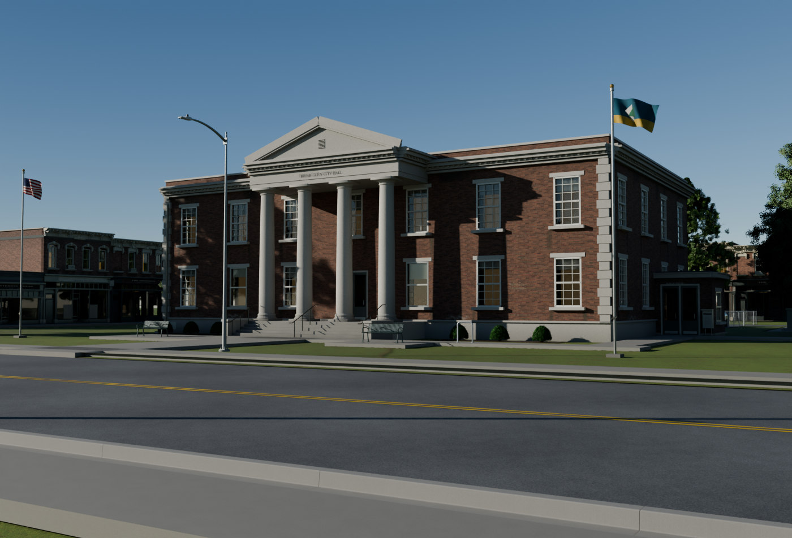
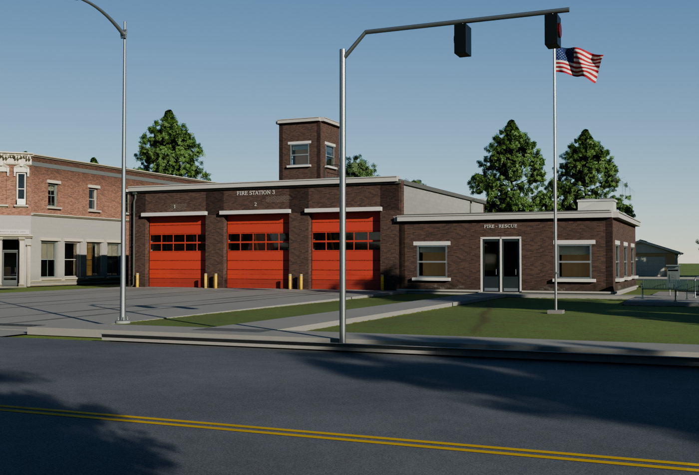
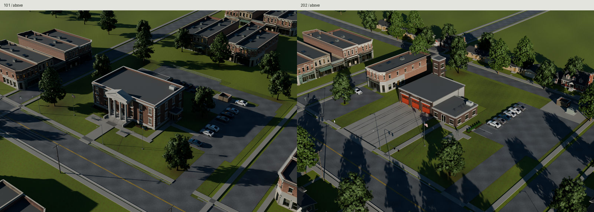
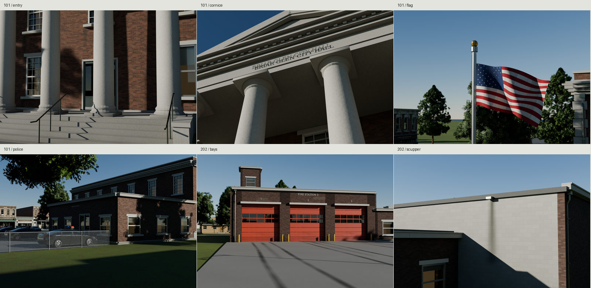
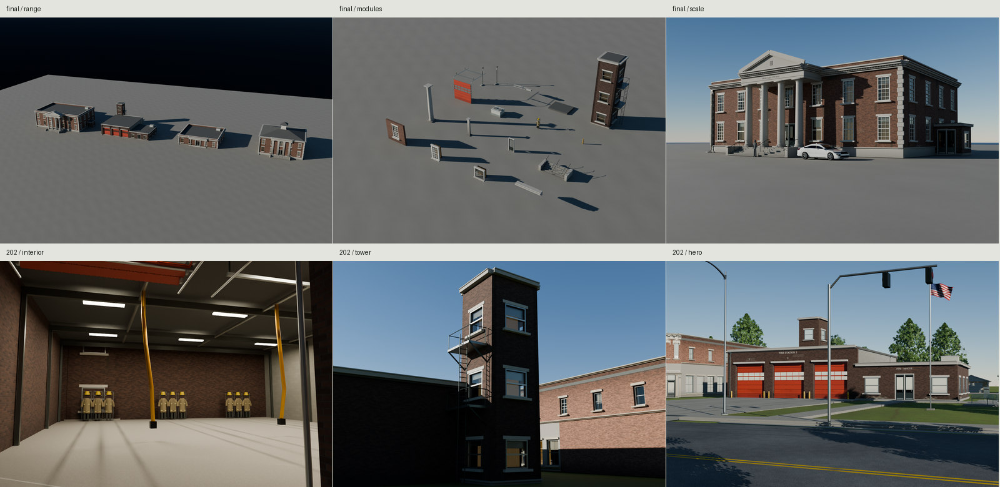

# Town civic buildings







An original civic kit for a maintained American town in 2010: a 1928 brick and limestone city hall with a 1976 police wing and 1994 accessible vestibule, and a 1974 three-bay fire station with a later exhaust retrofit. Seven building examples and two different parcels use the library's existing baked surfaces. Every vertex and texel comes from this repository's scripts.

This is the family's final delivery, including the partial corrections in
**Known flaws** below. The gallery uses fresh imports of the exported glTF
with its shipped baked maps, mirrored byte for byte into inspection GLBs.

[All full-size finals](renders/final/contact.jpg) ·
[Matched-light photographs](renders/matches/contact.jpg) ·
[Last-round fixed-camera changes](renders/last-fixes/contact.jpg) ·
[Visual critiques](REVIEW.md)

The change pairs retain 1400 native pixels per panel and the cameras from
`b9c5290`; the final heroes have their own revised compositions.
[REFERENCE.md](REFERENCE.md) distinguishes published comparators from original
dimensions; [SOURCES](refs/SOURCES.md) records exact sources and rights.

| Place | Plan and reason |
| --- | --- |
| 101 / Briar Glen City Hall | Raised 1928 brick/limestone civic block near Main Street; a smaller 1976 police wing, fenced fleet lot and 1994 at-grade entry record later municipal needs. Flags, walks and planting retain a public front lawn. |
| 202 / Briar Glen Station 3 | A low 1974 three-bay station on a working arterial; the long graded apron reaches the street, with staff parking to the side, crew quarters and a rear hose/training tower. An occupied corner office and houses frame its parcel. |

## Program grammar

`src/plans.py::building(seed, program, style, bays, bay_width, stories, order, roof, wings)` is independent of Blender. `buildings.hall()` and `station.station()` assemble its result from common construction functions. The CLI writes custom results inside `build/custom/`, leaving the proof packages alone:

```sh
make dependencies
blender -b --factory-startup --python-exit-code 1 --python src/build.py -- \
  --program library --seed 919 --style colonial --bays 9 --bay-width 4.18 \
  --stories 2 --order pilasters --roof hip --no-wings --directory build/custom-919
```

Historic programs are `hall`, `post_office` and `library`: Classical or Colonial, 3–11 odd frontage bays, at least 3m pitch, 1–3 stories, columns/pilasters/plain, parapet/hip/cupola, and an optional later annex. The central entry occupies its own bay. Station programs have 2–4 apparatus bays at least 4.8m apart, one or two crew-wing stories, a plain modern entry, parapet or hip roof, and an optional crew/office wing. Unsupported combinations fail explicitly. The seed controls selected sash replacements and site occupancy; the two proof sites have different program-specific layouts rather than one reskinned parcel.

| Seed | Program / variation |
| --- | --- |
| 101 | Seven-bay, two-story hall, columns, parapet and later wing |
| 202 | Three-bay station, one-story crew wing and tower |
| 303 | Five-bay post office, pilasters, one story, no wing |
| 404 | Five-bay, two-story library, pilasters and cupola |
| 505 | Two apparatus bays and two-story crew wing |
| 606 | Five-bay, one-story plain hall with hip roof |
| 707 | Eleven-bay, two-story columned hall without a wing |

A content build selects the program, seed and dimensions, calls the independent
`building()` planner, and runs the Blender CLI above to generate its glTF.
Load the resulting building root at grade, retain its named moving nodes and
sockets, and cache external image URIs by resolved content rather than by
building instance. Blender is an offline generator; no Blender runtime is
required in the game. Use `site(seed)` and `build_site()` when placing one of the
two authored parcel grammars; arbitrary road networks and parcel boundaries
remain the game's responsibility. Programs share modules and images while
their footprints, entry and roof assemblies change with the parameters.

## Dimensions and construction

| Feature | Authored size / source comparison |
| --- | --- |
| Main hall | 29.2608 × 17.6784m / 96 × 58ft; two 3.9624m story pitches over a .9144m plinth |
| Hall entry | Four Tuscan columns, 7.3748m order height, .878m nominal diameter; square plinths, torus/scotia, entasis, neck/astragal, echinus and abacus; full architrave/frieze/dentilled cornice and pediment |
| Stair | Six 152.4mm risers, 330.2mm goings, 8.6m width, jointed stone treads, bearing cheeks and 42mm handrail tube |
| Historic sash | 1.3716 × 2.4384m / 4ft6in × 8ft; six-over-six glazing with masonry returns, separate frames, lintels and projecting sills |
| Police wing | 14.6304 × 12.192m / 48 × 40ft; different brick, aluminum windows and yard-facing operating entry |
| Apparatus hall | Three 5.4864m / 18ft centers; 18.288m / 60ft depth; measured clear openings 4.2672 × 4.2672m / 14 × 14ft |
| Tower | 3.6576m / 12ft masonry square, 12.8m to wall head; projecting training landings, braces, ladder and railings |
| Apron | About 26.86m from bay face to lowered sidewalk, graded to the arterial, with a transverse trench drain; wheel lanes and standing-engine drips belong to each bay |
| Later accessible links | 1.8m clear ramp skins, 7.4% and 6.73% running grades; street/lot paths reach real thresholds. These are selected geometric checks, not a whole-site code certificate |

HABS MA-995, LA-1127 and NJ-357 supply elevation, plan and molding studies. The National Register brick/limestone nomination documents civic masonry, raised bases, cornices and later additions. Fire Engineering's 1989 guide describes roughly 15ft-wide / 40ft-deep single bays and larger apparatus doors; the new design deliberately uses more width/depth. Tubac supplies a later 14×14ft cross-check. USFA and the NFPA source-capture report inform the exhaust retrofit and separation of the shallow bay from living quarters. The 2018 USFA guide recommends a taller 16ft opening; this asset represents an older 14ft station. All town names, dates, inscriptions and agency graphics are fictional.

The hall assembly including additions/portico spans 33.271 × 35.600 × 11.845m; the station including tower/landings spans 28.839 × 22.882 × 13.078m. Their parcels are 80 × 68m and 69 × 66m. A separate native corner office occupies the station's western neighbor. These are original design envelopes, not measurements attributed to a real building.

Windows have actual openings, glazing, blinds and dim room layers. `CivicRoomGlow` and `CivicBayDiffusers` carry `switch_kind=interior_lights`; a game can change their emission. Only the apparatus volume has a modeled inspection interior: floor, beams, racks, hanging coats/helmets/boots, 150mm exhaust hoses, ducts, lights and door tracks. There is no apparatus model or playable civic interior.

## Modules

`export/CivicPieces.gltf` is an inspection library with independent roots arranged in a grid. Replace a selected root's transform when placing it. Structural modules use construction datums: wall/window front line and sill, column foot, cornice bearing, door threshold, roof underside. Fine brick and manufactured detail remains in the shared normal maps.

| Module | Triangles | Exported accessor bytes | Resident image MiB |
| --- | ---: | ---: | ---: |
| Wall bay with sash | 776 | 98,328 | 36 |
| Tall sash | 644 | 82,080 | 20 |
| Aluminum sash | 572 | 73,992 | 20 |
| Cornice run | 836 | 110,296 | 4 |
| Tuscan column | 1,092 | 111,328 | 4 |
| Pilaster | 132 | 17,144 | 4 |
| Operating entry/frame | 528 | 68,368 | 20 |
| Stone stair/rails | 1,736 | 215,824 | 20 |
| Complete overhead door/track | 1,976 | 220,152 | 16 |
| HVAC | 484 | 54,872 | 16 |
| Turnout rack/gear | 736 | 90,992 | 16 |
| Bollard | 280 | 31,248 | 16 |
| Scupper/downspouts | 504 | 72,352 | 20 |
| Plain fascia | 88 | 11,280 | 4 |
| Roof panel | 24 | 2,832 | 4 |
| Hose/training tower | 10,708 | 1,416,808 | 36 |

Small planar/simple parts remain below the nominal modular range; no triangles are added to meet a minimum. The tower uses its separate 12k allowance. Accessor bytes count each actual exported module subtree's unique buffer views, excluding shared JSON and images. `build/module-costs.json` retains those measurements. Per-construction-object triangle/material/image costs are in `build/piece-costs.json`, `build/family.json` and `build/modules.json`. `build/resource-report.md` separates package, car, vegetation and neighboring-town costs. Image dependencies are shared resident resources, never allocations to sum across modules.

## Proof packages and resources

| Export | Triangles | Materials | glTF + BIN bytes |
| --- | ---: | ---: | ---: |
| Civic-101, city hall + police | 100,282 | 7 | 12,814,003 |
| Civic-202, three-bay station | 49,757 | 9 | 5,731,383 |
| Civic-303, post office | 45,861 | 7 | 5,797,300 |
| Civic-404, cupola library | 64,929 | 7 | 8,414,351 |
| Civic-505, two-bay/two-story station | 53,184 | 9 | 6,288,927 |
| Civic-606, small plain hall | 43,648 | 7 | 5,338,029 |
| Civic-707, larger 11-bay hall | 107,403 | 7 | 13,702,170 |
| Site-101, including plants | 357,695 | 22 | 23,977,156 |
| Site-202, including plants | 255,417 | 23 | 16,709,279 |

Static site counts excluding vegetation are **174,227** and **95,629**, within 250k. Included trees/shrubs account for **183,468** and **159,788** placed triangles respectively. The hall has 13/19 occupied stalls and the station 6/9, with reserved route/service access kept free. Cars are presentation actors outside those packages; `build/cars-101.json` and `cars-202.json` report actual placed/stored counts, including the station's two neighboring-office cars. Native vehicle geometry/maps are shared, with documented factory color decoding, parked lamps off and a separate fictional police roof upfit. Their two native 2048 triples add 32 MiB shared across actors; the police upfit reuses the civic finish set already resident. `build/town-costs-*.json` reports the separate native buildings, street construction and yard trees. Context has no frame-rate guarantee; an engine needs instance batching, LODs and culling.

All packages are stock glTF + BIN with external images. Canonical relative image URIs are shared across modules and seeds. Preserve that layout or remap resolved URIs to an engine image cache. `build/review/*.glb` embeds the **same BIN and exact images** solely for fresh-import evidence. Building roots are centered on their physical footprint at grade, Blender −Y front / +Z up; glTF +Z front / +Y up. Site roots are parcel centers; `origin_offset_m` converts their construction-plan coordinates. All authored mesh scales are applied.

| Site category | Placed triangles | Unique accessor bytes | Resident image MiB |
| --- | ---: | ---: | ---: |
| Hall static building/site | 174,227 | 17,363,474 | 104 |
| Hall trees/shrubs | 183,468 | 6,353,112 | 48 |
| Station static building/site | 95,629 | 10,092,046 | 104 |
| Station trees/shrubs | 159,788 | 6,353,112 | 48 |

The vegetation shares native mesh payloads despite differing instance counts.
Accessor bytes exclude JSON, alignment and external PNGs. Native sedan and
hatchback actor sources cost 10,140,724 / 11,530,736 GLB bytes, including their
embedded images; their unique geometry accessors are 5,444,172 / 5,389,908 bytes.
Each source binds one 2048 triple, 16 MiB, shared across its instances.
`build/package-costs.json` retains these byte measurements. Police roof upfits
remain separate presentation geometry using the already resident finish maps.

| Reused maps | Sizes / compressed full-mip estimate |
| --- | --- |
| Downtown masonry, mineral/roof, finish | 2048 triple + 1024 triple + 2048 triple / 36 MiB |
| Commercial painted block | 1024 triple / 4 MiB |
| Ground asphalt, concrete, lawn, trim/decals | Four 2048 triples / 64 MiB; lawn uses the garden's existing July albedo recipe |
| Native maple and oak | Two 2048 triples / 32 MiB |
| Native boxwood/hydrangea atlas, boxwood root selected | 2048 triple / 16 MiB |
| Native chain-link | 1024 triple / 4 MiB |

**36 unique images / 156 MiB shared across this family, zero new civic image sets.** Each hall binds 36 MiB, each station 40 MiB, and each complete planted site 152 MiB. The resolved PNG union totals 91,892,698 disk bytes. The July lawn albedo is generated by the garden's accepted recipe in a private folder; normal/ORM resolve to exact native Ground bytes. Caused age uses vertex color/coverage over the existing baked charts: irregular repointing, salts, splash, sill/cornice wash, chalked column bases, worn treads, hardware rust, door fading/dents, rubber/oil lanes and block-scupper discharge. One shared weather material adds coverage without a new map. Missing Downtown/Commercial maps rebuild through their unchanged 4096 recipes inside civic-owned folders. No existing delivery is rewritten. Furniture, utility and house context still use native form adapters, which are weaker than their final material deliveries.

The masonry's pigment value is calibrated separately from weather: standard glTF vertex multipliers .65 for historic programs and .35 for stations, also applied to their corresponding module prototypes. Facade exposure/history adds .78–1.0 value variation; lower splash and sheltered runoff have distinct masks. The concrete-balanced photographs guided these display-value decisions; they are not measured physical albedos. The unchanged native maps remain shared.

## Pivots, sockets and paths

Custom axis/vector extras (`pivot_axis`, `points_m` and door guide vectors) retain the authored Blender frame: meters, +Z up, −Y front. For a native glTF engine, map a vector `(x,y,z)` to `(x,z,-y)` before applying the glTF node world matrix. Ordinary node transforms and mesh attributes are already converted by the exporter. Path points are local to their named path node, including its parcel-centering transform.

- Entry leaves rotate 0–90° about their physical local +Z hinges, with one shared center mullion and real clearance.
- Each overhead door has eight independently named sections with hinge origins, pitch, 420mm bend radius and nominal opening metadata. `src/door_motion.py::pose(objects, progress, rest)` preserves chord length while following the vertical/curved/horizontal track, including imported quaternion objects. Use progress 0–1 and retain its returned rest matrices. No armature is required.
- `Socket_Apparatus_*` is each apparatus center; `*_Stall_*` is each parked-car center, with occupancy/police metadata. `Path_*` nodes retain `points_m`, `path_kind` and `clear_width_m`; Blender curves become metadata-bearing glTF nodes for engine paths. The lowered apron exits, staff drive, public/police connector and service access are separate drive paths. The police aisle has a 6m vehicle opening; the hall service bay is kept unoccupied. Street crossings omit curb and raised sidewalk, with lights and trees clear of the drives.
- Flags have +Z pivots; dumpster lid is −X rotation and enclosure gates open in opposite +Z directions. Their metadata is available, but only front and sectional doors have sampled motion certification.

The national cloth has thirteen stripes and fifty scripted stars; the town
cloth bears an original pine/limestone diamond. Both use a continuous welded
light-breeze surface with gravity sag and diagonal stress folds, on real hoist
clips, halyard falls, cleat, truck and brass finial. These are fixed cloth poses
with a rotatable pole axis, not cloth simulation or a wind animation.

## Rebuild and verification

```sh
make                  # refs, dependencies, programs/sites, checks, exports, finals, pairs, contact and gallery
make check            # raw glTF, fresh import, UV/normal/scale, ramps, drives, parked-car/walk envelopes, door motion, repository
make repeat           # exact packages, manifests, owned context caches and maps; shared GPU maps retained
make check-texture-repeat  # fresh 4096 source fields and GPU rebakes in private folders; canonical maps retained
make source-matches   # supplemental source views, with the exported pairs' recorded camera/light
make changes          # last-round same-camera pairs; needs build/civic-round3-before in the clone root
make WIDTH=1000 SAMPLES=20 render
```

All Cycles work uses `kit/with_gpu.sh` and the inherited GPU lock, one lock per render set. Fresh serial Blender workers release memory between frames. Resumption verifies exported sources, render/context recipes, size and samples before reuse. Heroes use 1.72m eyes, 38/45mm lenses and opposite 18-degree raking suns under a procedural clear sky. The final set includes both parcels, details, a four-view turnaround of each building, programs/modules, scale and an Eevee control. `build/check.json`, `motion-check.json`, `repeat.json` and `render-check.json` retain measured evidence. Door sweeps use the existing kit BVH/edge-interval check and Downtown's oriented-solid-angle membership, including its positive/negative fixtures. Rolling guide contact is explicitly excluded; all other fixed surfaces remain. This is sampled geometry, not continuous mechanical simulation. A separate route check uses the measured native sedan box at occupied sockets, expanded by each walking path half-width: 182 + 42 segment/vehicle pairs, zero overlaps. It certifies that conservative parking-placement envelope, not full traffic motion.

The native oak has one known MikkTSpace corner that may re-encode by .0001. The station's curved corner-cut sheet also has one tangent component on that rounding boundary (.2175/.2176). New civic packages use the kit's existing exact position/normal/UV signature guard to retain the original oak and first measured weather-sheet encodings. No other field or canonical file changes; larger differences or changed signatures fail. Exact repeats are measured after that bounded step. Shared GPU maps are retained during `repeat`, not claimed as a fresh byte-identical GPU rebake.

Final proof: the build started with civic `build/`, `export/`, `textures/` and
`renders/` absent and completed through `make`, with verified resumption of
joined interrupted render sets. The explicit `make check` passes ten packages,
selected construction/route measurements, source/export door sweeps and repository
rules; 1,011 existing delivery files remain byte-identical. `make repeat` passes
70 runtime files, manifests, maps and rebuilt owned context caches exactly.
`make check-texture-repeat` independently regenerates twelve 4096 source fields
and fifteen shipped maps; all are exact, with zero GPU map channel differences.
`make review changes` validates 28 final views, three export pairs, three source
pairs and ten fixed-camera change pairs. The five final JPGs are 1400–1600px
wide and 188,566–197,411 bytes. Audit receipts remain under `build/`.

The source-surface bearing audit rays all 20 lowest foot vertices of five rooftop units against actual roof triangles: maximum measured gap is zero. Hip/cupola examples omit that rooftop unit. This proves source bearing; the separate fresh-import bounds/count audit proves serialization, and image receipts prove which exports were rendered. Neither substitutes for the photographic critique.

The primary comparison fits are 3.32 px for the entry, 8.40 px for the larger hall and 8.58 px for all twelve opening corners of the clear three-bay brick-station photo. Concrete neutrals, gains, crops and calibration overlays are retained with the pairs. They compare different original designs and do not certify a reconstruction. The 11-bay example is used for the larger hall photograph. Source pairs supplement the exported pairs to expose consolidation/color loss.

## Credits

All geometry, weather masks, lettering and cloth graphics are original scripts.
HABS, the National Register nomination, USFA, fire-service design guides and
the Access Board inform the construction and selected dimensions. Commons
photos are comparison inputs only; [SOURCES](refs/SOURCES.md) records authors,
licenses and uses. Installed DejaVu Serif supplies the fictional inscriptions.
The library's native surfaces, plants, vehicles and context remain unchanged.
No downloaded asset, texture, HDRI, decal or photographic pixel enters a model.

## Known flaws

- **Light and composition improved, with limits.** The common foreground sedan
  is removed and the two heroes have different cameras and side sun. Column,
  cornice and pier shadows are stronger. The clear sky remains a smooth
  gradient and the station horizon is still pale. Shaded faces can be dark,
  and broad planar surfaces still read CG. The signal pole crosses the third
  bay in the station hero.
- **Age is partial.** Wall values, knee-height splash, sheltered moldings,
  sill/cornice tracks, column feet, scupper runoff and apron wheel lanes are
  stronger. They still read better in close views than at hero distance.
  Large limestone faces remain too evenly maintained; column feet do not yet
  convincingly convey decades of dirt. Flat roofs are uniformly clean.
  Repointing/salt patches and some runoff reveal their procedural shapes.
  Long tree/pole shadows still compete with the apron lanes in the hero.
  The stronger lanes remain too straight, regular and softly airbrushed.
- **Lawns are partial.** Darker yellow-green, moisture patches, worn margins,
  tree shade and visible mulch improve their values. They remain planar,
  with repeating blade charts and coarse interpolated patches from above.
  The surrounding town repeats house/tree silhouettes and reduced materials.
  The flag close-up exposes a sparse far horizon beyond the authored blocks.
- Close molding/finial facets remain. Door dents and bollard scuffs are modest,
  and the open bay's repeated gear, hoses and room layers are schematic.
  There are no pigeon deposits or playable office interiors. Eevee glazing is
  pale and opaque compared with Cycles; its foliage shadows also differ.

Native Ground/tree/shrub/vehicle exports are library prerequisites;
`make dependencies` builds missing Downtown/Commercial recipes and owned form
adapters. Sampled checks do not certify continuous traffic or building-code
compliance. No collision hulls or engine LODs are supplied. No kit or top-level
index files were changed.
