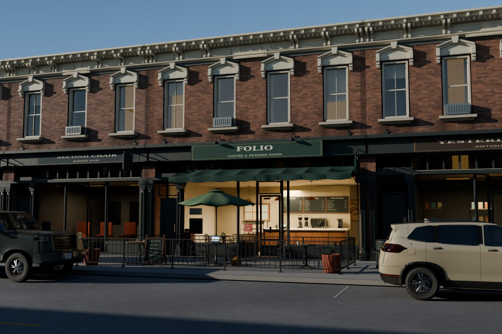
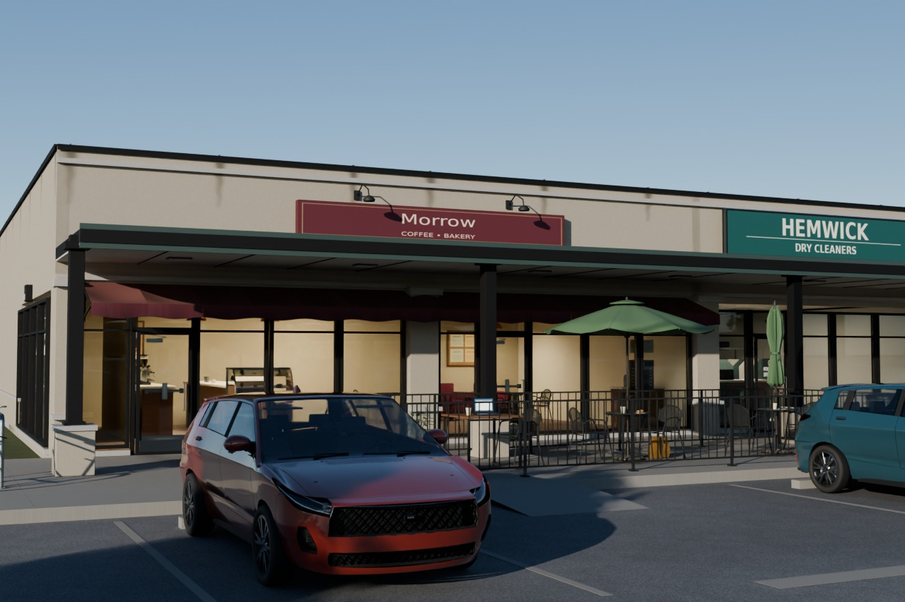
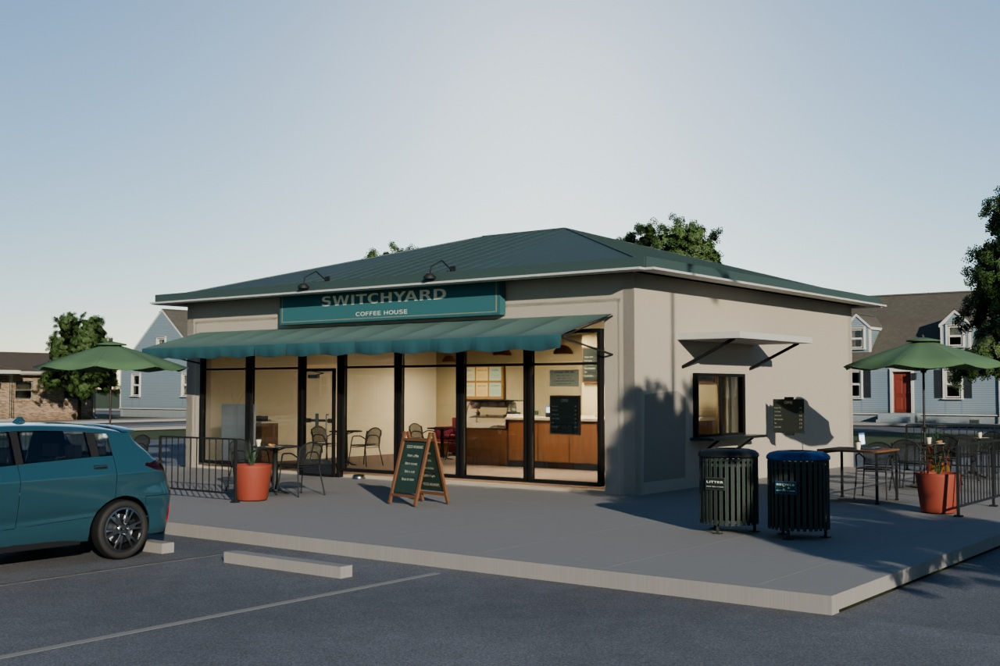
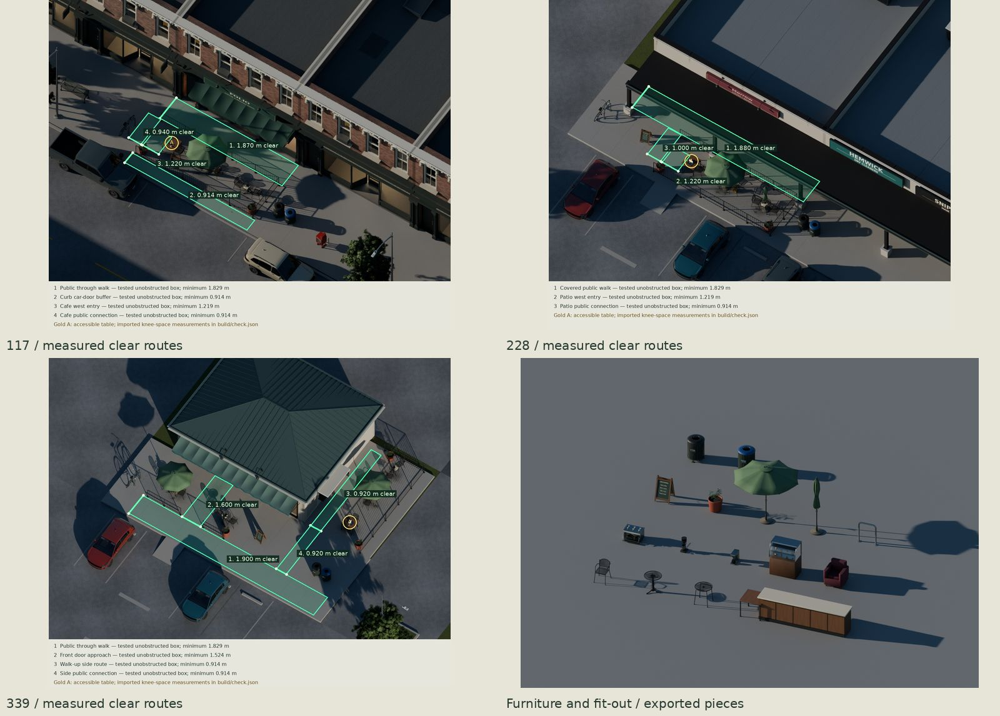
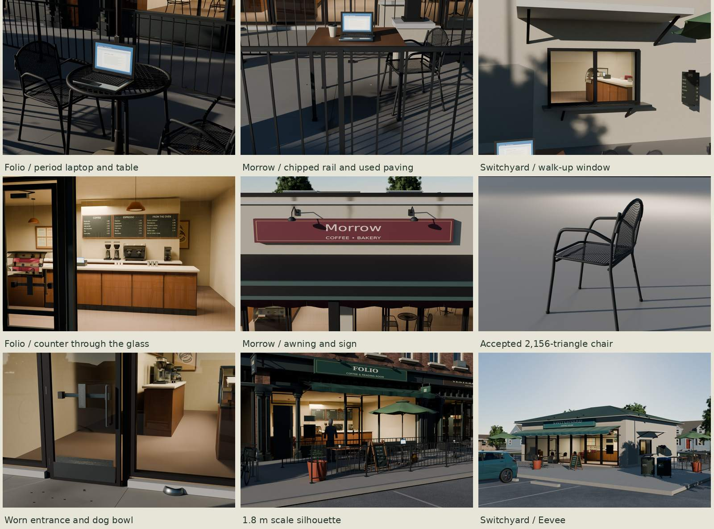

# Coffee shop / outdoor seating family







Three original neighborhood businesses for a 1995–2015 American town:
**Folio** in an old Main Street storefront, **Morrow** in a strip-center end
cap, and **Switchyard** in a small converted bank-branch pad building with a walk-up
window. All geometry, graphics and texture pixels are scripted.

Connected seeded street/lot exports include fitted neighbors, parked cars,
trees and street furniture. Low clear-sky sun rakes each storefront and warm
rooms show through the glazing. Pulled and turned chairs, different settings,
a locked commuter bike, a satchel and a dog bowl suggest use. One shared 4096
manufacture bake ships at 2048; age follows sunlight, customer contact,
queueing and runoff. The accepted furniture counts and table/room layouts remain.

Local full-size evidence: [Cycles heroes](renders/final/heroes.jpg),
[drawn seating layouts](renders/final/layouts.jpg),
[all views](renders/final/contact.jpg),
[fixed-camera corrections](renders/delivery-fixes/contact.jpg),
[period photo pairs](renders/final-matches/matched-contact.jpg), and
[source-finish pairs](renders/final-source-matches/matched-contact.jpg).
[REVIEW.md](REVIEW.md) keeps the rejected passes and remaining weaknesses;
[REFERENCE.md](REFERENCE.md) separates published dimensions from original choices.

| Delivery correction | Native before/after evidence |
| --- | --- |
| Clear low sun and deep canopy shade | [Folio](renders/delivery-fixes/117-retained.jpg), [Morrow](renders/delivery-fixes/228-retained.jpg), [Switchyard](renders/delivery-fixes/339-retained.jpg) |
| Pad street and facing neighbors close the left horizon | [Same hero camera](renders/delivery-fixes/339-hero.jpg), [site from above](renders/delivery-fixes/339-site.jpg) |
| Caused age on walk, furniture, canvas and building | [Rail and gum](renders/delivery-fixes/228-rail.jpg), [worn plates](renders/delivery-fixes/339-door.jpg), [coping runoff](renders/delivery-fixes/228-awning.jpg) |
| Seeded chairs, settings and period notebook | [Notebook](renders/delivery-fixes/117-table.jpg), [used table](renders/delivery-fixes/117-use.jpg), [layout](renders/delivery-fixes/339-above.jpg) |
| Storefront/patio fill the lot heroes | [Morrow](renders/delivery-fixes/228-framing.jpg), [Switchyard](renders/delivery-fixes/339-framing.jpg); these two comparisons explicitly change cameras |

All other correction pairs keep identical cameras. Each panel is 1000 or
1280 native pixels wide; none is enlarged. The baseline is revision `37e6af3`.

## Construction and dimensions

| Proof / business | Host footprint | Seating plan | Authored age |
| --- | --- | --- | --- |
| 117 / Folio | Downtown, **9.144 × 27.432 m**, two stories | 20 ft sidewalk, curbside fenced band, separate public path and west entrance | Old building, freshly fitted room |
| 228 / Morrow | Commercial, two combined 21 ft bays, **12.8016 × 19.5072 m** | Covered through walk with a railed patio outside its columns | Worn entrance and patio, 2004 fit-out |
| 339 / Switchyard | Original pad envelope using Commercial helpers, **10.9728 × 9.144 m** | Split front/side court, separate entry gap and side walk-up connection | Faded, patched 1997 conversion |

Downtown's masonry shell, cornice, sash, recessed iron storefront, stair
entry and rear construction are reused. Its generic shop room/sign/awning
are suppressed and replaced locally. Commercial's two stock bays, flat walk
canopy, wrapped end-cap glazing, coping and services are called directly,
with their stock tenant fit-outs suppressed and demising wall omitted. The
pad calls the same wall/aperture, storefront and leaf helpers, with a new
standing-seam hip roof, folded caps, 460 mm eaves and a bracketed walk-up
cover. Its small envelope, side sliding aperture and patch are new. Host-family
source files and every existing delivery remain unchanged.

Visible rooms have customer joinery and a separate back bar with a **.96 m**
working aisle, two-group espresso equipment, two doser grinders, a conventional
drip brewer, register, glass tip jar, cup stacks/pitchers, curved pastry case,
large menus, condiment cabinet, tables/chairs, soft seating, pendants, art and
community notices. Their **6.7 / 7.5 / 7.8 m** depth is a window-visible fit-out,
rather than a full playable restaurant.

The chair uses real **22 mm** bent round stock, a crowned steel seat, curved
expanded-steel back, perimeter/support members and glides. Fine diamond holes
use original coverage in the shared sheet; the frame remains geometry.
The **711.2 mm** round tables have actual open cast lattices, a **742 mm** top,
and either a three-foot pedestal or four splayed legs around an umbrella base.
The latter has a **52 mm** pole guide and **68 mm** top opening around Patio
Set's unchanged **38.1 mm** pole. Its stock open/tied umbrellas retain their
cloth sag, vent, ribs, crank and weighted bases.

Each shop has one **914.4 mm square**, **762 mm high** accessible exterior
table. Imported-surface measurements give **775 mm** between the side rails
at 700 mm height and **732 mm** center underside height; 195 forward rays
test the approach/knee box. The public through corridors are **1.870 / 1.880 /
1.900 m** wide. Separate **.940 / 1.000 / .920 m** connectors continue to the
cafe or side route. The downtown curb buffer is **.9144 m**. Actual furniture,
foliage, canopy edges, feet and rails are tested against the drawn boxes.
These are geometric lower bounds on the shown layouts, not permit or whole-site
accessibility certification. See the municipal/ADA sources and exact limits
in REFERENCE.

Dimensions are cross-referenced in [REFERENCE.md](REFERENCE.md) and the
[source register](refs/SOURCES.md): emu's tube/mesh chair specification,
legacy Linea Classic installation dimensions, conventional BUNN brewer
envelopes, and period Seattle/US Access Board publications. Hosts inherit
their documented original module dimensions. Shop identities, architecture
choices and smallware are original designs, rather than measured replicas.
The generic circa-2006 notebook has a 325 × 227 × 29 mm closed body,
78 physical keys on 18 mm pitch, a 13.3-inch lit display and a 95° lid.
Its screen reuses the BaseColor image through a separate emission UV channel.

## Generator and placement

`src/plan.py` is Blender-independent. An integer `seed` and `kind` (`downtown`,
`strip`, `pad`) choose an identity/palette, two or three outdoor pairs, bounded
counter offsets, table settings, furniture positions and placement seeds.
The pad adds two front tables to its side court. Smaller seating seeds shorten
their fence; the proof seeds use three pairs / three pairs / five tables.
The three types have different circulation and counter orientations, rather
than a common plan with different colors. Names, lettering, menus, paper
masthead and artwork are fictional and generated from installed open fonts.

```sh
python3 src/plan.py --kind strip --seed 812 --out build/custom-plan.json
blender -b -t 1 --factory-startup --python src/build.py -- --kind strip --seed 812 --out build/custom.blend
```

Build the default once before a custom shop, to create its host cache. A custom
build also writes the reusable stock library and its own `CoffeeShop-812.gltf`;
the default `make` restores the three proof exports. The footprint/depth and
style are fixed within a host type. This generator does not
claim arbitrary parcel sizes or unbounded procedural architecture.

Coordinates are meters, Blender +Z up and −Y front, glTF +Y up / +Z front.
Each delivered shop root is at its host footprint center on ground grade.
`FrontFrame` is the front-center datum at local Y = −depth/2. Plan coordinates
are relative to that frame. Furniture standalones have footprint/grade origins.
`CoffeeShopPieces.gltf` spreads them for inspection; individual files under
`export/pieces/` retain zero placement.

Chairs remain individually placeable. `*__Seat` sockets mark seated people,
`*__Placement` marks furniture, `*__Top` supports settings, `*__Wheelchair`
marks forward approach, and pendant/sign sockets locate engine lights.
Door leaves retain the host's physical hinge frames: Downtown **local Z
0–100°**, Commercial entry/service leaves **local Z −100–0°**. The pad's
`Walkup_SlidingPane` has local X **−.86–0 m** travel in its rotated wall frame.
Umbrellas are separate open/tied static alternatives; stock cranks turn around
local Y **0–360°**. No armature or folding-cloth animation is provided.
Full pivot/socket positions are in `build/shops/<seed>.json`. Closed-position
closer links are form detail rather than articulated linkages. The source and
fresh exports pass actual-surface sweeps for all ten door leaves and the slider,
at 21 positions per mechanism, with 1 mm penetration tolerance. This is a
sampled geometric check, not a continuous-motion proof. Notebook bottom-face
samples measure support against the imported tabletop, and its triangles are
checked against the umbrella. Settings rest on the measured central top skin;
the rolled outer rim is higher.

For a game, load one `CoffeeShop-<seed>.gltf`, place its footprint origin at
the parcel datum, then stream its shared images by resolved URI. Use the
individual pieces for another layout, or replace a chair with a seated
character at its seat socket. `CoffeeSite-<seed>.gltf` is a complete example
scene and already contains the shop; do not load both for one location.
Connect engine lights at the saved pendant/sign frames. The studio's practical
lights are render setup, while notebook emission is part of the export.

## Budgets and shared images

<!-- METRICS_START -->
| Seed | Shop triangles | Visible room | Materials / mesh primitives | glTF + BIN bytes | Referenced PNG bytes | Shared texture MiB |
| --- | ---: | ---: | ---: | ---: | ---: | ---: |
| 117 | 72,970 | 21,026 | 14 / 76 | 6,313,332 | 45,260,113 | 108.00 |
| 228 | 79,650 | 27,726 | 13 / 80 | 5,932,637 | 34,396,079 | 86.67 |
| 339 | 83,792 | 22,142 | 13 / 58 | 5,328,655 | 34,396,079 | 86.67 |

| Reusable piece | Triangles | Measured W × D × H, m |
| --- | ---: | --- |
| BistroChair | 2,156 | 0.538 × 0.588 × 0.836 |
| BistroTable | 1,220 | 0.711 × 0.711 × 0.742 |
| UmbrellaTable | 1,384 | 0.711 × 0.711 × 0.742 |
| AccessibleTable | 244 | 0.914 × 0.914 × 0.762 |
| Counter | 232 | 3.730 × 0.780 × 1.053 |
| EspressoMachine | 1,612 | 0.720 × 0.630 × 0.538 |
| Grinder | 572 | 0.235 × 0.345 × 0.598 |
| Brewer | 480 | 0.216 × 0.477 × 0.445 |
| PastryCase | 2,960 | 1.120 × 0.712 × 1.408 |
| SoftChair | 828 | 0.810 × 0.780 × 0.930 |
| AFrame | 220 | 0.625 × 0.634 × 1.021 |
| Planter | 636 | 0.580 × 0.581 × 0.892 |
| Umbrella_Open | 3,920 | 2.764 × 2.764 × 2.565 |
| Umbrella_Closed | 3,908 | 0.500 × 0.500 × 2.565 |
| BikeRack | 1,020 | 0.868 × 0.152 × 0.914 |
| Litter | 2,966 | 0.700 × 0.702 × 0.960 |
| Recycling | 2,966 | 0.700 × 0.702 × 0.960 |

The three packages reference **34** unique image files / **51,597,136 bytes** across the family. The same-scene import/reimport retains **34 / 34** decoded image datablocks. Construction primitives are counted before optional engine instancing/batching.
<!-- METRICS_END -->

Embedded customer-use pieces measure **2,944 triangles** for the commuter
bicycle, **1,318** for the notebook, **332** for the dog bowl and **108** for
the satchel. They are separate placed meshes inside each shop, generated by
`src/daily_use.py`; the stock inspection library retains its accepted 17 pieces.

One new shared **2048² BaseColor / +Y Normal / ORM** set serves furniture,
fit-out, original signage and steel/wear coverage: **16 MiB** at 8 bpp per map
with full mip chains. `T_CoffeeShop_BaseColor.png` is sRGB; Normal and ORM
are linear data. ORM packs occlusion in R, roughness in G and metallic in B.
Original manufacture and meter-valued height fields
are baked in Cycles at **4096**, then filtered by channel into the shipping
set. Wood grain, brushed stainless, coating/cloth texture and printed
artwork share this sheet. Opaque, glass and cutout serve the reusable pieces;
one additional site-only BLEND state carries fractional ring, spill and
runoff coverage without discarding faint deposits. It adds no images.
UV charts repeat intentionally; the
audit checks each triangle against its declared cell and reports density.
It does not claim nonoverlapping unique islands or a sculpt-to-low bake.

The canonical Patio Set umbrella maps cost **16 MiB**, Street Furniture
rack/litter/recycling **17⅓ MiB**, and Ground concrete **16 MiB**. Hosts now
bind Downtown's baked masonry/mineral/finish resources or Commercial's
wall/roof/equipment resources. Shop image allocations are **108 / 86⅔ /
86⅔ MiB** with 8-bpp block compression and full mips. These are cached shared
resources, not a new allocation per chair. Context houses, cars, vegetation
and street fixtures are reported separately in `build/lookdev-check.json`.
<!-- SITE_METRICS_START -->
| Context seed | Placed triangles | Materials | glTF + BIN bytes |
| --- | ---: | ---: | ---: |
| 117 | 975,838 | 36 | 31,499,992 |
| 228 | 1,994,421 | 46 | 36,821,650 |
| 339 | 2,198,874 | 41 | 33,517,754 |

The whole-site union references **74** shared images / **119,651,141 disk bytes**, estimated **262.17 MiB** at 8 bpp with full mips. The new three-map set occupies **3,392,032 PNG bytes / 16 MiB**. Shared memory is charged once across instances.
<!-- SITE_METRICS_END -->
The complete context contains canonical houses, cars and vegetation;
it is separate from the café's new allocation. Two host-lettering sheets
accompany the new PBR set.
The small accessible table, counter, brewer and A-frame need fewer than
500 triangles and are not padded with hidden detail.

Large use history is instance-owned; it allocates no per-seed image.
Folio has fresh fittings in old brick/cast iron over a long-used walk. Morrow
has door/kick-plate scuffs, chair contacts on the rail and stained customer
areas. Switchyard has exposed faded canvas, dirty valance, a local stucco
repaint/cracks and a rubbed walk-up sill. Furniture uses contact rings and
scratches clipped onto its actual top surfaces, foot abrasion and wiped
chalk. Continuous queue/handoff darkening belongs to the room floor.

External-image glTFs and geometry bins sit in `export/`. Reused images resolve
to their canonical family paths; the new coffee set and host tenant lettering
sheets live under `coffee-shop/export/textures/`. Keep relative directory
layout and cache resolved image URIs in the engine. Embedded GLBs under
`build/` are inspection intermediates. Fresh import of all three seeds and a
repeat checks decoded image reuse, rather than assuming equal filenames mean
equal GPU resources.

## Rebuild and evidence

```sh
make clean                      # own outputs; retains refs and comparison history
make WIDTH=1280 SAMPLES=40       # refs, hosts, stock, shops, checks, Cycles, pairs, sheets
make check                      # exported geometry/resources/contact/motion checks
make repeat                     # isolated deterministic stock/host/shop/site rebuild
make check-texture-repeat       # isolated real 4096 GPU rebake, shipping-pixel comparison
make before-after               # original fixed cameras, each side >=800 px
make check-repo
```

Missing original family dependencies build through their own public targets;
present deliveries are read-only inputs and are never refreshed by the coffee
build. Blender jobs are serial and all Cycles rendering uses the kit's shared
GPU lock. Modeling/export uses one CPU worker; private Commercial-host UVs
round below 0.002 shipping texel, and three imported-car tangent corners use
the kit's exact-signature, one-rounding-step guard. This preserves strict
byte comparisons despite evaluated-mesh rounding at fresh process boundaries.
Work and temporary files stay in ignored build folders. No kit file
or top-level README is changed. Requires Blender 5.2, Python/Pillow/NumPy,
fontconfig/open DejaVu fonts, Git, GNU make, curl and flock; no installation occurs.

| Local path | Evidence |
| --- | --- |
| `export/CoffeeShop-<seed>.gltf` + `.bin` | The three shop packages, external shared images |
| `export/sites/CoffeeSite-<seed>.gltf` + `.bin` | Connected town/lot scenes; front-center datum, shop counts separate |
| `export/pieces/*.gltf`, `CoffeeShopPieces.gltf` | Independently placeable new/reused stock and inspection library |
| `build/check.json` | Fresh-import counts/bounds/normals/UV presence, actual route surfaces, knee-space rays, image resources |
| `build/preservation.json` | Hashes of all preexisting family delivery/map inputs |
| `build/repeat.json` | Deterministic byte comparison with normalized canonical URIs |
| `build/texture-repeat-check.json` | Independent 4096 GPU rebake / 2048 filtered pixels, originals unchanged |
| `build/photo-calibration.json` | Named landmarks, estimated cameras, residuals and assumed-neutral balance |
| `renders/final/<seed>/` | Eye-height 40/45/42 mm hero, overhead, front/side/back/top, clearances, details, 1.8 m scale, Eevee; pad walk-up |
| `renders/final/piece-sheet.jpg` | Every furniture/fit-out module with labels |
| `renders/final/contact.jpg` | All current views and four photo pairs |
| `renders/final-matches/*-pair.jpg` | The actual export against four neutral-balanced period photographs; two show occupied outdoor seating |
| `build/lookdev-check.json` | Raw per-triangle chart bounds/density, PBR maps, whole-site resources/counts |
| `renders/delivery-fixes/*` | Thirty-one fixed-camera before/after pairs at 1000 or 1280 px per panel, plus two clearly marked framing comparisons |
| `renders/final-source-matches/*` | Same game geometry with original manufacture fields + height, before normal bake/filter |
| `build/presentation-check.json` | Current package/image hashes and hero display-range diagnostics |
| `build/coffee-motion.json` | Actual source/export door and slider sweeps, samples and measured penetration |
| `build/use-check.json` | Fresh-export U-lock enclosure of actual closed frame/rack sections, triangle clearance and sampled support gap |
| `build/docs.json` | Five final JPEG sources, encoding sizes and hashes |

The four technical turnarounds show the shop export alone on neutral studio
ground. Their orthographic framing is fitted to the imported mesh bounds,
and every projected bound corner is checked inside the frame. Heroes,
seating layouts and site overheads show the complete connected context.

The strongest remaining CG tells are repeated neighboring buildings/trees,
regular slab joints, limited pastry crust detail and simplified age on broad wall surfaces. Glass
reflections partially veil menus from some angles. The umbrella/pad fits
reach their 70 mm lens bound. The Fair Grinds gallery/canvas comparison
has a weaker framing fit; ground junctions obscured by the gate and patrons
are explicit estimates used to stabilize gravity. Reference credits and balance assumptions
are recorded in SOURCES and the calibration receipt. The closer links are
closed-position form detail, not opening-link kinematics. Sweeps sample motion
and do not certify every intermediate position. Morrow's leading parked car
obscures part of the accessible table in its hero; the overhead proves its layout.

Original library inputs and their credits remain in their family reference
registers. All new geometry, lettering, maps and artwork are generated here.
No photograph pixels enter a material or docs image. DejaVu fonts use the open
Bitstream Vera/DejaVu license and are located through `kit/fonts.py`.
