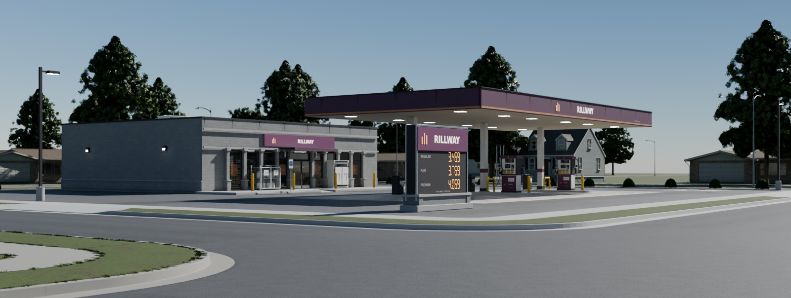
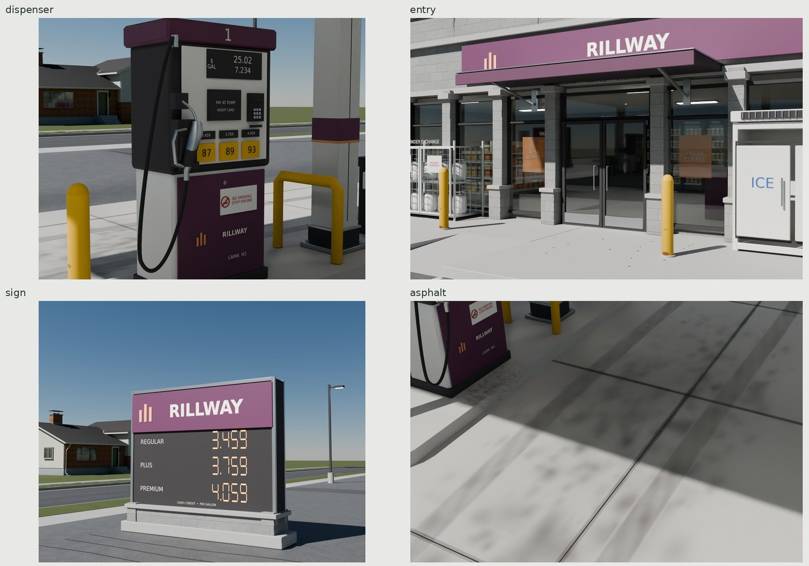
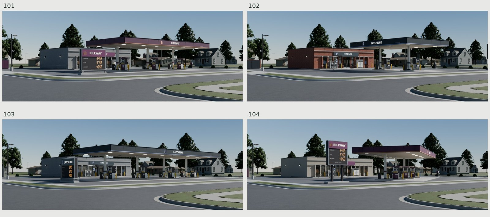
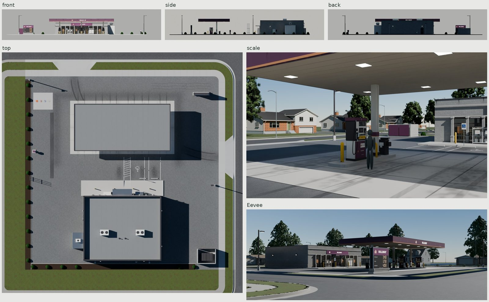
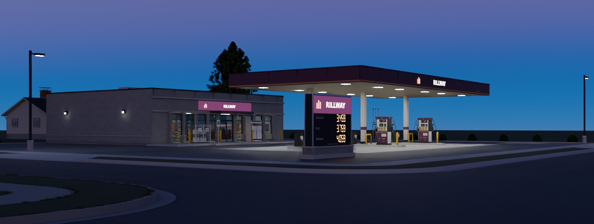

# Commercial / seeded corner gas stations

Four original 1995–2010 American corner stations, maintained at about fifteen
years in service. Fixed plans and two fictional brands share tiled masonry,
roof, concrete and one equipment/trim atlas. Deliveries are stock glTF with
external images shared across every seed.







Every vertex and texel is scripted. Photographs supply measurements and
comparison only. [REFERENCE.md](REFERENCE.md) distinguishes published sizes,
original decisions and fit limits; [REVIEW.md](REVIEW.md) records rejected
images and the full-size final audit. [TEXTURES.md](TEXTURES.md) explains
allocation and sharing; [refs/SOURCES.md](refs/SOURCES.md) records credits.

## Plans and real dimensions

| Seed | Lot, ft | Store, ft / area | Canopy | Corner / walls / brand / sign |
| --- | --- | --- | --- | --- |
| 101 | 150 × 150 | 60 × 50 / 3,000 sq ft | 3 islands, parallel | SW / split CMU / Rillway / corner monument |
| 102 | 140 × 150 | 56 × 48 / 2,688 sq ft | 2 islands, perpendicular | SE / brick / Latchline / frontage pylon |
| 103 | 160 × 160 | 64 × 48 / 3,072 sq ft | 4 islands, parallel | NW / smooth CMU / Latchline / frontage monument |
| 104 | 160 × 160 | 66 × 50 / 3,300 sq ft | 3 islands at 30° | NE / EIFS / Rillway / corner pylon |

| Construction | Authored real size / measured proof |
| --- | --- |
| Canopy | 14 ft 6 in / 4.4196 m nominal soffit; 3 ft 3 in / .9906 m fascia; 14 in / .3556 m clad columns |
| Islands | 25 ft / 7.62 m centers; 4 × 18 ft / 1.2192 × 5.4864 m; 6 in rise; 21 ft / 6.4008 m clear between curbs |
| Cairn M3 dispenser | 1.10 m cabinet width, .62 m electronics depth, 1.19 m crown, 2.24 m crown height; 30 mm OD hoses |
| Store | 203.2 mm wall shell; 2.75 m glazing head; 3.9624 m roof datum; 4.8768 m parapet; .1524 m slab |
| Public interface | 24 ft clear openings, 5 ft transition wings, native 6 ft apron, 5 ft walk and 15 ft curb-return radius |
| Accessible approach | 132 in vehicle bay + 60 in aisle; a 6 ft 1:12 run and 6 ft level landing in the 12 ft store walk |
| Tank vents | 12 ft / 3.6576 m before caps; original fill/monitor covers use the cited API colors and symbols |

Published municipal/manufacturer comparators and original decisions are cited
in REFERENCE. These are asset dimensions and sampled construction checks,
not structural, ADA, fuel-system or civil-engineering certification.
Meters, Blender +Z up and canonical −Y frontage; a quarter-turn selects the
street corner. Props retain footprint/ground origins, and operating leaves
retain their physical hinges. glTF maps Blender Z to Y up.

## Construction and maintained age

Split-face pilasters/wainscot, precast feet and caps, folded entry shelter,
profiled coping, wall packs and electric/gas service complete the store.
Monument bases use its masonry with real caps. Canopy columns have painted
wraps, base skirts and a brand band. Smooth 30 mm hoses hang in slack loops;
the original wire proxy is removed. Compound-section nozzles have open guards,
swivels and separate hand sockets. Gondola product fronts, cooler doors,
checkout and ceiling lights read through the wall of glass.

The station's asphalt retains the ground family's exact maps. Vertex colors
compensate their repeated broad field and add darker polished traffic lanes,
weathered edges and parked-engine centers. Sealed cracks and a patched buried
service trench follow actual repairs. A dedicated concrete tile has sand,
pores and irregular fine broom bristles; independent pours have slight tone
changes and sealant follows saw cuts. Absorbed gray-brown footprints combine
many drips around the engine/fuel-door and a soft standing band. Swept tire
contacts cross them and follow the driveways. Gum and base grime belong to
foot traffic. Rust borders curved bumper-height paint chips and the wet base
ring, preserving yellow paint. Runoff starts at fascia/coping joints and
excludes open scuppers; low masonry retains salts/dirt. Sun-facing sign paint
fades. Original Boxwood instances sit over irregular shredded bark.

All light uses procedural sun/sky. Day views have cast canopy/store shadows;
blue hour exposes for white canopy diffusers and their forecourt pool. Price
digits, brand panels, shop lights and the visible interior emit from the
exported map. The same emission state is retained by day and night.

## Shared maps and material cost

**18 new images / 29 MiB** estimated BC7/BC5 with full mips: CMU 1024 triple,
brick 512 triple, EIFS/roof 512 color-normal pairs, concrete 1024 triple,
equipment/trim 2048 triple, graphics 1024 RGBA color and emission. Manufacture
is generated and Cycles flat-baked at 4096, then filtered in linear color,
vector-normal and roughness-RMS space. This is a shared tile bake, rather
than a unique whole-building projection.

The family reuses ground asphalt/lawn and shrubs' maps (**48 MiB**). All wall
alternatives together therefore allocate **77 MiB**; a default CMU station
loads **75⅓ MiB**. PNG disk bytes are reported separately below. Presentation
Cape/ranch/split houses, oak/maple trees, street lights and roads load their own exports and do not enter delivery.
The houses' and ground family's existing 150 delivery/map files remain
byte-identical to the pre-work receipt.

**Nine materials per station; ten on smooth-CMU seed 103.** Equipment and
trim share one opaque PBR atlas. Ink, transparent wear and all emission share
one graphics material: UV0 selects color/alpha and UV1 selects powered pixels
or a zero-emission swatch. Glass is one material. Tiled masonry, roof and
concrete retain separate materials for their scale and physical response;
smooth/split CMU share images but need different normal strengths. Ground
asphalt/lawn and the single original shrub mask retain canonical image URIs.
Bark and leaves join locally into one instanced mesh/material, retaining their
original vertices, UVs and maps. None of those library assets is modified.

Material counts differ from draw calls. The table counts actual glTF material
primitives, including separate operating leaves; a renderer may batch repeated
modules. One plant is one primitive with shared geometry.

| Default part | Triangles | Materials | Primitives |
| --- | ---: | --- | ---: |
| Store | 34,308 | CMU, Concrete, Equipment, Glass, Graphics, Roof (6) | 11 |
| Canopy | 13,098 | Concrete, Equipment, Graphics, Roof (4) | 16 |
| SitePaving | 23,180 | Asphalt, Concrete, Equipment, Lawn (4) | 4 |
| AccessibleSign | 416 | Equipment, Graphics (2) | 2 |
| TankPad | 1,164 | Concrete, Equipment (2) | 2 |
| TankVents | 376 | Equipment (1) | 1 |
| Dispenser, each | 5,160 | Equipment, Graphics (2) | 4 |
| Trash/washer, each | 1,116 | Equipment (1) | 1 |
| PriceSign | 1,516 | CMU, Concrete, Equipment, Graphics (4) | 4 |
| IceMerchandiser | 1,776 | Equipment, Graphics (2) | 5 |
| PropaneCage | 4,474 | Equipment, Graphics (2) | 6 |
| Store bollard, each | 288 | Concrete, Equipment (2) | 2 |
| AirWater | 1,570 | Concrete, Equipment, Graphics (3) | 3 |
| DumpsterEnclosure | 3,224 | CMU, Concrete, Equipment (3) | 7 |
| Lot light, each | 348 | Concrete, Equipment, Graphics (3) | 3 |
| ServiceWear | 712 | Asphalt, Equipment, Graphics (3) | 3 |
| Landscape | 106,172 | Shrubs .001 (1) | 19 |

## Measured budgets and bytes

| Seed | Store | Canopy/islands | Sign | Without plants | Placed plants | Total |
| --- | ---: | ---: | ---: | ---: | ---: | ---: |
| 101 | 34,308 | 13,098 | 1,516 | 106,490 | 106,172 | 212,662 |
| 102 | 30,060 | 9,826 | 1,044 | 90,494 | 106,172 | 196,666 |
| 103 | 34,528 | 16,490 | 1,516 | 119,476 | 111,760 | 231,236 |
| 104 | 32,058 | 13,098 | 1,044 | 106,460 | 106,172 | 212,632 |

Store ≤45k, canopy ≤18k and each dispenser 5,160 ≤6k. The sign uses fewer
than the preferred 2k lower end because its accepted construction needs no
filler geometry. Botanical placements are
not unique GPU geometry: each Boxwood instance shares the same 5,588 triangles.
The additional paving vertices carry the station-only repeat/traffic correction;
raised bark pieces supply close-range relief without another material.
`build/delivery-check.json` records unique geometry and measured UV densities,
normal errors, actual lens/support probes, and source/import surface errors.

| Seed | glTF + BIN bytes | Embedded build GLB bytes | Materials | Placed material primitives |
| --- | ---: | ---: | ---: | ---: |
| 101 | 13,186,355 | 66,729,400 | 9 | 112 |
| 102 | 11,467,051 | 62,644,132 | 9 | 102 |
| 103 | 14,444,302 | 67,987,368 | 10 | 123 |
| 104 | 13,182,568 | 64,160,228 | 9 | 111 |

The 18 shared new PNGs occupy **10,059,586 bytes**. Geometry buffers exclude images.
All 27 unique family PNGs occupy 54,486,472 bytes including reused
ground/shrubs; the default station references 53,541,730 image bytes.
Four glTF/BIN pairs total 52,280,276 bytes.
Glass uses KHR transmission/IOR/specular; native lamp radiance uses
KHR_materials_emissive_strength. Use an importer supporting those standard
extensions. Canonical image identities let a scene load each map once; a same-scene import
of all four seeds and a repeat independently checks actual image reuse.

## Parts, pivots and generator

Fixed construction consolidates per reusable module: store, canopy/islands,
each dispenser, sign, site paving, tank pad/vents, trash/washer, ice cabinet,
propane cage, air/water, dumpster yard, bollards, signs and poles. Botanical
meshes remain instanced. There is no armature.

| Moving node | Local axis / range |
| --- | --- |
| Entry_Left / Entry_Right | Z, −100…0° / 0…100°; outer jamb barrels |
| ServiceDoor | Z, −100…0°; rear exterior hinge |
| IceDoor_-1 / IceDoor_1 | Z, −100…0°; separate cabinet hinges |
| PropaneDoor_-1 / PropaneDoor_1 | Z, −100…0°; cage front hinges |
| DumpsterGate_-1 / DumpsterGate_1 | Z, −110…0° / 0…110° |
| DumpsterLid_-1 / DumpsterLid_1 | X, −105…0°; rear lid edges |
| Dispenser_<n>_NozzleA/B | Detachable holstered frames, separate hand sockets |

Entry/nozzle hand sockets, `Socket_StoreEntry`, `Socket_StoreWalk`, and separate
private paving, curb-flowline, apron and public-walk driveway frames survive.
The owner's tank may be loaded only by the read-only fit tool; it never enters
the saved station, maps or export. Source and fresh-import checks distinguish
working surface clearances from mere serialization.

`src/plan.py` remains Blender-independent: 2–4 islands, 0/30/90° canopy axes,
quarter-turn corners, bounded stores, four wall styles, two original brands,
monument/pylon and selected cooler boxes. Rillway retains aubergine/copper/ivory
and three unequal piers; Latchline retains graphite/periwinkle/off-white and
offset brackets. The trade-dress comparison is in REFERENCE. Equal graphic
quads allow UV-selected brand changes without different logo geometry.
Retail walls/openings, storefronts, coping, services and fit-out remain reusable
within this family for the later strip mall. No strip mall is built this round.

## Rebuild and proof

```sh
make -C commercial WIDTH=1600 SAMPLES=48
make -C commercial check
make -C commercial repeat
python3 kit/repo_check.py
```

`make` generates fields, GPU bakes and shared images; builds four sources and
external deliveries; checks them; renders the exported station in Cycles and
Eevee; composes five used-photo pairs and eight before/after crops; generates
bounded documentation JPGs. GPU jobs hold the kit lock. Work stays under
build/. Existing family deliveries are preserved. No kit code changes.

| Output | Evidence |
| --- | --- |
| `renders/final/hero.png` | Opposite sidewalk, measured 1.60 m eye, 40 mm, verticals vertical |
| `renders/final/seeds/<seed>/{street,above}.png` | All four corners, property fitted to actual exported vertices |
| `renders/final/{dispenser,entry,sign,asphalt}.png` | Hoses, storefront, sign and absorbed forecourt wear |
| `renders/final/{canopy,column,rear,services,landscape}.png` | Construction, services, bark and plant details |
| `renders/final/{front,side,back,top,scale}.png` | Turnaround and measured 1.8 m silhouette |
| `renders/final/dusk.png`, `renders/final-eevee/hero.png` | Lit station and real-time view |
| `renders/final/contact.jpg`, `matched-pairs.jpg`, `values.jpg` | Current finals and compact comparison sheets |
| `renders/look-matches/*-pair.jpg` | Five neutral-balanced photographs paired under estimated matching sun/sky |
| `renders/delivery-fixes/*-before-after.jpg` | Eight fixed-camera crops against accepted `dba25d4` |
| `build/checks.json`, `motion-*.json`, `plan-check.json` | Actual surfaces, swept leaves, 1,000 pickup routes and negative controls |
| `build/delivery-check.json`, `final-view-check.json` | Actual image sharing, charts, normals, package and image provenance |
| `build/repeat-check.json`, `brand-swap-check.json`, `preservation.json` | Byte repeat, equal-geometry brands and protected family bytes |

PA canopy fit: 1.66 native pixels RMS; CA dispenser .28; PA forecourt 3.43;
TX entry .58. Supplementary VA paving: 19.26 px with a 1.65 m eye prior, a
weaker fit. Five comparisons use four photographs (two PA crops). Procedural
sun vectors follow visible shadow directions/lengths, without downloaded
HDRIs. These are estimates, rather than surveyed solar positions or inverse
albedo measurements. `build/reference-balance.json` records each neutral ROI
and linear gain before any value comparison. Fixed display Y′ medians follow.

| Surface | Export | Balanced photo | Difference |
| --- | ---: | ---: | ---: |
| soffit | 0.423 | 0.417 | +1.5% |
| concrete | 0.777 | 0.795 | -2.3% |
| dark cabinet | 0.128 | 0.135 | -4.8% |
| eifs | 0.667 | 0.663 | +0.5% |
| asphalt | 0.447 | 0.466 | -4.1% |

The concrete control now samples bare sunlit cement ahead of the longer
fueling footprint; the original patch contains visible deposits. The strict
nine-ray material check is retained. The cabinet ROI was narrowed after rays
exposed rubber hose inside the old
wide patch (.107 mixed value). All five current ROIs have nine actual
exported surface/finish ray checks in `build/value-surface-check.json`.
These are display measurements under estimated matching light, not albedos.


## Credits and limits

Original geometry, procedural fields, graphics, Rillway/Latchline marks and
Cairn M3 dispenser design. DejaVu system fonts are found
through `kit/fonts.py`. References are credited with rights and comparison use
in [refs/SOURCES.md](refs/SOURCES.md); original stock ground, Boxwood, house and
oak assets come from this repository. No reference image contributes texels.

The clean `make WIDTH=1600 SAMPLES=48 WRITE_DOCS=0` replay began with empty
commercial build, map, export and render directories, retaining references
and immutable family deliveries. It completed after correcting the bare-cement
measurement control; docs were generated after the native-size review.
`make check`, `make repeat` and the repository check pass. Repeat:
66,729,400 byte-identical bytes; both brands retain 177 frames and 22 image
payloads. The final provenance gate verifies 30 Cycles images and one Eevee
image against the current exported geometry, maps, context and recipe.

Every final was opened at native resolution before committing docs. Passes
13–18 in REVIEW record the fixes, rejected frames and remaining limits.
Hero architecture spans 74.9% of the frame at measured 1.60 m / 40 mm. Its
conservative projected architectural/equipment mask has display Y′ p1/p50/p95/p99 of
.041/.266/.631/.776; .26% clips white, concentrated in powered lenses/ink.
Source/import position error remains under 8 µm and all 48 actual canopy
lens openings are independently probed across the four seeds.

Remaining CG tells: the six repeated product fronts, very regular masonry
and joinery, simplified fine bark depth and repeated neighborhood prototypes.
The ground atlas has a broad repeat; the commercial correction reduces it
without changing that family's bytes, but some aggregate rhythm survives in
extreme overhead views. Eevee's cached indirect light restores the soffit;
its shadows and glass still differ from the Cycles judgments. Photograph fits
and unknown camera responses limit exact comparisons. No tool, permission or
kit change is needed; the broad ground-field repeat is an upstream finding.


The hero revision keeps the accepted camera, construction, emission and
detail/dusk lighting. A lateral procedural sun separates front/side values
and casts the canopy shadow across the slab. Original neighborhood houses,
trees and street lights sit along continuing native streets; none ships in
the station. Top retains the surrounding ground, and the period canopy
comparison renders its procedural sky opaque under the retained matched sun.

Fixed sunlit-paving masks (`src/hero_review.py`) measure pixels at least 4%
below each region's clean p85 Y′. Coverage / median deposit contrast:

| Pair | Before | After | Balanced photo |
| --- | --- | --- | --- |
| Used forecourt | 19.0% / 11.9% | 37.2% / 9.0% | 31.5% / 6.8% |
| Used asphalt | 23.4% / 4.9% | 63.3% / 10.5% | 59.2% / 9.1% |

These are projected appearance estimates with annotated masks, not surveyed
surface areas or chemical oil segmentation; aggregate, residual joints,
different layouts and estimated light limit the comparison. An additional
8% threshold is recorded in `renders/hero-review/wear-measurements.json`.
Native-pixel before/after hero crops cover forecourt, fascia, driveway,
lighting and setting. Recreate the current masks with
`python3 src/hero_review.py`; supply `--before <saved-render-folder>` to compare
a retained earlier render. Close paving still exposes some softness in the
shared ink atlas, and repeated house/tree prototypes remain recognizable.

<!-- LOD checkpoint: begin -->
## Additional LODs

`make lod` builds additional glTF/BIN files under `export/lod/`; `make check-lod` independently checks them. The existing delivery is immutable LOD0. Default `make` and `make check` retain their original build graph.

| Level | Triangles / target | Materials | Geometry bytes | PNG bytes | Total load bytes | GPU textures + mesh, MiB | Switch height / distance |
| --- | ---: | ---: | ---: | ---: | ---: | ---: | --- |
| LOD0 | 18,258 / — | 9 | 13,186,355 | 53,541,760 | 66,728,115 | 75.334 + 12.3445 | near |
| LOD1 | 15,834 / 10,955 | 4 | 1,955,303 | 6,176,884 | 8,132,187 | 23.334 + 1.8160 | 30.0% / 15.70 m |
| LOD2 | 15,134 / 5,477 | 4 | 1,887,698 | 6,176,884 | 8,064,582 | 23.334 + 1.7515 | 12.0% / 39.25 m |
| LOD3 | 14,732 / 2,739 | 4 | 1,848,542 | 6,176,884 | 8,025,426 | 23.334 + 1.7142 | 4.5% / 104.66 m |

Distances are to the bound center at a 60° vertical FOV / 1080p. GPU figures estimate 8-bpp block-compressed textures with full mips plus raw accessor mesh bytes, before engine overhead. PNG storage is separate. Each row is a cold load; URI/content caching can share images across levels. Targets are aspirations: the achieved counts retain geometry when reduction fails seam, silhouette, shading or topology checks.

Load the original and additional files as alternatives and explicitly configure Godot visibility ranges, Unity LODGroup renderers, or corresponding Unreal mesh/component LODs. A filename does not create an engine controller. Keep matching pivots in the same pose during switching. [Engine sources, thresholds, texture policy and limitations](../kit/LOD.md).

All ordinary moving geometry, sockets, skins and their frames stay separate and retain their delivered data. No pilot merges moving parts into its body. Canonical external PNGs stay shared among the additional levels and LOD0. A distant texture set saves residency only when larger maps are unloaded or streamed.

Native-pixel comparison strips, amplified differences and close views of every level: `renders/lod/`. The local `contact.jpg` indexes them; `metrics.json` records original/adjacent comparisons from three azimuths. Raw checks and immutable-input hashes: `export/lod/check.json` and `manifest.json`. Rejected component reductions: `build/lod/<source stem>/simplification.json`. [Two critique passes and the six-pilot sheet](../kit/LOD_REVIEW.md).

Shipped PNG dimensions: LOD0: 2 × 512×512, 8 × 1024×1024, 12 × 2048×2048; LOD1: 2 × 512×512, 5 × 1024×1024, 3 × 2048×2048; LOD2: 2 × 512×512, 5 × 1024×1024, 3 × 2048×2048; LOD3: 2 × 512×512, 5 × 1024×1024, 3 × 2048×2048.

This pilot selects `Canopy` (including islands) and `Dispenser_1` from the original station. LOD0 triangle counts describe those modules, while its bytes/materials/maps describe the full unchanged station container. The new levels carry only selected geometry and its four materials, in the original station coordinates. Their canonical external maps remain shared. Separate dispenser close-ups accompany each level.

<!-- LOD checkpoint: end -->
