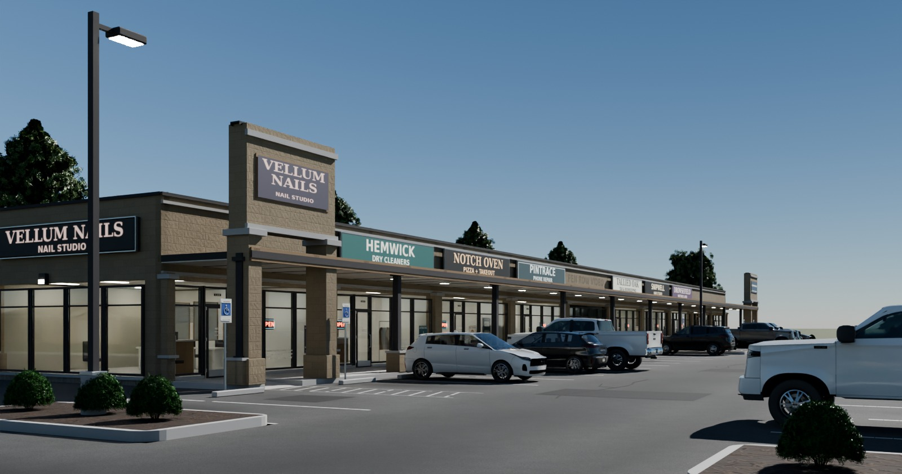
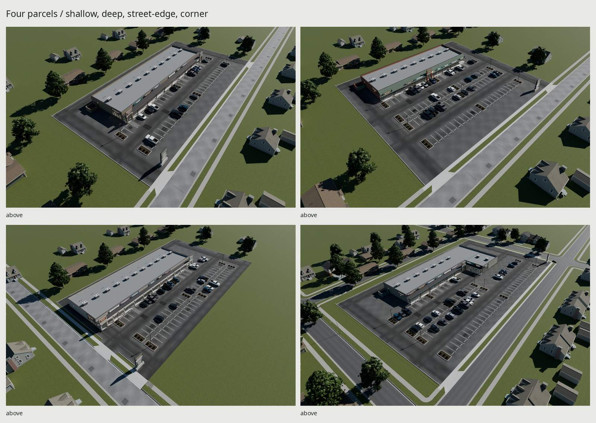
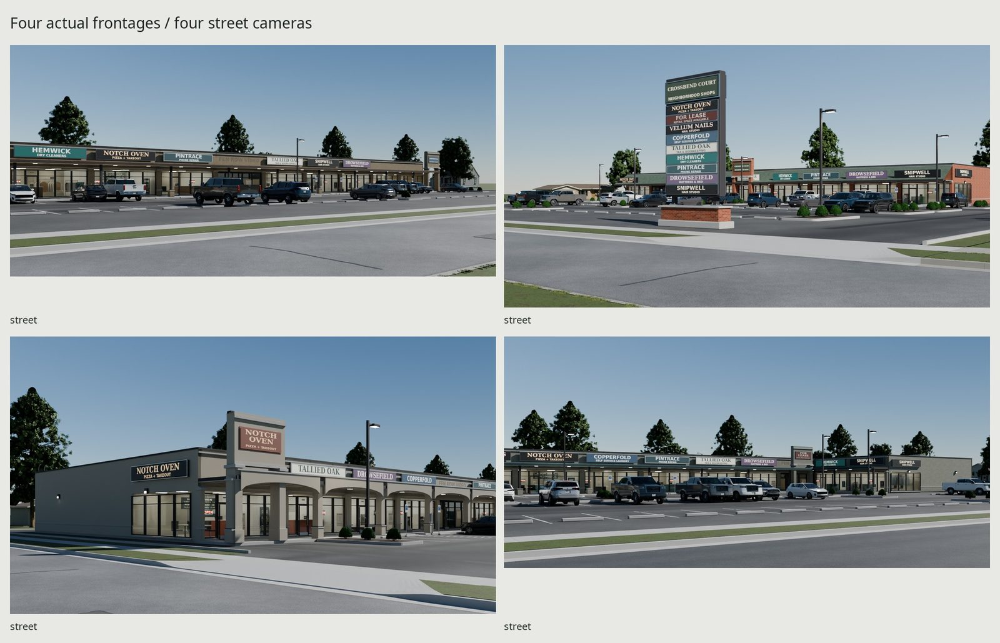
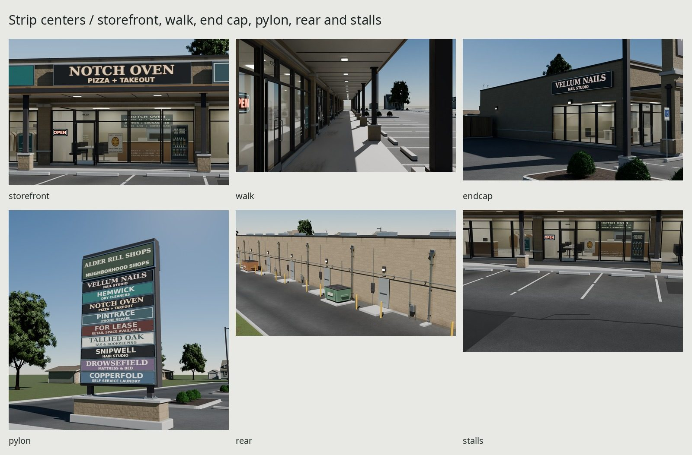
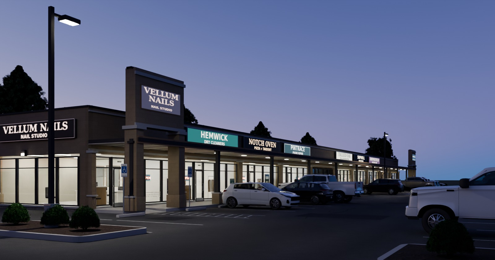

# Commercial / neighborhood strip centers

Four original small-shop centers, built in the 1985–2005 vocabulary and
maintained after approximately 15–25 years. Every vertex and texel is
scripted. The game deliveries are **external-image glTF**, sharing the gas
station's manufactured maps and the library's original terrain/plant maps.







[Construction sources and limits](STRIP_REFERENCE.md), [map allocation](TEXTURES.md),
[full-size critique](REVIEW.md), and [reference credits](refs/SOURCES.md)
accompany the delivery. Photography supplies comparison and dimensions;
none supplies texture pixels. Gas, houses and Ground deliveries remain unchanged.

## Plans and dimensions

| Seed / center | Parcel, ft | Building / area | Plan / palette | Stalls |
| --- | --- | --- | --- | ---: |
| 201 / Alder Rill Shops | 360 × 200 | 240 × 70 ft / 16,800 sq ft | Shallow arterial frontage; one double-loaded aisle; sandstone CMU / bronze | 55 |
| 202 / Crossbend Court | 300 × 260 | 198 × 64 ft / 12,672 sq ft | Deep narrow lot; four rows; warm brick / sage mansard | 85 |
| 203 / Lowbank Commons | 348 × 218 | 242 × 76 ft / 18,392 sq ft | Wrapped end at west street, parking beside it, east service buffer; cream EIFS / burgundy | 78 |
| 204 / Willow Span Shops | 396 × 244 | L / 17,920 sq ft | Two frontages, south entrance/east exit, cross aisle; putty CMU / teal | 91 |

These are authored parcel choices, not surveyed properties. The first three
have one public frontage; the corner has two. The shallow center has two
parking rows, the deep center four, and the west-facing center three.
The building, driveways, islands and pylon actually change position; the
street images use four different cameras. The source grammar resolves
circulation before modeling and rejects unsupported controls.

| Construction | Authored size / published comparator |
| --- | --- |
| Structural shop bay | 22 or 24 ft × 64–76 ft; within the cited architect's 20–30 ft width / 50–80 ft depth comparators |
| Standard stall / aisle | 9 × 18 ft / 24 ft; Brookfield nonresidential standards, p.16 |
| Accessible parking | Six dispersed 11 ft bays sharing three exclusive 5 ft aisles; Access Board van-space and count tables |
| Accessible walk | 10 ft deep; recessed 6 ft / 1:12 ramp and 4 ft level landing; measured surface rays and column clearances |
| Entrances / service drive | 24 ft clear, native 5 ft transition wings / 6 ft apron, six-inch Ground grid |
| Masonry / floor / roof | 203.2 mm shell; .1524 m floor; 4.2672 m membrane; 5.1816 m parapet; 6.72 m towers |
| Storefront | 55 mm aluminum sightlines / 120 mm profiles; 2.75 m head, 2.20 m transom, .27 m display sill; 914.4 × 2,030 mm entry leaf |
| Canopy soffit | 3.3075 m flat/arcade; 3.0925 m mansard; source rays measure each actual underside |
| Rear landings / protection | 1.7 × 1.6 m stoops at floor level; 114.3 mm loading bollards |

[STRIP_REFERENCE](STRIP_REFERENCE.md) links each dimensional authority and
states its limits. Retail parking ratios exceed the cited 3/1,000 sq ft
baseline; the asset is not a jurisdictional parking-demand study. A thousand
plans receive overlap/dimension tests, and the four proofs include occupied
parking, pickup circulation, a reversible passenger-car park/back-out and
rear-container pad obstacles. These are geometric demonstrations, not
traffic, delivery-truck or accessibility certification.

## Construction, tenants and twenty years of service

Storefront bays, wrapped/signed end caps, towers, arcade/flat/mansard walks,
real coping profiles and rooftop units reuse commercial construction. Rear
service leaves have stoops, bollards, unit numbers, scuppers, rain leaders,
wall packs, gas branches, clipped distribution pipe, conduit and the common
meter rack. Three welded container types stand on pads; the gated yard sits
clear of doors and circulation. Containers use authored generic envelopes,
not claimed manufacturer's capacities.

Nine original occupants share the same geometry/UV interface: **Vellum Nails,
Hemwick Dry Cleaners, Notch Oven Pizza, Copperfold Laundry, Pintrace Phone
Repair, Drowsefield Mattress, Tallied Oak Tax, Snipwell Hair Studio, and vacancy**.
Names and trade dress remain fictional. Channel-style carriers, illuminated
boxes and painted panels retain their independent frames. Opaque carriers
and a 1 mm face clearance remove the former detached letter shadows.

Each trade selects its own vinyl lettering, illustrated offers, hours,
luminous OPEN sign and window displays. Some panes have partial blinds;
vacancy has taped paper and FOR LEASE notices. The pizza room has a menu,
counter, oven and drinks cooler; salons have chairs/mirrors/product displays;
cleaners have a supported garment conveyor and front rack; laundry has rows
of front-load machines. These are economical **walk-visible fit-outs**, not
playable full-depth interiors. Foreground goods reuse equipment atlas cells;
no new interior atlas is allocated. Change a module's `tenant` key in
`strip_plan.py`; the sheet supplies the alternative ink/UVs and fit-out.

Stall-centered absorbed oil, side/aisle/rear wheel paths, irregular sawcut
patches, sealed cracks and faded paint describe service traffic. Door grime
and gum stay on the walk. Coping/scupper/wall-pack runoff, low damp/salts and
thin wet-hem corrosion retain their substrates' colors. The vacant fascia
has a removed tenant's letter ghost. Coverage is measured on balanced-photo
pairs and actual ray-verified floors, not inferred from shader settings.

Lit ceilings, OPEN tubes, sign faces, walk diffusers and pole lenses use the
sheet's emission. External glTF also carries named **KHR_lights_punctual**
fixture nodes: point lights in rooms, cutoff spots on the walk and lot, with
6 / 4.5 / 15 m ranges. Engines can switch these circuits by day/night while
retaining the emissive faces. Final Cycles/Eevee images import the external
package with these lights; presentation cars/houses/streets never ship in it.

## Geometry, draw primitives and bytes

Budget tables and exact verification receipts are generated in
`build/strip-look/{external-check,delivery-check,checks}.json`.
The building limit is 80k, each bay 7k, and every pylon 3,104 triangles.
Source bay counts include its share of the walk/roof and its fitted room.

| Seed | Building / bay triangles | Total / unique triangles | glTF + BIN bytes | Building / whole-seed primitives | GPU MiB |
| --- | ---: | ---: | ---: | ---: | ---: |
| 201 | 60,592 / 4,036–6,252 | 189,854 / 94,858 | 12,311,606 | 56 / 115 | 79.33 |
| 202 | 53,882 / 4,034–6,256 | 291,062 / 95,482 | 12,429,065 | 52 / 138 | 92.33 |
| 203 | 67,808 / 4,108–6,342 | 253,140 / 107,852 | 14,036,685 | 61 / 139 | 76.00 |
| 204 | 54,154 / 4,036–6,282 | 295,068 / 99,488 | 12,699,687 | 51 / 133 | 79.33 |

Building static surfaces join by material, with entry/service leaves separate.
Site surfaces consolidate; **pylons, poles, yards and containers retain their
own reusable roots and meshes**. The source blend retains every bay/end/tower
module and repeat socket, before runtime building consolidation. There is no
armature. Repeated shrubs share one stock mesh. Placed triangle counts include
all shrubs; unique geometry and compressed map memory are separate quantities.

Six fixed-building material primitives (seven with shingles) replace the
former repeated static bay surfaces. A building also pays for each independent
entry/service leaf; those cannot be called one draw. Compare this with the gas
station's 11 store primitives / 112 whole-default primitives in the family
README. The table reports actual exported material primitives, not an engine
frame-rate prediction or a count of distinct material names.

The default fell from 246 whole-center primitives to 115; the gas default has
112. The building counts include moving leaves, while fixed surfaces alone
use six or seven primitives. Distinct material states per seed are 9/10/9/9.

| Seed | Referenced image bytes | First-load bytes, geometry + images |
| --- | ---: | ---: |
| 201 | 54,117,556 | 66,344,805 |
| 202 | 63,768,899 | 76,054,033 |
| 203 | 51,552,253 | 65,447,395 |
| 204 | 54,117,556 | 66,671,058 |

The first center still needs its referenced images. Four centers together
reference 30 unique image files totaling 67,079,530 bytes; all four geometries
plus that union total 118,040,557 bytes. No per-seed image copies are shipped.
GPU figures above estimate block-compressed textures with complete mip chains;
they exclude geometry, framebuffers and presentation context.

Maps retain canonical relative URIs: one `export/textures/` for commercial and
strip art, plus the existing Ground, shrub and house map paths. Four seeds
and a repeat share decoded image identities in the fresh-import check. PNG
bytes are not GPU allocation. The only new strip maps cost **6⅔ MiB** with
block compression and full mip chains: 2048² RGBA color / 1024² RGB emission.
The atlas includes window/interior art and causal deposits. Existing
manufactured sets were Cycles-baked at 4096 and filtered for shipment.

## Frame, pivots and sockets

Meters; Blender +Z up, shop fronts −Y, glTF +Y up / +Z forward. The center's
origin is the parcel center at grade; the west-frontage archetype opens to −X.
Bay origins are front-center. Exports apply mesh transforms while preserving
physical hinge/socket frames.

| Node | Pivot / local rotation range |
| --- | --- |
| `Bay_<nn>_Entry` / `Bay_<nn>_ServiceDoor` | Exterior hinge, Z −100…0° |
| `Strip_DumpsterGate_-1/1` | Gate posts, Z −110…0° / 0…110° |
| `Strip_DumpsterLid_-1/1` | Rear lid edge, X −105…0° |
| `RearDumpster_<n>_Lid_<n>` | Actual rear lid edge, X −95…0° |
| `Bay_<nn>__RepeatLeft/Right` | Structural joints retained in the source/runtime hierarchy |
| `Bay_<nn>__Entry`, `*__Hand`, `*__RearHand` | Pedestrian entry and handle attachments |
| `Socket_{Drive,GroundCurb,GroundApron,GroundWalk}_1/2` | Native private/public-interface frames |

Full five-degree motion sweeps test the actual source surfaces, separately
from fresh-import frame/position equality. Meter working space, floor supports,
ramps, stoops and public curb seams use surface probes; constants are not
reported as measurements.

## Rebuild and evidence

```sh
make -C commercial WIDTH=1600 SAMPLES=40
make -C commercial check
make -C commercial repeat
python3 kit/repo_check.py
```

The default target now builds the strip; the established gas targets remain
available. `strip-model`, `strip-export`, `strip-check`, `strip-render`,
`strip-match`, `strip-eevee`, `strip-values`, `strip-review`, and `strip-repeat`
are individual stages. The final `strip-docs` stage writes five gallery JPGs
after the current-view audit. Review native renders before committing those JPGs.
The repeat checks both the independently rebuilt intermediate GLB and the
actual external glTF/BIN bytes, including shared URIs and fixture lights.
All Cycles work uses the shared GPU lock. Shared canonical library deliveries
are dependencies and remain unchanged. Sources and the final docs are tracked;
models/maps/exports/renders and photographic comparisons are rebuildable outputs.

| Path under `commercial/` | Evidence |
| --- | --- |
| `export/CommercialStrip-<seed>.gltf` + `.bin` | Game packages with shared external images and fixture lights |
| `build/strip-look/strip-<seed>.blend` | Deterministic editable procedural modules |
| `build/strip-look/strip-<seed>.glb` | Embedded inspection/intermediate copy; not the delivery format |
| `renders/strip/checkpoint/` | Hero, all four overhead/street views, details, turnaround, scale, dusk and contact sheet |
| `renders/strip/eevee/hero.png` | Same external package under Eevee |
| `renders/strip/matches/*-pair.jpg` | Six comparisons against the same balanced photographs |
| `renders/strip/measurements/` | Coverage/contrast masks and neutral-balance receipt |
| `renders/strip/fixes/*-before-after.jpg` | Native-pixel crops, every crop at least 800 px wide |
| `docs/strip-*.jpg` | Five final-only gallery JPGs, ≤1600 px / ≤200 KB each |

Historical before images are the immutable handoff capture under
`build/strip-final/before/`; a clean clone rebuilds the current asset without
requiring that historical image cache. [REVIEW](REVIEW.md) discloses the
measurement-rectangle change and the original as well as recomputed values.

## Final comparisons and measured variation

All before/after plates retain native pixels, with individual crops 1,312–1,600
pixels wide. The original handoff pixels are preserved rather than rerendered
using the corrected generator.

| Fix | Before / after proof |
| --- | --- |
| Four sites | [201](renders/strip/fixes/site-201-before-after.jpg), [202](renders/strip/fixes/site-202-before-after.jpg), [203](renders/strip/fixes/site-203-before-after.jpg), [204](renders/strip/fixes/site-204-before-after.jpg) |
| Tenant window dressing and fitted rooms | [Window life](renders/strip/fixes/window-life-before-after.jpg) |
| Detached letter shadows | [Sign face](renders/strip/fixes/sign-face-before-after.jpg) |
| Operating rooms, OPEN signs and pole pools | [Dusk](renders/strip/fixes/night-light-before-after.jpg) |
| Stall oils, tire paths, repairs and seals | [Asphalt](renders/strip/fixes/asphalt-before-after.jpg) |
| Softer entry deposits, retained gum | [Walk](renders/strip/fixes/walk-before-after.jpg) |
| Containers, gas runs, numbers and runoff | [Rear](renders/strip/fixes/rear-before-after.jpg) |
| Warm sandstone instead of cool gray | [Palette](renders/strip/fixes/warm-palette-before-after.jpg) |

[All final views](renders/strip/checkpoint/contact.jpg) and
[the six photographic pairs](renders/strip/matches/pairs.jpg) accompany these
plates. The four palettes are sandstone/bronze, brick/sage, cream/burgundy and
putty/teal. Roughly 26% of stalls are occupied by repeated pickup, crossover
and hatchback instances with several stock colors, favoring the shops.

| Surface / same validated patches | Before coverage / contrast | After coverage / contrast | Balanced photo coverage / contrast |
| --- | ---: | ---: | ---: |
| Asphalt | 28.24% / 5.25% | 44.99% / 5.79% | 46.00% / 7.25% |
| Shaded concrete walk | 11.07% / 5.58% | 39.68% / 5.70% | 58.27% / 6.24% |

That table records the accepted first delivery, before the asphalt value correction.
It uses the 4%-below-p85 display-value threshold, standardized at 1440 px;
8% results are retained in the JSON. Aggregate, repair and illumination
variation count as well as deposits: this is not measured chemical oil area.
Neutral assumptions and RGB gains are recorded beside the masks. The walk
photo patch is tiny, so its statistics are particularly sensitive to sampling.

The inherited report was asphalt 24.9% coverage / 5.1% contrast and walk
9.6% contrast. Changed parcels put a curb in the old asphalt rectangle, and
the old walk rectangle crossed a lighting gradient. Both current rectangles
were rejected, replaced with ray-verified floors, and **both before images
were remeasured in the replacement rectangles**. The table is the comparable
series; the inherited values cannot honestly be subtracted from its after
values. The reference rectangles remain unchanged.

In that earlier delivery, asphalt was slightly darker than its bright-corner photo patch (Y′ .657 vs .675), but
its strong-variation tail remains weaker. The shaded walk is brighter (.258
vs .232), with lower coverage. Architecture p1/p50/p95/p99 is
.015/.265/.625/.776; white clipping is .121%, largely fixture lenses.

## Asphalt value correction after the accepted delivery

The strip now applies darker COLOR_0 to the existing Ground asphalt, retains
more of its mineral mottling, and uses dry scalar roughness .96. The canonical
Ground/gas maps are unchanged. Absorbed engine oil and curved entry/aisle wheel
paths live in the wearing course; sky-reflecting alpha films were removed.
The exposed utility repairs and 45–55 mm routed seals retain asphalt response.
Broader soft walk deposits retain the individual gum marks and stop before
access-ramp slopes. No extra texture memory or material primitive is added.

The period_lot camera and its fitted glazing landmarks moved two bays along
the same frontage, clearing the foreground island. Lens, eye height, photo,
neutral balance and light/exposure remain fixed. Surface rays and sun-path
rays validate the replacement sunlit render patch. The accepted export was
also rendered through this camera with its verified original chart bytes.

| Asphalt display value Y′ (0–1) | Before | After / control |
| --- | ---: | ---: |
| Actual export, common reframed sunlit patch | .652 | .572 |
| Actual hero, identical foreground rectangle | .486 | .396 |
| Balanced photo, three sunlit native patches | — | .605 / .626 / .675 |

These are exposed image values, not measured real-world reflectance. The
assumed photographic neutral is the sunlit concrete curb, excluding joints
and blue shadow. The result is deliberately on the dark side: its measured
sunlit patch is .033 below the darkest of the three photo-patch medians.
See the [outlined photo patches](renders/strip/values/photo-sunlit-patches.jpg),
[outlined render patches](renders/strip/values/render-sunlit-patches.jpg) and
[1600 px native hero before/after](renders/strip/values/hero-lot-before-after.jpg).

| Surface | Accepted coverage / contrast | Current coverage / contrast | Balanced photo |
| --- | ---: | ---: | ---: |
| Asphalt, inherited accepted camera | 44.99% / 5.79% | — | 46.00% / 7.25% |
| Asphalt, common reframed camera | 51.07% / 6.32% | 56.31% / 7.12% | 46.00% / 7.25% |
| Shaded walk, unchanged camera/patch | 39.68% / 5.70% | 35.18% / 6.61% | 58.27% / 6.24% |

The same 4%-below-p85 metric, 1440 px normalization and photo rectangles are
retained. Contrast now approaches the asphalt photo; asphalt coverage is
10.31 percentage points higher. The walk statistic under-covers its tiny
photo patch even though broader traffic wear is visible beside the doors.
The photo still has coarser exposed aggregate and less orderly repair history.
[JSON receipts](renders/strip/values/value-round.json) retain the inherited
camera results separately from the common-camera comparison.

Ground and gas are measured without modifying their deliveries: actual
exported UV/vertex/PBR input median linear Y is .134 and .100, versus strip
.0905 before / .0492 after. These are vertex samples, not area-weighted
reflectance surveys. The [same-light swatches](renders/strip/values/same-light.jpg)
isolate those median tints and native PBR settings from different site shadows;
their display values are recorded in
[control-values.json](renders/strip/values/control-values.json).

The cold strip rebuild, checks, export repeat and repository check pass.
All five docs JPGs were regenerated from the current export and inspected at
native size before replacing the sole gallery commit. Building geometry,
palettes, occupancy and tenant fitouts remain as accepted. Current budgets
above include the 590–1,022 removed site-film triangles per seed.

## Credits and limits

Reference photography: Michael Barera and Yngvadottir (CC BY-SA 4.0), plus
unlicensed manufacturer/property brochure and service-rear comparators kept
only in ignored references. The register credits each exact image. Fonts:
DejaVu Sans/Serif, installed open-license faces. All generated art is original.
The rifle pipeline informed modeling/export/re-import rigor. Commercial,
Ground, Boxwood, HouseShingles and the original cars/houses/trees supply the
library dependencies; none is modified for this delivery.

Room equipment and clothing are deliberately simple, close typography is
atlas-limited, and repeated structures/services remain conspicuously orderly.
Eevee transmits less room light than Cycles with the shipped glass; its hero
is visibly darker and remains in the evidence. The sparse library neighborhood
is presentation context. These remain visible
CG tells; geometric verification does not establish photographic equivalence.
