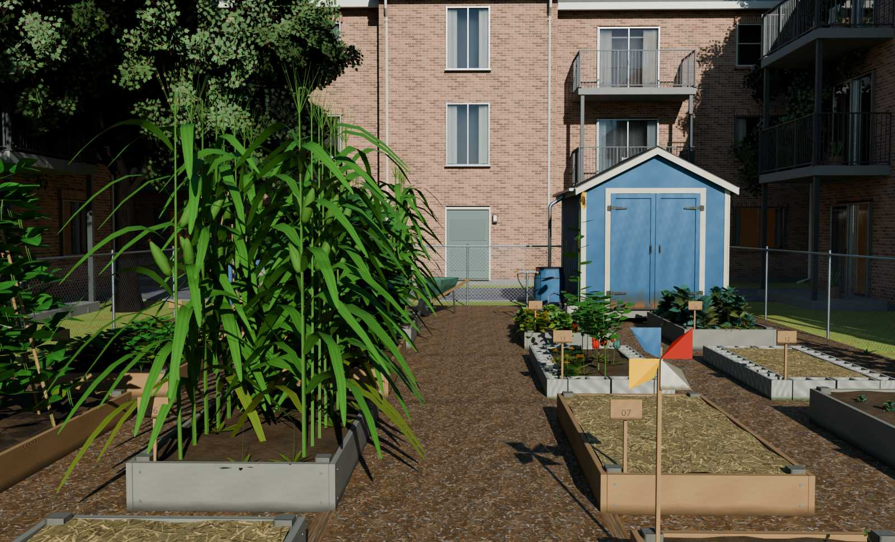
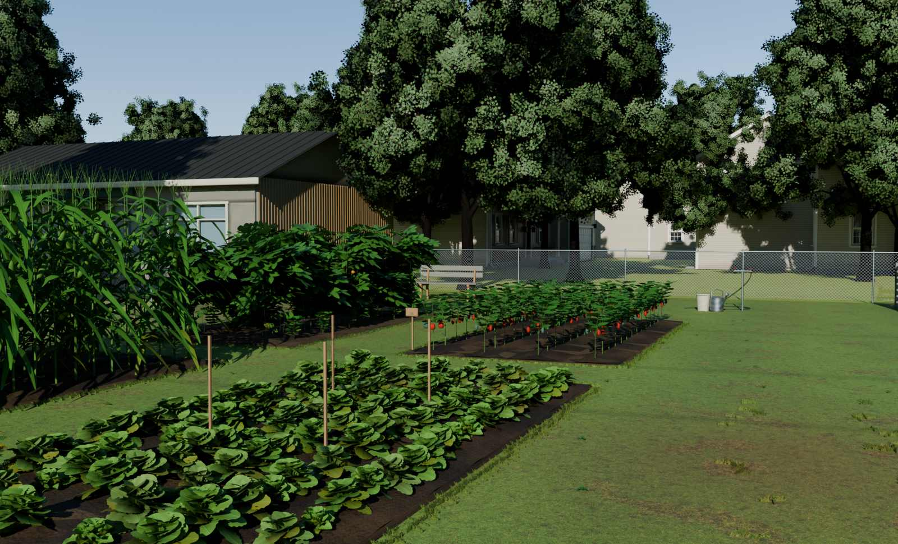
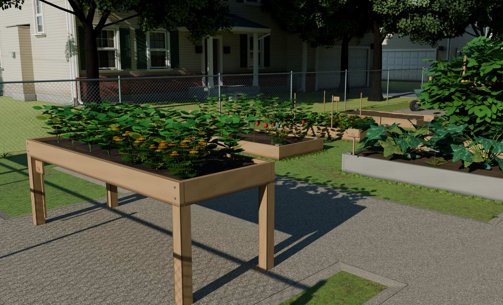
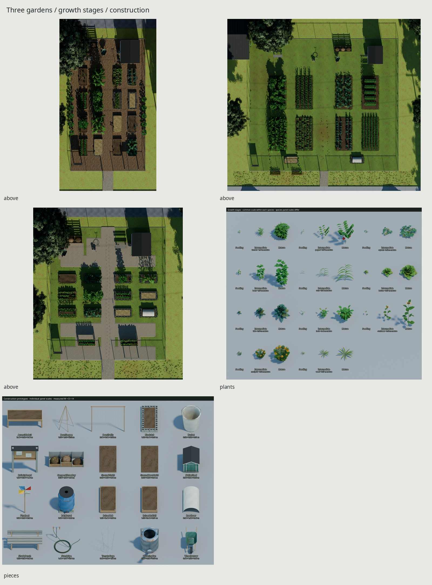
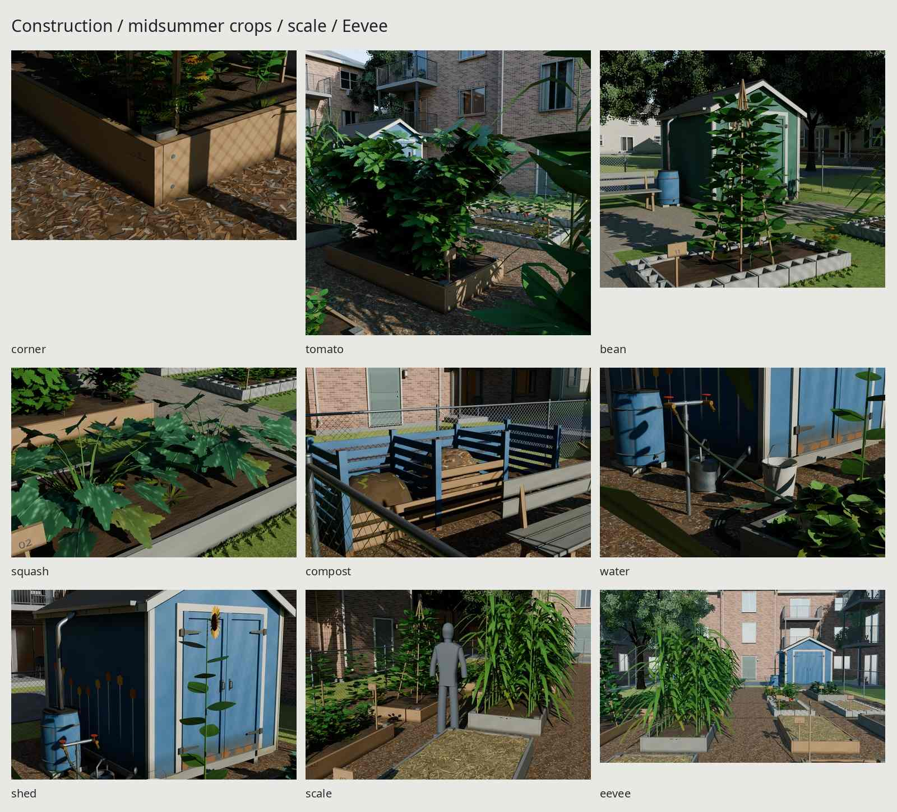

# Community gardens







Three original, seeded American community gardens of 1995–2015, delivered as
glTF with shared external images. July crops overlap their supports and plot
edges; newly planted, weedy and fallow plots retain their different care states.
Every mesh and asset texel is scripted. Photographs are references only.

| Seed | Fictional place | Year | Fence footprint | Why it differs |
| --- | --- | --- | --- | --- |
| 117 | Bellwether Growers | 1998 | 10.668 × 18.8976 m | A narrow apartment gap: wood chips, reclaimed bins, mural shed and brick enclosure |
| 229 | Meadow Commons | 2004 | 27.432 × 24.384 m | Eight large unframed tenant plots cut into summer turf, hilled rows, grass paths, mature edge trees and an adjacent park hall |
| 341 | Alder Neighbors | 2012 | 16.4592 × 18.8976 m | Newer tan beds and standing trays beside a compacted crushed-stone court, steel edging and neighborhood houses |

## Dimensions and construction

| Part | Real dimensions | Source / design decision |
| --- | --- | --- |
| Raised bed | 4 × 8 ft / 1.2192 × 2.4384 m | OSU and Iowa State two-sided reach guidance; authored 8 ft length |
| Tenant plot | 10 × 20 ft / 3.048 × 6.096 m | Brief; planted rows and internal access strips, rather than a ten-foot reach bed |
| Lumber | 38.1 mm thick; 234.95 or 285.75 mm high | Dressed nominal 2×10 / 2×12, butted ends and 88.9 mm corner posts |
| CMU | 193.675 × 193.675 × 396.875 mm | Angelus nominal 8×8×16 in unit; actual open cores and 25 mm webs |
| Main route | 1.524 m; accessible site 1.8288 m | Authored widths informed by garden guides and ADA route requirements |
| Compact working aisles | At least .9144 m | Iowa State equipment access guidance; exported gaps checked separately |
| Elevated tray | 2.4384 × .9144 m, work surface .8636 m | ADA 34 in maximum work height, two-sided 18 in reach |
| Tray underside | .6973 m; actual exported clearance tested | Above ADA 27 in / .6858 m knee height; nine knee-space rays |
| Chain link | 1.2192 m high, 3.048 mm wire | Native fence citations; 50.8335 mm perpendicular clear mesh |
| Shed | Nominal 2.4384 × 3.048 m | Native gauged 8×10 ft shed: skids, framing, sheathing, returned trim and hinged doors |
| Cage / trellis | 1.34 / 2.32 m total height | Authored 5 mm cage wire and 25 mm bamboo poles; .20 m driven feet put the trellis 2.12 m above grade |
| Hose | 20.6 mm outer diameter | Authored 5/8 in bore class; slack runs and coils supported on grade |
| Park hall, context only | 13 × 8.5 m, 5.05 m ridge | Original representative building; municipal reference informs adjacency, not a surveyed replica |

The [source register](refs/SOURCES.md) gives URLs, authors, rights and uses.
[REFERENCE.md](REFERENCE.md) explains construction, crop spacing and inference.
The city's gap-garden type follows land-trust accounts; the park relationship
follows municipal garden planning; Seattle's P-Patch publications inform the
later container and standing-bed garden. These are fictional sites. Route
widths and tray checks do not certify a real installation's ADA compliance.
The traditional shed threshold is outside the accessible-interior claim.

Soil has planting basins, row ridges, dry crust, straw and hose-wet patches.
Wood wear follows soil contact, water traps and exposure. Summer turf reuses
the library's own Ground blade normals and alpha field at a 3.048 m repeat;
a private albedo, mowing/drought/traffic tints, clipped edge tufts and rooted
clover replace the even lawn. Angular granular relief, loose shoulder stones,
steel edging and compressed sole/wheel marks distinguish the later court.

## Plants and reusable pieces

Tomato leaders reach 1.72 m above soil; their measured mature canopy reaches
about 1.96 m. Five leaders, overlapping nine-leaflet compounds and curved
branchlet cards carry green, turning and ripe trusses.
Zucchini forms overlapping .36–.46 m blades. Corn reaches 2.24 m before its
tassel; husked ears rise from leaf joints and carry brown silk at the tip.
Beans climb real poles and twine to 1.95 m. Marigolds branch into flowering
and spent heads. All eleven species have .28/.64/1.0 stages and seeded mature
variants. Lettuce and kale have eight mature variants with different leaf
counts, sizes and colors; placements add rotation, intermediate stages and
failed gaps. These leafy heads represent mixed greens.

| Plant | Seedling | Intermediate | Mature high | Mature field |
| --- | ---: | ---: | ---: | ---: |
| tomato | 444 | 892 | 4,200 | 2,746 |
| pepper | 142 | 456 | 1,790 | 236 |
| squash | 430 | 894 | 1,814 | 904 |
| bean | 338 | 578 | 1,358 | 436 |
| corn | 214 | 390 | 961 | 441 |
| lettuce | 372 | 788 | 1,012–1,268 | 116–164 |
| kale | 340 | 788 | 980–1,268 | 112–164 |
| herb | 240 | 848 | 1,840 | 164 |
| sunflower | 92 | 804 | 900 | 620 |
| marigold | 944 | 1,964 | 2,952 | 384 |
| weed | 66 | 66 | 66 | 26 |

Counts include each plant's descendants. The maximum remains below 4,608
triangles. Field versions preserve canopy silhouette with simpler petioles
and fruit. `_WIND` is a separate custom attribute; only actual leaf/turf tints
export as material-consumed `COLOR_0`.

| Piece | Triangles, including moving children |
| --- | ---: |
| Raised4x8 | 1,444 |
| Raised4x8Tall | 1,444 |
| Block4x8 | 1,536 |
| Accessible8x3 | 1,448 |
| Ground10x20 | 756 |
| GroundBare10x20 | 584 |
| TomatoCage | 608 |
| BeanTrellis | 322 |
| CompostThreeBay | 1,361 |
| Standpipe | 1,976 |
| RainBarrel | 1,396 |
| ShadeBench | 316 |
| BulletinBoard | 508 |
| Bucket | 476 |
| WateringCan | 702 |
| Wheelbarrow | 636 |
| RowCover | 570 |
| Pinwheel | 52 |
| BeanTeepee | 584 |
| NativeShed | 4,468 |

## Delivery costs

| Garden | Triangles | Plot plants | Materials | glTF / BIN bytes | External PNG bytes | Texture memory |
| --- | ---: | ---: | ---: | ---: | ---: | ---: |
| 117 | 125,758 | 202 | 3 | 862,266 / 7,505,092 | 10,755,853 | 24 MiB |
| 229 | 248,993 | 512 | 4 | 1,735,196 / 7,556,040 | 33,888,691 | 40 MiB |
| 341 | 118,974 | 167 | 4 | 780,623 / 8,826,240 | 33,888,691 | 40 MiB |

The park spends the original brief's remaining 250k allowance on visible turf
edges, fuller planting and varied heads; the plant and texture limits stay.
The city has three materials: opaque atlas, masked foliage and masked wire.
Park and accessible gardens add the existing-size lawn set as a fourth.

| Shared set | Shipped maps | Compressed full-mip allocation |
| --- | --- | ---: |
| GardenSurfaces | 2048² BaseColor / OpenGL +Y Normal / ORM | 16 MiB |
| GardenPlants | 1024² RGBA BaseColor / +Y Normal / ORM | 4 MiB |
| ChainLink | 1024² BaseColor-alpha / +Y Normal / ORM | 4 MiB |
| GardenLawn | 2048² private BaseColor, native +Y Normal / ORM | 16 MiB |

All seeds share image identities. Opaque finishes are authored and Cycles-baked
at 4096, then filtered to 2048; analytic plants are generated at 4096 and filtered
to 1024. Ground's accepted maps remain untouched. Identical lawn normal/ORM
bytes resolve to that native delivery. ORM is R occlusion, G roughness,
B metallic; BaseColor is sRGB. Estimates assume 8 bits/pixel/map and complete
mips, excluding geometry and engine overhead. Garden allocations total 40 MiB
across the entire family, rather than 104 MiB when counted independently.
Intentional shared charts and alpha-card overlap are audited for chart bounds,
collapsed UV triangles and measured density, not unique-island packing.

| Presentation site | Garden + context triangles | Unique image memory | glTF / BIN bytes |
| --- | ---: | ---: | ---: |
| 117 | 908,324 | 164.02 MiB | 1,134,839 / 33,710,896 |
| 229 | 1,872,723 | 158.00 MiB | 1,975,883 / 31,255,172 |
| 341 | 1,334,892 | 158.00 MiB | 967,238 / 31,778,188 |

`export/final/Garden_<seed>.gltf` and its BIN contain the game garden.
`Site_<seed>.gltf` adds the separately costed native neighborhood used for
presentation: apartments/houses, street, trees, cars, utility poles and the
park hall. Staggered rear house rows close gaps in the park and accessible
service views. Context is optional. Its native images are externalized losslessly
in a shared content-hash cache. The accepted native-car tangent rounding guard
preserves its source tangent; no native delivery is rewritten.

## Placement, generator and motion

Place the garden root at the center of its fence footprint on ground grade,
in metres, Blender +Z up and −Y front; glTF uses +Y up and +Z forward. Reserve
space for gate swing, plant overhang and the park's entry flower verge.
Keep the image URI directory structure or remap it in your importer.
`CommunityGardenPieces.gltf` contains overlapping prototype roots: instance
one named root and its children, rather than displaying the whole library at
once. Shared meshes and materials allow engine instancing. Batch static children by
material if an importer does not instance mesh references; retain pivots and
sockets. Distance LODs are
left to the engine; alpha overdraw still warrants profiling in large scenes.

`src/plan.py` owns dimensions, archetype and deterministic seed decisions.
The shipped seeds are 117 / 229 / 341. For another site run `make -C community-garden model SEEDS=118
ARCHETYPE=city` (also `park` or `accessible`). Checks and presentation presets
cover the three delivered seeds. Care states, crop placement and
piece variations derive from the seed. `plants.build(species, stage, seed,
support_radius, field=False)` builds an individual plant. `src/surfaces.py`
owns the metric finish fields. Private context rebuilds preserve native files.

Moving parts keep their real pivots and names:

| Part | Blender local axis / range |
| --- | --- |
| GateLeaf | Z −110°…0°, presented at −85° |
| Shed Door_L / Door_R | Z −110°…0° / 0°…110° |
| Context HallDoorLeft / HallDoorRight | Z −90°…0° / 0°…90° |
| BarrowWheel | X ±360° |
| PinwheelRotor | Y ±360° |
| Bib wheels | Z 0°…720° |
| Barrel tap | Z 0°…90° |
| Lid slides | Z translation 0…0.30 m |

Each plot and the standpipe expose gardener sockets in the hierarchy. The
import/contact check measures soil/root, cage feet, receiving grade and tray
knee-space surfaces. The separate motion check samples gates and shed doors
every 5° against exported solids, including the new hall and nearby ground;
it excludes boundary-only alpha sheets.
Serialization checks prove the export survives import, independently of those
construction and clearance measurements. An independent raw RGB-stream audit
checks that site packaging preserves the garden tints, with a .0046 linear
tolerance for Blender BYTE_COLOR import and U16 re-export. The renderer reads
the exported result, so missed color transfer cannot hide behind source shaders.

## Correction comparisons

Native before/after PNG panels accompany these JPG pairs. Each panel is at
least 800 px wide. The three heroes and specimen views retain their historical
camera; garden comparison cameras now sit among actual neighboring plots.

| Correction | Before / after |
| --- | --- |
| July lawn, blade relief, trimmed edges, drought and traffic | [Summer turf](renders/fix-crops/01-summer-turf.jpg) |
| Cut-earth park plots, hall and closed neighborhood | [Park](renders/fix-crops/02-park-plots-and-building.jpg) |
| Closed tomato canopy and varied leafy heads with failures | [Tomato](renders/fix-crops/03a-tomato.jpg), [heads](renders/fix-crops/03b-varied-heads.jpg) |
| Husked ears rising at leaf joints, brown tip silk | [Corn ear](renders/fix-crops/04-upright-corn-ears.jpg) |
| Removed city row-cover instance at the frame edge | [City corner](renders/fix-crops/05-row-cover-at-frame-edge.jpg) |
| Granular court, edging, loose stones and compressed tracks | [Accessible court](renders/fix-crops/06-granular-accessible-court.jpg) |
| Populated garden comparisons | [Wise](renders/fix-crops/07-wise_bed-whole-garden-pair.jpg), [City Hall](renders/fix-crops/07-cityhall_mature-whole-garden-pair.jpg), [Martin](renders/fix-crops/07-martin_place-whole-garden-pair.jpg) |
| Clear low sun, deep shade and retained highlights | [City](renders/fix-crops/08-117-clear-low-sun.jpg), [park](renders/fix-crops/08-229-clear-low-sun.jpg), [accessible](renders/fix-crops/08-341-clear-low-sun.jpg) |

## Rebuild and evidence

```sh
make -C community-garden
make -C community-garden check
make -C community-garden repeat
make -C community-garden check-texture-repeat
python3 kit/repo_check.py
```

Blender 5.2 and the kit's installed tools are required. `make` fetches only
registered image/PDF references, builds private source geometry and atlases,
bakes, exports, checks and renders at 1600 px / 96 samples, with 192-sample
heroes. Only absent native prerequisites are built. All Cycles jobs use the
shared GPU lock; camera fitting and CPU scene packaging precede one lease for
the complete serial render set. Interrupted views resume from current receipts.
No kit changes are required.

The complete evidence stays local under `renders/final/`: each seed's hero,
above and annotated plan, front/side/back inspections, construction and crop
close-ups; 117 also scale with a 1.8 m silhouette and Eevee; 341 also the tray.
`pieces.png` uses individually fitted panels with measured W × D × H labels.
`plants.png` keeps stages at a common scale within each species; species panel
scales differ and mature heights are labeled. Tomato detail cameras are fitted
inside actual aisles, with 25 conservative foreground rays reporting zero
hits for each delivered seed. These rays prove foreground clearance, not
plant density or image quality. `plants/` includes five
standalone specimens and the ear detail. `contact.jpg` and `matches/` contain
the full contact sheet and three midsummer garden pairs. Every final view
freshly imports an exported garden or site and its shipped baked maps.

`renders/fix-crops/` contains native before/after panels at least 800 px wide
for all eight corrections (`make fixes`). Historical images are preserved local checkpoint
evidence; a fresh clone cannot reconstruct earlier revisions from current
scripts; those historical inputs are optional for a fresh `make` and required
for the correction crops. Hero and specimen cameras match exactly; photographic comparison
cameras now fit equivalent landmarks inside the delivered sites.
`REVIEW.md` records the full-size critique passes, white-balance neutrals and
remaining CG cues. Camera fits are unsurveyed: City Hall's hoop scale and
occluded bed ends are inferred. The botanical pairs compare morphology;
only tomato/concrete and squash/weed-cloth have assumed neutral balances.

The exact repeat rebuilds geometry, full sites, private shed, analytic maps,
source fields and camera/WB outputs at identical paths. The native-car tangent
guard checks its variable pre-repair rounding diagnostic separately; the complete
repaired site BIN still compares exactly. GPU rebakes are compared
separately at 4K and shipped 2K using the kit's max/RMSE tolerance. GPU renders
are provenance checked, not promised byte-identical. A final gallery is created
with `make docs` after recording the local full-size visual review receipt;
five JPGs are bounded to 1600 px and 200 KB each and committed separately.

Known limitations: close leaves retain repeated analytic silhouettes/veins;
branch tiers and fruit are regular, squash runs cool/teal, field silk is thin
and thin-leaf transmission approximate. Chips have shallow relief; compost
mounds and the park hall's opaque glazing are simple. Suspended hose spans
are too straight; foot/wheel marks remain regularly spaced. Coarse turf cards
and overly straight soil banks show in macros, small vessels retain facets,
and marigold flowers are angular.
Eevee glass and foliage are flatter than Cycles. Native tree crowns repeat.
Photo architecture, crop mixtures and illumination differ from these fictional
sites. The planted scenes read best from their intended garden viewpoints;
measurements and successful checks do not make them exact photographic replicas.

Credits: original library Ground, fences, shed, houses, apartments, trees, cars
and utility families retain their documented source credits. Text uses installed
Noto Sans (SIL OFL 1.1) found through `kit/fonts.py`. All signs and names are
fictional. See [refs/SOURCES.md](refs/SOURCES.md) for reference credits;
photographs never become asset textures or mesh input.
