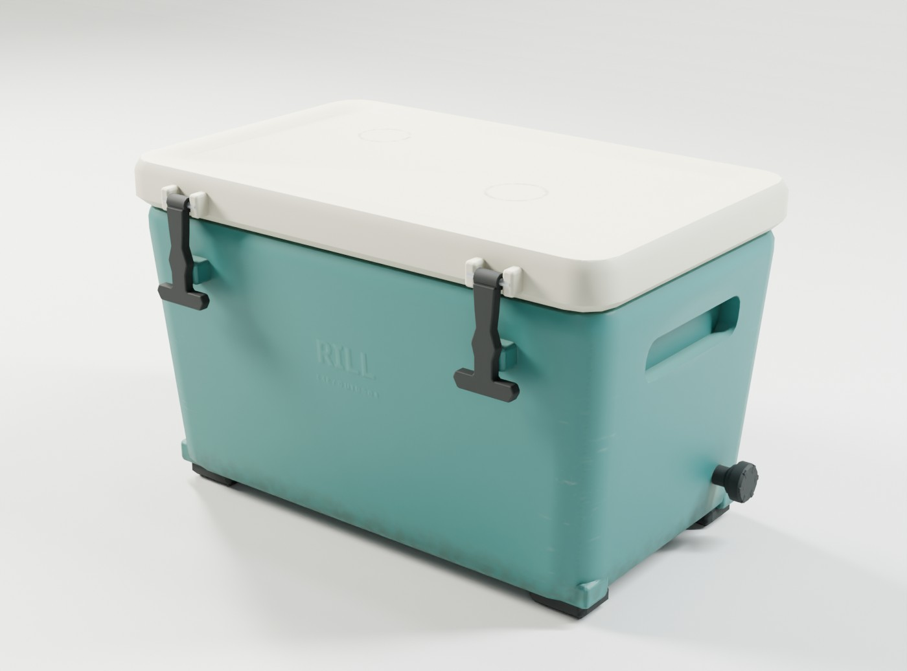
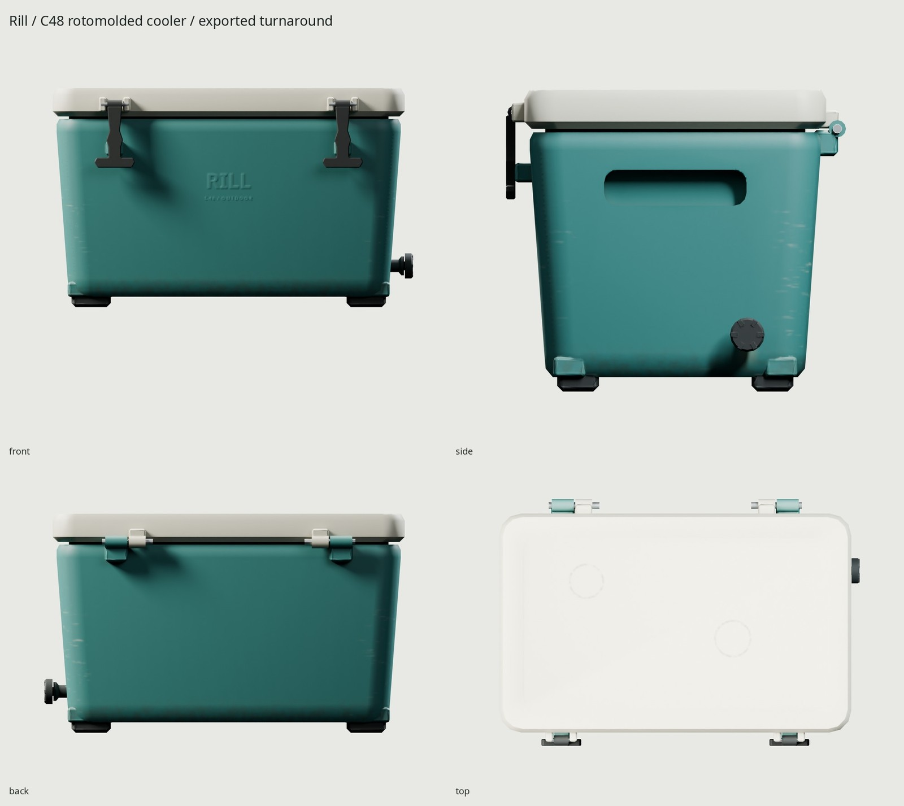
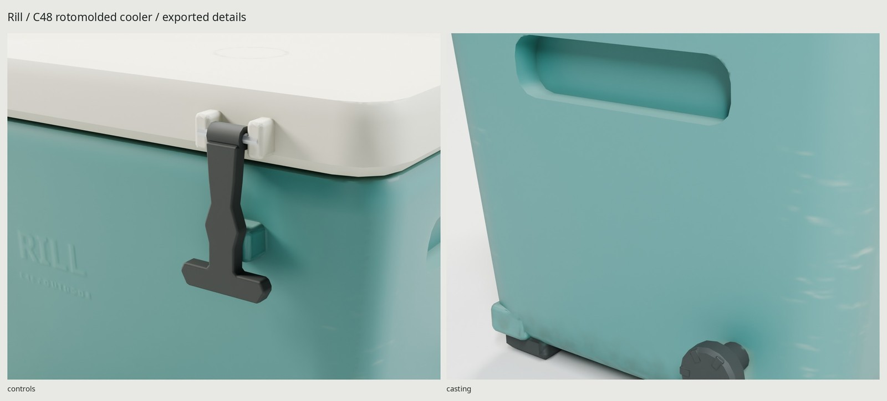

# Rill / C48

An original 47-quart rotomolded patio cooler with teal polyethylene, flax lid,
recessed molded grips, rubber T-latches and fictional molded branding. All
geometry, weather masks, embossing and lighting are generated by scripts.



## Dimensions and construction

[REFERENCE.md](REFERENCE.md) compares the original design with manufacturer
measurements and [refs/SOURCES.md](refs/SOURCES.md) credits every inspection
image. RTIC's 45 QT drawing establishes a typical 669 × 462 × 400 mm envelope;
our original design has a slightly taller cavity, different crown and molded
integral grips. No real brand or pattern is reproduced.

| Actual measurement | Default model |
| --- | --- |
| Overall W × D × H, hardware included | 689.05 × 472 × 419.1 mm |
| Lid crown plan | 673.1 × 419.1 mm |
| Cavity, actual vertex-section integration | 44.810 L / 47.350 US qt |
| Interior depth | 295 mm to the mouth plane |
| Wall remaining behind recessed grip | 29.61 mm |
| Ground | Four rubber pads, minimum Z=0 |

The C48 name is nominal. Capacity integrates section areas extracted from the
actual interior mesh, omitting the tiny drain volume; it is not inferred from
the name or exterior envelope. Body walls taper and round into a thick floor,
shoulder and continuous mouth. The lid has a stepped crown, insulated inner
plug and continuous retained gasket. Alternating bored hinge sleeves and
bridges connect to secured stainless pins. Both latch eyes run on actual pins;
the flexible cam lip bears on a molded body lug. One bored drain passage
connects the cavity to its threaded seat and separate cap. No basket, rope
handle or accessory is included.

Meters, +Z up, front −Y; glTF is +Y up, front +Z. The origin is centered on the
four-pad footprint at ground level. Geometry transforms are applied in export.

## Controls and pivots

| Node | Local axis / range | Rest pivot in module coordinates |
| --- | --- | --- |
| Lid | X, 0 closed … −108° open | (0, 225, 365) mm |
| Latch_L / Latch_R | X, 0 engaged … −90° released | (∓218, −224, 388) mm |
| Drain_Plug | X, 0…360° | (336, 100, 79) mm |

Release both latches to −90° before opening the lid. Source and game sweeps
sample this sequence every 3°; drain rotation is sampled every 15°. Latch
lip/lug flex and captive eye/pin contact are explicitly allowed, with reasons.
There is no blanket allowance for lid/body interference. Gasket compression,
rubber deformation and the drain screw's axial thread travel are not simulated.
To remove the drain cap in an engine, translate it outward along local +X after
turning. The studio open pose is −100° and remains within the tested range.
No armature or animation clip is needed.

## Materials and performance

One **1024² BaseColor / OpenGL +Y Normal / ORM** texture set, baked at 4096².
ORM is R occlusion, G roughness, B metallic. One delivered material shares this
atlas across the five rigid nodes; approximately **4 MB compressed GPU memory**.
The game mesh is **4,036 triangles** against the brief's 2,000–5,000 budget.
Fine Noto-font emboss and molding witness detail bake to normals rather than
adding game geometry. UVs have no measured overlap/outside/degenerate triangles,
64.21% coverage and p5/median/p95 density about 439/497/509 px/m.

`WEAR=0.35` gives ordinary suburban use. Ground height and exposed corners drive
sparse stress-whitened sliding/impact scratches and bottom splash dirt;
cavities collect rim grime. Upward surfaces fade, touch zones polish, gravity
drives a drain stain, and standing drinks leave broken mineral rings on the
lid. Fine
whole-surface noise describes polyethylene molding only. Cleaner/dirtier
versions rebuild by changing this single parameter.

The GLB is **1,642,980 bytes**. BaseColor / Normal / ORM PNGs are
329,135 / 451,312 / 481,017 bytes. High-detail source: 8,390 triangles.
The imported-GLB Cycles and Eevee views, final photographic pair and three
JPG docs are generated from the delivery. Matching two-segment source/game
bevels reduce source/game differences but do not eliminate small latch-ear,
reaction-lug and foot/runner fillet shading. Those and the softened lettering/
molding grain are the weakest close-view details.




## Rebuild and verification

Uses installed Blender 5.2.2, Python/Pillow/NumPy and flock. No packages, meshes,
materials, textures or HDRIs are downloaded. Only credited reference JPGs are
retrieved; they never enter Blender.

```sh
make                         # fetch, model, UV, 4K GPU bake, 1K maps, GLB, renders, checks
make check                   # geometry, scale, UV, normals, import, motion and construction
make match PASS=source-match WIDTH=1000 SAMPLES=40
make match-final PASS=shipped-match WIDTH=1000 SAMPLES=40
make WEAR=0.65
make clean && make
```

All Cycles passes use the shared kit GPU flock and explicit GPU selection.
The same seed/parameters reproduce geometry; GPU texture bytes can vary within
ordinary floating-point noise.

| Local output | Contents |
| --- | --- |
| `export/Cooler.glb` | Embedded baked atlas, static body and four moving pivots |
| `textures/bake/`, `textures/ship/` | Three 4096 bake / 1024 shipped maps |
| `build/*audit.json`, `uv-report.json`, `delivery-check.json` | Geometry, UV, normal and fresh GLB import proof |
| `build/motion-*.json`, `construction-*.json` | Independent actual-surface latch, drain and staged lid sweeps; cavity, supports and bore |
| `renders/final/contact.jpg` | All delivered Cycles shots and Eevee last |
| `renders/final/` | Closed/open heroes, four-view turnaround, latch/grip/gasket details, 1.8 m silhouette |
| `renders/final-eevee/hero_closed.png` | Eevee from the same GLB |
| `renders/used-refined/used_full-pair.jpg`, `renders/review-glb/used_full-pair.jpg` | Source and shipped photographic comparison |
| `docs/` | Three final JPGs, ≤1600 px wide and ≤200 KB each |

[REVIEW.md](REVIEW.md) records source and exported critiques. The outdoor photo
has different palette, rope handles and a wet body held above water; the C48 is
an original dry patio prop. Camera calibration is approximate (9.5 px RMS on a
480 px crop; lens at its 180 mm bound), not an exact lens recovery or product
copy. The separate actual used-cooler comparison fits six corners at 11.10 px
RMS over a 635 px crop, estimated 62.3 mm lens. Its exact age is unknown and its
body is more heavily damaged; original C48 wear is ordinary patio use. Small
molding/letter detail necessarily softens in the 1024 atlas.

All vertices and texels are original scripts. Fictional Rill/C48 lettering uses
the installed open-license Noto Sans font. Manufacturer images remain their
owners' copyrighted reference material outside Git. The rifle and kit provide
the workflow standard. No installation or external service is needed.
