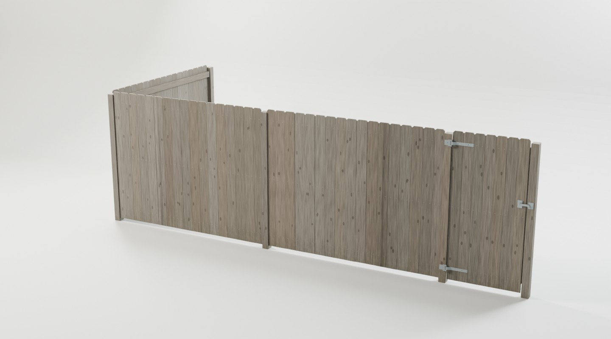
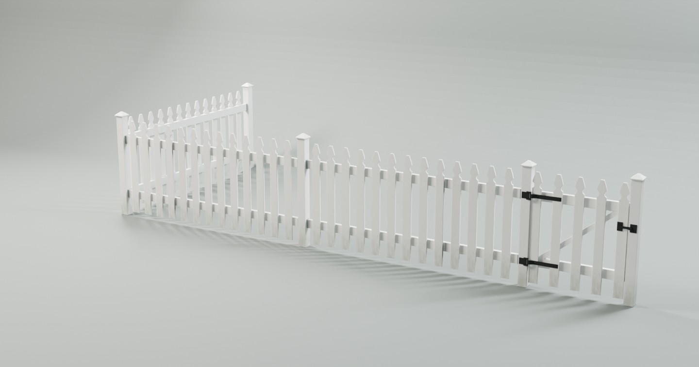
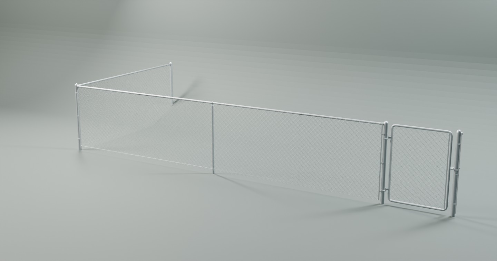
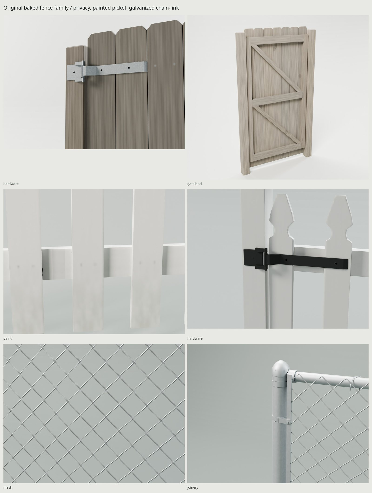
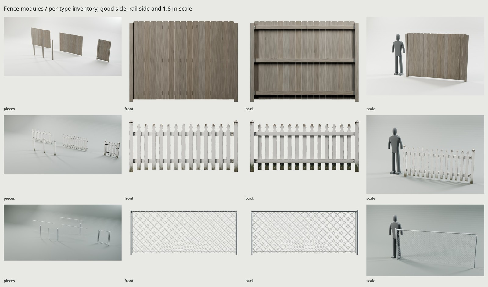

# Modular backyard fence family

Three original American backyard systems: weathered dog-ear pine privacy,
painted white cedar pickets and galvanized residential chain-link. Each includes
sections, the appropriate end/line/corner posts, a working walk gate and
post-center sockets. Every vertex and texel is generated by our scripts.

All use grade-level origins, Blender +X along a bay and −Y toward the good side.
Designers snap post centers, choose a matching end treatment and retain the
shared materials. Individual pipeline outputs live in `export/`,
`picket/export/` and `chain-link/export/`; the family root `make` builds all three.







## Privacy dimensions and construction

[REFERENCE.md](REFERENCE.md) distinguishes published dimensions from original
construction choices. [refs/SOURCES.md](refs/SOURCES.md) records reference
owners, licenses and use; [REVIEW.md](REVIEW.md) records the image critiques.

| Dimension | Generated |
| --- | --- |
| Straight post-center pitch | 2.4384 m / 96 in |
| Clear post-face infill width | 2.3495 m / 92.5 in |
| Pickets | 1.8288 m / 72 in long, 15.875 mm / 5/8 in thick |
| Picket width | Fifteen 139.7 mm / 5.5 in interior boards, two balanced 115 mm rip cuts |
| Dry-season board gaps | 1.5 mm; intentional shrink gaps, distinct from modular seams |
| Nominal ground clearance | 50.8 mm / 2 in; seeded rough-cut seating variation ≈±1.3 mm |
| Maximum source height | 1.88068 m including slight picket seating variation |
| Actual 4×4 posts | 88.9 mm square, 1.840 m above grade |
| Actual 2×4 rails | 38.1 mm thick × 88.9 mm high |
| Rail centers above grade | 196.85 / 965.20 / 1733.55 mm |
| Gate post-center pitch | 1.0033 m / 39.5 in |
| Gate clear opening / leaf | 914.4 / 889.0 mm, 12.7 mm clearance each side |

The three rails sit in original 1 mm formed galvanized saddles. Each section
carries its saddles, so a corner post accepts two rotated sections without
adding hardware to the post mesh. Seat-to-rail and web-to-post-plane contact
are measured on evaluated surfaces; the rail ends leave 6 mm for mounting
screw heads. Three pairs of baked galvanized nail heads secure each picket.

The gate has stiles, three butt-jointed rails and two compression braces
bearing from the lower hinge toward the upper latch. Its two hinges have
stationary pins, hollow moving sleeves and bent strap necks. A lifting gravity
latch has a pivot stand-off and a stationary receiving seat/tab. The posts end
at grade: hidden buried wood, gravel and concrete footings are intentionally
omitted. In a level, terrain covers the bottom caps.

Wood aging follows UV exposure, earlywood erosion, longitudinal drying checks,
wet cut ends, fastener drips and ground splash/mildew. Boards vary coherently
between gray and tan; the two section seeds rearrange their color and knot
rhythm. `WEAR` changes these weather layers without replacing the construction.

## Snapping and origins

Coordinates below are **Blender meters**, +Z up, −Y the good/picket side,
+Y the rail side, +X along a straight fence. A module origin is the midpoint
between its post centers, on the post centerline at grade. A standalone post
origin is its square center at grade. The offset of the thin picket skin from
that centerline is intentional. glTF coordinates are `(x, z, -y)`.

The library GLB lays out roots for inspection. Instantiate a named root and
**replace its root transform** with your placement transform; retain all child
transforms. Keep its shared imported material. All mesh scales are applied.

```text
TOP VIEW (+Z looking down)                   rail side +Y

                          end post
                             ●  (2.4384, 2.4384)
                             │
                        section A, yaw +90°
                             │
end        section A       line        section B      corner
 ●────────────┼──────────────●─────────────┼─────────────●
-2.4384     -1.2192           0          +1.2192       +2.4384  → +X

               good / picket side −Y

Replace a bay with gate:
 section → ●─────────[ hinged leaf ]─────────● ← section
           left gate post                    right gate post
                  center pitch = 1.0033 m
```

| Root | Local sockets / role | Mesh triangles |
| --- | --- | ---: |
| `Section_A` | `__L=(-1.2192,0,0)`, `__R=(+1.2192,0,0)` | 664 |
| `Section_B` | Same sockets; independent timber variation | 664 |
| `Post_End` | `__connect_0=(0,0,0)`, facing +X | 20 |
| `Post_Line` | `__connect_0` and `__connect_180`, both at origin | 20 |
| `Post_Corner` | `__connect_180` toward −X; `__connect_90` toward +Y | 20 |
| `Gate_Bay` | `__L=(-.50165,0,0)`, `__R=(+.50165,0,0)`; **includes both posts** | 712 |

Socket names include the root prefix, e.g. `Section_A__L`. Endpoint sockets
coincide with **post centers**, not visible board edges. Align an endpoint
socket to a post's `connect` socket, with their local +X arrows facing in
opposite directions. This places the infill at the post face and the bracket
web against it. Add one post at each unique ordinary junction. Do not add a
second post at a `Gate_Bay` endpoint.

Each section also has `__rail_L_1…3` / `__rail_R_1…3` at the post face and
actual rail-center heights. Each post has corresponding `__face_angle_1…3`
sockets. These expose the physical support planes separately from the
post-center snapping grid. `Gate__free_edge` marks the latch-side picket edge.

For the diagram's right corner, place another section at
`(2.4384,1.2192,0)` with Z rotation +90°, and its end post at
`(2.4384,2.4384,0)` facing −Y. For a left corner, rotate the corner post −90° and connect a section
by its R socket, yaw −90°, so both good sides face outside the yard;
`src/assemble.py` demonstrates that case with an additional bay and a gate.
The assembled-run GLB is made by re-importing the baked library and sharing
its meshes/materials, then exporting that arrangement; no look-dev materials
enter the final render.

**Slopes:** these delivered pieces snap on flat ground. On a slope, step bays
while keeping posts and pickets vertical and rails level. Regenerate taller
junction posts and independent high/low rail sockets for the chosen step
heights; the flat post variant has no allowance for arbitrary steps. Raking
requires re-authoring rail angles and picket seating while keeping pickets
plumb. Keep the gate bay level and verify the terrain beneath its full sweep.

## Moving parts

| Node | Local pivot in its parent frame | Axis / useful range |
| --- | --- | --- |
| `Gate` | Gate_Bay `(-.45085,-.054,0)`; coaxial with physical hinge pins | +Z, −110°…0° |
| `Latch` | Gate `(.82585,.003,1.12)` | +Y, −65°…0° |

Lift the latch to −65° **before** opening the gate toward −Y. Close the gate
before lowering the latch. No armature or animation clips are required.
The gate sweep uses 111 poses at 1° intervals; latch release uses 34 poses
with at most 2° intervals, each on game and high sources. This is a sampled
solid-surface collision check, with a 0.3 mm tolerance, not a continuous-time
collision guarantee. No collision allow-list hides a gate/post intersection.

## Delivery and cost

One **2048² BaseColor / OpenGL +Y Normal / ORM** texture set and one shared
material for every privacy module, including galvanized hardware. ORM stores
R occlusion / G roughness / B metallic. Source materials bake at 4096² with
32 GPU samples; modules and moving parts project in eight isolated groups,
with 65 explicit source-coordinate frames kept aligned to their timber. This
prevents a neighboring section from painting bracket metal onto a reusable
post. Delivery filtering uses linear-light color, RMS roughness and
renormalized tangent normals. The shared set costs approximately **16 MiB**
with BC7/BC5-style block compression and full mip chains; it is loaded once
for the privacy system, not once per fence section.

| Delivery measurement | Result |
| --- | --- |
| Entire module library | 2,100 triangles / 3,000 family cap; every module under 2,000 |
| Stationary section draw calls | 1 per placed section; 1 shared material |
| Gate bay | 3 meshes: stationary posts/hardware, hinged leaf, lifting latch |
| Standalone post | 20 triangles; deliberately below the nominal 300 lower guideline, with no filler detail |
| UV coverage / overlaps | 50.29% / zero measured overlapping triangle pairs |
| UV density p5 / median / p95 | 233 / 233 / 490 px/m at 2048 |
| GLB bytes | 9,875,704 |
| BaseColor / Normal / ORM PNG bytes | 3,822,137 / 2,885,619 / 2,955,917 |

The two unique section regions trade close-up texel density for per-board
variation while sharing a single family set. The post types share economical
construction and differ in their connection sockets; the pine shader gives
them small surface differences. Engine instances should share these meshes
and the imported material rather than duplicating texture resources.

## Rebuild and proof

Installed requirements: Blender 5.2, Python with Pillow/NumPy, Noto Sans and
`flock`. No packages, code, textures or lighting are downloaded. `make refs`
fetches only the cited inspection images/PDFs. GPU work uses the kit's shared
GPU lock and OptiX with CUDA fallback; temporary files stay in the worktree.

```sh
make -C fences                 # refs → sources → UV → 4K bake → 2K → GLB → renders → docs → checks
make -C fences check           # budgets, dimensions, solids, UVs, GLB, sockets, motion, repository
make -C fences match PASS=source-match WIDTH=1000 SAMPLES=24
make -C fences match-final     # same calibrated view on the exported GLB
make -C fences WEAR=.25 render PASS=cleaner
make -C fences clean
make -C fences                 # rebuild generated delivery from scripts
```

Main outputs (rebuilt and ignored by Git):

- `export/WoodPrivacy.glb`: reusable library roots and shared embedded textures.
- `export/PrivacyAssembly.glb`: corner/gate assembly proof, built from that GLB.
- `textures/ship/T_WoodPrivacy_{BaseColor,Normal,ORM}.png`.
- `renders/final/`: Cycles heroes, four-view turnaround, three detail views,
  gate front/back, individual modules and 1.8 m human scale.
- `renders/final-eevee/hero_closed.png`: Eevee delivery check.
- `renders/assembly/{corner_good,corner_rails}.png`: short assembled corner run.
- `renders/final/contact.jpg`: all final views, including assembly and Eevee.
- `renders/photo-glb/match_rails-pair.jpg`: calibrated photographic comparison.
- `build/delivery-check.json`: independent raw GLB / fresh-import serialization,
  normals, texture size, UV, geometry and socket validation.
- `build/construction-check.json`: evaluated support contacts, gate opening,
  pin-axis alignment, module triangle counts, released-gate clearance on both
  sources, actual imported snap errors, a 90° corner solid-overlap check and
  delivered-ORM sampling that rejects projected metal on bare wooden posts.
- `build/motion-{game,high}.json`: independent latch-release sweeps.

Serialization agreement alone does not prove construction. The construction
checker measures the actual rail seats, bracket webs, frame bearings, physical
pin centers and imported socket positions. Its sampled gate sweep proves the
released mechanism at those poses. The final render metadata records each GLB
path and SHA-256, engine and samples.

Render-only views and lighting live in `src/views.py`; editing those settings
invalidates studio output without repacking UVs or rebaking the atlas.

## Limits and credits

Fine grain, nail marks and checks soften in the shared 2048 atlas, especially
in a very close view; the macro grain remains more regular than a photographed
rough-sawn board. The kit is designed for repeated backyard fences at gameplay
distances. No buried footing geometry, terrain fitting, runtime collision
meshes or distance LODs are supplied. Two section variants reduce obvious bay
repetition; they are not an infinite nonrepeating wood generator.

Everything delivered is original scripted geometry and shading. Photos/PDFs
are viewing and measurement references only. Font in review sheets: Noto Sans,
SIL Open Font License. Shared kit additions: procedural weathered pine and
zinc, reverse-view studio yaw, scalable studio lighting, wider seamless
backgrounds, and explicit coordinate-frame preservation during isolated bakes.
Existing defaults and bake interfaces remain compatible with the grill.


## Painted picket system

[Detailed picket dimensions, sockets and rebuild notes](picket/README.md).
Published 42 in boards are actual 5/8 × 3.5 in; 13 French Gothic pickets fit each
8 ft post-center bay. Equal interior/end gaps are 85.2714 mm. Two actual 2×4
rails, formed saddles, 4×4 posts and pyramid caps form a site-built painted
cedar fence. Cut/edge chips and nail seats expose wood; damp ground splash and
mildew fade upward. Post/cap top is 1.205 m; board top 1.1176 m includes a 2 in
ground gap. The five-picket gate has a compression brace, black bent-strap
hinges and a lifting latch.

Panel roots `Picket_A` / `Picket_B` use the same ±1.2192 m L/R sockets and
origin convention as privacy. `Picket_End`, `Picket_Line`, `Picket_Corner` carry
socket yaws 0°, 0°/180°, 180°/90°. `Picket_GateBay` includes both posts; its
L/R sockets are ±.50165 m. Opening/leaf/gaps match privacy at 914.4 / 889.0 /
12.7 mm. The separate `Picket_Gate` hinge is bay-local (−.45085,−.054,0), Z
−110°…0°; release `Picket_Gate_Latch` about Y −65°…0° before swinging.

## Galvanized chain-link system

[Detailed chain-link dimensions, termination choices and pivots](chain-link/README.md).
48 in fabric, 10 ft / 3.048 m post-center bays, 11-gauge wire, nominal 2 in clear
mesh measured perpendicular to a diagonal wire pair. Actual tube ODs are
41.275 mm line posts, 60.325 mm terminals and 34.925 mm rail/gate frame. Rounded
knuckled selvage, top rail, eye caps, bottom tension wire, ties, tension bars,
staggered corner bands, hollow rail ends and stamped support lugs describe
real assembly. No wire diamonds are modeled as cylinders in the shipped asset.

| Bay | Left endpoint | Right endpoint |
| --- | --- | --- |
| `Chain_Start` | Terminal bar | Line post |
| `Chain_EndSection` | Line post | Terminal bar |
| `Chain_Section` | Line post | Line post |
| `Chain_BetweenTerminals` | Terminal bar | Terminal bar |

Each uses L/R X ±1.524 m at grade. `Chain_Terminal` faces +X;
`Chain_Terminal_End` faces −X while keeping fabric on −Y. `Chain_Line` has
0°/180° sockets; `Chain_Corner` has 180°/90°. These choices keep fabric on the
same face while meeting actual tension bars. The corner's second band set is
staggered 24 mm, so two fittings never occupy the same ring.

The `Chain_GateBay` prefab contains **three budgeted modules**, two terminal
posts and the separate rounded welded gate. L/R X ±.5349875 m; clear opening
1009.65 mm, leaf 914.4 mm, 47.625 mm side hardware gaps. Replace adjacent
standalone posts with its included posts. `Chain_Gate` hinges at bay-local
(−.479425,−.043,0), Z −110°…0°. The open-jaw fork at (.4672,0,.72) lifts about
Y −95°…0° before the leaf swings. The gate prefab's aggregate triangles are
reported separately from its independently reusable under-2k modules.

## Shared snapping and slopes

```text
TOP VIEW: sockets are post centers, not panel surface edges

wood:   ●─────────────┼─────────────●─────────────┼─────────────●
        <------- 2.4384 m --------> <------- 2.4384 m -------->
chain:  ●────────────────┼────────────────●──── gate ────●
        <---------- 3.048 m ------------> <─ 1.069975 m ─>
        terminal/line choice determines where the infill ends

90° corner: two coincident post-center sockets, ONE corner post
                 ● end
                 │ bay
                 ●──────────────┼──────────────● → +X
               corner                         line/end
```

Preserve child transforms and replace root inspection transforms. Never place
two posts at one center. A gate bay owns its two posts; snap adjacent section
end sockets to its L/R and omit standalone posts there. glTF `(x,z,-y)` converts
Blender +Z up and −Y front. The alpha material is double-sided; this does not
change the frame's front/back offset or fitting handedness.

On sloping ground, wood panels step level with regenerated taller posts and
high/low rail sockets. A raked wood fence requires regenerated joinery. Chain-link
requires plumb posts, re-angled rail cups/eyes, cut fabric/phase and a tension
wire following grade; sharp changes need terminals. Never shear/stretch mesh
diamonds. Keep gate openings level. No engine LOD/collision meshes or buried
footings are provided.

## Family delivery and validation

Privacy uses its accepted shared 2048² set (16 MiB estimated BC7/BC5+mips).
Picket and chain-link each use **one 1024² set, 4 MiB each**: **8 MiB additional**,
within the combined 16 MiB allowance, **24 MiB for the full family**. Each set
is BaseColor, OpenGL +Y Normal and ORM. Pine/picket detail bakes at 4096²; chain
frame also bakes at 4096², while original analytic alpha/normal wire is generated
at its delivery tile density. Chain frame/fabric are two materials sharing the
same three images, with no extra alpha texture. The mesh field is 256² and the
knuckle strip 256×32; approximately 840 px/m, independent of the section count.

The family checks actual high/game construction, supports, sampled motion,
source budgets, world scale, unique UV overlaps/density, declared repeated tile
bounds/density, alpha holes/MASK policy, raw normals, re-imported vertices and
socket matrices. Contact/swing tests prove construction; re-import comparison
proves serialization. Whole-object camera framing projects actual posed GLB
vertices before composing the five final documentation JPGs.

```sh
make                          # full family, sequential per-type delivery
make check                    # all three construction/export checks
make check-framing            # builds studio deliveries, tests whole-view crops
make -C picket                # picket sublibrary, shared reference cache
make -C chain-link            # chain-link sublibrary, shared reference cache
```

Per-type final contacts are `renders/final/contact.jpg`,
`picket/renders/final/contact.jpg`, `chain-link/renders/final/contact.jpg`.
The complete family contact is `renders/family/contact.jpg`. Photo pairs remain
ignored under each type's `renders/`; [REVIEW.md](REVIEW.md) records the critiques
and [REFERENCE.md](REFERENCE.md) separates cited stock dimensions from authored
construction choices. Fine grain and hardware soften at shared wood atlas
density; chain-link wire flattens/aliases at close or subpixel distances. These
are deliberate limits for frequently instanced backyard pieces.


| Final library | Triangles | Materials / shared set | Estimated GPU | GLB bytes |
| --- | ---: | --- | ---: | ---: |
| Privacy | 2,100 | 1 / 2048² | 16 MiB | 9,875,704 |
| Painted picket | 2,936 | 1 / 1024² | 4 MiB | 3,134,324 |
| Chain-link | 9,116 | 2 / 1024², same three images | 4 MiB | 2,052,152 |

| Piece budgets | Sections | Posts | Complete moving gate / prefab |
| --- | ---: | --- | --- |
| Privacy | 664 each | 20 each | 712, including both posts |
| Picket | 996 each | 32 each, cap included | 848, including both posts |
| Chain-link | 504 each, four termination choices | Line 492; either terminal 876; corner 1,544 | Gate + fork 1,280; hinge post 1,156; latch post 876; **prefab total 3,312** |

The small wooden posts deliberately stay below the nominal 300-triangle lower
guideline. The chain gate prefab combines three under-2k modules; its aggregate
is not claimed as a single under-2k piece. Every other modular piece is below
2k. Runtime mesh/material instancing keeps textures shared across the street.

| Shipped PNG bytes | BaseColor | Normal | ORM |
| --- | ---: | ---: | ---: |
| Privacy | 3,822,137 | 2,885,619 | 2,955,917 |
| Picket | 1,180,454 | 876,986 | 812,527 |
| Chain-link | 647,760 (RGBA) | 334,916 | 389,009 |

Unique UV coverage / density p5, median, p95: privacy **50.29% / 233, 233, 490**
px/m; picket **52.48% / 208, 208, 208**; chain frame **20.25% / 175, 256, 271**.
All unique overlaps measure zero. Chain fabric separately reuses its declared
regions at **840 px/m**; the two tile regions use 73,728 texels (7.03% of the
1024 set), irrespective of how many 10 ft sections are placed. The long bottom
wire receives deliberately reduced UV priority; tiny metal fittings and painted
microstructure remain the weakest close-up areas.

Phase 2 picket wear uses broad peeling at cut tips and rail edges, chalked
upward faces, shaded-side mildew and grade-driven splash. The used-photo pair
is `picket/renders/wear-pass3-glb/used_pickets-pair.jpg`; the source pair is
in the corresponding `wear-pass3-source` folder. The 19.45 px fit compares
aging on different board profiles; the specified French Gothic construction
and all module geometry, sockets, UVs and texture dimensions are preserved.

The WoodPrivacy LOD adoption keeps one useful far reduction per section or gate
bay, at 9% screen height. The tested near reductions retained 58–63% and were
omitted. `Post_End`, `Post_Line` and `Post_Corner` are already 20 triangles each
and stay LOD0-only on the original shared material. All three adopted kinds
share one physical map pool and one canonical runtime texture set; the whole
family resident estimate is **16.264 MiB**. [Two adoption critiques](REVIEW.md).

<!-- LOD checkpoint section-a: begin -->
## Section_A levels of detail

`make lod` builds additional core glTF/BIN files and a manifest under `export/lod/section-a/`; `make check-lod` checks them. The existing delivery is immutable LOD0. Default `make` and `make check` retain their original build graph.

| Level | Triangles / target | Materials / draw calls | Geometry bytes | PNG bytes | Total load bytes | GPU unique textures + mesh, MiB | Switch height / distance |
| --- | ---: | ---: | ---: | ---: | ---: | ---: | --- |
| LOD0 | 664 / — | 1 / 1 | 212,029 | 9,663,667 | 9,875,696 | 16.000 + 0.1873 | near |
| LOD1 | 248 / 100 | 1 / 1 | 36,973 | 9,663,667 | 9,700,640 | 16.000 + 0.0263 | 9.0% / 17.62 m |

Chain check: True; image check: True; normal check: True.


Whole-chain resident GPU estimate: **16.214 MiB**, versus LOD0 alone **16.187 MiB**. Unique textures 16.000 MiB = 16.000 MiB original + 0.000 MiB proxy/impostor; all meshes 0.2136 MiB. Increase over LOD0 0.026 MiB = 0.000 MiB far maps + 0.0263 MiB additional mesh buffers. Intermediate new images: 0. Bind intermediate primitives to the canonical LOD0 material resources; the manifest records full image hashes and source image indices. Identical embedded/external PNG bytes require this resource binding to share GPU allocations, including duplicate original image entries. GPU columns deduplicate complete image hashes within each row; PNG/dependency bytes retain physical payload copies. Optional camera-facing impostor is a separate alternative; engine overhead is excluded.

Distances are to the bound center at 60° vertical FOV / 1080p. GPU figures estimate 8-bpp block-compressed textures with full mips plus raw accessor mesh bytes, before engine overhead. Per-level map bytes describe dependencies, including reused originals. The whole-chain estimate deduplicates canonical image resources. Targets and achieved counts are reported separately; a count alone does not establish visual acceptance.

Load these files as alternatives and configure Godot visibility ranges, Unity LODGroup renderers, or Unreal mesh/component LODs. Keep matching near pivots in the same pose during switching. [Engine sources, pixel thresholds and texture policy](../kit/LOD.md).

Near levels consolidate static parts by material and simplify moving parts while retaining names, pivots, sockets and animation data. Intermediate levels preserve original charts, attributes and LOD0 materials. Only the proxy receives new charts baked from the immutable delivered maps and shaders. Intermediate levels allocate no additional images.

Native-pixel LOD0/adjacent strips, amplified differences, close views and measured image status: `renders/lod/section-a/` (`contact.jpg`, `metrics.json`). Raw checks: `export/lod/section-a/check.json` and `export/lod/section-a/normals-vs-lod0.json`; per-level construction/pruning decisions: `build/lod/<source stem>/simplification.json` and manifest assembly receipts. [Critique, target misses and known failures](../kit/LOD_REVIEW.md).

Shipped PNG dimensions: LOD0: 3 × 2048×2048; LOD1: 3 × 2048×2048.

Selected placement roots: `Section_A`. LOD0 triangles, materials and draws describe those modules; its load bytes, maps and mesh allocation describe the complete unchanged original container. Extraction savings are separate from reduction. Retain child transforms when replacing a selected root placement.

<!-- LOD checkpoint section-a: end -->

<!-- LOD checkpoint section-b: begin -->
## Section_B levels of detail

`make lod` builds additional core glTF/BIN files and a manifest under `export/lod/section-b/`; `make check-lod` checks them. The existing delivery is immutable LOD0. Default `make` and `make check` retain their original build graph.

| Level | Triangles / target | Materials / draw calls | Geometry bytes | PNG bytes | Total load bytes | GPU unique textures + mesh, MiB | Switch height / distance |
| --- | ---: | ---: | ---: | ---: | ---: | ---: | --- |
| LOD0 | 664 / — | 1 / 1 | 212,029 | 9,663,667 | 9,875,696 | 16.000 + 0.1873 | near |
| LOD1 | 248 / 100 | 1 / 1 | 36,973 | 9,663,667 | 9,700,640 | 16.000 + 0.0263 | 9.0% / 17.62 m |

Chain check: True; image check: True; normal check: True.


Whole-chain resident GPU estimate: **16.214 MiB**, versus LOD0 alone **16.187 MiB**. Unique textures 16.000 MiB = 16.000 MiB original + 0.000 MiB proxy/impostor; all meshes 0.2136 MiB. Increase over LOD0 0.026 MiB = 0.000 MiB far maps + 0.0263 MiB additional mesh buffers. Intermediate new images: 0. Bind intermediate primitives to the canonical LOD0 material resources; the manifest records full image hashes and source image indices. Identical embedded/external PNG bytes require this resource binding to share GPU allocations, including duplicate original image entries. GPU columns deduplicate complete image hashes within each row; PNG/dependency bytes retain physical payload copies. Optional camera-facing impostor is a separate alternative; engine overhead is excluded.

Distances are to the bound center at 60° vertical FOV / 1080p. GPU figures estimate 8-bpp block-compressed textures with full mips plus raw accessor mesh bytes, before engine overhead. Per-level map bytes describe dependencies, including reused originals. The whole-chain estimate deduplicates canonical image resources. Targets and achieved counts are reported separately; a count alone does not establish visual acceptance.

Load these files as alternatives and configure Godot visibility ranges, Unity LODGroup renderers, or Unreal mesh/component LODs. Keep matching near pivots in the same pose during switching. [Engine sources, pixel thresholds and texture policy](../kit/LOD.md).

Near levels consolidate static parts by material and simplify moving parts while retaining names, pivots, sockets and animation data. Intermediate levels preserve original charts, attributes and LOD0 materials. Only the proxy receives new charts baked from the immutable delivered maps and shaders. Intermediate levels allocate no additional images.

Native-pixel LOD0/adjacent strips, amplified differences, close views and measured image status: `renders/lod/section-b/` (`contact.jpg`, `metrics.json`). Raw checks: `export/lod/section-b/check.json` and `export/lod/section-b/normals-vs-lod0.json`; per-level construction/pruning decisions: `build/lod/<source stem>/simplification.json` and manifest assembly receipts. [Critique, target misses and known failures](../kit/LOD_REVIEW.md).

Shipped PNG dimensions: LOD0: 3 × 2048×2048; LOD1: 3 × 2048×2048.

Selected placement roots: `Section_B`. LOD0 triangles, materials and draws describe those modules; its load bytes, maps and mesh allocation describe the complete unchanged original container. Extraction savings are separate from reduction. Retain child transforms when replacing a selected root placement.

<!-- LOD checkpoint section-b: end -->

<!-- LOD checkpoint gate-bay: begin -->
## Gate_Bay levels of detail

`make lod` builds additional core glTF/BIN files and a manifest under `export/lod/gate-bay/`; `make check-lod` checks them. The existing delivery is immutable LOD0. Default `make` and `make check` retain their original build graph.

| Level | Triangles / target | Materials / draw calls | Geometry bytes | PNG bytes | Total load bytes | GPU unique textures + mesh, MiB | Switch height / distance |
| --- | ---: | ---: | ---: | ---: | ---: | ---: | --- |
| LOD0 | 712 / — | 1 / 3 | 212,029 | 9,663,667 | 9,875,696 | 16.000 + 0.1873 | near |
| LOD1 | 230 / 107 | 1 / 3 | 36,130 | 9,663,667 | 9,699,797 | 16.000 + 0.0239 | 9.0% / 18.09 m |

Chain check: True; image check: True; normal check: True.


Whole-chain resident GPU estimate: **16.211 MiB**, versus LOD0 alone **16.187 MiB**. Unique textures 16.000 MiB = 16.000 MiB original + 0.000 MiB proxy/impostor; all meshes 0.2112 MiB. Increase over LOD0 0.024 MiB = 0.000 MiB far maps + 0.0239 MiB additional mesh buffers. Intermediate new images: 0. Bind intermediate primitives to the canonical LOD0 material resources; the manifest records full image hashes and source image indices. Identical embedded/external PNG bytes require this resource binding to share GPU allocations, including duplicate original image entries. GPU columns deduplicate complete image hashes within each row; PNG/dependency bytes retain physical payload copies. Optional camera-facing impostor is a separate alternative; engine overhead is excluded.

Distances are to the bound center at 60° vertical FOV / 1080p. GPU figures estimate 8-bpp block-compressed textures with full mips plus raw accessor mesh bytes, before engine overhead. Per-level map bytes describe dependencies, including reused originals. The whole-chain estimate deduplicates canonical image resources. Targets and achieved counts are reported separately; a count alone does not establish visual acceptance.

Load these files as alternatives and configure Godot visibility ranges, Unity LODGroup renderers, or Unreal mesh/component LODs. Keep matching near pivots in the same pose during switching. [Engine sources, pixel thresholds and texture policy](../kit/LOD.md).

Near levels consolidate static parts by material and simplify moving parts while retaining names, pivots, sockets and animation data. Intermediate levels preserve original charts, attributes and LOD0 materials. Only the proxy receives new charts baked from the immutable delivered maps and shaders. Intermediate levels allocate no additional images.

Native-pixel LOD0/adjacent strips, amplified differences, close views and measured image status: `renders/lod/gate-bay/` (`contact.jpg`, `metrics.json`). Raw checks: `export/lod/gate-bay/check.json` and `export/lod/gate-bay/normals-vs-lod0.json`; per-level construction/pruning decisions: `build/lod/<source stem>/simplification.json` and manifest assembly receipts. [Critique, target misses and known failures](../kit/LOD_REVIEW.md).

Shipped PNG dimensions: LOD0: 3 × 2048×2048; LOD1: 3 × 2048×2048.

LOD1 separate moving meshes: `GateMesh`, `LatchMesh`.

Selected placement roots: `Gate_Bay`. LOD0 triangles, materials and draws describe those modules; its load bytes, maps and mesh allocation describe the complete unchanged original container. Extraction savings are separate from reduction. Retain child transforms when replacing a selected root placement.

<!-- LOD checkpoint gate-bay: end -->
