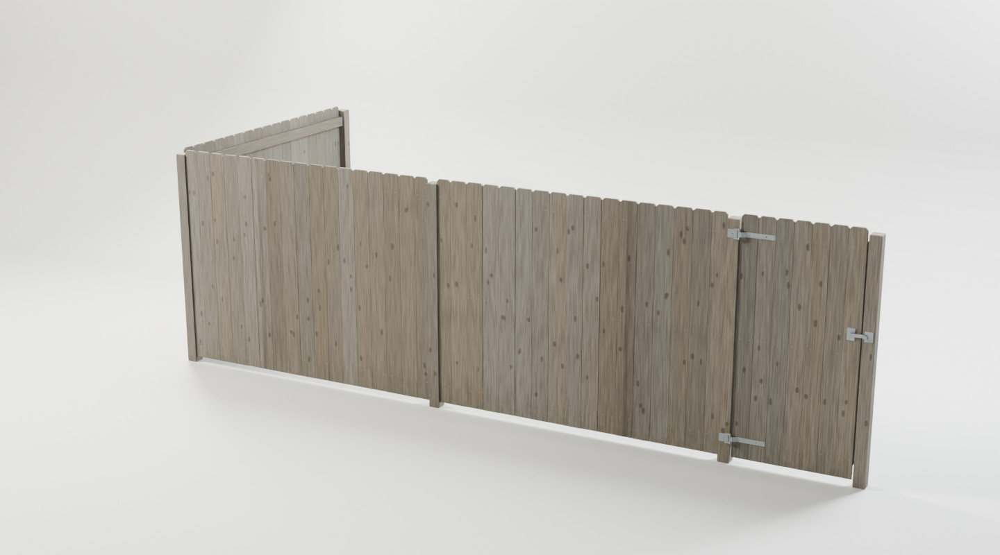
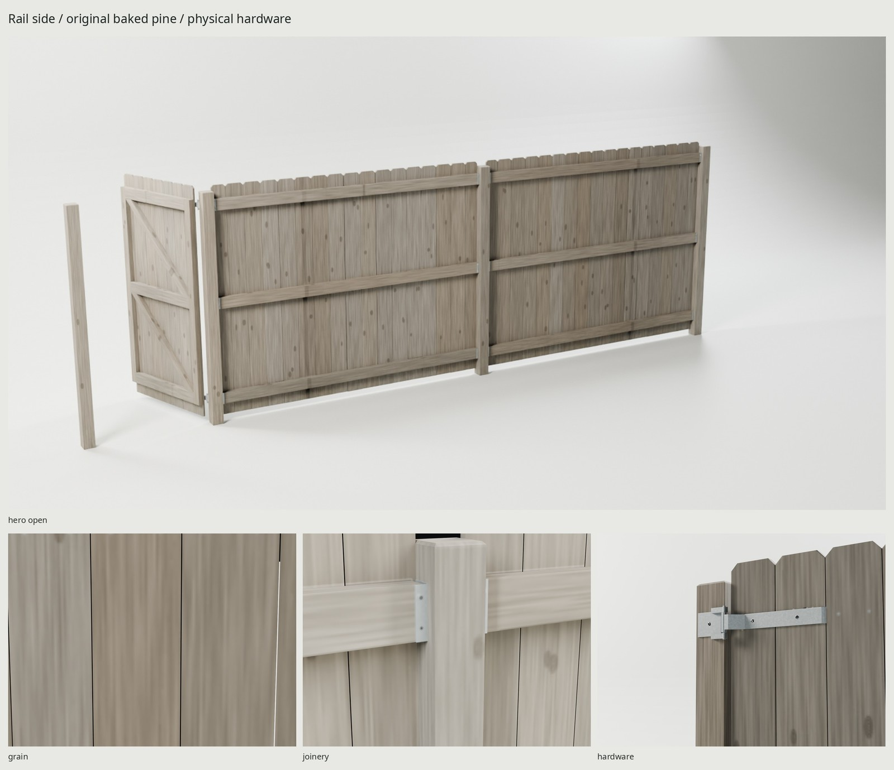
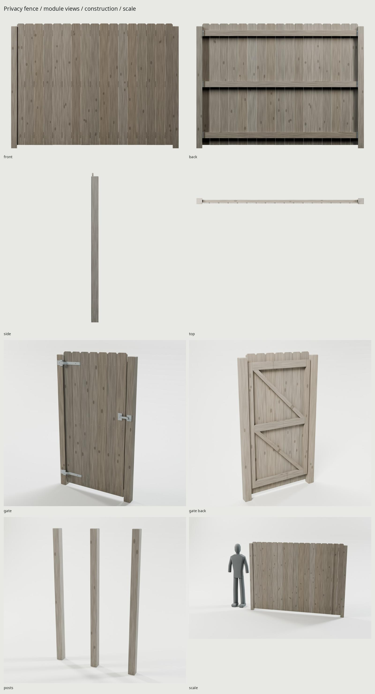

# Wood privacy fence kit

An original, site-built American dog-ear pine fence: two 8 ft bay variants,
three socket-defined post roles, and a working 3 ft walk gate. Every mesh,
fiber, knot, fastener mark and texture is generated by our scripts. **This
stop point contains only the privacy fence.** White picket and chain-link
families are deferred as requested.





## Dimensions and construction

[REFERENCE.md](REFERENCE.md) distinguishes published dimensions from original
construction choices. [refs/SOURCES.md](refs/SOURCES.md) records reference
owners, licenses and use; [REVIEW.md](REVIEW.md) records the image critiques.

| Dimension | Generated |
| --- | --- |
| Straight post-center pitch | 2.4384 m / 96 in |
| Clear post-face infill width | 2.3495 m / 92.5 in |
| Pickets | 1.8288 m / 72 in long, 15.875 mm / 5/8 in thick |
| Picket width | Fifteen 139.7 mm / 5.5 in interior boards, two balanced 115 mm rip cuts |
| Dry-season board gaps | 1.5 mm; intentional shrink gaps, distinct from modular seams |
| Nominal ground clearance | 50.8 mm / 2 in; seeded rough-cut seating variation ≈±1.3 mm |
| Maximum source height | 1.88068 m including slight picket seating variation |
| Actual 4×4 posts | 88.9 mm square, 1.840 m above grade |
| Actual 2×4 rails | 38.1 mm thick × 88.9 mm high |
| Rail centers above grade | 196.85 / 965.20 / 1733.55 mm |
| Gate post-center pitch | 1.0033 m / 39.5 in |
| Gate clear opening / leaf | 914.4 / 889.0 mm, 12.7 mm clearance each side |

The three rails sit in original 1 mm formed galvanized saddles. Each section
carries its saddles, so a corner post accepts two rotated sections without
adding hardware to the post mesh. Seat-to-rail and web-to-post-plane contact
are measured on evaluated surfaces; the rail ends leave 6 mm for mounting
screw heads. Three pairs of baked galvanized nail heads secure each picket.

The gate has stiles, three butt-jointed rails and two compression braces
bearing from the lower hinge toward the upper latch. Its two hinges have
stationary pins, hollow moving sleeves and bent strap necks. A lifting gravity
latch has a pivot stand-off and a stationary receiving seat/tab. The posts end
at grade: hidden buried wood, gravel and concrete footings are intentionally
omitted. In a level, terrain covers the bottom caps.

Wood aging follows UV exposure, earlywood erosion, longitudinal drying checks,
wet cut ends, fastener drips and ground splash/mildew. Boards vary coherently
between gray and tan; the two section seeds rearrange their color and knot
rhythm. `WEAR` changes these weather layers without replacing the construction.

## Snapping and origins

Coordinates below are **Blender meters**, +Z up, −Y the good/picket side,
+Y the rail side, +X along a straight fence. A module origin is the midpoint
between its post centers, on the post centerline at grade. A standalone post
origin is its square center at grade. The offset of the thin picket skin from
that centerline is intentional. glTF coordinates are `(x, z, -y)`.

The library GLB lays out roots for inspection. Instantiate a named root and
**replace its root transform** with your placement transform; retain all child
transforms. Keep its shared imported material. All mesh scales are applied.

```text
TOP VIEW (+Z looking down)                   rail side +Y

                          end post
                             ●  (2.4384, 2.4384)
                             │
                        section A, yaw +90°
                             │
end        section A       line        section B      corner
 ●────────────┼──────────────●─────────────┼─────────────●
-2.4384     -1.2192           0          +1.2192       +2.4384  → +X

               good / picket side −Y

Replace a bay with gate:
 section → ●─────────[ hinged leaf ]─────────● ← section
           left gate post                    right gate post
                  center pitch = 1.0033 m
```

| Root | Local sockets / role | Mesh triangles |
| --- | --- | ---: |
| `Section_A` | `__L=(-1.2192,0,0)`, `__R=(+1.2192,0,0)` | 664 |
| `Section_B` | Same sockets; independent timber variation | 664 |
| `Post_End` | `__connect_0=(0,0,0)`, facing +X | 20 |
| `Post_Line` | `__connect_0` and `__connect_180`, both at origin | 20 |
| `Post_Corner` | `__connect_180` toward −X; `__connect_90` toward +Y | 20 |
| `Gate_Bay` | `__L=(-.50165,0,0)`, `__R=(+.50165,0,0)`; **includes both posts** | 712 |

Socket names include the root prefix, e.g. `Section_A__L`. Endpoint sockets
coincide with **post centers**, not visible board edges. Align an endpoint
socket to a post's `connect` socket, with their local +X arrows facing in
opposite directions. This places the infill at the post face and the bracket
web against it. Add one post at each unique ordinary junction. Do not add a
second post at a `Gate_Bay` endpoint.

Each section also has `__rail_L_1…3` / `__rail_R_1…3` at the post face and
actual rail-center heights. Each post has corresponding `__face_angle_1…3`
sockets. These expose the physical support planes separately from the
post-center snapping grid. `Gate__free_edge` marks the latch-side picket edge.

For the diagram's right corner, place another section at
`(2.4384,1.2192,0)` with Z rotation +90°, and its end post at
`(2.4384,2.4384,0)` facing −Y. For a left corner, rotate the corner post −90° and connect a section
by its R socket, yaw −90°, so both good sides face outside the yard;
`src/assemble.py` demonstrates that case with an additional bay and a gate.
The assembled-run GLB is made by re-importing the baked library and sharing
its meshes/materials, then exporting that arrangement; no look-dev materials
enter the final render.

**Slopes:** these delivered pieces snap on flat ground. On a slope, step bays
while keeping posts and pickets vertical and rails level. Regenerate taller
junction posts and independent high/low rail sockets for the chosen step
heights; the flat post variant has no allowance for arbitrary steps. Raking
requires re-authoring rail angles and picket seating while keeping pickets
plumb. Keep the gate bay level and verify the terrain beneath its full sweep.

## Moving parts

| Node | Local pivot in its parent frame | Axis / useful range |
| --- | --- | --- |
| `Gate` | Gate_Bay `(-.45085,-.054,0)`; coaxial with physical hinge pins | +Z, −110°…0° |
| `Latch` | Gate `(.82585,.003,1.12)` | +Y, −65°…0° |

Lift the latch to −65° **before** opening the gate toward −Y. Close the gate
before lowering the latch. No armature or animation clips are required.
The gate sweep uses 111 poses at 1° intervals; latch release uses 34 poses
with at most 2° intervals, each on game and high sources. This is a sampled
solid-surface collision check, with a 0.3 mm tolerance, not a continuous-time
collision guarantee. No collision allow-list hides a gate/post intersection.

## Delivery and cost

One **2048² BaseColor / OpenGL +Y Normal / ORM** texture set and one shared
material for every privacy module, including galvanized hardware. ORM stores
R occlusion / G roughness / B metallic. Source materials bake at 4096² with
32 GPU samples; modules and moving parts project in eight isolated groups,
with 65 explicit source-coordinate frames kept aligned to their timber. This
prevents a neighboring section from painting bracket metal onto a reusable
post. Delivery filtering uses linear-light color, RMS roughness and
renormalized tangent normals. The shared set costs approximately **16 MiB**
with BC7/BC5-style block compression and full mip chains; it is loaded once
for the family, not once per fence section.

| Delivery measurement | Result |
| --- | --- |
| Entire module library | 2,100 triangles / 3,000 family cap; every module under 2,000 |
| Stationary section draw calls | 1 per placed section; 1 shared material |
| Gate bay | 3 meshes: stationary posts/hardware, hinged leaf, lifting latch |
| Standalone post | 20 triangles; deliberately below the nominal 300 lower guideline, with no filler detail |
| UV coverage / overlaps | 50.29% / zero measured overlapping triangle pairs |
| UV density p5 / median / p95 | 233 / 233 / 490 px/m at 2048 |
| GLB bytes | 10,186,900 |
| BaseColor / Normal / ORM PNG bytes | 3,884,643 / 3,094,855 / 2,995,337 |

The two unique section atlases trade close-up texel density for per-board
variation while sharing a single family set. The post types share economical
construction and differ in their connection sockets; the pine shader gives
them small surface differences. Engine instances should share these meshes
and the imported material rather than duplicating texture resources.

## Rebuild and proof

Installed requirements: Blender 5.2, Python with Pillow/NumPy, Noto Sans and
`flock`. No packages, code, textures or lighting are downloaded. `make refs`
fetches only the cited inspection images/PDFs. GPU work uses the kit's shared
GPU lock and OptiX with CUDA fallback; temporary files stay in the worktree.

```sh
make -C fences                 # refs → sources → UV → 4K bake → 2K → GLB → renders → docs → checks
make -C fences check           # budgets, dimensions, solids, UVs, GLB, sockets, motion, repository
make -C fences match PASS=source-match WIDTH=1000 SAMPLES=24
make -C fences match-final     # same calibrated view on the exported GLB
make -C fences WEAR=.25 render PASS=cleaner
make -C fences clean
make -C fences                 # rebuild generated delivery from scripts
```

Main outputs (rebuilt and ignored by Git):

- `export/WoodPrivacy.glb`: reusable library roots and shared embedded textures.
- `export/PrivacyAssembly.glb`: corner/gate assembly proof, built from that GLB.
- `textures/ship/T_WoodPrivacy_{BaseColor,Normal,ORM}.png`.
- `renders/final/`: Cycles heroes, four-view turnaround, three detail views,
  gate front/back, individual modules and 1.8 m human scale.
- `renders/final-eevee/hero_closed.png`: Eevee delivery check.
- `renders/assembly/{corner_good,corner_rails}.png`: short assembled corner run.
- `renders/final/contact.jpg`: all final views, including assembly and Eevee.
- `renders/photo-glb/match_rails-pair.jpg`: calibrated photographic comparison.
- `build/delivery-check.json`: independent raw GLB / fresh-import serialization,
  normals, texture size, UV, geometry and socket validation.
- `build/construction-check.json`: evaluated support contacts, gate opening,
  pin-axis alignment, module triangle counts, released-gate clearance on both
  sources, actual imported snap errors, a 90° corner solid-overlap check and
  delivered-ORM sampling that rejects projected metal on bare wooden posts.
- `build/motion-{game,high}.json`: independent latch-release sweeps.

Serialization agreement alone does not prove construction. The construction
checker measures the actual rail seats, bracket webs, frame bearings, physical
pin centers and imported socket positions. Its sampled gate sweep proves the
released mechanism at those poses. The final render metadata records each GLB
path and SHA-256, engine and samples.

Render-only views and lighting live in `src/views.py`; editing those settings
invalidates studio output without repacking UVs or rebaking the atlas.

## Limits and credits

Fine grain, nail marks and checks soften in the shared 2048 atlas, especially
in a very close view; the macro grain remains more regular than a photographed
rough-sawn board. The kit is designed for repeated backyard fences at gameplay
distances. No buried footing geometry, terrain fitting, runtime collision
meshes or distance LODs are supplied. Two section variants reduce obvious bay
repetition; they are not an infinite nonrepeating wood generator.

Everything delivered is original scripted geometry and shading. Photos/PDFs
are viewing and measurement references only. Font in review sheets: Noto Sans,
SIL Open Font License. Shared kit additions: procedural weathered pine and
zinc, reverse-view studio yaw, scalable studio lighting, wider seamless
backgrounds, and explicit coordinate-frame preservation during isolated bakes.
Existing defaults and bake interfaces remain compatible with the grill.
