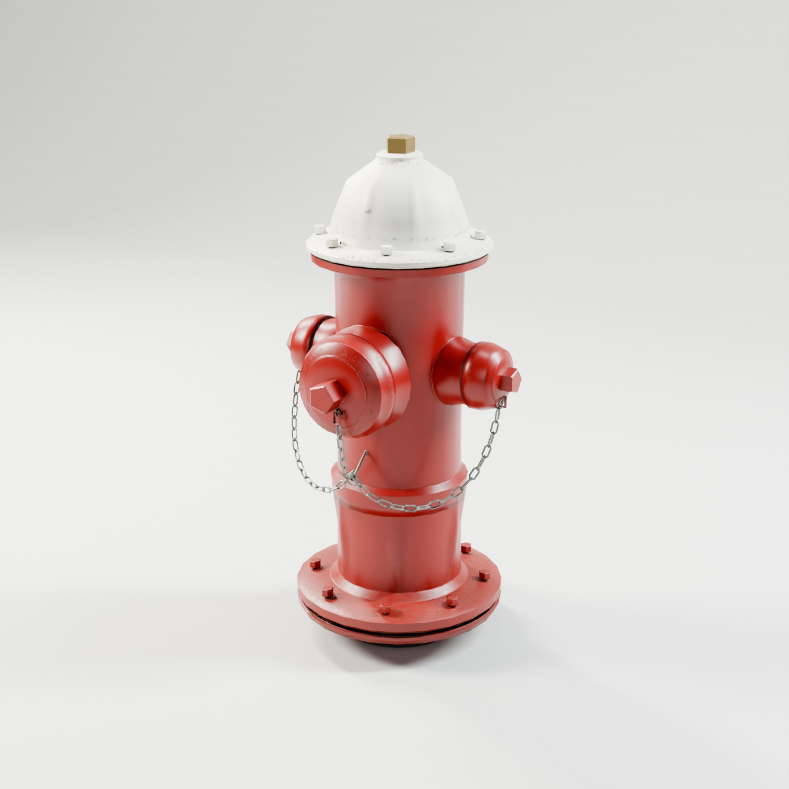
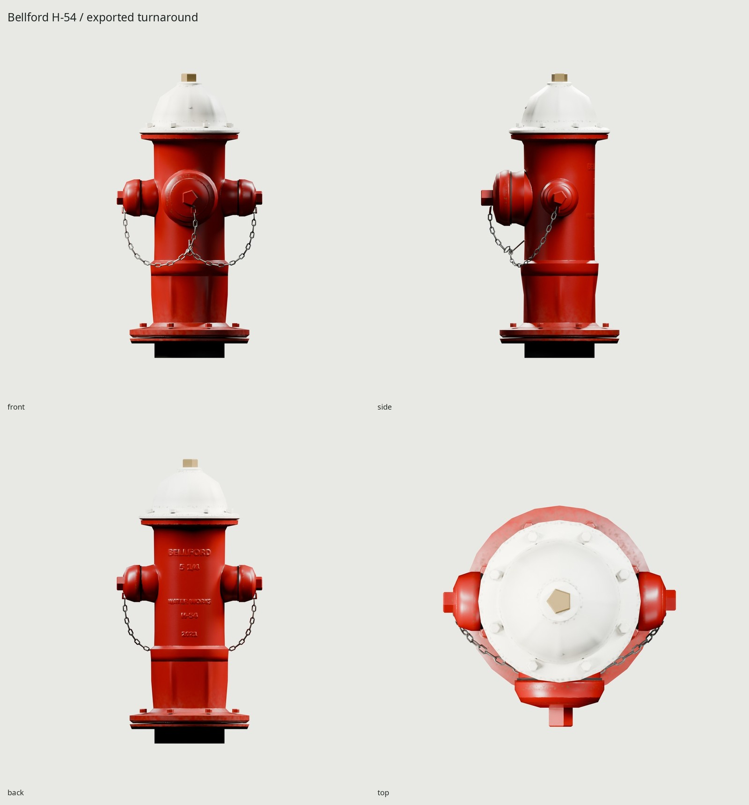
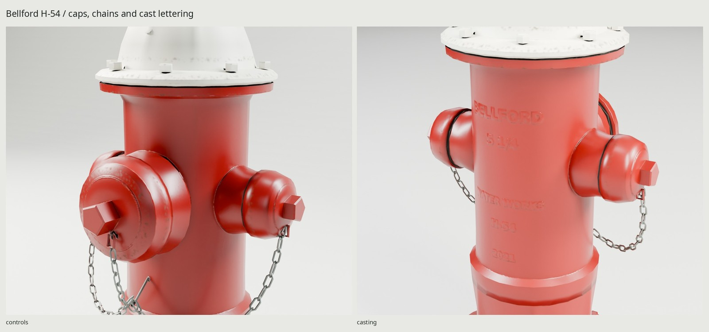

# Bellford / H-54 fire hydrant

An original American three-way dry-barrel hydrant, installed at grade: red
painted cast iron, a warm white bonnet, two capped 2½-inch hose outlets, one
capped 4½-inch pumper outlet, and linked steel retaining chains. All geometry,
materials and fictional casting marks are generated by the scripts here.



[REFERENCE.md](REFERENCE.md) distinguishes manufacturer dimensions from authored
construction estimates. [refs/SOURCES.md](refs/SOURCES.md) records the exact
photos/drawings, authors and rights. The FH-84 reference drawing controls scale;
the installed CC0 photograph supplies the repaint, wear and construction study.
This is an original foundry design, with no real maker or approval markings.

| Dimension | Reference / generated |
| --- | --- |
| Height above ground | 32 in / **812.8 mm** |
| Nozzle center above ground | 18 in / **457.2 mm** |
| Traffic flange bottom above ground | 1⅝ in / **41.275 mm** |
| Width over hose cap nuts | 2 × 8.18 in / **415.544 mm** |
| Depth, pumper nut to rear flange | Authored / **395.0 mm** |
| Operating nut | 1½ in nominal reference; authored regular pentagon, **38.1 mm inscribed diameter** |
| Hose / pumper outlet nominal size | **63.5 / 114.3 mm**; capped exterior, hidden bores omitted |
| Barrel / ground flange / bonnet diameter | Authored estimates / **200–208 / 342 / 290 mm** |

The flange sits just above grade on the short black-coated barrel stub, as in
the installation drawing. Sink the origin to the terrain surface; no concrete
pad or surrounding terrain is part of this asset. The buried shoe, main valve
and riser are omitted. It is an exterior street prop, rather than a maintenance
cutaway.

The upper barrel and nozzle throats form a fused cast shell. The source includes
cast reinforcing ribs, bonnet flutes, flange reveals, cap edge beads, washers,
wrench flats, filler screw, and raised BELLFORD / WATER WORKS / H-54 / 2021 type.
Fine beads, washers, letter relief and manufacturing microstructure transfer to
the tangent normal map. The cap chains retain actual linked silhouette geometry.
All parts are fixed in this requested variant: **one static mesh, no moving
parts, armature, animation clips or gameplay sockets**.



| Delivery measurement | Result |
| --- | --- |
| Game mesh | **5,980 triangles / 6,000** |
| High-detail source | **47,832 triangles** |
| Materials / draw calls | **1 / 1** |
| Texture set | **1024² BaseColor / OpenGL +Y Normal / ORM** |
| Bake | **4096²**, 32 GPU samples; 16-bit normal intermediate |
| Approximate compressed GPU texture memory, mipmaps included | **4 MiB** for three BC7/BC5-class maps |
| UV coverage / overlaps | **56.73% / 0 measured** |
| UV density p5 / median / p95 at 1024 | **539 / 597 / 683 px/m** |
| GLB | **4,127,488 bytes** |
| BaseColor / Normal / ORM PNGs | **1,056,399 / 1,182,368 / 1,517,354 bytes** |

ORM packs occlusion in R, roughness in G and metallic in B. BaseColor is sRGB;
the other maps are linear/non-color. BaseColor downsamples in linear light,
normal vectors are filtered and renormalized, and roughness uses RMS filtering.
The PNG/GLB disk size differs from compressed engine GPU memory. The triangle
cost is near the budget ceiling because three interlinked chains and round
cast silhouettes remain geometry; texture memory and draw calls remain at the
standard-prop tier. Small letters soften at close range in one 1024 atlas.



`WEAR=.55` is maintained suburban use. Sun exposure chalks the enamel;
cap/flange rims and wrench edges lose small paint chips, with iron/rust beneath;
bolt deposits follow gravity; lower-barrel road/soil splash darkens the base.
Casting grain is manufacturing structure, not uniform dirt. `WEAR=0` removes
use wear while retaining that structure. Cleaner/dirtier builds use the same
parameterized scripts.

Authoring units are meters. Blender +Z is up, the pumper points toward −Y, and
`FireHydrant` is at the ground-plane center of the circular flange footprint.
The applied mesh and its root import at unit scale. glTF maps Blender `(x,y,z)`
to `(x,z,−y)`, so the engine sees +Y up and +Z at the pumper/front. The nozzle
caps and operating nut are fixed; a functional removable-cap variant would need
its own pivots, openings and interior surfaces.

Installed Blender 5.2.2, Python/Pillow/NumPy, DejaVu Sans Bold and flock are the
only dependencies. No downloaded code, packages, models, textures or lighting
are used. Procedural area lights make the studio. All Cycles bakes/renders use
OptiX/CUDA through the shared kit GPU lock, with a warning and CPU fallback if unavailable.

```sh
make                         # refs, model, UVs, bake, textures, GLB, studio, docs, checks
make check                   # source/game, UV, GLB re-import, camera and repository checks
make clean && make           # rebuild all delivery outputs from scripts
make refs                    # images/PDFs only, ignored by Git
make PASS=review match        # photo comparison, never a texture input
make WEAR=.85                 # regenerate a dirtier delivery asset
make hook-install            # install the worktree-local repository rules hook
```

| Local path | Contents |
| --- | --- |
| `export/FireHydrant.glb` | One static mesh and embedded baked PBR textures |
| `textures/bake/`, `textures/ship/` | 4096 source bake and 1024 delivery set |
| `build/lookdev.blend`, `game-audit.blend`, `finalized.blend` | Rebuildable source, low mesh and packed low scene |
| `build/*-audit.json`, `uv-report.json`, `delivery-check.json` | Counts, topology, scale, atlas and independent re-import proof |
| `renders/final/contact.jpg` | All eight Cycles views plus Eevee last |
| `renders/final/` | Hero, front/side/back/top, two close-ups and 1.8 m human scale view |
| `renders/final-eevee/hero_closed.png` | Same GLB in Eevee |
| `renders/pass1/`, `renders/pass2/` | Ignored source critique renders, photo pairs and residual overlay |
| `docs/` | Three final JPGs, each ≤1600 px wide and ≤200 KB |

`make check` passes: both source/game topology and scale, camera projection,
raw GLB geometry/normals, 1024 texture channels, unit normal vectors, UV overlap
and density, mesh transforms and a fresh Blender re-import. No vertex displacement
was measured on re-import. [REVIEW.md](REVIEW.md) records two photo-directed
critique passes and delivery inspection. The fitted camera retains the older casting's measurement error;
this is not a CAD replica. Wear is more orderly than the incidental damage in
the reference, and very close views reveal simplified chain wire, cap
silhouettes and some cap-rim normal waviness. Those are the main compromises at the intended street-prop scale.

Original geometry, shaders, markings and studio: this repository. DejaVu Sans
Bold uses the installed open DejaVu font license. Daderot's installed reference
is CC0; manufacturer drawings/photos are copyrighted local research material,
not redistributed. The rifle project and approved gas-grill pilot informed the
scripted pipeline.
