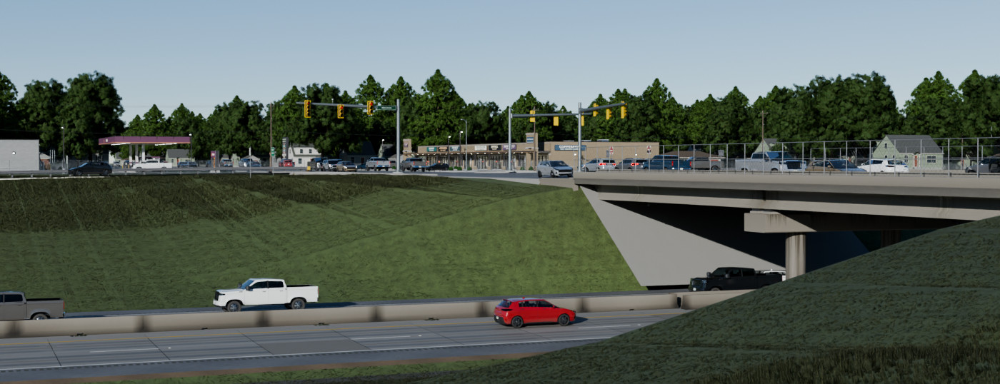
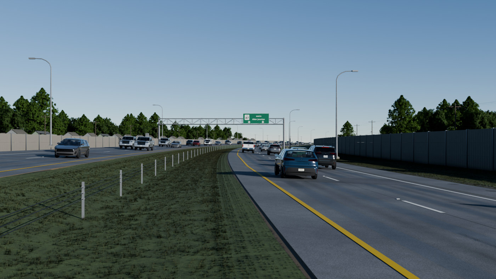
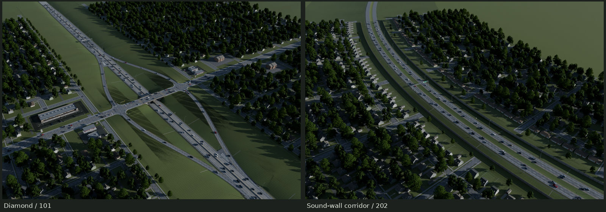
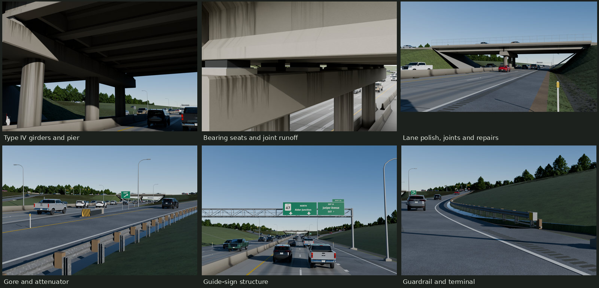
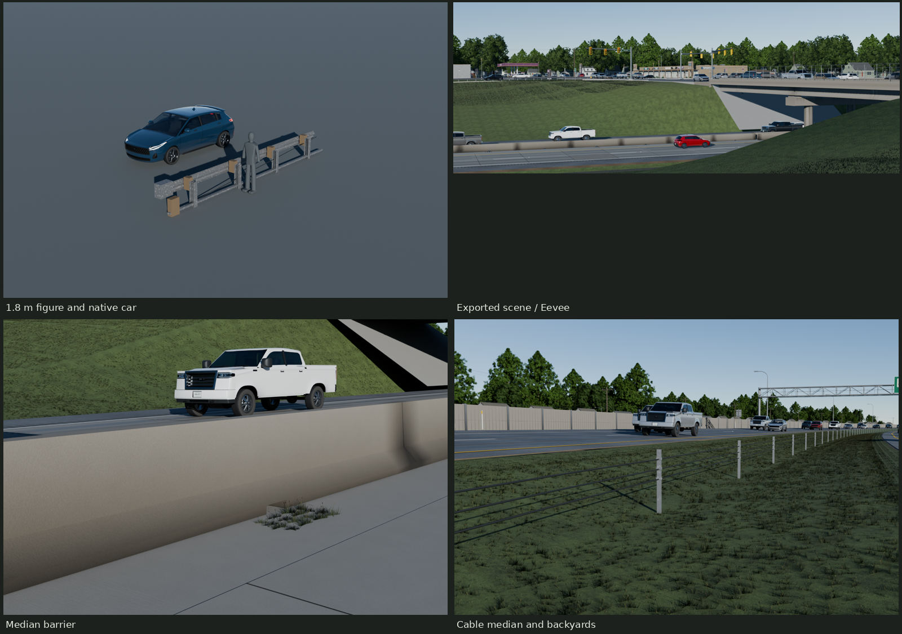

# Freeway — Alder Junction and Cedar Hollow







Two original, scripted freeway places in a town of 2012: maintained 1970s
concrete beneath an arterial diamond, and a curved asphalt corridor with a
wide median and residential sound walls. The first hero looks across the cut
from an exit shoulder toward the signal queue, gas canopy, strip storefronts
and the town's roof/tree/pole skyline, with foreground turf reduced to a band.
Its camera is 1.65m above the sampled shoulder surface. The second looks down afternoon traffic
with roofs, varied yard trees and a utility line above its wall.

[REVIEW.md](REVIEW.md) records the photographic critiques and remaining CG cues;
[REFERENCE.md](REFERENCE.md) gives dimensions and source limits;
[TEXTURES.md](TEXTURES.md) describes the shared PBR resources.
All final views use freshly imported exports and their shipped baked images.
The native tree family's thin-leaf shader is restored from those same images;
its stock glTF MASK fallback is also retained in the delivery. The context
is static; canonical cars and trees provide the working animation/wind data.

## Places, cost and context

| Seed | Civil plan | Length | Center radius | Elevation datum (`Plan.grade`) | Crossfall |
| --- | --- | ---: | ---: | ---: | --- |
| 101 | Alder Junction diamond | 1,600 m | Straight | 0 m | 2% crown |
| 202 | Cedar Hollow sound walls | 1,000 m | 1,400 m | 1.4 m | −4% bank |

| Scene / package | Expanded tris | Unique tris | Mesh instances | Materials | glTF + BIN bytes | Referenced PNG bytes | Full-mip GPU MiB |
| --- | ---: | ---: | ---: | ---: | ---: | ---: | ---: |
| 101 Freeway | 287,744 | 270,124 | 837 | 29 | 22,827,086 | 68,053,155 | 106.25 |
| 101 Town + ROW turf | 114,763,356 | 1,141,807 | 104,662 | 84 | 130,631,322 | 92,498,701 | 175.58 |
| 101 Traffic | 5,305,194 | 1,330,615 | 6,014 | 64 | 71,472,895 | 26,553,791 | 73.33 |
| 202 Freeway | 162,518 | 162,518 | 590 | 17 | 14,541,340 | 60,553,226 | 88.25 |
| 202 Town + ROW turf | 38,077,398 | 232,538 | 28,365 | 50 | 29,122,275 | 66,409,115 | 102.92 |
| 202 Traffic | 2,221,793 | 936,056 | 2,945 | 57 | 50,385,538 | 27,970,229 | 76.00 |

Whole-scene image unions (shared hashes counted once):

- 101: 105 unique images, 140,727,303 PNG bytes and 298.92 MiB compressed GPU memory.
- 202: 78 unique images, 115,955,361 PNG bytes and 226.92 MiB compressed GPU memory.
- Both scenes together: 107 unique images, 142,143,741 PNG bytes and 301.58 MiB.

The civil files are `export/Freeway-{101,202}.gltf`. Separate
`Town-<seed>.gltf` and `Traffic-<seed>.gltf` packages make the context optional;
every final scene view loads all three. Counts distinguish expanded instance
triangles from stored unique meshes. The town is an instanced context, not a
single efficient game-level draw call: stream/cull its parcels and generate foliage LODs/impostors in an engine.
Repeated glTF nodes share mesh indices; group their transforms into GPU
instance batches per streamed tile. No frame-rate claim is made for loading
the whole town at once. PNG bytes, material states and primitive counts are in
`build/look-audit.json`; the table's image estimates assume 8bpp compression
and full mips, deduplicated by actual image hash.

Alder Junction's narrow lots are 50/55/60 ft wide and 106.9 ft deep, using four
native ranch/Cape envelopes, their garages and driveway/walk sockets. Rear
fences and service alleys, sidewalk drive openings, street and yard trees,
four garden apartment blocks and three native commercial parcels fill the
arterial frontage. Commercial lots retain the native paved footprints and
actual driveway openings. The strip's public street wraps behind its parcel.
Cedar Hollow uses offset-curve frontage compensation to retain the same lot
scale; its inner yards put trees behind the roofs from the freeway's view.
Measured lot and house-clearance ranges are in `build/context-audit.json`.

Seed 101: 1,710 houses, 4,362 trees and 4 apartment blocks; town and ROW turf have 104,662 mesh instances sharing 209 unique meshes.

Seed 202: 656 houses, 1,463 trees and 0 apartment blocks; town and ROW turf have 28,365 mesh instances sharing 20 unique meshes.

The house, tree and traffic placements are retained from the accepted delivery.
Near ROW grass adds linked crossed-card tiles to the optional Town package;
eight 64-triangle patterns share the maintenance atlas. Smaller .65m patches
fit terrain creases, with height and density fading into a mown textured base.
The base uses the native lawn's blade normal detail and alignment-following
1.524m mowing swaths. Terrain shading is smoothed without moving the accepted
graded surfaces. Taller growth stays beyond the mowing line; shorter edge
rows lead into the narrow soil/gravel margin. Barrier drains retain weeds.
Their extra expanded triangles are 5.87M / 1.47M net,
including removal of old cosmetic grass skins. Civil color sampling adds
24,240 / 1,984 triangles for lane-center oil, column runoff and barrier joints.
The finer 101 layout grows the Town geometry files by 15.02M bytes; 202 remains
4.01M bytes smaller than the prior delivery. Many additional authoring nodes
share those eight meshes. Group nodes tagged `turf_card_tile` by mesh/material
into instance buffers per streamed tile; individual grass nodes are not an
efficient game scene graph. Whole-scene compressed image memory is unchanged
because turf reuses maps already present in the scene.

The 50–60 × 100–130 ft range comes from this brief; the 2002 USGS aerial is
the density/canopy comparison, not a cadastral survey. House roofs, openings,
garages, finish colors and UVs come from the original library plans. Their
local distance adapter rebuilds wall/roof skins from the native plan and
openings, simplifies casings/fixtures and omits the fine weather grids. It retains
each native construction envelope. Town foliage links the native oak and
maple meshes with seeded rotations/scales. Mature yard crowns are scaled 1.4×,
street crowns 1.2×; the closest roof/wire zone stays smaller. Species, yaw and
actual scale are recorded in the placement manifest. Utilities use actual pole sockets
and sagging primary, neutral and telephone conductors.

The two snapshots have 279 / 135 actors, including 183 / 111 mainline actors;
the rest occupy ramps, queues, arterial, commercial parking or neighborhood
streets. Traffic uses the original Alder H120 hatch, X220 SUV and C150 pickup, with
full native geometry near the principal inspection zones and local reduced
bodies targeting 5.5k triangles at distance. Parked and neighborhood actor
heights are sampled from the actual paved surfaces. The native paint coverage is decoded in linear
light into ordinary local RGB variants, preserving contamination and factory
metallic factors. Seeded silver/gray/black/white/blue/red/green/tan weights are
22/16/22/12/12/10/4/2 percent. Five colors are native factory presets; Garnet,
Spruce and Sand are original local tints. Mainline spacing uses 20–27 m/s and
1.15–1.9 second headways, plus stopped signal queues. This is a static snapshot;
use canonical cars for working gameplay pivots. The old context cache calls
the pickup “Crossover”; it remains the native C150 pickup geometry.

All original library deliveries stay read-only and are hash-checked. Keep
repository-relative external image URIs, or remap them into an engine's shared
texture cache. No photograph supplies any exported vertex or texel.

## Dimensions and construction

| Feature | Dimension / basis |
| --- | --- |
| Mainline | Two 12ft / 3.6576m lanes each way; 10ft right and 4ft left shoulders; 2% tangent crossfall |
| Diamond | 1,600m excerpt; 8ft median; terminal axes X ±78m; 366m parallel speed-change lane plus 91.44m taper |
| Curved corridor | 1,000m excerpt; 1,400m radius; 4% bank; 30ft median and 14ft precast sound walls |
| Paving / paint | 15ft concrete joints; 6in lines; 10ft dashes on a 40ft cycle; physical 16×7in rumble envelopes at 12in pitch |
| Median / rail | 32in F barrier, actual drain openings; 31in W-beam top, 12-gauge sheet, 6ft 3in post pitch and real blockouts |
| Overpass | Two 24m spans; 70ft / 21.336m deck; five 11ft lanes; 5ft clear walks retained |
| Girders | Seven per span, Type IV: 54in depth, 20in top, 26in bottom, 8in web, actual chamfers/haunches and 18mm camber |
| Supports | Three 1.2m columns; 19.8×2.3×1.1m chamfered cap; elastomeric pads, sole plates, .88×.78m pedestals and widened abutment ledges |
| Girder length | 23.49m reusable example; 23.82m in the bridge so the complete pads stay under the flange |
| Structure / lighting | 34m four-chord triangulated guide truss; 12m davit mounting height |

FHWA/AASHTO cross-section guidance, 2003/2009 MUTCD and period DOT plans inform
these dimensions. The corrected Type IV section is from TxDOT report
0-4751-1 vol.2, Figure A.1.4.1. [SOURCES.md](refs/SOURCES.md) records the primary
references, dates, authors and rights. These are original visual constructions,
not load-rated bridges or certified crash hardware.

The bridge has top/bottom flanges and web, cambered haunches, end/intermediate
diaphragms, bearing plinths, abutments/wingwalls, approach slabs, deck overhang,
a real underside drip groove, walk parapets, fence and connected drains.
Paving boundaries have granular shoulders or curb returns sampled against
actual soil. Ditches/inlets, cut flumes, mowing limits, ROW fencing, volunteers
and trapped litter complete the corridor. Added terminal controls include stop
bars, through/left-turn arrows, WRONG WAY / DO NOT ENTER, entrance guides and
fictional Lark Route 47 trailblazers. DejaVu Sans Condensed Bold is the open-font
FHWA substitute; no Interstate shield or real brand is used.

## Reusable pieces

Fresh raw-accessor counts. Material states differ from placed draw calls.

| Module | Triangles | Materials |
| --- | ---: | ---: |
| CableBay | 126 | 2 |
| Cantilever | 1,922 | 4 |
| DavitLight | 228 | 4 |
| GoreAttenuator | 302 | 4 |
| GorePaving36 | 20 | 2 |
| GuardrailEnd | 404 | 4 |
| MedianF | 140 | 1 |
| Overpass | 23,892 | 9 |
| PierBent | 1,828 | 2 |
| PrestressedGirder24 | 796 | 1 |
| RampBranch | 548 | 3 |
| RoadBankTransition | 1,568 | 6 |
| RoadCurve | 1,568 | 6 |
| RoadStraight | 1,664 | 7 |
| SignTruss | 3,190 | 4 |
| SoundPanel | 144 | 2 |
| WBeam | 188 | 3 |

The complete bridge includes its girders and bent; do not add those examples
again. All ordinary pieces stay below 2k, structures below 8k, the bridge below
50k. Flat paving and small barriers intentionally use fewer than 300 triangles.

## Shared materials and memory

Ground Asphalt, Concrete and GroundTrim remain canonical. Seasonal summer turf
uses a local 2048 color derivative with the original Lawn normal/ORM. The
original native Lawn color also remains shared by commercial context. New
FreewayConcrete and FreewaySigns are 2048 triples (16 MiB each);
FreewayZinc and FreewayMaintenance are 1024 triples (4 MiB each): **40 MiB in the four freeway sets**,
shared across seeds and modules. The sign triple replaces the old temporary
single sheet. The small fence field reuses the original chain-link recipe.
`TEXTURES.md` separates the manufacturing fields, caused placement layers and
native context resources. Estimates assume 8bpp block compression and full
mips; PNG bytes and Blender's uncompressed residency are different quantities.

All twelve new maps are generated/baked at 4096, then filtered with the kit.
BaseColor is sRGB, Normal is OpenGL +Y, ORM is linear occlusion/roughness/metallic.
Tiling UVs and guarded chart reuse intentionally overlap. Independent audits
check finite UVs and noncollapsed textured triangles, measured density percentiles, normal lengths,
resource identities and actual serialized triangle counts. No unique-lightmap
UV certification is implied.

## Coordinates, sockets and rebuild

Meters; Blender +Z up, canonical front −Y, station +Y, arterial +X. Scene origin
is station zero at the alignment datum. glTF converts `(x,y,z)` to `(x,z,−y)`.
Individual module exports retain chaining frames; the library sheet has display
placements to reset before assembly. Sign faces remain replaceable panel roots,
lights expose emitter sockets, and bridge/girder ends expose W/E frames.
Road and rail S/N frames use local +Y forward; bridge W/E frames follow +X.

The immutable `Plan` carries seed, civil type, length, median, radius, grade,
bank and terminal offset. Its exact center/frame functions drive every mainline
surface and path. Four lane and four ramp curves remain in the diamond source;
four lane curves remain in the curved source. glTF path empties retain sampled
Blender/glTF coordinates in extras because glTF has no curve primitive.
Those samples are already in the authored path-root frame. The path empty's
translation marks its start; do not add that translation to the samples again.
No new freeway animation or armature is needed.

Use the road's S/N sockets to align successive modules in +Y tangent order;
match the preceding N frame to the next S frame without a 180° flip. A straight
example is 36.576 m long. A curve example spans the same station interval on
the 1,400 m circle. Matching sockets alone cannot repair different crossfalls:
use `roads.road(..., bank=(start,end))` for a transition with the actual adjacent
end profiles. The supplied transition illustrates −2% to −2.5%; the curved
scene's constant bank is −4%. Terrain, signs, bridge and terminal clearance
still need placement against the new alignment. A complete Overpass already
contains its girders and bent; do not stack the individual examples into it.

The `Plan` dataclass in `src/plan.py` exposes length, median, radius, elevation,
bank, pavement and terminal offset. `build.py --seeds 101 202 --stage look`
builds the two validated places. Other integer seeds are deterministic examples;
the fixed terminal context has only been validated for these two deliveries.
`town_context.py` controls parcel widths, setbacks and tree planting;
`context_colors.py` controls the weighted fleet. Sources stay parameterized,
with no hand edits to saved Blender files.

```sh
make                         # fields/bakes, exports, checks, final views, evidence and docs
make check                   # fresh imports, budgets, UV/density, real contacts, preservation
make repeat                  # exact deterministic CPU fields, caches, glTF/BIN and manifests
make check-texture-repeat    # fresh GPU rebake within the kit's tolerance
make render sheet scale      # Cycles scenes, labeled modules and 1.8 m human/car scale
make matches source-pairs    # four balanced-photo pairs, shipped and 4096 source-field views
make evidence                # nine earlier pairs plus eight round-four fix panels
```

Blender runs serially, and each render/bake set uses the shared kit GPU lock.
Scratch stays inside build/. No kit code changed. For final review, a clean
`make checkpoint` builds every current model, texture, export and full-size
inspection before `make` assembles the gallery; the default target contains
both stages. The historic 0d5b092 archive
can reconstruct missing before views inside this worktree, with read-only
library inputs and without touching another checkout.

`make check` passes on the revised exports. It includes 343 bidirectional
surface comparisons, fresh imports, actual parcel clearances, 11,808 paving
edge probes with zero exposed gap and 168 bearing probes within .76mm of
contact. These geometric measurements are separate from serialization and
visual judgment. All 1,099 preserved files from other deliveries remain
byte-identical; both Traffic glTF/BIN packages exactly match the handoff.
Blend containers and stochastic raw renders are outside the byte-repeat
claim. Current export/image/camera provenance is checked separately.

`renders/final/` contains both heroes, aerials with/without driving overlays,
all close-ups, 17 individually framed modules, the labeled sheet, human/car
scale and `contact.jpg`. `renders/final-eevee/101/hero.png` is the Eevee view.
`renders/final-matches/` contains four photographic comparisons and its contact;
`renders/final-source-matches/` has the explicitly labeled source-field pairs
for bake-loss inspection. `renders/fix-crops/` contains nine earlier native
before/after panels (980–1400 px per side). The latest handoff comparisons in
`renders/round4-crops/` have 1400 native pixels per side, without enlargement:

- Grass: [101](renders/round4-crops/grass-101.jpg), [202](renders/round4-crops/grass-202.jpg).
- Composition: [101](renders/round4-crops/framing-101.jpg), explicitly labeled as a camera change.
- Age: [columns](renders/round4-crops/columns.jpg), [barrier](renders/round4-crops/barrier.jpg),
  [101 lanes](renders/round4-crops/lanes-101.jpg), [101 road view](renders/round4-crops/lanes-101-road.jpg),
  [202 lanes](renders/round4-crops/lanes-202.jpg).

The seven physical-change panels retain identical cameras. All evidence includes
source hashes and camera receipts. All of these are rebuildable and
ignored; only the five bounded gallery JPGs are committed.

`build/check.json`, `edge-audit.json`, `bridge-audit.json`, `context-audit.json`
and `accepted-construction.json` distinguish actual surface measurements from
serialization checks. The accepted bridge, plan, controls and seated paving
are preserved; the inherited ROW fence is opened across the arterial. Obsolete
opaque mowing skins were removed, with their color carried on the existing
graded earth. The construction comparison excludes maintenance deposits,
replacement-slab skins/sealant spread, revised turf shading/UVs, the obsolete
large cosmetic grass faces, the measured 48-triangle opaque column repair
skin and the local fence opening. Added color stations on supporting pavement,
barriers and shafts receive a bidirectional surface comparison; every drain,
flume and small volunteer leaf remains in its strict comparison.
`look-audit.json` measures raw exported geometry, UV charts, resources and
preserved inputs. `final-provenance.json` verifies every final frame's source,
images, camera and render recipe; it does not certify appearance. Exact repeat
and tolerant GPU receipts are separate. `REVIEW.md` records full-size visual
judgment and the concrete/asphalt neutral patches used to balance each photo.

The town's repeated native house/tree silhouettes and orderly block rhythms
remain visible. Grass clump and mowing rhythms, especially the near median
edge and terminal, remain more procedural than the photographs. Lane wear and
barrier joint staining remain regular. Broad asphalt variation and fine alpha
rib/wire parallax remain CG cues at close distance.
The supplementary wall close-up is strongly backlit and has limited material
readability. Raking light makes the zinc grain look coarse in the gore view.
The bridge's fine manufacture grain remains more uniform than the reference.
Small native vehicle details simplify at distance; the supplied snapshot is
not a traffic simulation. Context consumes far more expanded triangles and
texture memory than the civil family and needs engine culling/LOD work.
The source-field pairs show the main wear surviving delivery reduction, while
fine manufacture grain softens. Photo fits compare original types: lane counts,
bridge construction, season and cities differ; they are not reconstructions.

Native context comes from the original [houses](../houses/README.md),
[trees](../trees/README.md), [cars](../cars/README.md),
[apartments](../apartments/README.md), [commercial lots](../commercial/README.md),
[ground](../ground/README.md), [signals](../signals/README.md),
[utility poles](../utility/README.md) and [street lights](../street-light/README.md).
The [school](../school/README.md), [skatepark](../skatepark/README.md) and
[playground](../playground/README.md) lawns informed exposure/root shade and
instanced sward construction; no existing family delivery is rewritten.

Credits: original procedural geometry/materials and native library construction;
FHWA, USGS, TxDOT/TTI and the period agency documents in
[refs/SOURCES.md](refs/SOURCES.md) for viewed references; Commons photographers
Francis Rogers/Krimpet and Coolcaesar, with their stated licenses; DejaVu's
open font for fictional highway and business legends. Photographs are comparison
inputs only and are not redistributed in the gallery or textures.
