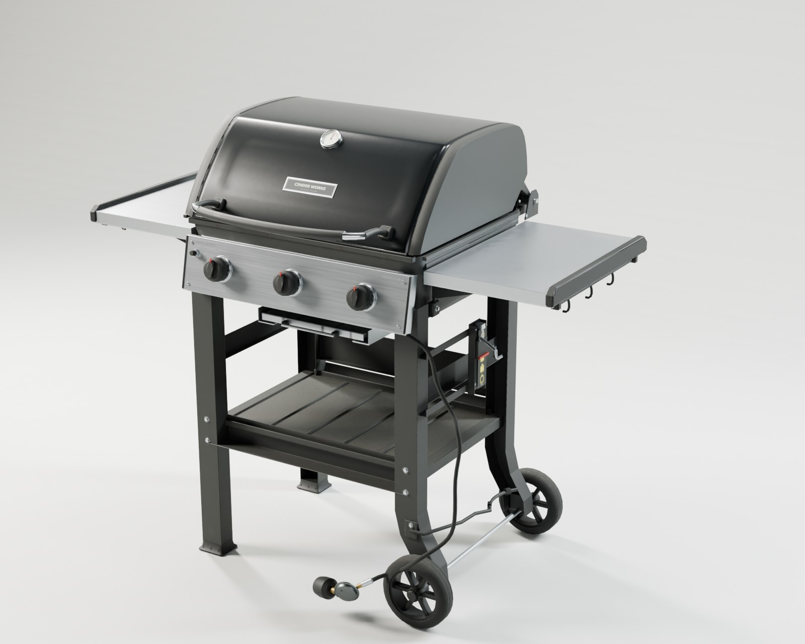
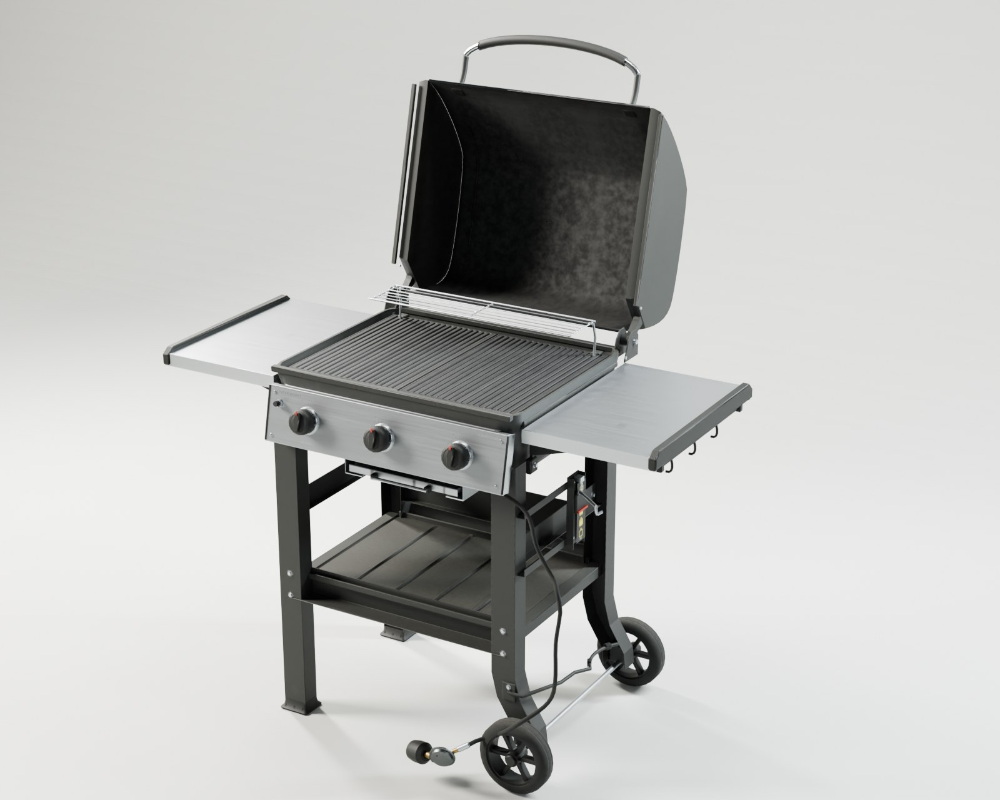
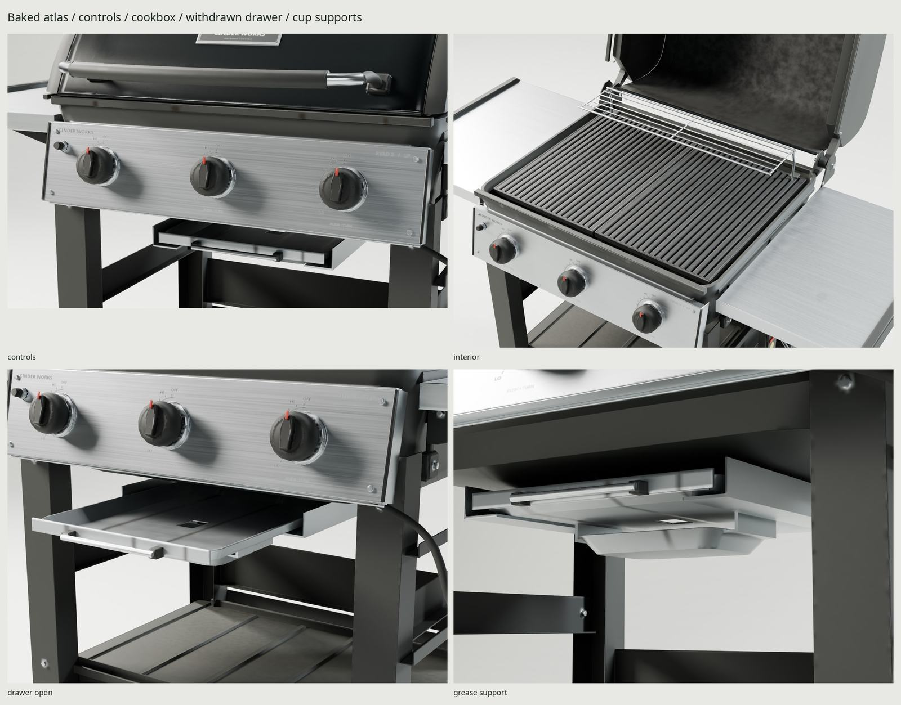
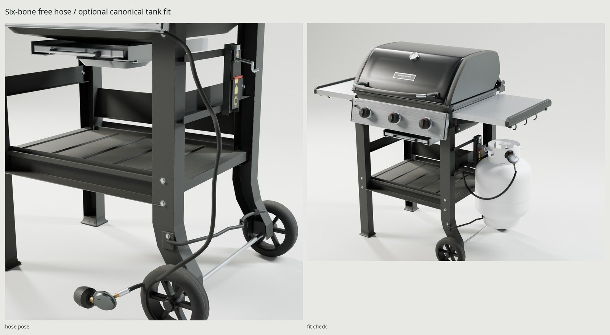
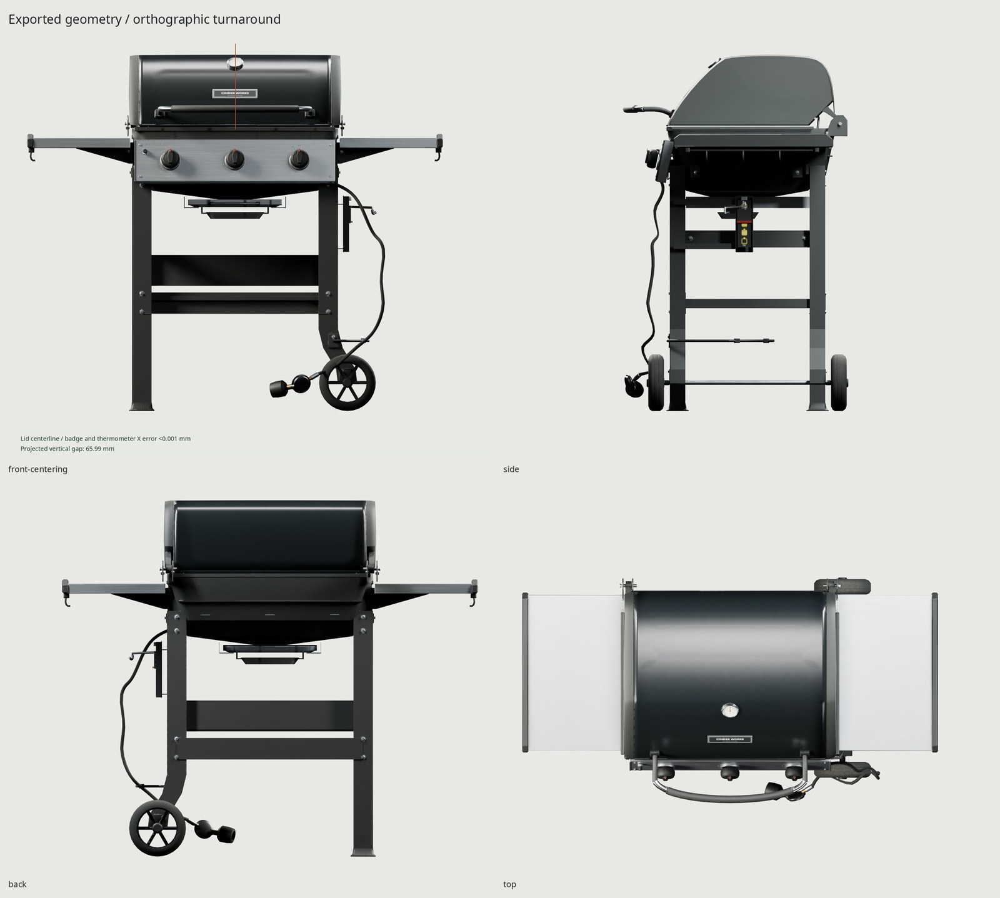

# Cinder Works / Field 3

An original, lightly used American three-burner LP grill on an open cart.
The older Spirit II E-310 US envelope gives familiar backyard proportions,
visible combustion hardware and a practical two-wheel frame. The hood,
construction details, fictional branding and graphics are authored here.




The grill includes the regulator, Type 1 coupling, flexible skinned hose,
spring hanger and foot-ring cradle. **The tank is a separate game asset.**
It is absent from the modeling scene, bake, texture set and exported GLB.
Only the optional fit-check image loads the owner's external canonical tank.

## Dimensions and delivery

[REFERENCE.md](REFERENCE.md) records the chosen specification and uncertainty;
[refs/SOURCES.md](refs/SOURCES.md) credits the photos/manuals. The manufacturer's
2020 US catalog supplies the 2018–2024 reference envelope; rounded regional
dimensions are not mixed. The original design now needs 30 mm more closed depth
for the outboard wheels and cleared hinge. Construction gauges are authored
manufacturing estimates.

| Measurement | Reference | Generated |
| --- | --- | --- |
| Extended table width | 1320.8 mm / 52 in | 1320.0 mm, −0.8 mm |
| Closed depth, handle included | 685.8 mm / 27 in | 715.8 mm; +30 mm for mechanical clearance |
| Fully open height / depth | 57 in / ≈1448 mm reference height | 1570.2 / 916.7 mm at −104°, connected hose rest pose |
| Closed height | 1130.3 mm / 44.5 in | 1130.3 mm |
| Primary cooking area | 424 in² nominal | Two castings: 608 × 451 mm outer frame; 446 mm bar span |
| Warming rack | 105 in² nominal | 557 × 121 mm perimeter centerlines |
| Grate crowns | Photo estimate 880 ±15 mm | 887 mm |
| Shelf top | Photo estimate 865 ±15 mm | 865 mm |
| Knob pitch | Photo estimate 205 ±8 mm | 205 mm; about 60 mm knob diameter |
| Wheels | Photo estimate 180 ±10 mm | 180 mm |

One material, one **2048² BaseColor / OpenGL +Y Normal / ORM** atlas. ORM is
R occlusion / G roughness / B metallic. Cycles bakes at 4096²; the normal
intermediate is 16-bit, then vector-filtered/renormalized to 8-bit delivery.
BaseColor is filtered in linear light; roughness uses RMS filtering.

| Delivery measurement | Result |
| --- | --- |
| Exported grill, including hose/fitting/hardware | **19,912 triangles / 20,000** |
| High-detail source | **171,390 triangles** |
| GLB | **10,439,228 bytes** |
| BaseColor / Normal / ORM PNGs | **1,645,778 / 2,693,421 / 4,489,710 bytes** |
| Used delivery materials / texture sets | **1 / 1** |
| UV atlas coverage | **46.45%** |
| UV-area-weighted density p5 / median / p95 | **279 / 549 / 1,140 px/m** at 2048 |
| UV contacts above numerical threshold | **3**, totaling **0.34 shipped texel²** |

`build/delivery-check.json` records independent GLB re-import proof; no cylinder
geometry or texture data is present.

Atlas density is priority-weighted: hood, fascia, worktops, markings and fitting
receive more space than hidden manifold/frame faces. Moving roots are exploded
into independent projection groups during the bake;
rest-position shadow copies preserve stationary contact AO. The withdrawn-drawer
render checks that the cookbox does not project onto it. Tiny subpixel UV contacts
are measured and reported rather than described as exactly zero overlap.
Flame ports, screw drives, springs, tiny bevels, tread and material relief are
high-source detail carried by the normal bake. Print sheets project onto solid
low metal backing, avoiding coplanar duplicate game surfaces.

## Construction and materials

The crowned porcelain shell has an inner wall, wrapping cast caps, reveal,
overlapping lip and fork hinges with pins and cast connecting webs. Its inner
carbon/flaking follows
heat plumes and cavities. A rounded 4–7 mm cast firebox slopes toward an open
grease throat; residue follows burner lanes, the sloped floor and drain pool.
Three hollow stainless source burners have paired flame-port rows, venturi/air
shutters, retaining tabs, brass valves, crossover and a ceramic spark electrode.
Five dull folded V channels cover the three burners with channels 1/3/5.
The final GLB `combustion` diagnostic deliberately removes all five tents,
grates and rack to expose the burners. The source diagnostic removes covering
tents 1/3/5 while retaining the intermediate two.

Two satin-black porcelain iron grate sections have trapezoidal bars, cast frames
and underside cross ribs. The warming rack has transverse wires, welded ties
and returned supports. A hollow formed grease drawer has a 30 × 40 mm outlet
and two folded hangers
supporting its foil cup. Hanger-to-tray gap is 0.00 mm; sampled hanger-to-cup
gap is 0.029 mm. Full fluid/grease routing is not simulated.
The 2 mm formed C-section cart has cross braces, bolts, molded feet, axle, spokes
and hub caps. Stainless shelves have folded aprons, return hems, molded ends,
underside brackets and a hook rail. The inclined fascia has folded returns,
bezel/gasket construction, paddle knobs, igniter and Phillips screws.

`WEAR=0.35` represents one or two seasons outdoors. Enamel orange peel, fine
scratches and handle oils; directional stainless brushing and fingerprints;
powder-coat edge/foot scuffs; cooked grease/carbon inside; dust on shelf/feet;
scuffed tires and handle. Heat-channel carbon follows apexes/flame lanes, with
gravity streaks down the V sides. Changing `WEAR` regenerates source and bake.
All masks use physical rest-frame placement, cavity/edge/exposure and directed
tracks; noise breaks those masks or describes manufacturing microstructure.



Both the thermometer and badge are stacked on the lid centerline, each within
0.001 mm in the orthographic front check (`renders/final/front-centering.jpg`).
Wheel-to-leg axial gaps are 17.5 / 18.5 mm, invariant through Y rotation.
`make check` sweeps the lid every 2° from closed to −104°, wheels every 5°,
knobs every 5° and drawer every 5 mm, with 0.5 mm penetration tolerance and
explicit hinge/hub contact allowances. Both high and game scenes must pass.

## Pivots and hose rig

Authoring is meters, Blender +Z up and front −Y. `GasGrill` is the footprint's
ground center; `Grill` has the documented internal X offset −55.5 mm. Mesh
children are rebased to their owning pivot and have applied scale. glTF maps
Blender `(x,y,z)` to `(x,z,−y)`; Blender X/Y/Z axes become glTF X/−Z/Y.
No animation clips are exported; the engine controls the separate parts/skin.

| Node | Blender local axis / range | Location / behavior |
| --- | --- | --- |
| `Lid` | X, 0° closed to −104° open | World (−55.5, 294, 912) mm; hood/caps/handle/dial move together |
| `Knob_1`…`Knob_3` | local Y, 0° to −140° | Shafts follow the fascia's −12° X inclination; indices rotate with paddles |
| `Wheel_Front`, `Wheel_Back` | Y, continuous | World X 301.5 / Y ±290 / Z 90 mm; common axle |
| `GreaseTray` | local Y translation, −200…0 mm | World (−55.5, −9, 647) mm; drawer/cup/handle slide toward the front |
| `tank_socket` | Z yaw +50°, fixed | World (451.5, 13, 198) mm; external tank origin/orientation |
| `regulator_attach` | bone-parented, fixed mating frame | Type 1 mating face; local +Y toward the valve, +Z up in connected rest pose |

`HoseRig` has six connected deform bones, parented in order:
`Hose_01 → Hose_02 → Hose_03 → Hose_04 → Hose_05 → Hose_06`.
Root head is at the manifold: world **(204.5, −277, 748) mm**.
Bones 1–5 follow arc-length stations along the approximately **850 mm** hose;
bone 6 runs from the swaged ferrule toward the coupling. The regulator/nut are
rigidly weighted 1.0 to bone 6. Hose rings blend smoothly between adjacent bones,
with normalized weights and at most two influences. Contributions below 0.0001
are pruned and renormalized before export, matching the portable exporter policy. `regulator_attach` is the
authoritative attach point; use it rather than an importer-generated bone tail.
Its Blender local +Y mating direction becomes glTF local −Z; glTF local +Y is up.

The rest pose is connected to the canonical tank. Final catalog renders pose
the hose hanging free with a pinned manifold. The ordinary linear-skinning
pose test checks every ring for collapse, the fitting's rigid weights, root
position, attachment travel and reset. Re-import checks raw inverse bind
matrices independently of Blender's chosen bone display axes, all bone names
and parents, authored weights, rest vertices and both socket matrices.



## Separate canonical tank fit

The external owner's GLB uses meters, +Z up, valve toward −Y and an origin at
the foot-ring bottom center. Measured visual bounds are **312.2 × 312.2 ×
468.0 mm**, collar diameter **175 mm** (Z 369.325–459.6 mm), foot ring diameter
**210 mm** (Z 0–50.848 mm). Its outlet face is **(0, −41.9, 423.5) mm**, outward
axis **(0, −1, 0)** in that asset's Blender import coordinates.

Parent the external tank root under `tank_socket` with an identity local
transform. In glTF world coordinates the socket is (0.4515, 0.198, −0.013) m,
rotation quaternion XYZW (0, 0.422618, 0, 0.906308). The transformed outlet is
world **(483.597, −13.933, 621.5) mm**, axis **(0.766044, −0.642788, 0)**.
The coupling's mating face coincides on axis. Its mouth overlaps 10 mm of the
outlet thread region. A J-hook lifts beneath the collar's side handle lip at
canonical **(−94, 0, 436) mm**; formed bridge straps connect the spring scale to
the cart. The foot ring narrows above its 105 mm maximum flange radius. The
retention cradle has approximately 3.1 mm clearance and its pads 3.4–3.5 mm
clearance at their working height; these restrain swing after small movement,
and are not zero-clearance supports. The collar hook carries the tank weight.
The mounting plate/bolt seat on the upright's outer face. The separate vessel extends
3.1 mm beyond the right table edge; it is excluded from the grill envelope.
Rest hose clearance to
the canonical mesh is measured by the optional checker.

The local reference stays external and read only. Only the dedicated fit checker
and one fit-check render import it; neither saves or exports a scene containing
it. The checker compares its checksum before/after. If absent, `make` prints a
clear skip and produces all remaining outputs. No cylinder, OPD, cylinder
markings or cylinder texture set is generated by this asset.

## Rebuild and proof

Installed Blender 5.2.2, Python 3/Pillow/NumPy, Noto/DejaVu fonts, flock are required; an
OptiX/CUDA GPU is recommended. No packages, code, HDRIs or assets are downloaded.
`make refs` retrieves cited images/PDFs only. Every Cycles bake/render holds
`ASSETS_GPU_LOCK`; scripts select OptiX/CUDA when available and warn before falling back to CPU.

```sh
make                          # complete delivery build and checks
make check                    # geometry, motion, construction, camera, GLB/UV/rig/fit, Git rules
make check-texture-repeat     # optional full rebake and numerical texture comparison
make preview                  # Workbench source review
make match PASS=photo-review WIDTH=1200 SAMPLES=48
make WEAR=0.65 PASS=dirtier WIDTH=1000 SAMPLES=32 render
make TANK_REFERENCE=          # build without the optional fit asset
make TANK_REFERENCE=/absolute/path/propane-tank.glb
make hook-install             # worktree-local staged-blob pre-commit checks
make clean && make            # rebuild models, bake, textures, export and final studio
```

Changing the optional fit path invalidates studio output without invalidating
the grill's bake/export. Its absence removes any stale fit-check image.
The source photo critique and iterative corrections are in [REVIEW.md](REVIEW.md).
The current two camera fits have 6.48 / 18.05 px landmark RMS; the independent
projection implementation agrees within 0.001 px. Lenses are estimates, not EXIF.
The interior photograph's circular GBS insert is a regional difference; this
asset follows the selected US straight grates.

| Local output | Contents |
| --- | --- |
| `export/GasGrill.glb` | Embedded baked textures, separate pivots, six-bone skin and sockets |
| `textures/bake/`, `textures/ship/` | 4096 source bake and 2048 delivery set/reports |
| `build/lookdev.blend`, `build/game-audit.blend`, `build/finalized.blend` | Original high, game tessellation and packed low scenes |
| `build/*-audit.json`, `uv-report.json`, `delivery-check.json`, `fit-check.json`, `motion-*.json`, `construction-check.json` | Independent counts/topology/scale, UVs, GLB/rig and optional fit proof |
| `renders/final/contact.jpg` | All 16 Cycles views plus Eevee last |
| `renders/final/` | Both heroes, turnaround, controls/interior/construction/combustion/regulator, scale, free-hose pose, withdrawn drawer/cup-support details and optional canonical fit; shot metadata with GLB SHA-256 |
| `renders/final-eevee/hero_closed.png` | Eevee render of the same exported GLB |
| `renders/final-photo/*-pair.jpg` | Last source/photo comparisons, ignored and not used as textures |
| `docs/` | Five final JPGs, each ≤1600 px wide and ≤200 KB |



Known limitations retained after owner approval: combustion weathering still
has procedural mottling and overly uniform grate bars; shipped stainless loses
source anisotropy, becoming pale in Cycles or granular in Eevee; burner ports
are subtexel in the atlas. Control/handle close-ups reveal coarse silhouettes
and baked-normal waviness. The free hose pose still has visible bends/twist and
about 26% local radius compression; it is a functional demonstration, not a
physics simulation. These finishes and the hose pose were outside this final
construction touch-up.

Geometry is deterministic. Cycles GPU maps are numerically reproducible, not
byte-identical: accepted maximum channel difference is **2/255**, with RGB
byte-domain RMSE ≤**0.02** per map. `kit/compare_textures.py` passed on two
current full-size bakes: 53 changed channel values total, maximum difference 1,
worst RMSE 0.00147 bytes (`build/texture-repeat.json`). The fresh reviewer's
earlier independent pair also passes (maximum difference 2).
`make check-texture-repeat` tests an additional full bake when needed.
Export-preservation checks prove
serialization; motion/construction reports provide the separate mechanical
checks. The motion sweeps sample the declared ranges; they are not continuous
collision detection.


Original geometry, shaders, studio and fictional markings are generated here.
Reference photos/manuals remain their authors' copyrighted measurement aids
outside Git. Noto Sans uses SIL OFL; DejaVu Sans its open font license. The
owner's separate canonical tank is credited only in the optional fit image;
no redistribution right is inferred. The rifle project supplies the workflow
quality reference. No additional tools or installations were required.
