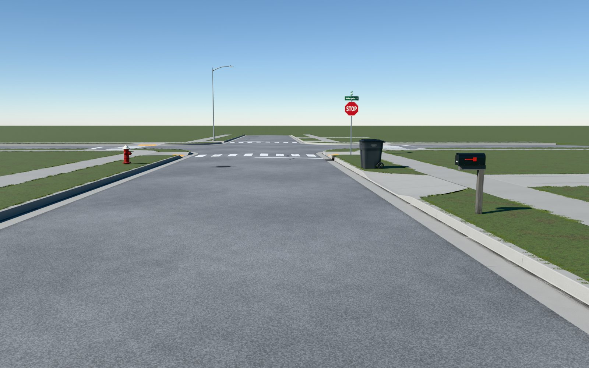
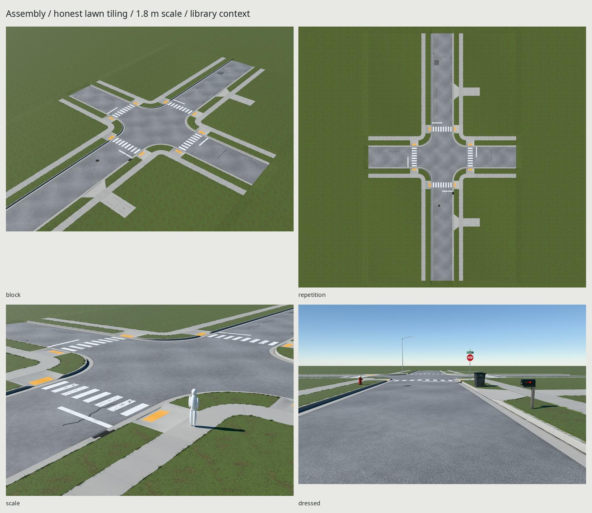
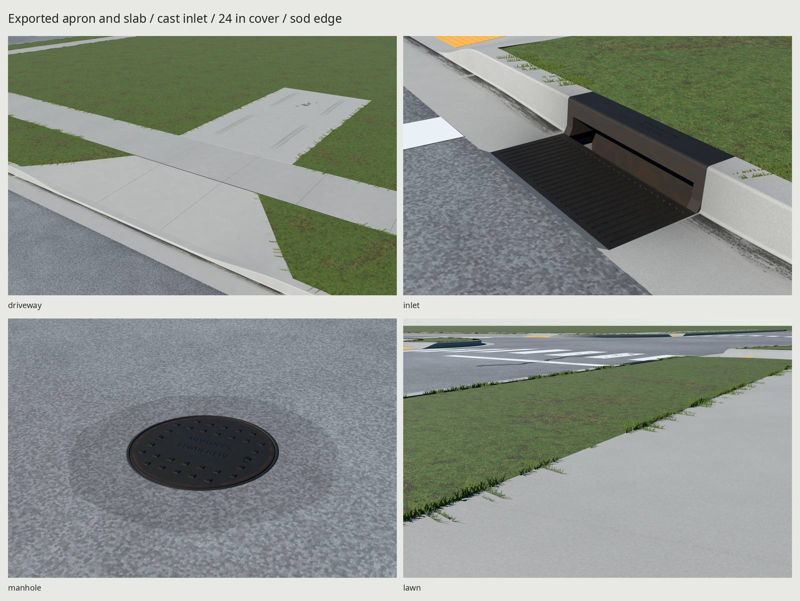

# Aldervale / modular residential ground

An original American neighborhood street: aged crowned asphalt, curb and
flow-line gutter, walks and accessible corners, jointed driveways, late-summer
lawn, a combination storm inlet, and a 24-inch cast-iron manhole. Every vertex
and texel is generated by these scripts for ordinary stock glTF rendering.



Three seamless PBR tiles and one shared trim atlas serve the family. The iron
castings **fit on the trim atlas**: no separate casting set is needed. Six
material states share twelve 2048² images: asphalt, concrete, lawn, blended
trim, opaque iron, and double-sided alpha-tested foliage using the trim's same images.

[REFERENCE.md](REFERENCE.md) separates published dimensions from authored fit
choices. [Reference credits](refs/SOURCES.md) record every photo and drawing.
[REVIEW.md](REVIEW.md) records the rejected passes and exported photo comparisons.
The photo fits judge finish and framing; they do not survey the photographed
streets or certify a civil design.

## Construction and real scale

| Feature | Chosen dimension |
| --- | --- |
| Asphalt carriageway | 7.3152 m / 24 ft, two nominal 12 ft lanes |
| Curb face to curb face | 8.2296 m / 27 ft |
| Back to back of curb | 8.5344 m / 28 ft; distinct from clear street width |
| Crown | 1:48 each side; road edge 6.35 mm and crown 82.55 mm above flow-line datum |
| Curb/gutter | 609.6 mm overall: 457.2 mm pan, 152.4 mm back, 152.4 mm rise; 13 mm tool radii, 1:12 battered face |
| Corner return | 4.572 m / 15 ft nominal face radius |
| Sidewalk | 1.524 m / 5 ft wide, 5 ft score pitch, 1% fall toward the street |
| Walk scores | 3.175 mm opening, 6 mm visible recess; tooled edge relief |
| Planting strip | 1.8288 m / 6 ft between curb back and sidewalk |
| Perpendicular ramp | 1.524 m clear width, 1.8288 m run, full 1.524 m walk landing behind |
| Detectable warning | 1.524 × .6096 m; normal-represented 27.94 mm domes at nominal 50.8 mm pitch, 5.08 mm source relief |
| Drive opening | 3.048 m / 10 ft low span, 1.524 m transition each side, 25.908 mm remaining curb nose |
| Apron | 1.8288 m run; 6.096 m wide at curb, tapering to 3.048 m at walk; expansion material at the walk |
| Private drive | 3.048 × 3.048 m panels, two deep in the demonstration; 0.4% rise away from walk |
| Inlet module | Same 609.6 mm × 3.048 m curb envelope; 890 × 375 × 35 mm bar grate; 25 mm transverse bars, 9.6 mm slots; flush curb-profile box and depressed pan |
| Manhole | 609.6 mm / 24 in lid, nominal 635 mm upper frame, visible bevel/flange to 641 mm; irregular nominal 1.12 m asphalt patch |

Auburn's street/drive drawings supply the section and curb cut; Windsor informs
the planting allowance and corner radius. Portland's walk repair manual informs
joint placement at different pours/thicknesses and scoring through a driveway.
The inlet adapts common US combination-inlet construction to this exact pan;
its fit dimensions are authored, not a reproduction of a named casting.
Manufacturer literature supplies the 24-inch cover convention. All foundry and
municipal lettering is fictional: **ALDERVALE**, **SANITARY**.

The low-volume local street has no centerline. The stop-controlled crossing
prefab uses 18 in white bars, 18 in gaps, a 6 ft crosswalk band, and a 12 in stop
bar on the incoming right-hand lane at least 4 ft before the crossing.

These are exposed terrain skins. Buried paving, footings and internal module
end caps are omitted. The grate has transverse cast bars with small edge radii, connected perimeter webs,
wall thickness, a cast perimeter support seat and a shallow basin with visible
end returns underneath. The manhole replaces an actual hole in its road variant; its patch ring and tilted frame follow the crown.
The lid carries real 3 mm raised grip lands; fine sand-cast grain, pits and
lettering use the shared normal map. The removable lid has its full 38.1 mm
cast gauge, underside and a load-bearing frame seat. Warning domes remain
normal-only and cast no individual shadows.

## Grid, anchors and every piece

Meters, Blender +Z up, front −Y; glTF `(x,z,-y)` is +Y up. The construction
subgrid is **.1524 m / 6 in**; road pitch 6.096 m, curb pitch 3.048 m, walk pitch
1.524 m. Terrain roots intentionally use construction anchors rather than a
prop's footprint-center origin. All coordinates below are local Blender meters.

The inspection library lays roots apart. **Replace a root's transform** when
placing it; keep its children. Most root Z=0 values refer to flow-line grade,
not the top of a slab. `src/assemble.py` supplies the complete placement example
and rephases UVs/tint into the export after placement.

| Root | Skin footprint / role | Snap anchors |
| --- | --- | --- |
| `Road_Straight_A/B/C` | Each 7.3152 × 6.096; aged mix / sealed repair / patch | S/N `(0,±3.048,0)`; W/E `(±3.6576,0,.00635)` |
| `Road_Straight_Manhole` | Same, with a real patch opening | Same; `Cover=(1.1,0,road_z(1.1))` |
| `Road_Intersection` | 17.3736 m square envelope, four concave rounded corners | N/S `(0,±8.6868,0)`; E/W `(±8.6868,0,0)` |
| `Curb_Straight` | X −.4572…+.1524, Y ±1.524 | S/N `(0,±1.524,0)` |
| `Curb_Corner` | SW quarter about origin, 4.572 m nominal face radius | N `(-4.572,0,0)`; E `(0,-4.572,0)` |
| `Curb_DrivewayCut` | Same section, Y ±3.048; central 10 ft low span | S/N `(0,±3.048,0)` |
| `Curb_Ramp` | Same section, Y ±1.524; central 5 ft depressed span | S/N `(0,±1.524,0)`; Back `(.1524,0,0)` |
| `Curb_StormInlet` | Same section and 3.048 m length; depressed central 900 mm opening | S/N `(0,±1.524,0)`; Curb `(0,0,0)` |
| `Sidewalk_A/B` | Each X 0…1.524, Y ±.762; B has a thin shrinkage crack | S/N `(0,±.762,0)` |
| `Sidewalk_Corner` | SW annulus, radii 1.0668…2.5908 | N `(-2.5908,0,0)`; E `(0,-2.5908,0)` |
| `Sidewalk_Ramp` | X 0…3.3528, Y ±1.524; run, flares, landing, warning | S/N `(1.8288,±1.524,0)`; Curb `(0,0,0)` |
| `Markings_Crossing` | Full road width; Y −.9144…+2.4384 | `Ramp_axis=(0,0,0)` |
| `Driveway_Apron` | X 0…1.8288; Y ±3.048 at curb, ±1.524 at walk | Curb `(0,0,0)`; Walk `(1.8288,0,0)` |
| `Driveway_Slab` | X 0…3.048, Y ±1.524; sawn/expansion joints | Street `(0,0,0)`; Back `(3.048,0,.012192)` |
| `Lawn_Strip` | X 0…1.8288, Y ±1.524; shallow sod mound and two fringes | S/N `(0,±1.524,0)`; Curb `(0,0,0)`; Walk `(1.8288,0,0)` |
| `Lawn_Yard` | X 0…6.096, Y ±3.048; fringe at walk, 0.4% rise | S/N `(0,±3.048,0)`; Walk `(0,0,0)`; Back `(6.096,0,.024384)` |
| `Lawn_Field` | Same skin and grade, without the concrete-edge fringe | Same |
| `Lawn_YardNarrow` | X 0…1.0668, Y ±3.048; fringe at walk | Same S/N and Walk; Back `(1.0668,0,.0042672)` |
| `Lawn_FieldNarrow` | Same narrow skin, without fringe; outer lot closure | Same |
| `Lawn_DriveSide_N/S` | Each X 0…6.096, Y ±.762; walk and driveway fringes | S/N `(0,±.762,0)`; Walk `(0,0,0)`; Back `(6.096,0,.024384)` |
| `Lawn_CornerStrip` | SW annulus, radii 2.5908…4.4196; two fringes | N `(-4.4196,0,0)`; E `(0,-4.4196,0)` |
| `Lawn_CornerYard` | SW quarter disk, radius 1.0668; curved walk fringe | N `(-1.0668,0,0)`; E `(0,-1.0668,0)` |
| `Lawn_DriveWings` | Two triangular sod infills, X 0…1.8288, outside tapered apron | Shares the apron Curb/Walk construction frame; place at the same origin |
| `Manhole` | Irregular nominal 1.12 m patch, frame and separate 24 in cover | Surface `(0,0,0)` mates with road `Cover`; `Patch_E=(.563507,0,-.011740)` lies on the actual cut polygon |

Socket names include the root prefix. A repeated driveway or yard advances its
Back anchor, including the stated Z increment. Apron/strip anchors stay on the
family flow-line datum; their visible surfaces contain the curb rise. Grass
cards overhang the skin boundary by a few centimeters. The sample's narrow
side yards and corner yards receive a smooth grade blend in the assembler so
they meet the deeper north/south lots without a gap or shading seam.

The demonstration has two driveways on the east side, one on each long arm;
its inlet is on the southeast approach beyond the ramp. The road's manhole
variant and separate casting share one irregular 64-edge cut polygon. Local
surface-normal interpolation at the road's ports matches the established core.

## Materials, service wear and repetition

| Set | Physical coverage | Delivery / planar density |
| --- | --- | --- |
| Asphalt | 6.096 × 6.096 m | 2048² BaseColor / +Y Normal / ORM; 335.96 px/m |
| Concrete | 3.048 × 3.048 m | Same maps, 671.92 px/m |
| Lawn | 3.048 × 3.048 m | Same maps, 671.92 px/m; 1.49 mm texels |
| GroundTrim | Shared graphics, iron and foliage regions | 2048² RGBA BaseColor / Normal / ORM; region-dependent density |

All tiling fields are generated and GPU-baked at 4096². BaseColor is sRGB;
Normal is OpenGL +Y; ORM is R occlusion, G roughness, B metallic, in linear data
space. Filtering uses linear-light color, normalized vector normals and RMS
roughness. Leaf-stroke edges receive a small wrapped linear-light antialias
filter before baking. The same source/bake color and numeric wrap gates apply
to all three tiles. Independent raw color mosaics and GLB-rendered 3×3 PBR
boards expose the repeat.

The concrete correction is in **albedo**, under unchanged side daylight:
light neutral paste replaces dark blue-gray paste, and low-frequency cloud
contrast is reduced to a whisper. Quiet separate-pour value shifts, soil at
planting edges, dirt at scores and the less-dirty walking center carry the use
history. Faint irregular broom relief and pores remain in normals. No broad
noise wash is used as service dirt. Some shaded curb faces still receive blue
sky illumination; the base material is neutral and rough, not a glossy blue coat.

Asphalt exposes 6–13 mm stones through oxidized binder. Repairs are sparse and
independently placed; long seals sit away from the center of the lane, and open
cracks remain thin. Seals are dark gray, slightly glossy, roughly 65–80 mm wide,
with feathered edges and .8 mm normal relief. Their card clearance is 3 mm.
The chamber floor keeps a dark settled-sediment tint even in direct sun.
Gutter deposits follow the low toe: a wandering dark damp band, opaque fine
grit, needles and a few leaves. The depressed inlet deposits follow the actual
imported pan triangles at the same 3 mm clearance, rather than bridging across
its twist. Oil groups sit at curbside parking positions and under a parked
engine on each rear driveway slab; tire traces stay in the two tire paths.

Opaque iron and blended lettering share the trim images; the iron state avoids
transparent sorting of solid castings in Eevee.

Iron is dark charcoal brown-gray. Oxide is confined to sheltered faces, slot
walls, pad bases and frame edges; exposed tops carry a darker metallic burnish.
The curb-box top and 1:12 battered face match the concrete curb profile, and its
back ends at the lawn boundary. The lower throat is below the 70 mm face-plate
edge. Inlet-only fringe exclusion prevents grass crossing the cap. Its pan uses
the existing concrete and sediment, with localized damp strongest at the lip;
all other ground pieces and material functions retain the accepted design.
Fictional **ALDERVALE / DUMP NO WASTE / DRAINS TO STREAM** lettering remains on
the top, within the same trim atlas.

The lawn combines individually generated green and straw-colored blades,
clover leaves, thatch and small thin patches over soil. Edge cards use eight
original tuft fragments in the trim atlas, a .30 alpha cutoff and double-sided
stock glTF rendering. Card envelopes are roughly 32–60 mm high, with shorter
actual tips, irregular spacing and bent overhang onto concrete. Each lawn
module remains comfortably under 2,000 triangles.

The lawn interior is a surface tile. **An engine should scatter short grass
blades, a few clover leaves and sparse seed heads over it**, thinning them in
exposed-soil patches and excluding concrete, iron, ramps and the driveway.
Distance fading, terrain macro tint and stochastic tile blending would further
reduce repetition. Those are optional engine additions; the supplied GLBs use
ordinary PBR, authored UVs, alpha and vertex color, with no custom shader.

World placement rephases UVs and continuous tint into the exported GLB. Curb
profiles unfold using height; the apron/ramp projection blends that chart into
the walk's planar chart. Merely translating a library root in a viewer does
not rephase its baked UVs: use the assembler when authoring another stretch.
Terrain UV overlap is intentional repetition, distinct from duplicate physical
triangles or accidental overlapping unique-atlas islands.

The complete family costs approximately **64 MiB** with BC7 BaseColor, BC5
Normal, BC7 ORM and mipmaps: four sets loaded once, regardless of module count.
The opaque iron and foliage states add no image allocation. Uncompressed RGBA8 uploads
can instead take **256 MiB** with mipmaps. The five optional street-prop sets
add about **20 MiB**, making the dressed view about **84 MiB** compressed.
PNG/GLB byte sizes are separate from GPU memory.

## Imported delivery measurements

The library contains **11,098 triangles**, **6 material states** and
**12 unique 2048² images**; its GLB is **53,627,160 bytes**. The assembled
street contains **69,206 triangles**, uses those same image bytes, and
is **59,261,600 bytes**. The twelve shipped PNGs total **52,763,768 bytes**.

| Module | Imported triangles |
| --- | ---: |
| `Curb_Corner` | 704 |
| `Curb_DrivewayCut` | 374 |
| `Curb_Ramp` | 374 |
| `Curb_StormInlet` | 2,472 |
| `Curb_Straight` | 110 |
| `Driveway_Apron` | 140 |
| `Driveway_Slab` | 46 |
| `Lawn_CornerStrip` | 516 |
| `Lawn_CornerYard` | 384 |
| `Lawn_DriveSide_N` | 288 |
| `Lawn_DriveSide_S` | 288 |
| `Lawn_DriveWings` | 174 |
| `Lawn_Field` | 64 |
| `Lawn_FieldNarrow` | 64 |
| `Lawn_Strip` | 248 |
| `Lawn_Yard` | 244 |
| `Lawn_YardNarrow` | 244 |
| `Manhole` | 1,452 |
| `Markings_Crossing` | 28 |
| `Road_Intersection` | 1,760 |
| `Road_Straight_A` | 68 |
| `Road_Straight_B` | 74 |
| `Road_Straight_C` | 72 |
| `Road_Straight_Manhole` | 312 |
| `Sidewalk_A` | 42 |
| `Sidewalk_B` | 48 |
| `Sidewalk_Corner` | 336 |
| `Sidewalk_Ramp` | 172 |

Some flat modules fall below the 300-triangle guideline because extra faces
would not improve their silhouette. Both small castings stay below 3,000.

All **458** imported seam/interface tests pass. Maximum position difference is
**3.842 µm**; maximum smooth-join normal difference is **0.065°**.
Intentional grade-break contacts reach **28.981°** and use the documented contact policy. The overlay
sampler checks **126,176 actual imported points**, measuring
**1.228–7.998 mm** closest-surface clearance, with no sampled penetration.
These measurements prove geometric construction independently of serialization.

The inlet's ray-measured clear throat is **800.000 ×
95.400 mm**; grate top is **-25.400 mm** relative
to flow-line grade. Its vertical service lift retains **29.795 mm** from the upper face plate
and **5.000 mm** at each chamber end; the front pan clearance is
**5.000 mm**. Two imported ray pairs
measure grate-to-seat contact within **0.000008 mm**.
Imported rays also measure **25.000 mm** cast bars and **9.600 mm** clear
slot necks across the flow. Three comparisons against the straight curb face
agree within **0.015 µm**; the cap top/back both measure **152.400 mm**.
The actual cover diameter is **609.600 mm**, with **1.600 mm** radial clearance
for vertical removal. The cover rests on its actual frame seat with a measured
**0.000007 mm** gap. Both chamber end-return rays hit
the imported housing. These are fresh-import measurements, not source constants.


The shared-edge sampler keeps the original tolerances: 50 µm position/UV phase
and .002 normal-vector difference. New lawn intervals and apron contacts extend
the existing sampler; the original road/curb/walk policies remain. Grade breaks
and different material charts are identified explicitly. Decal support samples
actual imported surface triangles; structural iron and upright foliage are not
misclassified as paving overlays. Wrap, normal length, dielectric tile ORM,
scale, density, applied mesh transforms and repository rules are also checked.

`Manhole_Cover` lifts along local +Z, with its origin at the cover center/grade.
`Inlet_Grate` lifts along local +Z from `(-.2125,0,-.0254)` in the inlet frame;
its child is rebased to that origin. A .35 m service lift is documented. Their
actual radial/XY separations from the fixed castings are measured after import
and remain clear for a straight vertical lift. These are removable service
parts, with no armature, animation clips or hinged range. Fixed parts are joined
within their modules. Blender +Z becomes glTF +Y for these translations.

## Renders and rebuilding




Requires installed Blender 5.2, Python/Pillow/NumPy, open DejaVu/Noto fonts and
`flock`. No packages, executable code, models, textures or HDRIs are downloaded.
Every Cycles bake/render holds the kit's GPU lock. Scratch data stays in this
worktree's ignored `build/` folders.

```sh
make -C ground                       # refs, 4K fields/bakes, 2K delivery, GLBs, renders, docs, checks
make -C ground check                 # independent imported geometry, seams/support, wrapping and repo gates
make -C ground context               # build/check available main-library street props; never fixes them
make -C ground preview               # quick Eevee view of the exported assembly
make -C ground PASS=inspection match-final match-source
make -C ground tile-render           # three honest 3×3 PBR boards, including lawn
make -C ground WEAR=.5               # milder service-weather graphics
make -C ground clean
make -C ground                       # rebuild all ground outputs from scripts
```

| Path | Output |
| --- | --- |
| `export/Ground.glb` | Reusable module library, shared embedded maps, anchors and service parts |
| `export/GroundStreet.glb` | Placed street, built from the imported library; context props are not included |
| `export/GroundTiles.glb` | Three 3×3 material proof boards using the imported maps |
| `build/source.blend` | Editable scripted library before inspection layout |
| `build/lookdev-assembly.blend` | Identical assembled geometry with original pre-bake fields, for comparison |
| `textures/bake/`, `textures/ship/` | 4096 intermediate and 2048 shipped maps |
| `renders/final/` | Player-height hero, dressed and streetside views, block/top, turnaround, details and 1.8 m scale |
| `renders/final-eevee/hero.png` | Eevee view of the exported assembly |
| `renders/tiles/` | Asphalt, concrete and lawn 3×3 sheets and PBR board renders |
| `renders/final/contact.jpg` | All final Cycles views, Eevee and all three tile boards |
| `renders/iron-final-{glb,source}/` | Four calibrated pairs, ignored and never used as texture inputs |
| `build/delivery-check.json` | Raw GLB channels/UVs, fresh-import bounds/counts, ramp and casting measurements |
| `build/seam-check.json`, `build/decal-support.json` | Actual imported shared-edge and overlay-support measurements |
| `build/tiling-check.json`, `build/context-props.json` | Tile/color/memory proof and optional prop build outcomes |

Final lighting is the existing procedural sky and .53° side sun at 38° elevation,
with Khronos PBR Neutral. Asset geometry and materials come from the exported
GLB. A distant procedural lawn backdrop sits outside the delivered sample and
uses its imported lawn material; it is presentation context. The dressed shot
imports the checked hydrant, mailbox, trash cart, stop/name sign and street
light GLBs, places them at their real street locations, and records their hashes.
The mailbox post is buried to keep its floor at road-relative mail height;
light emission is disabled for daytime. Neither operation modifies the prop GLBs.

The remaining compromises are visible: concrete is less eroded and organically
stained than the photographs; lawn interiors are flat at close eye height;
cast iron has cleaner, more regular edges and less retained debris than the used references;
some tile weathering repeats in the large top view; and the warning domes lack
raised silhouettes/shadows. The empty horizon is an asset demonstration rather
than a complete neighborhood. The sample is level longitudinally: local inlet
depression is supplied, but designed street grades, drainage calculation,
collision meshes and engine LODs are not. These limits do not change the supplied
physical module sizes or the reported construction measurements.

All delivered graphics, meshes and materials are original. References are
inspection only, never projected/traced/baked. The open fonts and all photo /
municipal/manufacturer credits are listed in `refs/SOURCES.md`. This completion
adds no shared kit functionality; it uses the existing opt-in tiling pipeline.
