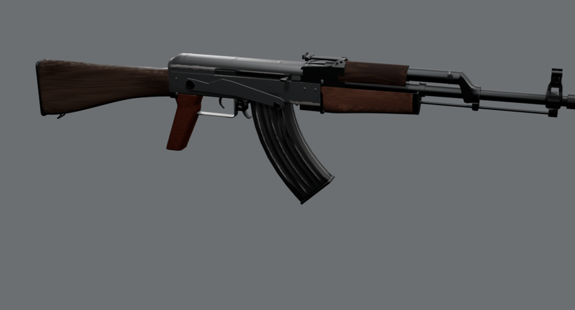

# Propane Defense Rill 39

An original, script-built **stamped-receiver 7.62×39 rifle** game asset.
Fixed hardwood furniture, a molded grip, a curved 30-round steel magazine,
reciprocating handle and three-position selector share one baked 2048 PBR
atlas. Maker, model, serial and markings are fictional. Every vertex and texel
comes from our scripts in Blender 5.2.

The renders below are made from the exported GLB with its baked maps. The
full contact sheet is generated at `renders/final/contact-sheet.jpg` (not
tracked).




`ReloadEmpty` at real speed: front-hook magazine engagement, rock-in seating and charging stroke.

| | |
| --- | --- |
|  |  |
|  |  |

All final stills load exported GLBs with their baked maps. Photographic pairs
are in `renders/final/pairs/`; dense procedural-source pairs are labeled
separately in `source-pairs/`. `look-review/` contains whole-part hue,
saturation/value distributions, highlight colors and actual 2D worn-area
masks. `../lmg/renders/final/hero-beside-ak-smg.jpg` compares all three current
exports under the LMG's unchanged procedural studio. `REVIEW.md` records rejected iterations, neutrals,
measurements, limitations and the final critique. The separate
`wood-grain-and-color.jpg` / `wood-grain-values.json` compare every blank and
an interior stock-side land; spread is (value p90−p10)/median.
`wood-two-scale.jpg` / `wood-two-scale-values.json` split that signal into
broad structure (10 mm FWHM Gaussian) and the fine residual, on the same
physical grid for the GLB and locally balanced photo. The metal-only control
is independently baked and exported through the same kit path: its wood,
manufacturing and carbon remain. `metal-wear-difference.png` is the unamplified
native-hero RGB difference; `metal-wear-proof.jpg`, `metal-wear-regions.png`
and `metal-wear-table.md` give actual visible pixel regions, areas and signed
luma changes for every named site, including honest zeroes for occluded sites.
`look-review/wood-edge-values.json` and `wood-edge-table.md` compare every
exposed wood margin with adjacent intact film on the same blank, in the
shipped BaseColor and native 1600-pixel hero. `wood-edge-colors.jpg` displays
the measured swatches; `wood-edge-regions.png` locates
these fixed physical regions. Film breaks into irregular fragments and fades
along the existing exposed margins; its fibers retain the wood's brown hue.

## Dimensions and construction

| Measure | Actual geometry / reference basis |
| --- | --- |
| Overall length | About 881.38 mm; published class about 880 mm |
| Barrel exterior span | 415.00 mm; independent published 415 mm baseline |
| Intended unloaded mass | About 3.1 kg reference target; not a mesh mass measurement |
| Magazine | 30-round class; three staggered visible display rounds |
| Receiver sheet | Measured about 1 mm; open folded U, not a solid block |
| Eye behind rear notch | Measured 295 mm; cheek-weld photo estimate 268 ±35 mm |
| Eye above comb | About 42.87 mm from an actual surface ray |
| Front hood sheet / depth | About 1.01 / 14.00 mm; conditional photo estimates 1.3 ±.5 / 12.6 ±2 mm |
| Rear leaf / crosspiece width | 13.40 / 25.99 mm; photo estimates 12.9 ±2.1 / 27.3 ±4.4 mm |
| Trigger height / depth / width | 21.99 / 8.43 / 5.16 mm, measured triangle bounds |
| Guard section | 13.00 ×1.65 mm, actual section intersection |

Published specifications, original design choices and photo-derived estimates
are distinguished in [REFERENCE.md](REFERENCE.md). Photos are only for looking
and measuring, with authors, licenses, direct URLs and uses in
[refs/SOURCES.md](refs/SOURCES.md). Camera residuals quantify framing; they do
not certify contours or dimensions between anchors.

The receiver has finite folded skins, lower bends, trunnion-pattern rivets,
magazine-guide dimples, an ejection opening and a stamped guard/release housing.
The cover has flat flanks, a pronounced longitudinal bead over its rear half,
shallow roof-only beads, a downturned rear and retaining button. The gas
forging has circular collars, flat lands and a straight diagonal neck with
small radii. Its front flange, exterior vent relief and lower pin witnesses
are retained in the normal map. The lower lug has its own forged outline and
cutout. The handguard front is capped by a finite-gauge sheet ferrule with a
rearward return fitted to the carved section, a planar front diaphragm,
short barrel surround, rod relief and a supported left sling loop.

The rear sight is a low saddle with planar sides, raised hinge cheeks, a
spring channel, a narrow leaf and wider notch crosspiece. Its sleeve carries
two knurled buttons. Two staggered columns of original Noto numerals are
stamped into the normal and have restrained light infill. The front tower
retains its rectangular window, thin open sheet hood and flat, flush drum.

Stock, handguards and grip are supported compound subdivision forms. The wood
has changing sections and real internal handguard channels. The molded grip
has flat checkered sides and rounded straps. Dense molds, button knurl,
checkering, stampings and marking relief transfer into the normal; they do
not add game triangles. The trigger's concave front faces the muzzle, its
back is convex, and its narrowing toe curls forward.

The magazine is hollow formed sheet with integral ribs, folded spines, curled
lips, a tilted floorplate, front lug, rear catch and separate follower/round
owners. Its front hook engages before the magazine rocks into its seated
pose. Loaded and empty detachables retain identical local frames; standalone UVs
translate the original atlas neighborhoods without reducing texel density. The cartridge and open fired case use brown-olive lacquered-steel exterior
finishes, a jacket and fictional headstamp.

This is an exterior visual asset. The hidden bolt-lug and hammer/sear owners
have **zero render meshes**; retained bones carry their accepted timing. The
barrel has an oversized visual void, without chamber or rifling. Carrier,
piston and ammunition are inert display shapes. Contacts and sampled motion
checks establish visible assembly, not an operative firearm mechanism.

## Finish and wear

Black dielectric enamel covers the stamped receiver, cover and guard, over
matte gray phosphate with rare satin steel at the most exposed points.
Bluing on the barrel, gas forging and sights keeps nearly gray reflections.
The magazine uses gray-black oxidized steel. The stock is brown varnished
hardwood, the lower handguard a redder blank, and the upper a darker red-brown
blank with a duller film. Curved growth layers have irregular spacing and
contrast along each part's long axis; separate vessels provide fine relief.
The grip retains the accepted brown-plum molded phenolic finish.

Named wear sites:

- Receiver lower front corners and magazine-entry edges: a few connected,
  ragged matte-gray phosphate patches with tapered ends. The broad flanks and
  upper/rear edges retain enamel. Only the exposed lower-front rivet crown
  receives a small rub.
- Cover rear rim and rear side bead: longer gray rubs; one rear roof crest
  and a shorter middle crest take hand/sling friction. Other crests retain
  their coating. Satin steel is confined to rare sharp high points.
- Trigger guard: a worn central stretch of the bottom contact edge, fading
  toward the bends.
- Magazine: pouch rubbing along selected raised ribs and folded spines,
  with smaller floorplate-corner/feed-lip wear. Coordinates follow the
  curved press rather than drawing diagonal marks across it.
- Selector blade/tab: restrained friction on the forward exposed edges
  and the thumb fold; the broad blade stays dark.
- Carrier rails/charging handle: directional satin contact visible in the
  open-action view; the closed hero hides the rails.
- Blued gas block: smooth gray collar-edge rubbing with the diagonal web
  still dark. Carbon stays at the exterior vent region and muzzle crown.
- Secondary contacts: narrow rubs on the gas-tube seat and muzzle rim,
  front hood/rear notch/slider-button peaks, and selected buttplate and
  front-cap side edges; surrounding finish stays dark.
- Wrist and handguards: elongated varnish flakes within the hand-contact
  margins, separated by intact film. Exposed fibers retain the same wood,
  slightly lighter/less red and more matte; there is no bleached wrist wash.
- Stock toe/heel and isolated handguard knocks: normal-map depressions with
  dark crushed-fiber bottoms and small same-color lips, without orange arcs.

Broad stain absorption follows curved growth layers in each blank. Oil and
embedded dust darken the receiver-side wrist, cheek-contact land and sheltered
handguard roots. New film loss is confined to exposed toe/heel/comb and
handguard lower/front margins, retaining intact stretches and the accepted
smaller hand-contact flakes. The metal sites keep their accepted locations;
matte substrate value and gloss establish their visibility at native hero
size, with steel still confined to the sharpest high points.

Intact enamel uses linear RGB **.022/.023/.024**, roughness **.42** and
glTF specular factor **.8**. It is a 2.2–2.4% diffuse black reflector. The
previous .0015 paint is superseded by the reviewed family correction. Exposed matte conversion gray is .110/.108/.101, roughness
.88 and metallic .08 on the painted parts; magazine gray is .180/.176/.165,
roughness .86 and metallic .08. Rare high-point steel retains its previous
response. These are authored shader values; the native-hero difference
measures their actual visible effect after baking and export.

The complete visible painted receiver, including accepted wear, is measured
under one physical photographic rig against the white-balanced museum view.
V P10/median/P90 is **24/53/71** against **24/53/76**; mean RGB in the brightest
luminance decile is **96.00/94.14/96.56** against **92.57/93.13/96.42**.
The median passes ±10%, tails ±15%, and highlight value/channels/normalized
color ±10%. The existing gray backdrop supplies the estimated neutral.
`make paint-review` rebuilds the complete-part pair and numeric checks in
`renders/final/paint-review/`. No image correction or per-part light linking
supplies these values; the hero/GIF lights and cameras remain fixed.

`WEAR=0` removes use layers while retaining manufacture and fictional marks.
Stable position/normal attributes keep each finish attached through the clips
and through projection isolation. Named static skins are separated during
baking to prevent wood color entering a sight; assembled shadow copies retain
contact AO. All texture generation is original. No downloaded texture or HDRI
is used.

White balance precedes measurements. The museum view uses its gray backdrop;
the used side uses unprinted white cloth immediately below the receiver; the
installed sight uses weathered gray wood; the molded grip uses light-gray
concrete; the case uses unprinted bright paper-grid cells, and the copper-colored jacket
uses unprinted white paper above its separate reference. The upper cloth
has a different warm illuminant and is excluded from local color calibration.
Cardboard component photos remain form-only. These are estimated neutrals,
with mixed light, reflected surroundings and photographic editing still
limiting absolute comparisons. Whole-part distributions and brightest-decile
RGB are reported separately from authored albedo/BRDF parameters.

Final visible-part medians in the unchanged hero, compared with the locally
balanced used photograph (8-bit RGB; these include illumination):

| Blank | Hero RGB / saturation | Photo RGB / saturation |
| --- | --- | --- |
| Stock | 85/64/53 / .387 | 83/63/51 / .376 |
| Lower handguard | 112/70/54 / .513 | 107/62/45 / .550 |
| Upper handguard | 86/56/44 / .500 | 87/52/39 / .544 |

The fitted side view now separates broad value structure from fine grain.
On a common 0.5 mm physical grid, the same masked 10 mm FWHM Gaussian
defines the broad signal in both GLB and photograph. Fine is the residual;
each spread is (p90−p10)/the original median HSV value. These measurements
include illumination and section shading; they do not recover albedo.

| Blank | Total GLB / photo | Broad GLB / photo | Fine GLB / photo |
| --- | ---: | ---: | ---: |
| Stock | 0.514 / 0.478 | 0.420 / 0.395 | 0.185 / 0.211 |
| Lower handguard | 0.445 / 0.559 | 0.324 / 0.371 | 0.166 / 0.318 |
| Upper handguard | 0.595 / 0.590 | 0.370 / 0.292 | 0.389 / 0.431 |
| Stock interior flat land | 0.279 / 0.287 | 0.206 / 0.186 | 0.154 / 0.164 |

The largest remaining spread difference is the lower handguard’s fine
residual (.166 versus .318). Removing the pale edge strokes changes these
whole-part image distributions; the accepted grain, broad stain and grime
sources remain fixed. Small relief still softens in the 2048 bake, and the
section differs from the photograph. The interior stock land retains its
previous .279/.206/.154 total/broad/fine spreads. Broad absorption, wrist/root
grime and edge film loss survive at native hero size. The unresampled whole-part
and interior-land values remain in `wood-grain-values.json` alongside this
physically rectified analysis.

## Frame, rig and clips

Meters, palm origin; Blender **+Y forward / +Z up / +X right**; glTF **−Z
forward / +Y up**. Internal Root stays identity. Consumer stance, recoil and
whole-instance motion transform the complete scene instance. The additive
[1.6.0 supplement](INTERFACE.md) and [family interface](../INTERFACE.md) retain
existing occupancy and event meanings, add `magazine_rocks_in`, and declare
no last-round hold-open.

Seventeen rigid bones retain their accepted heads and parent frames. The
carrier translates; Bolt rotates as an inert hidden owner; ChargingHandle
rides the carrier's full frame. Selector, Trigger, Hammer, MagRelease,
MagCatch, Magazine, Follower, three top rounds, ChamberRound, CaseTravel and
EjectedCase retain their own timing. The magazine pivots about its front hook
through engagement and then withdraws. Selector display positions are safe
0°, automatic −10° and semi −15° about X. Sight adjustments and the buttplate
trap are static display settings.

Twenty clips: Idle, IdleEmpty, IdleSafe, IdleAutoReady, IdleAuto; Fire,
FireSemi, FireAuto, FireLast; Reload, ReloadEmpty, Charge, Inspect; Selector,
SelectorSafe, SelectorSemi, SelectorAuto, SelectorAutoSemi; AutoStart, AutoStop.
FireLast closes empty. Reload retains the chamber; ReloadEmpty exchanges the
magazine and racks. Rounds use STEP occupancy and feeding is a visibility
handoff. Every clip has explicit holds and complete endpoints. Pause/resume
retains clip/frame/state, including magazine absence.

Six base sockets stay at scene root. Socket_Magazine follows Magazine;
Socket_ChargingHandle follows ChargingHandle. Socket_Eye is the actual optical
frame, without a presentation offset. The aimed render looks from that exact
frame through the rear notch to the post against gray. Event frames,
durations, bindings and local socket positions are in
[src/interface.py](src/interface.py), the supplement and generated
`build/interface.json`.

## Delivery and verification

One canonical **2048 BaseColor / OpenGL +Y Normal / ORM** atlas, baked at
**4096 /32 samples**. ORM is R occlusion, G roughness, B metallic. Opaque
BaseColor alpha carries a per-surface specular factor through
`KHR_materials_specular`; it does not control transparency or add a fourth
image. Consumers must preserve this extension, including the alpha data in each
standalone BaseColor map. The rifle costs approximately **16 MiB** with full
mipmaps at 8-bpp block compression. Each magazine has its own lossless **1024**
subset (about **4 MiB**); the cartridge and fired case each use **512** (about
**1 MiB**). No inter-file texture sharing is assumed.

Budget and file sizes are measured from the actual exports and checked in
`build/delivery/verify.json`. The sizes below describe the final reviewed paint rebuild;
fresh GPU rounding can change PNG compression and GLB byte counts slightly:

| Output | Triangles | Maps | GLB bytes |
| --- | ---: | ---: | ---: |
| Rifle | **40,000 / 40,000** | 2048 | 10,839,212 |
| Loaded magazine | 6,756 | 1024 | 1,534,304 |
| Empty magazine | 4,596 | 1024 | 1,462,400 |
| Cartridge | 960 | 512 | 164,864 |
| Fired case | 704 | 512 | 149,672 |

Each output uses one material and three embedded images. All four standalone
sets retain **density ratio 1.000**, the gun’s trilinear mipmapped sampler,
8 px mip-aligned outer guards and linear-light pull-push background fill.
Whole atlas regions retain their existing internal margins and texels exactly.
Loaded magazine: one source cluster → two packed regions; empty: four → five;
cartridge and case: one → one each. Both magazines fail 512 at full density;
cluster copying makes 1024 possible with 8 px guards. The ammunition’s cluster
sets also beat island packing (164,864 versus 184,124 bytes for the cartridge;
149,672 versus 172,076 for the case). No rebake, scaling or resampling occurs.
The four GLBs total **30,302,284 → 3,311,240 bytes (89.07% smaller)**.
[Family delivery results](../DETACHABLES.md) include per-level bleed checks and
full-size / native 40 px old/new mipmapped pairs in `build/ak-detach/pairs/`
from the repository root. Those subset-only diagnostics describe the earlier handoff. This paint
round rebuilds the copied subsets, finals and docs from the new 4K bake.

The rifle has 17 bones, eight sockets and 20 clips. Detached magazines deliberately
retain their accepted geometry. The canonical PNGs total **7,418,058 bytes**:
BaseColor 1,158,235; Normal 2,509,125; ORM 3,750,698. All are 2048 square.
UV coverage, actual clipped overlap and density percentiles are measured,
rather than described as uniform or exactly zero.
The complete staged atlas covers 40.25%; there are no outside or degenerate
UV triangles. One microscopic overlap has a measured area fraction
0.000000730. Density p5/median/p95 is 1,544/1,880/5,401 px/m; the separate
small-ammunition regions deliberately have the highest density.

Independent construction checks repeat the **44 accepted contact/visibility
groups**, safe-slot coverage and all clip clearance sweeps. Nine further fixed
seats cover the ferrule, sling, gas forging and rear spring. Imported triangles
are attributed one-to-one by rigid owner, centroid and every vertex before
those same checks run on them. No source surface substitutes for an imported
surface. Ordinary clearance tolerance remains 0.2 mm and the same four visual
joints retain their finite bounds. A stored pre-round fingerprint also
preserves all 108 unmodified game meshes and normals, rest bones/sockets,
and 1,556 sampled affine poses. The cap return is also measured against the
actual imported wood section at 23 radial rays; its small overhang and sheet
gauge are plotted in `renders/final/retainer-section.jpg`. The texture-round
fingerprint retains the main rifle’s geometry, normals, UVs,
skin weights, rig, clips and layout. The historical accepted GLB SHA-256 is
`0fecef4cfc1b77fa9c485272d787cb276625781745a6893fe67ba190b60355a0`
against `main` at `2b6ac0e`. A fresh GPU bake can differ at a few quantization
boundaries even with fixed saved inputs and seed 0. The check therefore
compares **every non-image buffer byte, including tangents**, and the complete
JSON semantics exactly; only buffer offsets, embedded PNG lengths and total
buffer length are excluded from that fingerprint. Materials, samplers,
accessors, UVs, skin, nodes, sockets and clips remain exact.

Every decoded pixel of all three maps, including opaque specular alpha and
unused atlas space, is checked against the reviewed paint bake: **at most 1/255
per component and 128 changed texels per map**. `src/accepted_bake.json`
contains validation checksums, not reference images. Its reviewed-change
history keeps the old GLB/map hashes; `src/reviewed_rebaseline.py` is the
explicit acceptance step, separate from normal builds. That step rejects any
non-image/JSON change and any tolerance change. The current reviewed GLB is
`2396ed61fba8b60db0cef52d747e9b4bdcf1bc309949e85e2dac65b614b92b1e`. Three modular moments
per 1024 channel samples locate at most two one-level differences per block;
an in-memory comparison copy must then match the accepted full-image SHA-256.
An ambiguous or unrecoverable block fails closed. A checksum collision cannot
bypass the full-image digest. No shipped texel is corrected or reused, and
ordinary builds cannot record a new baseline. The regression tests reject
two-level changes, excessive changed texels, checksum collisions, missing
alpha, and changes to non-image data or JSON semantics. Measurements are in
`build/texture-preservation.json`; construction and fresh re-import checks
remain separate proofs.

A separate accepted detachable fingerprint retains
oriented corner geometry, normals, other attributes and node frames while
allowing subset UV translations. The independent atlas audit checks inverse
surface samples, density, guards, sampler and pointwise mip bleed through L3.
The old/new comparison additionally checks material factors/extensions,
positive uniform UV transforms and tangent direction, with maximum angular
delta 0.01283° and UV storage error 0.000123 delivered pixels. Three exact-signature
tangent anchors restore main’s exporter rounding within one 0.0001 step.
These preservation checks are separate from the actual fit tests.
Serialization is separate: affine bone and
socket frames, posed surfaces, clip durations, weights/normals and full rotated
magazine spawns are compared independently. Hidden lock/sear geometry is
proved absent by inventory.

## Rebuild

Requires installed Blender 5.2, Python/Pillow/NumPy, fontconfig, Noto Sans,
GNU make and flock. All Cycles work uses the shared kit GPU lock; scratch stays
inside this worktree's `build/`. No packages or downloaded code are installed.

```sh
make -C guns/ak                   # refs through exports, checks, finals and docs
make -C guns/ak check             # source/finalized/imported construction and delivery
make -C guns/ak gif                # signature motion from the baked GLB, real-speed GIF
make -C guns/ak export            # original 4K bake, 2K filtering and five GLBs
make -C guns/ak render match      # exported Cycles/Eevee stills and photo pairs
make -C guns/ak source-match      # separately labeled procedural-source photo pairs
make -C guns/ak strips extra      # real-duration Eevee clips and detachables
make -C guns/ak look-review       # whole-part histograms and 2D worn masks
make -C guns/ak metal-control     # independent metal-off bake/GLB, native difference and site table
make -C guns/ak sections          # measured triangle cuts
make -C guns/ak precedent         # optional: same-studio SMG comparison, if its export exists
make -C guns/ak WEAR=.5           # cleaner finish; unchanged shape and rig
```

Defaults: `BAKE_SIZE=4096`, `BAKE_SAMPLES=32`, `SHIP_SIZE=2048`, `WIDTH=1600`,
`SAMPLES=64`, `WEAR=1`. Parameter stamps invalidate affected stages. This asset
rebuilds without another gun's outputs; the optional SMG comparison reads its
accepted GLB and writes only into this asset's renders.

| Generated path | Contents |
| --- | --- |
| `export/ak.glb` | Final skin, rig, clips, sockets and baked atlas |
| `export/magazine_loaded.glb`, `magazine_empty.glb` | Detached variants in the complete magazine frame |
| `export/cartridge.glb`, `case.glb` | Inert standalone ammunition |
| `textures/T_Rill39_*.png` | Canonical 2048 maps |
| `build/delivery/detachables/<item>/` | Independent 512/1024 maps and audited cluster layouts |
| `build/ak.blend` | Named game parts, retained dense sources and accepted rig |
| `build/delivery/finalized.blend`, `high.blend` | Packed target and procedural dense bake source |
| `build/check.json`, `build/delivery/*construction.json` | Independent actual-surface contact and motion evidence |
| `build/serialization.json`, `build/delivery/verify.json` | Source and final serialization, UVs, maps and budgets |
| `renders/final/`, `build/provenance.json` | Studio, comparisons, playback and current-source image audit |

## Limits and credits

Fine engraving, checkering, substrate grain and the smallest wear soften at the
single 2048 atlas density, particularly in extreme macros. The small normal-only
headstamp remains low contrast in the standalone view, and the lower gas-collar
pin witnesses are softer than their dense-source counterparts. Large varnish reflections
are broader and less saturated than in the used side photograph. The photographs'
individual scratch histories and variant contours are not copied. A static
leaf setting differs from the raised isolated side reference; the original
cover pressing and grip corners also retain small construction differences.
The retainer follows the preserved broad wood section, so its plate is broader
than the modern component reference; it retains the rifle's riveted sling eye.
Small collar/rod-hole silhouette facets remain in the isolated macro. Wood
edge wear is less extensive than on the older photographed example.
The metal-only control measures 22 neighboring Front_Insert projection pixels
at the touching lower-front receiver joint. They remain in the shipped bake
and raw difference, but are excluded from every named-site pixel count.
Existing stock-to-buttplate/sling-eye projection cross-talk also samples
adjacent wood: 419 nonwood BaseColor texels follow the corrected wood color
in this edge round. The source metal shaders and primary wear sites are
unchanged; `REVIEW.md` records this atlas-level qualification.
The closed hero cannot expose hidden carrier rails; the open-action view does.
Mass, ergonomics and manufacturing tolerances are not certified by these
visual exterior meshes.

Reference authors, licenses and URLs are in [SOURCES](refs/SOURCES.md).
Lettering uses installed Noto Sans under the SIL Open Font License. Workflow
and finish precedents are the owner's read-only rifle and finished family
members. This paint round changes no kit code. The two stamped guns share the
receiver photographic audit and optional physical-light fitting helpers in
`guns/common/`; geometry and all other finishes stay fixed.
