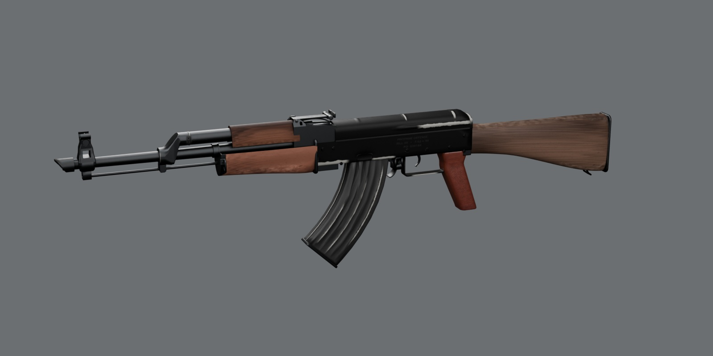
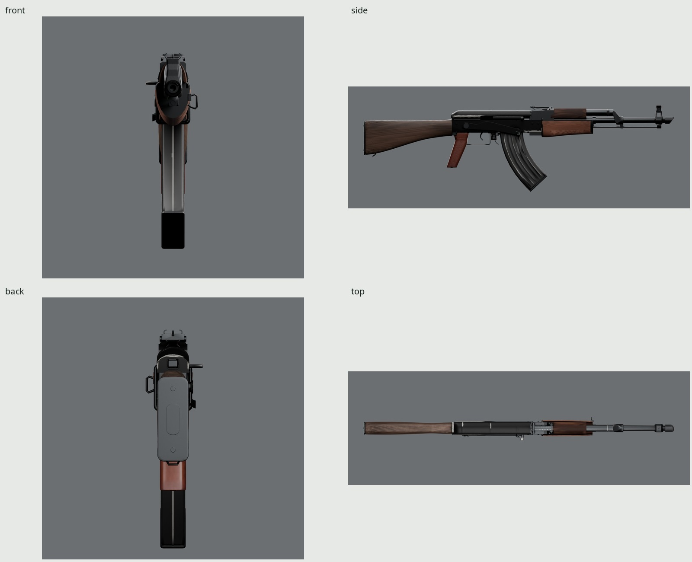
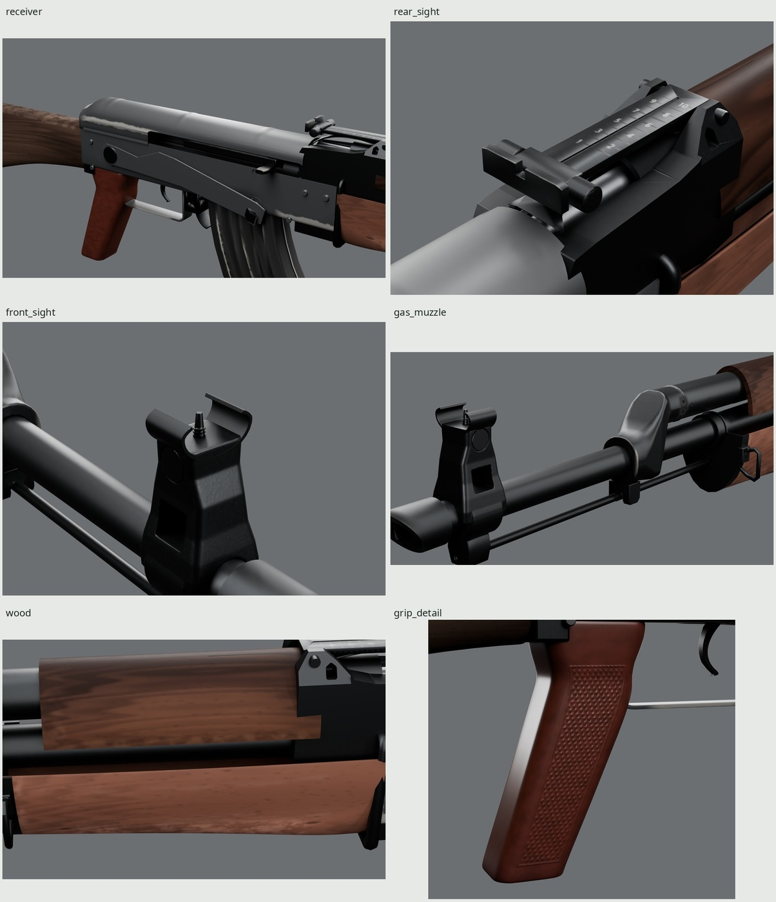
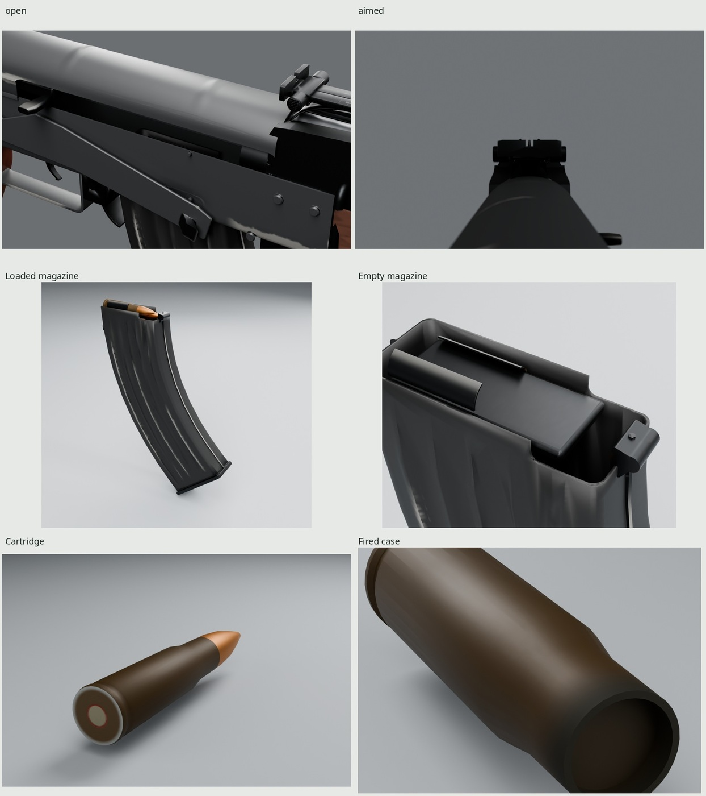
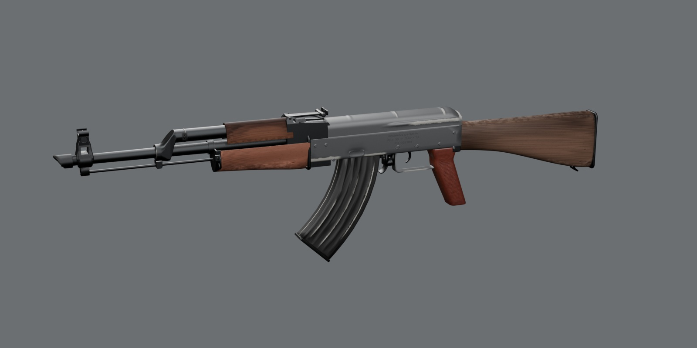

# Propane Defense Rill 39

An original, script-built **stamped-receiver 7.62×39 rifle** game asset.
Fixed hardwood furniture, a molded grip, a curved 30-round steel magazine,
reciprocating handle and three-position selector share one baked 2048 PBR
atlas. Maker, model, serial and markings are fictional. Every vertex and texel
comes from our scripts in Blender 5.2.

The baked candidate is ready for review. These five documentation JPGs are
generated under `docs/` and deliberately left uncommitted until the lead
accepts them. The full generated contact sheet is
`renders/final/contact-sheet.jpg`.



| | |
| --- | --- |
|  |  |
|  |  |

All final stills load exported GLBs with their baked maps. Photographic pairs
are in `renders/final/pairs/`; dense procedural-source pairs are labeled
separately in `source-pairs/`. `look-review/` contains whole-part hue,
saturation/value distributions, highlight colors and actual 2D worn-area
masks. `hero-beside-smg.jpg` compares the accepted black-paint precedent under
the same procedural studio. `REVIEW.md` records rejected iterations, neutrals,
measurements, limitations and the final critique.

## Dimensions and construction

| Measure | Actual geometry / reference basis |
| --- | --- |
| Overall length | About 881.38 mm; published class about 880 mm |
| Barrel exterior span | 415.00 mm; independent published 415 mm baseline |
| Intended unloaded mass | About 3.1 kg reference target; not a mesh mass measurement |
| Magazine | 30-round class; three staggered visible display rounds |
| Receiver sheet | Measured about 1 mm; open folded U, not a solid block |
| Eye behind rear notch | Measured 295 mm; cheek-weld photo estimate 268 ±35 mm |
| Eye above comb | About 42.87 mm from an actual surface ray |
| Front hood sheet / depth | About 1.01 / 14.00 mm; conditional photo estimates 1.3 ±.5 / 12.6 ±2 mm |
| Rear leaf / crosspiece width | 13.40 / 25.99 mm; photo estimates 12.9 ±2.1 / 27.3 ±4.4 mm |
| Trigger height / depth / width | 21.99 / 8.43 / 5.16 mm, measured triangle bounds |
| Guard section | 13.00 ×1.65 mm, actual section intersection |

Published specifications, original design choices and photo-derived estimates
are distinguished in [REFERENCE.md](REFERENCE.md). Photos are only for looking
and measuring, with authors, licenses, direct URLs and uses in
[refs/SOURCES.md](refs/SOURCES.md). Camera residuals quantify framing; they do
not certify contours or dimensions between anchors.

The receiver has finite folded skins, lower bends, trunnion-pattern rivets,
magazine-guide dimples, an ejection opening and a stamped guard/release housing.
The cover has flat flanks, a pronounced longitudinal bead over its rear half,
shallow roof-only beads, a downturned rear and retaining button. The gas
forging has circular collars, flat lands and a straight diagonal neck with
small radii. Its front flange, exterior vent relief and lower pin witnesses
are retained in the normal map. The lower lug has its own forged outline and
cutout. The handguard front is capped by a finite-gauge sheet ferrule with a
rearward return, barrel/rod relief and a supported left sling loop.

The rear sight is a low saddle with planar sides, raised hinge cheeks, a
spring channel, a narrow leaf and wider notch crosspiece. Its sleeve carries
two knurled buttons. Two staggered columns of original Noto numerals are
stamped into the normal and have restrained light infill. The front tower
retains its rectangular window, thin open sheet hood and flat, flush drum.

Stock, handguards and grip are supported compound subdivision forms. The wood
has changing sections and real internal handguard channels. The molded grip
has flat checkered sides and rounded straps. Dense molds, button knurl,
checkering, stampings and marking relief transfer into the normal; they do
not add game triangles. The trigger's concave front faces the muzzle, its
back is convex, and its narrowing toe curls forward.

The magazine is hollow formed sheet with integral ribs, folded spines, curled
lips, a tilted floorplate, front lug, rear catch and separate follower/round
owners. Its front hook engages before the magazine rocks into its seated
pose. Loaded and empty detachables retain identical local frames and atlas
coordinates. The cartridge and open fired case use brown-olive lacquered-steel exterior
finishes, a jacket and fictional headstamp.

This is an exterior visual asset. The hidden bolt-lug and hammer/sear owners
have **zero render meshes**; retained bones carry their accepted timing. The
barrel has an oversized visual void, without chamber or rifling. Carrier,
piston and ammunition are inert display shapes. Contacts and sampled motion
checks establish visible assembly, not an operative firearm mechanism.

## Finish and wear

Black dielectric enamel covers the stamped receiver, cover and guard, over
matte gray phosphate with rare satin steel at the most exposed points.
Bluing on the barrel, gas forging and sights keeps nearly gray reflections.
The magazine uses gray-black oxidized steel with broken wear on its raised ribs, spines,
lips and floorplate rims. The wood is muted reddish-brown varnished hardwood;
annual growth layers intersect a curved blank, with individual longitudinal
vessels and isolated crushed-fiber dings. The upper handguard has darker stain
and a duller surviving film, calibrated separately so the stock cannot hide
its whole-part value. The grip is brown-plum molded
phenolic with slightly polished straps and checkering peaks.

Named wear sites:

- Receiver folded edges, well corners, rivet crowns and cover bead crests:
  interrupted gray phosphate patches with rare satin steel; broad flats
  retain black enamel.
- Selector: polished contact edges and thumb fold, with its broad blade dark.
- Carrier rails and handle: directional satin rubbing where cycling and the
  hand act. The open-action view exposes the rails hidden in the closed hero.
- Muzzle and gas socket: matte carbon at the slanted crown and exterior vent
  region, with the surrounding bluing retained.
- Handguards and wrist: pressure graded around the compound form, with muted
  raw fibers and increased roughness; no straight band or oval stencil.
- Stock toe and heel: isolated angular fiber depressions and small broken
  varnish lips. They add no geometry or decal material.

`WEAR=0` removes use layers while retaining manufacture and fictional marks.
Stable position/normal attributes keep each finish attached through the clips
and through projection isolation. Named static skins are separated during
baking to prevent wood color entering a sight; assembled shadow copies retain
contact AO. All texture generation is original. No downloaded texture or HDRI
is used.

White balance precedes measurements. The museum view uses its gray backdrop;
the used side uses unprinted white cloth immediately below the receiver; the
installed sight uses weathered gray wood; the molded grip uses light-gray
concrete; the case uses unprinted bright paper-grid cells, and the copper-colored jacket
uses unprinted white paper above its separate reference. The upper cloth
has a different warm illuminant and is excluded from local color calibration.
Cardboard component photos remain form-only. These are estimated neutrals,
with mixed light, reflected surroundings and photographic editing still
limiting absolute comparisons. Whole-part distributions and brightest-decile
RGB are reported separately from authored albedo/BRDF parameters.

## Frame, rig and clips

Meters, palm origin; Blender **+Y forward / +Z up / +X right**; glTF **−Z
forward / +Y up**. Internal Root stays identity. Consumer stance, recoil and
whole-instance motion transform the complete scene instance. The additive
[1.6.0 supplement](INTERFACE.md) and [family interface](../INTERFACE.md) retain
existing occupancy and event meanings, add `magazine_rocks_in`, and declare
no last-round hold-open.

Seventeen rigid bones retain their accepted heads and parent frames. The
carrier translates; Bolt rotates as an inert hidden owner; ChargingHandle
rides the carrier's full frame. Selector, Trigger, Hammer, MagRelease,
MagCatch, Magazine, Follower, three top rounds, ChamberRound, CaseTravel and
EjectedCase retain their own timing. The magazine pivots about its front hook
through engagement and then withdraws. Selector display positions are safe
0°, automatic −10° and semi −15° about X. Sight adjustments and the buttplate
trap are static display settings.

Twenty clips: Idle, IdleEmpty, IdleSafe, IdleAutoReady, IdleAuto; Fire,
FireSemi, FireAuto, FireLast; Reload, ReloadEmpty, Charge, Inspect; Selector,
SelectorSafe, SelectorSemi, SelectorAuto, SelectorAutoSemi; AutoStart, AutoStop.
FireLast closes empty. Reload retains the chamber; ReloadEmpty exchanges the
magazine and racks. Rounds use STEP occupancy and feeding is a visibility
handoff. Every clip has explicit holds and complete endpoints. Pause/resume
retains clip/frame/state, including magazine absence.

Six base sockets stay at scene root. Socket_Magazine follows Magazine;
Socket_ChargingHandle follows ChargingHandle. Socket_Eye is the actual optical
frame, without a presentation offset. The aimed render looks from that exact
frame through the rear notch to the post against gray. Event frames,
durations, bindings and local socket positions are in
[src/interface.py](src/interface.py), the supplement and generated
`build/interface.json`.

## Delivery and verification

One canonical **2048 BaseColor / OpenGL +Y Normal / ORM** atlas, baked at
**4096 /32 samples**. ORM is R occlusion, G roughness, B metallic. Opaque
BaseColor alpha carries a per-surface specular factor through
`KHR_materials_specular`; it does not control transparency or add a fourth
image. Consumers must preserve this extension and reuse the canonical image
hashes across GLBs to share the approximately **16 MiB** compressed allocation
with mipmaps. Separate GLB imports do not automatically share GPU memory.

Budget and file sizes are measured from the actual exports and checked in
`build/delivery/verify.json`:

| Output | Triangles | GLB bytes |
| --- | ---: | ---: |
| Rifle | **39,650 / 40,000** | 11,073,284 |
| Loaded magazine | 6,756 | 7,940,880 |
| Empty magazine | 4,596 | 7,852,724 |
| Cartridge | 960 | 7,732,444 |
| Fired case | 704 | 7,720,124 |

Each output uses one material and the same three embedded images. The rifle
has 17 bones, eight sockets and 20 clips. Detached magazines deliberately
retain their accepted geometry. The canonical PNGs total **7,676,643 bytes**:
BaseColor 1,299,917; Normal 2,539,193; ORM 3,837,533. All are 2048 square.
UV coverage, actual clipped overlap and density percentiles are measured,
rather than described as uniform or exactly zero.
The complete staged atlas covers 40.28%; there are no outside or degenerate
UV triangles. One microscopic overlap has a measured area fraction
0.000000731. Density p5/median/p95 is 1,544/1,883/5,401 px/m; the separate
small-ammunition regions deliberately have the highest density.

Independent construction checks repeat the **44 accepted contact/visibility
groups**, safe-slot coverage and all clip clearance sweeps. Nine further fixed
seats cover the ferrule, sling, gas forging and rear spring. Imported triangles
are attributed one-to-one by rigid owner, centroid and every vertex before
those same checks run on them. No source surface substitutes for an imported
surface. Ordinary clearance tolerance remains 0.2 mm and the same four visual
joints retain their finite bounds. Serialization is separate: affine bone and
socket frames, posed surfaces, clip durations, weights/normals and full rotated
magazine spawns are compared independently. Hidden lock/sear geometry is
proved absent by inventory.

## Rebuild

Requires installed Blender 5.2, Python/Pillow/NumPy, fontconfig, Noto Sans,
GNU make and flock. All Cycles work uses the shared kit GPU lock; scratch stays
inside this worktree's `build/`. No packages or downloaded code are installed.

```sh
make -C guns/ak                   # refs through exports, checks, finals and docs
make -C guns/ak check             # source/finalized/imported construction and delivery
make -C guns/ak export            # original 4K bake, 2K filtering and five GLBs
make -C guns/ak render match      # exported Cycles/Eevee stills and photo pairs
make -C guns/ak source-match      # separately labeled procedural-source photo pairs
make -C guns/ak strips extra      # real-duration Eevee clips and detachables
make -C guns/ak look-review       # whole-part histograms and 2D worn masks
make -C guns/ak sections          # measured triangle cuts
make -C guns/ak precedent         # optional: same-studio SMG comparison, if its export exists
make -C guns/ak WEAR=.5           # cleaner finish; unchanged shape and rig
```

Defaults: `BAKE_SIZE=4096`, `BAKE_SAMPLES=32`, `SHIP_SIZE=2048`, `WIDTH=1600`,
`SAMPLES=64`, `WEAR=1`. Parameter stamps invalidate affected stages. This asset
rebuilds without another gun's outputs; the optional SMG comparison reads its
accepted GLB and writes only into this asset's renders.

| Generated path | Contents |
| --- | --- |
| `export/ak.glb` | Final skin, rig, clips, sockets and baked atlas |
| `export/magazine_loaded.glb`, `magazine_empty.glb` | Detached variants in the complete magazine frame |
| `export/cartridge.glb`, `case.glb` | Inert standalone ammunition |
| `textures/T_Rill39_*.png` | Canonical 2048 maps |
| `build/ak.blend` | Named game parts, retained dense sources and accepted rig |
| `build/delivery/finalized.blend`, `high.blend` | Packed target and procedural dense bake source |
| `build/check.json`, `build/delivery/*construction.json` | Independent actual-surface contact and motion evidence |
| `build/serialization.json`, `build/delivery/verify.json` | Source and final serialization, UVs, maps and budgets |
| `renders/final/`, `build/provenance.json` | Studio, comparisons, playback and current-source image audit |

## Limits and credits

Fine engraving, checkering, substrate grain and the smallest wear soften at the
single 2048 atlas density, particularly in extreme macros. The small normal-only
headstamp remains low contrast in the standalone view, and the lower gas-collar
pin witnesses are softer than their dense-source counterparts. Large varnish reflections
are broader and less saturated than in the used side photograph. The photographs'
individual scratch histories and variant contours are not copied. A static
leaf setting differs from the raised isolated side reference; the original
cover pressing and grip corners also retain small construction differences.
The closed hero cannot expose hidden carrier rails; the open-action view does.
Mass, ergonomics and manufacturing tolerances are not certified by these
visual exterior meshes.

Reference authors, licenses and URLs are in [SOURCES](refs/SOURCES.md).
Lettering uses installed Noto Sans under the SIL Open Font License. Workflow
and finish precedents are the owner's read-only rifle and finished family
members. This round changes no kit, common module or other gun's source.
