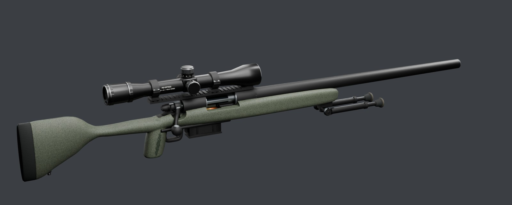
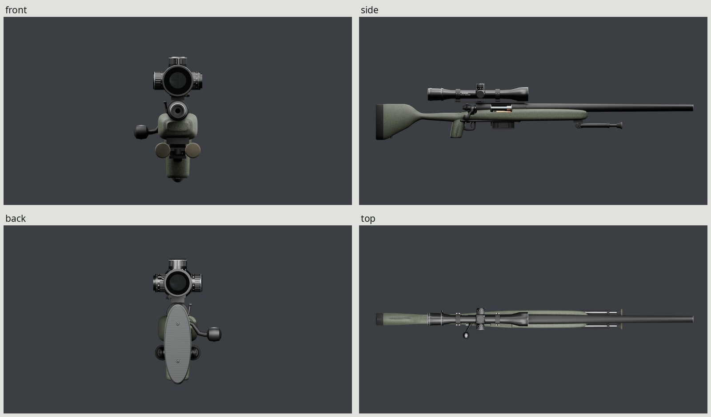
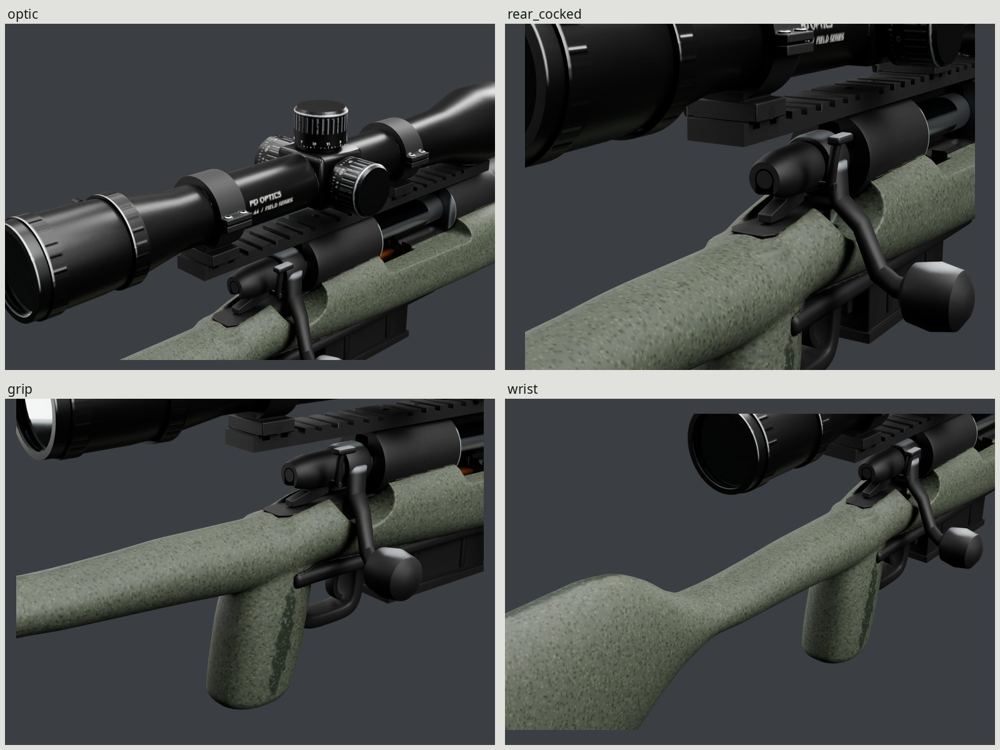
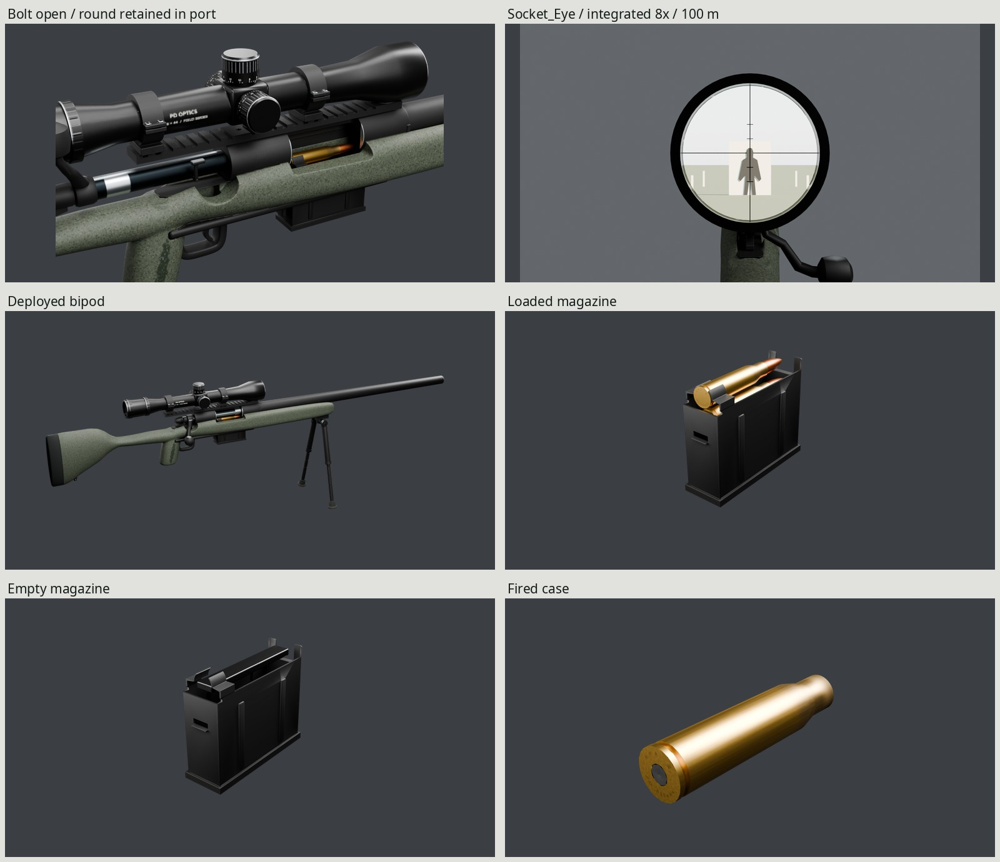
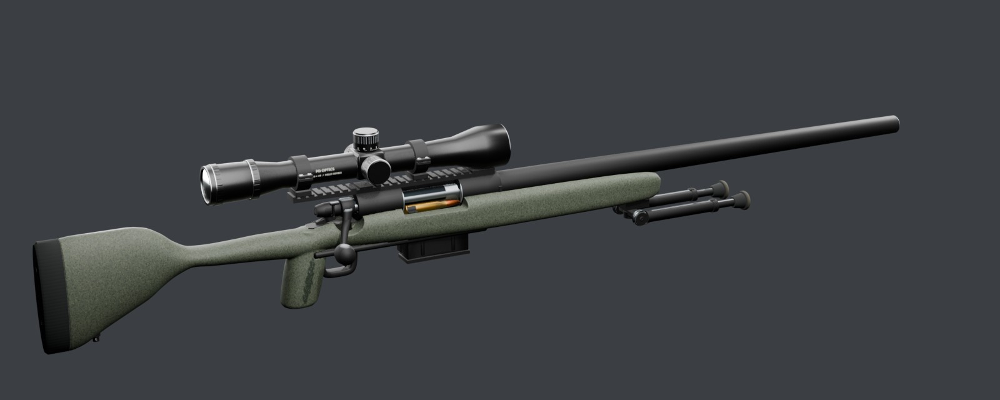

# PD Vesper B24 bolt-action precision rifle

An original .308 precision-rifle game asset, built entirely by Blender 5.2
scripts: sculpted composite furniture, a 24-inch heavy barrel, five-round
magazine, 4–16×44 optic and folding/extending bipod. The fictional maker is
**Propane Defense**. Its contours, controls, reticle and markings are original.
The finish represents a few seasons of field use.



| | |
| --- | --- |
|  |  |
|  |  |

These images load exported GLBs with baked maps; the rifle retains its 2048 atlas. `make` builds
the full contact sheet at `renders/final/contact-sheet.jpg`, Cycles stills in
`renders/final/beauty/`, Eevee in `renders/final/eevee/`, calibrated exported
photo pairs in `renders/final/pairs/`, dense-source comparisons in
`renders/final/source-pairs/`, and real-speed clip strips/WebPs in
`renders/final/strips/`. Generated files are named here as paths, since they
are ignored. [REVIEW.md](REVIEW.md) records the form history, five finish passes and two lead-correction passes,
actual-map wear measurements, value comparisons and remaining differences.

## Dimensions and construction

| Dimension | Design / measured geometry | Basis |
| --- | --- | --- |
| Overall length | 1,129.6 mm / 44.47 in | Brief 44–45 in; manufacturer M24 sheet 44 in |
| Barrel, chamber face to crown | 609.6 mm / 24 in | Brief and manufacturer sheet |
| Heavy contour, shank / near muzzle | 30.734 / 23.55 mm | Manufacturer 1.210-inch shank, straight taper to .900 at 26 inches, shortened to 24 inches |
| Length of pull at finger-height face | About 342.9 mm / 13.50 in | Brief; actual surface ray at Z=10 mm |
| Stock mid-grip section | About 36.9 × 45.9 mm | Original near-vertical palm swell |
| Forend at Y=320 mm | About 62.6 × 41.5 mm | Original broad beavertail; channel excluded from section height |
| Recoil-pad full height / width | 127 / 43.5 mm | Within the cited medium pad's trim range |
| Magazine rear height / body length | 64.008 / 77.597 mm | Published five-round steel-magazine envelope; floor lip projects beyond body |
| Scope tube / objective | 30 / 44 mm | Published variable-power class |
| Scope length | 357 mm | Published class 357.1 mm |
| Eye relief behind ocular rim | 88.9 mm / 3.5 in | Brief target; reference optic 96.5 mm |
| Eye above comb at the actual socket | About 34 mm | Actual vertical ray to comb, checked in `build/check.json` |
| Bolt visual lift / draw | 90° / 104 mm | Individually authored visual estimates, checked through clips |
| Bipod extension / notch pitch | 76.2 / 25.4 mm | Published 6–9 in class, 1-inch steps |
| Bipod sleeve / rod / foot diameter | 14.5 / 9.5 / 24.8 mm | Photo-scaled class estimates, measured again on the mesh |
| Cartridge case / OAL | 51.18 / 71.12 mm | Published .308 dimensional envelope |

The **11–12 lb unscoped rifle** is a design-class mass target, not a mesh-derived
mass. The visual model omits working internals and composite layup. Published
manufacturer sheets, dimensional envelopes, manuals and individual photographic
credits are recorded in [refs/SOURCES.md](refs/SOURCES.md). Photographic diameter
estimates and authored mechanism ranges are distinguished from published values.

The stock is a volumetric union of changing rounded sections and palm-web/grip
volumes, voxel-remeshed and relaxed, then reduced to 9,000 game triangles. Its
dense sculpt transfers through the normal bake. It has a broad flat-bottomed
forend, rounded channel lands, free-floated barrel, tapered butt and a flowing
raised comb. Actual cuts and surface rays check the grip, cheek height, barrel
gap and shoulder seat. The shallow, rounded **single receiver tang** replaces
the earlier exposed fork; the accepted tail still clears it through withdrawal.

The receiver is a hollow round cage with a 72 mm radiused port, clear raceways
and a visible lug-seat pocket. The rear comprises a forged handle collar,
swept stem, oversized knob, tapered shroud and separate lower cocking tail.
The recessed target crown retains its heavy straight taper. Broad precision
bottom metal surrounds the actual well and guard opening. The short magazine
has a folded hollow shell, pressed ribs with inner relief, formed retaining
lips, catch notch, follower and lipped floorplate. Two representative rounds
avoid paying for hidden cartridges; five-round capacity is a semantic property.

The hollow scope retains a clear structural passage through its turret saddle.
Split steel rings have four cap screws each, clamp washers/cross-bolt nuts and
feet seated on a one-piece receiver-matched base. Small control ribs and rail
relief belong to the dense bake source. The stud-mounted bipod has hollow
sleeves, notched extensions, molded rubber soles and an original torsion return.
All vertices, relief, spatter, graphics and texels come from our scripts.

## Materials and field use

The action, barrel, bottom metal, rings and handle have a **matte black
resin/ceramic coating on steel**. The intact coating uses a dielectric response;
exposed steel is metallic. This is our documented coating choice for the class,
not a chemistry inferred from a photo. Fine axial manufacturing variation
breaks the highlights. The bolt body retains dark oxide away from bright
raceway bands and longitudinal contact tracks; the lugs' bearing faces are
polished steel. Carbon stays at the crown and bolt face.

The scope is **black anodized aluminum**: its dyed oxide has a finer satin
response and a deeper neutral black than the steel coating. Thin cap-edge and
knurl-crest rubs expose silver aluminum. The accessible eyepiece rim wears;
recessed valleys stay black. Ring screw heads expose their steel substrate.
The bipod's outer front surfaces carry narrow metal scuffs; its rubber soles
are abraded and dusty. Bore surfaces do not receive exterior leg wear.

The stock's original olive web paint has three fine spatter tones over a base
coat, with slight orange peel in the normal map. Longitudinal palm-swell/front
contact, lower forend shoulders and bag flat, and the cheek-ridden comb top
wear through to dark base coat and occasional gray composite. Narrow tapered
patches have small broken boundaries, with smoother polish nearby. `WEAR=0`
removes use effects while retaining manufacture, paint and markings.

Rubber remains distinct on the pad and feet. Brass cases, annealed shoulders,
copper jackets and a separate primer response share the atlas. The fired case
has a struck primer, open mouth, sooted lip and fictional **PD VESPER / 308 W**
headstamp. Engraved receiver text includes **PROPANE DEFENSE**, **VESPER B24**,
**308 WIN** and **PD-B24-028417**. The scope carries **PD OPTICS**, power/class
marks and original numbered turret scales. Installed Noto Sans and DejaVu Sans
supply the lettering; no real brand or reticle is copied.

Glass is the second material: thin transmissive blue-tinted coating proxies,
with a faint colored reflection component. They do not implement a physical
lens train. The original black split-post reticle stays crisp at the center.
`Socket_Eye` is the exact camera frame, 88.9 mm behind the ocular rim. The still
uses a 70° horizontal player-camera field and opaque gray surround. The direct
mesh is unmagnified; the integrated aimed still fills its ocular with the
objective-camera render and composites the reticle over it, following
[the 1.2.0 supplement](INTERFACE.md).

Every reference is white-balanced before measurement and pair composition.
[src/white_balance.py](src/white_balance.py) records native neutral patches and
linear RGB corrections in `build/white-balanced/corrections.json`. The primary
right photograph uses a bare silver bipod fastener: gains **1.253420 / 0.970818 /
0.770660**, with neutral-patch luminance preserved. The profile uses its gray
mounting ring because its white backdrop is clipped; the left backdrop also
clips, so its identity correction cannot constrain a residual cast. Field
fabric/snow and silver-highlight neutrals are estimates, documented in
[REVIEW.md](REVIEW.md). The old shade-cast calibration is superseded.

The steel is neutral matte black ceramic coating, with linear base
**.0035/.0035/.0035**, central roughness **.60**. The scope's deeper black dyed
anodizing uses **.0018/.0018/.0018**, central roughness **.33** and fine satin.
Neutral studio light keeps the steel highlights neutral too. The accepted olive
spatter paint, wear masks, silver edges, bolt bands and markings are unchanged.

| Surface / reference | Median display luma, photo / export (0–255) | Photo R:G:B (G=1) | Export R:G:B (G=1) |
| --- | ---: | --- | --- |
| Steel, full visible receiver + barrel / corrected right | 41.40 / 38.00 | 0.881:1:1.071 | 1:1:1 |
| Scope, visible photo bell / diffuse rendered tube | 32.59 / 31.72 | 0.853:1:1.235 | 0.984:1:0.969 |
| Original olive stock / corrected used field coat | 117.42 / 113.57 | 1.017:1:0.847 | 0.940:1:0.871 |

These are display measurements under approximate comparable neutral light,
**not recovered albedos**. The scope row spans different surface normals;
separate dark/highlight ranges are retained in the full report. The primary
steel mask covers the exposed face, rather than measuring only its bright
reflection strip. Photo barrel/receiver medians are 42.43/37.03; the rendered
patches are 37/55, so local reflection angles still differ. The combined median
matches the near-black target without copying the remaining photographic cast.
The stock remains our slightly greener original olive paint; corrected field
paint is only 3.85 display levels brighter. All seven references' material
medians, channel ratios and neutral assumptions are in
`build/white-balanced/measurements.json`. Source patches have explicit native
coordinates; rendered patch corners are actual triangle BVH hits in
`build/value-loci.json`. Primary and auxiliary overlays build as
`renders/final/photos/value-patches.jpg` and `value-patches-used.jpg`, with full
distributions in `values.json`.

The aimed still at `renders/final/beauty/aimed.png` demonstrates the objective
render target at **8× / 2.9296° / 100 m**, on the delivered ocular surface, viewed from the
exact Eye socket. Its bright circular image and shader-composited reticle fill
the eyepiece. [INTERFACE.md](INTERFACE.md) specifies mesh `VesperB24`, glass slot
**1**, aperture mapping, eye relief and the FOV table at 4–16×. The original
internal geometric reticle remains in the GLB. The procedural range image is
runtime presentation output, not an extra canonical material/texture set.


## Frame, sockets and clips

The family frame takes precedence over the general prop frame: meters, grip
origin, Blender +Y forward / +Z up / +X right; glTF −Z forward / +Y up.
Internal Root stays identity. Apply stance/recoil to the complete loaded
instance. Six base references and optional `Socket_OpticObjective` stay at scene
root; `Socket_Magazine` follows the full Magazine bone frame. The eye is about
34 mm vertically above the actual comb at its station. Exact socket positions,
event times, states and optional controls are in [INTERFACE.md](INTERFACE.md)
and its executable binding, [src/interface.py](src/interface.py).

| Moving group | Rest pivot, Blender mm | Motion |
| --- | --- | --- |
| BoltTravel | (0, 18, 65) | −Y, 104 mm |
| Bolt | (0, 18, 65), child of BoltTravel | −Y-axis rotation, 90° lift |
| CockingPiece | (0, −22, 65), child of BoltTravel | +Y, 4 mm fire movement |
| Trigger | (0, 26.69, 23) | X, −12° |
| Safety | (18, 14, 62) | X, 25° |
| BoltRelease | (−3, 20, 20) | X, 5° inspection press |
| MagRelease | (0, 51, 25) | X, −12° plus 1.2 mm rearward clearance |
| Magazine | (0, 100, 46) | Downward removal and handoff tilt |
| BipodL/R | (±24, 410, 2) | X, −90° fold/deploy |
| BipodSplayL/R | Same pivot, child of fold | Z, ±15° |
| BipodExtendL/R | (±24, 510, 2), child of splay | Local +Y, 76.2 mm |
| PowerRing / Diopter | (0, −74/−115, 113) | Y |
| Elevation | (0, 62, 129) | Z |
| Windage / Parallax | (±16.5, 62, 113) | X |

Motion values are authored visual parameters, not manufacturer mechanical limits.
Nine clips: **Idle, IdleEmpty, Fire, FireLast, Reload, ReloadEmpty, Inspect,
BipodDeploy and BipodFold**. Fire includes lift/draw/return/lock; FireLast closes
empty with no hold-open. Chambered Reload retains the locked bolt and chamber.
Empty Reload opens, exchanges the magazine, chambers and locks. Cocking tail
and shaft move 4 mm. All holds are explicit; ammunition visibility uses STEP.
Feeding is an occupancy representation, not a cartridge-path simulation.

Save clip/frame/state to pause and resume an interrupted reload. Spawn detached
magazines with the complete magazine socket transform before offscreen
replacement. Loaded/empty variants retain the same origin; their standalone UVs use separate subsets.
Bipod state is orthogonal to ammunition: preserve a consumer bipod layer through
firing/reload when needed, as documented by the additive supplement.

## Budget and delivery

| Final output | Triangles | Materials | GLB bytes | Map size | Density ratio |
| --- | ---: | ---: | ---: | ---: | ---: |
| Rifle, all animated representations | 48,931 | 2 | 11,090,352 | 2048 | — |
| Loaded magazine | 4,976 | 1 | 1,371,024 | 1024 | 1.000 |
| Empty magazine | 3,716 | 1 | 1,400,092 | 1024 | 1.000 |
| Fired case | 768 | 1 | 201,584 | 512 | 1.000 |

The rifle stays under 50k, including its loaded magazine and all ammunition
representations. Detached magazines retain that accepted held-gun geometry,
rather than a separate dropped-prop reduction; two microscopic Boolean
triangles disappear during UV preparation (48,933 inspection / 48,931 delivery).
The corrected trigger is a **6.35 mm wide, 3.2 mm deep radiused blade**, with a
concave front facing +Y (muzzle), convex back and forward-curled toe. Its width
is a class estimate; photographs and limits are cited in [SOURCES](refs/SOURCES.md).
It adds **168 triangles** (452 → 620). Its pivot and −12° pull are unchanged.
Actual source triangle surfaces give **1.473 mm** pulled guard clearance and
**1.431 mm** minimum across thirteen pull poses; the solid visual pin remains
engaged. `make trigger-match` builds right-side and oblique exported/source
photo pairs in `renders/final/trigger-pairs/` and `trigger-source-pairs/`, plus
rest/pulled inspection views in `renders/final/trigger/`. The trigger uses a
previously empty atlas strip; all other parts retain their accepted UVs.
The fired case uses 768 triangles under the revised approximately 800 ceiling,
with 40 radial segments at its open mouth and 32 at the shoulder. Loaded and
chambered cartridges retain their accepted geometry; their silhouettes remain
round at the delivered magazine and open-port image scales.

| Canonical 2048 PNG | Bytes |
| --- | ---: |
| `T_VesperB24_BaseColor.png` | 1,397,751 |
| `T_VesperB24_Normal.png` | 2,178,855 |
| `T_VesperB24_ORM.png` | 3,130,984 |


The kit bakes at **4096 / 32 samples** and filters to one **2048 BaseColor /
OpenGL +Y Normal / ORM** atlas. ORM is R occlusion, G roughness, B metallic.
The rifle retains its canonical **2048** atlas, approximately **16 MiB compressed
with mipmaps**. Standalone loaded/empty magazines now carry their own **1024**
sets; the fired case carries **512**, preserving the original atlas density.
All three retain density ratio **1.000** and the gun’s trilinear mipmapped
sampler, with repeat wrapping. The empty magazine uses six copied atlas regions
(five original clusters, one split); the loaded magazine uses two (one split
cluster), and the case uses one. Source crops preserve internal atlas texels
and overlap at split halos; destination regions are disjoint, with 8 px aligned
outer halos. Every island stays intact. The remaining background uses pull-push,
with normalized generated normals. No density reduction or resampling is needed.
Magazines cost about 4 MiB each / the case 1 MiB compressed with full mips.
See [delivery details](../DETACHABLES.md) for all seventeen items’ sizes, bytes,
density, per-level bleed and old/new comparisons.
The native-scale stock/cap wear comparison is built at
`renders/final/pairs/hero-wear-pair.jpg`; photographic scale estimates and coating
differences are labeled. The rifle is one rigidly weighted skin with two material primitives, including
glass; standalone magazines/case use one material each.

`build/delivery/verify.json` records actual UV coverage, density, overlap,
embedded image hashes, file sizes and round-trip errors. The imported rifle covers 30.53% of the atlas; the complete prepared atlas,
including the reserved case, covers 31.98%. Reported clipped-triangle overlap,
outside triangles and degenerate UV triangles are all zero. Delivered rifle
density is 1,613 px/m median (5th/95th: 1,064 / 2,680); the small standalone
case region is denser for its headstamp. These are measured distributions,
not a claim of uniform density. Small control ribs, orange peel, markings and
wear add no delivery draw calls. Dense sculpt detail
is projected in isolated rigid-bone groups with explicit rest-coordinate
attributes, so finishes follow their parts through clips. Microscopic Boolean
edges are dissolved before unwrap without changing silhouette or contact limits.

## Rebuild and proof

Requires installed Blender 5.2, Python/Pillow/NumPy, fontconfig, Noto/DejaVu,
GNU make and flock. No downloaded code, model, material or lighting is used.

```sh
make -C guns/bolt                    # refs through all exports, checks and finals
make -C guns/bolt check              # source, finalized and imported construction
make -C guns/bolt WEAR=.45           # cleaner finish, same geometry and rig
make -C guns/bolt render match       # final GLB stills and photographic pairs
make -C guns/bolt strips extra       # clips, detachables, engraving and bag-contact views
make -C guns/bolt source-match       # separately labeled dense-source photo pairs
make -C guns/bolt trigger-match      # side/oblique blade pairs and pulled clearance view
make -C guns/bolt wear-audit          # actual UV masks and shipping RGB/ORM readings
make -C guns/bolt critique PASS=correction2 # frozen exported review views/pairs
make -C guns/bolt sections           # source/game actual-surface sections
make -C guns/bolt clean              # only generated outputs; references retained
make -C guns/bolt                    # rebuild from scripts
```

Defaults: `BAKE_SIZE=4096`, `BAKE_SAMPLES=32`, `SHIP_SIZE=2048`, `WIDTH=1600`,
`SAMPLES=64`, `WEAR=.85`. Parameter stamps invalidate the affected stages.
All Cycles work uses the shared kit GPU lock; scratch stays in `build/`.

The inspection and finalized source repeat all **27 actual-surface contacts**
and the full **2,195 half-frame pose** clearance sweep. The consolidated fresh
GLB is decomposed only for auditing: every imported triangle matches a source
part one-to-one by rigid owner, centroid and all vertices. Contacts and clearance
then run independently on those actual imported surfaces. Separately, affine
frames, intended states/holds/transitions, all socket orientations, posed
surfaces and rotated magazine spawns prove serialization. UV checks keep the
unchanged 1e-5 microscopic-overlap limit and forbid escaped/degenerate triangles.
Every bake channel must have zero missed interior texels. An independent clean
factory-startup build checks procedural repeatability. Final provenance checks
every still/strip's GLB hash and the decoded duration of all nine WebPs.

| Generated path | Contents |
| --- | --- |
| `export/bolt.glb` | Final skin, rig, nine clips, eight sockets and embedded atlas/glass |
| `export/magazine_loaded.glb`, `export/magazine_empty.glb` | Detached variants in the complete magazine frame |
| `export/case.glb` | 768-triangle fired case |
| `textures/T_VesperB24_*.png` | Canonical 2048 maps |
| `build/baked/4k/` | Original 4096 maps and projection-coverage report |
| `build/delivery/finalized.blend`, `build/delivery/high.blend` | UV target and dense procedural bake source |
| `build/check.json`, `build/delivery/*construction.json` | Independent source/finalized/imported contact and sweep results |
| `build/serialization.json`, `build/delivery/verify.json` | Affine/state, surfaces, UV, texture and detachables audits |
| `build/final-provenance.json`, `build/repeat.json` | Current-image identity, real clip timing and independent rebuild |
| `renders/final/` | All required stills, pairs, scale cue, playback and contact sheet |

## Remaining limitations and credits

The objective-camera magnification is demonstrated in the integrated aimed
render and documented in the supplement; it still needs the consumer's runtime
render-target shader and camera update. Fine engraving, orange peel and the
smallest knurl relief soften at the single 2048 atlas density. The fired mouth
is round at the delivered macro scale; the hidden case base is intentionally
less tessellated. The authored coating/wear differs from the reference
camouflage, and photographed reflected sky is not a spectrophotometric material
measurement. Eevee and Cycles differ in transmission and grazing reflection.
Mass, ergonomics and manufacturing tolerances are not certified by these visual
outer meshes.

Individual reference authors, licenses, direct image/PDF URLs and uses are in
[refs/SOURCES.md](refs/SOURCES.md). Photos are only for looking and measuring.
The workflow follows the owner's read-only rifle project and the finished
family members; this asset changes no kit, common, pistol or shotgun module.
