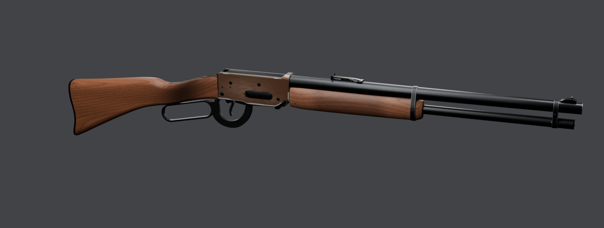
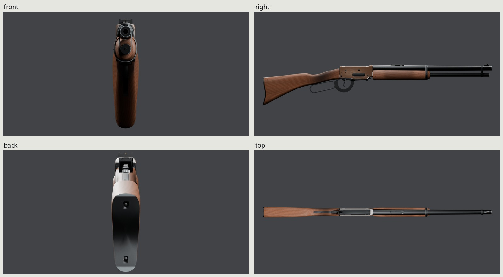
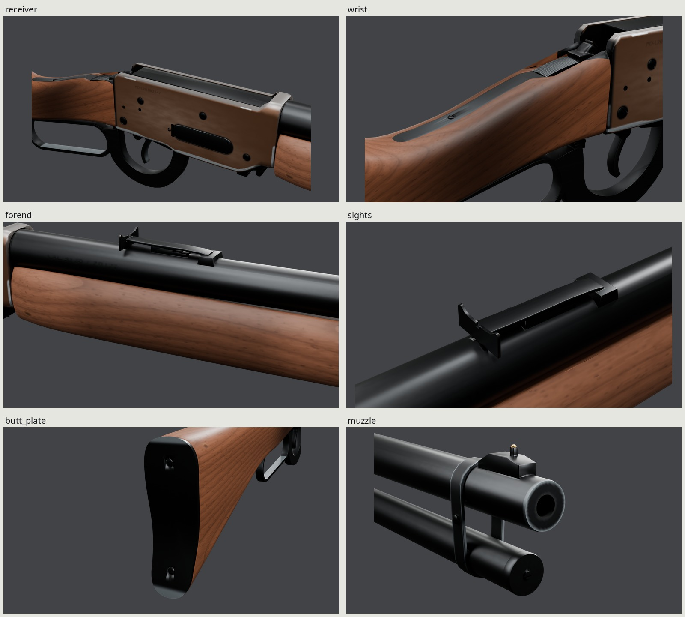
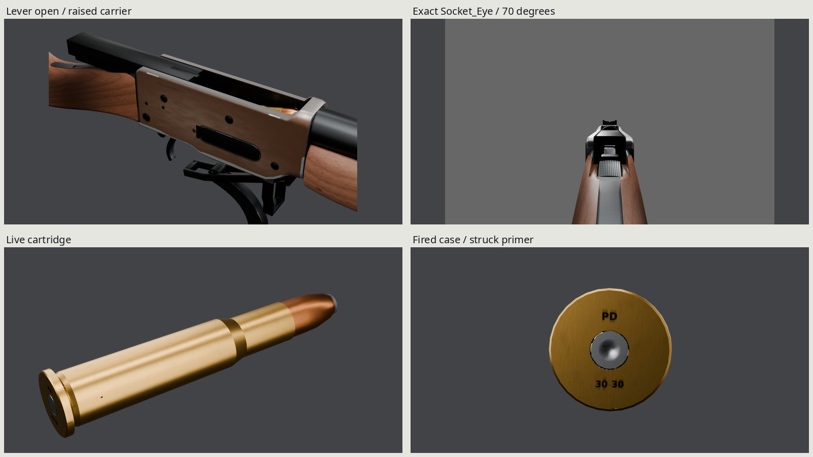
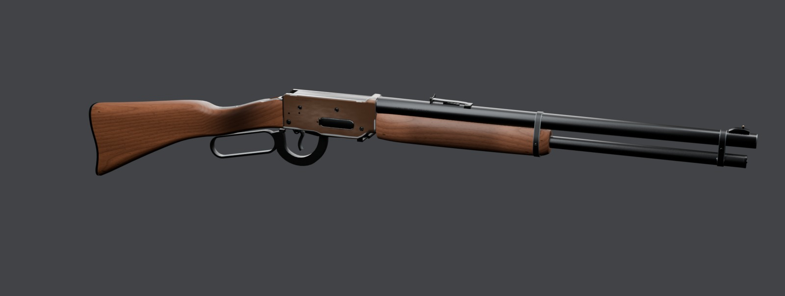

# PD Bracken L20 lever-action carbine

An original **Propane Defense** .30-30 visual game asset, generated entirely by
Blender 5.2 scripts. A 20-inch round barrel, six-round tube, straight-grip walnut
stock, curved steel butt plate, exposed hammer and semi-buckhorn sights share
one baked 2048 PBR atlas. The finish represents a hunting gun used for many
seasons: thinning brown/plum bluing, gray contact steel, oiled walnut and local
handling/impact wear. Its contours, rollmarks, serial and ammunition headstamp
are fictional and original.



The final renders load the exported GLBs with their baked maps. `make` builds
`renders/final/hero-gray.jpg`, `contact-sheet.jpg`, `turnaround.jpg`, `details.jpg`
and `action.jpg`; native Cycles stills are in `renders/final/beauty/`, Eevee in
`renders/final/eevee/`, photographic comparisons in `renders/final/pairs/`,
dense-source pairs in `renders/final/source-pairs/`, and all 37 real-duration
clip strips/WebPs in `renders/final/strips/`. Five docs JPGs are generated under
`docs/`.

[REVIEW.md](REVIEW.md) contains the form history and successive finish critiques,
exported bake reviews, 2D wear evidence, value measurements and limitations.
[REFERENCE.md](REFERENCE.md) distinguishes published dimensions, photographic
estimates and original design decisions.

## Dimensions and construction

| Quantity | Actual evaluated geometry / design | Reference basis |
| --- | --- | --- |
| Barrel, breech face to crown | 508.00 mm / 20 in | Published carbine class; mesh bounds |
| Overall length | 965.20 mm / 38 in | Published class; Smithsonian external measurement |
| Length of pull at finger height | 340.74 mm | Actual trigger/butt surface rays; about 3 mm shorter than published 13.5-inch class |
| Closed width / height | 42.55 / 176.68 mm | Visible evaluated surfaces; shorter rear-sight ears reduce the previous height |
| Tube capacity | Six, plus one chambered | Individual representations and count states |
| Lever opening / lower bar / transverse width | 104 x 29 / 3.30 / 8.20 mm | Preserved aperture; closed-photo bar/opening ratios |
| Lever bow side depth | About 12.95 mm | Actual inner/outer surface rays; normalized photo estimate about 13 mm |
| Rear blade height / gauge / ear rise | 9.00 / 1.10 / 2.20 mm | Actual surfaces; ruler photo and seller's 9.017 mm blade |
| Rear notch width / depth | 2.02 / 1.25 mm | Native ruler-photo estimate; accepted shoulders/aim line retained |
| Eye behind rear sight / above actual comb | 368.00 / 39.02 mm | Authored ergonomic placement, verified on surfaces |
| Case / cartridge overall length | 51.80 / 64.77 mm | Published C.I.P. visual exterior envelope |
| Rim / body / neck diameter | 12.85 / 10.71 / 8.38 mm | C.I.P. |
| Planning mass | About 3.1 kg | Class target; not a mesh-derived mass |

The standalone headstamp planes sit 0.025 mm behind the physical case head, so
full GLB bounds include that depth. The exact Eye camera keeps 70-degree
horizontal FOV, zero shift, opaque gray surround, every gun part visible and
the bead centered at the notch shoulders. The cheek-weld photo supports the
placement qualitatively; it does not publish an eye-relief dimension.

The receiver is a hollow machined forging with rolled corners, raised rear
heel, lowered action belly, front barrel/tube ring, open top race and separate
flush bolt. Its spring-steel loading cover sits in a rounded aperture with a
real hinge/pin and rear screw. Barrel bore, chamber counterbore, crown and
hollow magazine tube are visible construction, not solid placeholder rods.
Bands are fitted to actual wood/barrel/tube section cuts with 1.3 mm steel gauge.

The stock and forend are compound subdivision cages with changing width,
comb, toe, belly and channel curvature. Dense originals remain in
`build/sculpt.blend` and supply the bake. Both tangs are inletted within the
original wood envelope, with a bored through-wrist screw and supported bearing
lands. The curved plate covers the wood across its complete crescent. Smooth
outer walnut normals come from the uncut carving; machined walls retain their
seams. The last wrist fix changes no stock vertices or triangles.

The lever is a continuous forging. Its fuller lower rail grows outward from
the accepted aperture; a concealed 2.2 mm upper relief preserves tang/wood
clearance. The S and opening remain in the gun's mid-plane throughout the
stroke. The hammer has a compound curved body, returning spur and crowned
1 mm checkering. The trigger is a 6 mm wide, 3.7 mm deep radiused blade, with
muzzle-facing concavity and a forward-returning toe. The rear sight is one
filled, coin-gauge sheet with a shallow crescent, short ears and center notch,
supported by its spring leaf, dovetail and stepped elevator.

Visible bolt, forked lock, cradle carrier, sear supports and ammunition
handoffs establish supported poses and game animation. Concealed engineering,
springs and fire-control internals are deliberately incomplete. This is a
visual asset, not a functioning reproduction. Every reference/credit is in
[refs/SOURCES.md](refs/SOURCES.md).



## Materials and years of use

Intact blue steel uses linear `.021/.022/.023` and metallic 1. Continuous
gray-brown oxide covers the receiver's external forging, rolled shoulders and
front ring. Only narrow screw seats, the loading recess and the rear wood/tang
joint retain protected blue: approximately 1–2.5 mm, without a plate-wide
perimeter fade. Palm and cloth pressure vary oxide thickness between linear
`.056/.028/.016` and `.110/.073/.053`. The effective metallic contribution is
`.45`, roughness `.40`; thinner oxide on the exposed rolls approaches warm
gray `.145/.135/.130`, metallic `.72`, roughness `.34`. This is an effective
single-atlas metal/rough approximation to thin oxide over steel. It preserves
gray steel sheen while retaining a brown-plum body.

Eight individual tapered grit tracks, 8–22 mm long and 0.08–0.14 mm wide,
occupy the carrying palm and lower scabbard contact sites. They add shallow
color/roughness/normal detail, with no added geometry. The unhandled upper and
end fields have no all-over brushed scratch texture. The marks barely resolve
at hero scale and read individually in the receiver macro.

Receiver contact steel uses linear `.38/.41/.43` and roughness centered on
`.48`, calibrated beside the Hearth's worn edges in the same studio. Other
rubs retain `.12/.135/.145` and central roughness `.62`, with fine directional
variation. The lever exterior, trigger sides, broad bands and most of the upper
tang remain blued. The shipped dielectric specular level remains `.16`
(glTF specular factor `.32`); consumers retain the imported PBR material and
`KHR_materials_specular`. The studio now matches the accepted Hearth 12's
five cards, gray world, exposure and reflection flags, so steel is judged
under the same light. Camera frames, including the exact aimed view, are kept.

Walnut comes from curved longitudinal growth layers, narrow latewood, separate
fiber bundles and individual elongated vessels. Grain follows each carving's
long axis. Stock diffuse endpoints are `.022/.008/.0035` and
`.155/.063/.034`; the forend uses `.026/.010/.005` and `.180/.082/.050`.
Central roughness is `.48`. A graded palm-pressure field follows the wrist's
crown and sides, darkening toward `.0067/.0034/.0022` without a straight cuff.
No photograph or downloaded texture is used. Original **PROPANE DEFENSE /
BRACKEN L20**, **CAL. 30-30 / PD L20** and **PD-L20-082147** rollmarks use
installed Noto Sans. Ammunition **PD / 30-30** uses installed DejaVu Sans.

| Wear site | Appearance and cause |
| --- | --- |
| Receiver flats | Continuous gray-brown oxide with slightly thinner palm contact; sparse individual tracks in the middle and lower scabbard strip |
| Receiver shoulders and front ring | Continuous oxide over the rolls; thinner exposed oxide keeps a near-gray, slightly warm steel reflection |
| Receiver screw seats | Narrow darker surviving bluing in each head's protected shadow; no broad circular stain |
| Loading-gate recess | Darker blue beside and within the protected aperture, with gray contact only on its lip |
| Tang/wood joint | Narrow surviving blue at the inaccessible rear seat, without darkening the full end of the plate |
| Receiver lower fillet | Accepted cupped carry-contact contour retained exactly; satin gray replaces the former bright response |
| Other receiver edges | Isolated satin-gray front/bottom corner and short shoulder rubs, with continuous oxide between them |
| Lever | Satin gray inside the finger loop and on the rear bar; exterior and forward bow stay blue |
| Trigger | Rubbed finger face, with blued sidewalls and back |
| Barrel bands | Narrow gray rim rubs; the broad sleeve faces stay blue |
| Upper tang | Predominantly satin blue with restrained local handling polish, rather than a white top plate |
| Muzzle | Gray exposed crown rim; dark bore and local soot retained |
| Stock toe/heel and forend edges | Local depressed, compressed fibers with small broken-finish lips |
| Wrist | Graded dark hand oil wrapping the form and fading into the stock |



White balance precedes every photo measurement. The primary used right/top
photograph uses its broad exposed bolt flat; the full right profile uses
unclipped white paper. The other action views use silver pin/screw facets, the
sight photos their gray backdrops, and the ammunition photo its exposed gray
lead. Native rectangles, gains and marked neutrals are rebuilt in
`build/white-balanced/`. These reflected neutrals are estimates, not gray cards.

| Used-photo surface | Photo median RGB / luma (0–255) | Exported comparison RGB / luma |
| --- | --- | --- |
| Receiver flat | 81/54/39 / 58.73 | 79/57/43 / 60.67 |
| Handled wrist | 44/23/11 / 26.75 | 41/22/12 / 25.10 |
| Forend | 86/51/32 / 57.29 | 86/51/34 / 57.21 |

These are observed display values under estimated comparable views, not
recovered albedos. Whole-flat hue/saturation/value histograms, native masks,
brightest-flat deciles and separate rolled-shoulder reflection colors rebuild
in `renders/final/look-review/plate-distributions.json` and
`receiver-histograms.jpg`. The brightest diffuse brown pixels are reported
separately from a gray steel reflection. Its highlight width/brightness is
not used to infer roughness from the photograph's different lights.
The whole-flat hero median is **76/53/38**, versus photo **79/53/36**;
the matched used-view whole flat is **70/48/34**. Hero display-luma
p10/median/p90 is **49.23/56.59/68.88**, versus photo **46.10/56.95/72.65**.
The hero bright decile is **91/68/53**, median pixel saturation **.416**;
the photograph is **104/73/57 / .444**. Macro and matched-view bright-decile
saturations are **.425 / .429**, also below the photo. These distributions
include narrow protected seats and exclude separate hardware.

A fixed physical shoulder site, away from bare corner rubs, reflects the key
at **138/127/123** in the hero's bright reflection decile and **134/127/123**
in the macro. `reflection-samples.jpg` marks this site, the upper flat and
front ring. `receiver-used-closeup.jpg` keeps the entire receiver beside the
used photo; `receiver-sites.jpg` names nine physical sites, and `wear-sites.jpg`
shows the accepted controls, wood and band finishes as well. With an optional
Hearth render folder, `look-review` also makes `hero-shotgun.jpg` and
`steel-shotgun.jpg` under this asset's `renders/final/look-review/`.

The separate flash-lit full-profile stock is a clear remaining display
mismatch: photo **188/128/119**, luma **140.38**, versus studio **96/55/35**,
luma **62.20**. It is retained in the value sheet, rather than averaged into
the primary used-view patches. Different incident light and the photographed
stock finish prevent treating that comparison as a recovered wood albedo.

Brass, copper jacket, lead cap and primer retain their original materials and
geometry. Standalone ammunition also retains its accepted original studio
cards and exposure. The fired case has its struck primer, open mouth and localized soot.
The complete metal display measurements remain in
`renders/final/pairs/ammunition-values.json`, including mismatches caused by
different reflection angles and the photographed rounded soft point versus
our accepted flat nose.

The two-dimensional lower-fillet comparison rebuilds as
`renders/final/pairs/wear-2d-pair.jpg`. Its accepted contact field is unchanged;
`src/preserve_look.py` optionally compares the exact lower-width, center,
contour and modulation expressions with the handoff. A separate diagnostic
emission projection measures the actual contact factor on delivery UVs,
independently of the darker steel color; actual shipping RGB/ORM are sampled
by surface rays on the same 0.5 mm grid. The old BaseColor-brightness threshold
would incorrectly shrink this unchanged field after correcting reflectance.
The new JSON records the factor threshold, sensitivity, both area-share axes
and connected components. The photo uses the same independent native gray-
fillet annotation and approximate 115 × 8 mm physical envelope. The original
25.1% / 27.1% color-mask comparison remains historical evidence in REVIEW.md;
new scalar-factor measurements are distinguished from that earlier metric.
After the feed geometry repack, the factor grid measures **28.70%** against
**27.07%** in the photo annotation, with one connected region each. UV filtering
changes the sampled boundary; the underlying physical contact expressions remain.
The diagnostic mask is never embedded or shipped as an additional texture.

## Frame, rig and consumer binding

The [1.5.0 additive supplement](INTERFACE.md) preserves the family 1.0.0 contract
and reuses 1.1.0 tube-loading/interruption meanings. Meters, grip origin,
Blender +Y forward / +Z up / +X right; glTF −Z forward / +Y up. Internal Root
remains identity. Whole-instance stance/recoil and hand IK belong to the
consumer. All existing names remain; three additive bones bring the rig to
29 bones, with 37 clips and ten complete socket frames.

| Part | Rest pivot or travel, Blender mm | Visual range |
| --- | --- | --- |
| Lever | X at (0,124,−1), riding Link | 0–80 degrees global |
| Lower link | X at (0,195,5) | 0–20 degrees |
| Bolt | Y translation | 90 mm rearward |
| Locking block | Z translation | 30 mm down |
| Carrier | X at (0,85,7) | 0–16 degrees feeding/loading; legacy IdleOpen reference 20 degrees |
| Hammer | X at (0,70,30) | Fired 0, half-cock 12, cocked 44, overtravel 90 degrees |
| Trigger | X at (0,83,0) | 0 to −12 degrees |
| Loading cover | Z at (15.2,122,20) | 0–28 degrees inward |
| Tube rounds/follower | Y translation | 64.77 mm pitch, count-dependent |

These are authored visual motion estimates, not published mechanism dimensions.
Fire and manual Cycle are separate clips. Count-specific holds, single/multiple
insertions, empty reload, empty cycling and hammer safe/cock states retain their
explicit events and STEP occupancy. Save `{version, clip, frame, state}` to
pause/resume an insertion; exit only in declared hand-clear windows. The
executable binding is [src/interface.py](src/interface.py).

The gun exports as one rigidly weighted skin/material primitive. Cartridge and
case export unskinned at their head-centered origins, +Y toward the mouth.
At eject, consumers use the supplement's FiredGuide case-head matrix to spawn
the standalone case and hide the demonstration representation. Socket_Ejection
retains its legacy effect frame. Feeding now has a continuous authored path,
with coincident ownership changes rather than blanked tube displays.

### Visible feed audit

The original 90 mm bolt draw was sufficient, with 15 mm behind the presented
rim. Its low tray was wrong: the cartridge was inclined −20°, its head 11.85 mm
above the tube axis, and it appeared on the tray at f28 without leaving the
tube. The lift occurred over f34–36 rather than the declared full lift interval.
Reloads blanked tube displays before reindexing. The old case translated upward
without turning about the extractor. No live-round unload clip exists.

The corrected 68 mm tray is horizontal on the 20 mm tube axis. The 64.77 mm
cartridge travels from the metering stop onto it, then rises 16°: head lift
13.55 mm, nose lift 31.41 mm. The open bolt has 18.73 mm behind the actual
inclined rear-rim plane. Stop/cutoff tips, extractor/ejector contacts, an internal
receiver throat and concealed forend pockets make that path clear. The bolt
underside pocket and feed heel support the push. Outer barrel length, overall
length, ammunition dimensions and all events remain. Fine hidden ammunition
interior rings pay for the added parts within the original triangle ceiling.

The [primary action sequence](refs/SOURCES.md#visible-feed-correction--2026-10-29)
and [additive clip/handoff details](INTERFACE.md#visible-feeding-additive-correction)
distinguish class evidence from our authored geometry/timing. Independent
triangle-surface checks cover the stops, rising tray, bolt contact, chamber
lead-in and extraction at intermediate frames, repeated on imported GLB
triangles: **492** contact assertions, including **426** feed/handoff assertions,
pass on the baked import. Moving ammunition participates in **10,619**
clearance samples across all 37 clips, with zero policy violations.
Native fractional pickup/quarter-frame path keys and STEP indexing survive the
GLB round trip; uniform 60-Hz export alone blurred those boundaries.

All action, reload and inspection clips have **30-Hz exported-GLB port and
cutaway strips**, with real-speed WebPs under `renders/feed/before/` and
`renders/feed/after/`. Full frames, renderer/GLB hashes, decoded durations and
native inspection pages accompany them. Synchronized comparisons are under
`renders/feed/comparison/` (for example `Cycle-port.jpg` and `Cycle-cutaway.jpg`);
each adjacent pair uses the same source frame, before on the left. `build/feed-audit.json` contains the
actual contact measurements and physics continuation pose/velocities.



## Budget and delivery

| Output | Triangles | Materials | GLB bytes | Map size | Density ratio |
| --- | ---: | ---: | ---: | ---: | ---: |
| Carbine, including all ammunition displays | 39,800 | 1 | 21,606,688 | 2048 | — |
| Live cartridge | 1,598 | 1 | 492,548 | 1024 | 1.000 |
| Fired case | 1,326 | 1 | 516,876 | 1024 | 1.000 |

The inspection source has 39,818 triangles; only microscopic Boolean cleanup
removes 18 for delivery. The final asset stays below 40k. One 4096/32-sample
source bake is filtered to a single **2048 BaseColor / OpenGL +Y Normal / ORM**
set for the gun. ORM is R occlusion, G roughness, B metallic; the gun retains
approximately **16 MiB compressed memory with mipmaps**. Standalone cartridge
and case now each embed their own **1024** set, extracted losslessly at the
original atlas density. Standalone samplers match the gun’s trilinear
mipmapped sampler, approximately **4 MiB** compressed per item including
mipmaps and repeat wrapping. Each uses one copied atlas cluster at density
ratio **1.000**, with an 8 px aligned outer halo and unchanged internal atlas
texels. Pull-push fills the outside and generated normals are normalized. See
[delivery details](../DETACHABLES.md) for padding, density and old/new comparisons.

| Canonical 2048 PNG | Bytes |
| --- | ---: |
| `T_BrackenL20_BaseColor.png` | 1,863,923 |
| `T_BrackenL20_Normal.png` | 2,243,006 |
| `T_BrackenL20_ORM.png` | 2,890,375 |

The prepared gun covers about 26.23% of the atlas (30.94% with both standalones). Separate regions protect
stock and forend UV tips and padding from nearby metal, while the same single
set still serves the gun and ammunition. Median regional shipping densities
are approximately 2,185 px/m for metal, 2,441 for stock and 1,937 for forend.
Escaped and degenerate UV triangles are zero; microscopic clipped overlap
fraction is approximately 2.50e−7, below the unchanged 1e−5 limit. All six bake
channels miss zero of 3,891,368 checked interior texels. The complete wood
regions, including subpixel tips and padding, contain zero metallic texels.
The generated delivery audit retains full distributions, hashes and sizes.
The larger GLB includes dense intermediate animation samples that preserve
fractional pickup and reload boundaries; texture memory and draw calls remain
within the original budgets.



## Rebuild and proof

Requires installed Blender 5.2, Python/Pillow/NumPy/Matplotlib, fontconfig, Noto/DejaVu,
GNU make and flock. No downloaded code, models, materials or lighting are used.

```sh
make -C guns/lever                    # refs through bake, exports, checks and finals
make -C guns/lever check              # source/finalized/imported construction and motion
make -C guns/lever feed-audit          # source dimensions, contacts and case handoff
make -C guns/lever feed-strips         # 30-Hz port and cutaway, exported baked GLB
make -C guns/lever form-review        # final sight/lever pairs, wrist rake and stroke
make -C guns/lever render match       # exported GLB stills and photographic pairs
make -C guns/lever source-match       # separately labeled dense-source comparisons
make -C guns/lever wear-review        # 2D contact-factor evidence and actual-map samples
make -C guns/lever look-review        # whole receiver HSV/highlight comparison
# Optional: add SHOTGUN_RENDERS=<Hearth hero/receiver render folder> to look-review
make -C guns/lever strips extra       # all clips and standalone ammunition macros
make -C guns/lever repeat             # independent deterministic geometry/rig rebuild
make -C guns/lever WEAR=.45            # cleaner use layers, same forms and rig
make -C guns/lever clean              # generated outputs only; references retained
```

Defaults: `BAKE_SIZE=4096`, `BAKE_SAMPLES=32`, `SHIP_SIZE=2048`, `WIDTH=1600`,
`SAMPLES=64`, `WEAR=1`. Parameter stamps invalidate affected stages. Every
Cycles bake/render uses the shared kit GPU lock; the Eevee clip batch holds one
shared lease while its per-clip guards use a nested local lock. Scratch stays
under `build/`.
`checkpoint.mk` retains the earlier untextured inspection graph.

The original construction probes plus intermediate feed contacts, tang bearing lands, through-wrist bore,
plate/wood cover, sight rays and trigger direction establish construction.
All 37 clips are swept at half frames, with fixed hand envelopes and the same
bounded contact policy. The lever's mid-plane is tested at each sampled pose.
The final consolidated GLB is decomposed only for auditing: every imported
triangle must match one named finalized surface by rigid owner, centroid and
all oriented vertices, corner normals and UVs before construction and clearance
are independently repeated.

Full affine bone/socket frames, intended states/counts, event/end surfaces,
rigid weights, normal direction and standalone origins separately establish
serialization. Raw texture hashes and a final provenance audit associate every
still/strip with the current exported GLB; WebP durations are decoded and checked.
Raw GLB corner normals agree within 0.0049 degrees, with exact positions and
UV error below 0.000061 shipping pixels. Blender's imported custom-normal fan
encoding reaches 0.584 degrees at one narrow inletting cut; that importer loss
is measured separately from the raw delivered normals.
The optional `src/preserve_receiver.py --before <saved-handoff>` audit compares
all 116 accepted meshes, 26 bones, 37 clips, ten sockets, every nonreceiver
material node/default/link, and the five accepted lower-fillet expressions.
The saved handoff is review evidence and is never required by `make`.
See `build/check.json`, `serialization.json`, `delivery/construction.json`,
`delivery/verify.json`, `final-provenance.json` and `determinism.json`.

## Remaining limits and credits

The rounded sight lobes retain a different mounting from the reference insert; the accepted
long lever opening, larger hammer mortise and broader thumb table still differ
from the photographed guns. Wood figure is more regular than real walnut;
small pores, lettering and the finest carry marks soften at 2048. The used
photograph retains richer fine oxide breakup and incidental damage.
Reflected neutrals, approximate cameras and different illumination limit exact
photographic matching. The rig demonstrates supported visual poses and declared
handoffs; it supplies neither functional internals nor an anatomical hand.

All geometry, relief, masks, graphics and texels are original script output.
Reference authors, licenses and URLs are in [refs/SOURCES.md](refs/SOURCES.md).
Noto Sans uses the SIL Open Font License; DejaVu Sans uses its open font license.
No kit or existing common/gun module changes are required by this asset.
