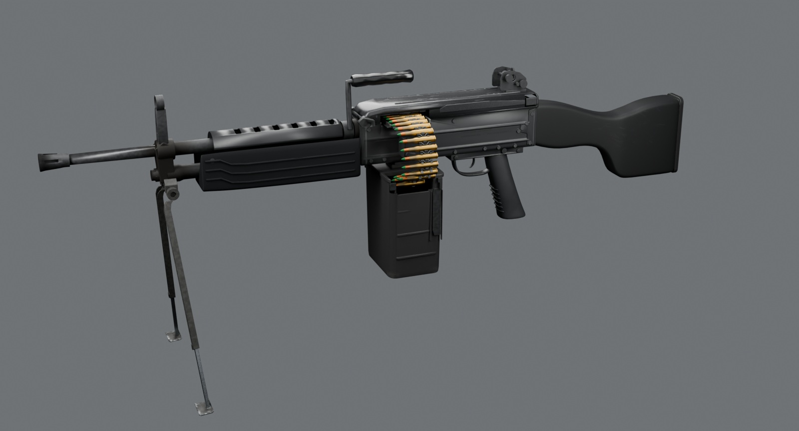
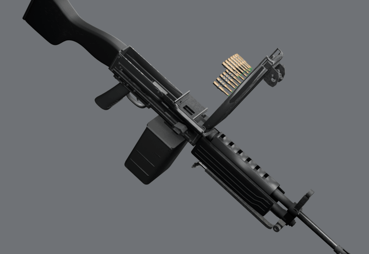
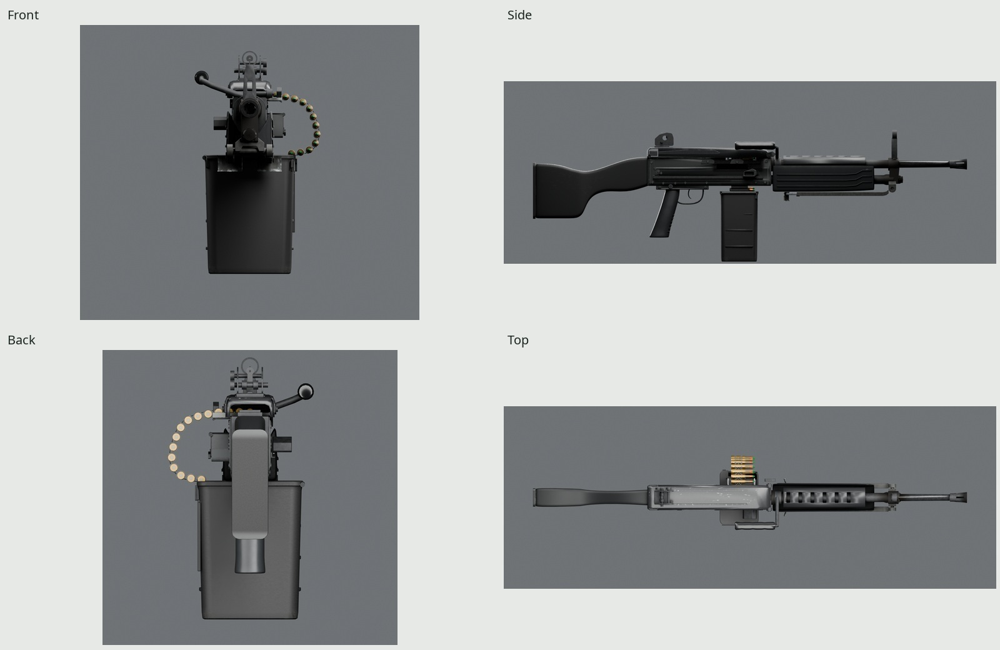
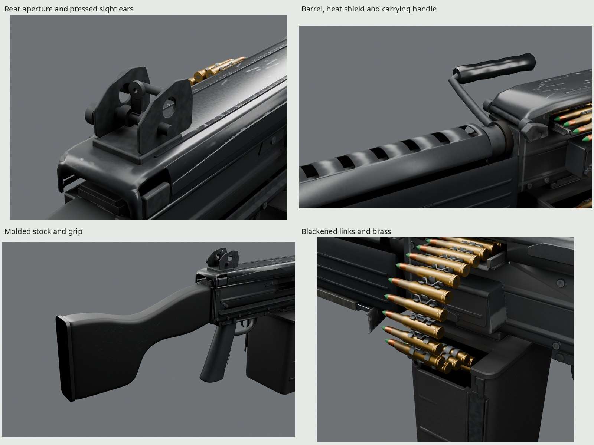
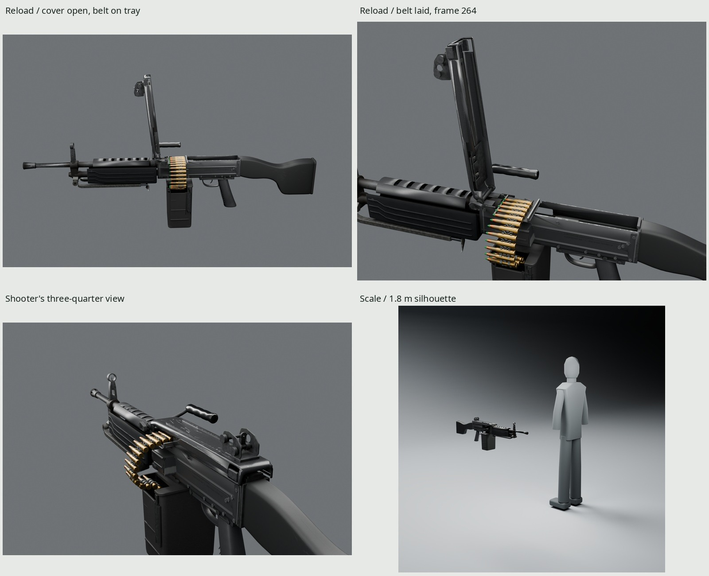
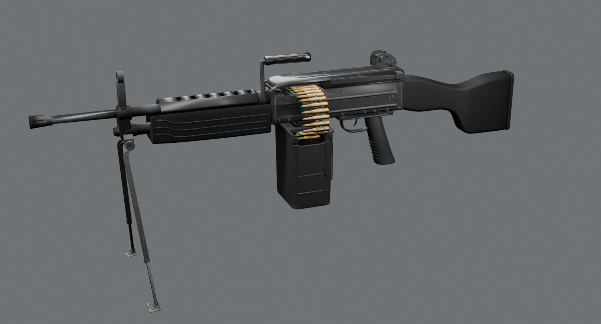

# Propane Defense Harrow 56

An original, script-built **belt-fed 5.56×45 light machine gun** game asset.
Stamped steel, a fixed molded stock, ribbed handguard, folding carrying handle
and telescoping bipod share one baked 2048 PBR atlas. A detachable 200-round
box supplies a count-aware cosmetic belt with individual rounds and links.
The fictional **Propane Defense Harrow 56** represents an issued, used gun.
Every vertex, texel and marking comes from our Blender 5.2 scripts.





`Reload` excerpt at real speed: belt laid on the tray, cover closing and latch seating.

| | |
| --- | --- |
|  |  |
|  |  |

All images load exported GLBs with their embedded baked maps. `make` creates
Cycles stills in `renders/final/beauty/`, the feed close-up in `docs-feed/`,
Eevee in `renders/final/eevee/` and the complete contact sheet at
`renders/final/contact-sheet.jpg`.
`renders/final/docs-contact-sheet.jpg` gathers every final studio still,
including the added loaded-tray view. Photographic comparisons live in
`renders/final/pairs/`; dense-source comparisons are labeled separately in
`source-pairs/`. These generated paths are ignored, rather than broken links
to files absent from the repository. [REVIEW.md](REVIEW.md) records the form,
finish and motion reviews, rejected trials and remaining differences.

## Dimensions and construction

Published class specifications, photographic estimates and original design
measurements are kept distinct. The [manufacturer's class overview](https://fnherstal.com/en/defence/portable-weapons/fn-minimi-556-mk3/)
supports the selected 465-mm long-barrel option and fixed-stock configuration;
its modern furniture differs. The [1988 primary period publication](https://www.benning.army.mil/infantry/magazine/issues/1988/SEP-OCT/pdfs/SEP-OCT1988.pdf)
gives a 40.87-inch / 1,038.1-mm envelope. Our **1,040-mm** exterior combines
older class features with original furniture and pressings. The **7.5-kg**
unloaded target is nominal, not a mass measured from this visual mesh.
[Sources, authors, licenses and measurement uses](refs/SOURCES.md) include the
primary class manual and sharp stock, tray, sight and box photographs.

| Measure | Evaluated geometry / reference basis |
| --- | --- |
| Overall length | 1,040 mm / published period class 1,038.1 mm |
| Barrel exterior span | 465 mm / published long-barrel class option |
| Receiver envelope, width × length × height | 52 × 293 × 67 mm / original pressed layout |
| Cover envelope | 60 × 294 × 25 mm / original pressing |
| Receiver / cover wall at broad lands | 1.40 / 1.70 mm / measured mesh gauges |
| Stock comb at Y −275.13 / −122.22 mm | 103.51 / 111.06 mm; photo 98.51 / 107.84 ±8 mm |
| Butt height / toe below bore | 134.00 / 131.00 mm; photo 126.54 / 127.01 ±8 mm |
| Handguard at Y 280 / 440 mm, width × height | 65.83 × 62.48 / 63.30 × 60.81 mm; photo 62–68 × 57–66 mm |
| Handguard wall / rib spacing | 3.16 / 14 mm; photo rib spacing about 12–17 mm |
| Rear aperture outside / hole diameter | 9.60 / 2.80 mm; photo 8–11 / 2.3–3.4 mm |
| Sight ear height / thickness | 31.92 / 1.70 mm; photo 29–35 / 1.3–2.2 mm |
| Bipod hinge to pad, retracted / extended | 253.36 / 318.22 mm each leg; photo retracted 235–260 mm |
| Leg channel / pad broad dimensions | 12 × 9 / 36 × 22 mm; deployed pad plane tilt 5° |
| Box envelope / shell gauge | 127.75 × 90.56 × 162.50 / 4.27 mm |
| Eye behind actual rear aperture rim | 85 mm; cheek-weld estimate 88.5 ±25 mm |

The bipod manual confirms adjustment but supplies no individual leg lengths.
Photographic subpart dimensions above remain estimates. The clipped white
stock-photo backdrop supports form measurement, not calibrated albedo.
`build/measurements.json`, `form-round2.json`, `sections.json` and
`reference-measurements.json` retain the actual surface and pixel measurements.

The receiver has finite folded walls, an interior that follows its embossing,
14 exterior rivets per flank, upper bosses and rear doublers. A covered side
well remains inactive. The feed cover has pressed sides, flange returns, a
sight housing, latch, underside arm and separate pawls. The finite tray has
formed lips and a central relief. The stock is a changing-section subdivision
shell with integral side recesses; the handguard has broad flat lands, small
corner radii and three longitudinal ribs. Dense source relief bakes into the
normal map. The fixed stock has no folding shoulder rest.

Open-channel bipod legs carry separate telescoping extensions and finite
pressed feet. The box has rounded molded corners, ribs, a hinged lid, catch
and a supported suspension clip. Seventeen rounds and sixteen links share
one round mesh and one link mesh. The terminal single cuff surrounds its own
round. Hidden belt owners retain the nineteen-slot interface without geometry.

## Materials, measured finishes and wear

Black enamel starts at linear RGB **.022/.023/.024**, roughness **.42** on
the receiver and **.29** on the cover, specular factor **.8**. Exposed phosphate
starts at **.028/.029/.030**, roughness **.57**, metallic **.35**; the bipod has
a lighter **.044/.045/.042** bath color. Heat darkens only the chamber/gas-seat
neighborhoods. Coating chips expose diffuse phosphate gray first, with bright
steel confined to sharp contact peaks.

Molding inputs are handguard **.006/.0068/.0078**, stock **.009/.0095/.010**,
grip **.032/.034/.036**, box **.023/.024/.023** and handle **.009/.0095/.010**.
Fine molding skin, conversion grain and restrained bath variation remain
manufacturing detail. Brass, copper jackets, green tips, rubber and blackened
links have separate responses within the same material. Fictional markings
and headstamps use installed open-license Noto Sans.

The accepted whole-part comparisons below use the actual exported GLB.
V is max RGB at P10/median/P90; H is mean RGB in the brightest luminance decile,
all encoded sRGB, 0–255. Estimated neutrals are the unclipped gray studio
backdrops, paper in soft cast shadow, or concrete, individually recorded in
`src/white_balance.py` and the source list. One physical light rig serves all
parts in each photograph; no image correction supplies the results.

| Finish | GLB V10/50/90 | Balanced photo V10/50/90 | GLB H RGB | Photo H RGB |
| --- | --- | --- | --- | --- |
| Receiver paint | 0/32/63 | 0/35/68 | 78/80/86 | 81/83/84 |
| Cover paint | 27/37/122 | 28/37/115 | 168/173/183 | 175/184/196 |
| Barrel phosphate | 26/52/126 | 27/52/123 | 141/148/152 | 140/146/152 |
| Bipod phosphate | 51/105/209 | 51/107/218 | 213/217/218 | 211/223/232 |
| Handguard molding | 40/103/133 | 38/102/135 | 128/131/145 | 132/135/146 |
| Stock molding | 46/106/130 | 48/111/129 | 115/116/141 | 118/119/135 |
| Grip molding | 50/76/100 | 47/79/91 | 114/121/127 | 116/122/130 |
| Box molding | 26/47/67 | 25/47/72 | 117/114/109 | 120/115/109 |
| Handle polymer | 17/35/173 | 16/35/188 | 189/192/203 | 181/194/211 |
| Brass | 92/167/237 | 91/165/251 | 248/245/232 | 253/250/225 |
| Steel links | 38/56/89 | 38/56/92 | 104/104/113 | 104/103/105 |
| Copper / green tip | 105/184/246 | 108/177/255 | 249/245/236 | 254/252/245 |

All twelve pass median ±10%, tails ±15%, highlight channels and normalized
highlight color ±10%; zero tails require exact equality. Cover reflection
FWHM is **17.14% / 16.44%** of the local section, peak P95 **217.05 / 229.8**
(GLB / photo), both within 10%. These comparisons constrain appearance under
the measured lighting; differing construction and estimated neutrals prevent
claiming inverse material recovery. The pinned before/after evidence and
full-precision measurements remain in `renders/final/look-review/` and
`surface-pairs/`, with their history in REVIEW.md.

Eleven independently switchable wear sites are **receiver, cover edges,
cover top, rivets, carrying handle, flash hider, regulator, ports, bipod feet,
box and stock/butt**. Gear scratches follow motion on the cover, chips follow
receiver edges, rivet crowns take contact, and impact marks stay on the box,
feet and butt returns. Finite stock-flank drags expose stressed polymer;
carbon stays around muzzle, gas and port sites. `WEAR=0` retains manufacture
while removing use layers. The default is the accepted used finish.

Receiver, cover, cover-top and rivet map footprints are respectively
**5.12%, 2.30%, 1.32% and 69.63%**, against apparent photographic fractions
**5.22%, 2.16%, 1.21% and 67.70%**. Actual hero on/off differences separately
prove visibility for every site, including the reverse hero for the right
port. Eleven independent 4096 controls, 2048 maps and exports retain all other
sites. These are map/appearance measurements, not physical coating thickness.

## Frame, rig and sockets

Meters; palm origin; Blender **+Y forward / +Z up / +X right**, glTF **−Z
forward / +Y up**. The family frame takes precedence over the general prop
frame. Root stays identity; stance, recoil and inspect motion apply to the
whole imported instance. [Interface supplement 1.8.0](INTERFACE.md) extends
[the common contract](../INTERFACE.md). Preserve the imported materials,
samplers and `KHR_materials_specular` extension.

**64 bones, 12 sockets, 19 clips.** The display is open-bolt, automatic-only,
with an independent nonreciprocating charging handle and no last-round
hold-open. `belt_ready` has an empty chamber and rearward action;
`belt_last_ready` means one round on the tray. FireLast ends forward and empty;
CeaseFire ends caught at the rear. These belt states do not redefine the
base interface's chambered `ready` state.

| Owner | Axis / authored visual motion |
| --- | --- |
| FeedCover / CoverLatch | X, 0 to −96° / +Z, 6-mm release |
| Bolt and OperatingRod | −Y, 80 mm |
| ChargingHandle | independent −Y, 80 mm |
| Trigger / Safety | X, −12° / X, 5 mm |
| CarryHandle | Y, 0 to −65° |
| Bipod fold / splay / extension | X, 85° / local Z, ±18° / local −Y, 65 mm |
| Magazine / BoxLid | complete detachable frame / Y, 100° |
| ShoulderRest | compatibility owner; no mesh on this stock |
| BeltRoot, BeltLink00…18, BeltRound00…18 | cosmetic guide; parallel cartridge axes |

| Socket | Rest position, Blender mm | Ownership / purpose |
| --- | --- | --- |
| Muzzle | (0,710,105) | Scene root, effect frame |
| Foregrip | (−26,344,62) | Scene root, support hand |
| Butt | (0,−330,47) | Scene root, shoulder reference |
| Eye | (0,−107.5,176) | Scene root, optical frame |
| Ejection | (26,150,91) | Scene root, event reference |
| MagWell | (0,164,53) | Scene root, fixed box-seat reference |
| Magazine | (0,164,51) | Rides Magazine; complete box spawn frame |
| ChargingHandle | (49,190,83) | Rides ChargingHandle; hand frame |
| BeltEntry | (0,145,124) | Scene root, feed reference |
| LinkEjection | (28,200,112) | Scene root, link effect frame |
| FeedCover | (0,−40,144) | Rides FeedCover; operating-hand frame |
| BoxMouth | (−55,145,39) | Rides Magazine; belt outlet |

Names carry `Socket_`. Socket_Eye is 85 mm behind the measured aperture rim,
on the line through the front post. The aimed camera uses it directly with
no position offset: a 20-mm presentation lens, plus the separate 40-mm macro.
The supported cheek-weld photograph estimates 88.5 ±25 mm; eyewear obscures
the pupil. This is a visual reference frame, not an anatomical fit certificate.

## Clips and belt integration

[src/interface.py](src/interface.py) is the executable 60-Hz event/state
manifest; `build/interface.json` is generated. Clip endpoints are inclusive.

| Clips | Duration | Presentation |
| --- | --- | --- |
| Idle / IdleSafe / IdleEmpty | 1/60 / 1/60 / 1 s | Ready, safe-ready and empty-forward holds |
| Fire / Burst / CeaseFire / FireLast | .20 / .40 / .133 / .20 s | One cycle, three cycles, catch rearward, empty forward |
| Reload / ReloadEmpty | 6 / 7 s | Cover, belt and box exchange; empty reload also charges |
| Charge | 1.10 s | Independent handle draw and return |
| BipodDeploy / BipodFold | 1.40 s each | Fold, splay and telescoping extension |
| SafetyOn / SafetyOff | .30 s each | Safe/fire control |
| CarryRaise / CarryFold | .50 s each | Carrying handle |
| BoxOpen | 1 s | Withdraw box, then open its lid |
| Inspect / BeltEnd | 3 / .70 s | Cover inspection / last three displayed rounds |

Reload releases the latch at frame 18, opens the cover at 60, lifts the belt
at 88, withdraws the box at 140, seats its replacement at 215, lays the belt
at 264, closes the cover at 324 and latches at 340. ReloadEmpty finishes its
handle draw/return at 380/410. The README GIF shows `Reload` frames 226–346:
the cover starts open, the belt settles visibly onto the tray, then the cover
closes and latches. It runs at authored speed, sampled at 20 Hz, with a 500-ms
initial hold. The camera looks from above and in front of the right side;
the muzzle and stock end leave the mechanism crop while the cover stays in frame.
Delivery is **720×496, 40 frames, 20 Hz, 128 distinct palette entries and
437,964 bytes**, with a 2,500-ms total loop. The complete six-second Reload
and all other clips remain in the unchanged GLB.

Persist `{version, clip, frame, remaining, phase}` for pause/resume. Never jump
to Idle while the cover is open or box absent. `src/belt.py` supplies the
continuous phase/count solver and `game_pose` streaming helper. Consume
rounds at shot events; do not wrap phase while the belt is visible. STEP
visibility reveals the finite tail. Two round owners and three link owners
have no mesh. Recycling must occur in the occluded box-end region. The
finite authored guide is cosmetic, with no chain dynamics; game ammunition
bookkeeping and effect spawning remain external. Bipod state is orthogonal:
mask action clips to action/feed owners to preserve deployed legs.

## Budget, detachables and validation

| Output | Triangles | Materials | Maps | GLB bytes |
| --- | ---: | ---: | --- | ---: |
| Gun, including display belt | **47,638** | **1** | 3 × 2048 | **14,579,528** |
| Loaded box | 4,456 | 1 | 3 × 1024 | 1,965,888 |
| Empty box | 3,284 | 1 | 3 × 1024 | 1,598,116 |
| Cartridge | 896 | 1 | 3 × 512 | 224,708 |
| Fired case | 704 | 1 | 3 × 512 | 223,168 |
| Link | 276 | 1 | 3 × 512 | 274,080 |

The main GLB contains one skinned body and **33 rigid belt mesh nodes**
(17 rounds, 16 links), sharing three unique mesh datablocks and one material.
Budget those instances as separate draws unless the consumer batches them;
the one-material count alone does not establish one draw call. Each standalone
is one mesh node with one material.

The gun fits the accepted **48,000-triangle** ceiling. Its 47,640-triangle
source differs by two submicron cover slivers collapsed in delivery, with
maximum sampled bidirectional surface difference **.000324 mm**. Finish and
wear add no game triangles. The accepted source allocation below differs from
delivery only by the two cover triangles; `build/triangles.json` has per-object counts.

| Part group | Source triangles |
| --- | ---: |
| Belt rounds and links | 12,032 |
| Receiver, side well and charging handle | 6,826 |
| Cover, tray, pawls and latch | 5,310 |
| Furniture and heat shield | 7,528 |
| Sights | 2,704 |
| Bipod | 2,802 |
| Box | 3,500 |
| Trigger group and safety | 1,706 |
| Barrel, gas group and carrying handle | 4,024 |
| Animation witnesses and staged effects | 1,208 |
| **Source total / ceiling** | **47,640 / 48,000** |

One canonical **2048 BaseColor / OpenGL +Y Normal / ORM** set is baked at
4096 with 32 GPU Cycles samples. BaseColor RGB is sRGB; its opaque alpha stores
the linear per-surface specular factor for `KHR_materials_specular`. ORM is
R occlusion, G roughness, B metallic. About **16 MiB** with 8-bpp compression
and full mip chains. Exported PNGs total **10,016,210 bytes**:

| Canonical map | Pixels | Bytes |
| --- | --- | ---: |
| T_Harrow56_BaseColor.png | 2048×2048 | 2,151,475 |
| T_Harrow56_Normal.png | 2048×2048 | 2,926,807 |
| T_Harrow56_ORM.png | 2048×2048 | 4,937,928 |

The five detachables retain full atlas density, **ratio 1.000**, and separate
one-material GLBs. Loaded/empty boxes share the Magazine socket's full local
spawn frame. Their 1024 subsets cost about 4 MiB each compressed with mipmaps;
the three 512 items cost about 1 MiB each. The kit copies atlas neighborhoods
without resampling, with 8-pixel aligned guards and trilinear mipmapped
samplers. Pointwise surface and mip-bleed checks through L3 pass for all five.
See [the family detachable contract](../DETACHABLES.md).

`make check` checks budgets, scale, UVs, normals, contacts, motion, belt spacing,
all clips, fresh GLB import, atlas poses and subset delivery. Source clearance
samples **1,529 poses**, fresh import **1,556**, with no violations. Every
60-Hz clip frame and authored endpoint is included; imported floating-point
keys add near-duplicate times. Maximum socket/bone serialization position
error is **.000257 mm**, and six posed surface comparisons differ by at most
**.000152 mm**. The **29** surface-contact rows separately prove seats and
support; serialization agreement alone does not prove construction.

Atlas chart coverage is **37.96%**, median density **1,262 px/m**, p5/p95
**1,050 / 7,155 px/m**. The tiny ammunition templates receive higher density;
repeated belt meshes share charts. There are no outside or degenerate UV
triangles, numerical overlap fraction **2.204 × 10⁻⁷**, and zero interior bake
misses. Half-frame belt spacing error is **.087264 mm**; all sixteen cuff-center
errors are below **.000032 mm**. Clearance is sampled, rather than a continuous
collision guarantee. Full precision and provenance remain in
`build/delivery/verify.json`, `build/check.json` and the generated
presentation reports. The accepted finish review indexes 98 native GLB renders
on 23 pages; the docs add the final loaded-tray close-up.

## Rebuild

Requires Blender 5.2, Python with Pillow/NumPy, fontconfig, Noto Sans, GNU make,
flock and ffmpeg for the GIF. GPU bakes/renders use the kit's shared lock;
scratch stays in the clone's ignored `build/`. No downloaded code, geometry,
materials, textures or HDRIs are used. Reference retrieval downloads only
cited images/PDFs for local comparison.

```sh
make -C guns/lmg                 # model → UV → 4K bake → 2K maps → six GLBs
                                # → checks → final renders/pairs/review → five docs JPGs
make -C guns/lmg check           # source, delivery and fresh-import checks
make -C guns/lmg gif             # shared tool; real-speed exported-GLB reload
make -C guns/lmg docs            # regenerate final JPGs and their provenance report
make -C guns/lmg render match source-match wear-review precedent extra review
python3 kit/repo_check.py
```

| Generated path | Contents |
| --- | --- |
| `export/lmg.glb` | Skinned body + 33 rigid belt nodes, one material, 64 bones, 12 sockets, 19 clips |
| `export/{box_loaded,box_empty,cartridge,case,link}.glb` | Five standalone atlas subsets |
| `textures/T_Harrow56_{BaseColor,Normal,ORM}.png` | Canonical shipped 2048 maps |
| `build/baked/4k/` | Original bake and ray-coverage report |
| `build/delivery/` | Finalized game mesh, dense source, reimport and verification |
| `renders/final/` | Cycles/Eevee, photo pairs, wear controls and contact sheet |
| `build/docs-report.json` | Five JPG dimensions, bytes, quality and hashes |
| `build/gif/` | Raw/decoded-frame review, global palette, timing/provenance and playback page |

The GIF is opt-in. [src/gif.json](src/gif.json) owns its clip and camera;
[shared GIF conventions](../GIFS.md) list delivery and timing. Optional
physical-light fitting requires the already installed OpenImageIO and
PyOpenColorIO; normal builds use the committed light recipes. All game
outputs and photographic evidence remain ignored. Only scripts, documentation,
reference credits, final docs JPGs and the signature GIF are tracked.

## Credits and limitations

All meshes, relief, masks, texels, markings, lights and presentation staging
are generated locally. Photographs are comparison only, never geometry or
texture inputs. [refs/SOURCES.md](refs/SOURCES.md) credits the manufacturer
specifications, US military public-domain imagery and manual, Commons
photographers and comparison-only product photos. Noto Sans is under the
SIL Open Font License. No real maker's branding is reproduced.

Fine molding grain filters at 2048, and the stock has fewer fine scuffs than
the older loose-stock photograph: 1.57% map footprint versus 2.70% apparent
photo area. Port-photo darkness includes inseparable recess shadow, so its
54.63% apparent fraction is not an absolute carbon target. One receiver
control also affects a measured neighboring rim within the existing 4-mm
projection guard; the independent audit records those texels. Estimated
neutrals, different cover construction and differing photographic variants
limit inverse finish inference.

This is an inert visual game asset. Two rectangular ready-position witnesses
prove animation seating, without operative locking/sear engineering. No
working chamber, firing pin or gas port is supplied; ammunition has solid
decorative bases. Checks establish visual contact and animation continuity,
not fabrication suitability. The accepted form, rig, materials, wear and
baked delivery are unchanged by this documentation round. No kit or other
gun implementation changes are required.
