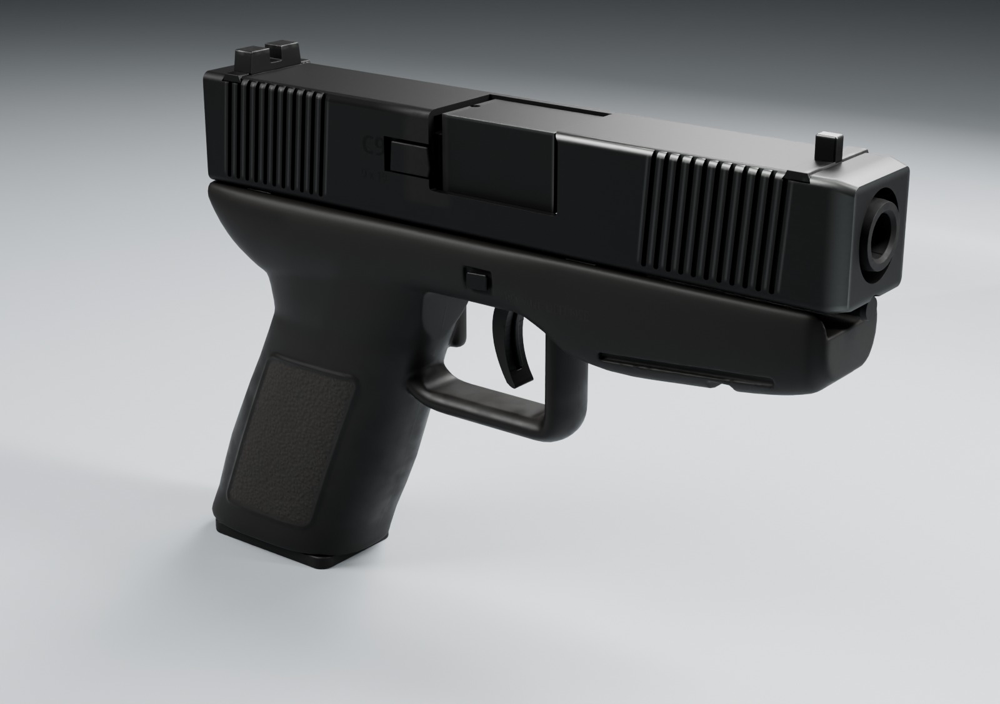
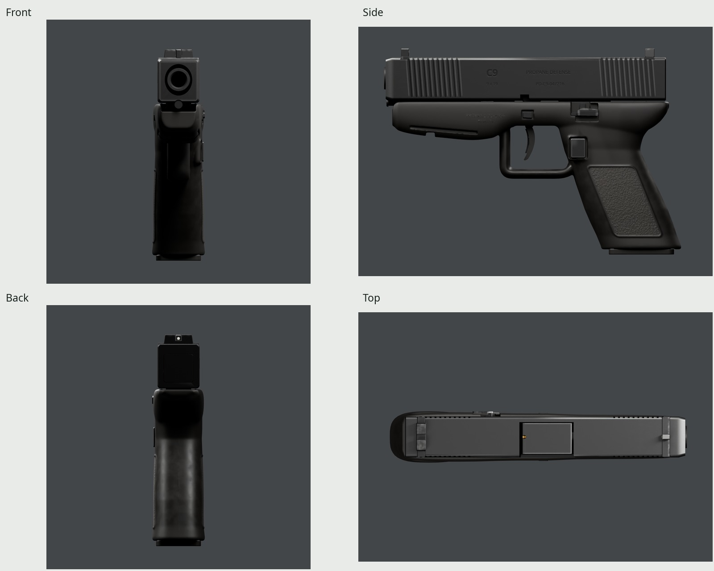
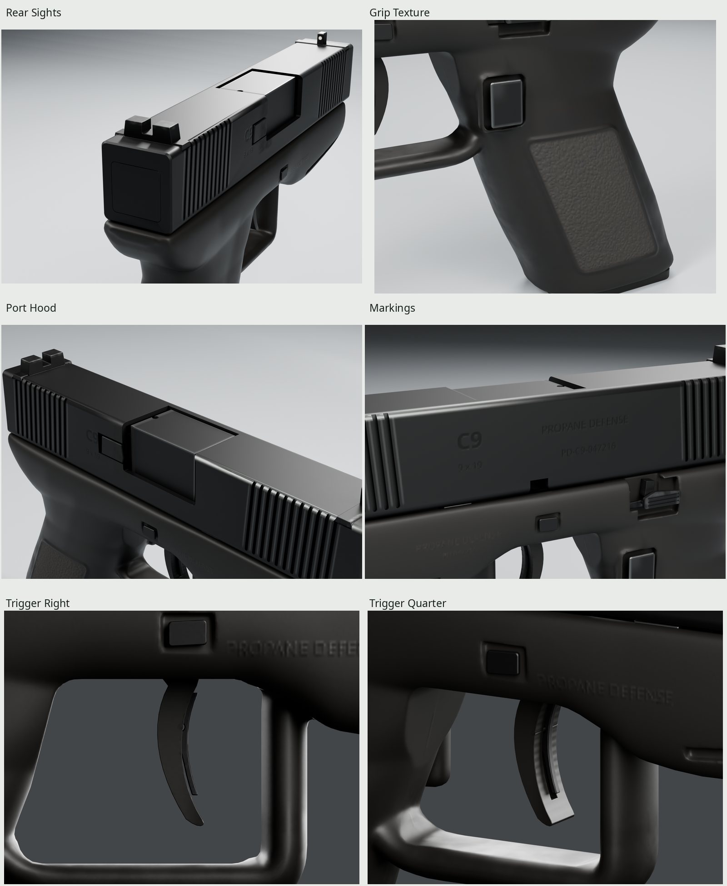
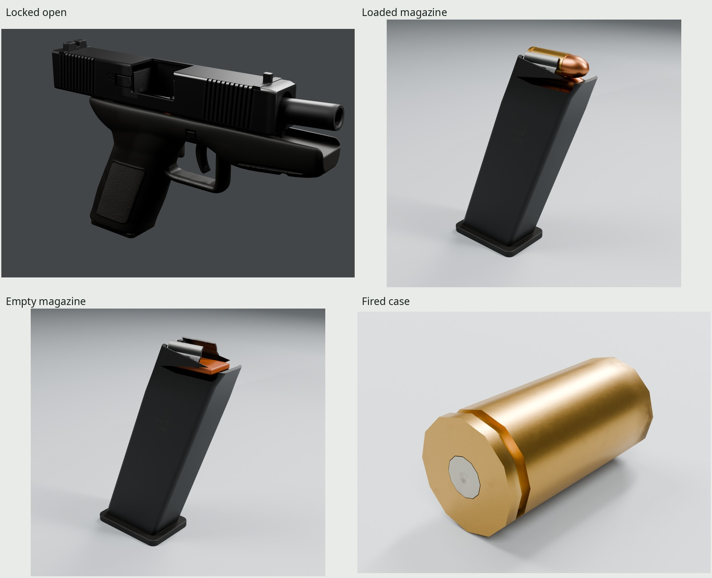
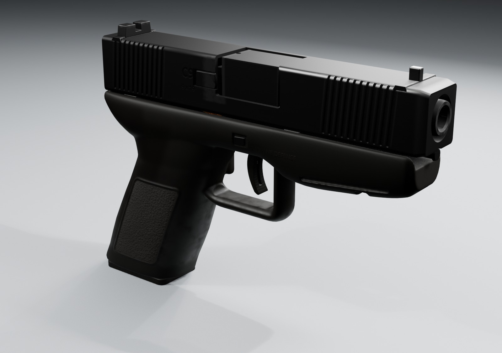

# PD C9 compact pistol

An original compact polymer-frame 9 mm game asset, generated entirely by Blender
5.2 scripts. Fictional maker/model: **Propane Defense C9**. Its compound molded
frame, serrations, cellular grip pattern, controls and markings are our own design.



| | |
| --- | --- |
|  |  |
|  |  |

All images above load the exported GLB with its baked 2048 maps. The
full contact sheet (`renders/final/contact-sheet.jpg`) also includes the
aimed view (`renders/final/beauty/aimed.png`),
1.8 m scale shot (`renders/final/beauty/scale.png`),
190 mm hand-length guide (`renders/final/beauty/hand_frame.png`),
markings (`renders/final/beauty/markings.png`), and the
case mouth (`renders/final/case/case_mouth.png`).
Photo pairs: right (`renders/final/pairs/right_photo-pair.jpg`),
open (`renders/final/pairs/open_photo-pair.jpg`),
left (`renders/final/pairs/left_photo-pair.jpg`).
Trigger close-ups: right (`renders/final/trigger-pairs/trigger_right_photo-pair.jpg`)
and three-quarter (`renders/final/trigger-pairs/trigger_quarter_photo-pair.jpg`).
These use visually estimated angles and matched blade scale; the different
fictional guard is retained.
[REVIEW.md](REVIEW.md) records the accepted form and finish critiques, including
two final carry-correction passes, measured value/hue, remaining differences
and rebuild/check evidence.

## Files

| Path | Contents |
| --- | --- |
| `export/pistol.glb` | One rigidly weighted skin, 15 bones, ten clips, seven sockets and one PBR material |
| `export/magazine_loaded.glb`, `export/magazine_empty.glb` | Standalone loaded/empty magazines in the complete magazine-bone frame |
| `export/case.glb` | Accepted 384-triangle fired case with struck primer |
| `textures/` | Canonical `T_C9_BaseColor`, `T_C9_Normal`, `T_C9_ORM`, all 2048 |
| `build/baked/4k/` | 4096 bake intermediates and ray-coverage report |
| `build/delivery/finalized.blend` | UV-packed game assembly; same rig and moving-part owners |
| `build/delivery/high.blend` | Dense sculpted frame and original procedural finishes |
| `build/pistol.blend`, `build/sculpt.blend` | Accepted game/dense forms with the rig, before finish assignment |
| `renders/final/` | Cycles/Eevee views, photo pairs, scale cues, real-time clip strips and sheets |
| `refs/SOURCES.md` | Photo/specification authors, licenses and measurements |

Everything in `build/`, `textures/`, `export/`, `renders/` and downloaded `refs/`
is rebuilt and ignored. Only scripts, source notes, Makefiles and five final docs
JPGs are committed.

## Dimensions and construction

| Dimension | Evaluated geometry, rounded | Published baseline |
| --- | --- | --- |
| Overall length | 184.47 mm / 7.26 in | 185–187 mm |
| Height, including sights and seated magazine | 128.00 mm / 5.04 in | 128 mm |
| Overall width | 31.90 mm / 1.26 in | 32–34 mm |
| Slide length / width | 174.00 / 25.50 mm | 174 / 25.5 mm |
| Slide section height | 27.00 mm | C9 section choice; deeper than the photo sample |
| Barrel tube length | 102.00 mm / 4.02 in | 102 mm |
| Steel sight radius | 152.00 mm | 152 mm |
| Trigger reach at the shoe's 17 mm section | 71.12 mm | 71.2 mm published trigger distance |
| Mid-grip section | 30.39 × 50.57 mm | brief: about 30 × 50 mm |
| Grip center-line rake | 21.99° | brief: about 22° |
| Guard opening, mid-length / height | 33.53 / 27.55 mm | brief: 32–36 / 26–28 mm |
| Guard front / bottom wall at Y=50 | 6.72 / 5.96 mm | photo estimate: 6.9 / 6.3 mm, ±0.7 mm |
| Magazine class | 15-round double stack | 15 rounds |

The [manufacturer specifications](https://eu.glock.com/en/products/pistols/g19)
supply the 174 mm slide, 152 mm steel sight radius and 71.2 mm trigger-distance
baseline. The **71.12 mm local reach** is measured on the corrected concave
trigger face. Our Z=17 mm mesh section is not the manufacturer's
unpublished gauge procedure, so the values are not claimed directly equivalent. The 184.47 mm length and 31.90 mm overall width are deliberate narrow
compact choices. This is not a replica. Further class comparisons, photographs,
authors and licenses are in [refs/SOURCES.md](refs/SOURCES.md).

The frame is one sculpted mold, built from authored rounded sections, a swept
oval guard and palm-web volumes, voxel-fused and relaxed. `build/sculpt.blend`
retains the dense source; the game frame is reduced to 9,600 triangles. Bounded
C1 station flow keeps broad web and flank transitions smooth without changing
the authored section extrema. The
rounded grip's accepted sections and approximately 22° rake are retained. Its
raised panel rims are part of the mold, as is the flared well entry. There are
no separate grip panels. A curved shoulder swells beneath the slide; a hooked
tang ends about 2 mm behind its rear. The dust cover ends 4 mm behind the slide,
with a deeper rounded belly rising toward the muzzle and sweeping into the guard.

The bottom guard is an oval section, rather than an extruded strap. Its section
at Y=44 is about 13.7 × 6.0 mm; the aperture cutter trims its upper surface near
Y=50, where the center gauge is 5.96 mm. The opening is measured beside the
trigger slot at X=5.5 mm; wall gauge is measured at X=0. These are distinct
physical sections, explicitly recorded in `build/check.json` and the section
sheet. The photo-pixel gauge is annotated separately (`renders/round3/reference-guard-gauge.jpg`).

The 7 mm trigger face carries a recessed safety blade. Actual shoe thickness
is 5.29 mm at Z=24, 3.78 at Z=17, and 2.60 at Z=7. Its front face
is concave toward the muzzle, its rounded toe curls forward, and its rear face
is convex toward the grip. The 1.26 mm safety blade runs in a curved pocket,
with a bored bearing around its unchanged pivot. A hidden upper land rests
on the existing frame slot end. The magazine release is a
rounded 9 × 12 mm rectangle within a molded surround. The steel stop is a thin
bent stamping with a raised serrated pad, its stem enclosed by the molding;
takedown tabs have rounded seats.
The slide retains broad shoulder radii and a nose carry bevel. Eleven grooves
per field are evenly pitched at 3 mm and cut about 1 mm into the steel, with
rounded lower terminations continuing into the upper bevel. The flush cover,
actual dovetails, low sights, hood, witness opening, crown, extractor, lock notch
and supported recoil assembly remain visible construction. Fine grip texture, molded/engraved markings and carry wear transfer through the normal and PBR bake. The accessory rail is cut into the frame molding, rather than attached as separate plates.

Only two magazine cartridges and the chambered round are modeled. The 7.28 mm
feed-lip aperture is narrower than the case's 9.92 mm diameter; thin curled steel lips retain
its upper quadrants and attach to the coated shell. The rear spine has a U-relief
and stands above the front wall. Five real witness holes open through it; the
3.3 mm floorplate is 27.2 × 40.5 mm with a modest front lip. Both bullet noses remain behind the
actual front envelope, and all-round solid clearance is independently checked. The follower supports the second cartridge. The fired case
keeps a 19.16 × 9.92 × 9.92 mm envelope including its struck primer: it was never
stretched to compensate for foreshortening. The [C.I.P. sheet](https://bobp.cip-bobp.org/uploads/tdcc/tab-iv/tabivcal-en-page28.pdf)
lists a 19.15 mm maximum case length and 9.96 mm maximum rim diameter.

## Materials and carry wear

The slide is matte black nitride with a slight sheen. The frame is a distinct,
warmer black polymer: satin on smooth moldings and matte in the original cellular
texture. Its raised borders and well flare are sculpted; the fine pattern, tool
marks, parting line and fictional text are normal-map detail. The slide carries
engraved **PROPANE DEFENSE**, **C9**, **9 x 19** and **PD-C9-047216**. The maker and
serial are molded into the frame; magazine caliber/capacity marks are recessed.
No real logo or product marking is reproduced.

Wear represents a few years of carry and shooting. Holster contact breaks the
finish at the muzzle/front shoulder and front sight; racking/contact polishes
the stop and release perimeter. The barrel hood stays nitrided black except at
narrow slide-rub tracks. Carbon stays at the breech/port and crown. Hands polish
the thumb web and grip crowns, lower grip contact has restrained chafe, and
sparse lint sits in sheltered texture valleys. The coated magazine shell has
insertion/contact scuffs; steel feed lips rub where they retain ammunition.
Cartridges are brass and copper, with a separate primer response. The fired case
has mouth soot and an extractor-rim mark. Noise breaks up these causal masks;
it is not an overall dirt overlay. `WEAR=0` removes use-related effects while
retaining manufactured texture and markings.

The two blacks were checked using median view value and RGB ratios in fixed
photo patches, with an unmarked slide render patch projected by the calibrated
camera. In the daylight-left comparison, photo/render median luma is
75.85/76.00 for the slide, 66.79/70.93 for smooth frame and 69.57/63.21 for textured
grip. Render RGB ratios (G=1) are 1.000:1:1.000, 1.000:1:0.986 and
1.032:1:0.952. The reference ratios are 1.053:1:0.987, 1.030:1:1.061 and
1.014:1:1.058. Different lighting/white balance prevents treating these as
recovered albedos. The scanned right/open references have a higher black floor;
our medians remain lower there. The overlays and all three comparisons are in
`renders/final/photos/values.json` and `value-patches.jpg`.

## Frame, sockets and animation

[INTERFACE.md](../INTERFACE.md), version **1.0.0**, is the consumer contract: required
and optional clips, capabilities, event times, start/end states, interruptions,
materials and magazine spawning. `src/interface.py` is its tested implementation.

Meters; grip origin; Blender +Y toward muzzle, +Z up, +X right; glTF +Y up and
−Z forward. The seven rifle names are retained. Whole-weapon recoil, stance and
hand movement transform the complete loaded instance externally. Internal `Root`
stays identity through every clip. This preserves the rifle's six top-level
socket paths; `Socket_Magazine` rides the magazine bone with its full orientation.
The rifle's `tools/finalize.py` uses this same top-level/riding split.

| Socket | Blender rest position, mm | Use |
| --- | --- | --- |
| Socket_Muzzle | (0, 137, 53.5) | Crown at the shot event |
| Socket_Foregrip | (−12, 2, −1) | Support hand |
| Socket_Butt | (0, −22, −15) | Compatibility grip-seat reference |
| Socket_Eye | (0, −190, 69.8) | Optical axis through the sight dot and notch |
| Socket_Ejection | (14, 22, 55) | Inside the moving port at the eject event |
| Socket_MagWell | (0, −22.7, −51) | Magazine entry |
| Socket_Magazine | (0, 14.3, 40.5) | Full posed spawn matrix for either magazine |

Fifteen rigid bones include the accepted Root, Magazine, Trigger, MagRelease,
Slide, Barrel and SlideStop. Extractor rides Slide; ChamberRound rides Barrel;
Follower and visible ammunition ride Magazine; the safety blade rides Trigger.
Motion pivots are the bone heads on their real axes; the inspection GLB has one
consolidated rigidly weighted skin. Every clip has independent complete pose keys,
explicit hold boundaries and STEP visibility. No growing half-size cartridges.

| Moving bone | Rest pivot, Blender mm | Axis |
| --- | --- | --- |
| Slide | (0, −35, 53.5) | Y travel |
| Barrel | (0, 127, 53.5) | X tilt + Y travel |
| Trigger | (0, 43, 27) | X |
| SlideStop | (−13, 43, 31) | X |
| MagRelease | (0, 16, 10) | +X |
| Magazine | (0, 14.3, 40.5) | Raked withdrawal, then X handoff rotation |

Motion limits are **individual visual estimates**, not manufacturer specifications:
36 mm maximum slide stroke; 34 mm locked travel; 3 mm barrel translation; up to 3°
hood drop about the muzzle-side X pivot; trigger −10°, safety −9°; stop −7° locked /
+4° released; magazine release 2 mm inward. The right/open photo pair supports
roughly 34–36 mm visible slide displacement (about one fifth of the 174 mm slide);
projection and pose differences limit precision. The small 2 mm press check has
zero barrel tilt. Slow-rack unlock boundaries are explicit. The guide is a visual
telescoping assembly with a supported wound segment. Its forward end stays behind
the cap throughout the stroke; hidden spring seats and compression are omitted. Magazine
handoff rotation is an animation choice. `Charge` is an empty-magazine rack ending
locked open. Full feeding and cartridge ejection paths are not simulated.

| Clip | Length | Result / events |
| --- | --- | --- |
| `Idle` | 1 frame | Ready rest |
| `Fire`, `FireSemi` | 0.20 s | Shot f2, eject f4, chamber f8, reset f12 |
| `FireLast` | 0.25 s | Shot f2, eject f4, lock f7; empty/open end |
| `Reload` | 2.00 s | Magazine out f28, in f91; retains chambered round |
| `ReloadEmpty` | 2.40 s | Out f28, in f91, release f112, chamber f118 |
| `Inspect` | 1.50 s | 2 mm press check, open f30, closed f65 |
| `Charge` | 0.60 s | Empty-magazine rack, lock f30; empty/open end |
| `IdleOpen`, `IdleEmpty` | 1.00 s | Explicit empty/open and empty/closed states |

Frames are at 60 Hz. The clip sheet (`renders/final/clips.jpg`), individual
`renders/final/strips/<Clip>.jpg` strips and animated WebP loops come from the
baked GLB in Eevee. Samples are uniformly spaced at 15 Hz; WebP durations retain
the actual clip length, including short endpoint intervals. Consumers keep the
imported PBR material and resume interrupted reloads at their saved clip/frame;
[INTERFACE.md](../INTERFACE.md) defines the state/event contract.

## Budget and delivery

The loaded pistol is **34,122 triangles** in the final GLB (34,154 in the
inspection source), below the 35k ceiling. The continuous game frame uses 9,600;
slide shell 8,972 after finalization. The dense molded frame is a bake source
only, about 1.19 million triangles. Hidden detail has lower density than sights,
slide and visible grip. UVs reserve shared family rectangles for the pistol,
magazine and case; measured density/overlap are reported rather than claimed
perfectly uniform or zero.

| Final output | Triangles | Materials | GLB bytes |
| --- | ---: | ---: | ---: |
| Pistol, loaded | 34,122 | 1 | 8,080,736 |
| Loaded magazine | 5,256 | 1 | 5,396,268 |
| Empty magazine | 4,416 | 1 | 5,362,336 |
| Fired case | 384 | 1 | 5,204,716 |

Bake: **4096, 32 samples**, filtered to one **2048 BaseColor / OpenGL +Y Normal /
ORM** set. ORM stores R occlusion, G roughness, B metallic. Explicit rest-position
and normal attributes preserve masks while the kit isolates rigid bones for
projection. Original micro-AO carries texture-valley shading alongside geometric
AO. The filtered three-map atlas costs approximately **16 MiB compressed with
mipmaps**. All four GLBs embed byte-identical atlas payloads; engines must cache
the canonical textures/hash to share that allocation. Separate file imports do
not enforce GPU sharing. `KHR_materials_specular` retains the .28 dielectric
specular setting; no extra material or map is required.

The final hood correction replaces broad noisy inset rub bands with narrow
front/side bearing contact. Its measured top density stays 3,276 px/m at 2048;
UVs and cage are unchanged. Sampled shipping BaseColor medians are 45/45/45
sRGB bytes on both unworn hood and slide, 81/82/81 at the hood's front contact,
and 74/75/74 on the front serration crests. Palm-web roughness changes from
145/255 to 119/255 while median color changes from 19/18/16 to 20/18/17.
These are surface texels, separate from the photographic view values above.
`build/surface-audit.json` records actual ray-hit/UV samples and all channels.

Exact final bytes, density/overlap, normals, image hashes and round-trip errors
are recorded in `build/delivery/verify.json`. Serialization agreement is separate
from the independent actual-surface contact and swept-motion checks.

## Rebuilding and checks

Requires installed Blender 5.2, Python 3 with Pillow/NumPy, fontconfig, Noto Sans,
GNU make and flock. No downloaded code, asset, texture or lighting is used.

```sh
make -C guns/pistol                     # everything, including final GLB renders and docs
make -C guns/pistol check               # budgets, scale, UVs, normals, contacts, motion, re-import
make -C guns check                      # every gun in this worktree
make -C guns/pistol WEAR=.40            # cleaner carry finish, same geometry and rig
make -C guns/pistol render              # Cycles finals and Eevee hero, exported GLB only
make -C guns/pistol match               # calibrated right/open/left exported photo pairs
make -C guns/pistol strips              # real-duration Eevee clips using the baked GLB
make -C guns/pistol sections            # actual game/dense triangle-plane cuts
make -C guns/pistol clean               # delete generated outputs; refs remain cached
make -C guns/pistol                     # rebuild from scripts
```

`BAKE_SIZE=4096`, `BAKE_SAMPLES=32`, `WIDTH=1600` and `SAMPLES=64` are the final
defaults. Parameter stamps invalidate the appropriate downstream stage. The kit
GPU wrapper honors `ASSETS_GPU_LOCK`; scratch files stay under the clone's
`build/`. The pistol's delivery graph calls the existing kit finalizer, baker,
channel-aware downsampler and animated exporter. Both magazines are extracted
through the kit's complete posed bone frame and checked at a rotated reload pose.
No file under `guns/shotgun/` is required or changed.

Source, dense sculpt and finalized game assembly each repeat all contact and
1,110 half-frame clearance samples. Fresh imports independently verify normals,
weights, complete bone/socket affine transforms, intended clip states, transition
boundaries, eight interrupted-reload resumes, magazine spawn matrices and the
accepted case dimensions. UV checks retain the kit's 1e-5 microscopic-overlap
limit. Final image provenance checks verify current GLB hashes for every view
and strip, plus actual WebP playback durations. None of these checks alone
establishes the photographic look; the exported critique passes and pairs do that.

## Remaining limitations and credits

The small serial is soft at this atlas density, the grip pattern is more regular
than the used reference, and the accepted frame has broader mold radii. The
384-triangle repeated case shows its twelve-sided end outline in an extreme
close-up. Eevee reflections/shadows differ modestly from Cycles. Repeated GPU
bakes can differ by one 8-bit channel level in a few texels; native and dense
geometry hashes match across the clean rebuild. Blender can also change a last
rounded tangent digit on export. The trigger correction independently verifies
all other native geometry, the rig, sockets and clips against a clean baseline,
as logged in [REVIEW.md](REVIEW.md). Camera fits and
material values are visual estimates, not measured manufacturing tolerances or
photometric material recovery. The 1.8 m silhouette and 190 mm guide are scale
cues; no human hand-fit claim is made.

Reference photographs: Wikimedia Commons, public domain and CC BY-SA sources;
authors, direct links, licenses and individual uses are in
[refs/SOURCES.md](refs/SOURCES.md). Reference pixels are used only for comparison.
Marking font: installed **Noto Sans**, SIL Open Font License. Procedural workflow
and frame/socket conventions follow the owner's read-only rifle project.
Everything in the model, materials, texture pattern and markings is generated by
our scripts. Shared guns-only presentation helpers live in `../common/`; general
asset tools remain in `../../kit/`.
