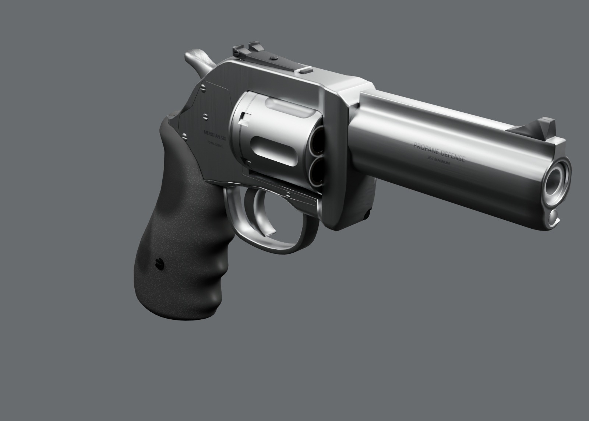
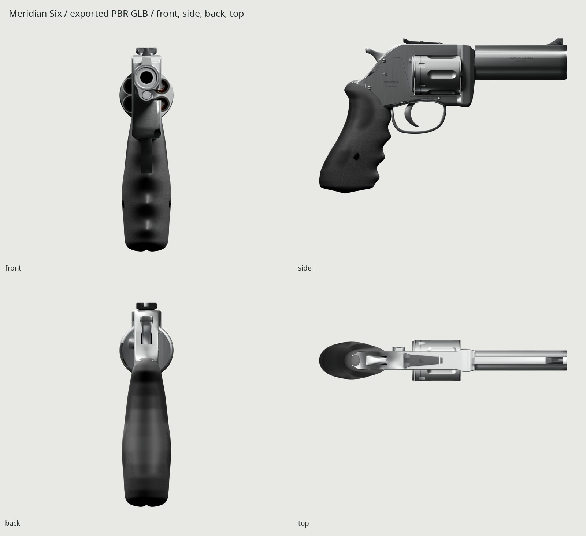
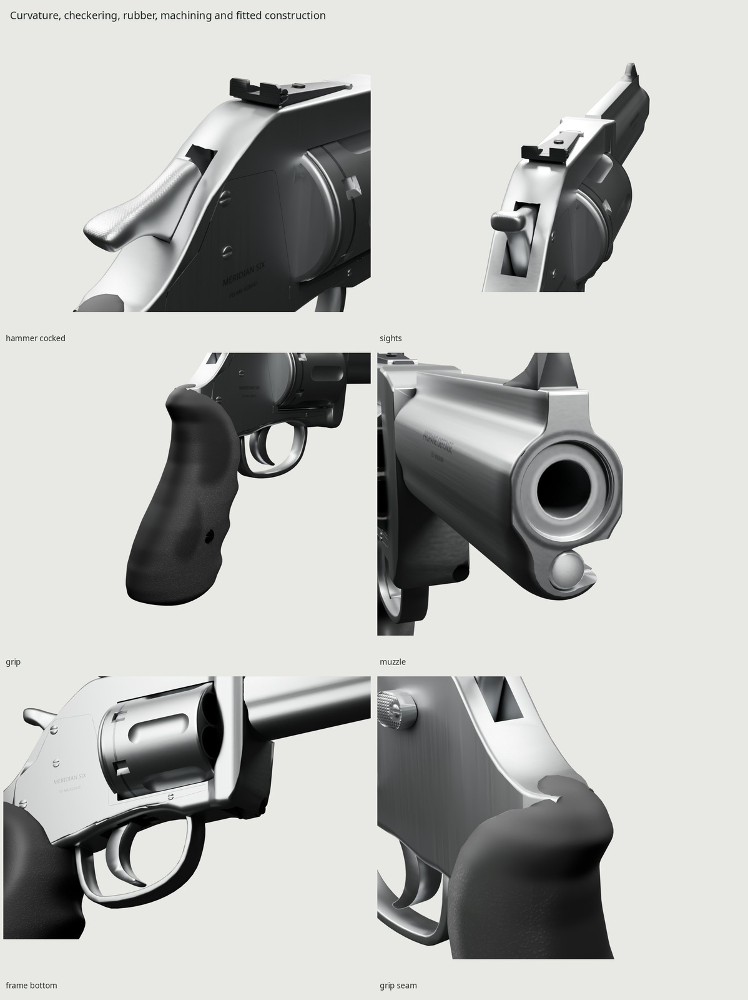
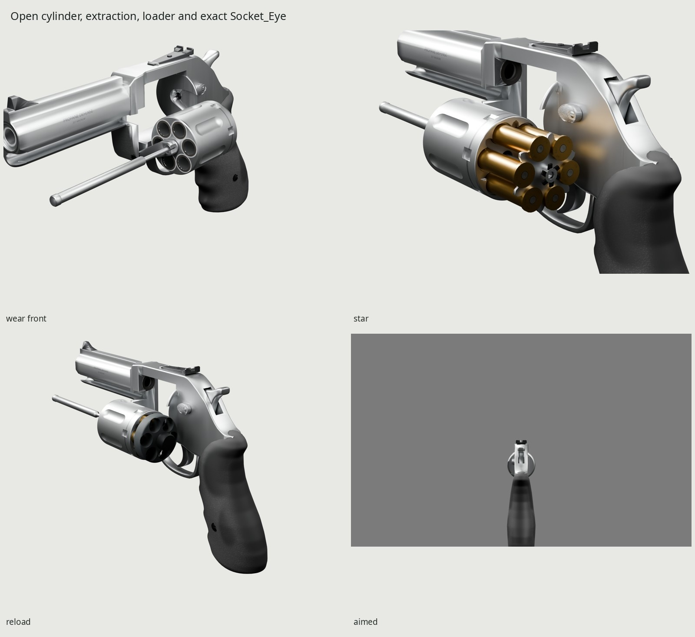
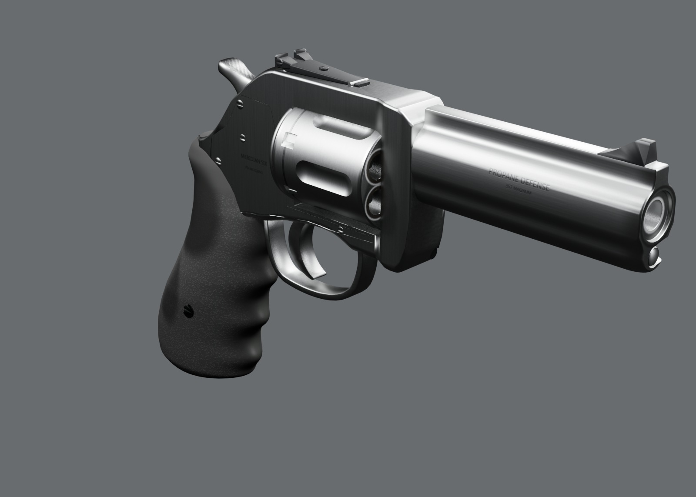

# PD Meridian Six — .357 service revolver

An original six-shot, medium-frame double-action revolver game asset, generated
entirely by Blender 5.2 scripts. Four-inch barrel, full underlug, adjustable
sights, broad crescent hammer and sculpted wrap-around rubber grips. The maker
and model, **Propane Defense Meridian Six**, and all markings are fictional.
The finish represents years of carry and firing, with maintained stainless steel.



| | |
| --- | --- |
|  |  |
|  |  |

These images load the exported GLB and its baked 2048 maps. Docs JPGs are
prepared for the lead's review and left uncommitted as requested. Full-resolution
evidence is generated at `renders/final/hero-gray.jpg`, `contact-sheet.jpg`,
`photo-pairs.jpg`, `hammer-pairs.jpg`, `scale-gray.jpg` and `beauty/frame_bottom.png`.
The four final corrections have before/after/photo evidence in `renders/final/fixes/`,
with measured photographic gauges and separate front/below lug views.
[REVIEW.md](REVIEW.md) records form and finish critiques, measured comparisons,
bake loss, validation and the remaining limitations.

## Files

| Generated path | Contents |
| --- | --- |
| `export/revolver.glb` | One rigidly weighted skin/material, 32 bones, 22 clips and ten sockets |
| `export/cartridge.glb`, `export/case.glb` | Base-centered cartridge and open fired case, +Y toward the nose/mouth |
| `export/speedloader_loaded.glb` | Loaded loader in the complete LoaderGuide frame |
| `textures/` | Canonical `T_MeridianSix_BaseColor`, `T_MeridianSix_Normal`, `T_MeridianSix_ORM`, all 2048 |
| `build/baked/4k/` | 4096 bake intermediates and measured ray-coverage report |
| `build/delivery/finalized.blend`, `high.blend` | Packed game parts and dense procedural finish source |
| `build/revolver.blend`, `sculpt.blend` | Named inspection geometry and dense grip/hammer sources |
| `renders/final/beauty/`, `eevee/` | Cycles/Eevee, orthos, details, open action, exact Eye and 1.8 m scale cue |
| `renders/final/pairs/`, `source-pairs/`, `hammer-pairs/` | Exported/dense photographic comparisons and both hammer poses |
| `renders/final/strips/` | All 22 real-duration Eevee WebPs, uniform 15-Hz strips and timing manifest |
| `renders/final/photos/values.json`, `ammo/values.json` | White-balanced photographic view values and ray-hit render patches |
| `build/surface-audit.json` | Actual exported ray/UV texels at the wear sites |

Generated blends, GLBs, textures, renders and downloaded references stay ignored.
Only sources, notes, Makefiles and accepted docs images belong in git.

## Dimensions and construction

| Quantity | Evaluated geometry | Published / design anchor |
| --- | --- | --- |
| Overall length | 237.29 mm | approximately 240 mm; class catalog 241.3 mm |
| Overall width / height | 39.40 / 149.16 mm | original service-grip envelope |
| Barrel, breech to muzzle | 101.600 mm | 4.00 in / 101.6 mm |
| Cylinder diameter / length | 39.40 / 44.20 mm | original six-chamber layout |
| Grip width / depth / height | 36.20 / 68.97 / 109.14 mm | accepted changing sculpted sections |
| Recessed rim seat / head flushness | 1.400 mm / below .001 mm | original visual construction |
| Forcing-cone gap | .200 mm, three surface rays | accepted visual running gap |
| Window central upper / lower light | about .443 / .457 mm | actual surfaces, separate from swing relief |
| Crown recess | 1.450 mm | accepted protected annular floor |
| Hammer spur root / near-tip thickness | about 6.17 / 5.44 mm | corrected broad-end photo estimate 5.53 ±1.0 mm |
| Exposed rod / knurled head diameter | 5.80 / 6.40 mm | photo estimates 5.74 ±0.6 / 5.94 ±0.7 mm |
| Spur width / extension past frame gauge | about 9.92 / 16.55 mm | estimated class 9–11 / 14–18 mm |
| Cartridge length / rim diameter | 40.20 / 11.12 mm | C.I.P. maxima 40.39 / 11.18 mm |
| Fired assembly length | 32.80 mm | 32.77 mm case body plus primer relief |
| Unloaded mass | nominal 1.13 kg, unmeasured | published class 1.134–1.151 kg |

The manufacturer catalog and U.S. class test report establish the envelope;
C.I.P. supplies the cartridge's exterior limits. Direct links, authors, licenses
and the distinction between published dimensions and authored visual estimates
are in [refs/SOURCES.md](refs/SOURCES.md) and [REFERENCE.md](REFERENCE.md).
Mesh gauges use actual evaluated triangle bounds/rays. Photographic estimates
retain their perspective and placement uncertainty; they are not shop dimensions.

The frame is a changing-section forging with machined cheeks, a flush seated
sideplate, small even rear edge radius, continuous belly/guard transition and a
rounded crane-bearing corner. Its recoil shield has a rolled edge; the upper
window shoulders follow the cylinder. The accepted moving crane remains seated
behind a fine seam. The cylinder, long round-ended flutes, stop notches, recessed
extractor plate and six actual rim-bearing lobes retain their accepted geometry.

The barrel has side flats, a blended rib, protective recessed crown and a
compound rolled underlug nose. Its narrow left opening lets the rod depart with
the cylinder; the right wall hides it. Source/import rays measure the approximately
6.31 mm shaft release rather than claiming a closed tube. Front and rear sights retain
the pinned ramp, thin notch blade, tapered seated tongue and slotted adjustments.
The contoured latch stands on its recessed stem.

The original rod endpoints and 26 mm stroke are retained. Its forward shaft is
5.8 mm across, with a 6.4 mm knurled head and a smaller sliding journal through
the original bearings. The narrow release grows only with that diameter. The
lug has an elliptical underside, tangent barrel-side blend and a rolled nose.
The rear frame has a transverse crown behind the sight and a body-width cut
following the actual concave hammer sweep; the raised spur is wider than it.

Hammer cheeks and tongue come from one three-dimensional subdivision cage.
The fine crossed roof cuts bake over its curvature; the game mesh carries the
silhouette. Rubber has changing egg sections, palm swell, three finger saddles,
a rounded butt and a clean upper molding seam. Its dense remeshed/subdivided
source transfers onto the accepted 4,200-triangle game grip. The trigger has
muzzle-facing concavity, a forward toe and a convex grip-facing back; its accepted
shoe, guard, pivot and pull are unchanged.

The visual assembly supplies visible exterior construction. Mass, working
lockwork and manufacturing fits are not simulated.

## Materials and use

Stainless has neutral linear base **.51/.52/.53**, central roughness **.385**,
metallic **1**, vertical brush direction on frame cheeks, lengthwise machining
on barrel flats and turned/circumferential fields on cylinder and end faces.
Narrow contact lands become smoother and slightly brighter. Fine tool marks,
roof checkering and engraved **PROPANE DEFENSE**, **MERIDIAN SIX**, **.357 MAGNUM**
and **PD-M6-028641** transfer through the normal/PBR bake.

Rubber's original irregular cells use linear dark values around .019–.037,
roughness about .72 and fine height relief. Hands darken and smooth the web,
finger crowns and back/palm contact, lowering roughness toward .40 and reducing
cell height. Small lint deposits remain in sheltered lower valleys. The sights
have a matte black dielectric coating on steel, fine serrations and restrained
metal at exposed edges. Other dark hardware keeps its blackened metal response;
the loader shell is a separate dark dielectric region in the same atlas.

Ammunition uses brass **.50/.31/.095**, copper **.46/.16/.060**, lead
**.065/.068/.070** and a separate warm primer **.43/.42/.36** in linear RGB.
The open fired case has a struck cup and soot near its mouth. The original
**PD 357 / 26** headstamp is engraved from installed Noto Sans. Every marking
and texture field comes from our scripts.

| Wear site | Appearance and cause | Example shipping texels, before / after |
| --- | --- | --- |
| Cylinder stop circle | narrow dark track with a fine polished center on the outer lands | BaseColor luma about 191 / 112 |
| Cylinder face / forcing cone / topstrap underside | localized dark carbon around chamber outlets and directly over the hot gap | clean face about 191; sampled ring halo 113; underside 23 |
| Muzzle, cylinder edges and shroud nose | smoother holster-contact lands; grain loses relief where rubbed | barrel roughness .380 / muzzle .306 |
| Grip web, finger and palm contact | darker, smoother rubber with worn-down molded cells | roughness .722 / .447; BaseColor luma 39 / 26 |

Texel luma above is 8-bit **BaseColor**, separate from rendered view values.
`build/surface-audit.json` records the actual exported triangle hits, UVs and
channels. Noise breaks the boundaries of these causal sites; it does not apply
a uniform dirt wash. `WEAR=0` removes use while retaining manufactured texture
and markings. The closed hero shows the track, contact polish and grip contrast;
the open wear hero, `beauty/wear_front.png`, exposes the cylinder's six carbon rings and inside frame.

The primary used-gun photograph is balanced on matte gray paper above the gun,
native patch **(100,45)–(300,110)**. Linear gains are
**.98535 / 1.00245 / 1.01997**, preserving neutral luminance. The open photograph
uses gray foam; the Stephen Z side photographs use gray paper. The clipped ATF
white backdrop supplies form only. The blue-lit cocked hammer photo supplies
form, not quantitative material color. Ammunition uses the unclipped upper-left
gray paper in the soft-point photograph, gains **.92280 / 1.02777 / .97913**.
The other ammunition photograph's white cell clips and constrains structure only.

<!-- VIEW_VALUES -->
| Surface | Median display luma, photo / export (0–255) | Photo R:G:B (G=1) | Export R:G:B (G=1) |
| --- | ---: | --- | --- |
| Stainless frame | 129.50 / 109.57 | 1.016:1.000:1.031 | 0.982:1.000:1.000 |
| Stainless barrel | 151.42 / 143.57 | 1.017:1.000:0.993 | 0.986:1.000:1.000 |
| Textured rubber | 74.65 / 70.29 | 1.014:1.000:1.068 | 0.979:1.000:0.986 |
| Smooth hand contact | 97.86 / 79.43 | 0.980:1.000:1.010 | 0.975:1.000:0.975 |
| Black sight face | 64.14 / 69.33 | 1.008:1.000:1.016 | 0.943:1.000:1.036 |
<!-- /VIEW_VALUES -->

| Ammunition surface | Median display luma, photo / export (0–255) |
| --- | ---: |
| Brass case | 161.43 / 121.46 |
| Copper jacket | 97.72 / 90.27 |
| Exposed lead | 51.50 / 56.57 |
| Primer cup | 62.49 / 45.85 |

The forward ammunition comparison makes the exposed lead camera-visible;
visibility rays reject occluded value patches. Its neutral room reflection and
separate darker head-view environment use the same shipping material. Brass
remains warmer/darker than this photographed specimen, and the primer estimate
has few native pixels. The bright standalone beauty views intentionally show
broader card reflections; their highlights are not used as albedo measurements.


These are view/light measurements from independently chosen photo patches and
actual projected GLB surface patches, not recovered albedos or measured material
roughness. The neutral room comparison uses a diffuse bounce fill excluded from
glossy transport; the hero keeps shaped reflections and dark cavities. Source
and export use the same recipe. Marked patches, RGB ratios and distributions
are generated beside the value JSON files.

## Frame, sockets and clips

Meters, palm origin, Blender **+Y toward the muzzle / +Z up / +X right**;
glTF +Y up / −Z forward. Internal Root remains identity. Stance/recoil transforms
the complete loaded instance externally. Preserve the imported PBR material.
The accepted [1.4.0 chamber supplement](INTERFACE.md) is additive to the family
interface and retains all capabilities, chamber IDs, event and interruption meanings.

The six legacy scene-root references retain their paths. Magazine/ejection
compatibility references are explicitly inactive; this gun has no magazine.
`Socket_Cylinder`, `Socket_Speedloader` and `Socket_Round` ride the complete
Cylinder, LoaderGuide and RoundGuide frames. The guide sockets remain nonsingular
while demonstration meshes use STEP visibility. The exact Eye is about **649.4 mm
behind the near rear-sight edge**, 650 mm from its center, on the accepted sight
axis. The cited pistol-sighting study supplies approximately 800 mm eye-to-front
sight; the original 150 mm radius leaves 650 mm to the notch.

| Moving assembly | Rest pivot, Blender mm | Authored visual motion |
| --- | --- | --- |
| Cylinder | (0,38,48.2), Y | 60° per index |
| Crane | (−8,85,20), Y | 0 to −80°, left swing |
| Extractor | cylinder rear axis | −26 mm Y; plate and rod together |
| Trigger | (0,31,23), X | −20° DA; −10° cocked to −15° SA |
| Hammer | (0,10,48), X | +35° cocked |
| Cylinder stop | (4.7,37,24), X | −22° rocker retraction |
| Thumb latch / center pin | separate guide frames | +2 / −2.5 mm Y |
| Loader release | loader guide | +2 mm Y |

All travel values are authored visual estimates. The 22 clips include Idle;
Fire, Fire2–Fire5 and FireLast; IdleAfter1–6; CockHammer, IdleCocked and FireSingle;
DryFire and its empty/indexed holds; Reload, ReloadSingle and Inspect. The
[interface](INTERFACE.md) lists exact durations, states and events at 60 Hz.
Stable chamber IDs retain live/fired/empty state; fired cases stay seated until
extraction. Reload first clears the cylinder/star axially before case flight;
the loader seats, releases and withdraws before closing. Occupancy uses explicit
STEP handoffs. Feeding is a visual representation, not a continuous mechanism
simulation. Interrupted clips resume the saved clip/frame with the pose held.

## Budget and delivery

The **complete staged payload** counts every hidden live/fired alternative,
incoming six rounds, loader and single insertion representation. It stays within
40,000 triangles. Active loaded geometry is 30,954 triangles; unloaded geometry
is 27,834. Source anatomy is retained for audits; delivery consolidates the rigid
weights into one skinned mesh and one material.

<!-- OUTPUT_STATS -->
| Final output | Triangles | Materials | GLB bytes | Map size | Density ratio |
| --- | ---: | ---: | ---: | ---: | ---: |
| Complete staged revolver | 39,608 | 1 | 10,000,132 | 2048 | — |
| Cartridge | 520 | 1 | 74,972 | 512 | 1.000 |
| Fired case | 456 | 1 | 75,764 | 512 | 1.000 |
| Loaded speedloader | 5,398 | 1 | 654,268 | 1024 | 1.000 |

| Canonical 2048 map | PNG bytes |
| --- | ---: |
| `T_MeridianSix_BaseColor.png` | 775,448 |
| `T_MeridianSix_Normal.png` | 2,011,117 |
| `T_MeridianSix_ORM.png` | 3,497,635 |
<!-- /OUTPUT_STATS -->

The kit bakes **4096 at 32 samples**, then filters to one **2048 BaseColor /
OpenGL +Y Normal / ORM** set. ORM stores R occlusion, G roughness and B metallic.
The gun retains this canonical atlas, approximately **16 MiB compressed with
mipmaps**. The standalone cartridge and case now embed their own **512** sets;
the loaded speedloader carries **1024**. These subsets preserve the original
baked density (ratio **1.000** for each item). Their accepted maps remain
byte-identical: cluster candidates increased file size. Standalone samplers
match the gun’s trilinear mipmapped sampler, approximately 1 MiB / 4 MiB compressed with mipmaps. Eight-pixel
minimum guards align to the mip grid, and the whole background is filled. See
[delivery details](../DETACHABLES.md) for padding and old/new comparison evidence.

Rest-position/normal attributes keep manufacture and wear attached while the
kit isolates rigid bones and the stationary grip for projection. The grip is
separated only during the bake so rays cannot copy adjacent steel at its lip.
The dense sculpt carries curvature and fine relief; original micro-AO supplements geometry AO in shallow texture valleys.
The full atlas covers about **40.9%**, with median density about **4,225 px/m**
at delivery size. Microscopic overlap remains below the unchanged kit 1e-5
fraction limit; no escaped or degenerate UV triangles are allowed. Exact density,
coverage, bytes, normals, embedded hashes and errors are in
`build/delivery/verify.json`.

## Rebuilding and checks

Requires Blender 5.2, Python with Pillow/NumPy, fontconfig, Noto Sans, GNU make
and flock. Sources run from a clean scene; all scratch output stays in the
clone's `build/`. GPU bakes and renders use the kit's shared lock.

```sh
make -C guns/revolver                 # refs, model, atlas, checks, exported finals, clips, docs
make -C guns/revolver check           # budgets, topology, contacts, UVs, normals, rig and re-import
make -C guns/revolver WEAR=.45        # cleaner finish, accepted geometry and rig retained
make -C guns/revolver render          # Cycles and Eevee from the exported GLB
make -C guns/revolver match source-match hammers
make -C guns/revolver strips          # true-duration Eevee clips
make -C guns/revolver fix-pairs BEFORE=path/to/preserved/before # optional historical GLB comparison
make -C guns/revolver form            # optional unbaked checkpoint evidence
make -C guns/revolver clean           # generated output only; reference cache remains
```

Defaults are `BAKE_SIZE=4096`, `BAKE_SAMPLES=32`, `WIDTH=1600`, `SAMPLES=64` and
`SHIP_SIZE=2048`. Parameter stamps invalidate the corresponding stages.
The graph calls the kit finalizer, isolated baker, channel-correct downsampler
and animated exporter; each standalone is extracted in its complete posed frame.
No other gun, common module or kit source is changed.

Inspection/finalized parts and reconstructed actual imported parts independently
repeat all **48 actual-surface records** and half-frame clearance through every
clip. The imported reconstruction matches each triangle by rigid owner, centroid
and all vertex positions, one-to-one. Dense hammer rest/cocking and source
contacts receive their own check. Four independent triangle-hit corner-normal
probes protect the accepted flat cheek from crown shading spillover. Serialization separately compares **1,842
complete affine/state poses**, sockets, posed surfaces, endpoints and interrupted
resumes. Standalone dimensions, origins, spawn frames and atlas-mapped surface samples are
fresh-import checked. An independent rebuild compares all **187 native entries**;
the revision audit retains **182 unchanged entries**, including the complete
accepted rig, cylinder, extractor plate, grip, trigger, guard, ammunition and loader.

Every 4096 channel requires zero missed interior texels. Actual shipping UV
samples independently check stop/carbon contrast, muzzle/hand polish and dark
dielectric rubber at the accepted upper lip. Final
review requires current GLB and presentation-recipe hashes for every still and
strip, plus decoded WebP durations. These checks establish build, assembly and
serialization; the photo pairs and image critiques establish the look.

## Remaining limitations and credits

The head knurl, roof cuts, mold grain, engraving and headstamp soften at extreme
macro distance in the one 2048 atlas. The above/behind reference has only 500
native pixels; its slot comparison constrains form, not fine machining. Rod
and spur dimensions are oblique photographic estimates with stated uncertainty.
The accepted hammer underside is more concave and its end more regular than
the worn comparator. The left window retains its swing relief; the original
front forging, grip and latch outlines also differ from the reference products.
Extreme ammunition/mouth macros show the accepted radial economy. A small
machined lip remains at the necessary open-left shroud passage. Cycles and
Eevee retain different grazing reflections. Remaining view-value residuals
are recorded in the photographic tables without material overrides.

Reference authors, licenses and direct sources are in [refs/SOURCES.md](refs/SOURCES.md).
Photographs are comparison-only. Lettering uses installed Noto Sans (SIL Open
Font License). The owner's procedural rifle informs the workflow; shared tools
live in `../../kit/`. All asset vertices, texture fields and graphics are original.
