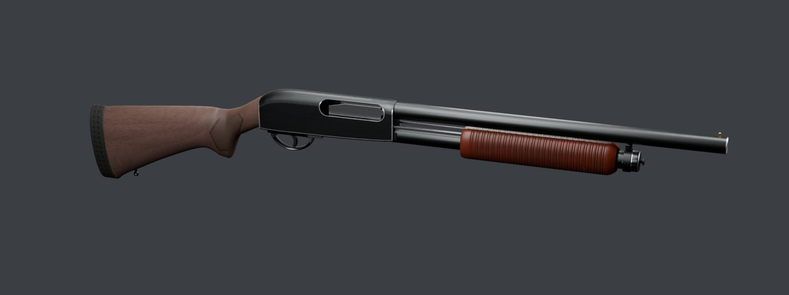
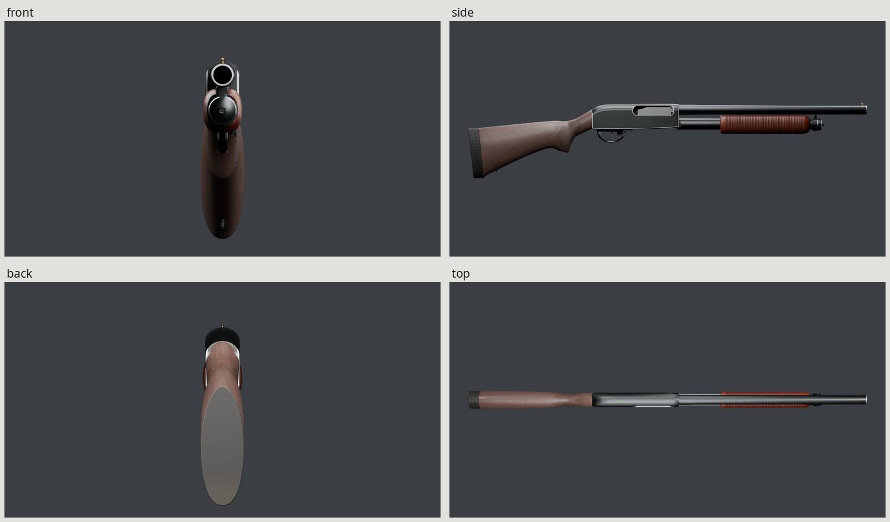
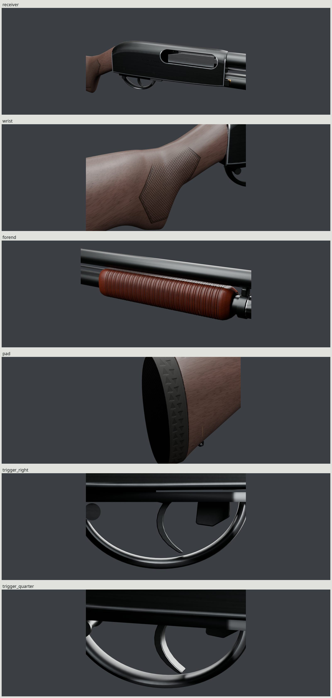
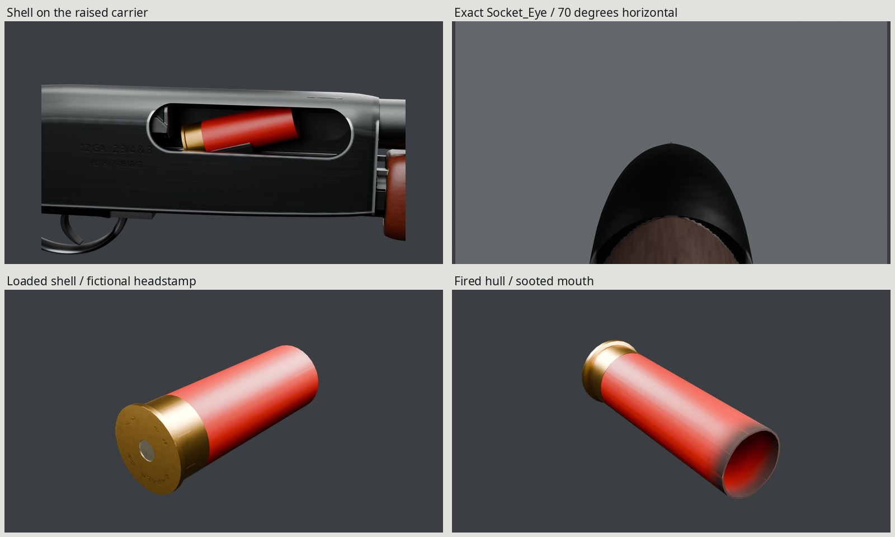
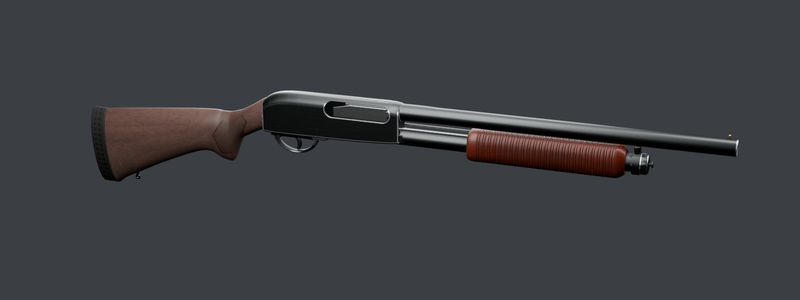

# PD Hearth 12 pump shotgun

An original, script-built 12-gauge utility game asset: short cylinder-bore
barrel, brass bead, steel receiver, four-shell tube, carved walnut furniture,
black rubber pad and sling studs. Fictional maker/model: **Propane Defense
Hearth 12**. Every vertex, grain field, cut, marking and texture is generated
locally by Blender 5.2 scripts. The accepted form, mechanism and 1.1.0 binding
are retained through final delivery.



| | |
| --- | --- |
|  |  |
|  |  |

All five docs images load exported GLBs with baked maps. The gun retains 2048 maps. The
full contact sheet (`renders/final/contact-sheet.jpg`) includes the
exact Socket_Eye view / 70 degrees (`renders/final/beauty/aimed.png`),
socket-view alias (`renders/final/beauty/aimed_socket.png`),
raised carrier and shell (`renders/final/beauty/open.png`),
1.8 m silhouette (`renders/final/beauty/scale.png`),
muzzle (`renders/final/beauty/muzzle.png`),
muzzle underside (`renders/final/beauty/muzzle_under.png`),
loading underside (`renders/final/beauty/underside.png`) and
molded pad sides (`renders/final/beauty/pad.png`).
Photo pairs: right (`renders/final/pairs/right_photo-pair.jpg`),
left (`renders/final/pairs/left_photo-pair.jpg`),
open (`renders/final/pairs/open_photo-pair.jpg`),
used bluing and walnut (`renders/final/pairs/used_photo-pair.jpg`),
native-scale hero receiver wear (`renders/final/pairs/hero-wear_photo-pair.jpg`),
sharp wood close-up (`renders/final/pairs/wood_photo-pair.jpg`).
Trigger pairs: right (`renders/final/trigger-pairs/trigger_right_photo-pair.jpg`)
and three-quarter (`renders/final/trigger-pairs/trigger_quarter_photo-pair.jpg`).
Their angles and blade scale are visually estimated; the original guard remains
different from the photographs.
[REVIEW.md](REVIEW.md) records form history and exported finish critiques,
measured value/hue and remaining photographic differences. The final visible-steel correction
section supersedes the earlier wear-visibility acceptance.

## Files

| Path | Contents |
| --- | --- |
| `export/shotgun.glb` | One rigid skin, 20 bones, eighteen clips, nine sockets and one PBR material |
| `export/shell.glb`, `export/hull.glb` | Head-centered standalone live shell and fired hull, +Y toward the mouth |
| `textures/` | Canonical `T_Hearth12_BaseColor`, `T_Hearth12_Normal`, `T_Hearth12_ORM`, all 2048 |
| `build/baked/4k/` | 4096 bake intermediates and measured ray-coverage report |
| `build/delivery/finalized.blend` | Named UV-packed game parts and the accepted rig |
| `build/delivery/high.blend` | Dense carved stock/forend and original procedural finishes |
| `build/shotgun.blend` | Accepted inspection model with hidden dense furniture sources |
| `renders/final/` | Cycles/Eevee views, photo pairs, real-speed clip strips and sheets |
| `refs/SOURCES.md` | Specification/photo authors, licenses and individual uses |

Generated files and downloaded references remain ignored. Git contains scripts,
Makefiles, source/review notes and five final docs JPGs only.

## Dimensions and baseline


| Property | Actual evaluated game geometry | Class baseline |
| --- | --- | --- |
| Overall length | 977.93 mm / 38.50 in | 38.5–39.5 in |
| Barrel, breech to crown | 469.90 mm / 18.50 in | 18.5 in |
| Length of pull | 352.65 mm / 13.88 in | about 14 in |
| Height / maximum width | 184.25 / 44.55 mm | original utility configuration |
| Receiver, at source Y 50 | about 35.50 × 63.03 mm | flat sides, rolled crown |
| Palm station at the origin | about 31.81 × 43.40 mm | compound carved wrist |
| Forend envelope | 219.58 × 39.93 × 45.65 mm | length × width × height |
| Magazine capacity | four closed 2¾ in shells, plus chamber | four in tube |
| Chamber class | 2¾ / 3 in, 12 gauge | brief / published class |
| Intended unloaded mass | 7.5 lb class target | 7–7.5 lb |

Pull is measured by two actual surface rays at the trigger shoe and rubber
back, at a common height. It is not a subtraction of authored landmarks.
Section outlines intersect the triangulated game meshes at thirteen stations.
Mass is **not measured or simulated** from the game mesh. Shell/chamber labels
describe the visual class, not manufacturing dimensions or a functioning design.

The [2018 manufacturer catalog, printed p.195](https://gravelagency.com/images/catalogues/2018-Remington-Catalog.pdf)
provides the short hardwood utility baseline. The
[Mossberg manufacturer comparison](https://www.mossberg.com/500-hunting-all-purpose-field-50120.html)
provides an independent wood-stocked 12-gauge class check. The
[owner manual](https://www.remarms.com/sites/default/files/documents/870%20Manual%20Final.pdf)
and its exploded diagram informed visible assembly. All photos, authors,
licenses, configuration differences and uses are in [refs/SOURCES.md](refs/SOURCES.md).

## Construction

The stock is a subdivided cage with independently changing width, cheek roll,
comb, belly and wrist sections. The forend is another subdivided cage, with
compound end tapers, broad faces, a real sleeve bore and a barrel-clearance
channel. Their dense originals remain hidden in `High_Sources` in the source
blend and supply the final dense bake source. Neither is a side profile extrusion.

The receiver has a continuous rounded roof, closed rear, real inner cavity,
right port, lower loading opening and two cross-pin heads on each side. Its
machined flats retain flat normals; the broad roof has an analytic elliptical
normal field following the rolled rear and narrowing nose. Coplanar machining
faces are dissolved while the crown's shape is preserved. The lower edge rises
toward the front. The 100 × 24 mm ejection opening has near-semicircular ends.
Ports and outer steel edges have modeled radii. The cast guard is a continuous
rounded bow joined to its plate, with a 4.4 mm bar section in side elevation.
The corrected 6 mm trigger blade is concave toward the muzzle with a forward
curl and convex back. Its side depth is about 2.7–2.8 mm through the working
bow, with rounded lateral edges. A hidden upper rear land rests against the
existing plate slot; the original pivot and −12° pull remain unchanged.
The bolt has a relieved rear, visible port cheek and an underside carrier pocket.
An action slide block joins
the twin bars to the bolt's underside with actual bearing contact. The tray is a stamped
concave cradle with a central opening. Shell stops bear on the tube shell's
rim; the measured aperture is 18.60 mm against the 22.40 mm rim. The forend's
two bearing rings remain supported by the magazine tube through the stroke.
The longer, slimmer forend retains those bearings and its 96 mm stroke. Its fine
paired grooves cover most of the length; the nose tapers onto the sleeve. The
tube, ring and cap extend 50 mm forward to provide room for this longer wood.
Capacity and the shell stops' positions remain four shells and the same rim seat.

The stock has a nearly straight comb, a short semi-pistol grip with a carved
oblique end flat, and a pitched recoil pad approximately one inch thick. The
stock overlays use the exported wood's silhouette. Manually observed points
are independent comparisons; their millimeter distances use an estimated camera
plane and do not establish submillimeter photographic metrology.

The loaded shell has a colored hull, brass-colored head, primer and six recessed
folds around a small center opening. Its outside rim has 32 sides; the fired
hull has 28. Both have analytic smooth cylinder normals. Sparse hidden rings
pay for the exterior silhouettes. The fired hull has a full inner wall and
closed inner base, genuinely open mouth, dark sooted interior
and struck primer. Their head centers are their origins;
+Y points toward their mouths. These are visual exterior assets only.

## Materials and many seasons of use

The receiver, barrel and magazine tube have matte blue-black bluing with red
lowest in the daylight channel ratios. Resolved lengthwise machining varies
roughness in the highlights. Narrow gray-steel carry rubs follow the actual
curved lower edges and front corners, port/loading lips, cap rim, crown and
barrel underside near the muzzle. The carrying hand thins and smooths the
receiver flanks slightly; action bars and carrier bearing lands are bright steel.
Carbon stays at the muzzle and port, rather than washing the receiver.

The native-scale receiver comparison (`renders/final/pairs/hero-wear_photo-pair.jpg`)
keeps the hero's actual pixels and resizes the used daylight receiver to the
same scale. The worn lower port lip measures **128.62/255** display luma against
**167.04/255** in the photo (previous export: 42.36). Lighting differs; these are
not recovered albedos. Actual worn-core shipping texels have median sRGB
**197/203/208**, metallic **1.0**, roughness **.380**, with the unchanged blue
field around them. The bright mask covers 7,664 of the receiver's 240,478
interior texels above half strength. [REVIEW.md](REVIEW.md) records both
correction passes, mask coverage, physical bands and strict delivery identity.

The stock and forend are stained walnut with a satin oil finish. Three-dimensional
growth layers follow the long blank and wrist, sweeping into arches where
the carved butt and forend intersect them. Irregular annual-layer spacing,
subtle annual bands, fine dark vessel dashes and fiber relief provide
distinct structures; figure changes across the blank. The original six-sided utility
checkering has crossed cuts and a double boundary. Its recessed grooves retain
dark oil/dirt. Hand and cheek contact darken and dull the wrist and comb.
A few crushed dents have depressed normal relief, compressed dark fiber and
broken finish lips; a continuous cross-grain scratch reveals raw wood in its
bottom. These occur at the heel, toe, comb and lower forend edges. Satin polish
stays on narrow forend land crowns; handled shoulders turn duller and darker,
and the paired grooves retain oil and dirt.
`WEAR=0` removes use effects while retaining grain, manufacture and markings.

The rounded trigger plate/bow represents **cast aluminum with dark anodizing**,
matching the class's dark alloy housing appearance; gray alloy shows on the
contact edge. The [primary manufacturer declaration recorded by California DOJ](https://oag.ca.gov/firearms/safety-device/870-express-aluminum-two-dot-iss-trigger-guard)
confirms an aluminum guard in the class. The precise anodizing response here is
our design choice, not recovered coating chemistry from a photograph. Controls
and sling hardware use dark steel; the sight bead is brass. The pad is black
rubber with an original molded basket back and two staggered columns of
triangular side recesses in its pitched frame. Shells have red
plastic, fine molded ribbing, brass-colored steel heads, separate primer response
and the fictional **PD HEARTH / 12** headstamp. The fired hull has a struck
primer, genuinely open mouth, sooted lip and dark interior.

Engraved **PROPANE DEFENSE**, **HEARTH 12**, **12 GA 2 3/4 & 3** and
**PD-H12-061843** transfer as height/color through the bake. Text uses installed
Noto Sans (SIL Open Font License). Grain, checkering, rubber pattern, lettering,
carbon and fine machining add no game triangles. No real trademark is copied.

Median display values and RGB ratios use **one daylight Commons photograph
of the same used gun** for steel, stock and forend, with independently projected
render surface patches. The sharp wood close-up is a structure comparison only.
These are view/light comparisons, not recovered albedos. The gray-coated utility
photo remains a form reference only. Final numerical values and patch
overlays are in `renders/final/photos/values.json` and `value-patches.jpg`.

| Surface | Median luma, photo / export (0–255) | Photo R:G:B (G=1) | Export R:G:B (G=1) |
| --- | ---: | --- | --- |
| Blued receiver | 73.37 / 73.01 | 0.920:1.000:1.000 | 0.932:1.000:1.014 |
| Walnut stock | 92.94 / 91.25 | 1.178:1.000:0.956 | 1.193:1.000:0.943 |
| Walnut forend | 64.68 / 63.81 | 1.768:1.000:0.839 | 1.597:1.000:0.895 |

The second outdoor photograph supplies a wider light/hue cross-check: steel
150.18 with .914:1:1.166, wood 126.58 with 1.588:1:.763. Reflected sky raises
its steel value; the first photograph has a hazy black floor. Those differences
remain explicit, rather than altering albedo until every unrelated light matches.


## Frame, sockets and animation


Meters, palm origin, Blender +Y forward / +Z up / +X right; glTF −Z forward /
+Y up. The palm origin is the middle of the wrist's selected section. Internal
Root stays identity in every clip; whole-instance movement belongs to the
consumer. The [1.1.0 additive supplement](INTERFACE.md) preserves the family's
[1.0.0 contract](../INTERFACE.md). `src/interface.py` is the tested binding.

| Socket | Blender rest position, mm | Behavior |
| --- | --- | --- |
| Socket_Muzzle | (0, 711, 49) | crown / shot effect |
| Socket_Foregrip | (−19, 428, −9) | existing scene-root rest reference |
| Socket_SupportHand | (−19, 428, −9) | complete frame riding Forend |
| Socket_Butt | (0, −260.73, −53) | shoulder reference on pitched pad |
| Socket_Eye | (0, −25, 64.6) | bore-aligned cheek-weld sightline |
| Socket_Ejection | (18, 172, 47) | in the port at ejection |
| Socket_MagWell | (0, 162, −2) | underside loading entry |
| Socket_Magazine | (0, 255, 13) | fixed tube mouth; no dropped magazine |
| Socket_Shell | (0, 185, 13) | nonsingular insertion-guide frame |

The eye is about **43 mm vertically above the actual comb surface** at its
station, at the front comb with a plausible cheek-to-eye offset. The optical
axis keeps the family's exact +Y-forward / +Z-up basis and meets the bead's
center. The accepted 55 mm frustum-plane check verifies that every stock triangle stays
below that original bound view; clearing only a single bead ray was inadequate
in form round 1. Both final aimed stills use **70° horizontal**
(25.71 mm on a 36 mm sensor), the **exact Socket_Eye frame**, zero lens shift
and an opaque gray studio surround. `aimed.png` is the view used in the docs;
`aimed_socket.png` is its socket-named alias. The raised-camera presentation
has been dropped. The wider vertical field retains the stock in the foreground;
the real receiver crown occludes most of the barrel, with the bead above it.
No stock or steel mesh is hidden for the view. `build/check.json` records the actual
comb intersection, eye height and stock clearance. The shoulder socket was moved
onto the pitched pad, with its surface distance checked in source and import.

Twenty rigid bones drive the forend/bars, bolt, unlocking block, carrier,
trigger, crossbolt, release, shell stops, follower and shell display states.
The forend and bolt travel **96 mm**; the carrier presents at **15°**, and folds
to **20°** during insertion. Trigger motion is 12°, safety travel 3 mm, release
9°. These are authored visual estimates, not manufacturer mechanical limits.
The nonscaling ShellGuide carries the shell socket; its display child alone
uses STEP visibility. This avoids singular socket transforms when hidden.

The following rest pivots are in the same Blender frame, in millimeters.
Translations and rotations use that frame; all rotation axes below are +X.

| Moving assembly | Rest pivot | Authored range |
| --- | --- | --- |
| Forend, sleeve, bars and slide block | (0, 430, 13) | Y: 0 to −96 mm |
| Bolt body and cheek | (0, 171, 49) | Y: 0 to −96 mm |
| Bolt lock, child of bolt | (0, 205, 53) | 0 to −9° |
| Carrier and its presented shell | (0, 85, 4) | 0 to +15°, +20° for loading |
| Trigger | (0, 84, −4) | 0 to −12° |
| Safety | (0, 56, −8) | X: 0 to +3 mm |
| Action release | (−12.8, 100, −3) | 0 to +9° |
| Left / right shell stops | (∓12.5, 240, 13) | outward X: 0 to 2 mm |
| Magazine follower | (0, 491, 13) | count-dependent Y: −236 to 0 mm |

The four tube display slots start at (0, 255 + 59i, 13), i = 0…3.
They and the chamber shell use STEP occupancy. ShellGuide supplies the insertion
path independently of display scale; event and interruption semantics are in
the interface supplement.

| Clip | Seconds | State behavior |
| --- | --- | --- |
| Idle | 1/60 | chambered, four in tube |
| Fire | 1.10 | shot and pump; four → three in tube |
| Fire3 / Fire2 / Fire1 | 1.10 each | subsequent count-specific cycles |
| FireLast | 1.10 | last chambered shell; closes empty |
| Reload | 1.20 | single insertion, three → four |
| Reload1 / Reload2 / Reload3 | 1.20 each | zero → one / one → two / two → three |
| ReloadEmpty | 6.30 | carrier loading, close, four individual insertions |
| Inspect | 2.50 | safety, release and short partial rack; external stance optional |
| IdleTube0–3 / IdleEmpty / IdleOpen | 1.00 each | explicit count/state holds |

All eighteen clips have complete hold boundaries and independent initial poses.
Each reload declares committed count events and hand-clear interruption phases.
In-flight interruption pauses/resumes the same clip and frame. Safe phases
name the matching count-specific Idle. The gun has no last-round hold-open.
Feeding uses a discrete carrier/chamber handoff and hidden tube-slot reindexing;
it is not a continuous cartridge-path simulation. The consumer spawns the fired
hull at the ejection event. Normal-speed WebPs and uniform 15-Hz strips are in
`renders/final/strips/`; `timing.json` records their real durations.

## Budget and delivery

The final gun stays below the brief's 40k ceiling, including all animated shell
representations. Loaded shell and fired hull stay within 600/400 triangles.

| Final output | Triangles | Materials | GLB bytes | Map size | Density ratio |
| --- | ---: | ---: | ---: | ---: | ---: |
| Gun, all animated shell representations | 39,829 | 1 | 11,943,316 | 2048 | — |
| Loaded shell | 600 | 1 | 364,784 | 1024 | 1.000 |
| Fired hull | 394 | 1 | 404,136 | 1024 | 1.000 |

Exact texture hashes, UV density/overlap and round-trip errors are recorded in
`build/delivery/verify.json`. The inspection gun remains 39,825 triangles; the
UV-prepared gun is 39,829 after retriangulating microscopic Boolean slivers.
All accepted surface dimensions, contacts and motion bounds are retained.

The kit bakes **4096 at 32 samples**, then filters to one **2048 BaseColor /
OpenGL +Y Normal / ORM** atlas. ORM is R occlusion, G roughness, B metallic.

| Canonical 2048 map | PNG bytes |
| --- | ---: |
| `T_Hearth12_BaseColor.png` | 2,091,336 |
| `T_Hearth12_Normal.png` | 2,841,090 |
| `T_Hearth12_ORM.png` | 3,293,969 |

Explicit rest-position and corner-normal attributes retain the finish fields
while rigid bones are isolated for projection. Dense carved wood transfers onto
the game mesh; original micro-AO supplements the geometric AO in shallow cuts.
UVs reserve small independent shell/hull regions, while the gun receives the
large region. Microscopic Boolean edges are dissolved only on receiver/bolt
before unwrap; no silhouette or contact threshold is changed. The final checks
measure the result rather than calling it perfectly uniform or overlap-free.
The fresh gun import covers 29.26% of the atlas, with 26 microscopic overlap
pairs totaling a fraction 2.015e-6, below the unchanged 1e-5 limit. Delivered
gun density is 2,415 px/m median (5th/95th: 968 / 2,612). Furniture receives
more atlas priority: stock about 2,432 px/m and forend 2,579, while receiver
markings retain about 1,916. The long barrel, bore and sheltered tube/sleeve
receive less. The complete atlas, including the denser standalone regions,
covers 34.50%.

The gun retains its canonical **2048** atlas, approximately **16 MiB compressed
with mipmaps**. The standalone live shell now embeds its own **1024** set and
the fired hull **1024**, preserving the baked atlas density. Both match the
gun’s trilinear mipmapped sampler and repeat wrapping. Each uses one copied
atlas cluster at density ratio **1.000**, preserving internal margins and
nonmember atlas texels. Its outer halo is 8 px on the mip grid; pull-push fills
the outside and generated normals are normalized. Each costs about 4 MiB
compressed including mipmaps.
See [delivery details](../DETACHABLES.md) for padding, sizes and old/new comparisons.
One material/skin draw call represents the gun, with no added draw calls for
checkering, engravings or wear. The standard shared PBR response uses
`KHR_materials_specular` at .33 and no extra map.

## Rebuild and checks

Requires installed Blender 5.2, Python/Pillow/NumPy, fontconfig, Noto Sans,
GNU make and flock. No downloaded code, model, texture or lighting is used.

```sh
make -C guns/shotgun                   # refs through final docs and checks
make -C guns/shotgun check             # inspection + baked delivery + independent repeat
make -C guns/shotgun WEAR=.45          # cleaner finish, same accepted mechanism
make -C guns/shotgun render            # Cycles finals and Eevee hero from GLB
make -C guns/shotgun match             # five calibrated pairs + native hero-wear pair
make -C guns/shotgun wear-audit        # actual receiver mask and shipping texel widths
make -C guns/shotgun source-match      # dense-source comparisons with the same cameras
make -C guns/shotgun strips            # eighteen real-duration Eevee clips
make -C guns/shotgun critique PASS=review5
make -C guns/shotgun sections          # actual accepted triangle-plane sections
make -C guns/shotgun clean             # generated outputs only; reference cache retained
make -C guns/shotgun                   # rebuild from scripts
```

Defaults: `BAKE_SIZE=4096`, `SHIP_SIZE=2048`, `BAKE_SAMPLES=32`, `WIDTH=1600`,
`SAMPLES=64`. Parameter stamps invalidate the corresponding bake/render stages.
All GPU jobs use the kit lock; scratch files stay in the worktree's `build/`.
The asset graph calls the existing kit finalizer, baker, channel-correct
filter and animated exporter. No pistol, bolt or kit source is modified.

Inspection and finalized parts independently repeat all **37 actual-surface
contacts** and half-frame clearance samples through every clip. The fresh
consolidated delivery is decomposed only for auditing: each imported triangle
matches a source part by rigid owner, centroid and all vertex positions, with
one-to-one membership. Contacts and clearance then run on those actual imported
surfaces. This is separate from the **3,032 affine/state comparisons**, complete
socket orientation, intended count/hold/interruption assertions and posed-surface
serialization tests. The standalone shells get their own fresh imports,
external dimensions, origins, normals and map-identity checks.

UV checks retain the kit's 1e-5 microscopic-overlap limit and require no escaped
or degenerate UV triangles. Every 4096 bake channel must have zero missed interior
texels. Embedded PNGs must match the current canonical texture files. A separate
ray-hit audit measures finish/wear texels and physical density. Review provenance
requires every final view/strip to cite the current exported GLB hash and checks
the decoded real duration of every animated WebP. These build checks do not
establish photographic quality; the pairs and exported critiques do that.

## Remaining limitations and credits

Fine checkering and small engraving soften at the single 2048 atlas density,
compared with the dense source. Extreme shell macros still resolve the accepted
32/28-sided exterior rims. The authored paired forend grooves have rounder
shoulders than the photographed cuts. The forend value now matches closely,
while its hue is still less red than the used reference. Fine vessel pores and
subtle figure remain less rich than the sharp source photograph at macro scale. The original
utility stock differs from the field-stock references; its accepted silhouette
residuals are in REVIEW.md.
Eevee and Cycles produce different grazing reflections and cavity shadows.
Feeding is an explicit visibility/ownership representation, not a continuous
cartridge-path simulation. Manufacturing dimensions, eye/cheek ergonomics,
mass and coating chemistry are not certified by this visual game asset.

Photographs and published measurements: Wikimedia Commons, manufacturer
specifications/manuals and the primary state record, with individual authors,
licenses, direct links and uses in [refs/SOURCES.md](refs/SOURCES.md). They are
comparison-only references, never material inputs or committed image pixels.
The workflow follows the owner's read-only rifle project; general tools live in
`../../kit/`, and presentation/schema helpers in `../common/`. Every asset vertex
and texel is original to these scripts.
