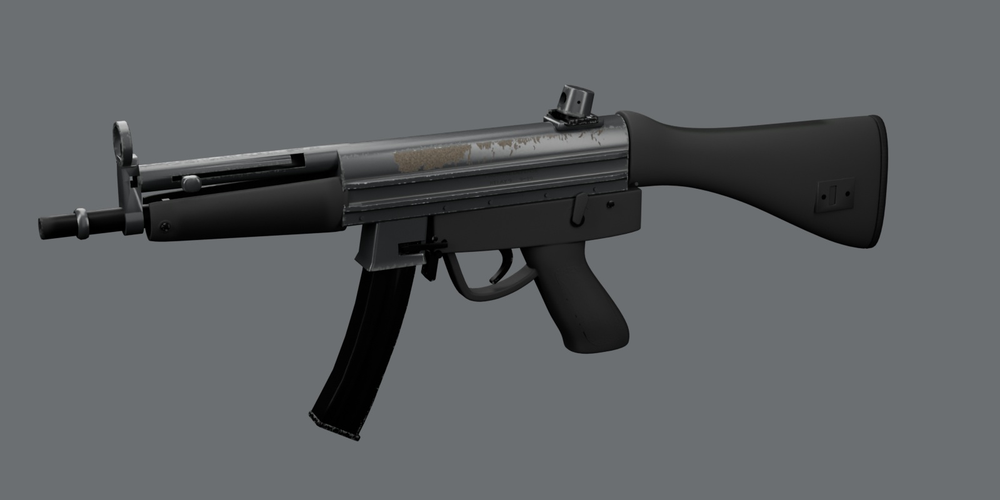
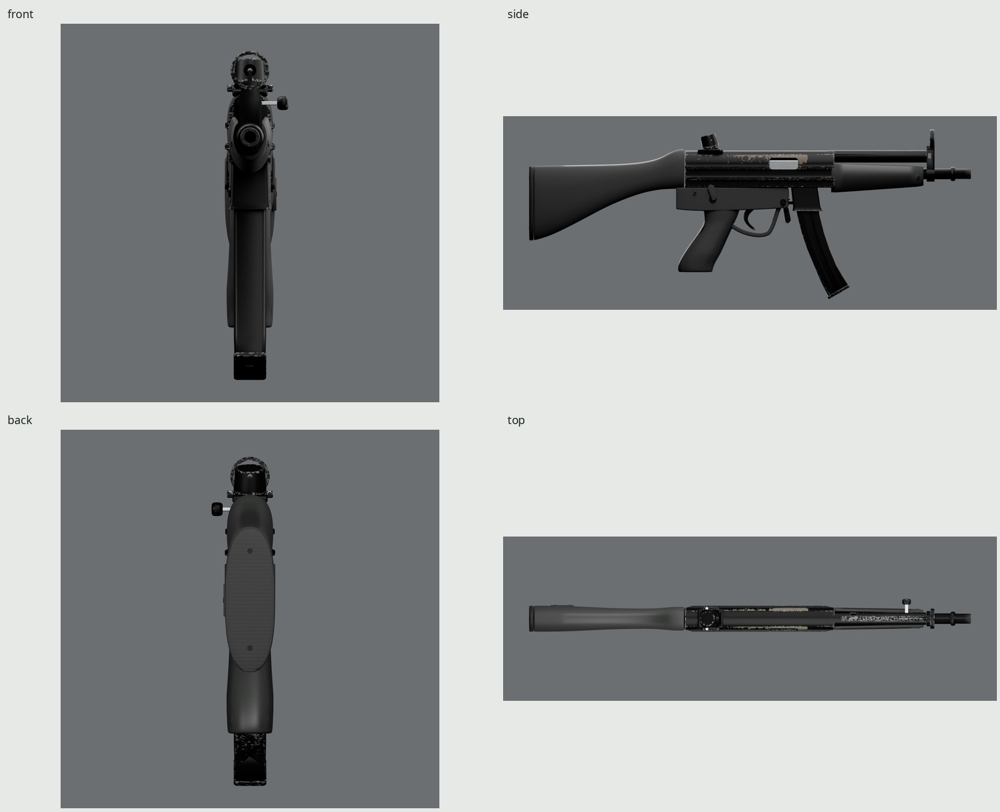
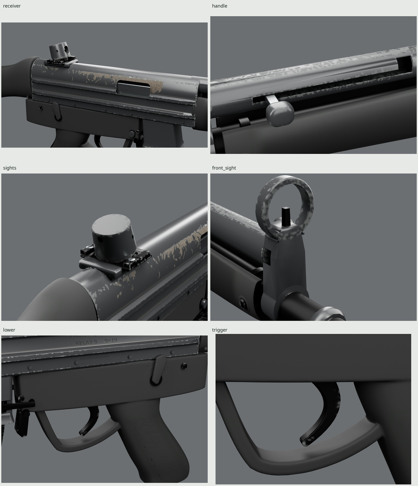
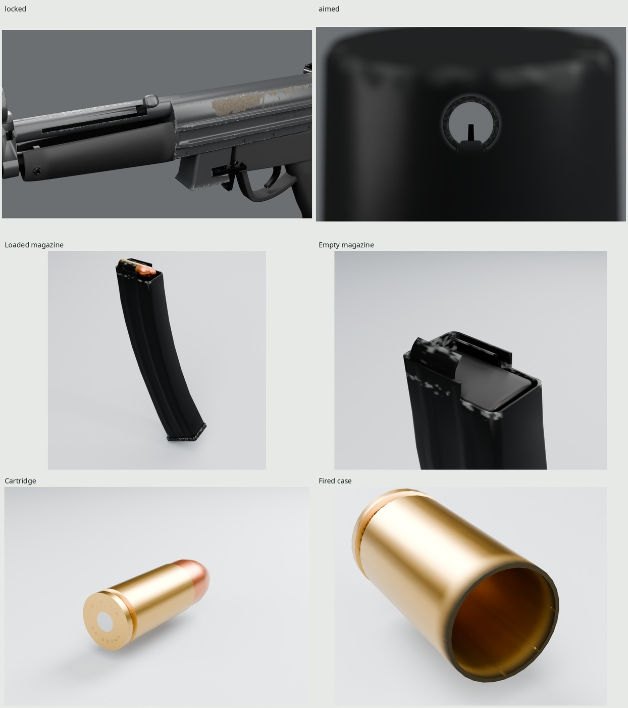
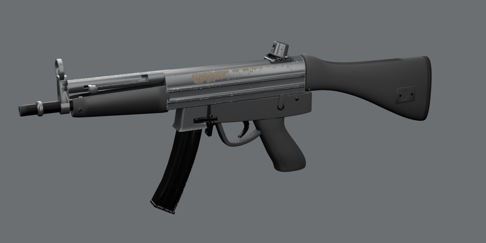

# Propane Defense Relay 9

An original 9×19 mm fixed-stock submachine-gun game asset, generated entirely
by Blender 5.2 scripts. Hollow stamped steel, compound polymer furniture,
curved steel magazine, rigid moving parts and 21 clips share one baked 2048
PBR atlas. The fictional **Propane Defense Relay 9** represents an issued gun
carried for years. Its contours, controls, serial and markings are original.



| | |
| --- | --- |
|  |  |
|  |  |

These images load the exported GLBs and their baked maps. `make` creates the
full contact sheet at `renders/final/contact-sheet.jpg`, Cycles stills in
`renders/final/beauty/`, Eevee in `renders/final/eevee/`, photographic comparisons
in `renders/final/pairs/`, dense-source comparisons in `renders/final/source-pairs/`,
and real-speed clip strips/WebPs in `renders/final/strips/`. Generated images
are named as paths because they are ignored. [REVIEW.md](REVIEW.md) records the
accepted form history, finish critiques, neutral patches, measurements and
remaining photographic differences.

## Dimensions and construction

| Measure | Actual evaluated geometry | Reference basis |
| --- | ---: | --- |
| Overall length | 680.10 mm | Published fixed-stock class: 680 mm |
| Barrel envelope, breech to crown | 225.00 mm | Published class: 225 mm |
| Maximum width | 50.49 mm | Published class: about 50 mm |
| Height with magazine | 260.84 mm | Published class: about 260 mm |
| Grip heel/web section axis to bore | 63.70° | Side-photo estimate: 64.3° ±3° |
| Molded guard width / depth | 15.99 / 6.51–7.06 mm | Photo-scaled broad rectangular section |
| Eye behind actual near drum face | 49.08 mm | Close cheek-weld photograph; adopted 40–60 mm range |
| Eye above actual comb at its station | 21.24 mm | Actual vertical surface ray |
| Selected aperture | 3.8 mm | Original visual aperture schedule |
| Rear drum rotational axis to front blade | 340 mm | Authored class spacing; curved aperture surface lies farther aft |
| Cartridge overall / case length | 29.51 / 19.16 mm | Accepted family 9 mm visual exterior |

The intended unloaded mass is **2.54 kg**, a published lightweight class target,
not a mass measured from a hollow game mesh. A later catalog configuration is
2.71 kg; the discrepancy remains in [REFERENCE.md](REFERENCE.md). Published
specifications, photographic estimates and authored visual dimensions are
kept distinct. All individual sources and licenses are in
[refs/SOURCES.md](refs/SOURCES.md).

The receiver is a hollow pressed section with broad lands, integral raised
crests, tight bends, a following 1.25-mm visual inner wall, ejection opening,
end closures, folded seam and spot welds. The upper cocking tube has an actual
longitudinal slot and locking branch. The nonreciprocating handle draws and
rotates into it. Visible bolt body, port cheek and chamber-facing ring are
modeled; hidden firing and roller engineering are omitted.

The front hood and post share the drum aperture's optical axis. The closed
rear drum turns on an inclined base with split clamp ears and slotted screws.
The stock, lower/grip and slim U-section handguard retain dense compound molds
for baking. Their changing sections, not extruded side profiles, establish the
rounded molding. The lower has flat side lands, small radii, a broad integrated
guard and full palm swell. The radiused trigger blade is concave toward the
muzzle, with a forward-curled round toe. Fine panel pebbling transfers from the
dense source to the normal map.

The curved magazine has a hollow stamped body, formed ribs, witness holes,
curled feed lips, catch window, tilted slid-on floorplate and separate shaped
follower. Three staggered cartridges represent the visible stack; thirty hidden
rounds would add no useful silhouette. Loaded and empty snapshots retain the
same local origin; their standalone UVs use separate atlas subsets. A cartridge and an open,
fired case are supplied independently, with round 32-sided visible mouths/rims.

## Materials and years of carry

Stamped steel has **black paint over gray phosphate**, with a soft satin
response and fine substrate texture in the normal/roughness maps. Intact
paint remains dielectric; exposed phosphate and bright steel have their own
response. The paint's linear base is `.0015/.00154/.0015`, central roughness
`.42`. Polymer is the grayer black: `.012/.013/.012`, roughness `.78`, reducing
to `.48` on handled areas. The receiver's upper-land phosphate uses
`.058/.049/.0375`; the accepted
secondary edge phosphate retains `.060/.064/.061`. Both use metallic `.08`
and roughness `.88`: matte conversion coating. Fine intrinsic color grain
breaks up the receiver field, whose warm gray is checked against the
white-balanced issued photograph. Rare steel flecks are
metallic `1`, roughness `.58`. These are authored PBR inputs; photographic
display values and actual shipped-map measurements are recorded separately.

Intact paint uses Principled specular level `.08` (glTF factor `.16`), while
polymer, phosphate and steel retain the previous delivery factor `.56`.
This factor occupies the **opaque BaseColor image's alpha**, shared by
`KHR_materials_specular`; it does not control transparency. Export/import must
support that extension. RGB remains sRGB and alpha is linear data; downsampling
uses `--alpha-mode independent`. There is still one material and three images.
The paint's roughness/albedo alone could not correct the upper-flank value:
lower roughness concentrates the large fill-card reflection and raises its peak.

The receiver has **one rubbed upper strip**, between the top crest and the
upper side rib. Forward of the support-hand/well station it merges into a gray
field, leaving ragged paint along its margins. Through the middle and aft,
larger intact paint lobes remain between lacy bites entering from the edges.
Below the rib, broad flats retain black paint; only sparse thin crest nicks
remain. Original domain-warped fields combine 17-mm island structure, smaller
fractures and elongated edge bites, thresholded against contact pressure and
distance from the crest. Coverage AA integrates the contours at source-mask
resolution. The two sides use independent seeds. No reference pixels enter
these masks. Rare steel remains restricted to sharp rubbing points. The
accepted cap, well, tube/slot, hood, drum and magazine edge shaders are retained.
The grip straps, handguard sides and stock comb become faintly satin where hands and
cheek work them; the dense panel's pebbled peaks are worn smoother.
Carbon stays at the muzzle and port edges. Dust stays in the selector's upper
recess, drum base and pressed roots. `WEAR=0` retains manufacture and markings
while removing the use layers.

Bright rubbing steel is visible through the port and on the handle shaft.
Brass, copper jackets and primers share the same atlas. The case has an open,
sooted mouth and separate primer. Fictional **PD RELAY / 9 × 19** headstamps,
stamped **PROPANE DEFENSE / RELAY 9 / 9×19 / PD-R9-063218**, molded lower legend,
and our **S / 1 / A** selector arc use installed Noto Sans. Fine stamps,
phosphate, weld relief and grip texture are normal-map detail.

Each comparison photo is white-balanced before sampling. Native rectangles,
neutral descriptions, linear RGB gains and patch overlays are generated by
[src/white_balance.py](src/white_balance.py) under `build/white-balanced/`.
The outdoor issued photo uses the gray ship bulkhead; the daylight display
photos use their white selector legends. The edited side photo also uses its
white safe-selector legend, and the studio quarter uses its unclipped gray
backdrop. These are estimated neutrals rather than color charts. Reflection
angles, mixed light and photographic editing remain limitations.

| Corrected reference | Paint median | Polymer median | Polymer location |
| --- | ---: | ---: | --- |
| `left.jpg`, edited side | 46.71 | 67.22 | lower |
| `right.jpg`, studio quarter | 35.28 | 68.93 | lower |
| `navy2.jpg`, issued display | 35.07 | 67.77 | stock |
| `trigger-ref.jpg`, display close-up | 110.85 | 114.78 | lower |

The first finish submission incorrectly used the shaded `navy2.jpg` lower
sample (30.93) to choose a deeper polymer. The repeated lighter polymer in the
other regions governs this revision. The outdoor photograph independently gives
paint 41.14 and magazine 41.34. All channel ratios remain in REVIEW.md. These
are observed surface values, not recovered albedos; exact exposure/reflection
agreement remains a limitation. Both final hero sides are measured under the
unchanged studio lights, with their surface polygons and medians in generated
`renders/final/finish-values.json` and the current REVIEW.md entry.

| Final hero surface | Left median luma | Right median luma |
| --- | ---: | ---: |
| Intact paint, lower flat strip | 13.00 | 2.00 |
| Upper-flank patch | 86.13 | 42.03 |
| Grip patch | 46.72 | 33.72 |
| Polymer lower | 55.72 | 41.72 |
| Polymer stock | 56.72 | 41.72 |
| Polymer handguard | 36.72 | 24.72 |

The upper-flank patch now includes the rubbed field; it is a mixed-finish
measurement. Intact paint is measured separately by excluding exposed texels.

Whole visible-region medians in the left hero are **paint upper receiver 39.00,
stock 53.72, grip 43.72**. These are independently rasterized from actual
finalized triangles, with exposed paint chips excluded; they supersede the
lower flat strip as the full-frame paint-value test. Rebuildable sampling masks
and method are in `renders/final/paint-value-regions.jpg` and
`paint-value-values.json`. The receiver is darker than both polymer regions
and the lead's approximately 47-luma bolt-rifle receiver benchmark.

Receiver wear is reviewed in **two dimensions**, using the exported GLB's
hero pixels and the independently white-balanced photo. The comparison is
`renders/final/pairs/wear-2d-pair.jpg`: observed color, the two binary masks,
connected worn regions, surviving paint regions, and worn-share profiles along
length and across height. `wear-2d-values.json` records every component's area,
bounding length and height, whether a boundary clips it, and threshold
sensitivity. Worn regions use eight-neighbor connectivity; paint uses four.
No 1D run-length statistic governs this finish.

Both images are sampled onto the same 0.5-mm grid over approximately
155.5 ×14 mm. Hero sample positions are intersections with the actual accepted
receiver triangles projected through the unchanged hero camera. Photo corners,
the approximate 1090-pixel / 230-mm envelope scale, the front-edge depth
estimate and projective rectification are explicit. These limitations, different lighting and the 2048 atlas prevent
claiming identical scratch histories or exact coating chemistry. A separate
`wear-2d-height-context.jpg` shows the complete flank and measures the black
flats below the rib. The current results and critique are in [REVIEW.md](REVIEW.md).

`renders/final/pairs/native-wear-pair.jpg` preserves the hero's native pixels;
only the photo is resized to the same receiver span. `chips-4x-pair.jpg` shows
forward, middle and aft native hero crops replicated 4× beside the photo at
common physical scale. `chips-native-4x-pair.png` preserves the photo's higher
native pixel density explicitly. Their former 1D acceptance tables are
superseded by the 2D masks and component dimensions.

The accepted paint remains roughness **.42**, linear albedo **.0015** and
shipping specular factor **.161**. The old supplemental crown-highlight
measurements remain diagnostic in `pairs/paint-highlight-pair.jpg`; the
4–6-mm target is withdrawn because it depends on source lighting. Every final
hero retains the existing studio lights and cameras. Actual surface values
and shipping-map material measurements are recorded in REVIEW.md and the
reports under `renders/final/` and `build/delivery/`.

## Frame, sockets and motion

The family frame takes precedence over the general prop frame: meters, palm
origin, Blender **+Y forward / +Z up / +X right**, glTF **−Z forward / +Y up**.
Root stays identity. Apply whole-weapon stance/recoil to the complete loaded
instance, including the scene-root sockets. The accepted
[1.3.0 supplement](INTERFACE.md) extends the family's earlier bindings without
changing them. [src/interface.py](src/interface.py) is the executable capability,
state, event and timing manifest.

| Bone | Rest pivot, Blender mm | Authored visual motion |
| --- | --- | --- |
| Bolt | (0,140,95) | Y: 0 to −84 mm |
| ChargingHandle | (0,301,122) | Y: 0 to −84 mm; Y rotation 0 to 35° for manual lock |
| Trigger | (0,59,44) | X: 0 to −12° |
| Selector | (0,3,57) | X: safe 0°, semi 42°, auto 83° |
| MagRelease | (0,116,43) | X: 0 to 12° paddle rotation |
| MagCatch | (0,111,51.5) | X: 0 to −3.5 mm |
| Magazine | (0,143,80) | Y/Z withdrawal; X handoff +9° to −6° |
| Follower | (0,145.6,58.8) | Magazine child; empty Y −2 / Z +17 mm |
| RearDrum | (0,0.5,133) | Inclined adjustment axis, 16° toward −Y; four detents |

The other four display bones own the chambered round and three magazine rounds.
A separate 19-pose sweep checks drum indexing through 0–270°; the clip catalog
retains the selected aperture. These ranges are authored visual estimates,
not manufacturer engineering specifications.

| Socket | Rest position, Blender mm | Ownership |
| --- | --- | --- |
| Muzzle | (0,400,95) | Scene root |
| Foregrip | (−17,265,80) | Scene root |
| Butt | (0,−280,50) | Scene root |
| Eye | (0,−65,148) | Scene root, exact optical frame |
| Ejection | (19,112,108) | Scene root, event reference |
| MagWell | (0,151,43) | Scene root |
| Magazine | (0,143,80) | Rides Magazine, full spawn frame |
| ChargingHandle | (−25,301,122) | Rides ChargingHandle, hand-IK frame |

All names carry `Socket_`. The aimed render uses the exact socket, zero camera
shift, 85-mm lens on a 36-mm horizontal sensor (~24°), focus on the post and a
1-mm entrance pupil. The soft near aperture surrounds the concentric hood and
centered blade on gray. This stated optical presentation is retained from the
accepted form review; the socket itself has no presentation offset.

The **21 clips** include semi/auto fire, last-round fire, chambered and empty
reloads, manual charge, inspect, selector changes and state holds. No automatic
last-round hold-open: the empty bolt closes. ReloadEmpty draws/locks the handle,
changes the magazine and slaps the handle down before chambering. The handle
does not reciprocate in firing clips. Holds have explicit boundaries; round
visibility uses STEP. Feeding represents occupancy rather than a continuous
cartridge path. Pause/resume retains clip, frame and state; spawn the dropped
variant at the complete Magazine socket transform before replacement.

## Budget and delivery

The gun uses **41,540 triangles**, within the lead-authorized 42k. The accepted
form source has 41,638; delivery removes 98 microscopic degenerate triangles
for valid UVs while retaining the exterior, rig, contacts and motion. The form
extension over the initial 40k ceiling funds pressed construction, fuller
lower/guard, rounded trigger, conforming pin surrounds and smoother visible
ammunition. Fine finish detail adds no game triangles.

| Output | Triangles | Materials | GLB bytes | Map size | Density ratio |
| --- | ---: | ---: | ---: | ---: | ---: |
| Gun, all animated display ammunition | 41,540 | 1 | 10,879,252 | 2048 | — |
| Loaded magazine | 5,792 | 1 | 1,318,624 | 1024 | 1.000 |
| Empty magazine | 4,048 | 1 | 1,186,756 | 1024 | 1.000 |
| Cartridge | 688 | 1 | 151,444 | 512 | 1.000 |
| Fired case | 688 | 1 | 154,940 | 512 | 1.000 |

One canonical **2048 BaseColor / OpenGL +Y Normal / ORM** set, baked at 4096
with 32 GPU Cycles samples. BaseColor is sRGB; ORM is R occlusion, G roughness,
B metallic. About **16 MiB** with 8-bpp block compression and full mip chains.
The PNG files total **7,317,144 bytes** (1,140,711 BaseColor,
2,413,887 Normal, 3,762,546 ORM). The gun retains these canonical images. Standalone loaded/empty magazines now
embed their own **1024** sets; the cartridge and case embed **512**, all lossless
subsets at the original atlas density. Standalone samplers match the gun’s
trilinear mipmapped sampler, approximately 4 MiB / 1 MiB compressed including
mipmaps, with repeat wrapping and density ratio **1.000** for each item.
The magazines retain their smaller accepted island-packed maps with 6 px
aligned guards. Each ammunition item uses one copied atlas cluster with an
8 px aligned outer halo, preserving its internal atlas texels. Pull-push fills
the remaining background and generated normals are normalized.
See [delivery details](../DETACHABLES.md) for padding, density and comparison evidence. Each exported
object is one mesh/material draw call. The loaded/empty magazines retain their
accepted held-gun detail rather than separate dropped-prop reductions.

`build/delivery/verify.json` gives exact GLB/image sizes, hashes, UV density,
overlap, normalized weights, normal direction, animation durations, surface
and affine deltas. It verifies serialization. Independent contacts, intended
states and clearance on the actual source/delivery/imported triangles prove
the assembly claims separately; neither substitutes for photographic critique.

The imported gun occupies 36.87% of the atlas. Measured island-density
5th/50th/95th percentiles are 1,314 / 2,382 / 2,638 px/m at shipping size.
Exterior and marking regions have priority over hidden structure. One
microscopic UV intersection occupies 0.00000811% of used UV area, below the
kit tolerance; there are no outside or degenerate UV triangles. The full
atlas including standalone ammunition occupies 39.36%. All seven 4096 bake
channels cover all 5,658,237 audited interior texels without a missed ray.

`src/paint_masks.py` creates the original intermediate receiver fracture fields
from contact locations, continuously sampled warped noise and millimeter
wavelengths. Local field gradients antialias each contour at its own resolution.
Its thresholds are authored as 2D pressure fields, without run-length fitting.
It reads no reference image. These two source masks bake into the canonical
atlas and add no shipped textures. The final wear audit reads actual shipping
pixels mapped to exterior triangles; source-mask statistics are only design
previews. `src/finish_review.py` retains the gun's accepted geometry/UV/skin/
animation buffers and node/accessor layout. Standalone fingerprints retain the
original oriented geometry, normals and origins; the atlas audit separately
checks their repacked UVs and mapped look. Guarded tangent rounding retains the
main gun's branch-point bytes; the accepted game mesh is unchanged.

## Rebuild

Requires Blender 5.2, Python with Pillow/NumPy, fontconfig, Noto Sans and flock.
No downloaded code or external assets. GPU bakes/renders use the kit's shared
lock and scratch files stay in the clone's ignored `build/`.

```sh
make -C guns/smg                 # refs → model → UV → look → 4K bake → 2K maps
                                # → five GLBs → checks → all renders/pairs/strips/docs
make -C guns/smg check           # source, delivery and imported construction + round trip
make -C guns/smg render          # Cycles stills and Eevee hero from exported GLB
make -C guns/smg match source-match
make -C guns/smg wear-2d         # exported-hero / photo masks, profiles, components
make -C guns/smg strips extra review docs
make -C guns/smg WEAR=0.7         # cleaner finish; all use masks share this parameter
make -C guns/smg clean           # removes generated artifacts, preserves reference cache
```

| Generated path | Contents |
| --- | --- |
| `export/smg.glb` | One skinned mesh, 14 bones, eight sockets, 21 clips, baked PBR |
| `export/magazine_loaded.glb`, `export/magazine_empty.glb` | Common full-frame origin; independent 1024 sets |
| `export/cartridge.glb`, `export/case.glb` | Standalone ammunition |
| `textures/T_Relay9_{BaseColor,Normal,ORM}.png` | Canonical shipped 2048 maps |
| `build/baked/4k/` | Original 4096 bake and ray-coverage report |
| `build/smg.blend` | Accepted separate game parts, rig and retained dense molds |
| `build/delivery/finalized.blend`, `high.blend` | Packed game mesh and procedural dense bake source |
| `build/delivery/imported-parts.blend` | Actual imported triangles reconstructed by rigid owner for independent checks |
| `renders/final/` | Stills, photo/source pairs, native wear pair, real-speed clips, inspection sheets |

The shared kit and other guns are unchanged. The SMG's original new common
modules remain [ammo9_visual.py](../common/ammo9_visual.py) and
[interface_v1_3.py](../common/interface_v1_3.py). Look-dev adds
[ammo9_bake.py](../common/ammo9_bake.py), a dense bake-only revolution of those
same visual profiles. It leaves every game mesh and existing common module
unchanged. Final delivery uses the existing kit and family presentation tools
through SMG-owned entry points.

## Credits and limitations

Photographs are comparison only and never enter geometry or maps. Credits,
licenses and direct image/PDF URLs are in [refs/SOURCES.md](refs/SOURCES.md).
Noto Sans is under the SIL Open Font License. All meshes, relief, masks,
markings, texels, lighting and presentation staging are generated locally.

The receiver press layout, clamp, molded contours and magazine press pattern
remain our simpler original designs. The left/locked photo camera fits are
weaker than the right fit. Extremely close ammunition views retain slight
32-sided faceting. The gun is a visual game prop and does not supply working
internal engineering. See [REVIEW.md](REVIEW.md) for the unabridged critique.
