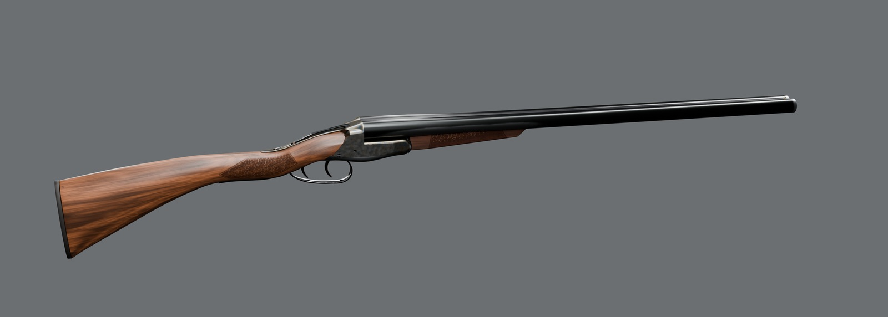
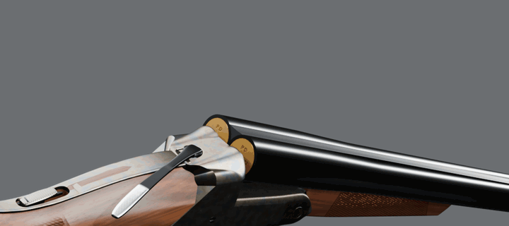
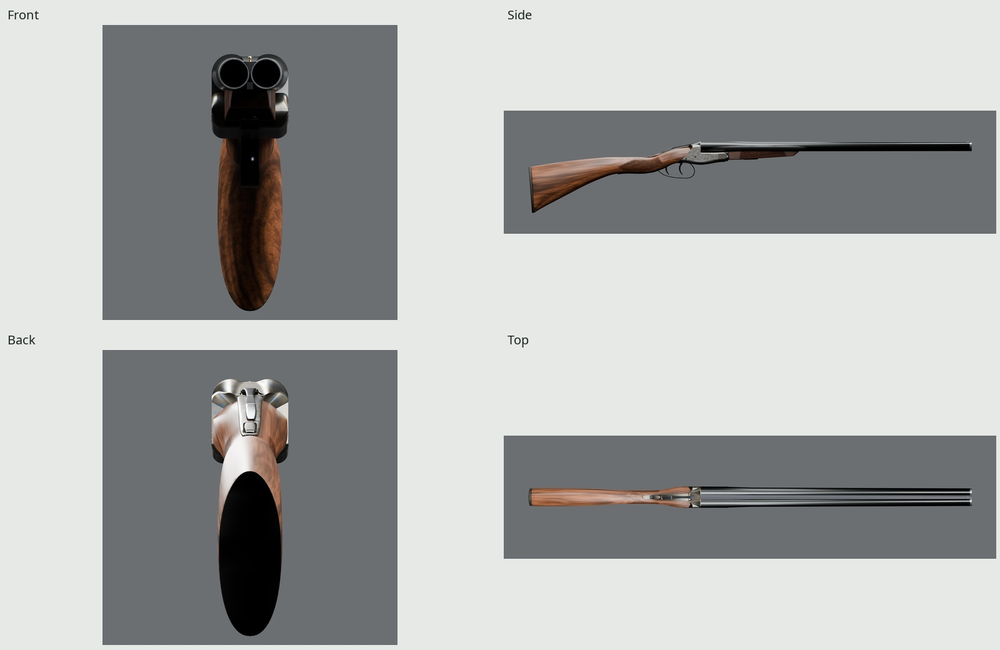
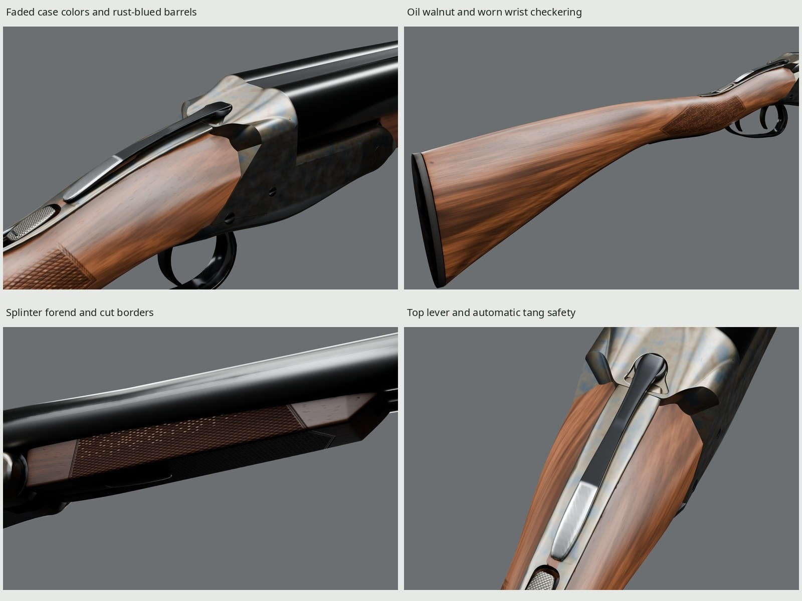
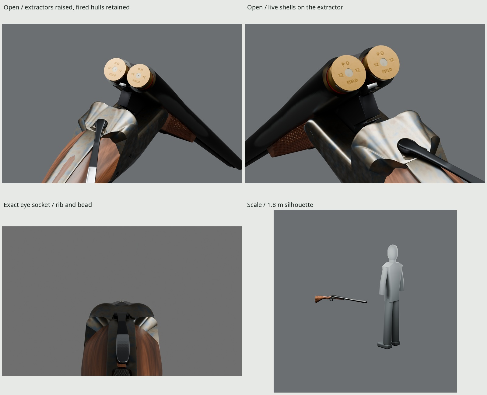
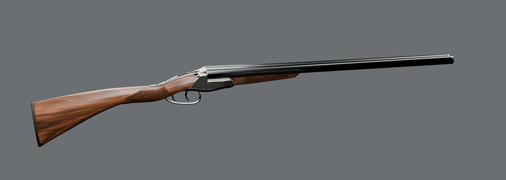

# Propane Defense Covey 26

An original, script-built **boxlock side-by-side 12-gauge shotgun** game
asset. Joined 26-inch barrels, double triggers, extractors, a top lever and
an automatic tang safety sit between a straight-hand walnut stock and a
splinter forend. Rust bluing, faded color-case steel, an oil finish and
localized field wear share one baked 2048 PBR atlas. The maker, model and
markings are fictional; every vertex and texel comes from our Blender scripts.





`Open` → `Reload` → `Close` excerpts at real speed: hull extraction, two shells inserted, then closure.

| | |
| --- | --- |
|  |  |
|  |  |

All five JPGs and the GIF load the exported GLB with its embedded baked
textures. `make` also generates the full-resolution studio stills and a
contact sheet in `renders/final/`. [REVIEW.md](REVIEW.md) retains the photographic
pairs, measured finishes, rejected trials and remaining differences.

## Dimensions and design

| Quantity | Evaluated visual geometry | Published class / design anchor |
| --- | ---: | --- |
| Overall length | 1079.95 mm | brief: about 1080 mm |
| Barrels, rear face to muzzle | 660.40 mm / 26 in | published 26-inch option |
| Overall width / height | 52.20 / 174.34 mm | corrected fence/side envelope; original straight stock |
| Front-trigger length of pull | 369.63 mm / 14.55 in | published 365 mm; original stock is 4.63 mm longer |
| Comb / heel drop | 38.02 / 63.03 mm | published 38 / 63 mm; measured against an actual rib-centerline datum (concave edges rise about 0.22 mm) |
| Cheek station | 35.00 mm behind comb nose | published range 31.75–38.10 mm |
| Eye above actual comb | 42.81 mm | actual surface ray; CPSA coin-rule sight picture, derived below |
| Eye optical pitch | −0.374° | exact line from the socket to the bead |
| Wrist, wood only at Y = −15 mm | 32.20 × 37.89 mm | sharp top/side photographs; absolute reference scale remains uncertain |
| Splinter wood, overall W × D × L | 34.40 × 24.20 × 172.99 mm | plain field photographs; evaluated mesh dimensions, not published part measurements |
| Splinter sections at Y = 211 / 320 mm | 34.16 × 22.54 / 28.24 × 16.16 mm | actual triangle-plane cuts, with barrel channels |
| Ammunition class | 12 gauge, nominal 2¾ in | nominal opened-hull length |
| Unloaded mass | target 3.2 kg, **unmeasured** | field-gun design class; no mass simulation |

The [published class specifications](https://www.ugartecheashotguns.com/shotguns/specifications/)
offer the boxlock, double triggers, extractors, 26-inch barrels and splinter
forend together. Their 38/63 mm comb/heel-drop baseline informs the original
stock. A straight hand keeps the field silhouette lean and permits shifting
the hand between triggers. The slightly longer measured pull is a disclosed
original-design difference. The original ammunition headstamp reads `P D`, `FIELD` and `12`, rasterized
from installed Noto Sans through `kit/fonts.py`; no real markings or engraving
are copied.

The [primary cheek-station instructions](https://www.brownells.com/userdocs/learn/076-200-548_Pull___Drop_Gauge.pdf)
place the cheekbone 1¼–1½ inches behind the comb nose. The accepted station
remains 35 mm behind the nose, at Y=−123 mm. The
[CPSA handbook](https://www.cpsa.co.uk/userfiles/files/CTSH.pdf), printed p. 4-2,
checks a sporting sight picture with a pound coin on the rib 200 mm ahead
of the standing breech: the bead's center just clears the coin. The historical
[round pound is 3.15 mm thick](https://www.royalmint.com/collect/collector-resources/designs-and-specifications/one-pound-coin-designs/).
Extending that line from the actual rib surface and bead back to the accepted
cheek station gives eye Z=60.500 mm, 3.612 mm above the extended rib and
42.811 mm above the actual comb. The local comb drop there is 39.199 mm;
the accepted comb-nose drop remains 38.02 mm. This derives a fitted visual
sight picture; it does not claim an anatomical measurement of a human.

The local primary side-by-side manual supplies its illustrated exterior parts,
double-trigger order, forend iron and controls. Direct sources, photographic
authors/licenses and reference limitations are in [refs/SOURCES.md](refs/SOURCES.md).
Photo landmarks calibrate cameras only; no photo enters modeling or materials.

## Parts and construction

The standing breech is a changing-section body with turned fences, ground
side lands, hollow rear falls and a central milled land. Its dense original
surface is retained for the normal bake. Bushings, cross pins, the flush
trigger plate and the hinge pin remain separate named surfaces. The barrels
are finite tubes with chambers, joined breech skins, top and bottom ribs,
extractor reliefs and under-lumps. The solid top rib carries matting and a
brass bead. The extractor has actual rim seats and rises with the barrels.

The walnut stock and splinter are sculpted subdivision forms with changing
sections, barrel channels and fitted inlets. The forend iron bears on the
knuckle; its inset latch, butt plate, guard bow and rear tang are modeled
parts. Borders, **20-LPI / 1.27-mm** checkering, pores, fine polish, original
markings and local impact relief live in the baked textures. The accepted
17-bone rig, 54 named rigid meshes and 19 clips retain their original pivots.
No part was reshaped for this finish round.

## Materials, measured finishes and wear

Rust bluing starts at linear RGB **.0397/.0427/.0430**, metallic 1 and
roughness **.24**, with a gray carrying rub and thin muzzle wear. The action
uses original blue/straw/brown case oxide, retained around the fences and
bar, fading toward handled silver-gray flats. This follows the used studio
references; their engraving and oxide pattern are never copied. The top
lever and guard retain protected blue and bright hand-contact surfaces.
Safety facets are polished with dark cuts; trigger faces stay blued, with
brighter edges. The bead is brass.

The planed walnut has domain-warped, uneven growth bands, narrower longitudinal
streaks and slow brown drift into the wrist. Fine vessels retain depth with
subdued color. Oil-land roughness starts at **.40 on the stock / .46 on the
forend**, broadening the reflection without a lacquer coat. The accepted
cut-wood substrate, checker pitch, borders, worn point tops and nine causal
wear fields are preserved. Oil reflection remains on lands and flattened tips;
open vessels and cut grooves suppress it.

These are **whole-visible-part measurements of the exported GLB**, with the
same masks and estimated photographic light rigs used before the correction.
L is Rec.709 luminance of encoded sRGB, 0–255; H is the brightest 5% mean.
The primary stock/forend and action references are white-balanced on their
unshadowed neutral gray studio paper. Supplementary metallic neutrals are
estimates, with native rectangles and gains in `build/look-photos/`.
No photograph or measurement supplies an asset texel.

| Finish | GLB L10/50/90 | Balanced photo L10/50/90 | H value, GLB / photo | H RGB, GLB / photo |
| --- | --- | --- | --- | --- |
| Rust-blued barrels | 15.6/28.9/94.4 | 17.0/29.0/86.4 | 145.9 / 153.5 | 142.7/146.7/146.9 / 155.3/153.3/149.8 |
| Faded case colors | 65.2/108.6/144.5 | 61.1/118.5/157.9 | 203.5 / 205.2 | 205.2/203.5/199.1 / 210.8/204.4/196.9 |
| Top lever | 18.8/60.6/187.6 | 20.1/55.3/188.1 | 229.4 / 246.2 | 228.2/229.6/230.6 / 244.6/246.9/243.9 |
| Tang safety | 39.0/68.9/151.9 | 35.9/75.4/147.3 | 206.8 / 200.6 | 208.2/206.8/202.0 / 206.0/199.8/192.5 |
| Triggers | 17.1/25.4/65.0 | 6.1/24.5/61.1 | 111.9 / 110.9 | 112.5/111.4/114.7 / 115.6/109.6/110.2 |
| Trigger guard | 10.4/52.9/173.5 | 11.0/51.3/170.0 | 232.0 / 238.6 | 230.7/232.3/233.5 / 240.5/238.4/234.9 |
| Oil walnut stock | 71.7/110.9/172.5 | 63.7/111.7/176.8 | 185.1 / 201.6 | 206.8/180.2/169.6 / 228.5/196.5/173.3 |
| Oil walnut forend | 37.5/62.1/111.3 | 35.8/57.3/103.5 | 125.6 / 125.9 | 158.1/118.6/100.4 / 158.9/118.9/98.6 |
| Brass bead | 58.6/176.6/222.5 | 68.5/160.8/246.7 | 242.6 / 254.0 | 247.7/242.2/230.8 / 254.9/253.7/254.1 |

The stock and forend pass median ±10%, P10/P90 ±15%, and highlight value and
each RGB channel ±10%. The other accepted finishes retain their results.
**Trigger P10 remains a disclosed miss** on the broad protected blade faces;
its median, upper tail and highlight pass. The older gray-barrel photograph
is supplementary use context and remains a mismatch for the retained-blue
finish. Estimated illumination and different makers' geometry limit material
inference; passing histograms alone do not prove appearance.

Nine independently switchable wear causes remain: **barrel carry, muzzle
rims, action fade, lever thumb contact, guard finger contact, wrist checker
points, forend checker points, stock toe/heel impacts and forend-edge
fractures**. Each stays where handling or impact causes it. The fractures
and checker wear overlap, so their evidence uses separate single-cause-off
bakes. Original fitted hardware is excluded from photographic damage counts.
The complete-part on/off measurements, profiles, sensitivity bands and native
2D masks are generated in `renders/final/wear/` and `wear-native/`.

## Frame, rig and sockets

[Interface 1.7.0](INTERFACE.md) adds break action, two chambers, double
triggers, automatic safety and extractors to the [family contract](../INTERFACE.md).
Meters, palm origin; Blender +Y forward / +Z up / +X right; glTF −Z forward /
+Y up. Internal Root stays identity. Apply stance, recoil and whole-gun motion
to the complete external instance, including all scene-root sockets.

| Moving assembly | Rest pivot / axis, Blender mm | Authored visual range |
| --- | --- | --- |
| Barrels and forend | (0,170,19), X | 0 to −42° |
| Extractor | (0,115,44), rides Barrels | Y 0 to −10 mm |
| Top lever | (0,94,53), Z | 0 to +25° |
| Front / rear trigger | (2.6,64,4) / (−2.6,31,4), X | 0 to −13° |
| Tang safety | guide at (0,5,23), Y | 0 to −5 mm |
| Visible locking shoes | (0,130,13), Y | 0 to −24 mm |
| Live/Hull/Insert displays and guides | head-centered, riding the extractor | explicit chamber states and insertion paths |

All names start with `Socket_`. Scene-root references retain their family
meaning; riding sockets preserve complete position **and orientation**.

| Socket | Rest position, Blender mm | Ownership / use |
| --- | --- | --- |
| Muzzle | (0,775.4,44) | Scene-root effect reference |
| Foregrip | (−18,270,12) | Scene-root support reference |
| Butt | (0,−304.6,−43) | Shoulder reference |
| Eye | (0,−123,60.500) | Optical frame, pitched −0.374° to the bead |
| Ejection | (0,115,44) | Legacy effect reference; this gun does not eject |
| MagWell / Magazine | (0,115,44) | Inactive compatibility references |
| SupportHand | (−18,270,12) | Rides Forend |
| Shell / ShellL | (±12.6,115,44) | Right / left insertion guides |
| ChamberR / ChamberL | (±12.6,115,44) | Rides Extractor; rim/grasp frames |
| MuzzleR / MuzzleL | (±10.9,775.4,44) | Rides Barrels; individual muzzles |

Chamber **0 is right**, chamber **1 is left**. Front Trigger fires right;
TriggerRear fires left. Each chamber is `loaded`, `fired` or `empty`.
Concealed hammer states are manifest data only. Spent hulls remain in the
gun until manually pulled clear: these are extractors, without ejectors.

## Clips and detachables

| Clips | Seconds | Presentation |
| --- | ---: | --- |
| Idle, IdleAfterRight, IdleSpent, IdleSafe | 1/60 each | Explicit closed control/ammunition holds |
| IdleOpenSpent, IdleOpenEmpty, IdleOpenOne, IdleOpenLoaded | 1/60 each | Explicit open chamber holds |
| Fire / FireLeft | .50 each | Right shot, then left; hull retained |
| Open / OpenLoaded | 1.20 each | Lever swings, barrels drop, automatic safety engages, extractor rises |
| Unload | 1.60 | Manual axial hull withdrawal, then hand clearance |
| Reload | 2.40 | Right shell, then left shell; seated handoffs |
| ReloadSingle | 1.40 | Right shell inserted beside an occupied left chamber |
| Close | 1.20 | Extractor home, barrels closed, lever returns and locks |
| Safety / SafetyOn | .50 each | Fire / safe detents |
| Inspect | 3.00 | Loaded opening and closing, ending safe |

The README loop joins excerpts of the three named clips; the manual `Unload`
phase between spent extraction and an empty reload is omitted from this
presentation. Opening begins with the lever swung; the two reload seating
excerpts also omit the air approach and hand-clear gap. All complete clips
remain in the GLB. Each has complete boundary
keys; shell ownership changes use STEP visibility at a coincident seated
transform. No hand mesh ships. The consumer owns hand IK, arbitrary mixed
chamber states, external hull handoff and ammunition bookkeeping.
`interrupt()` retains `{version,clip,frame,state}`: hold that pose and resume
that exact clip/time. Do not jump to closed Idle during an interrupted motion.

`export/shell.glb` and `export/hull.glb` are standalone, head-centered,
+Y toward the mouth in Blender. Their own three-map **512** subsets preserve
atlas density **1.000**, RGB16 normal precision, tangent frames, material
factors and trilinear/repeat samplers. The kit copies integer atlas
neighborhoods with **8-pixel aligned guards**; it neither rotates nor resamples
the copied pixels. Surface and pointwise L0–L3 mip checks compare each subset
against a full-atlas export at its actual bone frame. The shared shell exterior
matches the pump's class. See [detachable delivery](../DETACHABLES.md).

## Budget and delivery

| Output | Triangles | Materials | Three-map pixels | GLB bytes |
| --- | ---: | ---: | ---: | ---: |
| Gun, including staged ammunition | 38,822 | 1 | 2048 | 19,369,020 |
| Live shell | 752 | 1 | 512 | 624,492 |
| Fired hull | 480 | 1 | 512 | 742,316 |

The accepted **38,822 / 39,000** allocation includes hidden staged ammunition
alternatives. Its extra construction detail above the original 35k planning
target was accepted with the form. No triangle was added for the oil finish.
The 54 named rigid mesh nodes retain one shared material; material count does
not imply that an importer batches them into a single draw call.

The GPU source bake is **4096, 32 samples**, shipped at **2048**. BaseColor is
sRGB RGB plus linear opaque reflection data in alpha. OpenGL normals use +Y;
ORM is R occlusion / G roughness / B metallic.

| Canonical 2048 PNG | Storage | Bytes |
| --- | --- | ---: |
| `T_Covey26_BaseColor.png` | RGBA8 | 3,236,682 |
| `T_Covey26_Normal.png` | RGB16 | 10,542,965 |
| `T_Covey26_ORM.png` | RGB8 | 2,612,523 |

**Why the normal ships RGB16:** reducing it to eight bits introduced visible
stepped reflection bands across the turned, hollow-falling action head.
The original 4096 normal is filtered as normalized vectors and retains 16-bit
channels at 2048. This costs more PNG/GLB bytes while keeping the same atlas,
material and resolution. Normal compression must preserve those smooth
reflections in the target importer. Three ordinary 8-bpp compressed maps with
mipmaps would cost about **16 MiB**; actual RGB16 importer storage depends on
format handling. Each separate 512 subset is about **1 MiB** under the same
compression assumption.

`KHR_materials_specular` reads effective reflection strength from the same
opaque BaseColor image's alpha, adding a texture view rather than another
image. Preserve this extension and imported PBR materials/samplers. Alpha is
data, not coverage; importers that ignore it lose the porous wood response.

## Rebuild and proof

Requires installed Blender 5.2, Python/Pillow/NumPy/Matplotlib, fontconfig,
Noto Sans, GNU make, flock and ffmpeg for the GIF. All source materials and
lighting are procedural. Downloads are cited photographs/PDFs for local
comparison; no downloaded code, model, texture or HDRI is used.

```sh
make -C guns/sxs                 # model → UV → 4K bake → 2K maps → three GLBs
                                # → checks → final evidence → five docs JPGs
make -C guns/sxs check           # source and fresh-import construction/serialization
make -C guns/sxs gif             # shared tool, exported GLB, real-speed clip sequence
make -C guns/sxs docs            # hash-checked final JPGs and contact sheet
make -C guns/sxs sections match  # archival form/reference measurements
make -C guns/sxs reflections     # source/export diagnostic reflection bands
python3 kit/repo_check.py
```

Defaults are `WIDTH=4000`, `SAMPLES=48`, `BAKE_SAMPLES=32`. Every Cycles
bake/render uses the kit GPU lock; scratch stays in ignored `build/`.
The GIF is opt-in; [src/gif.json](src/gif.json) owns camera, excerpts and palette.
[Family GIF conventions](../GIFS.md) list decoded delivery/timing.

| Generated path | Evidence |
| --- | --- |
| `export/{sxs,shell,hull}.glb` | Rigged gun and standalone ammunition |
| `textures/` | Three canonical shipped PNGs and size report |
| `build/serialization.json` | Raw GLB and fresh-import scale, UV, normals, rig, clips, contacts and subsets |
| `build/check.json`, `build/import-check.json` | Independent source/import motion-clearance and assembly probes |
| `build/delivery/detachable-proof.json` | Full-atlas / subset density, surface and mip comparison |
| `renders/final/beauty/`, `eevee/` | Cycles and Eevee from the baked exports |
| `renders/final/contact-sheet.jpg` | Every studio, finish, wear and family panel |
| `renders/final/docs-contact-sheet.jpg` | Gun studio stills, including scale and Eevee |
| `renders/final/look-review/`, `source/` | Balanced-photo / export pairs and separately labeled source bake-loss comparisons |
| `renders/final/wear/`, `wear-native/` | Nine cause-off differences and native 2D comparisons |
| `build/docs-report.json`, `build/gif/report.json` | Output sizes, hashes, image provenance and decoded GIF timing |

Source and fresh-import checks independently sample actual hook/pin,
knuckle/iron, breech, locking-bite, rim/extractor and control-seat surfaces.
The lever is additionally swept at 51 angles, 0.5° apart. All 19 clips have
half-frame clearance samples; these are sampled checks, not a continuous
collision certificate. The separate 1,715 affine samples and deterministic
rebuild prove serialization/repeatability rather than physical correctness.
No test substitutes for the rendered photographic pairs.

## Credits and remaining limits

Every mesh, relief, texel, mark and studio light is original scripted output.
[refs/SOURCES.md](refs/SOURCES.md) records published class specifications,
the primary illustrated manual, fitting references, Commons photos and
comparison-only studio photography, with authors and licenses. Markings use
installed Noto Sans under the SIL Open Font License. Reference images are
neither redistributed nor baked into the asset.

The accepted open-camera residual is **2.469 mm**; the top wood-line residual
reaches **3.293 mm** on another maker's gun. The fitted eye height derives
from the sporting coin-rule sight picture, not a human anatomical measurement.
The trigger low-tail miss remains. Case oxide placement differs, and fine
safety cuts, lettering and pores soften at delivery resolution. Estimated
neutrals and photographed lighting limit exact material inference.
This exterior visual asset omits concealed working lockwork and provides
neither a physical firearm design nor an anatomical hand fit.

No kit, shared gun module or other gun implementation changes are required
by this finishing round.
