# Hearthfield / seeded American houses

Four types of maintained American houses, each generated from seeds into many different houses and delivered as
glTF on one shared family of baked tiling sets and a trim sheet, with moving doors and ground sockets. All geometry
and texture pixels are generated by scripts in Blender 5.2.

<table>
<tr>
<td align="center" width="50%"><a href="#first-type-builder-colonial">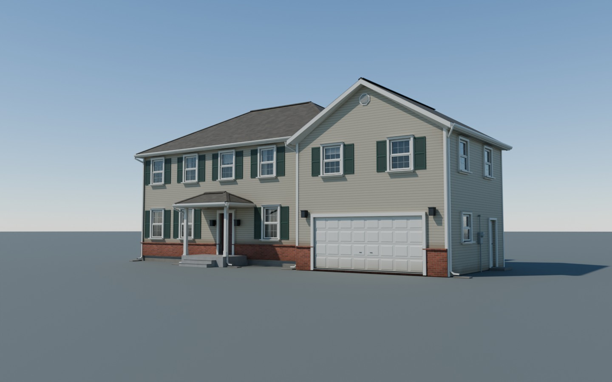</a><br><a href="#first-type-builder-colonial"><b>Builder colonial</b></a><br>two stories, room over the garage</td>
<td align="center" width="50%"><a href="#second-type-postwar-ranch">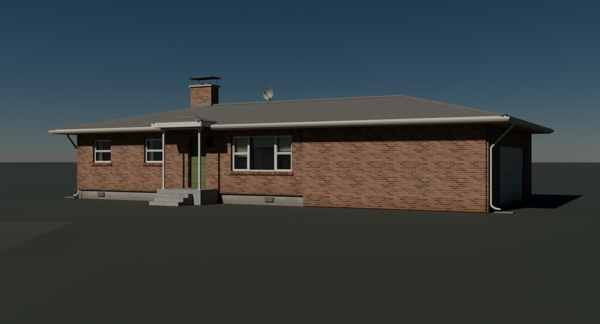</a><br><a href="#second-type-postwar-ranch"><b>Postwar ranch</b></a><br>one story, 1955–1975</td>
</tr>
<tr>
<td align="center" width="50%"><a href="#third-type-postwar-cape-cod">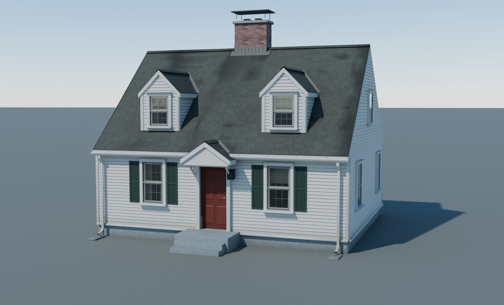</a><br><a href="#third-type-postwar-cape-cod"><b>Postwar Cape Cod</b></a><br>one and a half stories, 1940–1955</td>
<td align="center" width="50%"><a href="#fourth-type-split-level">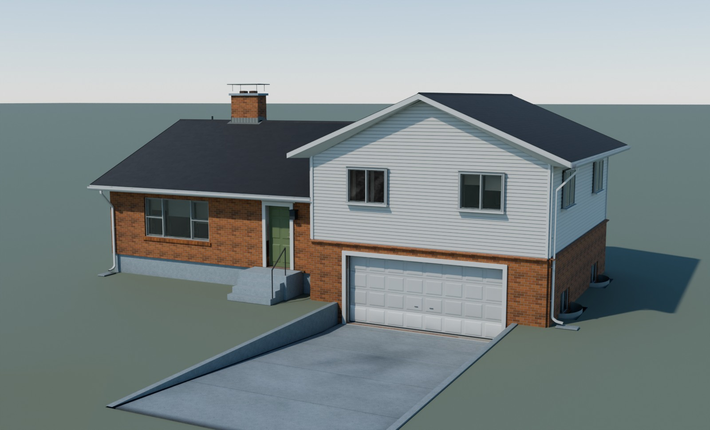</a><br><a href="#fourth-type-split-level"><b>Split-level</b></a><br>side-splits and a raised ranch, 1955–1975</td>
</tr>
</table>

## First type: builder colonial

An original family of maintained, roughly twenty-year-old American builder
colonials: two stories, a room over an attached double garage, vinyl lap
siding, architectural shingles and optional front brick veneer. All geometry
and texture pixels are generated by scripts in Blender 5.2.


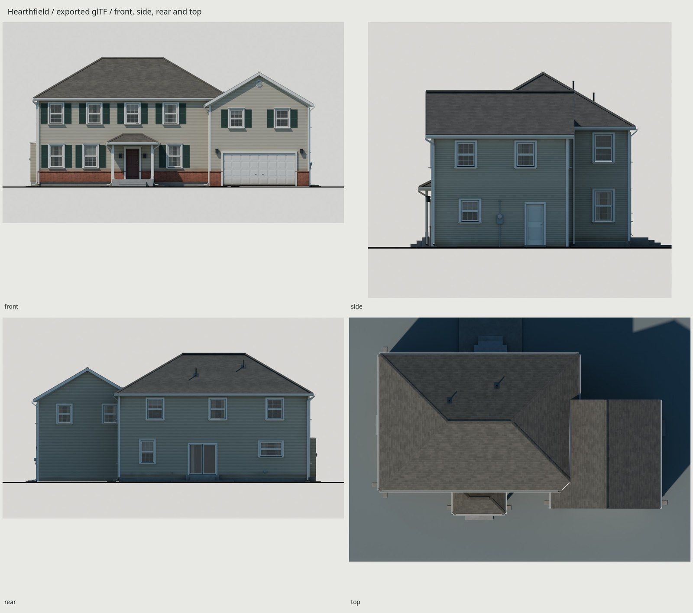

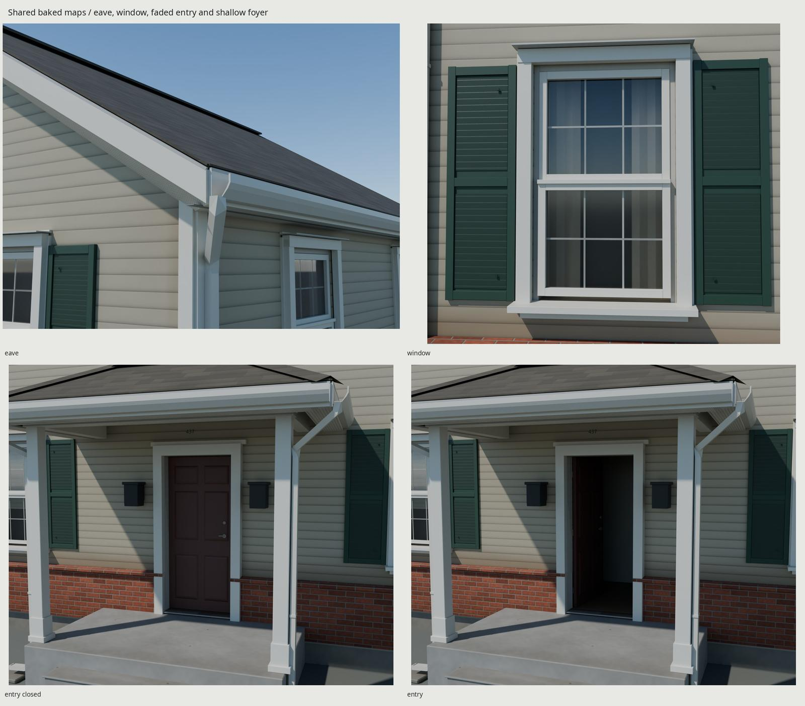

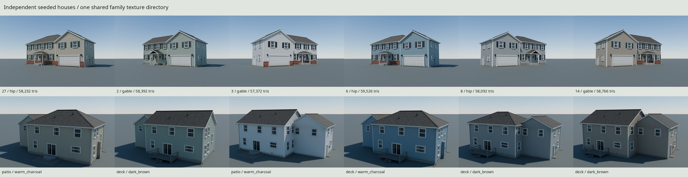

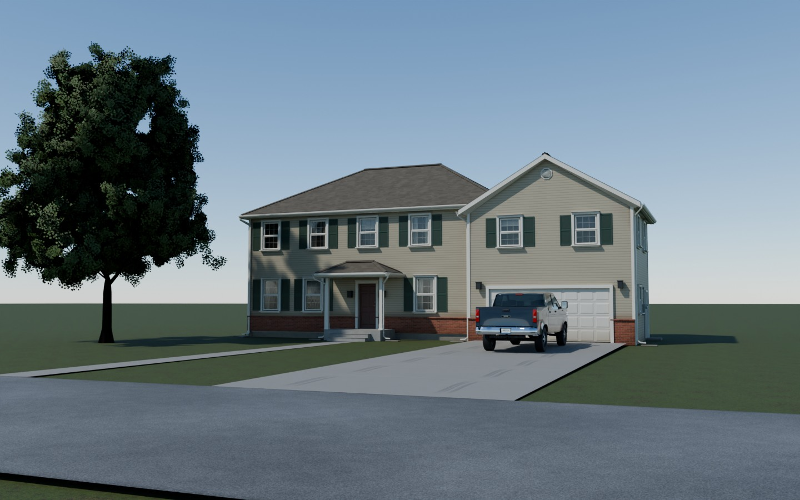

Every house view above imports the delivered glTF and its baked maps. The
street loads the other families' own exports for presentation only. After
building, contact sheet (`renders/final/contact.jpg`), scale shot (`renders/final/scale.png`),
Eevee hero (`renders/final-eevee/hero.png`), and photo pairs (`renders/final-matches/pairs.jpg`)
provide the full evidence. [REVIEW.md](REVIEW.md) records construction, source
look and four delivery critiques. [REFERENCE.md](REFERENCE.md) separates
published dimensional references from authored dimensions and measured checks.

### Generator and construction

Inputs are a seed and optional JSON plan. Two two-story rectangular blocks and
a portico form the supported grammar. Builder choices include 38/40/42 ft main
widths, 26/28/29 ft depths, 22/23/24 ft garage dimensions, 4/5/6 ft projection,
garage left/right, main hip/gable at 6/7/8:12, four/five upper-front bays,
hip/gable portico, front veneer coverage and six restrained palettes. The garage
roof remains a front gable. Arbitrary footprints, dormers and other house types
remain outside this grammar.

The rear now shows a 6 ft kitchen slider, short high sink window, family-room
window and varied bedroom rhythm. A side stair window spans the nominal upper
floor inside a reserved stairwell; ordinary windows retain floor/header clearance.
The garage has a side service door. Odd seeds use a concrete patio; even seeds
use a low timber deck with steps. Seeds divisible by three have a single-story
direct-vent gas-fireplace chase, below the upper windows, without a new roof
penetration. Both new doors have separate moving leaves.

Accepted recessed openings, cheeks, casings, J-channel, sloped sills, offset
sashes, grilles and half-window-width shutters remain geometry. Curtains and
seeded blind heights sit behind the glass, with a dim backing about 290 mm
beyond it. The lower sash has effective insect-screen coverage. An octagonal
louvered garage vent is added; the accepted stoop remains. A full-width porch
was deferred because it would change the accepted roof/entry arrangement.

Roof envelopes retain real thickness, overhangs, boxed soffits, fascia, drip
hems, shingle edges, caps, ridge vent, flashing, plumbing boots and resolved
valleys. The hip intersection retains its tapered cricket and falling valleys.
K gutters fall .25% to supported downspouts, elbows and splash blocks. Covered
adjoining walls/roofs are clipped away. The garage room remains .406 m below
the main upper floor, with three internal steps reserved at the connection.

| Seed 27 feature | Authored dimension |
| --- | --- |
| Main block | 12.8016 × 8.5344 m / 42 × 28 ft |
| Garage | 6.7056 × 6.7056 m / 22 × 22 ft, right side |
| Garage projection / overlap | 1.2192 / 1.2192 m |
| Main finished floor / upper floor | .508 / 3.556 m |
| Main ceiling modules | 2.7432 / 2.4384 m / 9 / 8 ft |
| Garage slab / upper floor | .1016 / 3.150 m |
| Main / garage roof | Hip / front gable, 7:12; .3048 m overhangs |
| Main ridge / cap envelope | 8.636 / approximately 8.699 m |
| Ground / upper front windows | .9144 × 1.524 / .9144 × 1.3716 m |
| Sink window / sill above grade | 1.524 × 1.016 m / 1.700 m |
| Stair window / sill above grade | .686 × 1.4224 m / 2.600 m |
| Front / patio / service door | .9144 / 1.8288 / .8636 m wide; 2.032 m high |
| Closed garage door | 4.8768 × 2.1336 m / 16 × 7 ft |
| Front / rear landing | .480 m top; 28 mm below threshold |
| Patio / deck | 4.2672 × 3.100 / 4.2672 × 2.4384 m |
| Shallow foyer floor | 2.25 m wide × 1.98 m deep |
| Column / window casing | .1397 m square / .0889 m wide |

### Shared delivery and engine use

Delivery is **one stock `.gltf` + geometry `.bin` per seed, with one shared
`export/textures/` directory**. No image is embedded in a seed's geometry.
Preserve this relative layout when copying the family:

```text
export/
  Hearthfield-27.gltf
  Hearthfield-27.bin
  Hearthfield-27.json       # optional measured/generator metadata
  Hearthfield-2.gltf
  Hearthfield-2.bin
  ...
  textures/
    T_HouseSiding_{BaseColor,Normal,ORM}.png
    T_HouseShingles_{BaseColor,Normal,ORM}.png
    T_HouseVeneer_{BaseColor,Normal,ORM}.png
    T_HouseConcrete_{BaseColor,Normal,ORM}.png
    T_HouseTrim_{BaseColor,Normal,ORM}.png
```

Load a seed's glTF, retain its imported materials and vertex colors, and
instantiate its hierarchy. Resolve image URIs relative to the glTF and cache
textures by their canonical resolved URI plus color-space/sampler settings.
All colonials then refer to the same fifteen image resources; do not bake each
house into a separate texture atlas or make per-instance texture copies.
An importer that packages textures into private resources per scene must be
configured to retain/reuse these external resources. The build's actual
Blender multi-import test loads all six seeds plus a repeat and keeps **fifteen
image datablocks by identity**, demonstrating in-memory reuse in a stock importer.
Other engines' import settings are not claimed to have been measured.

The only extension is standard `KHR_materials_transmission` for glass.
BaseColor is sRGB; tangent Normal is linear OpenGL +Y; linear ORM is occlusion
in R, roughness in G and metallic in B. Samplers repeat. Glass uses the trim
images, Fresnel IOR 1.5, variable blinds/curtains and lower-pane screen coverage.
An engine should enable its ordinary glass transmission/reflection support;
Eevee's evidence uses screen ray tracing and an explicit 4 mm pane
thickness, avoiding its default thickness derived from the joined building. No custom runtime shader is required.

The engine adds distance LODs, simple building collision, navigation and
interactive door behavior. Treat the house as an exterior shell with shallow
window backings and a foyer, not a playable floor plan. Keep the three moving
leaves separate. Collision should follow the openings and landings without
paying for siding, gutter or sash detail. The house export contains no terrain,
scale figure, camera, lighting, pickup or tree.

### Baked materials, density and weather

Five sets serve at most six materials: Siding, Shingles, Veneer, Concrete,
Trim and Glass. A house without veneer omits that material and its three map
references. All five original fields are generated at **4096²**, GPU Cycles
flat-baked at their physical coverage, then filtered in linear color,
vector-normal and roughness RMS space to the mixed delivery sizes below.
Normals retain 16-bit precision before final filtering. This is an actual
periodic material bake, not a whole-house unique-atlas projection bake.

| Shared set | Delivered size | Physical repeat / measured median density | Compressed GPU estimate |
| --- | --- | --- | --- |
| Neutral vinyl | 1024² | 2.4384 m / 420 px/m; 101.6 mm courses | 4 MiB |
| Architectural shingles | 2048² | 4.8768 m / 420 px/m; 143.4 mm courses | 16 MiB |
| Red-brown modular brick | 512² | 1.2192 m / 420 px/m | 1 MiB |
| Poured foundation | 512² | 2.4384 m / 210 px/m | 1 MiB |
| Trim atlas | 2048² | 4 m U repeat / 512 px/m | 16 MiB |
| Glass | Reuses trim | 470 px/m | No extra images |
| **Colonial allocation** | **15 PNGs / 16,072,463 bytes** | **One shared directory** | **38 MiB** |

Memory assumes engine BC7 BaseColor, BC5 Normal, BC7 ORM and full mipmaps;
PNG delivery alone does not apply GPU block compression. The stock Blender
import test holds 114 MiB of RGBA8 pixel data before mipmaps, independent of
house count. A no-veneer house alone needs 37 MiB under the stated compression.

UV density is measured from triangle UV/world area, weighted by surface area.
Trim p10/median/p90 is 238/512/512 px/m; broad room backings use less density.
Tiled overlap is intentional. Each trim face stays within one finish strip;
zero-area UVs are rejected, including roof thickness edges. No unique-atlas
non-overlap claim applies to repeated material tiles.

Vinyl has butt relief, overlap shadow, fine emboss and stud-period waviness.
Unshadowed warm-white linear factors remain below .70. Neutral shingle maps
average about .10 linear; seeded `warm_charcoal`, `weathered_wood` and
`dark_brown` factors produce realistic muted granule blends. Mortar is recessed;
brick colors vary in red-browns. Concrete has form ties and a parged upper
edge. The eight trim strips cover paint, louvers, soffit perforations, timber,
blinds, painted/bare metal, clear glass and screened glass.

Service age ships in ordinary **normalized RGBA8 `COLOR_0`**, multiplied by
the common BaseColor maps. Local surface samples carry brown splash on the
first two or three exposed siding courses and foundation, gray-green algae
on north (+Y) roof planes weighted below the ridge, corner runoff, downspout
foot stains, garage-bottom dirt, dirty/worn step nosings and faded door paint.
Masks follow height, exposure, water routes and contact, with irregular
boundaries. No extra weather texture, material, decal or custom shader is
allocated. Per-house aging changes albedo; fine roughness stays in shared maps.
The 1440 px hero, back, details and summer photo pair calibrate its visibility.

### Budgets and checks

The accepted seed 27 construction is 47,750 triangles; delivered weather samples
bring it to **58,232**, within the 40–60k target and 80k hard limit. Each house
has four meshes: fixed shell and three moving leaves. Material primitives are
nine without veneer, ten with it. Geometry/JSON file bytes exclude shared images.

| Seed | Triangles | Materials | glTF + bin bytes |
| --- | ---: | ---: | ---: |
| 27 | 58,232 | 6 | 5,085,829 |
| 2 | 58,392 | 5 | 5,176,730 |
| 3 | 57,372 | 6 | 5,015,924 |
| 6 | 59,526 | 6 | 5,242,532 |
| 8 | 58,092 | 5 | 5,102,699 |
| 14 | 58,766 | 6 | 5,191,888 |

The six geometry/JSON pairs total **30,815,602 bytes**; with the shared PNGs,
**46,888,065 bytes** (44.72 MiB), excluding optional metadata. Every additional
unique house adds roughly 5 MB of geometry; instances of a loaded seed reuse
its geometry and textures. The former 8.9 MB untextured checkpoint lost an
accidental second UV, unused tangents and float color overhead. Positions,
hard normals and UV0 remain float32. Clients generate normal-map tangents.

`make check` passes separate gates with explicit scopes:

| Evidence in `build/` | What it proves |
| --- | --- |
| `plan-sweep.json` | 1,000 plans: floor/header spacing, stairwell reservation, roof partitions and falling valleys; six invalid controls rejected |
| `mesh-check.json`, `seeds/checks.json` | Actual construction surfaces, roof/opening/service rays, mounting, landings and sockets; six forms, authored override and repeatable geometry/GLB bytes |
| `motion.json` | Actual front 0–105°, service 0–100° and slider 0–.8382 m sweeps, .5 mm tolerance, no reported penetrations or exemptions |
| `delivery-check.json` | Six final source surfaces, raw glTF counts/normals/tint/UVs, fresh import positions and pivots, common external image paths and real importer image reuse |
| `clean-delivery-repeat.json` | Clean-build geometry byte identity and GPU map repeatability within the kit tolerance |
| `texture-check.json` | Source-map dimensions, finite pixels, normal lengths and shingle albedo; delivery report separately checks baked maps and source/ship loss |
| `final-view-check.json` | All final views reference current geometry **and shared image** hashes; silhouette tonal/clipping check; street context hashes |

Bake BaseColor mean absolute encoded differences are .00002–.00227 across
the five filtered sets; normal differences are larger at mortar/lap transitions,
with .00002–.00766 mean channel error. These image statistics do not prove the
look: source and exported photographic pairs provide that comparison.
The fixed photographic residuals remain 3.34 / 4.12 / 8.48 px RMS. The summer
fit is a weaker type comparison and reaches the 100 mm lens bound; it is not
a surveyed copy. References stay local and never enter textures or docs.

### Frame, doors and ground sockets

Meters; Blender +Z up and −Y front. Export converts `(x,y,z)` to `(x,z,-y)`.
The grade origin remains centered on the accepted wall-line/stoop footprint;
overhangs, splash blocks and rear patio/deck attachments are outside that datum.
The garage sectional door is closed.

| Seed 27 node | Blender position / motion |
| --- | --- |
| `FrontDoor` | (−3.1964, −2.96315, .514); room-side hinge, +Z 0–105° |
| `PatioDoor` | Track/leaf-base origin; +X 0–.8382 m translation |
| `ServiceDoor` | Actual hinge; +Z 0–100° on right garages, −100–0° on left |
| `Socket_FrontThreshold` | (−2.7432, −3.21615, .508) |
| `Socket_Walk` | (−2.7432, −5.41825, 0) |
| `Socket_GarageApron` | (5.7912, −4.46535, .1016), 4.8768 m clear width |

Other seeds emit their own coordinates. Walk and driveway pieces from `ground/`
meet these sockets; the house includes no terrain or driveway.

### Generator inputs and rebuilding

Inputs are an integer seed and optional JSON plan. Default proofs are
`27,2,3,6,8,14`; the plan sweep tests seeds 0–999. Other integer seeds are
supported by the same bounded grammar, without a claim that an infinite range
was exhaustively tested. The seed varies dimensions and assembly choices
within the ranges above, six facade palettes, shingle color, blinds, landing
and fireplace. An override controls `main`, `garage`, `bays`, `porch`, face
`cladding`, linear `colors`, `shingle_color`, `rear_landing` and `fireplace`.

For example, save a plan containing
`{"garage":{"side":"left"},"shingle_color":"weathered_wood","rear_landing":"deck","fireplace":true}`.
Unsupported stories, roof forms or cladding values fail the grammar's bounds.

Existing Blender 5.2, Python with Pillow/NumPy, fontconfig and flock are required.
Every Cycles operation uses the kit GPU lock; no downloaded code, lighting or
texture assets are used. From this folder:

```sh
make                            # full six-house delivery, checks and finals
make check                      # construction, motion and final delivery checks
make export                     # family geometry and shared baked PNGs
make export COUNT=20 START_SEED=100  # twenty houses, seeds 100–119
make export SEEDS=1,10,27        # an explicit set; no presentation required
make export SEEDS=27 PLAN=build/my-plan.json
make final-render final-seeds final-matches street
make docs                       # contacts, current-view proof and five final JPGs
make refs                       # ignored reference photos/PDFs only
make checkpoint                 # historical construction presentation
make lookdev-model lookdev-matches  # analytic source comparison
make clean                      # remove generated houses outputs, then rebuild
```

For nondefault full presentations set `SEED` to a member of `SEEDS` (or the
`COUNT` range); its house supplies the hero and camera fit. Family exports
use their own centered grade origins and preserve per-house socket metadata.
`make street` rebuilds the ground, maple and pickup exports in their own
folders when needed. It instances/transforms them for one 1.68 m eye-height
Cycles shot, never joins them into the house or re-exports them. A distant
presentation plane reuses the ground lawn material. The actual driveway/walk
surface contacts are recorded in `renders/street/provenance.json`.

The additive kit change is `flat_bake.py --height-distance`, defaulting to the
existing .004 m behavior. Houses pass their generated physical height ranges;
other assets retain their existing bake behavior.

The weakest parts remain simple sky reflections and shallow room backings,
regular architectural edges, a visibly procedural landscape, and slightly
smoothed fine granules after filtering. Full interiors, arbitrary footprints,
dormers, full-width porches, stone veneer, engineered structure and permit
compliance are outside this grammar.

Credits and reference licenses: [refs/SOURCES.md](refs/SOURCES.md). Private
home references retain only direct image URLs and generic descriptions; no
street addresses, listing pages or agents' names remain in the tracked tree.
A renewed Commons search added period context; its more complex architecture
could not replace the accepted vinyl-house comparison cameras. The house
numbers are fictional and use installed DejaVu Sans. Every house vertex and
texture pixel is authored here.

---

<!-- LOD checkpoint: begin -->
### Additional LODs

`make lod` builds additional core glTF/BIN files and a manifest under `export/lod/`; `make check-lod` checks them. The existing delivery is immutable LOD0. Default `make` and `make check` retain their original build graph.

| Level | Triangles / target | Materials / draw calls | Geometry bytes | PNG bytes | Total load bytes | GPU unique textures + mesh, MiB | Switch height / distance |
| --- | ---: | ---: | ---: | ---: | ---: | ---: | --- |
| LOD0 | 58,232 / — | 6 / 10 | 5,085,829 | 16,072,464 | 21,158,293 | 38.000 + 4.8366 | near |
| LOD1 | 31,774 / 23,293 | 6 / 10 | 3,090,329 | 16,072,464 | 19,162,793 | 38.000 + 2.9342 | 30.0% / 25.11 m |
| LOD2 | 21,092 / 8,735 | 6 / 10 | 1,822,295 | 16,072,464 | 17,894,759 | 38.000 + 1.7249 | 12.0% / 62.78 m |
| LOD3 | 1,798 / 1,800 | 1 / 1 | 95,808 | 392,829 | 488,637 | 1.333 + 0.0880 | 4.5% / 167.41 m |

Chain check: False; image check: False; normal check: True.


Whole-chain resident GPU estimate: **48.918 MiB**, versus LOD0 alone **42.837 MiB**. Unique textures 39.334 MiB = 38.000 MiB original + 1.333 MiB proxy/impostor; all meshes 9.5837 MiB. Increase over LOD0 6.081 MiB = 1.333 MiB far maps + 4.7471 MiB additional mesh buffers. Intermediate new images: 0. Bind intermediate primitives to the canonical LOD0 material resources; the manifest records full image hashes and source image indices. Identical embedded/external PNG bytes require this resource binding to share GPU allocations, including duplicate original image entries. GPU columns deduplicate complete image hashes within each row; PNG/dependency bytes retain physical payload copies. Optional camera-facing impostor is a separate alternative; engine overhead is excluded.

Distances are to the bound center at 60° vertical FOV / 1080p. GPU figures estimate 8-bpp block-compressed textures with full mips plus raw accessor mesh bytes, before engine overhead. Per-level map bytes describe dependencies, including reused originals. The whole-chain estimate deduplicates canonical image resources. Targets and achieved counts are reported separately; a count alone does not establish visual acceptance.

Load these files as alternatives and configure Godot visibility ranges, Unity LODGroup renderers, or Unreal mesh/component LODs. Keep matching near pivots in the same pose during switching. [Engine sources, pixel thresholds and texture policy](../kit/LOD.md).

Near levels consolidate static parts by material and simplify moving parts while retaining names, pivots, sockets and animation data. Both intermediate levels preserve original charts, attributes and LOD0 materials. The final proxy merges all moving geometry in its rest pose: its retained transform names are placement/socket metadata, and cannot animate that shell. Keep an animatable level while an interaction pose differs from rest. Only the proxy receives new charts baked from the immutable delivered maps and shaders. LOD1/2 allocate no additional images.

Native-pixel LOD0/adjacent strips, amplified differences, close views and measured image status: `renders/lod/` (`contact.jpg`, `metrics.json`). Raw checks: `export/lod/check.json` and `normals-vs-lod0.json`; per-level construction/pruning decisions: `build/lod/<source stem>/simplification.json` and manifest assembly receipts. [Critique, target misses and known failures](../kit/LOD_REVIEW.md).

Shipped PNG dimensions: LOD0: 6 × 512×512, 3 × 1024×1024, 6 × 2048×2048; LOD1: 6 × 512×512, 3 × 1024×1024, 6 × 2048×2048; LOD2: 6 × 512×512, 3 × 1024×1024, 6 × 2048×2048; LOD3: 4 × 512×512.

LOD1 separate moving meshes: `FrontDoor_Leaf`, `Patio_Slider`, `ServiceDoor_Leaf`.

LOD2 separate moving meshes: `FrontDoor_Leaf`, `Patio_Slider`, `ServiceDoor_Leaf`.

<!-- LOD checkpoint: end -->

## Second type: postwar ranch

A seeded 1955–1975 one-story ranch, maintained through about 55 years of
service. The accepted source construction, period windows, broad eaves,
chimneys and causal aging now ship as stock glTF with baked shared maps.


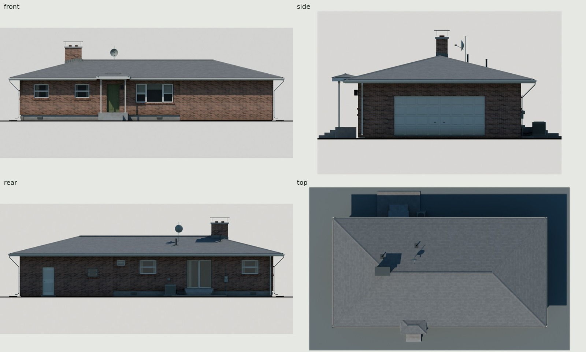

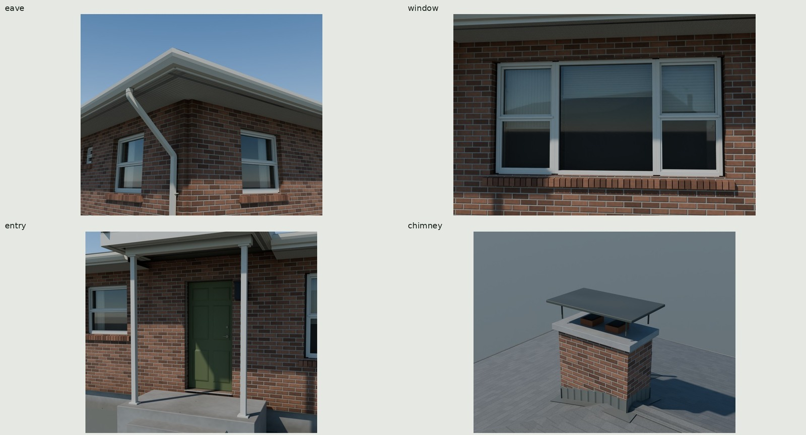

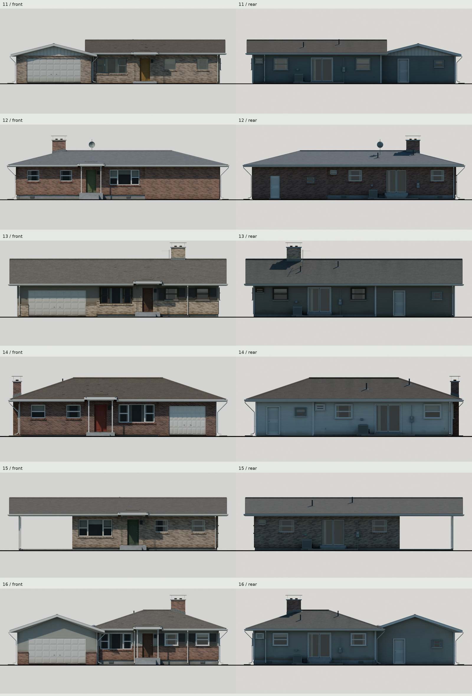

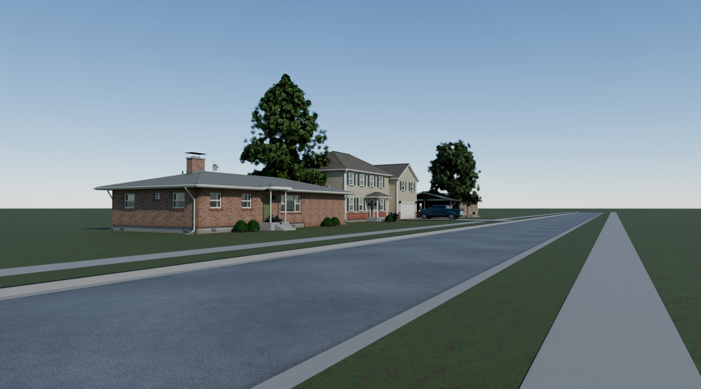

Every ranch image imports `export/HearthfieldRanch-<seed>.gltf` and its shared
maps. The street also imports the ground, red maple, pin oak, boxwood/hydrangea
and pickup families' own exports, for presentation only. It does not change or
re-export them. Full contact (`renders/ranch/final/contact.jpg`),
roof sheet (`renders/ranch/final/roofs.jpg`),
1.8 m scale (`renders/ranch/final/scale.png`),
Eevee (`renders/ranch/final-eevee/hero.png`) and
exported photo pairs (`renders/ranch/final-matches/pairs.jpg`) are local build
outputs. Measured eave band (`renders/ranch/final/hero-band-measurement.jpg`),
seed 11 before/after (`renders/ranch/revision2/compare/11/before-after.jpg`) and
seed 13 before/after (`renders/ranch/revision2/compare/13/before-after.jpg`)
show the final lighting and weather-sample reduction. [REVIEW.md](REVIEW.md)
records the delivery critiques and subsequent revision; reference photographs
never enter the delivered art.

The hero's front-directed sun is about 36° high. Three rendered wall profiles
measure a median .644 m / 25.3 in shadow band, 43.9 pixels at 1440 px width.
Band display Y′ is .0469, versus .0384 on shaded side masonry; the complete
ground shadow stays in frame. These are measured rendered values, not albedo.
The street camera sits 1.68 m above an actual imported sidewalk surface.
The closest ranch spans 37.5% of frame width; the colonial and second ranch
recede along native road, curb, planting-strip and sidewalk modules.

### Parameter and real construction

`generate(seed, overrides=None, house_type='ranch')`, `load(seed, plan,
'ranch')`, CLI `--type ranch`, or JSON `{"type":"ranch"}` select this type.
Omitting type still selects `builder_colonial`, with the same colonial RNG
sequence and byte-checked construction. Ranch plan keys include `main`,
`garage`, `floor`, `foundation`, `wall_mix`, `brick_color`, `battens`, `shutters`,
`chimney`, `window_update`, `roof_age`, `aerial`, `shingle_color` and `colors`.
Invalid bounded plans fail rather than generating unsupported structures.

| Authored feature | Range / construction |
| --- | --- |
| Width including garage | 44–60 ft permitted; 48–60 ft seeded |
| Depth including shallow L | 24–30 ft |
| Ceiling | 8 ft / 2.4384 m |
| Finished floor | 8/12/16 in above grade on slab; 24 in on vented crawlspace |
| Main roof | Side gable or hip; 3/4/5:12 |
| Clear front eave beyond masonry | 18 in on 11; 24.165 in on 13/16; 27.165 in on 12/14/15 |
| Picture unit | 9 × 4½ ft; fixed center with operable flanking sashes |
| Bedroom / bathroom unit | 42 × 40 / 24 × 16 in; 40 / 64 in sill above floor |
| Brick sash recess | Measured 97.5 mm / 3.84 in |
| Rowlock / lintel | Measured 8.67° slope / 4 mm steel angle |
| Modular brick | Three courses per 8 in; actual delivered-map measurement in the value report |
| Fireplace shaft | 4 × 2 ft, crown, liners, cap and roof-plane-clipped flashing |
| Entry | Supported slender square or iron columns; landing 28 mm below threshold |
| Parking | One/two cars, left/right, front/side entry; garage or open carport |

These are original authored dimensions informed by the authorities and period
photographs in [REFERENCE.md](REFERENCE.md), not surveyed copies of private
homes. Most roof-datum projections are 27/30 in, allowing for proud brick;
clear depth above is measured against the actual veneer surface. Continuous
rectangles have one roof envelope; projecting garages use clipped intersections.

The ranch reuses the family builder, roof envelopes, wall/opening subtraction,
K gutters, supported downspouts, doors/hardware, rear slider/service leaf,
weather samples and socket interface. Brick holes have masonry returns,
individual sloping rowlocks and thin angle heads. The broad chimney has a
concrete crown, open liners and sheet-metal cap. Window systems include wood
behind aluminum storms, bronze aluminum, and white/almond replacement vinyl.
Rear fixtures include the AC condenser, slack wall-routed lines, meters, bibs,
dryer hood, patio and optional aerial/dish. Shallow rooms and foyer provide
window/door depth; this remains an exterior asset.

### Shared delivery, materials and memory

Copy ranch glTF/BIN pairs beside the colonial pairs, retaining the same
`export/textures/` folder. Ranch names use `HearthfieldRanch-<seed>` so seed 14
can coexist with colonial 14. The sixteen new maps are:

```text
textures/
  T_RanchBrick_{red,red_brown,buff,tan}_{BaseColor,Normal,ORM}.png
  T_RanchRoof_{BaseColor,Normal,ORM}.png
  T_RanchTrim_ORM.png
  T_House...                         # fifteen original colonial images
```

| Allocation, BC7 color/ORM and BC5 normals, full mips | GPU estimate |
| --- | ---: |
| Original colonial sets, unchanged | 38 MiB |
| Four ranch brick triples, 512² | 4 MiB |
| Two-style ranch roof triple, 1024² | 4 MiB |
| Ranch trim ORM only, 1024² | 1⅓ MiB |
| **Whole family: 31 unique PNGs** | **47⅓ MiB** |

The 31 PNGs total 21,823,467 bytes; the six ranch geometry pairs total
30,545,525 bytes. With both six-seed types, geometry plus shared PNGs totals
83,184,594 bytes (79.33 MiB), excluding optional metadata. This is a compressed
GPU allocation estimate; PNGs do not apply engine compression.
Cache images by their resolved external URI and color space. The actual stock
Blender multi-import check loads both types and a repeat, retaining canonical
image datablocks by identity. A ranch uses at most six materials and 16 images;
glass shares the original trim maps while opaque trim uses the ORM variant.
No per-house texture copies or custom runtime atlas shader are needed.

The accepted native 512/1024 original manufacturing fields are periodically
interpolated to 4096 before the Cycles GPU bake, preserving their random brick
and tab tables. They are not claimed as newly authored 4K detail. BaseColor and
ORM bake without lighting; physical height creates tangent +Y normals, stored
at 16 bits before channel-correct filtering to delivery sizes. The trim ORM
variant derives from the original baked trim. Trim color/normal and glass stay
shared; no colonial map changes.

Brick measures about 420 px/m, roof 210 px/m and trim 512 px/m. Tiled overlap is
intentional. Exposed roof course/roll phases resolve into ordinary split UV0
charts, including wrap boundaries. On the three densest seeds, concealed roof
gauges and 24 mm eave lips retain metric/style addressing without per-course
random phase cuts. The checker reports these small exceptions and separately
audits exposed addressing and actual surface preservation against the source.
Redundant planar weather samples are dissolved within charts on roofs, upper
rear/side walls and soffits. Chart boundaries, hard normals, construction,
front walls and the low wall weather zone are preserved. No geometry surface
is intentionally moved; actual surface disagreement remains below 2 μm.
No texture or runtime shader is added.

Mortar recess, flashed fired units, roof age/style, low masonry salts/splash,
sill runoff, chalked paint, oxidized aluminum and worn walking surfaces retain
the accepted look. Large causal effects remain normalized RGBA8 `COLOR_0`;
small relief and roughness live in the common maps. The dish is a closed
3 mm shell so ordinary backface culling shows it from both sides; the measured
front/back separation is 2.99978 mm. Newer seed 12 has gray
architectural shingles; newer 15 has weathered wood. Other proofs have tired
three-tab roofs, with north-side algae and local granule loss.

### Per-seed budget, doors and sockets

Every delivered seed is below 60k; the six-seed median is **55,113**. Redundant
weather/UV sampling has been reduced from the previous 60,815 median without
changing the accepted source construction. Source counts remain 31,192–48,674.
Do not treat UV seams as new modeled shingle relief. Bytes below are glTF plus
geometry BIN, excluding shared maps and optional JSON metadata.

<!-- RANCH_BUDGET_BEGIN -->
| Seed | Wall footprint | Delivered triangles | Materials | glTF + BIN bytes |
| --- | --- | ---: | ---: | ---: |
| 11 | 60 × 28 ft | 59,795 | 6 | 5,597,923 |
| 12 | 60 × 28 ft | 55,228 | 6 | 4,906,874 |
| 13 | 56 × 28 ft | 59,576 | 6 | 5,693,608 |
| 14 | 48 × 26 ft | 50,624 | 6 | 4,633,617 |
| 15 | 52 × 28 ft | 54,998 | 6 | 4,991,063 |
| 16 | 56 × 28 ft | 53,037 | 6 | 4,722,440 |
<!-- RANCH_BUDGET_END -->

The fixed shell is consolidated. Moving `FrontDoor` rotates +Z 0–105°;
`ServiceDoor` rotates −100–0°; `PatioDoor` translates +X 0–.8382 m. Origins sit
on their hinge/track axes. Garage seeds have four meshes; the carport has
three, without a service leaf. Actual delivered-source motion checks retain
all solid components, with no contact exemptions. Imported pivots and socket
transforms are independently compared with source coordinates.

`Socket_FrontThreshold`, `Socket_Walk` and `Socket_GarageApron` carry over.
The side-entry apron faces the outer end. The carport apron is an attachment
datum 130 mm outside the slab edge. The grade origin centers the wall footprint;
stoop, patio, gutters and splash blocks are attachments. Meters, Blender +Z up,
−Y front; glTF axis conversion is the same as for the colonial. Engines add
collision, navigation, distance LODs and interaction; none is silently included.

### Rebuilding and evidence

From `houses/` with the installed dependencies used by the colonial:

```sh
make TYPE=ranch                         # sources, 4K bake, delivery, checks, finals/docs
make TYPE=ranch check                   # both type checks, source/UV/import/motion proofs
make TYPE=ranch export                  # six ranches plus canonical family maps
make TYPE=ranch RANCH_SEEDS=20,21,22 RANCH_SEED=20 export
make TYPE=ranch RANCH_SEEDS=20 RANCH_SEED=20 PLAN=build/my-plan.json export
make TYPE=ranch final-render final-seeds final-matches street
make TYPE=ranch bake-loss-pairs          # all four photo cameras, five changed seeds
make TYPE=ranch ranch-checkpoint         # retained source comparison workflow
make TYPE=ranch clean                    # clears ranch outputs, preserves colonial files
```

The plan sweep covers 1,000 plans of each type and eighteen negative controls.
`build/ranch/checks.json` measures construction and source motion. Final
`build/ranch/delivery/check.json` covers actual converted surfaces, source roof
addressing, raw glTF attributes and UV density, fresh imports, pivots, image
reuse, texture loss and the local colonial-byte baseline. The original colonial
`make check` runs separately. `build/ranch/delivery/values.json` records the four
photo camera residuals, fixed comparison patches, encoded Y′ and decoded linear
luminance. `build/ranch/delivery/view-check.json` checks every final bundle and
shared-image hash and the hero's tonal range.

Fixed exported/photo Y′ patches (sunlit brick / shaded brick / roof) are
.795/.782, .140/.112 and .775/.758 in the sunny three-quarter, and
.578/.587, .251/.240 and .665/.683 in the dated oblique. Maximum absolute
difference is .0281 under their stated light/exposure/tone fits. These are
display values, not physical albedo. Three courses measure .2032224 m.
The hero silhouette has Y′ p1/p50/p95/p99 of .015/.348/.519/.668 and no
clipped-white pixels. All eighteen ranch geometry/metadata files repeat
byte-for-byte; the independent GPU rebake differs by at most one byte,
with largest byte-domain RMS .001954. No bit-exact GPU bake is promised.

All five changed seeds have fresh four-camera source/export and photograph
sheets in `renders/ranch/revision2/bake-loss/<seed>/`. Silhouette-masked mean
source/export Y′ error is .00257–.00582; the largest per-view p95 is .0244.
Individual maximum errors reach .269 at isolated small/reflected features;
the mean is not a bound on every pixel. The fixed seed 12 photo patches above
remain within .03. Independent old/new weather sampling at both meshes'
triangle centers gives area-weighted mean maximum-channel linear factor
errors .0000003–.000440 and worst local .0313. Co-located trim/gauge facets
are matched separately, with raw nearest errors retained. These are linear
weather factors, distinct from display Y′. All 31 shared PNGs are byte exact;
seed 14's delivered glTF/BIN also remains byte exact.

`src/ranch_revision_present.py` makes the revision sheets. Its `compare` scope
uses the local pre-revision archive at `build/ranch/revision2/before/`;
`bake-loss` scope rebuilds current source/export comparisons without that archive.
`src/ranch_weather_compare.py` measures archived versus current game meshes.
`build/ranch/revision2/weather-comparison.json`, `bake-loss.json` and
`identity.json` retain the numerical results. The normal `make` regenerates
the final hero measurement and portfolio views from the current exports.

All six colonial construction/full compact-GLB comparisons remain byte exact;
its six delivered glTF/BIN pairs, fifteen images and five documentation JPGs
retain their pre-ranch-delivery hashes. No shared kit change is required.

The weakest features remain the regular manufactured masonry/roof pattern,
shallow rooms and sparse glass reflections, restrained whole-house age and
faceted small fittings at extreme close-up. Landscape and distant lawn still
read as procedural. Photo-camera residuals are type-comparison aids, not survey
accuracy; the photographs show different plans, colors and landscaping. Full
interiors, hidden engineering, arbitrary footprints and permit compliance are
outside the generator. Credits and rights remain in [refs/SOURCES.md](refs/SOURCES.md);
only direct image URLs identify private-home references, and no reference
photograph is committed or sampled into an asset.

---

## Third type: postwar Cape Cod

The 1940–1955 one-and-a-half-story Cape is delivered as six independent
`export/HearthfieldCape-<seed>.gltf` / `.bin` pairs with canonical shared
`export/textures/` images. All geometry, manufacture and weather are original
scripted work. The two accepted types retain their delivered bytes.


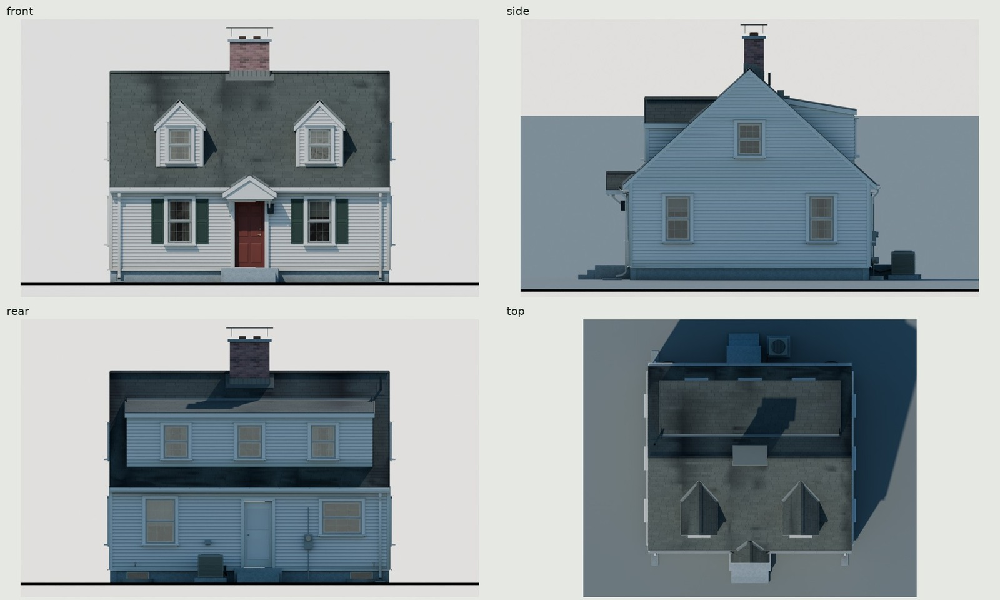

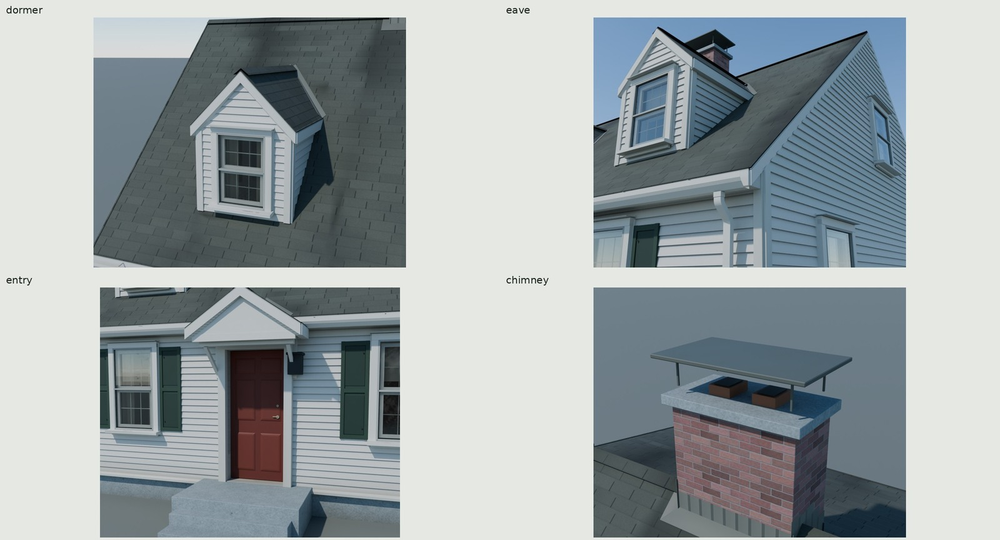

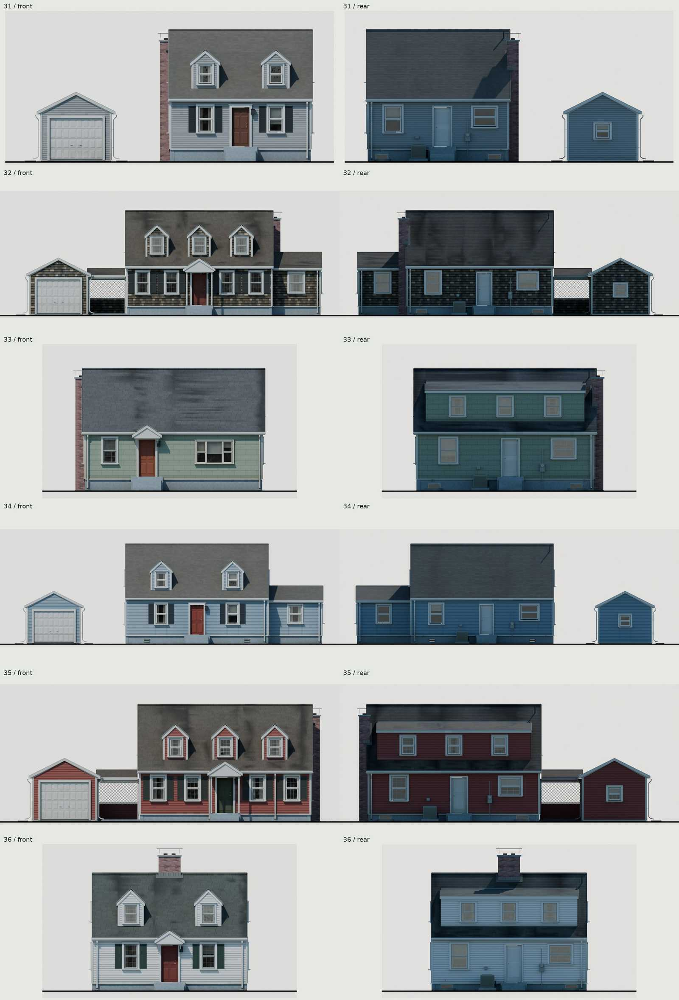

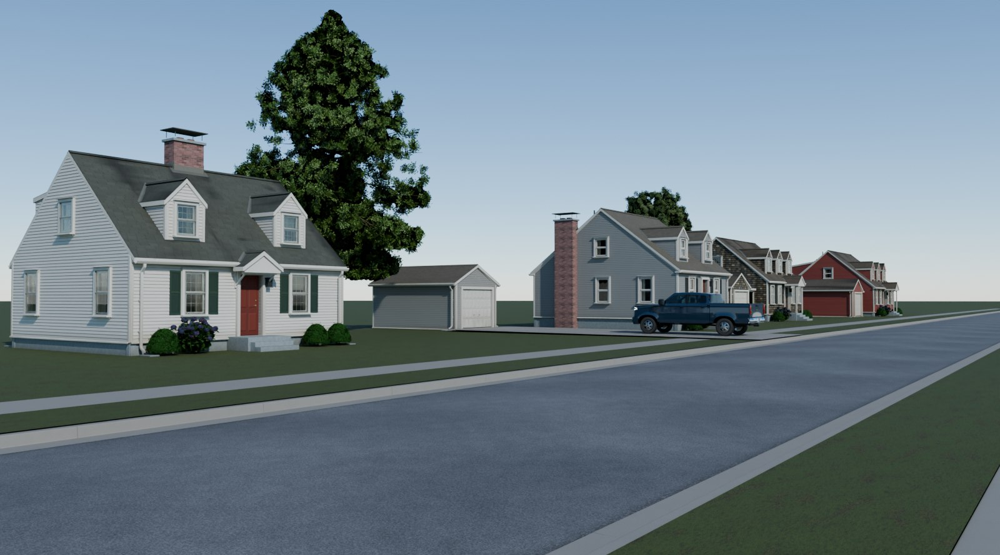

Every final view imports those delivered files and their shared maps. Full
resolution evidence stays untracked: `renders/cape/final/contact.jpg`,
`turnaround.jpg`, `details.jpg`, `family.jpg`, `siding.jpg`, the individual
`scale.png`, `concrete.png`, `peeling.png`, `renders/cape/final-cmu/` for
block coursing/stoop, and `renders/cape/final-eevee/hero.png`.
Used-material pairs are in `renders/cape/final-values/pairs.jpg`; whole-house
photo pairs and source/export comparisons are in `renders/cape/final-matches/`.

### Construction and dimensions

`generate(seed, overrides=None, house_type='cape')`, CLI `--type cape`, or
JSON `{"type":"cape"}` selects the type. Omitting type retains the original
colonial RNG sequence. The Cape has its own seeded RNG. Width/depth, pitch,
eave/rake, raised floor/foundation, dormers, rear shed, side wing, garage and
breezeway, hood, siding/paint, sash updates/storms/shutters, returns, chimney
and roof age are bounded controls. See [REFERENCE.md](REFERENCE.md) for the
period sources and the distinction between authored dimensions and surveys.

| Feature | Authored real dimensions |
| --- | --- |
| Principal box | 24–34 × 24–32 ft; one floor and an attic half story |
| Main roof | Side gable, 8:12–12:12; proof pitches 9/10/10/10/10/11:12 |
| Ceiling / floor | 8 ft first-floor ceiling; 18/24/30 in floor above grade |
| Eave / rake | Independent 4–12 / 0–6 in controls; tight proof eaves 6–10 in |
| Exposed foundation | 15–24 in in the proofs, below framing and sloped water table |
| Front dormers | 4 ft 6 in body; 28 × 40 in sash; none, two or three |
| Lower windows | 30 × 54 in; 29 in sill above the finished floor |
| Side additions | 10 or 12 × 14 ft; low subordinate roofs |
| Garage / breezeway | 12 × 20 ft; 8 ft covered connection or 10 ft detached gap |
| Front / service leaves | 36 × 80 / 34 × 80 in |
| Stoop | 1.75 m front / 1.45 m rear; 1.02 m landing; 280 mm treads |

Dormer cheeks start on the actual parent slope. Analytic roof unions clip
penetrations; roofing continues under the dormer trim skirts. Step flashing,
rake/fascia/soffit, drip edges, K-gutters and supported downspouts remain
separate construction in the source. The rear shed joins two rear-falling
planes at a pitch break. Sills have a true sloping weather surface above their
supporting block. Poured foundations have form imprints and tie plugs; the
crawlspace has 8 × 16 in coursing and four louvered vents. Basements have
rear openings and corrugated wells. Seeds 32/35 retain open, posted breezeways
with framed lattice backs, shown in dedicated three-quarter connector views.

| Seed / siding | Main box W × D, m | Complete W × D × H, m | Triangles | Materials | glTF + BIN bytes |
| --- | --- | --- | ---: | ---: | ---: |
| 31 / vinyl | 7.3152 × 9.1440 | 15.0518 × 17.8981 × 6.8676 | 38,982 | 6 | 3,544,739 |
| 32 / cedar | 9.1440 × 7.9248 | 19.3190 × 11.6498 × 6.5882 | 43,915 | 6 | 4,030,270 |
| 33 / cement | 9.7536 × 7.9248 | 10.5833 × 11.6498 × 6.7406 | 37,246 | 6 | 3,433,487 |
| 34 / aluminum | 9.7536 × 8.5344 | 21.1478 × 17.2885 × 6.8422 | 43,570 | 5 | 4,043,574 |
| 35 / wood | 9.7536 × 8.5344 | 17.3294 × 11.6994 × 6.6898 | 44,716 | 6 | 4,139,918 |
| 36 / wood | 8.5344 × 7.3152 | 8.9064 × 10.4802 × 7.7999 | 36,383 | 6 | 3,244,354 |

Bounds include the chimney, roofs, garages, wings and attachments. Each
export has three meshes: consolidated fixed construction and two moving
leaves. It uses RGBA8 linear vertex weather, ordinary UV charts and standard
PBR materials. Fine manufactured detail is carried by the shared maps.
Triangles stay within the brief's 30–45k delivered range; no LOD is included.

The origin is at grade at the permanent footprint center; Blender front is
−Y and up is +Z, becoming glTF +Z front and +Y up. `FrontDoor` rotates
0–105° about its hinge's Blender +Z / glTF +Y; `ServiceDoor` rotates −100–0°.
Leaves, knobs and hinges remain parented to those pivot nodes. The sectional
garage door remains closed. `Socket_FrontThreshold`, `Socket_Walk`,
`Socket_Driveway` and optional `Socket_GarageApron` retain their measured
per-seed positions. The house exports contain no terrain or driveway.

### Materials, age and texture allocation

Seed 31 has updated vinyl; 32 stained cedar; 33 straight-butt striated cement;
34 oxidized blue aluminum; 35 red clapboard; 36 warm-white clapboard. Cedar
units have independent brown/gray absorption, ±3 mm butts, occasional splits
and cupping, with low shaded green-gray staining. Cement is nominal 12 × 24 in,
11 in exposed, half-unit staggered, with two face nails and 4.37 mm butt relief.
Wood has 4 in exposure and 14 mm butt projection; vinyl/aluminum use their
10.5 mm lap. Actual delivered surface rays verify these projections.

Aluminum dulling follows the exposed courses and sun, with cleaner vertical
washing below window corners/overflow and dirt under the laps. It has no
cloud-noise chalk mask. Sill failure follows the wet nose, ends, sash joint
and casing foot: grain-long gray wood losses, surrounding checks, and thin
rolled film edges. Splash dirt stays low and at drainage/stoop sites; shaded
low/eave surfaces mildew. Trim chalks toward sun. Chimney units vary in hue
and value, with darker flashed bricks and shallower joints. Glass retains
sky/eave reflections, varied blinds/curtains and 1.15 m room backs with simple
contents. Roof granule loss, algae runoff and shaded moss remain. Isolated
curled-tab boxes are omitted. The aged roof's bounded vertex-field transfer
restores contrast lost through chart interpolation; it adds no noise or maps.

| Shared allocation | Images / dimensions | BC7 color/ORM, BC5 normals, full mips |
| --- | --- | ---: |
| Existing colonial + ranch | Original 31 PNGs, unchanged | 47⅓ MiB |
| Cape cedar | BaseColor / Normal, each 512 × 256 | ⅓ MiB |
| Cape cement | BaseColor / Normal, each 512 × 256 | ⅓ MiB |
| Cape brick and concrete | Two 256² color/normal pairs | ⅓ MiB |
| Whole family | 39 canonical PNGs | **48⅓ MiB** |

The two rectangular color/normal pairs are exact integer crops of the filtered original
4K packed bake. Splitting avoids mixed-material deep mips and thousands of
chart seam triangles while keeping the same 1 MiB addition and texel density.
The two constant shingle ORM images are replaced by their authored scalar values;
the old packed bake's tiny boundary mix is removed, and
the recovered ⅓ MiB funds separate 256² Cape masonry color/normal pairs at the
existing family texel density. Brick joints vary in width, course and edge
shape, with a 1.8 mm recess and neutral mortar; concrete has form bugholes,
aggregate and low groundwater mineral deposits. Neither changes any original
family map or adds geometry. Manufacture is baked in Cycles at 4096; filtering uses linear color, vector
normals and RMS roughness. Wood/metal paint reuses the existing matte trim ORM
through a standard texture transform. All original maps remain byte exact. Constant dielectric ORM uses no images.
The white aluminum comparison is an auxiliary `HearthfieldCape-34-control`
export, baked with its stated white input because additive chalk cannot be
recovered by multiplying blue paint. It shares the main seed's eleven image URIs and
adds no texture allocation. The six delivered palettes are unchanged.

The 39 PNGs total **22,583,497 bytes**. PNG disk size differs
from block-compressed engine memory. The importer test loads all six Capes,
a colonial, a ranch and a repeat while checking actual image-cache identity;
an engine must cache the same canonical URIs to obtain the shared allocation.

### Measured appearance and bake loss

The following are fixed-ROI Cycles pixels versus native-resolution,
neutral-balanced used-material photographs. Values are encoded Rec.709 Y′,
not albedo inferred from JPEGs. Medians are within 10%, both p10/p90 tails
within 15%, and R/G and B/G within 10%. Primary wood, cedar and roof retain
proof-seed colors. Vinyl/aluminum/cement are explicitly stated paint controls.

| Material | Median export / photo | R:G:B export / photo | Largest tail error | Export − source median |
| --- | ---: | --- | ---: | ---: |
| Painted clapboard | 0.651 / 0.630 | 0.964:1:1.018 / 1.031:1:0.969 | 12.3% | -0.001 |
| Stained cedar | 0.221 / 0.214 | 1.000:1:0.912 / 1.011:1:0.992 | 12.6% | +0.001 |
| Tired asphalt | 0.366 / 0.405 | 1.022:1:0.957 / 1.073:1:0.994 | 13.9% | -0.015 |
| Vinyl control | 0.797 / 0.802 | 0.975:1:1.020 / 0.999:1:0.995 | 8.6% | +0.000 |
| Aluminum control | 0.884 / 0.939 | 0.987:1:1.009 / 0.966:1:0.988 | 10.7% | +0.000 |
| Cement control | 0.762 / 0.824 | 0.979:1:1.015 / 1.009:1:0.995 | 13.3% | -0.003 |
| Concrete | 0.532 / 0.546 | 0.964:1:0.978 / 0.964:1:0.989 | 9.8% | -0.015 |
| Painted trim | 0.619 / 0.649 | 0.956:1:1.019 / 1.000:1:1.000 | 13.3% | +0.001 |
| Chimney brick | 0.363 / 0.377 | 1.253:1:1.034 / 1.222:1:1.047 | 14.2% | +0.001 |
| Glass / room | 0.075 / 0.070 | 1.000:1:1.000 / 1.024:1:1.046 | 14.7% | +0.000 |

Wood, roof, trim, brick and glass use the white-painted used Cape's door casing
as neutral. Cedar uses white attic casing; vinyl white upper-window casing;
aluminum a white corner board; cement clean upper shingle paint; concrete
white window casing. These are assumed neutrals, not calibrated gray cards.
The cement pair now shows used 12 × 24 in straight-striated units. The sill
reference demonstrates water-site failure; its teal hue is not the asset's
paint target. Reference rights, native ROI coordinates, gains, camera/light/EV,
paint controls and source/export hashes are recorded in `refs/SOURCES.md`,
`build/cape/material-photos.json` and each material folder's JSON.

Cedar lower-face unit values have export CV **0.247**, source **0.250**, photo **0.204**; export p10–p90 **0.193–0.342**, photo **0.189–0.340**. This separates unit spread from overlap shadows; sample counts and the
limited nine photographic units are documented in the JSON, not claimed as a
population survey. Lap crops contain the same numbers of courses: wood 2.941,
vinyl 7.944, aluminum 6.211. The folded scanline width/darkness comparison is
`build/cape/delivery/course-shadows.json`. Its export/photo dark-width fractions
are .156/.167 wood, .125/.211 vinyl and .188/.263 aluminum; dark/lit ratios are
.559/.689, .723/.798 and .934/.682. Geometric projection is separately measured
in `construction.json`. Illumination and photo resolution affect these widths.

`renders/cape/final-values/bake-loss.jpg` compares every source/export material
under identical cameras, light, exposure and controls. Independent first-hit
material rays exclude fixtures without selecting displayed values. Median
bake loss stays below .03; per-pixel mean and p90 losses are retained in
`build/cape/delivery/bake-loss.json`. Microtexture filtering still loses some
source granule speckling and fine paint response. Whole-house source/export
pairs use the same fitted cameras as the photograph comparisons. Common opaque
asset pixels have mean absolute Y′ losses .0107 / .0168 and p95 losses
.0429 / .0650 for the dormered / plain roof views; presentation ground is
excluded by independent projected-triangle masks.

### Rebuild and proof

```sh
make TYPE=cape WIDTH=1600 SAMPLES=48   # complete six-seed bake, delivery, checks, finals/docs
make TYPE=cape check                  # includes ranch and colonial checks
make TYPE=cape bake                   # 4K procedural Cycles bake + shipping filter
make TYPE=cape export                 # per-seed files and shared images
blender -b --factory-startup --python-exit-code 1 --python src/build.py -- \
  --type cape --seed 44 --out build/cape/custom.blend
# Add --plan build/my-cape.json for a caller-authored source plan.
```

The default delivery covers the six proof seeds. The wider grammar and a
painted-cedar override are independently source-tested; extra authored plans
are not additional delivered proof sets. Plan sweeps cover 1,000 plans per
type, including negative controls. Actual surfaces check roofs, openings,
dormer interiors/skirts, sill/soffit and landing/threshold contacts, foundation
exposure/vents and downspout supports. Door sweeps sample 342 poses with no
contact exemptions. Raw glTF accessors and a fresh import check normals,
RGBA8 color, nondegenerate UVs, texel density, applied scales, geometry and
all pivot/socket frames. Repeat UV overlap is intentional on this tiled
building; trim faces stay within their own finish strips.

`check.json` separates construction from serialization/import proof. Roof
pitch is fitted to the actual full roof planes in float64; raw skinny-triangle
normal error and maximum plane residual are retained. Source-to-delivery
triangle samples independently bound chart/reduction displacement, with
float64 closest-point refinement for ill-conditioned thin faces. A single
sub-micrometer wall-return edge that collapsed in UV float storage is welded;
its actual displacement is included in the surface test.

The street imports four different Capes, Ground lawn/curb/sidewalk/road,
RedMaple, PinOak, Shrubs and AlderC150 from their own exports for presentation
only. It measures 1.68 m above the actual sidewalk; the nearest house spans
35.2% of the frame. Its source hashes and measured camera/placement
facts are in `renders/cape/street/provenance.json`. The hero retains both dormer
shadows and the full house shadow. Silhouette-masked tonal percentiles are
p1 0.089, median 0.372, p95 0.741, with 0.000% white clipping.

### Older-type byte preservation

All **77** accepted colonial/ranch geometry, metadata, maps and docs files
retain their pre-session SHA256 hashes. `src/cape_legacy_hashes.json` records
that fixture; `src/cape_legacy_rebuild_audit.json` records the independent
Blender 5.2.3 rebuild. All twelve BINs matched exactly. Its only differences
were exporter labels v5.2.40 → v5.2.41 in twelve glTF files, corresponding
source-form hashes in six colonial metadata files, and one-byte channel drift
in eight independently rebaked maps. The accepted canonical files were retained;
actual construction/import/material checks then passed against the fresh games.

| Shared ranch edit | Scope and preservation evidence |
| --- | --- |
| `ranch_deliver.py` | Exclude Cape-only names from the ranch's 31-image inventory; no ranch publication or geometry change |
| `ranch_delivery_check.py` | Audit the original ranch/colonial sets independently of added Cape maps |
| `ranch_reduce.py` | Optional front-wall reduction, default off; default rebuild BINs exact |
| `ranch_uv.py` | Optional polygon chart input and tiny absolute area allowance, defaults unchanged; default rebuild BINs exact |

Historical construction regression checks normalize only the exporter-version
label before comparing the entire GLB payload; raw hashes remain in the report.
All other geometry, UV, color, node and material bytes still have to match.
This prevents a Blender patch's provenance label from masquerading as a mesh
regression. On a cold clone, the local pre-Cape canonical hashes are captured
after building the two existing types. Validation changes no longer invalidate the ranch publication stamp. The
legacy-check wrapper audits rebuilt payloads, preserves only the known exporter
provenance and one-byte bake drift, and fails on semantic changes. No shared
`kit/` file changed.

[REVIEW.md](REVIEW.md) records the delivery critiques and rejected transfers.
The weaker features are periodic manufacture at very close range, residual
fine-granule/paint bake loss and coarser roof weather interpolation, simple room
contents and procedural landscaping. The matched vinyl shadow is narrower and
aluminum shadow lighter than the photographs under these controlled lights;
their actual lap projections are independently verified. Eevee loses some of
the Cycles glass reflection and interior response.
The UV charts and small fittings are intended for normal player distances.
No full interiors, arbitrary footprints or engineering certification are
claimed. Fonts are system open-license faces; references remain inspection
only. Credits and rights are in [refs/SOURCES.md](refs/SOURCES.md).


---

## Fourth type: split-level

Five original side-splits and one split-entry / raised ranch, representing
1955–1975 construction with later windows, siding and roofs. The six seeds
ship as stock glTF/BIN pairs with the family’s shared baked maps.
All accepted colonial, ranch and Cape files retain their canonical bytes.


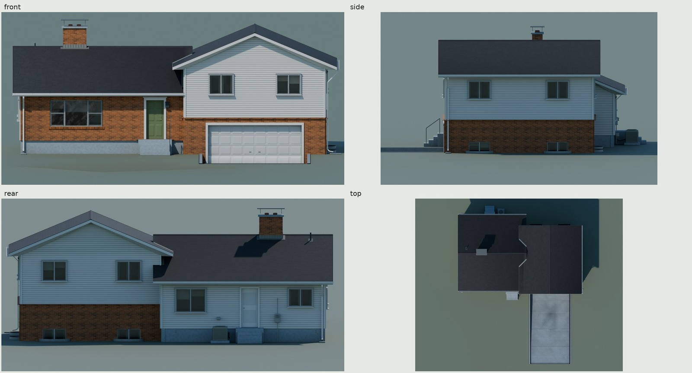

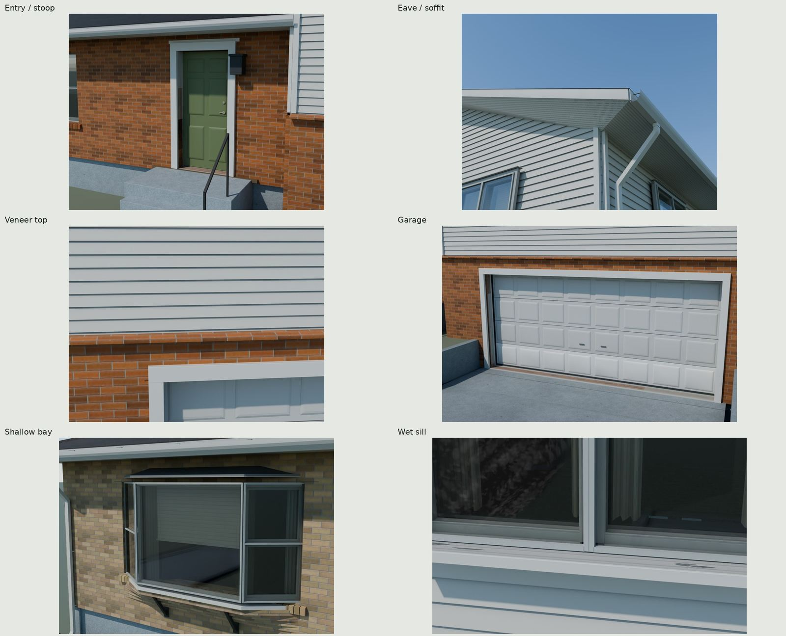

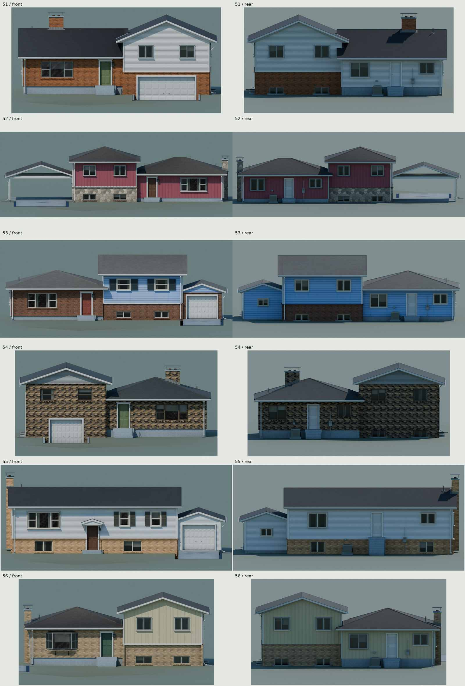

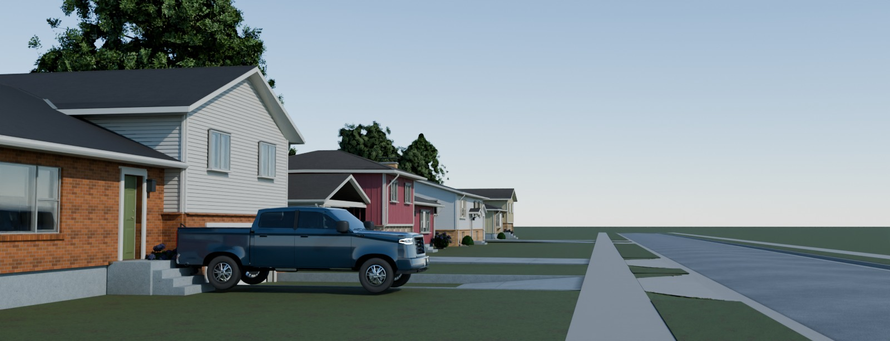

`generate(seed, overrides=None, house_type='split')`, CLI `--type split`,
or JSON `{"type":"split"}` selects the new type. Its local RNG never consumes
choices in the accepted generators. `kind` selects `side` or `foyer`; bounded
nested controls select living/bedroom wing dimensions, wing side/projection,
gable/hip roof, independent eave/rake, ridge direction, garage/carport/parking,
front cantilever, material mix, restrained palette, picture/bay, sash system,
shutters, chimney, entry hood and roof age. Five out of each six default
variants are side-splits. Examples are in `src/split_plan.py`.

### Dimensions and level construction

These are authored meter dimensions informed by the cited period construction
and photographic proportions, not surveys of the reference homes. Every
side-split has an 8 ft clear ceiling and an 8–12 in floor zone in its two-story
wing; its living floor lies halfway between the two floors. The proof split
entry has a low landing between the lower and upper floors. Actual short
flights are reserved and modeled in the shallow entry backing; they are not a
full playable interior. [REFERENCE.md](REFERENCE.md) distinguishes the period
authorities, dimensional choices and approximate photo-camera fits.

| Seed / form | Living box, ft | Bedroom box, ft | Lower / entry-living / upper floor, m | Roof pitch | Source triangles |
| --- | --- | --- | --- | --- | ---: |
| 51 / side, right wing | 28 × 30 | 24 × 28 | −.6096 / .7620 / 2.1336 | 5:12 | 34,036 |
| 52 / side, left wing | 30 × 26 | 22 × 26 | −.8890 / .4572 / 1.8034 | 4:12 | 32,926 |
| 53 / side, right wing | 28 × 28 | 24 × 30 | −.8636 / .4572 / 1.7780 | 3.5:12 | 33,228 |
| 54 / side, left wing | 28 × 28 | 22 × 28 | −.6096 / .7620 / 2.1336 | 4:12 | 33,756 |
| 55 / split foyer | 46 × 28 single box | Same box | −1.3716 / .1524 / 1.3208 | 3.5:12 | 33,064 |
| 56 / side, right wing | 26 × 28 | 22 × 26 | −.5588 / .7620 / 2.0828 | 4:12 | 37,242 |

Counts include the original drive, retaining cheeks where needed, services,
shallow entry/stairs and all moving sections. Every source uses six materials
at most. They remain within the accepted 31.5–38.4k range;
spare triangles remain available for later delivery UV charts and macro wear.
No geometry is added simply to reach the preferred range. Garage leaves
retain a simple floor backing, with the review ground cut behind their sunken
aprons. Panel bounds are also checked against the authored ceiling plane.

The living / bedroom bearing eaves are respectively 3.4544 / 4.8260 m on
51/54; 3.1496 / 4.4958 on 52; 3.1496 / 4.4704 on 53; and 3.4544 / 4.7752 on
56. Seed 55's main eave is 4.0132 m, against its attached garage's 2.7940 m.
Eaves and gable rakes have independent 12–24 / 6–18 in bounds. Boxed soffits,
vent strips, friezes, gutters, hems and roof/wall step flashing reuse the
family's construction. The lower roof continues under the higher eave to
its wall, rather than leaving a gap under the skirt.

Brick on the living front / lower floor, upper lap or vertical painted battens,
and the all-brick-wall seed have visible cap/material breaks. Cantilevered
fronts close their undersides, and their downspouts dogleg back to the lower
wall. Picture units have a fixed light and flanking sashes; the 16 in shallow
bay uses three glazed facets, a 45 mm seat, bolted square-tube steel knees,
stepped brick corbels and a three-plane folded sheet hood with wall flashing. Ordinary shutters are
half their associated opening width. The source retains period wood/storm,
aluminum/bronze and replacement vinyl systems, plus horizontal sliders.

Seeds 51/54 have integral two/one-car garages, 53/55 attached one-car garages,
52 a posted two-car carport, and 56 side parking. Every seed has a driveway;
sunken integral garages have descending concrete drives, level aprons and
retaining cheeks. Rear doors, stoops, condenser, slack lines, meters, bibs,
dryer hood, splash blocks and lower window wells remain. These are exterior
shells; hidden engineering, full interiors and arbitrary plans are outside
the grammar.

### Shared materials and motion

Cape-calibrated wood, aluminum, vinyl, modular brick, neutral concrete, trim
and clear glass are reused. Seed 52 introduces original procedural fieldstone;
51/53/54/55/56 have distinct red, red-brown, mottled common, buff and tan brick
bodies with neutral mortar. Eight-inch aluminum courses on 53 use the existing
map at half V scale. Replacement vinyl has J receivers and hollow corner
posts; older painted battens reuse the trim finish and vertical grain.

The family now has **41 canonical PNGs / 49 MiB** under BC7 color/ORM,
BC5 normal and full mip chains. The sole addition is the planned **512²
BaseColor/Normal pair, ⅔ MiB**. Its color map holds stone and five full-width
kiln-color bands; the normal retains the full accepted stone/coping field.
Brick normals reuse the unchanged Cape normal through ordinary
`KHR_texture_transform`. Factory color stays in texels while macro weather
uses RGBA8 `COLOR_0`; sparse vertex sampling would lose the common brick's
fired-unit spread. Scalar roughness .91 / metallic 0 avoids another image.
The other 39 shared maps remain byte-identical. Color bands have eight-pixel
periodic vertical guards; the stone color’s half-size guards are three pixels.
The latter and the atlas's mixed deep mips remain a distant-LOD limitation.

Source aging follows real sill corners, gutter endpoints, shaded low walls,
raised stoop contact, base splash, engine drip zones, wheel paths and joint
cracks. Tired/new roofs differ in shaded algae, lower-course moss and exposed
granule loss. Garage 51 has a replacement bottom section; 54 has a low dent.
The original Cape clear-glass response is retained, with deeper dark rooms
and curtains/blinds at varied heights. Seventeen fixed used-surface comparisons
report white-balance neutrals, medians, p10/p90 and R:G:B ratios in
`renders/split/final-values/values.json`. They measure rendered
appearance under disclosed lighting, not inverse albedo. White aluminum and
glass are explicitly retained Cape controls; blue wide-course aluminum is
measured on split 53 separately. The blue photograph's substrate is unverified.

Foyer 55 retains all three accepted floor datums. Its local review grade is
−.1524 m, leaving the lower floor four feet below ground and its full 36-inch
sashes six inches above it. Upper floor is 4.83 ft above that local ground.
Stoops, services and splash blocks follow the grade; rail feet touch actual
tread surfaces. Other seeds retain grade zero.

`FrontDoor` and `ServiceDoor` retain physical hinge origins and Blender +Z
ranges 0–105° / −100–0°. The sectional door consists of `GaragePanel1` through
`GaragePanel4`, numbered bottom to top, each with its origin at its top hinge.
Each section rotates about Blender +X from 0 to −90° during lift.
`split_motion.pose(progress)` demonstrates the 0–1 vertical / 200 mm quarter-
circle / overhead path. Each successive section follows the preceding rigid
chord; a game should implement that controller from the stored track/section
metadata. There is no armature or delivered animation clip. All four sections
clear the frame and each other at 41 sampled poses without exemptions.

The usual `Socket_FrontThreshold`, `Socket_Walk`, `Socket_Driveway` and optional
`Socket_GarageApron` are emitted per plan. Units are meters, +Z up, −Y street
front. The grade origin centers the permanent wall/stoop footprint; driveway,
eaves and rear attachments extend beyond it, as in the existing family.
Seed 55 keeps the accepted local datums; placement must account for the
−.1524 m grade declared by its walk/drive sockets.

### Rebuild and delivery evidence

From `houses/`:

```sh
make TYPE=split WIDTH=1600 SAMPLES=48  # bake, exports, checks and final portfolio views
make TYPE=split export               # clean scripted asset build, no photographs needed
make TYPE=split split-checkpoint     # retained source look review
make TYPE=split check                # delivered surfaces, motion, UVs, import, old-type bytes
make TYPE=split model SEEDS=51,52,53,54,55,56
blender -b --factory-startup --python-exit-code 1 --python src/build.py -- \
  --type split --seed 57 --out build/split/custom.blend
# Optional --plan build/my-split.json uses the same bounded nested controls.
```

Poppler `pdftoppm` is used only to prepare local inspection-photo crops from
the registered PDF. All Cycles invocations use the kit GPU lock. No downloaded
code, models, materials, texture assets or lighting are used.

Every final view imports `export/HearthfieldSplit-<seed>.gltf` and resolves
its relative `textures/` images. `renders/split/final/contact.jpg` collects the
hero, turnaround, entry/soffit/cap/garage/bay details, 1.8 m scale, sectional
door poses, six-seed portraits, Eevee and street evidence. Full material pairs
and source/export loss are in `renders/split/final-values/`; four fitted
house/photo pairs and source/export comparisons are in
`renders/split/final-matches/`. The street imports Ground, RedMaple, PinOak,
Shrubs and AlderC150 from their own exports, for presentation only. No context
mesh, image, camera or lighting is exported with a house.

Five listing-photo URLs carried private-home listing identifiers. Their source
cells now state that the URL is not recorded; this branch's own commits since
its base were rewritten to erase them too. Hash-only image URLs remain.
`src/split_privacy.py` checks both branch patches and every historical source
table. The four camera comparisons require the local inspection-photo cache:
these five identifying URLs cannot be fetched on a fresh clone. Geometry,
manufacture, maps and exports rebuild without photographs; the public agency
and other nonidentifying reference URLs remain downloadable. No photograph
is committed or read by a geometry/material generator.

Four new photographs show common builder side-splits in Pennsylvania/Ohio
and true between-floor split foyers in both regions. Their corresponding-
feature camera errors are 8.46 / 6.51 / 3.63 / 9.29 native pixels. Held-out
plan differences are separately reported (60.51 / 41.10 / 12.51 / 44.22 px);
these are original houses, not replicas. Side-roof estimates are 3.64:12 and
5.39:12. Ohio's visible bearing eave estimates 24.5 ±4 in; the other frontal
views do not independently recover eave depth. Foyer main ridges are hidden;
the Pennsylvania added cross-gable estimates 5.45–6.88:12 and differs from
our protected plain-roof plan. See [REFERENCE.md](REFERENCE.md) for scope.

`build/split/checks.json` separates actual surface probes, raw GLB/import
checks and sampled motion. Roof heights, unblocked openings, threshold/landing
and driveway/apron contact are tested on built meshes. The lower roof under
the tall skirt has independent probes. Every retained paint-loss vertex is
checked against actual window/storm surfaces: wood losses exclude masonry
rowlocks and the bay, and remain on the exposed sloping noses.
The four-type plan sweep covers 1,000
seeds each and rejects fourteen additional split negative controls. An authored
left-wing / flat-hood / no-garage override and complete repeat GLB bytes are
also checked. These tests prove specific geometry/serialization properties;
they do not prove the look, structural engineering or future bake fidelity.

The pre-change fixture `src/split_baseline.json` captures all eighteen accepted
construction GLBs in the current Blender version. The regression compares
those raw bytes and geometry digests without normalizing exporter labels;
all eighteen match. All 111 captured existing delivery/maps/docs files also
retain their SHA256 bytes. The shared code changes are split-only dispatch,
optional slider/fixed glazing, roof discharge/soffit handling, stepped-wall
pipe routing, masonry extent and audit support. No `kit/` file changes.

Four form critiques and subsequent material/form passes in
[REVIEW.md](REVIEW.md) record the rejected roof stripes, pale/pink finishes,
wrong foyer candidates, unsupported rail foot and flat calibration patches.
Remaining weaknesses include regular mortar/manufacture, polygonal stone
repetition, simplified room backings, unmatched reference plan features and
softened fine color after filtering. Full interiors and hidden engineering
remain outside this exterior grammar. Delivery measurements follow below.

### Delivered budgets and measured appearance

The six delivered seeds retain six materials. Geometry bytes below are glTF
plus BIN, excluding the shared images and optional per-seed JSON metadata.

| Seed | Triangles | Materials | glTF + BIN bytes |
| --- | ---: | ---: | ---: |
| 51 | 42,005 | 6 | 3,822,197 |
| 52 | 41,975 | 6 | 3,903,204 |
| 53 | 41,702 | 6 | 3,819,551 |
| 54 | 43,577 | 6 | 4,028,881 |
| 55 | 40,998 | 6 | 3,739,482 |
| 56 | 44,223 | 6 | 4,242,677 |

All seventeen fixed-ROI exported/photo comparisons pass: medians within 10%,
both tails within 15%, and R/G and B/G within 10%. Values are encoded Rec.709
Y′ under the unchanged disclosed light, camera and EV, not recovered albedo.

| Surface | Y′ export / photo | R:1:B export / photo | p10 / p90 error |
| --- | --- | --- | --- |
| Red brick / 51 | 0.575 / 0.560 | 1.331:1:0.748 / 1.431:1:0.688 | -3.1% / -3.2% |
| Red-brown brick / 53 | 0.338 / 0.317 | 1.370:1:0.778 / 1.451:1:0.781 | -0.7% / -11.2% |
| Common mix / 54 | 0.303 / 0.287 | 1.145:1:0.763 / 1.201:1:0.749 | +10.7% / -4.3% |
| Buff brick / 55 | 0.682 / 0.742 | 1.140:1:0.854 / 1.209:1:0.784 | +10.3% / -5.9% |
| Tan brick / 56 | 0.622 / 0.640 | 1.089:1:0.873 / 1.147:1:0.804 | -3.1% / -4.4% |
| Fieldstone / 52 | 0.354 / 0.373 | 1.146:1:0.787 / 1.102:1:0.846 | -2.3% / -7.3% |
| Red battens / 52 | 0.250 / 0.253 | 2.058:1:1.038 / 2.101:1:1.096 | +5.1% / -6.6% |
| Blue wide lap / 53 | 0.348 / 0.336 | 0.813:1:1.198 / 0.832:1:1.212 | -13.5% / +3.3% |
| Vinyl / 55 | 0.813 / 0.839 | 0.981:1:1.014 / 1.031:1:0.924 | -11.3% / -6.2% |
| Steel garage / 51 | 0.745 / 0.715 | 0.969:1:1.010 / 1.001:1:1.046 | +13.6% / -13.0% |
| Tired charcoal / 51 | 0.175 / 0.181 | 0.933:1:1.111 / 0.986:1:1.166 | +14.6% / -14.8% |
| Drive / 51 | 0.770 / 0.839 | 0.949:1:1.040 / 1.009:1:0.980 | +9.7% / -9.7% |
| Wood lap / 51 | 0.651 / 0.630 | 0.964:1:1.018 / 1.031:1:0.969 | -1.8% / -1.4% |
| White aluminum / Cape control | 0.884 / 0.939 | 0.987:1:1.009 / 0.966:1:0.988 | +10.3% / -8.3% |
| Concrete / 51 | 0.509 / 0.546 | 0.962:1:0.969 / 0.964:1:0.989 | +4.4% / -8.1% |
| Painted trim / 51 | 0.596 / 0.649 | 0.961:1:1.020 / 1.000:1:1.000 | +9.6% / -11.1% |
| Glass / Cape control | 0.075 / 0.070 | 1.000:1:1.000 / 1.024:1:1.046 | -14.7% / -11.4% |

Assumed neutrals are the white sash, entry or living-window casing for the
brick, stone, siding, garage and roof comparisons. Tan brick and the driveway
use sunlit unpainted concrete, assumed neutral gray. Reused Cape controls use
white door/window casing or a white corner board. The registered native boxes
and linear RGB gains preserve photographic exposure; the photographs are not
calibrated reflectance measurements. The white aluminum and glass controls
remain explicit older-type witnesses; blue eight-inch lap is measured on 53.

The roof retains a stock uniform roughness of .925, within .005 of the source.
A common material factor lets its dark RGBA8 vertex colors use more of their
available range while retaining the physical color. No additional image or
material is needed. Source/export pairs separately disclose fine-granule
filtering, weather interpolation and stone color softening.

The source-to-export material median changes by at most .02410 Y′. On common
opaque house silhouettes, the four fitted views have mean absolute Y′ loss
.01347 / .00965 / .00590 / .00583; their largest p95 loss is .04596. These are
appearance-loss measurements under identical lighting, distinct from the
photo-fit and physical-surface checks. The hero's asset-mask p1 / median /
p99 are .10814 / .46987 / .72189, with no clipped-white pixels.

`make TYPE=split` and `make TYPE=split check` pass. Separate
`make TYPE=builder_colonial check`, `make TYPE=ranch check` and
`make TYPE=cape check` pass. The split audit includes 506 door/sectional
poses, source/game surfaces within 2 micrometers, glTF import, pivots/sockets,
UV/density/normals, scalar material responses and actual shared-image identity
across four types. Fresh publication repeats all eighteen split glTF/BIN/JSON
files byte-for-byte. The forty-one PNGs occupy 23,174,235 disk bytes; the new
color/normal pair occupies 221,226 / 369,512 bytes. Their compressed GPU
allocation with full mip chains remains 49 MiB for the entire family.

`build/split/delivery/check.json`, `repeat.json`, `preserved.json`,
`privacy.json`, `bake-loss.json`, `whole-house-loss.json` and `view-check.json`
record those results. The latter verifies 47 current exported views and all
shared-map hashes. The street's eye is measured 1.60 m over the houses' own
sidewalk, using a fixed 35 mm lens on a 36 mm sensor and a 2.6:1 vertical crop.
The nearest visible architecture occupies 34.3% of the frame width; its living
wing continues beyond the left edge. This is a frame-clipped building
measurement, excluding the driveway, rather than a whole-site bound.

The handoff preservation audit compares 111 exact accepted files: 57 geometry
and metadata files, 39 maps and 15 existing docs images. Old-type checks under
a newer Blender exporter initially changed only generator/provenance fields;
`older-rebuild-audit.json` records those differences, and all accepted bytes
were restored. The rebuild checks distinguish that provenance change from
mesh/image change. A cold clone with no generated old deliveries builds the
three earlier types first and explicitly captures a fresh preservation
baseline; exporter patch versions can change provenance bytes. Existing
accepted deliveries always use the committed handoff hashes. An incomplete
existing delivery is reported rather than silently overwritten.

The five final `split-*.jpg` files are each at most 1600 pixels wide and
200,000 bytes. Existing docs stay byte-identical. Five exported critique
passes and a street-framing correction in [REVIEW.md](REVIEW.md) disclose the
regular brick/shingle manufacture, softened stone color, simple room
backings, peeling that still reads chiefly in close-up, and a spare procedural street
landscape. No kit changes or additional tools are required.
