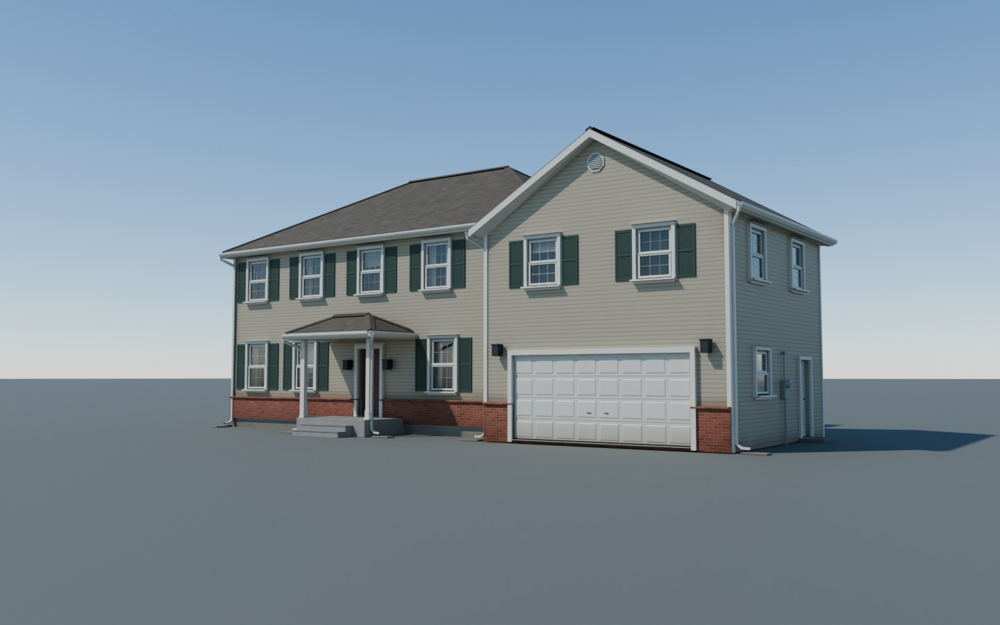
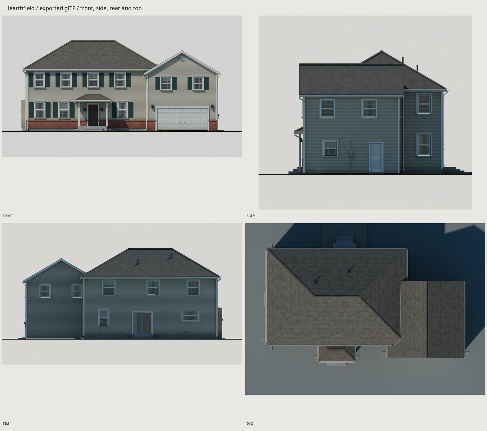
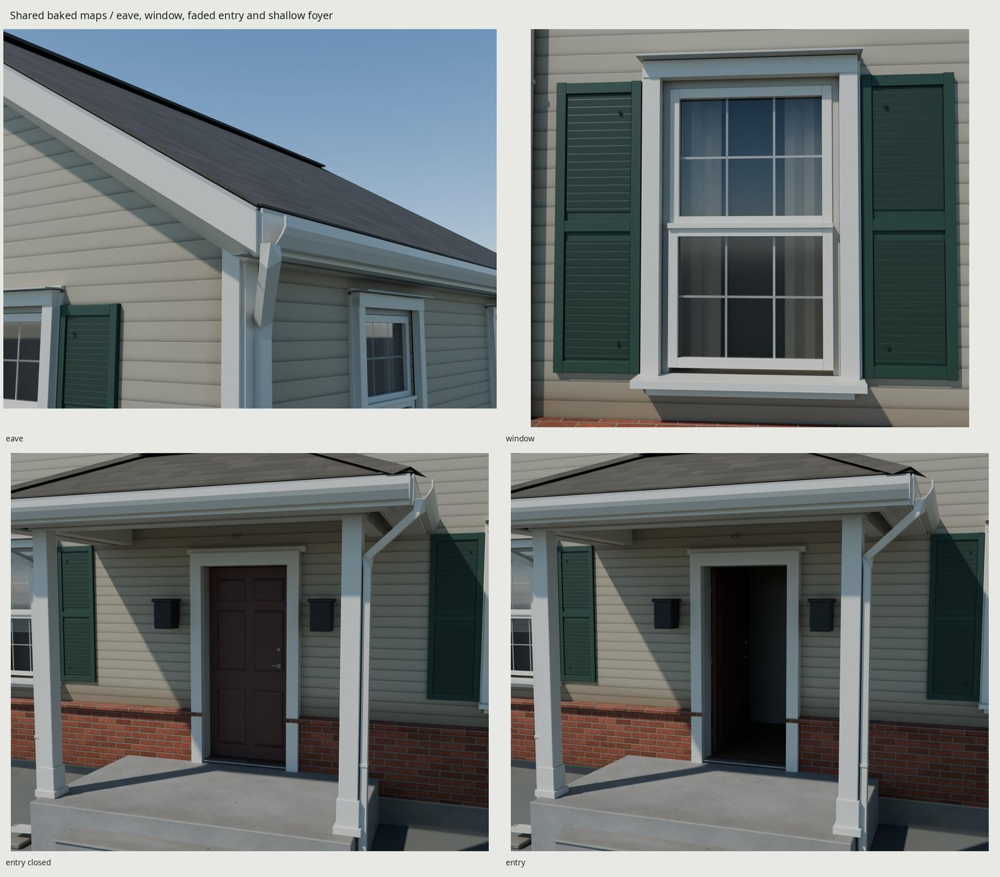
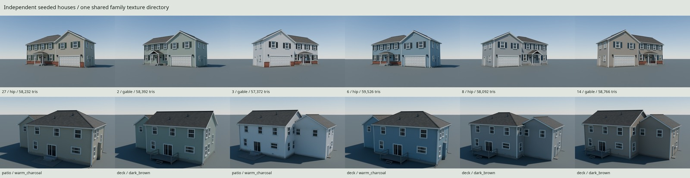
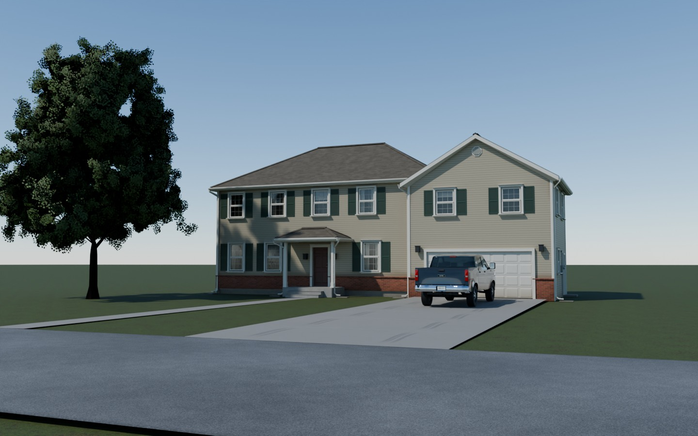
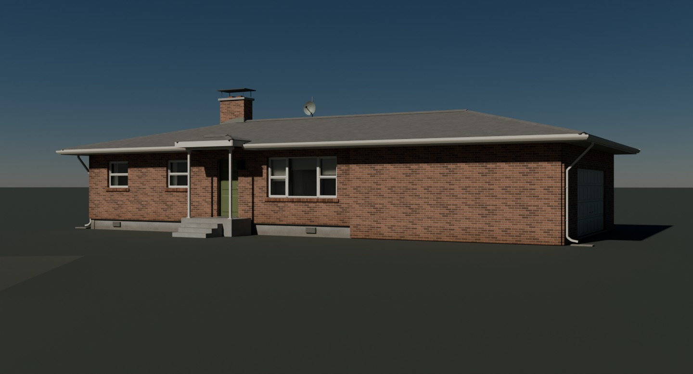
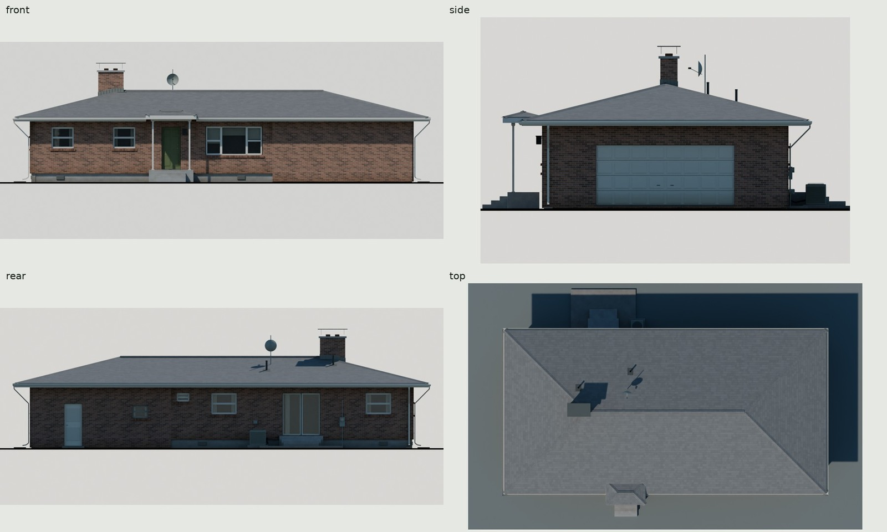
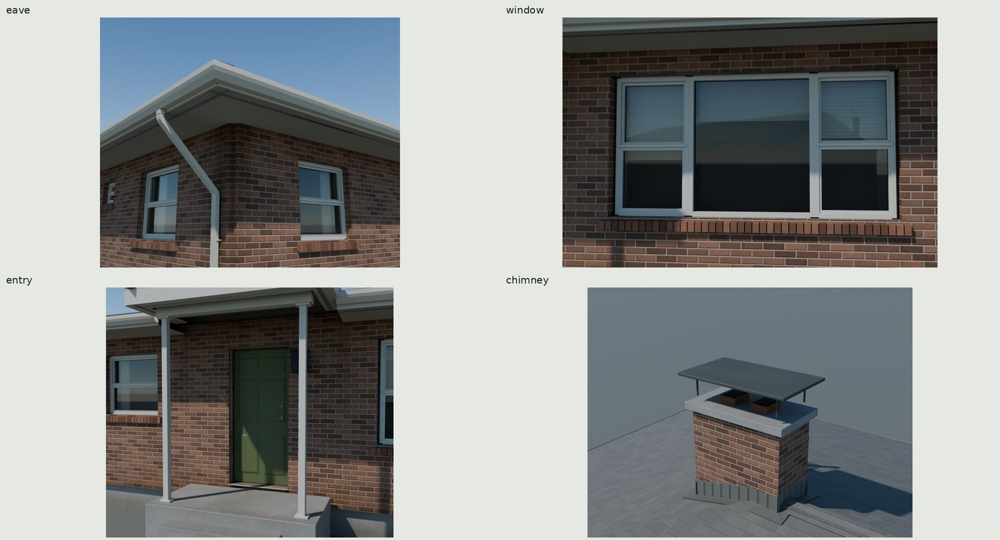
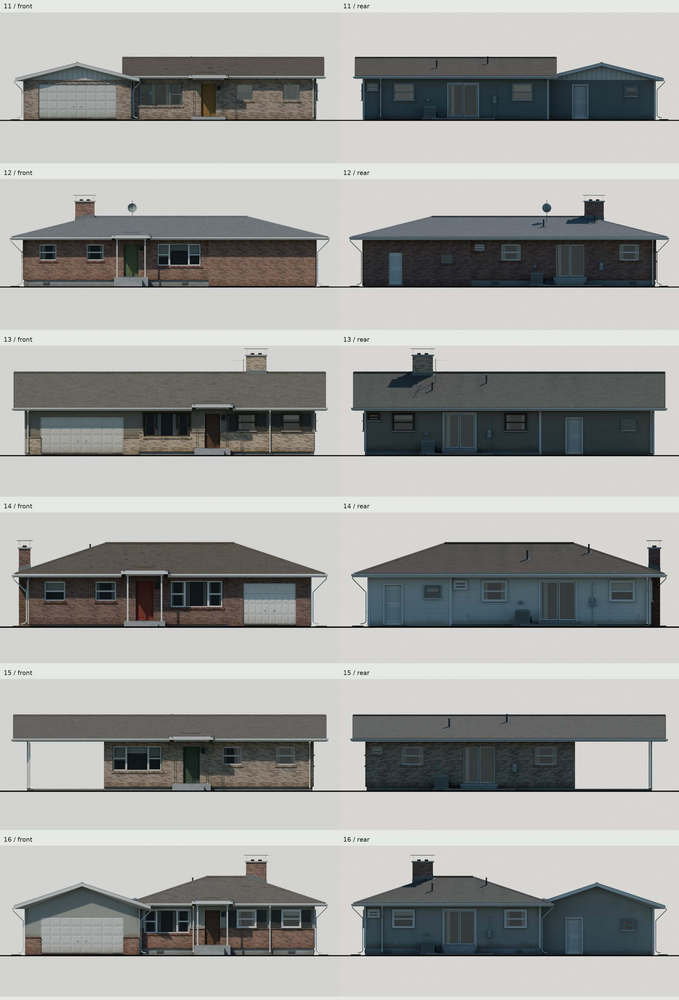
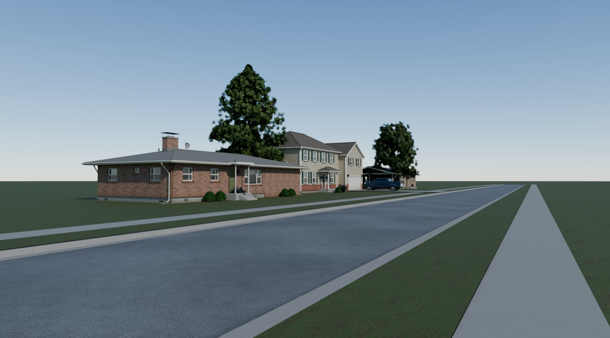

# Hearthfield / seeded American houses

The family delivers a builder colonial and a [postwar ranch](#second-type-postwar-ranch).
The colonial remains the default generator and the subject of the first images below.

An original family of maintained, roughly twenty-year-old American builder
colonials: two stories, a room over an attached double garage, vinyl lap
siding, architectural shingles and optional front brick veneer. All geometry
and texture pixels are generated by scripts in Blender 5.2.











Every house view above imports the delivered glTF and its baked maps. The
street loads the other families' own exports for presentation only. After
building, [contact sheet](renders/final/contact.jpg), [scale shot](renders/final/scale.png),
[Eevee hero](renders/final-eevee/hero.png), and [photo pairs](renders/final-matches/pairs.jpg)
provide the full evidence. [REVIEW.md](REVIEW.md) records construction, source
look and four delivery critiques. [REFERENCE.md](REFERENCE.md) separates
published dimensional references from authored dimensions and measured checks.

## Generator and construction

Inputs are a seed and optional JSON plan. Two two-story rectangular blocks and
a portico form the supported grammar. Builder choices include 38/40/42 ft main
widths, 26/28/29 ft depths, 22/23/24 ft garage dimensions, 4/5/6 ft projection,
garage left/right, main hip/gable at 6/7/8:12, four/five upper-front bays,
hip/gable portico, front veneer coverage and six restrained palettes. The garage
roof remains a front gable. Arbitrary footprints, dormers and other house types
remain outside this grammar.

The rear now shows a 6 ft kitchen slider, short high sink window, family-room
window and varied bedroom rhythm. A side stair window spans the nominal upper
floor inside a reserved stairwell; ordinary windows retain floor/header clearance.
The garage has a side service door. Odd seeds use a concrete patio; even seeds
use a low timber deck with steps. Seeds divisible by three have a single-story
direct-vent gas-fireplace chase, below the upper windows, without a new roof
penetration. Both new doors have separate moving leaves.

Accepted recessed openings, cheeks, casings, J-channel, sloped sills, offset
sashes, grilles and half-window-width shutters remain geometry. Curtains and
seeded blind heights sit behind the glass, with a dim backing about 290 mm
beyond it. The lower sash has effective insect-screen coverage. An octagonal
louvered garage vent is added; the accepted stoop remains. A full-width porch
was deferred because it would change the accepted roof/entry arrangement.

Roof envelopes retain real thickness, overhangs, boxed soffits, fascia, drip
hems, shingle edges, caps, ridge vent, flashing, plumbing boots and resolved
valleys. The hip intersection retains its tapered cricket and falling valleys.
K gutters fall .25% to supported downspouts, elbows and splash blocks. Covered
adjoining walls/roofs are clipped away. The garage room remains .406 m below
the main upper floor, with three internal steps reserved at the connection.

| Seed 27 feature | Authored dimension |
| --- | --- |
| Main block | 12.8016 × 8.5344 m / 42 × 28 ft |
| Garage | 6.7056 × 6.7056 m / 22 × 22 ft, right side |
| Garage projection / overlap | 1.2192 / 1.2192 m |
| Main finished floor / upper floor | .508 / 3.556 m |
| Main ceiling modules | 2.7432 / 2.4384 m / 9 / 8 ft |
| Garage slab / upper floor | .1016 / 3.150 m |
| Main / garage roof | Hip / front gable, 7:12; .3048 m overhangs |
| Main ridge / cap envelope | 8.636 / approximately 8.699 m |
| Ground / upper front windows | .9144 × 1.524 / .9144 × 1.3716 m |
| Sink window / sill above grade | 1.524 × 1.016 m / 1.700 m |
| Stair window / sill above grade | .686 × 1.4224 m / 2.600 m |
| Front / patio / service door | .9144 / 1.8288 / .8636 m wide; 2.032 m high |
| Closed garage door | 4.8768 × 2.1336 m / 16 × 7 ft |
| Front / rear landing | .480 m top; 28 mm below threshold |
| Patio / deck | 4.2672 × 3.100 / 4.2672 × 2.4384 m |
| Shallow foyer floor | 2.25 m wide × 1.98 m deep |
| Column / window casing | .1397 m square / .0889 m wide |

## Shared delivery and engine use

Delivery is **one stock `.gltf` + geometry `.bin` per seed, with one shared
`export/textures/` directory**. No image is embedded in a seed's geometry.
Preserve this relative layout when copying the family:

```text
export/
  Hearthfield-27.gltf
  Hearthfield-27.bin
  Hearthfield-27.json       # optional measured/generator metadata
  Hearthfield-2.gltf
  Hearthfield-2.bin
  ...
  textures/
    T_HouseSiding_{BaseColor,Normal,ORM}.png
    T_HouseShingles_{BaseColor,Normal,ORM}.png
    T_HouseVeneer_{BaseColor,Normal,ORM}.png
    T_HouseConcrete_{BaseColor,Normal,ORM}.png
    T_HouseTrim_{BaseColor,Normal,ORM}.png
```

Load a seed's glTF, retain its imported materials and vertex colors, and
instantiate its hierarchy. Resolve image URIs relative to the glTF and cache
textures by their canonical resolved URI plus color-space/sampler settings.
All colonials then refer to the same fifteen image resources; do not bake each
house into a separate texture atlas or make per-instance texture copies.
An importer that packages textures into private resources per scene must be
configured to retain/reuse these external resources. The build's actual
Blender multi-import test loads all six seeds plus a repeat and keeps **fifteen
image datablocks by identity**, demonstrating in-memory reuse in a stock importer.
Other engines' import settings are not claimed to have been measured.

The only extension is standard `KHR_materials_transmission` for glass.
BaseColor is sRGB; tangent Normal is linear OpenGL +Y; linear ORM is occlusion
in R, roughness in G and metallic in B. Samplers repeat. Glass uses the trim
images, Fresnel IOR 1.5, variable blinds/curtains and lower-pane screen coverage.
An engine should enable its ordinary glass transmission/reflection support;
Eevee's evidence uses screen ray tracing and an explicit 4 mm pane
thickness, avoiding its default thickness derived from the joined building. No custom runtime shader is required.

The engine adds distance LODs, simple building collision, navigation and
interactive door behavior. Treat the house as an exterior shell with shallow
window backings and a foyer, not a playable floor plan. Keep the three moving
leaves separate. Collision should follow the openings and landings without
paying for siding, gutter or sash detail. The house export contains no terrain,
scale figure, camera, lighting, pickup or tree.

## Baked materials, density and weather

Five sets serve at most six materials: Siding, Shingles, Veneer, Concrete,
Trim and Glass. A house without veneer omits that material and its three map
references. All five original fields are generated at **4096²**, GPU Cycles
flat-baked at their physical coverage, then filtered in linear color,
vector-normal and roughness RMS space to the mixed delivery sizes below.
Normals retain 16-bit precision before final filtering. This is an actual
periodic material bake, not a whole-house unique-atlas projection bake.

| Shared set | Delivered size | Physical repeat / measured median density | Compressed GPU estimate |
| --- | --- | --- | --- |
| Neutral vinyl | 1024² | 2.4384 m / 420 px/m; 101.6 mm courses | 4 MiB |
| Architectural shingles | 2048² | 4.8768 m / 420 px/m; 143.4 mm courses | 16 MiB |
| Red-brown modular brick | 512² | 1.2192 m / 420 px/m | 1 MiB |
| Poured foundation | 512² | 2.4384 m / 210 px/m | 1 MiB |
| Trim atlas | 2048² | 4 m U repeat / 512 px/m | 16 MiB |
| Glass | Reuses trim | 470 px/m | No extra images |
| **Colonial allocation** | **15 PNGs / 16,072,463 bytes** | **One shared directory** | **38 MiB** |

Memory assumes engine BC7 BaseColor, BC5 Normal, BC7 ORM and full mipmaps;
PNG delivery alone does not apply GPU block compression. The stock Blender
import test holds 114 MiB of RGBA8 pixel data before mipmaps, independent of
house count. A no-veneer house alone needs 37 MiB under the stated compression.

UV density is measured from triangle UV/world area, weighted by surface area.
Trim p10/median/p90 is 238/512/512 px/m; broad room backings use less density.
Tiled overlap is intentional. Each trim face stays within one finish strip;
zero-area UVs are rejected, including roof thickness edges. No unique-atlas
non-overlap claim applies to repeated material tiles.

Vinyl has butt relief, overlap shadow, fine emboss and stud-period waviness.
Unshadowed warm-white linear factors remain below .70. Neutral shingle maps
average about .10 linear; seeded `warm_charcoal`, `weathered_wood` and
`dark_brown` factors produce realistic muted granule blends. Mortar is recessed;
brick colors vary in red-browns. Concrete has form ties and a parged upper
edge. The eight trim strips cover paint, louvers, soffit perforations, timber,
blinds, painted/bare metal, clear glass and screened glass.

Service age ships in ordinary **normalized RGBA8 `COLOR_0`**, multiplied by
the common BaseColor maps. Local surface samples carry brown splash on the
first two or three exposed siding courses and foundation, gray-green algae
on north (+Y) roof planes weighted below the ridge, corner runoff, downspout
foot stains, garage-bottom dirt, dirty/worn step nosings and faded door paint.
Masks follow height, exposure, water routes and contact, with irregular
boundaries. No extra weather texture, material, decal or custom shader is
allocated. Per-house aging changes albedo; fine roughness stays in shared maps.
The 1440 px hero, back, details and summer photo pair calibrate its visibility.

## Budgets and checks

The accepted seed 27 construction is 47,750 triangles; delivered weather samples
bring it to **58,232**, within the 40–60k target and 80k hard limit. Each house
has four meshes: fixed shell and three moving leaves. Material primitives are
nine without veneer, ten with it. Geometry/JSON file bytes exclude shared images.

| Seed | Triangles | Materials | glTF + bin bytes |
| --- | ---: | ---: | ---: |
| 27 | 58,232 | 6 | 5,085,829 |
| 2 | 58,392 | 5 | 5,176,730 |
| 3 | 57,372 | 6 | 5,015,924 |
| 6 | 59,526 | 6 | 5,242,532 |
| 8 | 58,092 | 5 | 5,102,699 |
| 14 | 58,766 | 6 | 5,191,888 |

The six geometry/JSON pairs total **30,815,602 bytes**; with the shared PNGs,
**46,888,065 bytes** (44.72 MiB), excluding optional metadata. Every additional
unique house adds roughly 5 MB of geometry; instances of a loaded seed reuse
its geometry and textures. The former 8.9 MB untextured checkpoint lost an
accidental second UV, unused tangents and float color overhead. Positions,
hard normals and UV0 remain float32. Clients generate normal-map tangents.

`make check` passes separate gates with explicit scopes:

| Evidence in `build/` | What it proves |
| --- | --- |
| `plan-sweep.json` | 1,000 plans: floor/header spacing, stairwell reservation, roof partitions and falling valleys; six invalid controls rejected |
| `mesh-check.json`, `seeds/checks.json` | Actual construction surfaces, roof/opening/service rays, mounting, landings and sockets; six forms, authored override and repeatable geometry/GLB bytes |
| `motion.json` | Actual front 0–105°, service 0–100° and slider 0–.8382 m sweeps, .5 mm tolerance, no reported penetrations or exemptions |
| `delivery-check.json` | Six final source surfaces, raw glTF counts/normals/tint/UVs, fresh import positions and pivots, common external image paths and real importer image reuse |
| `clean-delivery-repeat.json` | Clean-build geometry byte identity and GPU map repeatability within the kit tolerance |
| `texture-check.json` | Source-map dimensions, finite pixels, normal lengths and shingle albedo; delivery report separately checks baked maps and source/ship loss |
| `final-view-check.json` | All final views reference current geometry **and shared image** hashes; silhouette tonal/clipping check; street context hashes |

Bake BaseColor mean absolute encoded differences are .00002–.00227 across
the five filtered sets; normal differences are larger at mortar/lap transitions,
with .00002–.00766 mean channel error. These image statistics do not prove the
look: source and exported photographic pairs provide that comparison.
The fixed photographic residuals remain 3.34 / 4.12 / 8.48 px RMS. The summer
fit is a weaker type comparison and reaches the 100 mm lens bound; it is not
a surveyed copy. References stay local and never enter textures or docs.

## Frame, doors and ground sockets

Meters; Blender +Z up and −Y front. Export converts `(x,y,z)` to `(x,z,-y)`.
The grade origin remains centered on the accepted wall-line/stoop footprint;
overhangs, splash blocks and rear patio/deck attachments are outside that datum.
The garage sectional door is closed.

| Seed 27 node | Blender position / motion |
| --- | --- |
| `FrontDoor` | (−3.1964, −2.96315, .514); room-side hinge, +Z 0–105° |
| `PatioDoor` | Track/leaf-base origin; +X 0–.8382 m translation |
| `ServiceDoor` | Actual hinge; +Z 0–100° on right garages, −100–0° on left |
| `Socket_FrontThreshold` | (−2.7432, −3.21615, .508) |
| `Socket_Walk` | (−2.7432, −5.41825, 0) |
| `Socket_GarageApron` | (5.7912, −4.46535, .1016), 4.8768 m clear width |

Other seeds emit their own coordinates. Walk and driveway pieces from `ground/`
meet these sockets; the house includes no terrain or driveway.

## Generator inputs and rebuilding

Inputs are an integer seed and optional JSON plan. Default proofs are
`27,2,3,6,8,14`; the plan sweep tests seeds 0–999. Other integer seeds are
supported by the same bounded grammar, without a claim that an infinite range
was exhaustively tested. The seed varies dimensions and assembly choices
within the ranges above, six facade palettes, shingle color, blinds, landing
and fireplace. An override controls `main`, `garage`, `bays`, `porch`, face
`cladding`, linear `colors`, `shingle_color`, `rear_landing` and `fireplace`.

For example, save a plan containing
`{"garage":{"side":"left"},"shingle_color":"weathered_wood","rear_landing":"deck","fireplace":true}`.
Unsupported stories, roof forms or cladding values fail the grammar's bounds.

Existing Blender 5.2, Python with Pillow/NumPy, fontconfig and flock are required.
Every Cycles operation uses the kit GPU lock; no downloaded code, lighting or
texture assets are used. From this folder:

```sh
make                            # full six-house delivery, checks and finals
make check                      # construction, motion and final delivery checks
make export                     # family geometry and shared baked PNGs
make export COUNT=20 START_SEED=100  # twenty houses, seeds 100–119
make export SEEDS=1,10,27        # an explicit set; no presentation required
make export SEEDS=27 PLAN=build/my-plan.json
make final-render final-seeds final-matches street
make docs                       # contacts, current-view proof and five final JPGs
make refs                       # ignored reference photos/PDFs only
make checkpoint                 # historical construction presentation
make lookdev-model lookdev-matches  # analytic source comparison
make clean                      # remove generated houses outputs, then rebuild
```

For nondefault full presentations set `SEED` to a member of `SEEDS` (or the
`COUNT` range); its house supplies the hero and camera fit. Family exports
use their own centered grade origins and preserve per-house socket metadata.
`make street` rebuilds the ground, maple and pickup exports in their own
folders when needed. It instances/transforms them for one 1.68 m eye-height
Cycles shot, never joins them into the house or re-exports them. A distant
presentation plane reuses the ground lawn material. The actual driveway/walk
surface contacts are recorded in `renders/street/provenance.json`.

The additive kit change is `flat_bake.py --height-distance`, defaulting to the
existing .004 m behavior. Houses pass their generated physical height ranges;
other assets retain their existing bake behavior.

The weakest parts remain simple sky reflections and shallow room backings,
regular architectural edges, a visibly procedural landscape, and slightly
smoothed fine granules after filtering. Full interiors, arbitrary footprints,
dormers, full-width porches, stone veneer, engineered structure and permit
compliance are outside this grammar.

Credits and reference licenses: [refs/SOURCES.md](refs/SOURCES.md). Private
home references retain only direct image URLs and generic descriptions; no
street addresses, listing pages or agents' names remain in the tracked tree.
A renewed Commons search added period context; its more complex architecture
could not replace the accepted vinyl-house comparison cameras. The house
numbers are fictional and use installed DejaVu Sans. Every house vertex and
texture pixel is authored here.

---

## Second type: postwar ranch

A seeded 1955–1975 one-story ranch, maintained through about 55 years of
service. The accepted source construction, period windows, broad eaves,
chimneys and causal aging now ship as stock glTF with baked shared maps.











Every ranch image imports `export/HearthfieldRanch-<seed>.gltf` and its shared
maps. The street also imports the ground, red maple, pin oak, boxwood/hydrangea
and pickup families' own exports, for presentation only. It does not change or
re-export them. [Full contact](renders/ranch/final/contact.jpg),
[roof sheet](renders/ranch/final/roofs.jpg),
[1.8 m scale](renders/ranch/final/scale.png),
[Eevee](renders/ranch/final-eevee/hero.png) and
[exported photo pairs](renders/ranch/final-matches/pairs.jpg) are local build
outputs. [Measured eave band](renders/ranch/final/hero-band-measurement.jpg),
[seed 11 before/after](renders/ranch/revision2/compare/11/before-after.jpg) and
[seed 13 before/after](renders/ranch/revision2/compare/13/before-after.jpg)
show the final lighting and weather-sample reduction. [REVIEW.md](REVIEW.md)
records the delivery critiques and subsequent revision; reference photographs
never enter the delivered art.

The hero's front-directed sun is about 36° high. Three rendered wall profiles
measure a median .644 m / 25.3 in shadow band, 43.9 pixels at 1440 px width.
Band display Y′ is .0469, versus .0384 on shaded side masonry; the complete
ground shadow stays in frame. These are measured rendered values, not albedo.
The street camera sits 1.68 m above an actual imported sidewalk surface.
The closest ranch spans 37.5% of frame width; the colonial and second ranch
recede along native road, curb, planting-strip and sidewalk modules.

### Parameter and real construction

`generate(seed, overrides=None, house_type='ranch')`, `load(seed, plan,
'ranch')`, CLI `--type ranch`, or JSON `{"type":"ranch"}` select this type.
Omitting type still selects `builder_colonial`, with the same colonial RNG
sequence and byte-checked construction. Ranch plan keys include `main`,
`garage`, `floor`, `foundation`, `wall_mix`, `brick_color`, `battens`, `shutters`,
`chimney`, `window_update`, `roof_age`, `aerial`, `shingle_color` and `colors`.
Invalid bounded plans fail rather than generating unsupported structures.

| Authored feature | Range / construction |
| --- | --- |
| Width including garage | 44–60 ft permitted; 48–60 ft seeded |
| Depth including shallow L | 24–30 ft |
| Ceiling | 8 ft / 2.4384 m |
| Finished floor | 8/12/16 in above grade on slab; 24 in on vented crawlspace |
| Main roof | Side gable or hip; 3/4/5:12 |
| Clear front eave beyond masonry | 18 in on 11; 24.165 in on 13/16; 27.165 in on 12/14/15 |
| Picture unit | 9 × 4½ ft; fixed center with operable flanking sashes |
| Bedroom / bathroom unit | 42 × 40 / 24 × 16 in; 40 / 64 in sill above floor |
| Brick sash recess | Measured 97.5 mm / 3.84 in |
| Rowlock / lintel | Measured 8.67° slope / 4 mm steel angle |
| Modular brick | Three courses per 8 in; actual delivered-map measurement in the value report |
| Fireplace shaft | 4 × 2 ft, crown, liners, cap and roof-plane-clipped flashing |
| Entry | Supported slender square or iron columns; landing 28 mm below threshold |
| Parking | One/two cars, left/right, front/side entry; garage or open carport |

These are original authored dimensions informed by the authorities and period
photographs in [REFERENCE.md](REFERENCE.md), not surveyed copies of private
homes. Most roof-datum projections are 27/30 in, allowing for proud brick;
clear depth above is measured against the actual veneer surface. Continuous
rectangles have one roof envelope; projecting garages use clipped intersections.

The ranch reuses the family builder, roof envelopes, wall/opening subtraction,
K gutters, supported downspouts, doors/hardware, rear slider/service leaf,
weather samples and socket interface. Brick holes have masonry returns,
individual sloping rowlocks and thin angle heads. The broad chimney has a
concrete crown, open liners and sheet-metal cap. Window systems include wood
behind aluminum storms, bronze aluminum, and white/almond replacement vinyl.
Rear fixtures include the AC condenser, slack wall-routed lines, meters, bibs,
dryer hood, patio and optional aerial/dish. Shallow rooms and foyer provide
window/door depth; this remains an exterior asset.

### Shared delivery, materials and memory

Copy ranch glTF/BIN pairs beside the colonial pairs, retaining the same
`export/textures/` folder. Ranch names use `HearthfieldRanch-<seed>` so seed 14
can coexist with colonial 14. The sixteen new maps are:

```text
textures/
  T_RanchBrick_{red,red_brown,buff,tan}_{BaseColor,Normal,ORM}.png
  T_RanchRoof_{BaseColor,Normal,ORM}.png
  T_RanchTrim_ORM.png
  T_House...                         # fifteen original colonial images
```

| Allocation, BC7 color/ORM and BC5 normals, full mips | GPU estimate |
| --- | ---: |
| Original colonial sets, unchanged | 38 MiB |
| Four ranch brick triples, 512² | 4 MiB |
| Two-style ranch roof triple, 1024² | 4 MiB |
| Ranch trim ORM only, 1024² | 1⅓ MiB |
| **Whole family: 31 unique PNGs** | **47⅓ MiB** |

The 31 PNGs total 21,823,467 bytes; the six ranch geometry pairs total
30,545,525 bytes. With both six-seed types, geometry plus shared PNGs totals
83,184,594 bytes (79.33 MiB), excluding optional metadata. This is a compressed
GPU allocation estimate; PNGs do not apply engine compression.
Cache images by their resolved external URI and color space. The actual stock
Blender multi-import check loads both types and a repeat, retaining canonical
image datablocks by identity. A ranch uses at most six materials and 16 images;
glass shares the original trim maps while opaque trim uses the ORM variant.
No per-house texture copies or custom runtime atlas shader are needed.

The accepted native 512/1024 original manufacturing fields are periodically
interpolated to 4096 before the Cycles GPU bake, preserving their random brick
and tab tables. They are not claimed as newly authored 4K detail. BaseColor and
ORM bake without lighting; physical height creates tangent +Y normals, stored
at 16 bits before channel-correct filtering to delivery sizes. The trim ORM
variant derives from the original baked trim. Trim color/normal and glass stay
shared; no colonial map changes.

Brick measures about 420 px/m, roof 210 px/m and trim 512 px/m. Tiled overlap is
intentional. Exposed roof course/roll phases resolve into ordinary split UV0
charts, including wrap boundaries. On the three densest seeds, concealed roof
gauges and 24 mm eave lips retain metric/style addressing without per-course
random phase cuts. The checker reports these small exceptions and separately
audits exposed addressing and actual surface preservation against the source.
Redundant planar weather samples are dissolved within charts on roofs, upper
rear/side walls and soffits. Chart boundaries, hard normals, construction,
front walls and the low wall weather zone are preserved. No geometry surface
is intentionally moved; actual surface disagreement remains below 2 μm.
No texture or runtime shader is added.

Mortar recess, flashed fired units, roof age/style, low masonry salts/splash,
sill runoff, chalked paint, oxidized aluminum and worn walking surfaces retain
the accepted look. Large causal effects remain normalized RGBA8 `COLOR_0`;
small relief and roughness live in the common maps. The dish is a closed
3 mm shell so ordinary backface culling shows it from both sides; the measured
front/back separation is 2.99978 mm. Newer seed 12 has gray
architectural shingles; newer 15 has weathered wood. Other proofs have tired
three-tab roofs, with north-side algae and local granule loss.

### Per-seed budget, doors and sockets

Every delivered seed is below 60k; the six-seed median is **55,113**. Redundant
weather/UV sampling has been reduced from the previous 60,815 median without
changing the accepted source construction. Source counts remain 31,192–48,674.
Do not treat UV seams as new modeled shingle relief. Bytes below are glTF plus
geometry BIN, excluding shared maps and optional JSON metadata.

<!-- RANCH_BUDGET_BEGIN -->
| Seed | Wall footprint | Delivered triangles | Materials | glTF + BIN bytes |
| --- | --- | ---: | ---: | ---: |
| 11 | 60 × 28 ft | 59,795 | 6 | 5,597,923 |
| 12 | 60 × 28 ft | 55,228 | 6 | 4,906,874 |
| 13 | 56 × 28 ft | 59,576 | 6 | 5,693,608 |
| 14 | 48 × 26 ft | 50,624 | 6 | 4,633,617 |
| 15 | 52 × 28 ft | 54,998 | 6 | 4,991,063 |
| 16 | 56 × 28 ft | 53,037 | 6 | 4,722,440 |
<!-- RANCH_BUDGET_END -->

The fixed shell is consolidated. Moving `FrontDoor` rotates +Z 0–105°;
`ServiceDoor` rotates −100–0°; `PatioDoor` translates +X 0–.8382 m. Origins sit
on their hinge/track axes. Garage seeds have four meshes; the carport has
three, without a service leaf. Actual delivered-source motion checks retain
all solid components, with no contact exemptions. Imported pivots and socket
transforms are independently compared with source coordinates.

`Socket_FrontThreshold`, `Socket_Walk` and `Socket_GarageApron` carry over.
The side-entry apron faces the outer end. The carport apron is an attachment
datum 130 mm outside the slab edge. The grade origin centers the wall footprint;
stoop, patio, gutters and splash blocks are attachments. Meters, Blender +Z up,
−Y front; glTF axis conversion is the same as for the colonial. Engines add
collision, navigation, distance LODs and interaction; none is silently included.

### Rebuilding and evidence

From `houses/` with the installed dependencies used by the colonial:

```sh
make TYPE=ranch                         # sources, 4K bake, delivery, checks, finals/docs
make TYPE=ranch check                   # both type checks, source/UV/import/motion proofs
make TYPE=ranch export                  # six ranches plus canonical family maps
make TYPE=ranch RANCH_SEEDS=20,21,22 RANCH_SEED=20 export
make TYPE=ranch RANCH_SEEDS=20 RANCH_SEED=20 PLAN=build/my-plan.json export
make TYPE=ranch final-render final-seeds final-matches street
make TYPE=ranch bake-loss-pairs          # all four photo cameras, five changed seeds
make TYPE=ranch ranch-checkpoint         # retained source comparison workflow
make TYPE=ranch clean                    # clears ranch outputs, preserves colonial files
```

The plan sweep covers 1,000 plans of each type and eighteen negative controls.
`build/ranch/checks.json` measures construction and source motion. Final
`build/ranch/delivery/check.json` covers actual converted surfaces, source roof
addressing, raw glTF attributes and UV density, fresh imports, pivots, image
reuse, texture loss and the local colonial-byte baseline. The original colonial
`make check` runs separately. `build/ranch/delivery/values.json` records the four
photo camera residuals, fixed comparison patches, encoded Y′ and decoded linear
luminance. `build/ranch/delivery/view-check.json` checks every final bundle and
shared-image hash and the hero's tonal range.

Fixed exported/photo Y′ patches (sunlit brick / shaded brick / roof) are
.795/.782, .140/.112 and .775/.758 in the sunny three-quarter, and
.578/.587, .251/.240 and .665/.683 in the dated oblique. Maximum absolute
difference is .0281 under their stated light/exposure/tone fits. These are
display values, not physical albedo. Three courses measure .2032224 m.
The hero silhouette has Y′ p1/p50/p95/p99 of .015/.348/.519/.668 and no
clipped-white pixels. All eighteen ranch geometry/metadata files repeat
byte-for-byte; the independent GPU rebake differs by at most one byte,
with largest byte-domain RMS .001954. No bit-exact GPU bake is promised.

All five changed seeds have fresh four-camera source/export and photograph
sheets in `renders/ranch/revision2/bake-loss/<seed>/`. Silhouette-masked mean
source/export Y′ error is .00257–.00582; the largest per-view p95 is .0244.
Individual maximum errors reach .269 at isolated small/reflected features;
the mean is not a bound on every pixel. The fixed seed 12 photo patches above
remain within .03. Independent old/new weather sampling at both meshes'
triangle centers gives area-weighted mean maximum-channel linear factor
errors .0000003–.000440 and worst local .0313. Co-located trim/gauge facets
are matched separately, with raw nearest errors retained. These are linear
weather factors, distinct from display Y′. All 31 shared PNGs are byte exact;
seed 14's delivered glTF/BIN also remains byte exact.

`src/ranch_revision_present.py` makes the revision sheets. Its `compare` scope
uses the local pre-revision archive at `build/ranch/revision2/before/`;
`bake-loss` scope rebuilds current source/export comparisons without that archive.
`src/ranch_weather_compare.py` measures archived versus current game meshes.
`build/ranch/revision2/weather-comparison.json`, `bake-loss.json` and
`identity.json` retain the numerical results. The normal `make` regenerates
the final hero measurement and portfolio views from the current exports.

All six colonial construction/full compact-GLB comparisons remain byte exact;
its six delivered glTF/BIN pairs, fifteen images and five documentation JPGs
retain their pre-ranch-delivery hashes. No shared kit change is required.

The weakest features remain the regular manufactured masonry/roof pattern,
shallow rooms and sparse glass reflections, restrained whole-house age and
faceted small fittings at extreme close-up. Landscape and distant lawn still
read as procedural. Photo-camera residuals are type-comparison aids, not survey
accuracy; the photographs show different plans, colors and landscaping. Full
interiors, hidden engineering, arbitrary footprints and permit compliance are
outside the generator. Credits and rights remain in [refs/SOURCES.md](refs/SOURCES.md);
only direct image URLs identify private-home references, and no reference
photograph is committed or sampled into an asset.
