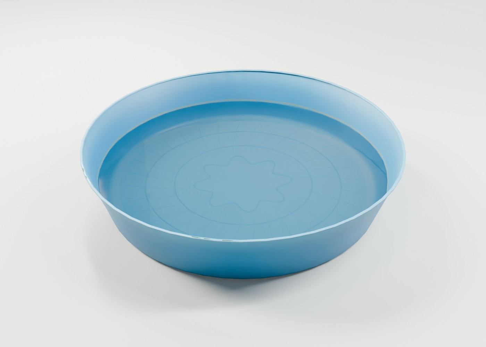
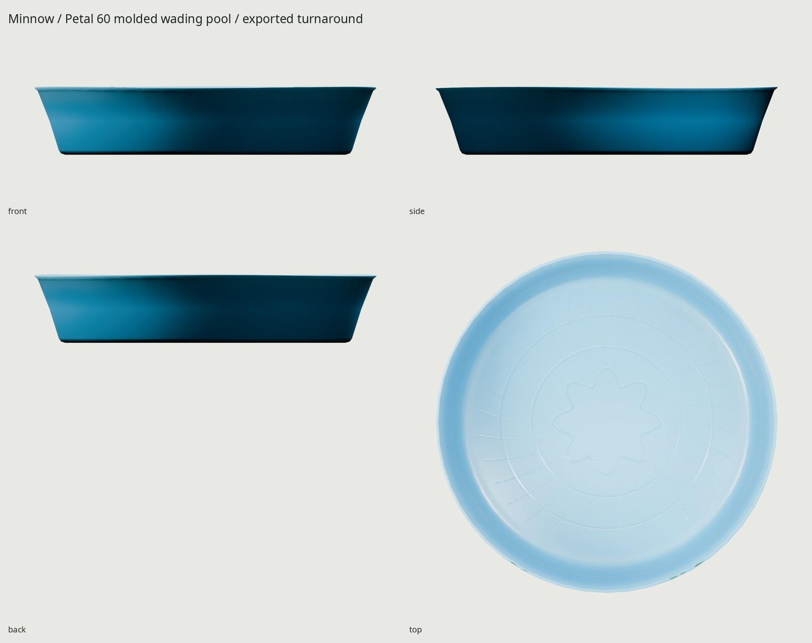
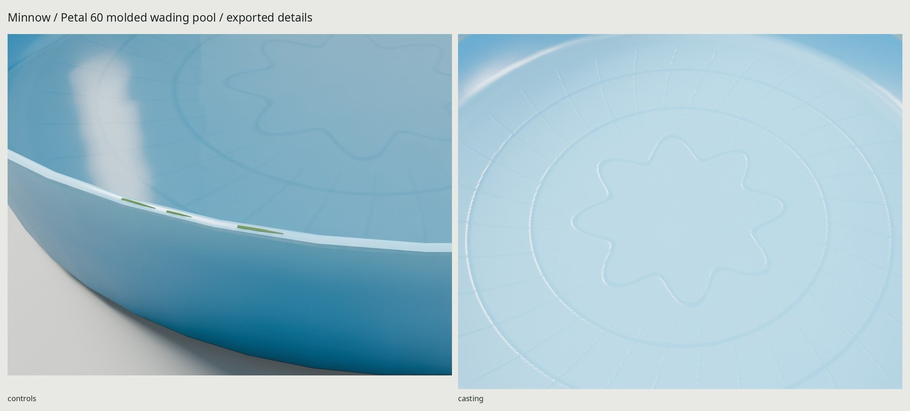

# Minnow / Petal 60

An original five-foot rigid molded wading pool with a thin curled rim,
twelve wall flutes, molded petal-and-ring floor relief, a prior waterline and
five wet grass clippings. Optional clear water is a separate node. Every
vertex, surface pattern and texture is generated by scripts.



## Dimensions and references

[REFERENCE.md](REFERENCE.md) separates cited manufacturer/retailer measurements
from authored construction choices. [refs/SOURCES.md](refs/SOURCES.md) credits
all inspection photos. The 60 × 12 inch assembled size comes from product
listings; the manufacturer's HDPE/rolled-edge/nonslip description establishes
construction. No real pattern, printed graphic or brand is copied.

| Actual default measurement | Result |
| --- | --- |
| Nominal cardinal diameter | 1524 mm / 60 in |
| Shell maximum height | 304.8 mm / 12 in |
| Wall gauge, measured at 24 flute crest/valley rays | 1.80 mm |
| Floor plane above ground | 2.4 mm |
| Optional water plane | 140 mm above ground |
| Water-to-floor separation | 137.6 mm |
| Water edge-to-inner-wall clearance, 48 rays | 1.05–5.48 mm |
| Ground / footprint-origin error | Z=0 / 0 mm |
| Grass/rim contacts | All five measured on actual surfaces |

Wall/floor gauge are original design assumptions, not manufacturer claims.
The unsupported upper lip has up to 5.5 mm downward warp plus slight inward
waviness; cardinal diameter and the flat ground-contact floor are preserved.
The real curled profile includes a free return underneath, rather than a
solid ring on a bucket. A few millimeters of clearance keep the optional
water edge inside the actual polygonal shell.

Meters, +Z up, front −Y; glTF is +Y up, front +Z. The basin origin is centered
on its ground footprint. All mesh transforms are applied. The pool has no
moving mechanism or armature. Hide the **Water** node for an empty, still-damp
pool. Its mesh is a 48-triangle open surface at Z=140 mm; this is a documented
example fill, not a maximum capacity or a simulated fluid volume. Water uses
KHR_materials_transmission with IOR 1.333 and a tiny baked ripple normal.
There is no animated water, buoyancy or bending simulation.

## Materials and cost

**1,936 triangles** including the optional water and all clippings, within the
500–2,000 brief budget. Dry pool: 1,888 triangles. The actual thin rolled shell
uses 1,728; original floor detail stays in the normal map. Source and game share
identical triangulation to keep thin-shell projections stable.

Two delivered materials—opaque HDPE/grass and clear water—share **one 1024²
BaseColor / OpenGL +Y Normal / ORM set**, baked at 4096². ORM is R occlusion,
G roughness, B metallic. The same three embedded images are explicitly shared
across both materials: approximately **4 MB compressed GPU texture memory**.
1024 retains the thin waterline, grass color and molded relief more reliably
than 512. No alpha cards, imported textures or HDRIs are used.

UV coverage is 48.47%, with no measured overlaps, outside or degenerate UV
triangles; p5/median/p95 density about 217/282/296 px/m. Fine source molding
microstructure averages out at game distance. GLB: **974,256 bytes**. Embedded
BaseColor / Normal / ORM: 275,953 / 293,632 / 295,272 bytes.

`WEAR=0.35` represents a few seasons of ordinary outdoor use. Upward exposure
and the upper rim drive sun fading against protected blue. The previous fill
height drives broken mineral residue, floor-wall cavities catch dirt, and
only the exterior ground edge receives bottom grime. Rim edge contact drives
stress-whitened scuffs. Wet arcs follow the clipping/splash sectors, and the
molded traction crests polish from contact. Fine uniform noise describes the
manufactured plastic grain; it is not a whole-floor dirt mask.




## Rebuild and proof

Requires installed Blender 5.2.2, Python/Pillow/NumPy and flock. Only credited
inspection JPGs are retrieved. No scripts, models, shaders, textures, HDRIs or
software are downloaded.

```sh
make                         # references, source, UV, 4K GPU bake, GLB, studio, checks
make check                   # budgets, scale, UVs, normals, import, physical surfaces, Git
make match PASS=source-match WIDTH=1000 SAMPLES=40
make match-final PASS=shipped-match WIDTH=1000 SAMPLES=40
make WEAR=0.65
make clean && make
```

Every Cycles pass uses the shared GPU flock and explicit GPU selection. Same
seed/parameters reproduce geometry; GPU map bytes may vary within ordinary
floating-point noise.

| Local output | Contents |
| --- | --- |
| `export/KiddiePool.glb` | Basin and optional Water nodes, shared embedded atlas |
| `textures/bake/`, `textures/ship/` | Three 4096 bake / 1024 delivery maps |
| `build/*audit.json`, `uv-report.json`, `delivery-check.json` | Geometry, UVs, normals, material/image sharing and fresh GLB import |
| `build/construction-*.json` | Actual ground/origin, water height/wall/floor, gauge and grass contact proof |
| `renders/final/contact.jpg` | Ten delivered Cycles views and Eevee last |
| `renders/final/` | Wet/dry heroes, four-view turnaround, rim/floor/waterline details and 1.8 m silhouette |
| `renders/final-eevee/hero_open.png` | Eevee from the same baked GLB |
| `renders/used-review/used_estate-pair.jpg`, `renders/review-glb/used_estate-pair.jpg` | Source/exported used-pool weather comparison |
| `docs/` | Three final JPGs, ≤1600 px wide and ≤200 KB each |

The round estate-sale pool's actual dimensions and age are unknown. Four rim
landmarks give an estimated 68.8 mm lens and 2.39 px RMS; these calibrate framing,
not its physical age or our dimensions. The retailer construction camera fits
at 8.21 px RMS after correcting perspective-circle correspondences. Our
unprinted pattern and faded blue are original. [REVIEW.md](REVIEW.md) records
critique, fixes and the limits of those comparisons.

All vertices, texels, grass and studio lighting are original scripts. Reference
images remain their owners' copyrighted inspection aids outside Git. Studio
labels use the installed open-license Noto Sans font. No new kit feature,
installation or external service is needed for the pool.

Delivery checks pass on source and fresh GLB import. The floor relief softens
at 1024 and grass reads as narrow strips at close range; the 48-sided lip can
show small facets. The required Eevee view is the dry pool: screen-space
transmission rendered the optional water black despite enabled ray tracing.
Cycles water views are correct; real-time water needs engine-specific setup.
