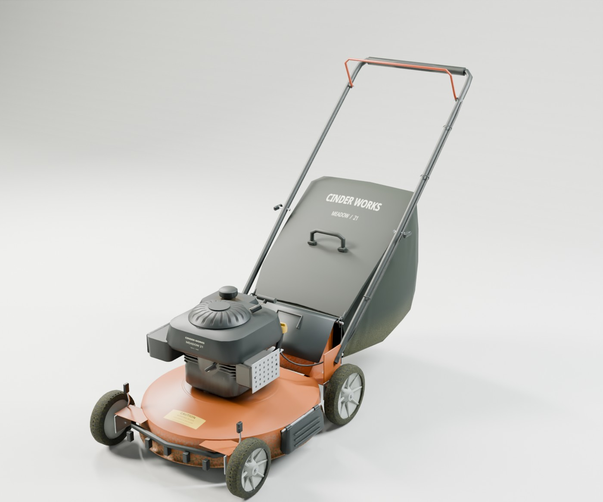
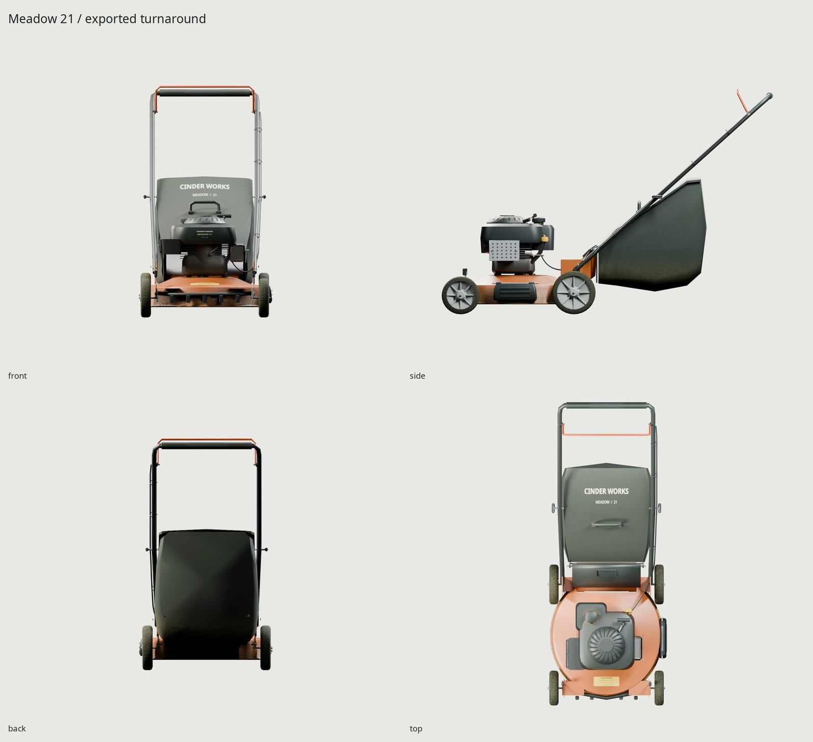
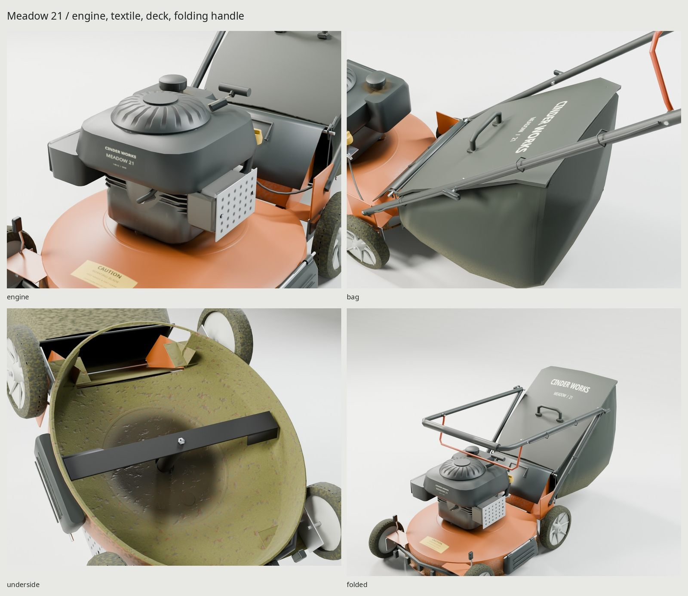

# Cinder Works / Meadow 21

An original, used American 21-inch gas push mower: copper-orange stamped steel,
black engine shrouds, four individually adjusted wheels, folding tubular handle
and a molded-top woven rear grass bag. It is manually pushed; there is no drive transmission.
Every vertex, shader, marking and studio light is generated by our scripts.



## Dimensions and reference

[REFERENCE.md](REFERENCE.md) distinguishes manufacturer specifications from
our design estimates. The TB120B specification establishes the 21-inch class,
140 cc vertical-shaft engine, 7/8-inch tires and 1.9-bushel catcher class. Its
photos and older parts manual establish construction. The design, individual
height adjusters, styling and Cinder Works branding are original.

| Feature | Reference / design | Actual game geometry |
| --- | --- | --- |
| Blade length | Published 21 in | 533.4 mm |
| Front / rear tire diameter | Published 7 / 8 in | 177.8 / 203.2 mm |
| Wheelbase / wheel center spacing | Design estimate | 530 / 538 mm |
| Overall operating envelope | Original design, released bail | 608.8 × 1550.9 × 1056.3 mm |
| Main deck gauge | Stamped steel estimate | 2 mm, with a returned rolled hem |
| Handle / bag frame | Construction estimates | 22 / 6 mm outside diameter |
| Blade height at this fixed setting | Reference class cuts 31.75–95.25 mm | 75–79 mm blade body surfaces |
| Handle grip center height | Ergonomic estimate | 1023 mm |
| Bag | 1.9 US bushel class | Tapered cloth envelope; not a certified volume |

`build/geometry-check.json` measures the actual wheel diameters, ground contacts,
blade span, rotating blade/chamber clearance, held-bail gap and footprint bounds.
Measured blade/chamber radial clearance is at least 9.95 mm; the held bail is 0.37 mm from the grip. These are physical checks on the finalized mesh. The GLB re-import check separately
proves that export preserves geometry and pivots.

## Construction and use wear

The drawn deck has an open underside, central spindle clearance, side discharge
port behind a closed molded mulch cover, an open rear throat and a rising folded
tunnel into the bag. The blade, upturned sails, spindle adapter and retention
bolt are present for underside inspection. Stamped outrigger shelves/returns
carry the four steel height plates; spring levers have molded finger tabs.
The deep-dish wheels have open hub bores, plated axles and nuts, molded radial
ribs and rubber tires. Tire lugs are high-source detail baked into the normal map.

The engine separates a cast sump, barrel/cooling fins, blower shroud, recessed
recoil dome, fuel tank/neck/cap, filter body/cover, muffler and pressed heat
shield, oil tube/yellow dipstick, ignition boot and cord. Small casting ribs,
screw detail, cap ribs and shield perforations are source detail for baking.

The lower handle bolts to deck brackets; the upper U folds on transverse clamp
bolts. The 9 mm coated-steel operator-presence bail seats in two molded pivot
bosses. Released, it stands forward of the operator grip; held, it lies against
that grip. A 5.6 mm Bowden sheath follows the right handle under three wrap clips,
then drops into a slack loop below the bag mouth and enters the engine brake
bracket. The recoil T pull rests at its engine outlet with its cord retracted.

The bag's hooked mouth frame rests on a rear cross-pin. Long support wires and
a rear hoop carry the bulging fabric sides and sagged bottom. Five cross-section
loops form the fabric silhouette, with a bowed rear panel, corner gathers,
stitched welt and weave in the normal map. The crowned molded polypropylene top
has returned edges and a thick carrying handle. Its inlet is open; the fabric
is an efficient double-sided shell. The molded canopy and fabric share the atlas.

`WEAR=0.35` represents several mowing seasons. Olive and green-brown dried clippings cake the interior
wall and discharge path, with the heaviest load in the outer blade-throw band.
Broken-away cake reveals bare oxidized steel rather than orange paint. The
accepted exterior lip and tire shoulder staining is retained.
Oil darkens the sump toward its lower seam; fuel wetting follows the cap neck.
The bag fades on exposed surfaces and abrades at its rear and lower seams.
Boot scuffs break deck paint; the grip is polished where hands bear on it.
Noise breaks up those physically located masks; it is not a whole-object dirt
wash. The final hero must show the lip and tire residue at full framing.



## Pivots and storage

Meters, Blender +Z up, front −Y. `LawnMower` is the center of the operating
footprint at ground level. The deck center is offset −4.4 mm in X and −416.55 mm
in Y to account for the handle and outboard side cover. glTF maps Blender
`(x,y,z)` to `(x,z,−y)`; Blender X remains glTF X. No armature or animation clips.

| Node | Blender axis / range | World pivot, mm |
| --- | --- | --- |
| `Wheel_FL` | X, continuous | (−273.4, −686.55, 88.9) |
| `Wheel_FR` | X, continuous | (264.6, −686.55, 88.9) |
| `Wheel_RL` | X, continuous | (−273.4, −156.55, 101.6) |
| `Wheel_RR` | X, continuous | (264.6, −156.55, 101.6) |
| `HandleFold` | X, 0…135° | (−4.4, 233.45, 550) |
| `OperatorBail` | X, −64.5…0° | (−4.4, 663.45, 937), child of fold |

All requested moving parts are separate. Mesh transforms are applied. Engine
control supplies rotations; no animations are included. The fixed height levers
represent one cutting-height setting; height adjustment, blade spin, bag removal,
side-cover opening and rear-flap movement are outside the requested motions.

Before folding, unclip/reroute the lower brake service span. `ServiceSpans`
retains that loop as a removable mesh; the folded demonstration hides it. It is
**not** a cable deformation simulation. The handle and thicker bail stay attached
and clear the engine and bag throughout the tested 135° storage sweep. The
retracted starter cord and pull remain on the engine.

`make check` sweeps all wheels every 30°, the bail at steps no greater than 2°,
and the handle every 3°, in both high and game scenes. It permits the documented
axle bores and hinge tube laps. Flexible service spans are excluded only from
the handle sweep. An independent axial gap measurement proves tire/support
separation for every rotation angle; sampling alone is not continuous collision
detection. The held-bail detail demonstrates the end of its allowed travel.

## Delivery and rebuild

One **2048² BaseColor / OpenGL +Y Normal / ORM** set, one PBR material. ORM is
R occlusion, G roughness, B metallic. Baked on the GPU at 4096², then linear-light
color, RMS roughness and vector-normal filtering produce 2048² delivery. The
normal intermediate is 16-bit. Estimated compressed GPU allocation is **16 MB**
for the three maps; PNG/GLB disk bytes are separate from runtime block compression.

| Measured delivery | Result |
| --- | --- |
| Exported / high triangles | **14,942 / 45,426** (delivery cap 15,000) |
| GLB | **10,247,348 bytes** |
| BaseColor / Normal / ORM PNGs | **2,781,210 / 3,123,972 / 3,406,288 bytes** |
| Materials / texture sets / mesh draws | **1 / 1 / 8** (body, 4 wheels, fold, bail, service span) |
| UV coverage | **56.32%** |
| Density p5 / median / p95 | **485 / 752 / 931 px/m** at 2048 |
| Measured UV contacts | **4**, total **1.32 shipped texel²** |
| Re-import maximum vertex error | **0.000 mm** |


Moving roots bake in isolated projection groups, with source-coordinate frames
preserved. Source-only markings and manufacturing relief are folded into the
same atlas. No reference photograph enters any material or exported texture.
An independent second game build has the identical geometry/world-transform SHA-256 (`build/determinism.json`). GPU texture bytes are not promised bit-identical.

```sh
make                     # refs, source, UVs, GPU bake, GLB, final studio, docs, checks
make check               # topology, budgets, scale, UVs, normal maps, GLB, motion, supports, Git
make model               # procedural high source only
make preview             # quick source preview (configured common views)
make render PASS=source-review SHOTS=hero_closed,engine,bag WIDTH=1100 SAMPLES=32
make match PASS=photo-review WIDTH=1100 SAMPLES=32
make match-final PASS=photo-review WIDTH=1100 SAMPLES=32
make WEAR=0.0             # clean manufacturing variant, same geometry
make WEAR=0.65            # heavier use, same geometry
make clean && make       # full regeneration
```

Requires installed Blender 5.2.2, Python/Pillow/NumPy, open Noto fonts, flock and
OptiX/CUDA. Every Cycles invocation uses the shared GPU lock. `TMPDIR` and scratch
files live in this worktree's `build/`; downloaded photos/manuals stay in ignored
`refs/`. Nothing is installed or uploaded. There are no kit changes.

| Local output | Contents |
| --- | --- |
| `export/LawnMower.glb` | Embedded PBR atlas, body, four wheels, bail, fold and service spans |
| `textures/bake/`, `textures/ship/` | 4096 bake / 2048 delivery maps and reports |
| `build/lookdev.blend`, `game-audit.blend`, `finalized.blend` | Original high, game and packed UV scenes |
| `build/*-audit.json`, `uv-report.json`, `delivery-check.json` | Source geometry, UV and independent GLB re-import proof |
| `build/motion-*.json`, `construction-check.json`, `geometry-check.json` | Physical assembly and motion measurements |
| `renders/final/contact.jpg` | All final GLB Cycles views plus Eevee |
| `renders/final/` | Hero, four-way turnaround, engine, bag, underside, folded, held bail, 1.8 m scale |
| `renders/final-eevee/hero_closed.png` | Same baked GLB under Eevee |
| `renders/owner-fixes-used-glb/match_used-pair.jpg` | Current exported-GLB comparison against an in-service mower, ignored |
| `docs/` | Three final JPGs, ≤1600 px and ≤200 KB each |



## Review limits and credits

[REVIEW.md](REVIEW.md) records the critique passes, bake rejection and fixes.
The reference mower differs in engine, rear wheel size and catcher construction;
photo matches are comparative camera estimates, not exact replica proof. Tiny
fasteners and tread lose relief at 2048, and the fabric remains more regular than
real sewn cloth. The engine's simplified castings and repetitive shield holes
are the weakest close-up areas. The cable storage procedure is manual as above.
No fluid, cloth, clipping or engine simulation is included.

Original geometry, textures, lighting and fictional graphics by this repository's
scripts. Noto Sans is SIL OFL. Photos/manuals are credited in
[refs/SOURCES.md](refs/SOURCES.md), for measurement and local comparison only.
The used Famartin photograph is CC BY-SA 4.0; the GPS 56 photograph is CC BY 2.0.
Comparison composites are ignored and carry adjacent credit files. Final docs
contain only our generated asset. The read-only rifle, gas grill and patio heater
informed the procedural pipeline; no outside model or texture was loaded.
