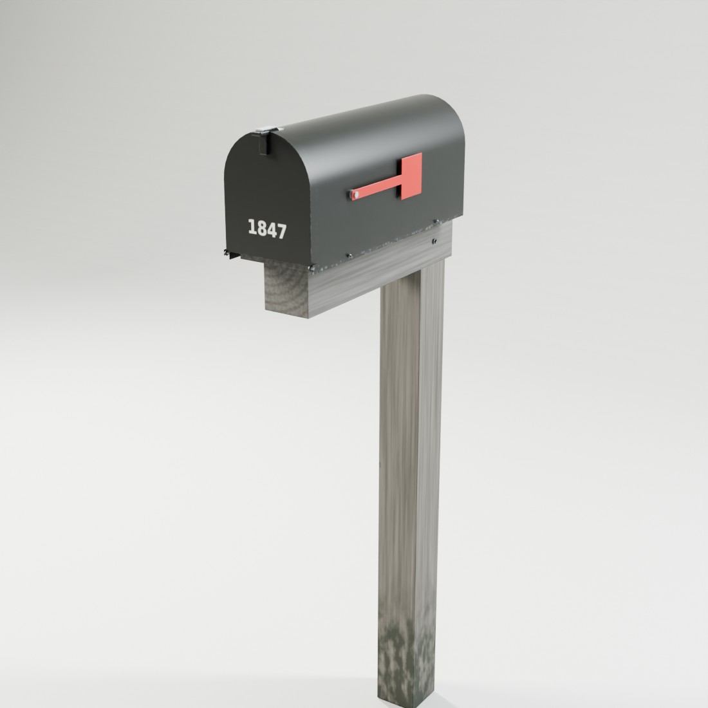
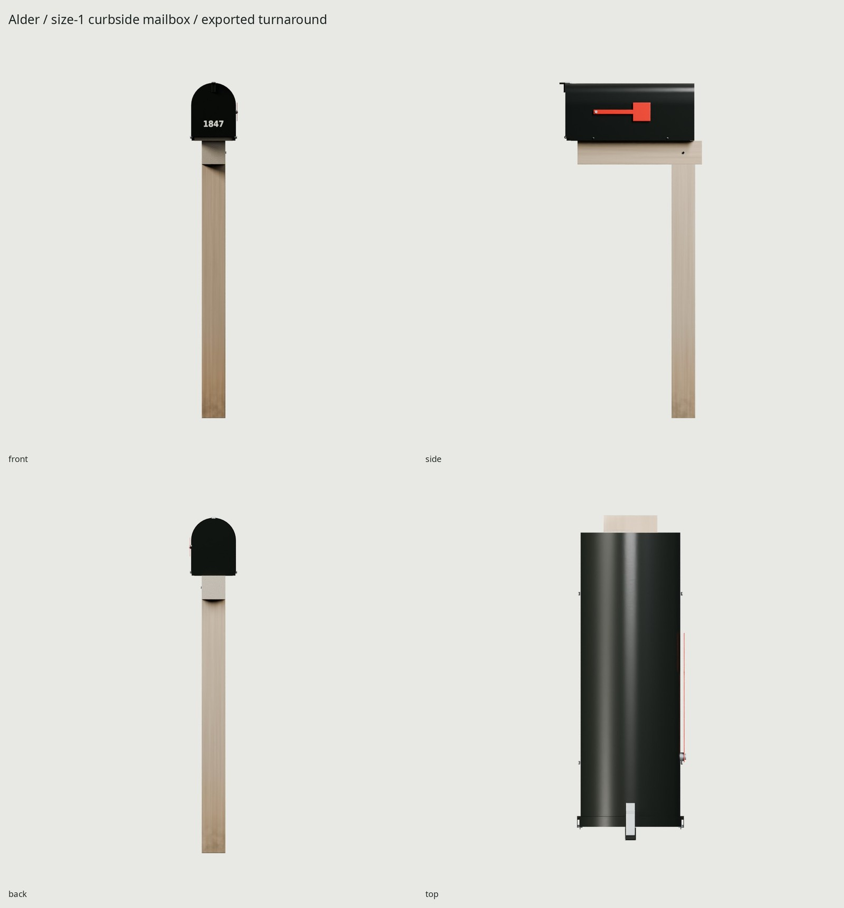
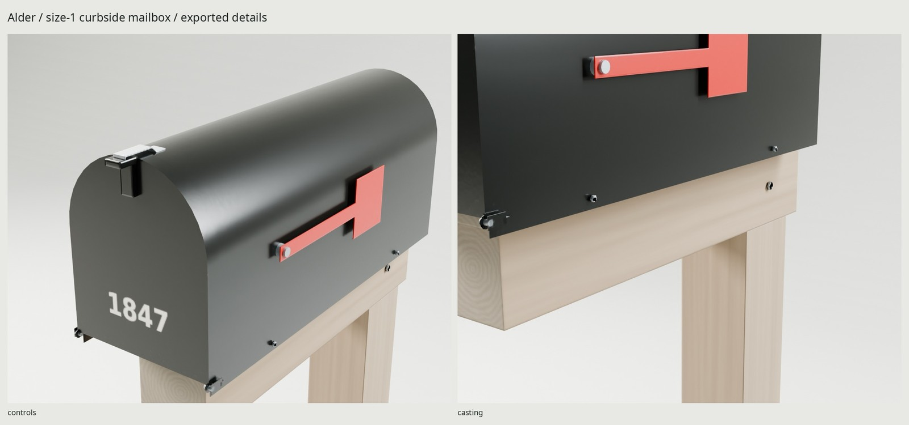

# Alder / size-1 curbside mailbox

Original black powder-coated galvanized-steel mailbox on a dressed wooden 4×4
post and half-lap mounting arm. The pine has silvered grain/checks and a darker,
road-splashed foot after a few outdoor seasons. The bent shell is hollow, with a closed rear,
pressed metal floor, returned front door, real hinge bores and an independent
red signal flag. Small pressed floor dimples and coating wear are baked detail.



The historic size-1 shell is **482.6 mm long × 165.1 mm wide × 215.9 mm high**
(19 × 6.5 × 8.5 in). The mail floor is **1066.8 mm / 42 in** above the road-height
datum. The post is **88.9 mm square** (dressed nominal 4×4); arm and mounting
board are 88.9 and 19.05 mm thick. Door returns/hinges/catch extend beyond the
nominal shell. Assembled bounds: **180.6 × 538.3 × 1269.65 mm** in the closed/rest
pose. [REFERENCE.md](REFERENCE.md) distinguishes references from authored internals.

Origin: center of the post's ground footprint, +Z up and front −Y in Blender;
glTF +Y up / +Z front. Terrain and the USPS 6–8 inch curb setback are placement
choices. There is no underground post tail or concrete block in the export.



The **2,082,780-byte GLB** uses **1,264 triangles**, **one material**, and three rigid meshes:
static shell/support, door, flag. One **1024² BaseColor / OpenGL +Y Normal / ORM**
set, baked at 4096², costs approximately **4 MiB** with BC7/BC5-class compression
and mipmaps. ORM packs occlusion, roughness and metallic in R/G/B. Engine import
should treat BaseColor as sRGB and Normal/ORM as linear. `WEAR=.45` adds edge
chips, cavity drips, lower-post dampening and fiber checking; `WEAR=0` retains
the manufactured coating and wood grain only. UV coverage is 71.15%, with zero measured overlaps;
density p5 / median / p95 is approximately 595 / 744 / 1005 pixels per meter.

| Pivot | Blender position, meters | Local axis | Range |
| --- | --- | --- | --- |
| Door | (0, −0.4453, 1.0603) | +X | 0 closed → 105° outward/down |
| Flag | (0.08905, −0.33, 1.1561) | +X | 0 stowed → 90° raised |

The glTF importer converts axes; use the named node's local X for both motions.
Keep static, Door and Flag meshes separate. No armature or animation clips.
An engine controls the pivots; the retained names/extras document the ranges.



```sh
make                          # references through final GLB, renders, docs and checks
make check                    # source, UV, serialization, support and motion tests
make PASS=review match        # source / photograph comparison
make PASS=review match-final  # shipped GLB / photograph comparison
make WEAR=.8                  # dirtier variant
make clean && make            # reproduce from scripts
```

`BAKE_POLICY` isolates Door and Flag high/low groups, with separate stationary
contact-AO shadows. This uses the merged kit implementation; no manual exploded
fallback was needed. `textures/bake/bake-report.json` records actual offsets and
group counts. `build/delivery-check.json` proves GLB serialization, atlas and
normal validity. `build/assembly-check.json` measures physical support surfaces.
`build/motion-game.json`, `motion-high.json` and `motion-glb.json` test the physical
source and imported meshes at one-degree steps, with 0.05 mm penetration
tolerance. Sampling is explicit; it is not a mathematical continuous sweep.
The flag's plane stays outside the shell for its entire rotation by construction.

Final Cycles hero, four-view turnaround, hardware/timber close-ups, open pose,
1.8 m human scale, and Eevee live in `renders/final/`, `renders/final-eevee/`.
The complete sheet is `renders/final/contact.jpg`. Shot metadata records the
exported GLB hash. [REVIEW.md](REVIEW.md) logs source and final GLB critique.

All geometry, shaders and address graphics are generated here. Address 1847 is
fictional; DejaVu Sans is an installed open font. Manufacturer photographs are
comparison only; rights and URLs are in [refs/SOURCES.md](refs/SOURCES.md).
Needs installed Blender 5.2, Python/Pillow/NumPy and flock. No downloaded assets,
lighting, plugins or packages. The small sheet gauge, rear seam and wood fibers
soften at street distance, and tiny baked fasteners darken more than the source; the historical shell differs from the modern reference
product's precise latch/flag construction.


Phase 2 used-object comparison: `renders/wear-pass3-glb/used_black_post-pair.jpg`
(source counterpart under `renders/wear-pass3-source/`). The fitted residual is
22.49 px at 1100×900; the photograph has a different flag/latch and does not
establish our dimensions. Pine uses `kit.materials.weathered_wood()` with
separate timber-grain and grade frames, a silver-gray tone and stronger local
road splash. Shell chips stay on manufactured folds; Door masks recover hinge
rest height and the flag excludes lower-shell deposits. The texture set is
unchanged: BaseColor / Normal / ORM 645,381 / 638,621 / 703,649 bytes at 1024².
The small fibers/checks soften at street distance; broad silvering and the dirty
foot remain visible in the full hero.
