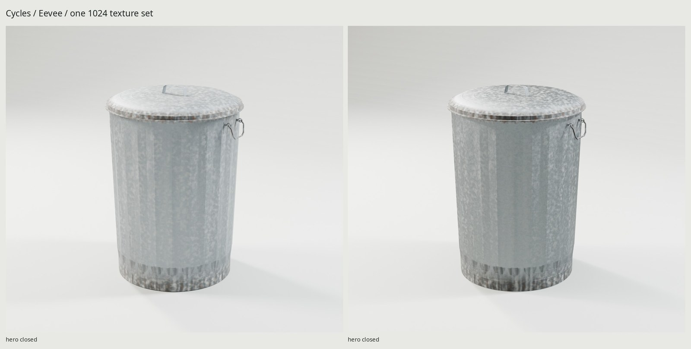
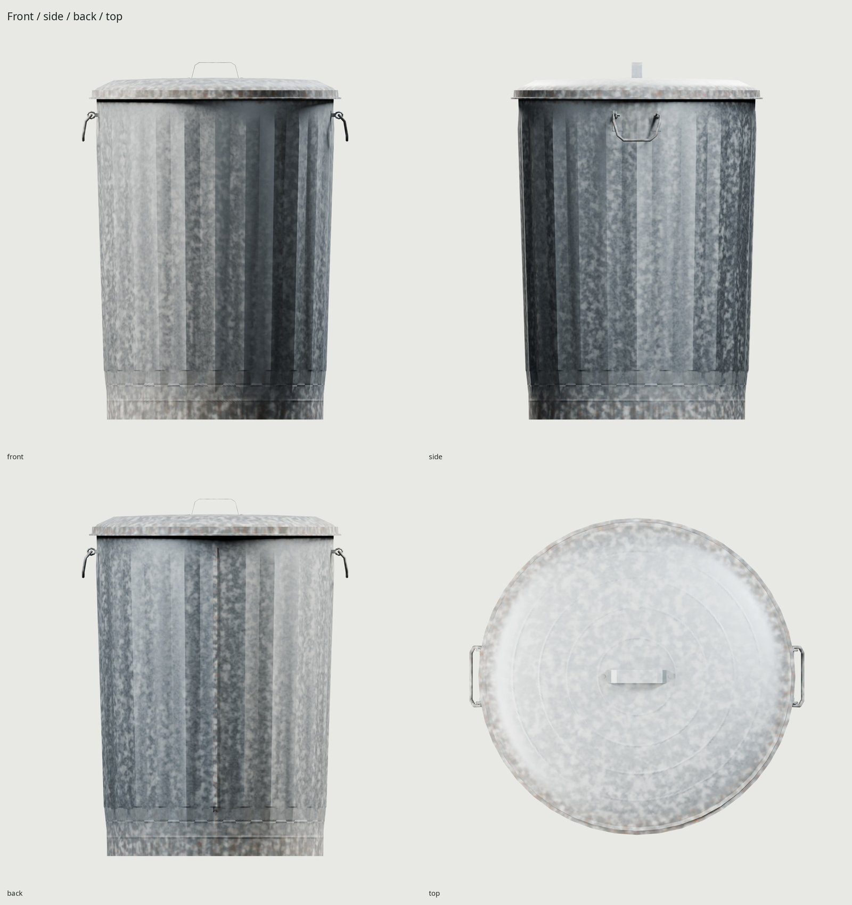
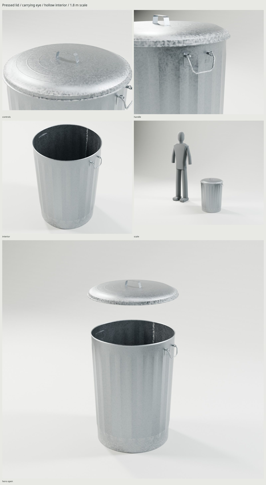

# Galvanized garbage can

An original, weathered 31-gallon steel garbage can: corrugated tapered sheet,
folded rear seam, rolled mouth, elevated floor and lower chime, removable
pressed lid and three carrying handles. The lid and the two side wire loops
remain independently movable. Every vertex and texel comes from the scripts.





The [manufacturer's 2021 catalog](https://www.behrens.com/wp-content/uploads/Behrens-Catalog-2021.pdf)
gives the 31-gallon class a 21-inch diameter and 29¾-inch overall height. The
current product page contains conflicting widths, so the dated catalog controls
this design. [REFERENCE.md](REFERENCE.md) distinguishes published dimensions
from authored construction estimates; [sources](refs/SOURCES.md) identify all
photographs and their rights. Photos are measurement/review only.

| Measurement | Modeled value |
| --- | --- |
| Lid diameter | 533.400 mm / 21 in |
| Overall height, including bridge handle | 755.650 mm / 29¾ in |
| Lower chime diameter | 457.200 mm / 18 in |
| Width including hanging side handles | 563.784 mm |
| Sheet / lid gauge | 0.65 / 0.80 mm, authored estimates |
| Elevated floor, actual inside / underside | 17.000 / 16.350 mm above ground |

Capacity is the nominal 31-gallon class; internal volume is not certified.
The original lid and bridge are a classic construction rather than a copy of
the reference manufacturer's patented lid. There are no commercial markings.

One material and one **1024²** BaseColor (sRGB), OpenGL +Y Normal and ORM
(R occlusion, G roughness, B metallic) atlas serve the complete assembly.
The exported asset is **4,928 triangles**, inside the 2,000–5,000 budget, in
four mesh objects. The GLB is **3,485,008 bytes**. Budgeted texture residency is approximately **4 MB** with
block compression and mipmaps. Engines may generate distance LODs on import.

The source uses angular zinc crystals, exposure dulling, broken white oxide
where rain and folded joints retain water, early rim/seam rust, and dark
handling and low-skirt grime. Restrained handling dents remain unchanged. `WEAR` controls use-related layers.
Small pressed beads and grain reside in shader microrelief. Other channels
use the kit's isolated high-to-low projection and stationary contact AO; the
normal is baked directly on the matching game shell to avoid projection
across the 0.65 mm wall. All maps are baked at 4096 before delivery filtering.
No texture repair, reference projection, downloaded material or HDRI is used.
Delivered PNG bytes are BaseColor 1,274,044; Normal 327,667; ORM 1,626,619.
The imported atlas covers 56.77%, with zero measured overlap/outside/degenerate
triangles and density p5/median/p95 of 406/448/471 px/m.

| Part | Pivot in Blender meters | Motion |
| --- | --- | --- |
| `MetalTrashCan` | (0, 0, 0) | Ground-footprint center; +Z up, front −Y |
| `Lid` | (0, 0, 0.714) | Removable; demonstrated +Z travel 0–0.600 m |
| `Handle_Left` | (−0.262, 0, 0.644) | Local Y, 0–95° outward |
| `Handle_Right` | (0.262, 0, 0.644) | Local Y, 0 to −95° outward |

The eye bores retain actual axle portions of the wire. The construction check
measures the lid/rim contact, floor gauge and retaining-eye support on source
surfaces. The kit sweeps high and game meshes at 10 mm lid steps and 2° handle
steps. The closed rim permits a declared 0.5 mm seating tolerance; each handle
uses 0.4 mm and only its intended eye-bearing contact is allowed. These are
sampled checks, not a claim of continuous collision certification. GLB
verification separately checks that serialization preserves geometry and pivots.

```sh
make                        # references through final renders/docs and checks
make check                  # geometry, UVs, normals, GLB, motion and actual contacts
make WEAR=.65               # a more weathered version
make match PASS=source-review WIDTH=1000 SAMPLES=24
make clean && make          # rebuild generated delivery from scripts
```

Requires Blender 5.2, Python/Pillow/NumPy and `flock`. Cycles uses the kit's GPU
lock and OptiX/CUDA. Eevee adds a procedural studio sphere reflection capture
for the bare metal; it uses the same exported material and textures. The Makefile includes the unified kit rules and declares
1024 delivery size; asset-specific code handles the thin-sheet normal pass.

The GLB is `export/MetalTrashCan.glb`, textures are in `textures/ship/`, and
source/UV/export/check JSON evidence lives in `build/`. Final Cycles views are
in `renders/final/`, Eevee in `renders/final-eevee/`; all are imported GLB views
with source SHA-256 metadata. `renders/final/contact.jpg` contains the complete
set. `renders/photo-final/match_front-pair.jpg` compares the delivered GLB
against the reference photo. [REVIEW.md](REVIEW.md) records failures, corrections
and final delivery evidence.

The weakest areas are the thin pressed beads and zinc grain at close range:
the shared 1024 atlas softens them, and the restrained dents are simpler than a
heavily battered real can. The construction photograph shows a newer, more reflective can. Outdoor-use
calibration uses `renders/wear-pass2-glb/used_estate-pair.jpg` and the matching
source pair; landmark RMS is 18.01 px. Its original lid and handle construction
differs from the estate photograph, and studio illumination is brighter than
the shaded outdoor reference.

## LOD selection and motion evidence

The opt-in chain selects 3224 triangles at .25 screen height / 2.62m, down
from 4928. It misses the unchanged 1971 goal. Two reviewed requests retain
3284/3224; an actual 1968-triangle ordinary-collapse control shows dark vertical
streaks, a damaged lower silhouette and lid response errors at that same
switch. See [both LOD critiques and target witness](REVIEW.md). This is the
lowest reviewed passing count, not proof of a global minimum. No farther row
is added. Original 1024 maps, one material and four active draws stay canonical.

Lid, Handle_Left and Handle_Right retain the original separate frames, meshes
and ranges listed above. `make check-lod` also tests their actual imported
surfaces, including LOD_Static, at the original sample steps/tolerances. The
selected lid's measured .347733mm seating depth stays within .5mm; both handle
depths measure zero within .4mm. The source control passes too. Counts and
surface results are in `build/lod-motion.json`; this is sampled physical
evidence, separate from serialization. The original family check passes after
the LOD build, with accepted generated inputs explicitly frozen.

Native strips, differences and close views: `renders/lod/`; measured summary
and contact: `build/lod-rollout/metal-trash-can/report/`; cheaper native control:
`build/lod-rollout/metal-trash-can/goal-control/`. The table below is generated
by the frozen reporter. All 103 frozen tool hashes match; the original delivery,
maps and docs remain byte-identical.

<!-- LOD checkpoint: begin -->
## Additional LODs

`make lod` builds additional core glTF/BIN files and a manifest under `export/lod/`; `make check-lod` checks them. The existing delivery is immutable LOD0. Default `make` and `make check` retain their original build graph.

| Level | Triangles / target | Materials / draw calls | Geometry bytes | PNG bytes | Total load bytes | GPU unique textures + mesh, MiB | Switch height / distance |
| --- | ---: | ---: | ---: | ---: | ---: | ---: | --- |
| LOD0 | 4,928 / — | 1 / 4 | 256,678 | 3,228,330 | 3,485,008 | 4.000 + 0.2393 | near |
| LOD1 | 3,224 / 1,971 | 1 / 4 | 173,892 | 3,228,330 | 3,402,222 | 4.000 + 0.1607 | 25.0% / 2.62 m |

Chain check: True; image check: True; normal check: True.


Whole-chain resident GPU estimate: **4.400 MiB**, versus LOD0 alone **4.239 MiB**. Unique textures 4.000 MiB = 4.000 MiB original + 0.000 MiB proxy/impostor; all meshes 0.3999 MiB. Increase over LOD0 0.161 MiB = 0.000 MiB far maps + 0.1607 MiB additional mesh buffers. Intermediate new images: 0. Bind intermediate primitives to the canonical LOD0 material resources; the manifest records full image hashes and source image indices. Identical embedded/external PNG bytes require this resource binding to share GPU allocations, including duplicate original image entries. GPU columns deduplicate complete image hashes within each row; PNG/dependency bytes retain physical payload copies. Optional camera-facing impostor is a separate alternative; engine overhead is excluded.

Distances are to the bound center at 60° vertical FOV / 1080p. GPU figures estimate 8-bpp block-compressed textures with full mips plus raw accessor mesh bytes, before engine overhead. Per-level map bytes describe dependencies, including reused originals. The whole-chain estimate deduplicates canonical image resources. Targets and achieved counts are reported separately; a count alone does not establish visual acceptance.

Load these files as alternatives and configure Godot visibility ranges, Unity LODGroup renderers, or Unreal mesh/component LODs. Keep matching near pivots in the same pose during switching. [Engine sources, pixel thresholds and texture policy](../kit/LOD.md).

Near levels consolidate static parts by material and simplify moving parts while retaining names, pivots, sockets and animation data. Intermediate levels preserve original charts, attributes and LOD0 materials. Only the proxy receives new charts baked from the immutable delivered maps and shaders. Intermediate levels allocate no additional images.

Native-pixel LOD0/adjacent strips, amplified differences, close views and measured image status: `renders/lod/` (`contact.jpg`, `metrics.json`). Raw checks: `export/lod/check.json` and `export/lod/normals-vs-lod0.json`; per-level construction/pruning decisions: `build/lod/<source stem>/simplification.json` and manifest assembly receipts. [Critique, target misses and known failures](../kit/LOD_REVIEW.md).

Shipped PNG dimensions: LOD0: 3 × 1024×1024; LOD1: 3 × 1024×1024.

LOD1 separate moving meshes: `Handle_LeftMesh`, `Handle_RightMesh`, `LidMesh`.

Whole default chain:

| Stored mesh triangles | Material resources | Stored primitive placements | Distinct payload bytes | Resident GPU, MiB |
| ---: | ---: | ---: | ---: | ---: |
| 8,152 | 1 | 8 | 6,887,230 | 4.4000 |

Stored counts include the full immutable source container once and every default level; optional impostor alternatives are excluded. Near materials use their canonical source bindings. Physical payload files are counted once by path. Only one level is drawn per instance: active draw calls range from 4 to 4 across these kinds/levels. Stored primitive placements are not simultaneous runtime draw calls.

<!-- LOD checkpoint: end -->
