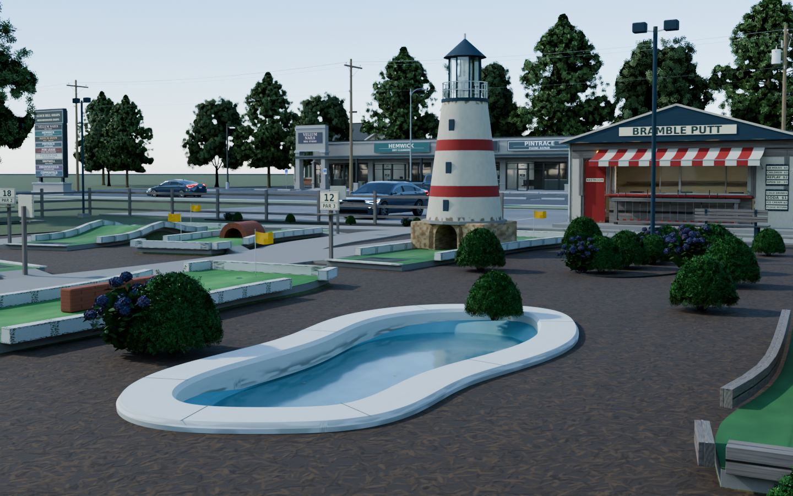
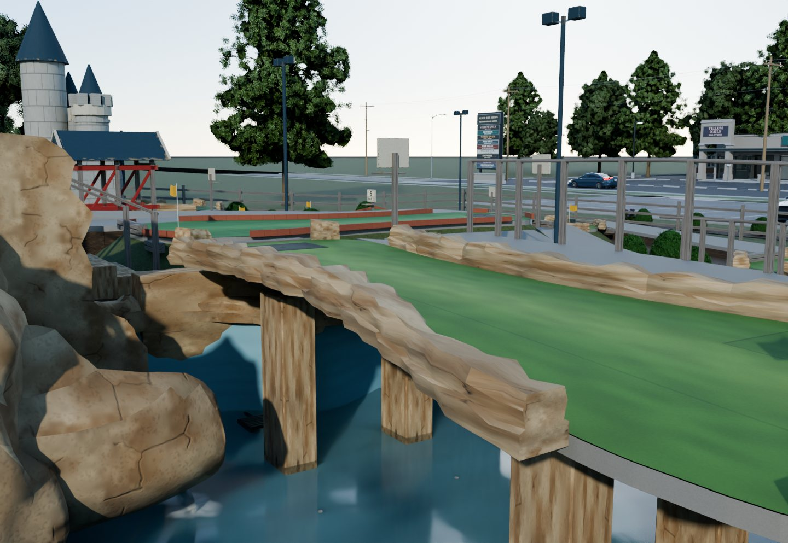
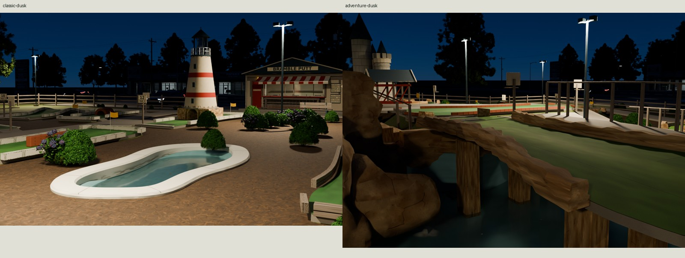
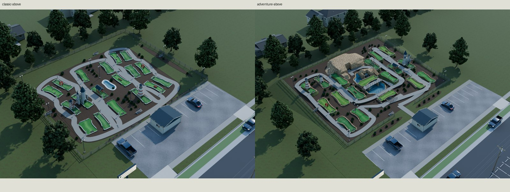
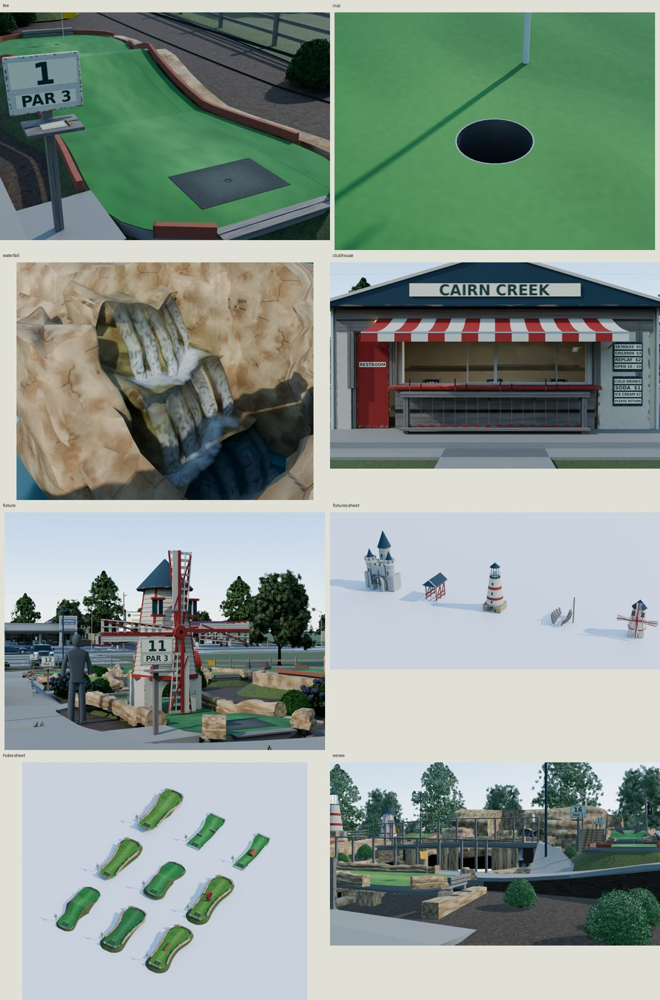

# Roadside miniature golf







Two original seeded 18-hole courses for a 1995–2015 American roadside setting.
**Bramble Putt** (seed 71) is an older repainted classic: shared winding walks,
concrete/brick/timber borders, faded traffic lanes, seams and repairs.
**Cairn Creek** (seed 92) is a newer 1990s-style adventure course: retained
terraces, a buff faux-rock quarry, a shallow painted stream and pond, a pumped
cascade, bridges and maritime fixtures. Both are in season and visibly used.

Every vertex, marking and material field is scripted. Fictional markings use
installed open-license DejaVu Sans, found through the kit font helper. Reference photographs
supply measurements and visual comparison only. The surrounding commercial
road, town buildings, cars, poles and distant trees are presentation context;
they are excluded from the course exports and costs below.

## Delivery and cost

| Course | Core triangles | Native plants, placed / unique | Complete triangles | glTF + BIN, core / complete bytes | Core / complete GPU images |
| --- | ---: | ---: | ---: | ---: | ---: |
| Classic 71 | 133,650 | 475,578 / 71,272 | 609,228 | 14,700,591 / 24,560,559 | 81⅓ / 129⅓ MiB |
| Adventure 92 | 202,239 | 634,154 / 71,272 | 836,393 | 22,992,871 / 32,878,261 | 81⅓ / 129⅓ MiB |

The cores use **10 classic / 11 adventure material states**; the separate
native landscape uses ten. These are shared texture bindings and transparency
states, not additional image sets.

Each construction scene references **16 canonical images / 81⅓ MiB**. With
optional native landscape it references **25 images / 129⅓ MiB**, shared
across both seeds by relative URI. Only **17⅓ MiB** is new: one 2048²
BaseColor/OpenGL +Y Normal/ORM set and a 1024² graphics sheet. Ground,
lumber and native vegetation reuse unchanged library maps. Memory assumes
8-bpp block compression, full mip chains and URI-based engine caching;
it is an allocation estimate, separate from PNG disk bytes. The 25 shared PNGs occupy 82,596,268 bytes on disk.
[TEXTURES.md](TEXTURES.md) describes bindings and intentional tiled UV overlap.

| Path | Contents |
| --- | --- |
| `export/Minigolf-{71,92}.gltf` + `.bin` | Complete construction, movable objects, Tee/Cup sockets and footprints |
| `export/Minigolf-{71,92}-landscape.gltf` + `.bin` | Optional co-located native shrubs and six perimeter trees; linked mesh instances |
| `export/MinigolfPieces.gltf` + `.bin` | 36 selectable hole modules and five standalone fixtures, coincident at the origin |
| `textures/ship/T_Minigolf_*.png` | Shared original baked maps and fictional graphics |
| `build/embedded/*.glb` | Self-contained verification mirrors; external images are the delivery format |

The piece library occupies **23,545,048 glTF + BIN bytes** and references
**65⅓ MiB** of shared images; these images are part of the allocation above.

Keep relative image paths intact, including the sibling `ground/`, `fences/`,
`trees/` and `shrubs/` folders. There is no duplicated `export/textures/` set.
The piece library is an assembly catalogue: select roots rather than displaying
all coincident modules as one scene. Hole modules retain their authored
vertical grade: use `hole_spec` / footprint extras and seat their measured
undersides in game terrain. The catalogue translates them to a flat stage;
it does not normalize or rebuild the delivered geometry.

## Dimensions and parts

[REFERENCE.md](REFERENCE.md) gives dimensions, construction sources and photo
landmark uncertainty; [refs/SOURCES.md](refs/SOURCES.md) gives credits and URLs.
Harris's published sections establish the four-inch base; Wittek's commercial
stock establishes tee-pad dimensions and carpet class. These are comparators,
not copied builder layouts.

| Part | Real-scale dimensions |
| --- | --- |
| Parcels including parking/hut | Classic 49 × 56 m; adventure 64 × 65 m |
| Fenced play area, measured from post meshes | 1,948.55 / 2,033.50 m²; 9.24 / 8.85 holes per 1,000 m² |
| Greens | 5.2–8.6 m long; 2.0–3.6576 m nominal width; .1016 m slab and .0048 m carpet offset |
| Cup / rubber tee | .10795 m clear opening, .1016 m liner depth and open drain; .9144 × .6096 × .003175 m mat |
| Walk / footbridge | 1.524 m circulation; 3.6 m span, .0381 × .1397 m joists and 1.067 m guards |
| Water | Main painted floor -.36 m, water -.17 m; shallow stream, three irregular spill crowns and routed 63 mm pump return |
| Clubhouse | 6.8 × 4.6 m; siding, service sash/counter, awning, prices, putters and ball stock |
| Parking / fence | 7.3152 m aisle, 5.4864 m stalls at 2.7432 m pitch; 1.18 m fence |

| Hole kind | Classic triangles | Adventure triangles |
| --- | ---: | ---: |
| Plain | 4,144–5,512 | 4,816–7,094 |
| Bank | 4,232 | 4,888–7,166 |
| Ramp | 4,232–5,512 | 4,888–5,992 |
| Bump | 4,232 | 4,888–6,080 |
| Tunnel | 4,376 | — |
| Loop | 4,924 | 5,580 |
| Drop | — | 5,552 |
| Dogleg | 4,320 | — |
| Split | 4,340 | 4,924–4,996 |

| Standalone fixture | Triangles |
| --- | ---: |
| Windmill | 5,536 |
| Castle | 3,524 |
| Covered Bridge | 988 |
| Lighthouse | 3,084 |
| Shipwreck | 6,428 |

Hole kinds include plain, bank, ramp, bump, tunnel, loop, drop, dogleg and
split. Carpet traffic follows tee-to-cup use; cup rims, exposed borders,
outer coping noses, splash faces and the painted basin
waterlines carry their own wear. Basins have smooth
bowl transitions; rock has ledges, mineral mottling, damp crevices and moss
at sheltered feet. Foam is a separate coverage-bearing mesh sharing the atlas.
Walks meet at trimmed joints; landings start at the actual combined paving
boundary, with level stair treads, equal risers and shaped timber bearing edges.

## Generator, placement and motion

`src/plan.py::generate(seed, kind=None)` selects dimensions, order, par, bends,
rises, carpet and fixture assignment. Kind defaults to seed parity; the proof
courses explicitly use `generate(71, 'classic')` and `generate(92, 'adventure')`.
The bounded grammar is checked on 250 seeds per kind. It is not arbitrary
parcel packing or a ball-physics simulation.

Import a course and its landscape companion with the same transform. Units are
meters, Blender +Z up / -Y front, exported as glTF `(x,z,-y)`. Origins are at
the parcel center and low-grade datum. Reserve the imported bounds, including
crowns beyond the fence. The course includes its ground: leave the pond and
stream excavation open in surrounding game terrain.

Fixed parts consolidate by owner/material; moving members keep their pivots.
Hole roots carry their Tee/Cup sockets, dimensions, feature and number in extras.
No armature or animation clips are included.

| Moving part | Blender local axis and range |
| --- | --- |
| Windmill rotor | Y rotation, 0–360°; bored hub on the actual shaft |
| Castle portcullis | Z translation, 0–.40 m from raised rest |
| Clubhouse door | Z rotation, -90–0° at jamb hinge |
| Service sash | X translation, -2.04–0 m; render inspection pose -1.40 m |
| Cup-marker flags | Z rotation, -30–30°; modeled cloth sag |

## Rebuild and proof

Installed Blender 5.2, Python/NumPy/Pillow, fontconfig and flock are required.
Every Blender operation runs serially through the kit GPU lock. Lighting is
procedural; no downloaded models, materials, textures, HDRIs or code are used.

```sh
make -C minigolf
make -C minigolf check
make -C minigolf repeat check-texture-repeat
# After viewing all final frames at native size:
make -C minigolf docs
```

`make` rebuilds exports, same-camera correction pairs, three photo matches and
three 4096-source-field comparisons, both eye-height heroes, dusk/above and
four-view turnarounds, detail/scale/Eevee frames, module sheets and contacts.
Turnarounds show the exported construction alone on a procedural surround,
with optional native plants and the presentation town omitted so nothing hides
the asset. Heroes, above views and photo matches retain the full setting.
`before-after` rebuilds the fe8acfc source in an isolated ignored directory.
All correction panels are 1440 px wide. The green comparison applies the
corrected photo fit to both exports; its photo pair separately proves framing.
The classic fit's 38.43 native-pixel RMS over a 2,892 px crop uses actual curb
corners within 5 mm of imported surfaces. The matched first green is at the rear right of both panels; the large
foreground green is a different module. The fit estimates a 22.7 mm lens;
different original green shapes and surrounding layouts remain visible.

Construction checks measure source surfaces, joints, supports and stair planes;
fresh-import checks measure cups, scale, normals, charts, density and motion.
A separate indexed-corner/image comparison proves serialization, not construction.
`build/{source-construction,check,look-check,external-check,costs}.json` retain
those scopes. Exact replay covers deterministic maps, glTF/BIN/JSON, embedded verification mirrors, source
construction receipts and procedural fields; real GPU rebakes have the kit's separate tolerance comparison.
[REVIEW.md](REVIEW.md) records native-size critiques and rejected candidates.

Final images are under `renders/final/`, with `contact.jpg`; correction pairs
under `renders/finish-fixes/`; photo pairs under `renders/look-matches/` and
`renders/source-matches/`. Only the five compressed gallery JPGs are tracked.

## Known flaws

The carved rock still repeats some creases at close range. Some short graded
walk connections retain fine facet shading, and narrow soil slivers remain
between adjacent curves. Water and soft foam
are static approximations, with no animated flow or fluid simulation. Carpet
fibers are below the delivered chart's sampling; traffic/seams/patches carry
its game-distance appearance. Native foliage has repeated card crowns; the mulch repeat is visible and
the beds remain tidier than many real courses. The compact original castle is less
elaborate than the reference. Photo fits compare different original designs
and layouts; their landmark errors do not imply a surveyed reconstruction.
Hole modules retain authored vertical grade rather than normalized ground
origins; individual placement needs terrain/underside seating as described
above. A placed course has many owner/material draws before engine batching; quoted
triangles and image allocations are not an engine performance guarantee.
