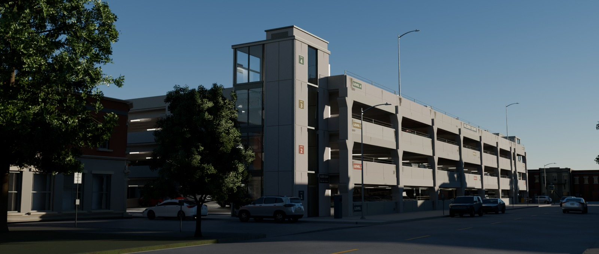
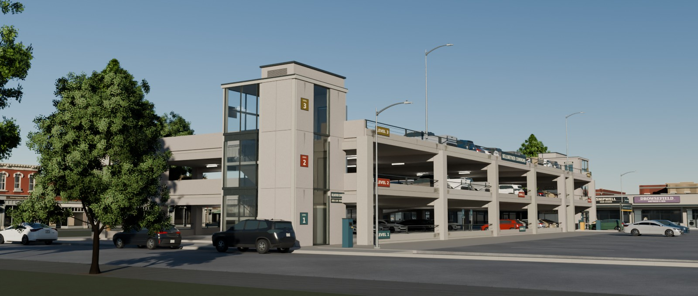
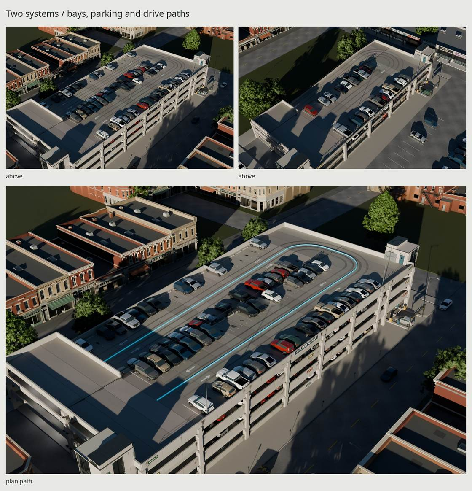
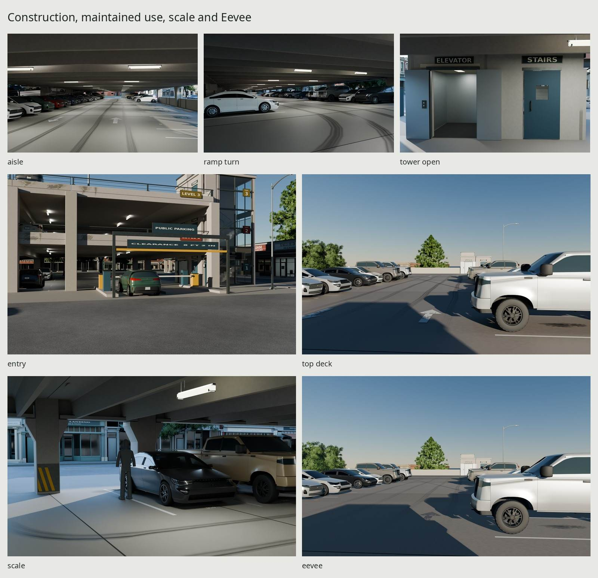
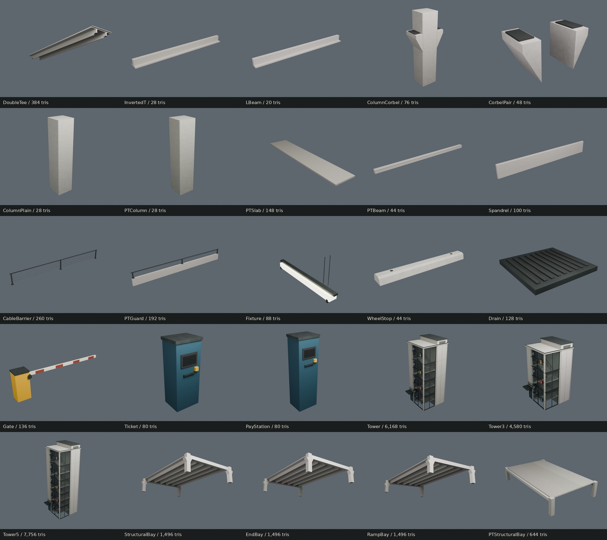

# Open parking garages







Two original American parking structures for a town of 1995–2015: **Alder
Quay**, a 1988 municipal precast garage, and **Bellwether Commons**, a 1996
cast-in-place post-tensioned garage beside a commercial center. Both are
scripted in Blender 5.2, at real scale, with shared external glTF images.

[All final views](renders/final/contact.jpg) ·
[Fixed-camera corrections](renders/delivery-fixes/contact.jpg) ·
[Final two corrections](renders/ruling-fixes/contact.jpg) ·
[Baked photographic pairs](renders/final-matches/contact.jpg) ·
[Source-finish pairs](renders/final-source-matches/contact.jpg) ·
[Critiques](REVIEW.md)

The municipal plan uses deep PCI-section double tees on seated girders, a
flat parking bay beside a full-rise parking ramp, four levels and a metered
Main Street frontage. The smaller commercial plan uses PT slabs/beams,
three levels, a separate speed ramp and a surface arrival court. Their towers
contain flights, landings, lift lobbies, shallow cabs and separately pivoted
doors. Neither plan is a reskin of the other.

| Seed | Structural footprint | Levels | Stalls / weekday occupied | Ramp |
| --- | --- | ---: | --- | --- |
| 101 | 80.4672 × 36.576 m | 4 | 291 / 196 | Parking ramp, 5.7292%, 58.5216 m run |
| 202 | 58.5216 × 25.6032 m | 3 | 76 / 56 | Speed ramp, 10%, 5% end transitions, 36.576 m overall |

Both use 2.5908 × 5.4864 m stalls (8.5 × 18 ft), 7.3152 m two-way aisles
(24 ft) and 3.3528 m levels (11 ft). Towers, entry gantry and roof poles
extend outside the structural rectangle. Dimensions and engineering choices
are distinguished in [REFERENCE.md](REFERENCE.md). The research includes
[PCI's parking FAQ](https://www.pci.org/GCPCI/GCPCI/Technical_Resources/FAQs/Parking-Structures.aspx),
[the Access Board parking guide](https://www.access-board.gov/ada/guides/chapter-5-parking/),
ACI 362, open-garage provisions and consultants' published geometry; exact
documents, photographs, authors and uses are in [SOURCES](refs/SOURCES.md).

One new shared concrete/steel triple carries manufactured pores, bed drag,
roughness, steel and eight original coverage fields. The assembly places age
where its cause acts: leaking panel/shaft junctions and failing seals,
connector rust, crystalline salts, repaired spalls, engine drips, wheel paths,
drain ponding, repaint ghosts, roof sealer abrasion and sheltered roost marks.
One barrier bows at a bumper strike. These are original scripted fields,
never photograph projections. The floor films conform to the actual crowned
deck triangles. Most facade panel area remains dry.

Drive lanes have two tire tracks apiece, 1.56 m apart, within 36 cm-wide
contact distributions that wander gently and widen at turns. That spacing
matches the native hatchback's rear track. Roof sealer loss follows those
same paths. Engine drips stay along the stall centers under the parked engines.

Four native vehicle families share geometry across their placements. Seeded
factory colors use the car family's principal palette, with small independent
offsets and angles. The color weights are a period-informed authored mix,
not a fleet census. The garage occupied reservations stay fixed; the town
adds metered parking, traffic and an entry vehicle. Context cars use simpler
uniform body paints. Town buildings, paving, trees, luminaires and car meshes
remain original library resources, with their existing deliveries unchanged.

## Resources

| Garage | Triangles | Materials | glTF + BIN bytes | Embedded review GLB bytes | Referenced image bytes / MiB |
| --- | ---: | ---: | ---: | ---: | --- |
| 101 | 149,684 | 11 | 27,430,560 | 50,130,444 | 22,699,445 / 57.33 |
| 202 | 57,116 | 11 | 9,835,673 | 32,535,560 | Same shared 13 images |

The garage totals include towers, signs, fixtures, roof poles and placed
service history. Cars and town geometry are separate. Additional triangles
over the accepted structural checkpoint belong to surface-conforming pigment
films; the structural module counts are unchanged. The whole-garage ceiling
is 300k without cars; modules are at most 2k and towers at most 8k. Simple
beams stay below the indicative modular range because extra tessellation
would not change their silhouette.

| Module | Triangles | glTF + BIN bytes | Materials | Referenced image MiB |
| --- | ---: | ---: | ---: | ---: |
| DoubleTee | 384 | 71,490 | 1 | 16.00 |
| InvertedT | 28 | 7,586 | 1 | 16.00 |
| LBeam | 20 | 6,080 | 1 | 16.00 |
| ColumnCorbel | 76 | 16,506 | 1 | 16.00 |
| CorbelPair | 48 | 11,095 | 1 | 16.00 |
| ColumnPlain | 28 | 7,573 | 1 | 16.00 |
| PTColumn | 28 | 7,558 | 1 | 16.00 |
| PTSlab | 148 | 27,742 | 1 | 16.00 |
| PTBeam | 44 | 10,561 | 1 | 16.00 |
| Spandrel | 100 | 20,994 | 1 | 16.00 |
| CableBarrier | 260 | 50,756 | 1 | 16.00 |
| PTGuard | 192 | 37,870 | 1 | 16.00 |
| Fixture | 88 | 20,230 | 2 | 16.00 |
| WheelStop | 44 | 10,332 | 1 | 16.00 |
| Drain | 128 | 25,483 | 1 | 16.00 |
| Gate | 136 | 28,210 | 1 | 16.00 |
| Ticket | 80 | 17,917 | 2 | 16.00 |
| PayStation | 80 | 17,924 | 2 | 16.00 |
| Tower | 6,168 | 1,175,025 | 4 | 21.33 |
| Tower3 | 4,580 | 876,618 | 4 | 21.33 |
| Tower5 | 7,756 | 1,475,654 | 4 | 21.33 |
| StructuralBay | 1,496 | 279,922 | 1 | 16.00 |
| EndBay | 1,496 | 279,636 | 1 | 16.00 |
| RampBay | 1,496 | 280,321 | 1 | 16.00 |
| PTStructuralBay | 644 | 125,478 | 1 | 16.00 |

Bytes are measured glTF JSON plus BIN, excluding referenced images. Memory
assumes 8bpp per map with a full 4/3 mip chain. A module instance reuses its
images; do not add the same allocation for every tee or garage.

| Shared allocation | Shipped size | Estimated MiB |
| --- | --- | ---: |
| New ParkingGarage BaseColor / +Y normal / ORM | Three 2048²; baked at 4096² | 16 |
| GroundTrim | Three 2048² | 16 |
| Ground Concrete | Three 2048² | 16 |
| Native roof StreetLight | Three 1024² | 4 |
| ParkingGraphics extension | One 2048² RGBA | 5.33 |
| Garage referenced union, both seeds | 13 images | 57.33 |

ORM packs occlusion in R, roughness in G and metallic in B. BaseColor is
sRGB; normal and ORM are linear. The new atlas has deliberately shared
manufacture bands and coverage charts, not unique lightmap islands. Its UV
audit checks band containment, collapse, tile seams, normals and texel
density; intentional chart reuse is not claimed overlap-free.

| Site cost, apart from garage | 101 | 202 |
| --- | ---: | ---: |
| Garage actors / expanded triangles | 196 / 12,722,398 | 56 / 3,542,596 |
| Surface court actors / triangles | 0 / 0 | 13 / 846,938 |
| Street parked actors / triangles | 7 / 483,508 | 9 / 611,198 |
| Moving traffic / triangles | 3 / 201,112 | 3 / 187,528 |
| Entry vehicle / triangles | 1 / 58,032 | 1 / 58,032 |
| Town without actors, triangles | 1,367,004 | 1,319,696 |
| Complete expanded scene triangles | 14,981,738 | 6,623,104 |
| Unique site mesh triangles | 2,120,974 | 2,003,852 |
| Site glTF + BIN bytes | 64,584,017 | 52,698,175 |
| Site referenced image MiB | 142.67 | 148.00 |

The two complete sites' cached image union is 148 MiB; paint variants add no
new images. glTF material variants require mesh/material combinations for
each factory color, so unique site mesh counts include those combinations.

The complete sites instance the four native models. Expanded actor triangles
charge every placement; unique site triangles describe the shared mesh
payload. This is presentation context, not an extra garage allowance.
These context counts describe the audited cold build; native-car variation
can change them slightly within the repeat tolerance below. Keep
relative image URIs and cache the resolved images across sites. Context
buildings generated from native scripts use their source finishes; they do
not certify the Downtown or Commercial families' final surface deliveries.

## Generator and game assembly

[plan.py](src/plan.py) accepts `seed`, `system`, `levels`, `tee_count` and
`occupancy`. The proof seeds pin the plans above. Other seeds choose within
3–5 levels and 12–24 tee stations, further restricted by permissible ramp
grade. Explicitly short parking ramps are rejected. The lightweight Python
manifest can be consumed without Blender. `src/build.py` exposes `--seeds`,
`--system`, `--levels` and `--tee-count`; the complete look-dev/Make proof
graph renders seeds 101 and 202. Changing `SEEDS` alone does not configure
every proof/render stage.

Grow a precast garage in 3.6576 m tee increments and 3.3528 m levels. Keep
the 18.288 m parking-bay width and 10.9728 m end-turn zones. Recompute the
full-rise parking ramp from the available run, then regenerate paired L
seats, tees, shafts, spandrels, stall reservations and routes. The PT system
uses its own slab/beam bay and external ramp. Add a tower matching the new
height; Tower3, Tower and Tower5 serve three, four and five levels. Use the
generator's contact/clearance checks after changing a plan. Repeating visual
pieces without recalculating the circulation does not produce a valid plan.

| Output | Purpose |
| --- | --- |
| `export/final/ParkingGarage-<seed>.gltf` + `.bin` | Garage alone, canonical relative external images |
| `export/final/sites/ParkingGarageSite-<seed>.gltf` + `.bin` | Town, instanced cars and garage |
| `export/final/modules/<name>.gltf` + `.bin` | Independent construction/mating modules |
| `build/final-glb/` | Exact embedded GLBs used for final rendering/re-import |
| `build/lookdev/garage-<seed>.json` | Placed pieces, stall sockets and path points |
| `build/lookdev/traffic-<seed>.json` | Models, colors, poses and actor costs |
| `build/delivery-metrics.json`, `.md` | Measured module/garage resource ledger |
| `build/delivery-check.json` | Fresh-import support, film and actor measurements |
| `build/final-package.json` | BIN/image identity and embedded GLB hashes |
| `renders/final/<seed>/` | Cycles hero, above, details, scale and four orthographic views; one Eevee view |
| `renders/final/modules/`, `modules.png`, `contact.jpg` | Every module, sheet and complete final contact |
| `renders/final-matches/`, `final-source-matches/` | Baked and source-finish photographic comparisons |

The earlier `export/`, `export/form/` and `export/lookdev/` stages are
historical/working outputs. Use `export/final/` for the complete
delivery. The GLBs embed exactly the canonical geometry buffer and referenced
PNG bytes, without a second Blender export or a change of finish.

The footprint origin is the structural rectangle's ground center, +Z up and
−Y front. glTF maps these to +Y up and +Z front. JSON/extras path points use
Blender meters: convert `(x,y,z)` to `(x,z,-y)` before applying a game root
transform. Beam-end sockets denote column/grid stations. Double-tee bearing
sockets are the plane halfway between pad undersides, not a solid contact
at the midpoint between stems. Ground exit, garage stair/lift interfaces,
bearing, stacking and bay-end sockets retain their authored local axes.

| Interaction | Blender local axis / range |
| --- | --- |
| Gate arm | Y, −90…0°, gearbox axle |
| Stair landing doors | Z, 0…95°, garage-facing jambs |
| Ground stair exit | Z, 0…95° relative to its +90° side-wall rest pose |
| Elevator leaves | X, 0…±0.72 m, center-opening pair |
| `Stall_<id>` | Center with width, depth, level and occupied extras |
| `Drive_Up_*`, `Drive_Down_*` | Aisle/ramp point lists; authoring curves and JSON |
| Pedestrian routes | Ground walk and tower-interface paths |

No armature or elevator travel animation is supplied. Doors are individually
pivoted; the final open-lift view exercises the exported slide origins. The
60 motion sweeps test moving parts against their neighbors. Drive clearances
use sampled real surfaces and headroom rays, not a continuous swept vehicle
or an engineering compliance certification.

Fixture emitter sockets carry local rectangle sizes and up/down power
metadata. The final renderer creates area lights at those exported sockets;
game integration must instantiate equivalent lights or probes. The procedural
sun, sky and presentation lights are separate from the baked material maps.

## Rebuild and proof

Use installed Blender 5.2, Python with Pillow/NumPy, Poppler, flock and an
open DejaVu font. Native Ground, StreetLight, Trees and Cars outputs are
read-only dependencies. Missing town/hatch/crossover presentation caches are
built locally from the original family scripts. No other family's delivery
is rebuilt or modified. No downloaded models, textures, HDRIs or code enter.

```sh
make -C parking-garage                    # build, bake, check, render, review, docs
make -C parking-garage check
make -C parking-garage repeat             # exact deterministic fields/geometry
make -C parking-garage check-texture-repeat # separate GPU bake, fixed tolerance
make -C parking-garage FINAL_WIDTH=1280 FINAL_SAMPLES=32 delivery-review
```

`make clean` removes local build/renders/export and checkpoint textures;
remove `textures/lookdev/` too for a complete new bake. GPU baking and all
Cycles rendering use the kit's shared GPU lock, once per render set. The
accepted recipe gates docs after full-size inspection; changing scripts
requires recording a new visual review before the docs target can proceed.

The repeat contract distinguishes generated garage content from native-car
presentation inputs. Garage modules, assembly meshes, UVs, authored graphics,
source fields and non-car exports repeat **byte for byte** with fixed inputs.
GPU rebakes are checked separately: at most one 8-bit code per channel and
mean normalized error at most 1e-5; their bytes are not promised identical.

The hatchback and crossover generators can vary by a few triangles and less
than a millimeter between cold builds. Their caches require identical object
names, material assignments and material definitions, total triangle counts
within **0.1%**, and 30 sampled surface positions per named mesh within
**1 mm** of the accepted export. The samples cover six extent face interiors
and 24 seeded area-weighted points. Every observed hash is logged. An
out-of-tolerance candidate is archived and rejected; at most three fresh
native attempts are allowed before the build fails. Rechecking an accepted
cache appends to its history without erasing rejected attempts. Complete
sites embedding these cars use that tolerance for car geometry, with
bidirectional surface samples; every non-car node, transform and mesh
attribute/index payload remains exact. This sampled comparison does not
measure every surface point. All other families' committed deliveries stay
byte-identical. Historical garage-owned form sites may regenerate.

The delivered empty-cache build completed with verified render resumption
after a SIGTERM; `make` and the explicit `make check` passed. `make repeat`
passed on 70 historical outputs (91,257,928 bytes), three source maps,
175 exact finish/export/manifest files and 14 mixed-site files audited with
the car exception. `make check-texture-repeat` passed: maximum one code in
BaseColor/normal, mean normalized errors 2.34e-10 / 6.23e-10, exact ORM.
Canonical textures stay unchanged. The build also passed all 60 motion
sweeps. Audit receipts are in `build/repeat.json`, `build/lookdev/repeat.json`,
`build/lookdev/bake-repeat.json` and `build/delivery-check.json`.

## Credits

Geometry, fields, coverage, signs and fictional names are original scripts.
Library meshes and maps retain their own original credits; fonts are open
DejaVu. Commons photographs and PCI/ACI/VA/Access Board documents are used
only for looking, measurements and comparison. Downloaded references are
ignored; `make refs` fetches the recorded images/PDFs. See [SOURCES](refs/SOURCES.md).

## Known flaws

Native hatchback/crossover caches and complete sites containing them repeat
within the tolerance above, rather than necessarily byte for byte. The cars
family is unchanged; this family does not repair its cold-build variance.
Observed 73,308- and 73,310-triangle crossover candidates exceeded the 0.1%
count limit and were rejected. Bounded source retries select only candidates
that pass both fixed limits; their complete histories are retained in
`build/context/` and `build/context-repeat/`.

At close range, the limited coverage kernels and perfectly manufactured small
edges remain visible procedural tells. Tower cement faces and close cab
hardware are more uniform than the photographs. Context cars have uniform
factory paints and simplified dark cabins. The paired tire tracks are now
localized, but their turning paths remain regular and the floor has less
trowel relief than the photographed deck; reflections stretch at grazing
angles in the isolated elevations. The photographed Harmon's cylindrical
columns differ from these square shafts; the sunny heroes use their actual
normal/shadow orientation rather than painted photographic shadows. Native
pickup bumpers extend beyond the painted stall ends by up to 0.645 / 0.619 m
in the two sites. These long vehicles are static context, and their poses do
not certify a continuous driving simulation. Door/route checks are sampled;
there are no supplied collision hulls, game-engine LODs or full elevator
travel machinery. No kit files were changed for this delivery.
