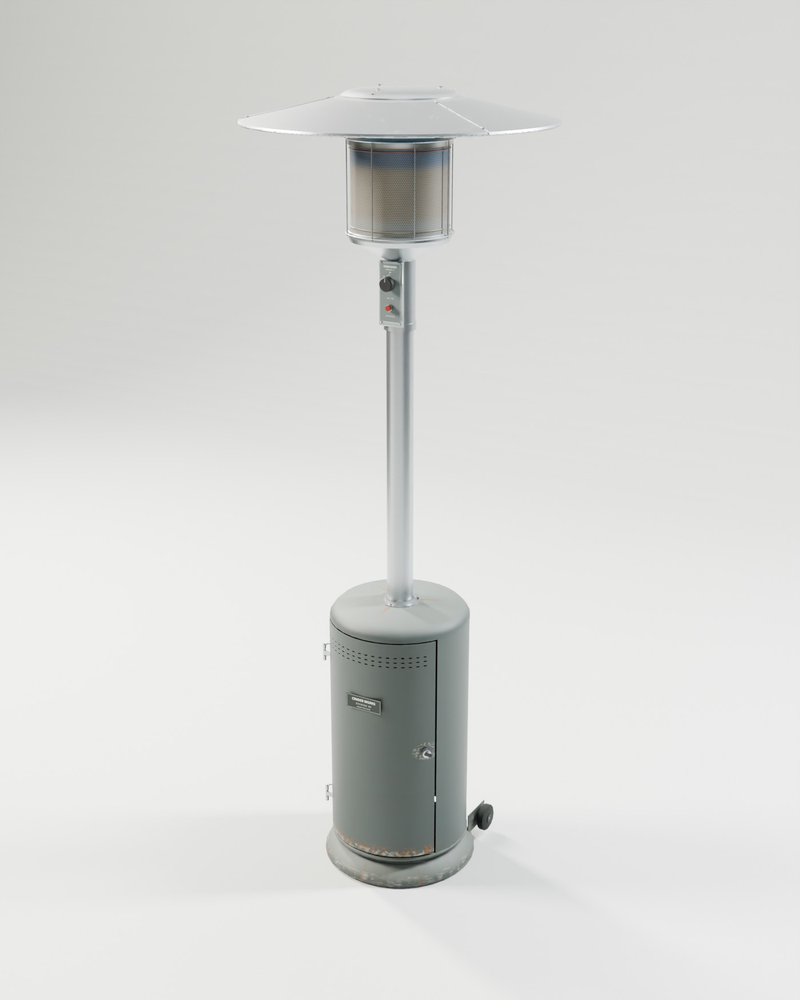
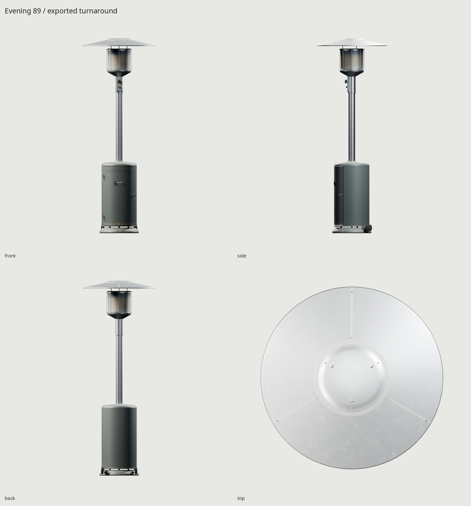
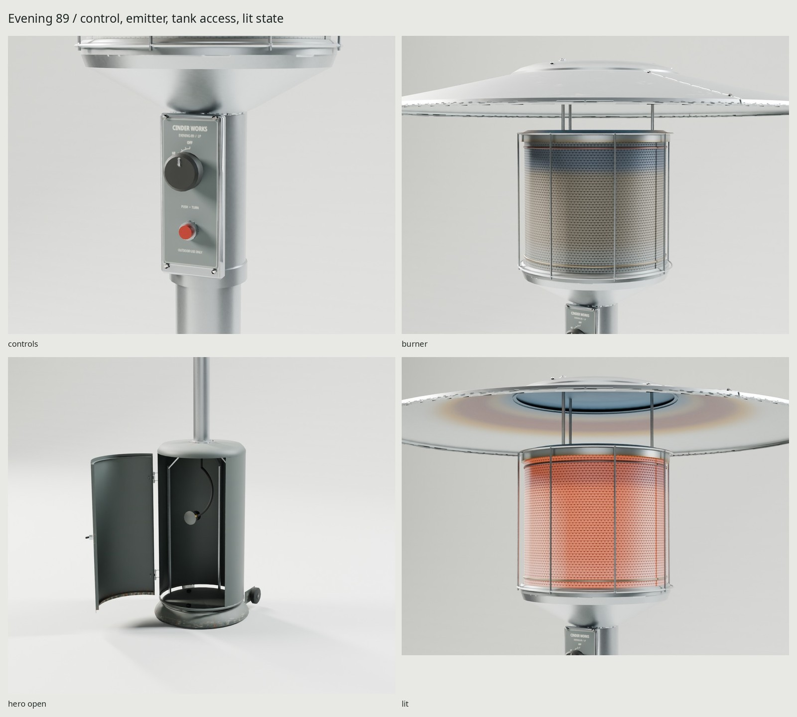

# Cinder Works Evening 89

An original freestanding propane mushroom heater: weathered basalt powder-coated
steel tank cabinet, brushed stainless post and burner, and a three-petal aluminum
reflector. Scripted in Blender 5.2 at real scale. The tank belongs to the owner
and is excluded from this asset.







Final images are rendered from the exported GLB and its baked textures.
The painted cabinet and hinged door distinguish this original design from the
stainless lift-cover product used for proportion research. Sources and the
measurement/design distinction are in [REFERENCE.md](REFERENCE.md), with photo
and manual credits in [refs/SOURCES.md](refs/SOURCES.md).

| Dimension | Target / basis |
| --- | --- |
| Overall height | 89 in / 2.2606 m, within 1 mm including fasteners |
| Reflector | 33 in / .8382 m nominal diameter; lap seam adds under 1 mm |
| Ground base | 18 in / .4572 m diameter |
| Post | 3 in / .0762 m OD, 1.2 mm wall |
| Cabinet | .4064 m OD, .710 m wall height, 1.5 mm steel |
| Emitter | .264 m OD, .224 m clear screen height |

The source uses gauged rolled sheet, return folds, hinge knuckles and pins,
a floor over a ballast pan, three internal post supports, diaphragm regulator,
a static hose with brass fittings, a hollow post, formed burner bowl, screen
retaining bands, guard hoops on radial tabs, and a reflector on three threaded
standoffs. Fine perforations, ventilation recesses, print, screw drives and
microstructure transfer into the shared atlas. The screen is opaque: holes are
baked recesses rather than transparency, an intentional optimization.

Weather is controlled by `WEAR` (default .35, ordinary outdoor service).
Up-facing painted shoulders and the base ring chalk and fade more than the
sheltered sides. Tipping and dragging chip the base lip and wheel regions;
fingers polish the latch surround and scratch its turning arc and handle.
Moisture retained at the door hem, floor drains and fastener crevices produces
localized oxide and short runoff marks. Dust settles on the reflector top and
behind its lap seams, with sparse broken mineral rings from evaporated rain.
Heat follows the emitter and rises radially along the hood underside, shifting
straw through violet to blue. Marks are sized to survive the shipped 2048 bake.
All texels and meshes are generated by our scripts; reference photos and
downloaded lighting never enter the materials.

## Delivery and cost

`export/PatioHeater.glb` embeds one shared 2048 BaseColor / OpenGL +Y Normal /
ORM set, baked at 4096 with 32 GPU samples. ORM is R occlusion, G roughness,
B metallic. Two materials share exactly three images: ordinary PBR and the
emitter's lit-state override. Approximate block-compressed texture allocation
with mipmaps is 16 MB (the kit's three-map 2K budget); PNG/GLB disk sizes differ.

The export has a consolidated static body plus the four moving assemblies
below. No armature or animation clips. Engine controls drive the pivots.
Verification records measured triangles, sizes, UV density, normals and
re-import error in `build/delivery-check.json`; physical support, motion and
tank-fit reports are separate, so serialization is not mistaken for assembly
correctness.

| Measured delivery | Result |
| --- | --- |
| Triangles | 14,536 / 15,000 budget |
| Materials / primitives | 2 shared-atlas materials, 6 draw primitives across 5 meshes |
| GLB | 6,967,140 bytes (6.64 MiB) |
| BaseColor / Normal / ORM PNG | 1,414,879 / 1,559,859 / 3,111,233 bytes |
| Delivered bounds X/Y/Z | .838200 / .839153 / 2.259800 m including lap seams and fasteners |
| UV coverage / overlap | 50.996% / zero measured overlap |
| Density P5 / median / P95 | 451.64 / 602.95 / 1122.24 px/m |
| GLB vertex / socket error | 0 m / 0 matrix error on re-import |
| Owner tank fit | 0.10 mm coupling gap; 16.08 mm minimum sampled hose gap; 15.9 mm side support gap |

A clean second game build produced the same measured geometry SHA-256. Only
geometry repeatability was tested; GPU texture bytes are not promised identical. No budget exceptions. The source is 42,920 triangles
for normal-map transfer; that mesh is not shipped.

At very tight crops, the reflector/crown edge has some atlas-edge sparkle and
tiny control lettering is softer than the source. The opaque screen recesses
are a deliberate game approximation. Weathering represents ordinary outdoor
use; the supplied used-heater photo has a different stainless cabinet, and
its exact service age is unknown.

## Frame, motion and socket

Meters, Blender +Z up, front −Y. glTF +Y up and front +Z. Root origin is the
center of the circular load-bearing footprint at grade. Mesh scales are applied.
Coordinates below are Blender coordinates relative to that ground origin.

| Node | Pivot / socket position (m) | Motion |
| --- | --- | --- |
| `TankDoor` | (−.189, −.115, .435) | local Z, −105° open to 0° closed |
| `ControlKnob` | (0, −.056, 1.757) | local Y, −135° LO to 0° OFF; HI −55° |
| `TransportWheel_L` | (−.194, .194, .059) | local X, free 360° |
| `TransportWheel_R` | (.194, .194, .059) | local X, free 360° |
| `tank_socket` | (0, 0, .064) | identity rotation; owner's cylinder bottom origin |
| `regulator_attach` | (0, −.0419, .4875) | valve mating face; fixed to heater |

For glTF coordinates transform (x,y,z) to (x,z,−y). Thus `tank_socket` is
(0,.064,0), still with identity orientation. Instantiate the owner's tank as
its child with identity transform. Its canonical +Z up / valve −Y frame becomes
+Y up / valve +Z in glTF. The socket puts the tank's foot ring on the actual
floor. The regulator coupling meets the valve face and the static hose follows
a short loop to the gas feed in the post. Disconnect the hose before removing
the tank; no rig or extraction animation is supplied. Lateral foot-ring stops
have measured slack and require lifting the tank to remove it.

The optional checker imports `../.foundry/shared/propane-tank.glb` read-only,
measures its actual surfaces and hash, and never saves or exports that scene.
Only `fit_check.png` includes the owner tank, with the door open. All other
renders and the asset exclude it. `make TANK_REFERENCE=` works without it and
reports the external fit check/render as skipped. No copy is kept in this repo.

The door, knob and both wheels have sampled physical clearance checks on both
high and game sources. Steps are 3°, 5° and 15° respectively. These prove the
sampled poses, not all continuous poses or the tank removal path. The knob
has a real blind spindle bore. Piezo compression and the quarter-turn latch
are fixed details; their tiny travel does not warrant additional draw calls.

## Lit state

The GLB carries a separate emissive emitter material with strength 7 and linear
RGB tint (1,.12,.008), using the same BaseColor atlas to retain dark perforations.
Set its emission strength to 0 for OFF, and restore 7 for ON. The studio hero
and turnarounds use OFF; `renders/final/lit.png` demonstrates ON. This is an
art-directed game intensity, not calibrated radiant heat output.

For surrounding illumination in an engine, add a point light at Blender
(0,0,2.015), or glTF (0,2.015,0), with warm amber sRGB **#FF891F**, range **3.5 m**.
Tune its energy to the engine's exposure. Toggle it with the emitter material.
The exported asset contains no lights.

## Rebuild and review

```sh
make -C patio-heater
make -C patio-heater check
make -C patio-heater match PASS=source-review WIDTH=1000 SAMPLES=40
make -C patio-heater match-final PASS=wear-review WIDTH=700 SAMPLES=40
python3 patio-heater/src/photo_matches.py --credit-dir patio-heater/renders/wear-review-glb
make -C patio-heater TANK_REFERENCE=
make -C patio-heater WEAR=0.65 render PASS=weathered
```

The shared Make rules set scratch paths under the worktree build directory.
All Cycles work acquires the shared GPU lock and uses OptiX with CUDA fallback.
`make refs` re-fetches only the registered reference images/PDF. Generated
blends, bakes, textures, GLB, reports and PNGs stay ignored. Three bounded docs
JPGs are tracked after the final review.

`renders/final/` contains the Cycles hero, four-view turnaround, three close-ups,
open housing, 1.8 m human scale, lit state and optional tank fit. Eevee is in
`renders/final-eevee/hero_closed.png`; `renders/final/contact.jpg` collects them.
The complete build was also exercised without the optional tank, with small
validation renders; final docs use the full default settings.

The [critique log](REVIEW.md) records the construction passes and the later
wear correction. `renders/wear-review-glb/match_used-pair.jpg` compares the
exported GLB against a used restaurant heater (3268zauber, CC BY-SA 3.0);
`match_used.png` is the corresponding GLB render. The reference credit and
comparison license accompany the pair in `REFERENCE-CREDIT.txt`. The camera
fit has a 68.95 px landmark RMS over the 2956 px reference crop height; different
head/cabinet proportions remain visible. No reference pixels enter the asset.
Geometry, UV packing, pivots and texture count are unchanged by the wear fix.
No real trademarks or marks are reproduced. Noto Sans fonts are installed
locally under the SIL Open Font License; all graphics are original.
