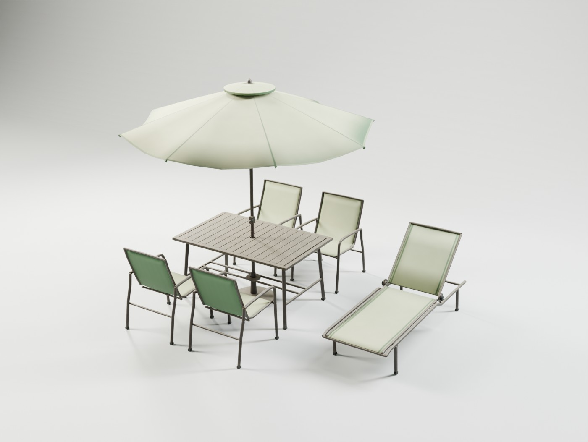
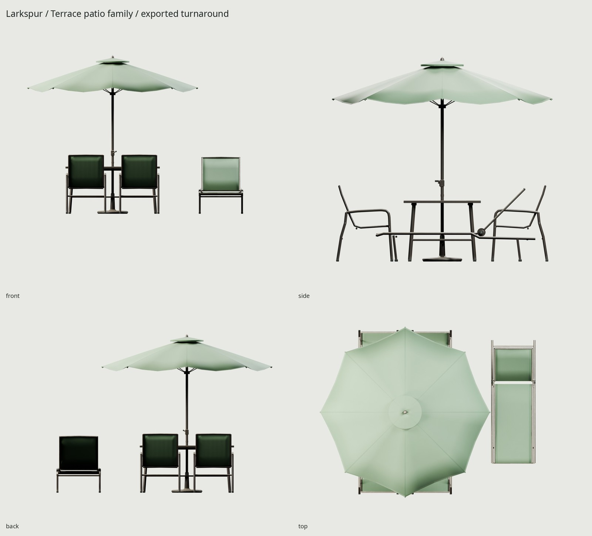
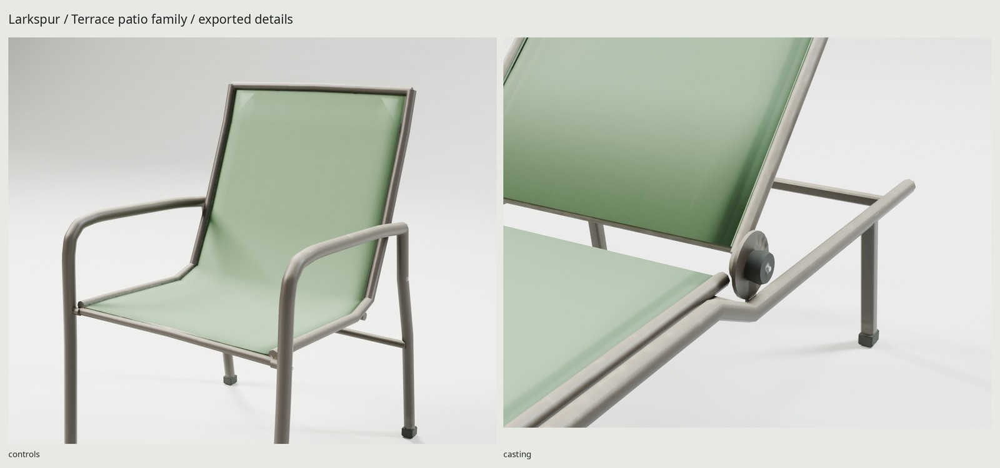

# Larkspur / Terrace

An original matching American patio family: a 60-inch aluminum slat table,
reusable sling dining chair, nine-foot crank umbrella in open and tied variants,
and adjustable sling chaise. Bronze powder coat and sun-softened sage fabric
share one atlas. Geometry, textile weave, weathering and studio lighting are
scripted from scratch.



## Dimensions and design

[REFERENCE.md](REFERENCE.md) records manufacturer measurements and design
choices; [refs/SOURCES.md](refs/SOURCES.md) credits the copyrighted reference
photographs and spec sheets. Designs and the Larkspur name are fictional.

| Module | Measured delivery envelope, W × D × H | Reference basis |
| --- | --- | --- |
| Table | 1524 × 965.2 × 763 mm including insert lip; top 762 mm | General Products p22: 60 × 38 × 30 in |
| Chair | 652 × 714 × 958 mm | Hanover Foxhill p2: 25.6 × 28.4 × 37.7 in |
| Chaise, flat | 724 × 2099 × 417 mm including hinge quadrants | Hanover: 83 in flat sling length, 28.2 in width, 13.2 in seat height |
| Umbrella, open | 2764.4 × 2764.4 × 2565 mm including tip pockets | Nominal 9 ft canopy; California Umbrella eight-rib / 1.5 in shaft construction |
| Umbrella, closed | 500 × 500 × 2565 mm including base | Same shaft/base; original furled envelope |

The main umbrella canopy is nominally 2743.2 mm tip-to-tip. The photographed
manufacturer's actual 9-foot product is 2640 mm; this is an intentional nominal
size design, not an exact replica. The shaft is 38.1 mm. The table insert has a
52 mm nominal bore; actual polygonal geometry guarantees **6.73 mm minimum
radial separation**. The lower guide also clears the pole. Each umbrella has
its own weighted base, retaining screw and internal bottom stop.

All feet reach Z=0. Ground-footprint origins are centered within 0.001 mm in
the construction report. Blender is meters, +Z up, front −Y; glTF is +Y up,
front +Z. The library uses staging translations for the independent roots:
Table and Umbrella_Open (0,0,0), Chair (−1.45,0,0), Chaise (1.75,.2,0),
Umbrella_Closed (−2.5,1,0). Clear these root translations to use each piece on
its own. Mesh transforms are applied and moving geometry is rebased to pivots.

## Delivery and performance

| Module | Triangles | Brief budget |
| --- | --- | --- |
| Chair, reusable | 1,648 | 1,000–3,000 |
| Table | 2,064 | 1,500–4,000 |
| Chaise, all moving parts included | 2,464 | 2,000–4,000 |
| Umbrella, open including base and crank | 3,920 | 2,000–4,000 |
| Umbrella, closed including base and crank | 3,908 | 2,000–4,000 |
| Entire module library | 14,004 | Separately enforced per module |

One material and one **2048² BaseColor / OpenGL +Y Normal / ORM** set for the
whole family. ORM is R occlusion, G roughness, B metallic. A 4096² Cycles GPU
bake is filtered to delivery size: linear-light color, renormalized vectors and
RMS roughness. Approximate compressed GPU texture memory is **16 MB**, shared
by every piece and all four chair instances. 1024² would put the coarse sling
weave below a texel; 2048² is retained. Fine canopy yarn is a close-view source
detail that largely averages out at game distance.

The reusable library is `export/PatioSet.glb`. The ready-arranged
`export/PatioDining.glb` has four actual chair nodes sharing one chair mesh,
the table/open umbrella and a raised chaise; it omits the closed umbrella.
Its textures are the same shared family set. Reuse that material/texture
allocation when loading both deliveries in an engine.

| Default delivery measurement | Result |
| --- | --- |
| Module library GLB | 8,784,792 bytes |
| Arranged four-chair GLB | 8,586,120 bytes |
| Arranged unique / drawn triangles | 10,096 / 15,040 |
| BaseColor / Normal / ORM PNG bytes | 2,396,736 / 2,549,599 / 2,793,143 |
| High-detail source triangles | 43,292 |

Measured file sizes, imported normal/UV checks and texture bytes appear in
`build/delivery-check.json`; assembly instancing and preserved image bytes in
`build/assembly-delivery.json`. The atlas occupies 38.17%, with UV-area-weighted
density p5 / median / p95 about **197 / 255 / 300 px/m**. No overlapping,
outside or degenerate UV triangles were measured. Fabric has higher priority
than small frame, foot and fastener surfaces.

## Construction, wear and controls

Bent tubular aluminum arms/front uprights and rear legs support separate
spline channels and a tensioned continuous sling. Welded mounting bosses and
seat bolts have measured contact with the frame. Molded feet and spline plugs
seal the stock. The table has sealed perimeter extrusions, narrow drain gaps,
corner sockets, splayed legs, underside bearers, lower ties and a pole guide.
The canopy has eight saddle-shaped sewn panels, a measured 75 mm hem drop
between rib tips, an inward scallop, underside rib tunnels, bound stitched hem
and rib-tip pockets. A separate vent carries a 23 mm valance above a measured
35–49 mm air gap. Stitching and pocket edges bake into the normal atlas.
Curved ribs, stretchers, hubs, pole joint and crank complete the assembly.
The tied variant has gathered gores, a sewn tie, buckle, hanging tails and
exposed rib tips.

`WEAR=0.35` represents ordinary outdoor suburban use. Upward faces chalk in the
sun; exposed fabric fades against shaded undersides, folds and hems; foot abrasion follows height;
water spots stay on horizontal faces; cavity masks collect a little pollen and
dirt. Weave/orange-peel noise describes manufacturing, not random whole-object
weathering. Cleaner or dirtier versions rebuild from the same parameter. The exported
BaseColor measures 1.069× canopy and 1.037× upright-sling exposure contrast and 2.50×
powder-coat top/vertical contrast; these are color measurements, not photo
radiometry. Mineral rings and corner deposits remain individually subtle.

| Pivot | Blender local axis / range | Rest position relative to its module |
| --- | --- | --- |
| Chaise_Backrest | X, 0° flat … +65° raised | (0, 290, 365) mm |
| Chaise_Lock_L / R | X, 0…360° handwheel rotation | (∓341, 290, 365) mm |
| Open_Crank / Closed_Crank | Y, 0…360° | (0, −43, 978) mm |

The chaise uses clampable 6 mm hinge quadrants with four source index recesses,
rather than a rear ladder brace. Loosen both handwheels before changing the
back angle. The handwheel screw's axial tightening and load-bearing friction
are not simulated. Catalog poses use 45°. Open/closed umbrellas are separate
static variants; ribs and cloth do not animate between them. No armature or
animation clips are needed.

Motion checks sample the back every ~2°, cranks every 10° and handwheels every
15°, on both high and game surfaces. Intended coaxial hinge/bearing contacts
are explicitly allowed. The construction checker measures actual evaluated
foot planes, polygonal shaft clearance and twenty assembly contacts. Those
checks prove physical layout; the independent GLB re-import check separately
proves serialization. Sweeps are sampled, not continuous collision proofs.




## Rebuild and proof

Installed Blender 5.2.2, Python/Pillow/NumPy, Poppler (`pdfimages`), flock and the
OptiX/CUDA GPU are required. No software, models, shaders, textures or HDRIs are
downloaded. Only the cited image/PDF references are retrieved.

```sh
make                         # refs → sources → UV → 4K bake → GLBs → studio → checks
make check                   # budgets, scale, topology, UVs, normals, motion, contacts, GLBs, Git
make render PASS=source WIDTH=1000 SAMPLES=40
make match PASS=source-match WIDTH=1000 SAMPLES=40
make match-final PASS=final-match WIDTH=1000 SAMPLES=40
make WEAR=0.65                # parameterized outdoor weathering
make clean && make           # regenerate all delivery artifacts from source
```

Every Cycles bake/render goes through the shared GPU flock and selects GPU
explicitly. Geometry is deterministic; GPU map bytes may vary within ordinary
GPU floating-point noise. Reference photos never enter Blender or any shader.

| Local output | Contents |
| --- | --- |
| `export/PatioSet.glb` | Five reusable modules with all pivots, one embedded atlas |
| `export/PatioDining.glb` | Actual four-chair assembly with shared chair mesh and raised chaise |
| `textures/bake/`, `textures/ship/` | 4096 bake and three 2048 delivery maps |
| `build/*audit.json`, `uv-report.json`, `delivery-check.json` | Independent geometry, budgets, UVs, normals and re-import proof |
| `build/motion-*.json`, `construction-*.json`, `assembly-delivery.json` | Surface clearance, support, ground and real glTF instancing proof |
| `renders/final/contact.jpg` | All final Cycles views and Eevee last |
| `renders/final/` | Hero, exposed tabletop, front/side/back/top, sling/hinge/canopy/furled details, 1.8 m scale view |
| `renders/final-eevee/hero_closed.png` | Eevee render from the same baked GLB |
| `renders/review-source/used_set-pair.jpg`, `renders/review-glb/used_set-pair.jpg` | Installed, visibly used outdoor set; source and shipped photo comparisons, never committed |
| `renders/review-glb/sling_chair-pair.jpg` | Additional chair construction comparison |
| `docs/` | Three final JPGs, ≤1600 px wide and ≤200 KB each |

[REVIEW.md](REVIEW.md) records critique and corrections. Weakest points are the
regular furled folds, opaque sling (fine real mesh porosity is not represented),
small frame silhouettes and softened hinge/index detail in close-ups, slight
normal shading patches at sling corners, and fine yarn detail lost to atlas
filtering. The chair camera fit has visible original-design differences and
14.19 px RMS on a small reference photograph. The used-set framing fits four
table anchors at 4.85 px RMS; its unknown dimensions, commercial umbrella
height, layout and different palette prevent an exact product match. Only the
comparison moves our umbrella behind the table to match that photograph. The family is intended to read at normal backyard scene distances.

All model vertices, shaders, textile patterning and weather masks are original.
Reference images/PDFs remain their authors' copyrighted inspection aids outside
Git. Studio labels use the installed open-license Noto Sans font. The rifle
project supplies the workflow standard. No new tools or installation needed.


Phase 2 fabric calibration keeps the original green dye on exposed faces,
with seats/canopy tops most exposed, upright backs less, and undersides/folds
protected. The thin sling sides differ modestly. The used-green-canopy pair is
`renders/wear-pass1-glb/used_set-pair.jpg`, with its source counterpart under
`renders/wear-pass1-source/`; the 17.23 px fit compares the common canopy
outline, not the photograph's different valance. The former white cafe
comparison remains available as `used_cafe`, separate from dye calibration.
`build/weather-check.json` measures delivered BaseColor hue and bounded exposure
contrast independently of studio lights. Frame weathering and construction are
unchanged, as are the geometry budgets and one shared 2048² texture set.
