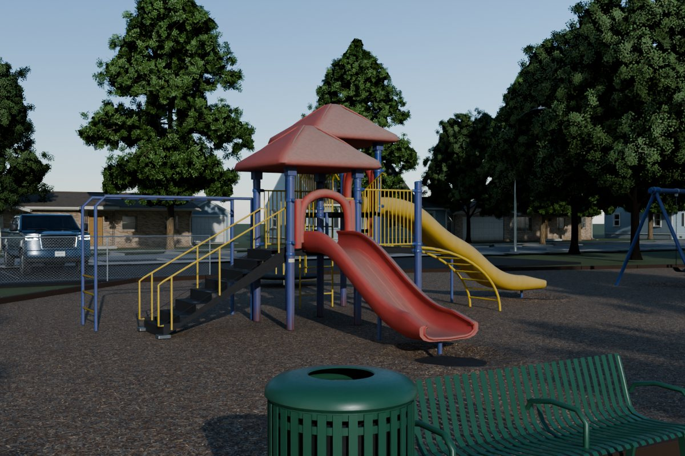
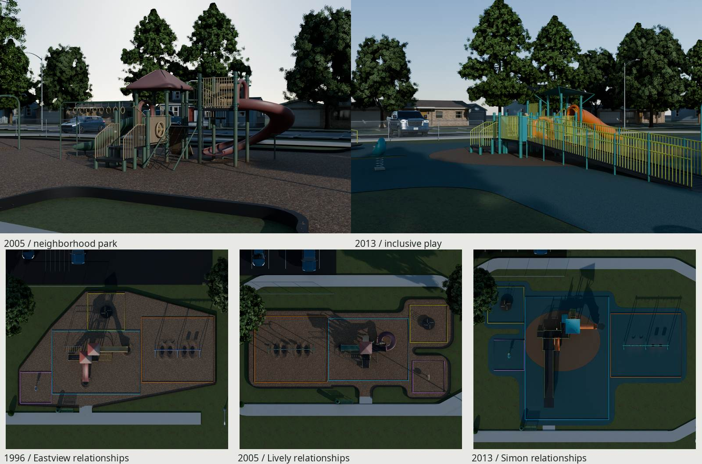
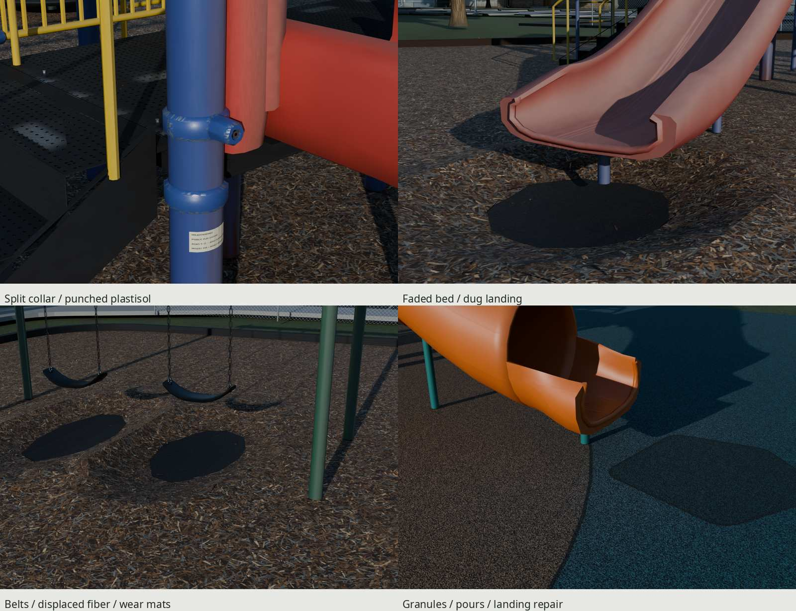
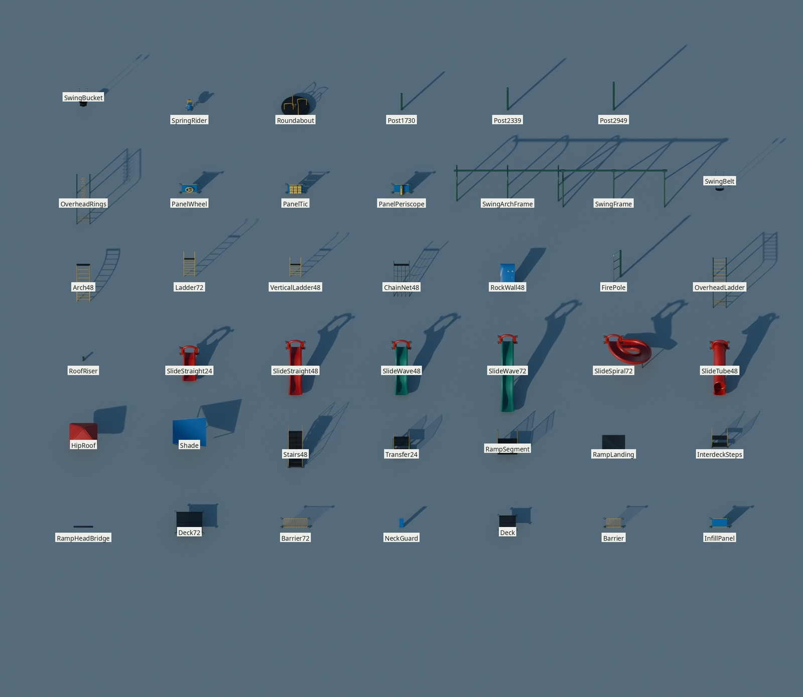
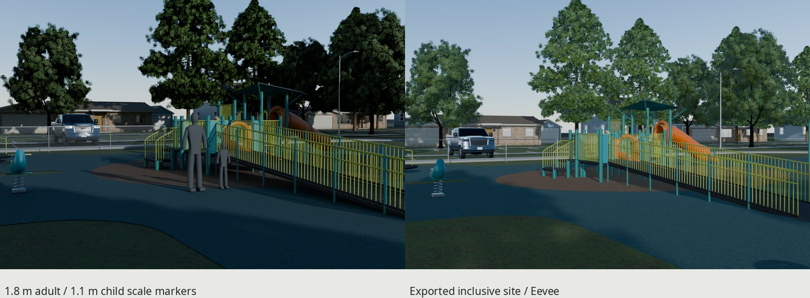

# Rill / modular municipal playgrounds



| | |
| --- | --- |
|  |  |
|  |  |

Original scripted American municipal/school equipment and three installed
playgrounds for a town of 1995–2015. Every gallery view imports exported glTF
and its baked maps. Heroes use 40 mm lenses at 1.65 m with an 18° procedural
sun. Inspection elevations omit the town and local trees to reveal construction.
Streets, houses, cars and distant planting are presentation context;
their existing library deliveries stay read-only.

## Delivery and cost

| Seed / installation | Equipment / whole-site triangles | glTF + BIN bytes | Material states | New + reused / total GPU MiB |
| --- | ---: | ---: | ---: | ---: |
| 101 / 1996 | 35,668 / 113,301 | 9,533,953 | 14 | 24 + 84 = **108** |
| 202 / 2005 | 42,636 / 118,513 | 9,746,104 | 14 | 24 + 84 = **108** |
| 303 / 2013 | 58,590 / 108,736 | 8,270,164 | 12 | 24 + 68 = **92** |

Whole-site counts include protective surfacing, border/walk, furniture,
fence/light, local trees and shrub. The residential context added by the
renderer is excluded. All sites remain below 120k; ordinary pieces top out at 1,940
and slides at 3,908. Tiny mating pieces deliberately stay below 300.
Material states include alpha-tested chains/decks and the reused landscape.

The nine new PNGs cost **24 MiB** with 8-bpp block compression and full mips,
shared across every piece/seed. They occupy **23,830,199 bytes** on disk.
Uncached complete sites cost 108 / 108 / 92 MiB; the three together share the
same 108 MiB image union when cached by resolved URI. Those estimates are
separate from serialized geometry bytes and presentation-context resources.

| Path | Contents |
| --- | --- |
| `export/Playground-{101,202,303}.gltf` and `.bin` | Complete installed sites, external shared images, meters |
| `export/PlaygroundPieces.gltf` and `.bin` | The 41 pieces displayed on a construction sheet |
| `export/<Module>.gltf` and `.bin` | Individual mating-origin modules |
| `textures/ship/T_Play{Metal,Plastic,Surface}_*.png` | Nine canonical family maps |
| `build/manifest.json`, `check.json`, `lookdev-check.json` | Actual pieces, dimensions, placement and fresh-import/resource audits |
| `renders/final/` | Three heroes/plans/turnarounds, detail views, scale, pieces and Eevee |
| `renders/final/contact.jpg`, `matched-contact.jpg` | All final views and the three daily-use comparisons |
| `renders/fix-crops/` | Fourteen native before/after pairs, individual crops and camera receipts |
| `build/final-provenance.json`, `docs.json`, `repeat.json`, `texture-repeat-check.json` | Export/resource hashes, JPG limits and reproducibility receipts |

Preserve the relative image URIs. Reused Ground, trees, shrubs and fence maps
remain canonical resources, rather than extra copies allocated per seed.

## Dimensions and construction

Sources, dates, rights and original choices are in [refs/SOURCES.md](refs/SOURCES.md).
Dimensions are authored from the cited construction vocabulary and independently
sampled after export; these are original compatible designs.

| Feature | Dimensions / basis |
| --- | --- |
| Posts | 127 mm / 5 in OD, nominal .120 in wall; dated manufacturer installation packet. Separate caps, split cast collars and recessed pin-drive fasteners. |
| Grid / decks | Original 1.2192 m / 48 in post grid; 1.0922 m standing skin. Deck tops .6096 / 1.2192 / 1.8288 m. This is wider than the cited maker's 42 in grid. |
| Deck manufacture | 2.667 mm / 12-gauge punched plastisol skin, 89 mm downturned tray, return hems, underside stiffener and corner seats on collars. Perforations use alpha coverage. |
| Barriers / grips | Main deck barrier 965.2 mm above deck; infill gaps below 88.9 mm; gripping tubes 28.6–32 mm. CPSC 2010 Table 4 and component sheets. |
| Stairs | Eight 152.4 mm rises, 243.75 mm runs, 900 mm width; closed press-braked cheeks/risers and punched trays, child grip rails. CPSC Table 6. |
| Step-up decks | Open supported trays at .3048 / .6096 m: 12 in rises, hemmed edges, posts, side infill and grips. `Transfer24` identifies this original 12/24 in assembly. Interdeck connectors use two 12 in rises. |
| Slides | 2/4/6 ft entries, .22 m exit and at least 279.4 mm flat runout. Compound molded trough, entrance hood, rolled lip and fitted underside saddles; tube has nominal 780 mm barrel / 744 mm vertical bore. CPSC §5.3.6 and dated 2011 sheet. |
| Climbers / events | Arch, ladders, chain net, rock panel, overhead ladder/rings at 2.05 m; 42 mm fire pole with independently measured deck reach. Molded panels have steering wheel, nine drums and periscope pivots. |
| Swings | Two 3.35 m bays; beam center 2.4384 m, bearing .13 m below it. 127 mm beam, 89 mm legs, 6 mm chain wire at 45 mm pitch. A-frame in 1996; arch posts in 2005/2013. Compound molded 560 mm belts and full bucket seats. |
| Inclusive approach | Six 1.2192 m segments rise .6096 m in 7.3152 m, actual 1:12. About 1.2714 m clear width, 1.8288 m turning bay / 1.7018 m between posts, dual 660/900 mm rails and wheel curb. |
| Fiber / wear mats | Authored 14–95 mm shredded wood, mixed widths/colors; actual dug surfaces, exposed black wear mats, displaced rims and walk/border carryout. Imported hollow-to-rim relief is about 113.5–129.5 mm. Visible carryout chips have 3–4 mm crowns. |
| Poured rubber | Two joined colors, resolved granules (2–4 mm period specification basis), narrow pour joints, darker newer landing repair, faded exposed binder and smooth lighter foot-contact regions. |

The source register distinguishes published dimensions from original choices.
CPSC Publication 325 (2010) anchors the period equipment/use-zone vocabulary;
only the public scopes of ASTM F1487-11, F1292-09 and F2075-10 were available.
No impact attenuation, installation certification or structural test is claimed.

## Three sites and their ages

| Seed | Original layout / period | Published-plan relationship |
| --- | --- | --- |
| 101 / 1996 | L-shaped three-deck school structure; two red hipped roofs, blue posts, yellow rails/events; timber/EWF enclosure and A-frame swings. Strong sun fade/chalk, selected repaints, collar chips, base oxide, dull scratched beds and dug landings. | Eastview Tot Lot sheet 2, 10 July 1995: adjoining composite/swing containment, accessible entrance, walk, seating and shade. Bradley's 2009 school plan informs the blacktop/building edge. Straight timber/EWF replaces Eastview's curved curb/play sand. |
| 202 / 2005 | Four-deck stepped park, lower roof bay, spiral/wave events, arch swings and rounded containment. Evergreen, tan and burgundy; intermediate fade/contact wear and brown mixed EWF. | Lively master-plan diagram, August 2005 in the October-approved plan: grouped play/picnic space, circulation, parking and retained trees. Recreation center/pool omitted. |
| 303 / 2013 | Low inclusive spine, ramp/turning bay, upper tube event and shade; teal, lime, orange and sand. Stronger newer pigment, hand/foot wear and two-color EPDM. | Simon Playground L1.0, 28 February 2013: curved soft surface, accessible approach, looping circulation, open lawn and shade. |

Each has one containment holding every reserved zone, edge seating and shade.
Protective areas are about 404.8 / 359.6 / 501.3 m². Use zones conservatively
reserve 6 ft beyond equipment and twice swing beam height fore/aft. They are
measured layout reservations, not a safety-engineering certification.

The 2005 Miracle catalog explicitly groups Hunter Green, Sand and Burgundy;
the 2009 Columbia Cascade catalog supplies the additional palette range.
The primary 1996 selection is a period-compatible inference, not a located
1996 color catalog. None of the plans or photographs is traced into geometry.

`src/plan.py::site(seed)` selects a period scaffold, repeating every 300,
then a bounded connected loop/side bay, roof position/count, compatible events
and mirroring. Seeds 101/202/303 pin the three review installations. Other
positive 31-bit seeds are deterministic variations of that grammar; the full
comparison/clearance/gallery proof belongs to these three review seeds.

## Pieces / measured exported triangles

| Module | Triangles |
| --- | ---: |
| `RampHeadBridge` | 92 |
| `Deck72` | 1,940 |
| `Barrier72` | 1,760 |
| `NeckGuard` | 140 |
| `Deck` | 1,772 |
| `Barrier` | 1,592 |
| `InfillPanel` | 1,420 |
| `HipRoof` | 460 |
| `Shade` | 440 |
| `Stairs48` | 1,700 |
| `Transfer24` | 1,412 |
| `RampSegment` | 852 |
| `RampLanding` | 44 |
| `InterdeckSteps` | 880 |
| `RoofRiser` | 64 |
| `SlideStraight24` | 3,860 |
| `SlideStraight48` | 3,812 |
| `SlideWave48` | 3,812 |
| `SlideWave72` | 3,812 |
| `SlideSpiral72` | 3,908 |
| `SlideTube48` | 3,880 |
| `Arch48` | 1,012 |
| `Ladder72` | 436 |
| `VerticalLadder48` | 372 |
| `ChainNet48` | 1,664 |
| `RockWall48` | 966 |
| `FirePole` | 868 |
| `OverheadLadder` | 680 |
| `OverheadRings` | 1,688 |
| `PanelWheel` | 1,832 |
| `PanelTic` | 1,922 |
| `PanelPeriscope` | 1,676 |
| `SwingArchFrame` | 1,312 |
| `SwingFrame` | 496 |
| `SwingBelt` | 1,428 |
| `SwingBucket` | 1,652 |
| `SpringRider` | 1,300 |
| `Roundabout` | 736 |
| `Post1730` | 390 |
| `Post2339` | 390 |
| `Post2949` | 390 |

## Materials and wear

| Shared set | Shipped size | GPU MiB, full mips | Contents |
| --- | --- | ---: | --- |
| PlayMetal | 1024² | 4 | Powder coat/orange peel, cast chips, zinc, plastisol holes/foot lanes, chain coverage, recessed drives, fictional plate and timber |
| PlayPlastic | 1024² | 4 | Rotomolding, chalk/fade, longitudinal bed scars, seams/flashing, seat scuffs and initials |
| PlaySurface | 2048² | 16 | Brown mixed fiber, silvered/pale chips, EPDM granules and contact response |

All nine maps start as original 4096² fields, pass through locked Cycles baking
and channel-correct filtering, and ship as sRGB BaseColor, OpenGL +Y Normal and
linear ORM (R occlusion, G roughness, B metallic). Metal BaseColor alpha carries
deck/chain coverage. Bakes are manufacture-field bakes; no high-poly projection
or photographic texture is implied.

Ordinary stock glTF PBR, vertex color and MASK coverage carry the look.
Age uses shared charts plus causal corner tint/UV selection: sun-facing pigment
loss, maintenance repaints, collar-edge chips, low post oxide, deck entry/nosing
foot lanes and slide-bed contact. Fiber dampening follows hollows/deck shade;
geometry displaces it. Rubber repair binder stays darker/less worn, while
traffic lightens adjacent landings. No extra age texture set is allocated.

Manufacture charts repeat intentionally within assigned cells, with eight
shipped-pixel guards and physical repeat boundaries. This is trim/tiling reuse,
not a unique zero-overlap atlas. The audit reports actual density percentiles
and rejects collapsed module UV triangles. Large molded parts carry less
microdetail than the fasteners. Normals and UVs are preserved; engines derive
tangent space on import, avoiding Blender's unstable rounding on one reused
foliage tangent. Keep `COLOR_0`, PBR maps and alpha masks when importing.

## Placement, sockets and motion

Place the complete `Playground-<seed>.gltf` root at grade. Its origin is the
first composite deck's projection onto the ground, rather than the center of
the asymmetrical enclosure. Blender is +Z up / -Y front; glTF is +Y up / +Z
front. Preserve the hierarchy, pivots, meters and relative image URIs.

Replace/recess the game's terrain under the containment so it does not cover
the supplied protective mesh or its hollows; keep underlying terrain below
-.12 m for fiber. The separately named `Library Ground lawn` is a supplied
landscape backdrop that a game with its own terrain can disable. Reserve the
manifest's boundary/use zones, then connect the public walk to town circulation.

The 1996 school/playground interface is `SchoolBuildingEdgeSocket`, kind
`school_building_edge`, at about (0, 25.9388, 0) in the Blender site frame.
Align a school's matching playground attachment frame to it at grade, with
its front toward the play area. `build/check.json` records the actual imported
socket coordinate; a fit to an external school model is not claimed.

Individual decks use their top connection plane, slides their entrance
projection on grade, ramp segments their upper joint and swings their beam
axis. Other props use footprint/ground origins. The library-sheet roots retain
display positions; reset those and mate the named deck/post/ramp sockets when
building another site. `*_Entry`, `*_Exit`, `*_HandFoot_*`, `*_Hands_*` and
transfer/seat empties expose the authored child interactions. The manifest
lists the exact sockets and placements.

| Moving assembly | Blender local axis / range | Pivot |
| --- | --- | --- |
| Each swing pendulum | X / -55…55° | Bearing, .13 m below beam; chains/seat follow |
| Spring rider | X / -14…14°, optional Y / -12…12° | Upper spring mount; rigid gameplay tilt |
| Roundabout | Z / continuous | Central bearing, .27 m above surfacing |
| Steering wheel | Y / continuous | Hub |
| Nine tic-tac-toe drums | X / continuous | Individual spindles |
| Periscope | Z / -90…90° | Base swivel |

Blender X/Y/Z maps to glTF X/-Z/+Y. No armature or animation clip is needed;
a game drives these rigid nodes. Spring deformation remains an approximation.
Fresh-import swing sweeps sample 11° increments against actual frame/neighbor
surfaces, with only their hanger articulation excepted. Actual tray levels,
open undersides, post walls, supported interfaces and surfacing relief are
measured separately from serialization. A passed export check alone does not
prove construction or appearance.

## Rebuild and review

Requires installed Blender 5.2, GNU make, Python/Pillow/NumPy/SciPy/Matplotlib,
Poppler and the repository fonts. Existing Ground, trees, shrubs, fences,
street furniture/light, houses and cars are read-only canonical inputs;
build their library deliveries first in a fresh clone. All Blender work uses
the shared serial GPU-lock wrapper. Temporary files stay inside this worktree.

```sh
make -C playground
make -C playground check
make -C playground repeat check-texture-repeat
python3 kit/repo_check.py
make -C playground SEEDS=404 model          # another bounded original site
make -C playground clean                    # own generated delivery, retains refs/correction evidence
```

`make` builds 4096 fields/bakes, shipped maps, pieces and sites, independent
checks, 35 exported views, three photo pairs, additional 4096-source comparisons,
contact sheets and five bounded gallery JPGs. Default finals are 1200 px / 32
samples; the piece sheet is 2400 px. Each scene resets between views; small
serial groups limit lifetime and shared-machine queue overhead.

`make repeat` independently regenerates fields, white-balanced photos and
camera fits, GPU bakes and all geometry in isolation. Procedural PNGs/layout,
glTF/BIN, copied image bytes, manifests and calibrations compare byte for byte.
The nine GPU maps use the kit's maximum channel delta 2/255 and byte-domain
RMSE .02; coverage alpha is exact. Blend containers, image-byte receipts and
stochastic renders are not promised byte-identical. Original deliveries remain
untouched; detailed results are in `build/repeat.json`.

[REVIEW.md](REVIEW.md) records the native critiques and rejected candidates.
The fixed-camera correction receipts accompany 14 native pairs; each panel is
at least 870 px wide. Three white-balanced comparisons use the Roswell and
Adair daily-use US playgrounds and a 2005 stair photograph. Their original-design
fit errors are about 29.23 / 20.49 / 12.69 native crop pixels. Adair retains
its full-photo 69–71 mm EXIF constraint; the tight-crop virtual lens is reported
separately. Reference neutrals, actual lens bounds and residuals remain explicit.

The clean rebuild and independent import/UV/scale/motion/resource checks pass.
`make repeat check-texture-repeat` compares **118 deterministic files exactly**;
the nine independent GPU maps have maximum change **1/255** and worst byte RMSE
**0.001668**, inside the kit limits of 2/255 and .02. Coverage alpha is exact.
The audit hashes **347 protected existing delivery files** without a change.
`build/final-provenance.json` checks all 38 exported views against current mesh
and image resources; `build/docs.json` records the five bounded JPGs.

## Credits and remaining limits

Every new vertex and texel is generated by our scripts; reused library assets
are also original repository work. Photos/plans are viewing references only,
with authors, dates, direct URLs and rights in SOURCES. Fictional MEADOWWORKS
plates and initials use installed open-license DejaVu/Noto fonts. Lighting is
procedural sky and sun. No downloaded model, texture, material, HDRI or code
is used.

The main remaining CG cues are repeated collar-chip charts, regular long bed
scars, flat fiber relief away from the hollows, simplified mat/repair edges,
small low-sided hardware and alpha-chain parallax. Context foliage exposes
repeated cards. The forest-green asset and blue/Kelly-green comparison photos
retain intentional palette differences; the fits compare original designs,
not surveyed replicas. These limits remain visible in the native evidence.
The wood fiber reads darker and browner than the period photographs'
sun-bleached tan, and the swing wear mats read as flat dark ovals.
