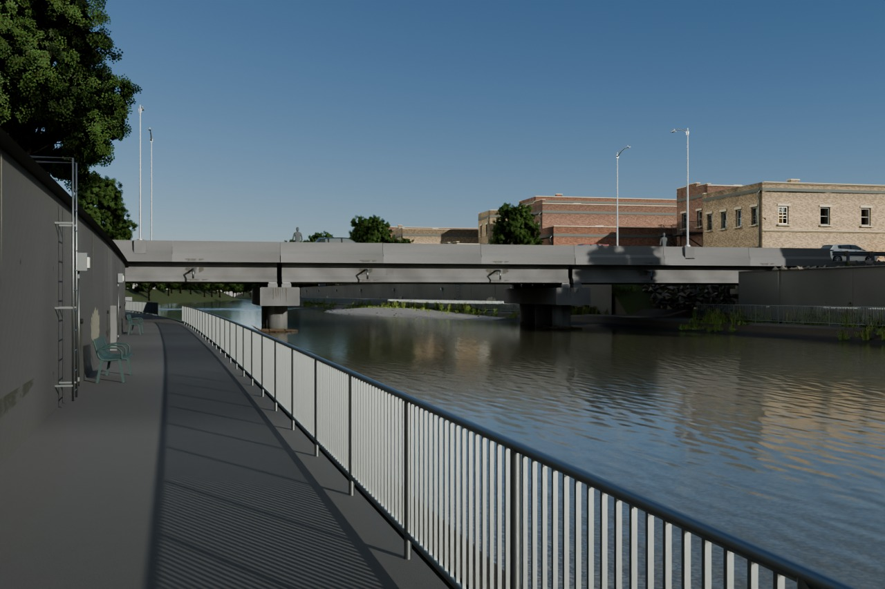
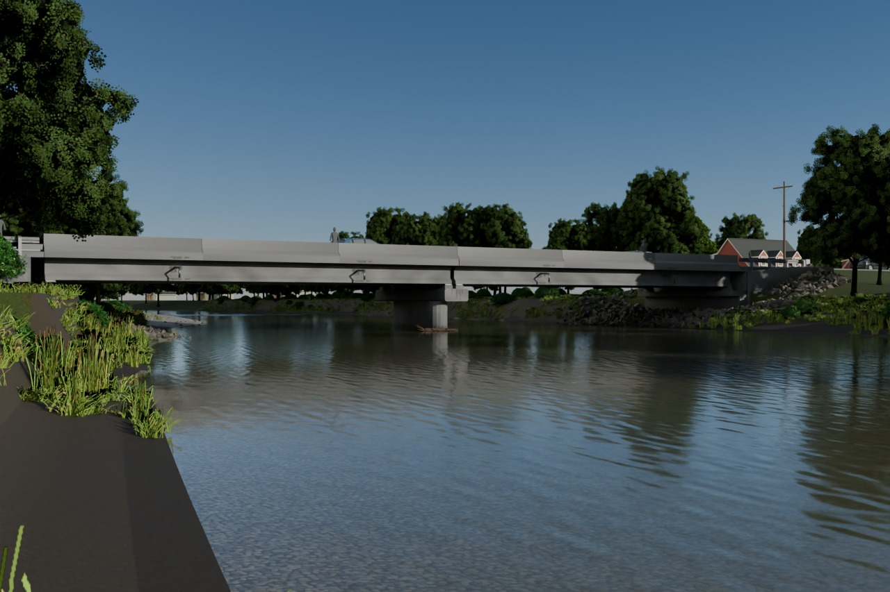
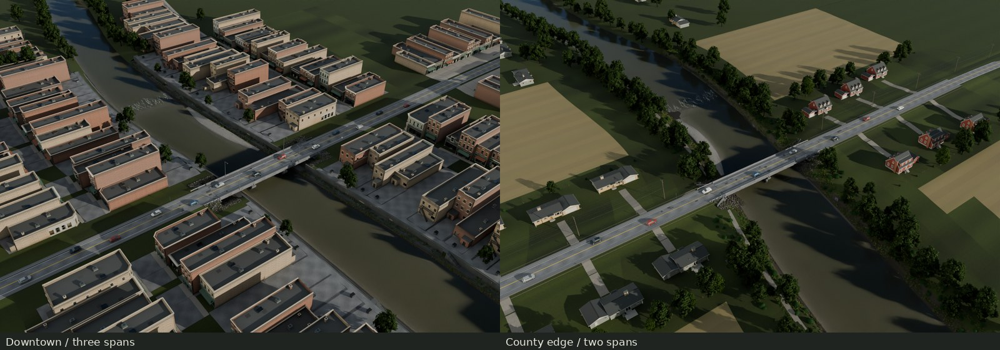
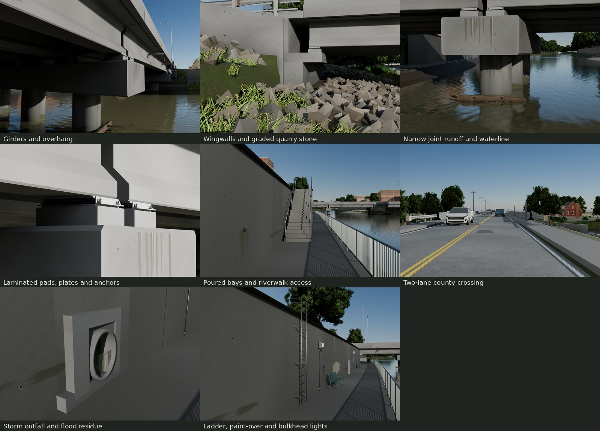
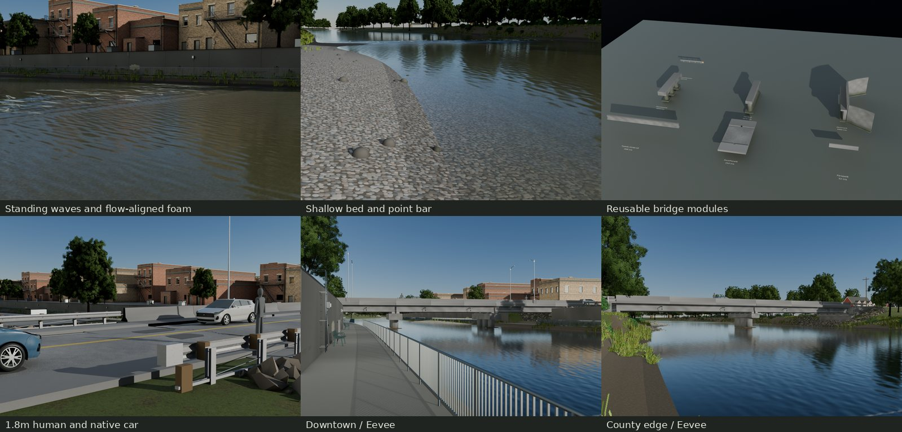

# River / county road crossings







An original scripted river reach and a parameterized prestressed-girder road
bridge, assembled into two different American town settings with period
infrastructure and the library's native vehicle context.
The original bank height field is baked at 4096 and filtered to the accepted
1024 delivery size. Every texture and mesh is generated by our scripts.

Local full-size exported views: [downtown hero](renders/final/101/hero.png),
[edge hero](renders/final/202/hero.png),
[complete contact](renders/final/contact.jpg),
[matched-light photo comparisons](renders/final-matches/contact.jpg),
[before/after contact](renders/fixes/contact.jpg).
The last round also has [21 fixed-camera comparisons to 56cce73](renders/last-fixes/contact.jpg),
with 1280 native pixels per side. See **Known flaws** below for the fixes that
remain partial; this is the family's final delivery round.
All presentation imports external-image glTF. Embedded GLBs are inspection
mirrors under `build/embedded/`, never the scene's high-detail source.

## Places and dimensions

| Seed | 101 / Cedar Run downtown | 202 / county edge |
| --- | --- | --- |
| Reach / nominal normal-flow width | 300m / 100ft, 30.480m | 300m / 120ft, 36.576m |
| Bridge / construction year | Three 60ft spans, 54.864m / 1974 | Two 80ft spans, 48.768m / 1968 |
| Out-to-out width | 39ft / 11.8872m | 35ft / 10.668m |
| Main supports | Three-column bents | Rounded-nose wall pier |
| Place | Low floodable riverwalk, floodwall and brick Main Street backs | Natural banks, gravel bar, launch/fishing access, fields and houses |

The downtown's three short spans, wider deck and paved floodable walk fit its
constrained urban banks. The county crossing uses two longer spans and an older
wall pier, with narrower walks and room for riparian cover, yards and fields.
They share construction modules while retaining different channel and land-use
plans.

Normal width varies along the reach, and the bar narrows the low-flow surface.
Runs are about 1.05m deep, the riffle about .19m, and the outer pool about 2.1m
(the exported vertex-depth maximum is 2.04m).
Bankfull and normal water are separate; the natural floodplain is about 2.15m
above water. Published sources and authored choices are separated in
[REFERENCE.md](REFERENCE.md); all viewed/downloaded rights and exact uses are
in [SOURCES.md](refs/SOURCES.md).

Five **AASHTO Type III** girders per span use the FDOT 20130 section:
45in depth, 16in top, 22in bottom and 7in web. They have modest camber,
haunches, diaphragms, concrete plinths, steel seating plates and elastomer pads.
Their exterior centers are .95m in from the deck edges. The wall cutwater
follows local flow while its cap stays transverse to the road.
Abutments have projecting seats, backwalls and wingwalls; approach slabs carry the road
onto fill. Deck panels carry a 2% crown, two 11ft lanes, raised walks, 32in
parapets, expansion gaps/seals, drains and supported utility conduits.
The W-beam approaches retain sheet gauge, blockouts, posts and generic terminals.
Plaques name a fictional county crossing. This is visual construction, not a
load-rated bridge or a hydraulic design.

## Generator and game interface

`src/plan.py` is Blender independent. `generate(seed, **changes)` returns an
immutable `Plan`: kind, reach length, channel width, bend amplitude/phase,
bar and riffle stations, span count (2–4), span length (12–27m), deck width (10–14m),
deck elevation, pier type and construction year. The two defaults change the
channel and site plans, rather than recoloring one composition.
Their bend parameters remain −7m / +15m, with different phases and bar/riffle stations.
Downtown's positive-station bend broadens progressively to 1.95 times its
parameter; its approach/hero reach retains the original centerline.

| Seed | Bend / phase | Bar / riffle station | Deck elevation | Pier |
| --- | --- | --- | --- | --- |
| 101 | −7m / 0 rad | +47m / +88m | 4.45m | Three-column bents |
| 202 | +15m / .35 rad | +40m / +74m | 4.45m | Rounded-nose wall |

To build another crossing, generate its `Plan`, build `channel.terrain(plan,
root)` and `channel.water(plan, reach)`, then call `bridge.assemble(plan, root)`.
Choose enough span length to clear channel width plus both abutment banks;
the generator rejects a shorter arrangement. `plan.bed`, `water_edges`,
`center` and `tangent` supply terrain and alignment to a game's placement
system. Deck width, span count/length and pier type drive the bridge, seats,
abutments, lane paths and sockets together. The two delivered plans are
examples of this interface, rather than a bridge mesh stretched over one river.

Meters, +Z up; river flow +Y; bridge station +X. glTF converts positions to
`(x,z,-y)`. Whole-crossing roots are at the crossing center on normal-water
datum. Module exports are locally centered and can be placed independently.
The inspection library arranges them on a sheet; reset its display transforms
before placing those roots into a new bridge.

- Girder `W/E` sockets mark the bearing centers, .26m in from each end;
  their flat seats meet the elastomer pads.
- `Lane_*`, `Sidewalk_*`, `RiverbankTrail` and `FlowCenterline` retain sampled
  paths in `points_blender_m` / `points_gltf_m` extras. Samples are local to
  the identity path root; do not add its translation again.
- `_FLOW` on the water is a float3 custom vertex attribute: Blender-frame
  horizontal velocity X/Y in m/s, then depth in m. It is data, not albedo.
  Convert velocity `(vx,vy)` to glTF `(vx,0,-vy)` in an engine shader. The river
  normal follows current-aligned UVs. Material extras specify continuous
  speed-to-normal/roughness ranges, evaluated from this exported attribute
  by the Cycles adapter and intended engine water shader. Stock glTF retains
  a constant PBR fallback. Sheltered curling wakes are analytic game data,
  rather than a fluid simulation. The exported wave shape is stationary.
- `FishingSpot` / `BoatLaunch` are gameplay sockets on the rural bank.

A game should preserve `_FLOW` as a custom float vertex stream. Use its X/Y
velocity to advect two normal samples with offset phases and crossfade them
before either UV offset resets; interpolate strength and roughness using the
material's exported speed ranges. Existing current-aligned UVs repeat about
3.7m across and 2.2m along flow. Prefer scene depth to include stones and actors
in absorption; the stream's third component is a bed-depth fallback. Foam
meshes locate the shoal's standing trains and sheltered pier wakes; advect foam
or emit particles along the same field. This delivery supplies that data and
the Blender adapter, rather than a particular engine's water implementation.

Load `export/RiverCrossing-101.gltf` or `RiverCrossing-202.gltf` with its BIN
and preserve relative image URIs. `export/RiverModules.gltf` and the seven
`export/pieces/*.gltf` provide reusable construction. Context/traffic/native
vegetation are named and costed separately for removal, batching and engine LOD.
The scene uses shared glTF mesh references, exact buffer interning,
`KHR_mesh_quantization` and `KHR_texture_transform`. Structural positions and
indices stay exact. Native context positions use a uniform decode with less
than .5mm error per axis; vegetation UVs stay exact for the native thin-leaf
adapter. Normals/colors and bounded context UVs use compact normalized storage.
The independent storage audit compares every retained attribute with the
embedded pre-compaction export, separately from fresh-import construction
and bearing-contact checks. Loaders must support the required extensions.

## Materials and measured cost

Ground's Asphalt, Lawn and GroundTrim are reused without changes.
Bridge concrete and galvanized parts use the landed freeway family's 2048
Concrete and 1024 Zinc sets: 16MiB + 4MiB at 8bpp with full mips. Those images
are shared external dependencies, not duplicate river allocations.
Native trees and buildings retain their original library images. Bank/bed has
one 1024 BaseColor/Normal/ORM triple; a 512 RGBA bank-card image also contains
the tiny plaque legends, foam and maintenance masks; water has one tiling 512
normal. That is **4⅔ MiB new** at 8bpp with full mips. These accepted dimensions
and allocations are retained. The bank bake uses a physical 2m tile and a 6mm
height range, then linear-color, vector-normal and RMS-roughness filtering.
BaseColor is sRGB; normal and ORM are linear, with OpenGL +Y normals and
ORM channels R occlusion, G roughness, B metallic.
The export renderer reuses freeway's thin-leaf response adapter on the
imported native foliage maps; it does not load high-detail vegetation sources.
After freeway landed, `main` was merged at `dcc2132`. The small adapter in
`src/freeway_bridge.py` calls its original girder, three-column bent, F-barrier,
guardrail/terminal and bearing factories in an isolated module namespace.
It substitutes the cited Type III section for freeway's larger Type IV,
adapts cap span/height while preserving round 1.2m columns, and scales the
native bearing layers to this bridge. Added sole plates, keeper angles,
anchor nuts and pad laminations retain the accepted stack's seat/top datums.
It does not edit the freeway sources
or canonical deliveries. The local deck, wall pier and abutment retain this
crossing's dimensions and construction.

Cycles uses imported transmission/IOR, the shipped normal and uniform river
absorption/scattering extras. The coefficients in inverse meters are absorption
`(.357, .340, .442)` and scattering `(.176, .1728, .1376)`, with HG anisotropy `.2`.
Stock glTF cannot carry the Blender volume node graph; the renderer reconstructs
one Volume Coefficients node from those extras.
An engine must implement the same depth absorption and flow. The existing
512 card sheet also carries original soft runoff, salt, repair and paint-over
masks. No new image allocation is added for weather. Maintenance vertex
tints use the kit's export-supported mix graph and are checked in the actual
serialized COLOR_0 data. Quarry stone reuses the freeway's fine mineral field;
its gray/brown variation and wet/algae tint come from fracture and water height.
All local bridge, wall, stair and outfall concrete now uses the freeway set.
Placement-owned COLOR_0 samples neutral cement, variation between pours,
paste variation, basal splash/dampness and the high-water remnant. Form seams,
ties and a small air-pore layer reuse the existing maintenance atlas; pores
are alpha shading, not displaced cavities. The native freeway deliveries stay
byte-identical. Concrete surface cells retain interpolated original UVs and
split normals; fine wall detail stays in the atlas rather than a dense grid.

Scour armor uses graded, staggered stone placements with buried lower halves,
chinking stones, dirt at soil contact and wet/algae tint at normal water.
Each stone retains up to eight extreme fracture corners to keep the continuous
blanket affordable. The bar's rounded gravel crowns and fine seams live in the
same 1024 bank/bed triple, with a small number of rounded silhouette cobbles.
Dry crowns are lighter, the edge is wet/darker, the downstream lee samples a
finer scale, and low vegetation cards occupy its upper edge. Other exposed
banks retain brown silt using the same normal/ORM resources at reduced strength.
Seven overlapping riffle chutes carry four standing crests each and 57 porous
downstream foam streaks; the accepted calm-water material and light are retained.
Snags have a tapered, bark-ridged trunk, root flare, torn ends and packed twigs,
with water-height darkening. Their mineral micrograin reuses existing images;
there is no additional bark or concrete texture allocation.
The water continues to ±800m as one closed medium over a submerged bed.
Internal closing planes are removed and their boundary vertices welded so
they cannot refract as artificial dams. The water object's extras distinguish
the 300m core from that presentation extension for engine clipping/streaming.
The hidden closing floor is 3.5m below local water level, below the entire
sampled bed. Actual camera and light paths still stop at the real bed or stone,
so attenuation follows visible depth. Imported bottom-face centroid rays check
that the closing interface cannot cut up through the bed between samples.
For direct sunlight Cycles uses a transparent shadow interface while retaining
the actual volume; camera/reflection rays retain the exported IOR and normals.
This approximates transmitted sunlight without a refractive caustic solve.
The measured water triangle count includes the extension; distant terrain,
houses and trees remain separately removable presentation objects.

<!-- measured-costs:start -->
| Piece | Triangles |
| --- | ---: |
| TypeIII_Girder18 | 696 |
| DeckPanel6 | 254 |
| Parapet6 | 52 |
| PierColumns | 4,608 |
| PierWall | 2,676 |
| Abutment | 4,960 |
| GuardrailTerminal | 404 |

Flat panels intentionally stay below 300 triangles; no subdivisions are added for a minimum.

| Assembled mesh type | Downtown count × max triangles | Edge count × max triangles |
| --- | ---: | ---: |
| Abutment | 2 × 2,464 | 2 × 2,336 |
| ApproachRail | 4 × 404 | 4 × 404 |
| ApproachSlab | 2 × 12 | 2 × 12 |
| BearingStation | 4 × 3,636 | 3 × 3,636 |
| ConcreteFormEvidence | 1 × 10,994 | 1 × 5,994 |
| DateAndNamePlaques | 1 × 14 | 1 × 14 |
| Deck | 9 × 282 | 6 × 257 |
| Girder | 15 × 696 | 10 × 696 |
| Parapet | 36 × 28 | 24 × 28 |
| ParapetLightPedestals | 1 × 48 | — |
| Pier | 4 × 3,268 | 1 × 1,564 |
| Span DiaphragmsHaunches | 3 × 204 | 2 × 204 |
| Span DrainConduit | 3 × 1,024 | 2 × 1,024 |
| TextureDrivenBridgeAge | 1 × 1,272 | 1 × 520 |

| Seed | Bridge | Bed / banks | Water | Site | Vegetation | Cars | Town / people | Total |
| --- | ---: | ---: | ---: | ---: | ---: | ---: | ---: | ---: |
| 101 | 53,713 | 52,095 | 31,798 | 64,548 | 5,711,998 | 820,534 | 2,322,176 | 9,056,862 |
| 202 | 32,980 | 48,058 | 31,391 | 798 | 14,928,948 | 388,674 | 1,074,960 | 16,505,809 |

| Seed | glTF + BIN bytes | Material states / unbatched placed draws |
| --- | ---: | ---: |
| 101 | 113,285,721 | 974 / 8205 |
| 202 | 22,735,261 | 55 / 21246 |

| Seed | Scene + river-owned PNG bytes | All referenced PNG bytes | Scene + standalone copies of all PNGs |
| --- | ---: | ---: | ---: |
| 101 | 117,722,293 | 89,274,150 | 202,559,871 |
| 202 | 27,171,833 | 82,683,584 | 105,418,845 |

The original 367 MB measurement counted glTF + BIN. Both scenes also remain below 120 MB including their river-owned PNGs. Canonical library PNGs remain external, shared and byte-identical. Copying every shared dependency into a standalone folder costs the larger total above.

Shared full-mip image residency per crossing, including native context: 101: **136.67 MiB** / 202: **114.00 MiB**. The two totals overlap and are not additive.

| Seed / category | Placed triangles | Unique triangles | Geometry bytes | Shared image MiB |
| --- | ---: | ---: | ---: | ---: |
| 101 / site | 64,548 | 64,548 | 3,611,160 | 48.33 |
| 101 / vegetation | 5,711,998 | 24,212 | 1,766,428 | 16.33 |
| 101 / bridge | 53,713 | 53,305 | 2,283,694 | 40.33 |
| 101 / context | 2,322,176 | 2,300,278 | 95,073,936 | 116.00 |
| 101 / reach | 52,095 | 52,095 | 3,190,888 | 36.00 |
| 101 / water | 31,798 | 31,798 | 956,832 | 0.67 |
| 101 / cars | 820,534 | 224,796 | 895,488 | 0.00 |
| 202 / site | 798 | 798 | 64,980 | 52.00 |
| 202 / vegetation | 14,928,948 | 54,648 | 3,930,900 | 36.33 |
| 202 / bridge | 32,980 | 32,716 | 1,476,686 | 40.33 |
| 202 / context | 1,074,960 | 102,280 | 3,739,516 | 57.33 |
| 202 / reach | 48,058 | 48,058 | 2,631,836 | 36.00 |
| 202 / water | 31,391 | 31,391 | 936,438 | 0.67 |
| 202 / cars | 388,674 | 188,474 | 895,488 | 0.00 |

Geometry bytes and image allocations are deduplicated within each row; shared rows are not additive.

| Module | glTF + BIN bytes | Shared image MiB |
| --- | ---: | ---: |
| TypeIII_Girder18 | 57,576 | 16.00 |
| DeckPanel6 | 25,062 | 32.00 |
| Parapet6 | 7,133 | 16.00 |
| PierColumns | 277,721 | 16.33 |
| PierWall | 157,098 | 16.33 |
| Abutment | 280,546 | 16.33 |
| GuardrailTerminal | 23,931 | 4.00 |

Both crossings share 41 unique image payloads, estimated **156.67 MiB** at 8bpp with full mips. PNG dependency bytes and uncompressed residency differ. These totals include native context; the new river-only allocation is listed above.
<!-- measured-costs:end -->

## Rebuild and evidence

```sh
make                         # native inputs, refs, sources, glTF, checks, final renders and five docs JPGs
make check                   # raw attributes, fresh import, actual bearing contacts, preservation
make repeat                  # exact geometry/manifests and image identity; excludes blend containers
make check-texture-repeat     # independent 4096 GPU bank bake and exact static-image regeneration
make render WIDTH=1280 SAMPLES=32
make docs                    # validate current export receipts, collect finals, encode bounded JPGs
python3 src/last_baseline.py  # recover missing 56cce73 controls from archived original scripts
python3 src/last_evidence.py  # native-size latest comparisons; verifies camera/light/exposure
make clean && make           # remove only this family's generated products and rebuild
```

Blender 5.2, installed Python/Pillow/NumPy/fonts and flock are required.
Only missing original library resources are built through their native targets;
existing deliveries are read-only. A serial render batch holds the kit GPU
lock once. All scratch and downloaded references stay in ignored folders.

`build/check.json` separates accessor/import preservation from actual sampled
girder/pad and plinth/support contacts, light-base seating, rail feet in soil,
alley paving over its supporting terrace, walk clearance, building/walk bounds,
crop material continuity across cell diagonals and reach measurements. Tiling UV reuse is intentional;
finite UVs and density are measured, not a unique lightmap/atlas certification.
`build/preservation.json` fingerprints every pre-existing delivery input.
`build/repeat.json` records the exact deterministic rebuild comparison.
`make repeat` regenerates the native town, authored fields, geometry, glTF,
manifests and camera calibration, comparing file sets and SHA-256 hashes.
When a gallery exists it also re-encodes its JPGs and regenerates the 21 latest
fixed-camera comparison panels and receipt. Blend containers and Cycles view
sampling are excluded. `make check-texture-repeat` independently rebakes
the three bank maps at 4096 and filters them to 1024; its gate is at most one
byte difference and RMS below .02 byte. Plants/maintenance/foam and the water
normal must regenerate byte for byte. Its receipt is `build/texture-repeat.json`.
The critique log is [REVIEW.md](REVIEW.md). No kit or top-level index change.
`build/delivery.json` records the 30 final export frames and five gallery
hashes/sizes. Every frame was inspected at native size before gallery creation.
The previous 56cce73 delivery passed a clean build, a 486-file exact repeat and
an independent texture rebake. This last round passed a clean model/texture/render
rebuild, `make`, `make check`, and a **509-file exact repeat**, including all five
gallery JPGs and the latest comparison evidence. The independent texture rebake
is exact except ORM's maximum one-byte / .001381-byte RMS difference, within its
declared tolerance. The repository check reports 2,496 source files and zero
errors; 638 other-family delivery inputs remain unchanged. Receipts are
`build/check.json`, `repeat.json`, `texture-repeat.json`, `render-check.json`
and `last-evidence.json`; [REVIEW.md](REVIEW.md) records the visual limitations.
The regenerated [checkpoint report](build/checkpoint-report.md) links every
requested fix to its views and lists per-piece/category memory and mesh reuse.
Imported `_GROUND_TIP` attributes mark all buried rail-post ends for actual
surface-contact checks; the rail profile and upper datum remain unchanged.

All trees are native red maples and pin oaks; no new willow species is made.
Native school context caches retain original house, car, bench, light,
boxwood and utility forms with quick materials. They are presentation resources;
native street-signs supply approach speed signs. An engine should batch/cull
instances and apply its own LOD/collision policy. The large placed-triangle
counts below describe the complete authored context, not a frame-rate claim.

The downtown uses 160 distinct native buildings generated in this family's
build directory through downtown's validated JSON-plan interface. Eight long
frontages combine native parameter draws from Midwest, Northeast and Western
styles, with varied widths, 80–120ft depths, one-to-three-storey rooflines,
setbacks, rear additions, service gaps and a parking court. End corners have
two storeys to stay within the native per-building
caps; interior three-storey elevations remain. Native rear walls, additions,
service doors and fire escapes face the river alleys; dumpsters and rear
parking occupy their working space. Four rows meet the river and four face
them across Main Street. Lots beyond the reach continue the crossing street;
distinct canonical buildings continue the town beyond the core. Rural context
adds dense linked maples and low, broad boxwood clumps,
hay swaths, field wire, occupied yards/drives, roadside ditches and utility
conductors with sag. Hay rows are material assignments on the terrain itself;
the outer continuation starts at its actual boundary. Bank colonies share
sixteen six-triangle meshes.
The floodwall has poured-panel seams, recessed form ties, weep holes, a hollow
30in storm barrel, flood residue and narrow drainage stains, gray paint-over,
wall ladders, a stair opening and bulkhead lights. The west ladder clears the
existing bench; the check measures their nearest imported surfaces.
`build/resources.json` measures stored/placed triangles, mesh instances and
shared images per category and module. Engine instance batching is still
required; the authored scene graph is not a frame-rate claim.

Heroes use 40mm lenses, measured standing bank/trail eyes and a procedural
clear 16° side sun at −.15EV. Underside inspections adapt exposure to the shade;
every frame records its camera, exposure, image hash, render recipe and exact
glTF/image bundle hash. The lower rural bank eye exposes the I-section; the
accepted high-trail eye is retained as an additional view.
The three comparisons use Raisin's town bridge (2008), FHWA's South Carolina
concrete I-beam underside (2008) and a Huron bank/water stretch (2008). White-balance assumptions,
fit residuals and the different structures/seasons remain visible. They are
reference comparisons, not reconstructions or dimensional surveys. Sun
directions in those pairs are visual estimates from lit faces and cast shadows,
recorded separately from the 16° hero light. Urban, bank and underside
comparisons use +.35, +.65 and +1.6EV respectively. Source-field pairs replace only
the bank's filtered maps with the original manufacture fields, to reveal bake
loss; they use the same imported geometry, cameras and estimated photo light.
Same-camera handoff/revised panels, at 1280 pixels per side, are under
`renders/fixes/`; changed inspection cameras use a reconstructed accepted
`4f09582` export and lighting rendered with the identical revised camera.
`build/fix-evidence.json` retains image/camera/bundle
hashes. Existing handoff frames are reused only when their optical camera,
width and samples match; other before views are rendered from that accepted
export. Exposure is allowed to improve while camera geometry stays identical.
Baseline eye clearances are measured on the imported accepted terrain in
`build/baseline-clearance-101.json` and `baseline-clearance-202.json`.
Both sides of every comparison must also pass the near-black image gate;
the downtown riffle camera clears both versions of its shifted bank.

## Credits

All geometry, masks, lettering, normal fields and pixels are original scripts.
FDOT's Type III section, Tennessee's 1989–1996 I-beam interface drawings,
USGS channel descriptions and FHWA HEC-18/23 inform the dimensions and
construction. [REFERENCE.md](REFERENCE.md) separates those published dimensions
from authored choices; [refs/SOURCES.md](refs/SOURCES.md) records each URL,
author, license and exact use. Photographs are viewed and measured only.
Installed DejaVu fonts supply fictional county plaques; no real trademark is
copied. The shared freeway, Ground, downtown, trees, shrubs, school context,
street-sign and vehicle factories/images remain unchanged.

## Known flaws

- **Concrete — partial.** Gray cement, pour variation, panel marks, pores and
  caused base/water staining replace the blank substrate. The pore layer has
  no true depth; the girder webs and brightly exposed bearing seats remain
  smoother and more uniform than forty-year-old photographed concrete.
  Bearing rust, salt and leakage still rely on simplified atlas marks.
  Coarse color interpolation can reveal diagonal patches in wall macros.
- **Riprap — partial.** Placement is substantially denser and keyed into the
  slope, with darker contact hollows. Large planar fractures, limited chinking
  and residual placement rhythm still read as low-poly CG, especially in the
  abutment macro. The coverage audit measures exposed stone, not a filter-bed
  engineering specification or proof that every gap is filled. In the final
  exports, 56.2–57.5% of the sampled apron rays expose stone above the bed;
  the rest hit soil/fines, so the continuous-blanket request is incomplete.
- **Bar — partial.** The bed is gravel rather than mud with chips, but the
  rounded tile can read as flat repeated discs close up. Sorting is coarse,
  and the lee is finer gravel rather than a complete sand/silt transition.
  Upper cards are generic seedlings/grass; botanically specific willow
  seedlings have not been built.
- **Riffle — partial.** Roughening and foam cover more of the width. Their
  analytic rows and fixed porous streaks remain orderly, and the center/right
  can still look too calm at bank distance. It is not convincingly turbulent
  across the entire river in every view. The elevated bank comparison also
  exposes an overly straight transverse foam band.
- **Drift snag — partial.** Taper, roots, broken ends, submerged darkening and
  upstream twigs improve its construction. The trunk still lacks a dedicated
  bark normal field; root forks, branch cuts and the wrack mat remain too stiff
  and segmented for a natural snag macro.
- **Optional town/paving changes were not pursued.** Roof and block rhythms,
  broad lawn strips and simplified riverwalk joints/stains remain visible.

The channel, wakes and standing waves are analytic, with fixed foam placement;
they are not a hydraulic simulation. Runtime advection and depth shading need
the engine shader described above; stock glTF retains a constant PBR fallback.
Fine bank cards can reveal their 512px edges in macros. Quarry silhouettes
retain a small number of hard fracture facets. Native context uses simplified
presentation materials and needs engine LOD/culling.
Eevee controls show paler transmission and less underside occlusion than
the Cycles look targets. The dense Eevee context also fills the renderer's
shadow buffer, which can omit shadow pages; the Cycles finals are unaffected.
The photographic fits
certify selected landmarks, not the photographs' complete structures, seasons
or interiors. Remaining visual criticism belongs in [REVIEW.md](REVIEW.md).
