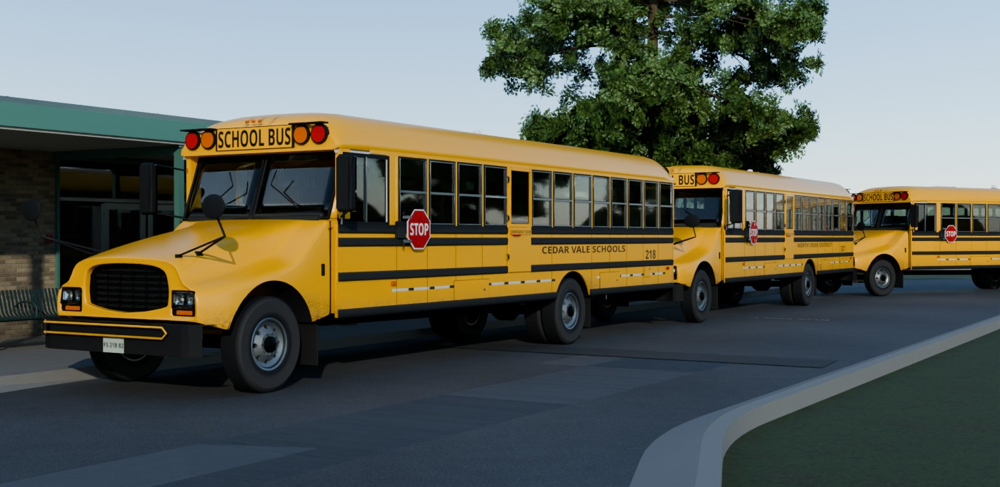
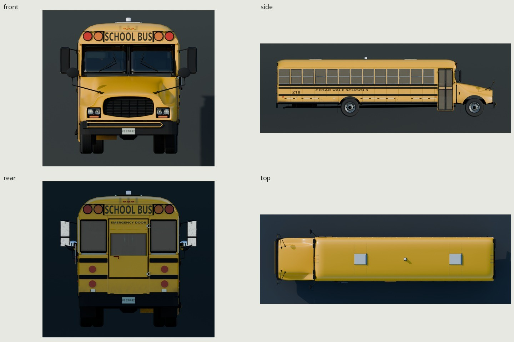
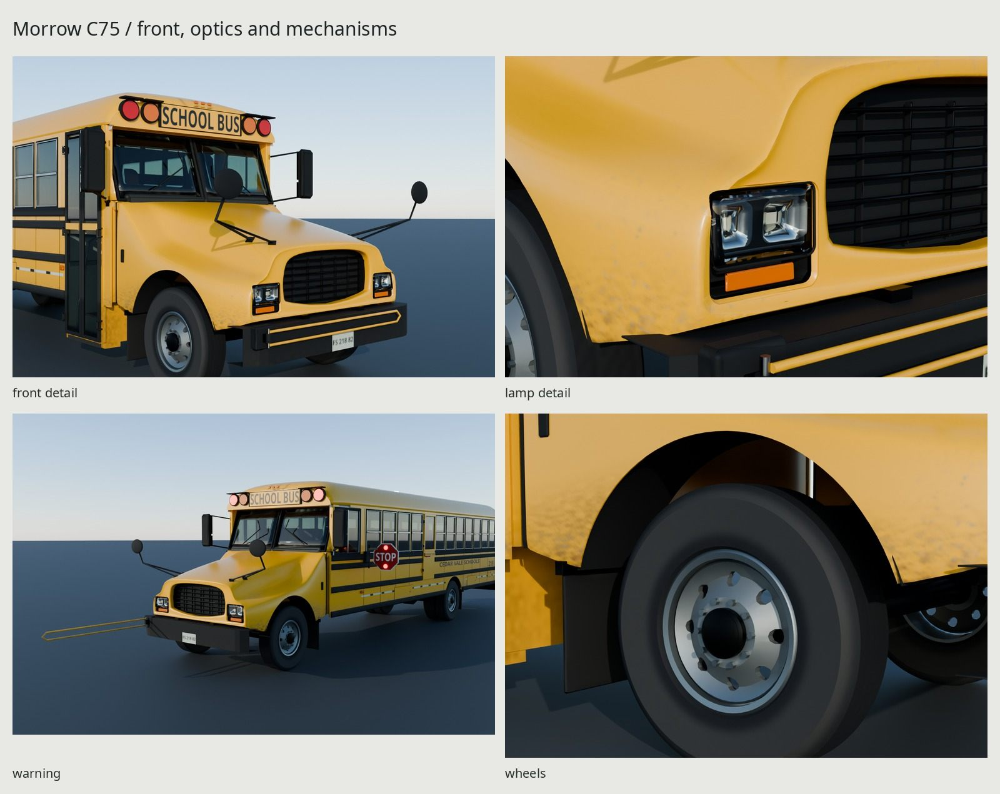
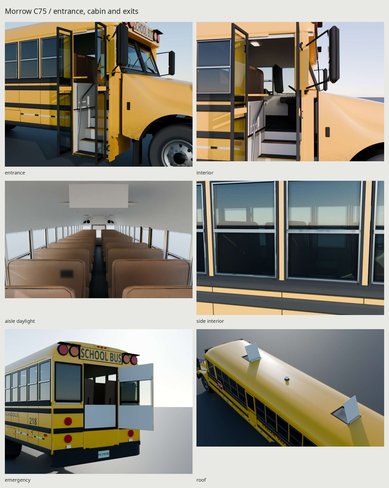
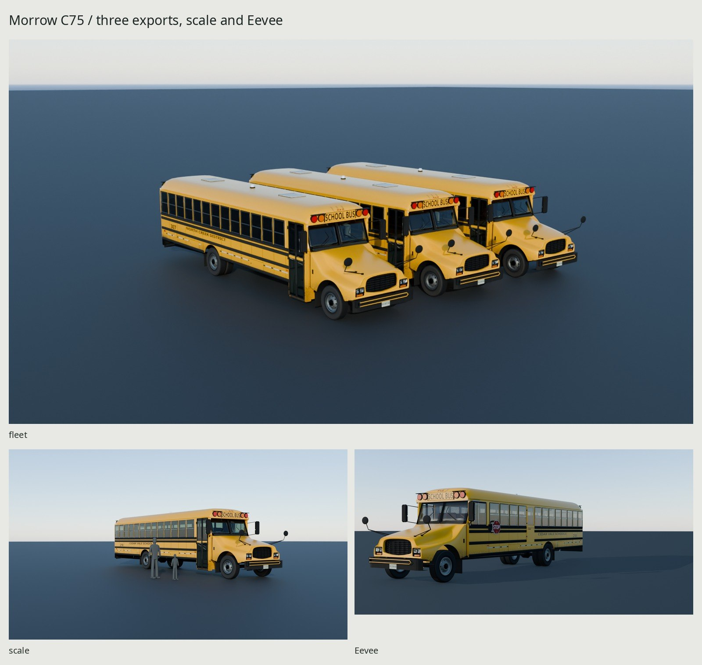

# Morrow C75 school bus



| Turnaround | Front, optics and mechanisms |
| --- | --- |
|  |  |
| Cabin and exits | Fleet, scale and Eevee |
|  |  |

An original late-2000s American Type C conventional, with a 75-child seating
layout and three fictional district/fleet seeds. Built entirely by scripts
in Blender 5.2. Each export is **86,394 triangles** on one shared **2048²
three-map atlas**, with four surface bindings, opening exits, steering and
six turning wheels. The three seeds depict three to five seasons of service.
The gallery imports the actual external-image glTFs and their baked textures.

The body has split-sash windows, four pressed rub rails, sheet seams and
normal-baked fasteners, roof caps, two roof hatches, a genuine entrance and
stairwell, rear and left-side emergency exits, dual rear tires, chassis rails,
springs, axles, service doors, exhaust, mud flaps, brackets, mirrors, stop arm
and crossing gate. Twenty-five padded three-place benches, an aisle, driver
station, controls, steering wheel, barrier, ceiling and lamps provide actual
interior parallax. Nothing is a photographic card or downloaded asset.

[Measurement basis and cited standards](REFERENCE.md) ·
[Photo/source register](refs/SOURCES.md) · [Critique log](REVIEW.md)

The original package targets **12.192m bumper length, 2.4384m steel body
width, 3.2004m roof and 6.9342m wheelbase**. Mirrors, rub rails, strobe and
other equipment extend that nominal envelope. Actual surface measurements,
triangle allocation and delivery bytes are rebuilt into `build/model-check.json`
and `build/delivery-101.json`; they are reported separately from design targets.

| Datum | Measured surface / pivot result | Basis |
| --- | ---: | --- |
| Bumper length | 12.192000 m / 40 ft | Brief; within AM-VIS-0710 conventional range |
| Steel body width | 2.438400 m / 96 in | Original package; AM-VIS-0710 lists 96 in exterior |
| Steel roof height | 3.200400 m / 10 ft 6 in | Brief's original package |
| Wheelbase | 6.934200 m / 273 in | AM-VIS-0710 72/77-place package |
| Full rest equipment envelope, W × L × H | 3.350 × 12.3005 × 3.330 m | Actual mirrors, lamps/arms and strobe included |
| Cushions / aisle | 0.990600 m each / 0.323400 m clear | 39-inch three-child benches; actual mesh bounds |
| Seat row pitch / minimum clear back spacing | 0.670 m / 0.614 m | Actual horizontal sections; 2010 NSTSP 24-inch recommendation |
| First tread / three tread rises / landing rise | 0.354 m / 0.210 m / 0.196 m | Actual walking faces; NSTSP step recommendation |

The rub-rail crowns reach 2.500 m wide, beyond the nominal 96-inch steel
body. Thus the rail envelope is 61.6mm wider than that published nominal
exterior width; this delivery makes that packaging difference explicit.
Track, overhangs and the cowl/door/window layout are original estimates,
not measurements attributed to a maker. See [REFERENCE.md](REFERENCE.md) for
the period 2010/2015 NSTSP and 2012 CFR FMVSS 111, 131, 217 and 220–222 basis.

## Geometry and construction

| Allocation | Triangles |
| --- | ---: |
| Body, glazing, lamps and chassis, excluding wheels | 43,498 |
| Six tires, steel wheels, hubs and lugs | 25,632 |
| Exterior subtotal | **69,130** / 70,000 |
| Interior | 17,264 |
| Total, each seed | **86,394** / 90,000 |

Fine sheet fasteners, roof laps, tread, corrosion and scratches are baked
fields. Geometry carries the six tire silhouettes, graded wheel lips,
compound hood/fender sections, window construction, actual openings and
mechanisms. The per-source-mesh and per-pivot counts are in
`build/model-check.json`; fresh imported mesh counts are in each
`build/delivery-<seed>.json`.

The hood/fenders share a fair ten-station subdivision cage and 6 mm laminate.
The independent **71,756-triangle** mold supplies curvature to the
**5,334-triangle** game hood. Deliberate shoulder lines and routed grille/lamp
returns remain sharp. A smooth optical die fitted to our own dense molding
shapes each pocket, bezel, clear cover and reflector together. Sampled central
cover rows sit about 6–9 mm behind the uncut molding. Source, dense and exported
reflection-line views and five actual section cuts accompany the front renders.

Brown padded vinyl benches have crowned cushions/backs and sewn welts; gray
lining, rubber coves and folded stair pans separate the cabin from the yellow
shell. Manufacturing fields use frozen meter-space coordinates. Wear follows
leading edges, wheel wakes, lower splash, roof crossfall, seams and hand contact.
Fine relief transfers through the normal map; the shared atlas softens its
smallest chips, lettering and fasteners compared with the authoring source.

The same total by exported group (carriers exclude their wheel children):

| Group | Count × triangles | Subtotal |
| --- | ---: | ---: |
| Static `SchoolBusMesh`, including cabin | 1 × 57,122 | 57,122 |
| Entrance leaves | 2 × 472 | 944 |
| Rear emergency door | 1 × 734 | 734 |
| Side emergency door | 1 × 550 | 550 |
| Roof hatches | 2 × 228 | 456 |
| Steering carriers | 2 × 92 | 184 |
| Front wheels | 2 × 4,656 | 9,312 |
| Rear outer wheels | 2 × 4,656 | 9,312 |
| Rear inner wheels | 2 × 3,504 | 7,008 |
| Stop arm | 1 × 616 | 616 |
| Crossing arm | 1 × 156 | 156 |
| Total | 17 mesh groups | **86,394** |

## Export and runtime use

`export/C75-101.gltf`, `C75-102.gltf` and `C75-103.gltf` each have a matching
`.bin`. Retain their relative `shared/` image paths or remap them through a
content cache. The `.glb` files are conversion intermediates; use the `.gltf`
deliveries for the final seed metadata, age deposits and coating configuration.
All three reference **one shared 2048² BaseColor / OpenGL +Y
Normal / ORM atlas**, including interior, tires and glass. The source fields
are GPU-baked at 4096 and channel-filtered to 2048. This is approximately
**16 MiB** with full mips and three 8bpp block-compressed maps, or about
64 MiB as uncompressed RGBA8 with mips. All three seeds share that allocation;
their relative image URIs are identical. PNG bytes and mesh buffers are separate.
Four car-family surfaces distinguish paint,
opaque fittings/interior, transmissive glass and switchable lamps. Paint needs
its clearcoat response separately from rubber/vinyl; glass and switchable
emission account for the other two bindings. All four sample the same images.
The standard glTF clearcoat roughness also reads ORM green, so deposited dirt
does not retain the clean coating's narrow highlight. This reuses the existing
texture and UVs; it adds no image or material.

This generator reuses the original car-family tire, glass, paint and lamp
generators and atlas methods on the bus's own shared texture set;
the accepted car files and deliveries are unchanged. Six truck tires share the
same manufacturing field. Fleet lettering occupies guarded charts in this
same atlas. The age variants additionally use a small, physically restricted
lower-body vertex-color layer; they do not allocate extra textures.

Fresh imported delivery sizes, in bytes:

| Payload | Seed 101 | Seed 102 | Seed 103 |
| --- | ---: | ---: | ---: |
| glTF | 53,326 | 53,327 | 53,326 |
| BIN | 9,192,240 | 9,192,240 | 9,192,240 |

The shared images total **5,778,015 bytes**: BaseColor 1,513,393,
Normal 1,711,181 and ORM 2,553,441. PNG storage size is distinct from the
16 MiB GPU estimate. All three seeds contain their own six district, fleet
and plate planes. Imported UV coverage is 37.19%, with p5/median/p95 density
36.67/68.19/124.09 px/m and zero overlaps or out-of-bounds triangles. The source
pack covers 39.01%, including all three guarded lettering regions. Entrance
treads and the first two bench rows receive extra priority in this same atlas.
Fine fasteners remain softer than the source; this is a conservative many-chart
pack, not an optimal utilization claim. BaseColor RGB is sRGB; normal and ORM
are linear data. Normal is OpenGL +Y. ORM is R occlusion, G roughness, B metallic.
BaseColor alpha is independent lamp/paint data, rather than surface opacity.

| Seed | Fleet | District | Age / wear | Coat factor |
| --- | --- | --- | --- | ---: |
| 101 | 218 | Cedar Vale Schools | 3 years / .46 | .25 |
| 102 | 307 | North Creek District | 4 years / .67 | .20 |
| 103 | 164 | Oak Hollow Schools | 5 years / .84 | .14 |

## Pivots, sockets and game control

Meters, Blender +Z up and −Y front; glTF +Y up and +Z front. The origin is the
center of the bumper footprint at grade. Retain the hierarchy and material
bindings. There is no armature or baked animation. Local authoring axes below
become glTF Y for Blender Z; X stays X. Ranges are from closed/rest.

| Pivot | Blender world position, m | Authoring axis / degrees |
| --- | --- | --- |
| `Entrance_front` | (−1.275, −3.750, .370) | Z, 0…98 |
| `Entrance_rear` | (−1.275, −2.940, .370) | Z, −98…0 |
| `Emergency_rear` | (−.485, 6.060, 1.198) | Z, 0…105 |
| `Emergency_side` | (1.246, −.052, 1.180) | Z, −105…0 |
| `Roof_hatch_front` | (0, −1.050, 3.220) | X, −80…0 |
| `Roof_hatch_rear` | (0, 4.250, 3.220) | X, −80…0 |
| `Stop_arm` | (1.302, −2.700, 1.780) | Z, −90…0 |
| `Crossing_arm` | (−1.010, −6.139, .710) | Z, −90…0 |
| `Steer_FL`, `Steer_FR` | (±1.015, −4.953, .523) | Z, ±40 |
| `Wheel_FL`, `Wheel_FR` | Same centers, children of steering carriers | X, continuous spin |
| `Wheel_RL_outer`, `Wheel_RR_outer` | (±1.057, 1.9812, .523) | X, continuous spin |
| `Wheel_RL_inner`, `Wheel_RR_inner` | (±.748, 1.9812, .523) | X, continuous spin |

The entrance leaves open outward on opposite jambs, with axes 34 mm outside
their planes. The side exit hinges at its forward edge; the roof lids hinge
at their rear edges. Rear duals have separate coaxial spindles. The source
`pivot_axis` extras use the authoring axes above: convert Z to glTF Y.

`Socket_Driver`, `Socket_Door`, 25 bench sockets and 75 passenger-place
sockets are separate empties, 102 total. Authoring positions measured from
the export report are:

| Socket | Position / arrangement |
| --- | --- |
| `Socket_Driver` | (.695, −3.400, 1.760), seated occupant root |
| `Socket_Door` | (−1.250, −3.370, .400), entrance approach |
| `Socket_Bench_00_L`, `_R` | (±.657, −2.310, 1.700) |
| `Socket_Bench_<row>_<side>` | Rows 00…12 at .670 m pitch; `04_L` omitted for the side exit |
| `Socket_Bench_<row>_<side>_Place0/1/2` | Bench X plus −.310/0/+.310 m; same Y/Z |

Exact matrices for every socket are in `build/export-<seed>.json`, under
`nodes`; the actual hinge positions/ranges are in `build/model-check.json`.
The circular tire is a mean loaded envelope, preserving ground contact while
turning; it does not simulate carcass deformation.

Move the `SchoolBus` root with the game's vehicle controller, facing glTF +Z.
Use the 6.9342 m wheelbase and actual axle nodes for steering/physics. Add
each wheel's travel distance / .523 radians to its local-X spin. Set the two
steering carriers' local-Y angles from the controller within ±40°, keeping
their wheel children free to spin. Preserve all rest translations and compose
rotations with each node's rest quaternion.

For entrance opening fraction `u` in [0,1], rotate `Entrance_front` by
`+98*u` degrees and `Entrance_rear` by `−98*u` about glTF local Y. Other exits
and arms interpolate their signed ranges above; roof lids use local X.
Collision bodies, suspension dynamics, path following and occupant animation
belong to the game; the export supplies rigid mechanisms and attachment frames.

Lamps default **off** in stock glTF. The car-family BaseColor-alpha convention
stores source power divided by 80. [lamp_states.py](src/lamp_states.py) reads
only delivered images and exposes red, amber, headlight, dome and strobe
uniforms. The warning proof selects red and strobe with amber off. Flash timing
belongs to the game. No additional emission image is required.

## Rebuild and evidence

```sh
make -C school-bus clean       # remove generated model, atlas, exports and review renders
make -C school-bus             # complete delivery, gallery, checks and five docs JPGs
make -C school-bus check       # source, motion, UV, imported meshes, magenta, preservation
make -C school-bus export      # all three glTF/BIN files and shared images
make -C school-bus render      # exported gallery, source/export photo pairs and Eevee
make -C school-bus repeat      # exact independent CPU rebuild/export comparison
make -C school-bus check-texture-repeat # independent GPU rebake within kit tolerance
make -C school-bus docs        # regenerate the five bounded JPGs from the verified gallery
python3 kit/repo_check.py      # source/format/size rules, including docs
```

The hero reads native `school/export/Campus-102.gltf` and its relative payloads.
The original single-socket fit proof also reads `Campus-101.gltf`. These are
read-only presentation/check inputs; rebuild them with the
[school family](../school/README.md) if absent. The bus builder, UV, bake and
exporter do not depend on either. Additional native tree instances share their original
data. Procedural distant understory candidates are rejected by actual ground
rays on roads, walks and roofs. No school payload is edited or re-exported.

Every Cycles bake/render uses the kit's shared GPU lock. Scratch files remain
under this worktree's `build/`. The Makefile includes the shared checkpoint
rules, imports the sedan's chart-repair finalizer and uses its frozen-coordinate
bake preparation. The original grille has a recessed surround and open webs.
No shared kit or car generator is changed.
CPU construction/import/camera audits run before one serial GPU render batch;
photo-pair composition runs after that batch releases the lock. A calibration
change refreshes only the eight photographic comparisons in a separate GPU turn;
the verified gallery stays cached.

| Generated evidence | Contents |
| --- | --- |
| `renders/final/hero.png` | Eye-height 44mm Cycles view in native school 102's loading lane, with two queued seeds |
| `renders/final/turnaround.jpg` | Front, side, rear, top |
| `renders/final/front_detail.png`, `lamp_detail.png`, `hood_surface.png` | Fair hood, recessed grille, swept optical seats and supported mirrors |
| `renders/final/entrance.png`, `interior.png`, `aisle.png`, `aisle_daylight.png`, `side_interior.png` | Steps, door and side-pane interior views, low and adult-height aisle cameras |
| `renders/final/warning.png` | Deployed stop/crossing arms and red warning state |
| `renders/final/emergency.png`, `roof.png`, `wheels.png` | Rear exit, open roof lids and wheel close-up |
| `renders/final/scale.png`, `fleet.png` | 1.8m adult and 1.1m child; three actual seed exports |
| `renders/final/contact.jpg` | All 21 Cycles views plus Eevee |
| `renders/matches/`, `renders/source-matches/` | Four neutral-balanced service-photo pairs, including two makers' fronts and a used long body's side |
| `renders/round3-repairs/` | Eight held-camera before/after pairs, each side 1400px wide |
| `renders/curvature/` | Dense/source/export reflection lines and five-station transverse triangle cuts |
| `renders/seethrough/` | Six imported-delivery magenta tests, envelope masks and counts |
| `renders/eevee/hero.png` | Eevee transmission preview |
| `docs/` | Five final JPGs, each at most 1600px wide and 200KB |

The historical repair pairs require this delivery session's ignored round-2
archive; `make fixes` composes them when it is present. The current asset,
final gallery and documentation rebuild independently of that archive.

The legacy school-101 sockets reserve 11m buses at 12m centers; blindly using
both would overlap this 40ft vehicle's bumpers. Parked buses need at least
**12.5m centers**; deployed crossing loops need **14.35m** for a 0.2m game-scene
gap. The school-102 presentation uses 12.6m longitudinal spacing, with the
rear bus angled into the actual east transition. All 18 tires meet native
asphalt, and 27 transformed body-envelope probes stay inside the corridor
(maximum measured offset 3.3282m; corridor half-width 3.6576m). Original socket
and actual staged-fleet proofs are separate: `build/school-fit.json` and
`build/school-stage.json`.

`build/checkpoint-check.json` gathers the independent reports. Construction
checks measure the actual surfaces: 153 supported joints, 48 walking-surface
probes, a 0.614m minimum seat/back clearance, and 508 sampled poses across
16 mechanisms. The only motion exceptions are the two intentional spindle
interfaces. Fresh imports separately verify all 17 mesh groups, zero duplicate
or bad-normal faces, the UV layout and 178,740 bidirectional vertex samples
per seed, with zero vertex/pivot displacement. A separate check measures all
36 marking corners against the intended source variant's positions and UVs.
Those import comparisons prove
serialization; they do not substitute for the construction measurements.
Six direct magenta views report zero resolved leak pixels. All 340 protected
delivery and documentation files from other families retain their
hashes, including the 56 pre-existing native school payloads.

The 4096 bake checks 5,502,544 interior atlas texels per channel, with
zero unfilled base texels, missing alpha or reversed normal hemispheres.
The 5,334-triangle hood receives normals from an independent 71,756-triangle
dense mold: 99.886% measured surface-area projection coverage, with exact mesh
normals retained on narrow routed returns. Missing projection beyond 1% fails
the bake. Independent builds compare 1,157 objects' exact geometry, canonical
oriented topology, bindings, transforms and metadata; measured maximum
smooth-normal difference is zero against the unchanged 10⁻⁶ tolerance.
Presentation receipts identify actual delivery hashes, pose deltas and scale
heights; `src/review.py` rejects stale or incorrectly posed evidence.

`make repeat` independently regenerates markings, source, preparation, UVs
and all three exports against the same baked inputs. It compares **34 files
byte for byte**, including all glTF/BIN/GLB payloads, shared/filtered maps,
source counts, UV/export reports and atlas manifest. Blender containers contain
timestamps and are excluded. Spherical mirror faces have canonical storage
order so they cannot perturb packing. Three MikkTSpace rounding boundaries
per seed use the kit's existing guarded stabilization: exact position/normal/UV
signatures and at most one 0.0001 tangent step. Larger changes fail the guard.

`make check-texture-repeat` separately rebakes at 4096 with 12 samples, filters
to 2048 and compares each shipped RGB map with the kit's maximum 2-byte and
0.02-byte RMSE limits. Independent BaseColor alpha receives the same limits.
This compares GPU samples within tolerance rather than claiming exact noise.

The hero's bus-only paint median/p99 displayed luma are .5865/.6693, with no
clipped channels; 30.52% of bus pixels fall below 25/255. The matched-light
comparisons balance the first front on snow, the second on a parking stripe,
and the long used side on a white trailer panel. Their appearance comparisons
and neutral assumptions are documented in [REVIEW.md](REVIEW.md); they are
not calibrated albedo measurements. The side registration remains 23.62 native
pixels. All final native images and the five bounded JPGs were reviewed.

## Known limits and credits

Warning/taillamp optics and driver controls remain simple. Small lettering,
fasteners and tape repairs soften at this atlas density. Seat corners show some
faceting at aisle-camera range, bench shapes repeat, and the underside is
schematic. Diagnostic chrome views reveal normal-map grain at roughness 0.055;
the ordinary enamel views retain continuous highlights. Some roof runoff
regularity remains. The cabin supports exterior views and peering through the
open door/windows; it is not a fully playable first-person cabin.

Cycles uses camera refraction with a parallel-pane colored-shadow approximation.
The Eevee preview uses the car family's finite-sheet Fresnel fallback and has
paler/noisier panes. The actual delivered glass geometry and atlas are shared.

Every vertex and texel is original procedural work. The kit and original car
generators supply shared modeling/material/export methods; neither was edited.
The [school](../school/README.md) is a read-only presentation asset, never part
of a bus export. Procedural sun/sky supplies all light. Installed Noto Sans
fonts are found through `kit/fonts.py` (SIL OFL). Reference authors, URLs,
licenses and measurement uses are recorded in [refs/SOURCES.md](refs/SOURCES.md).
No reference photograph, downloaded mesh, texture or HDRI enters the asset.
