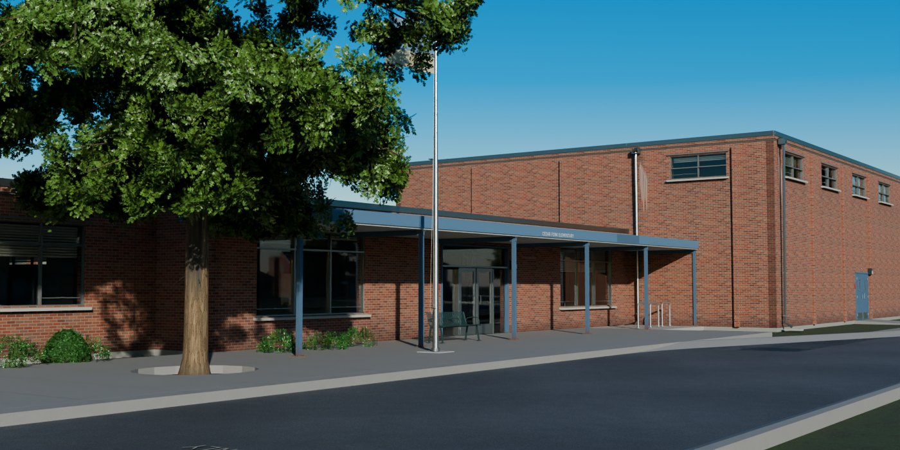
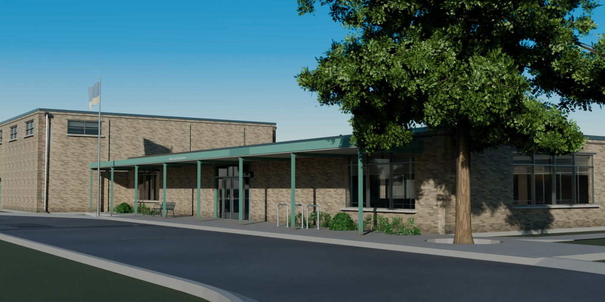
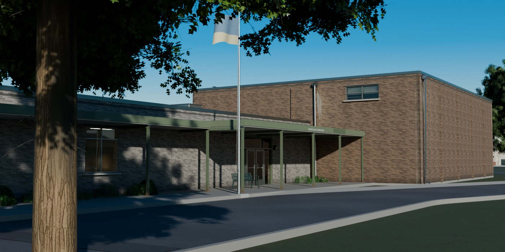
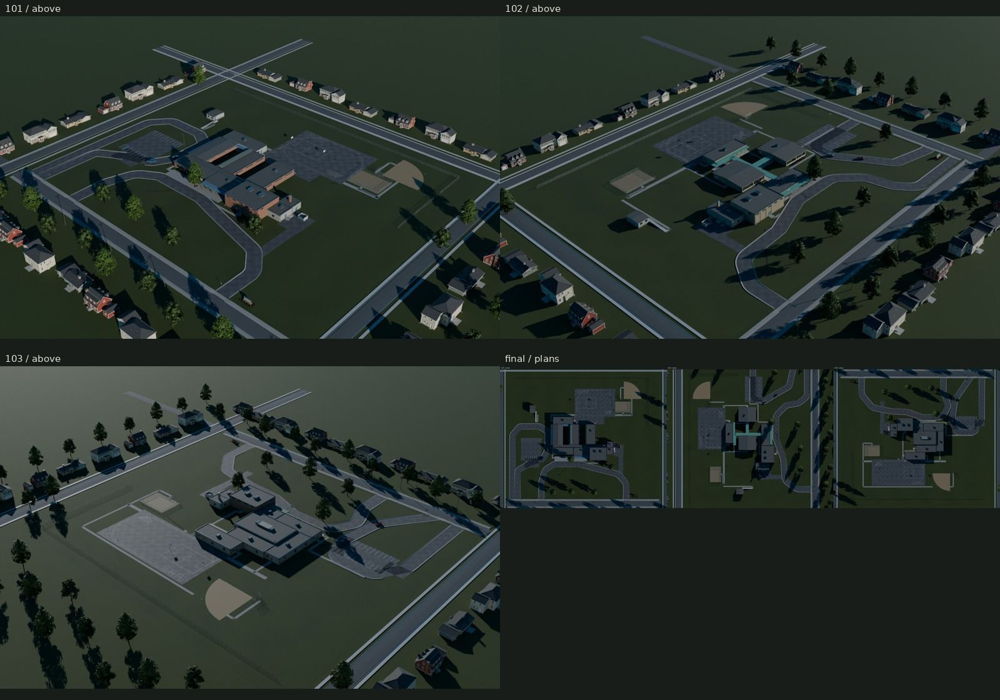
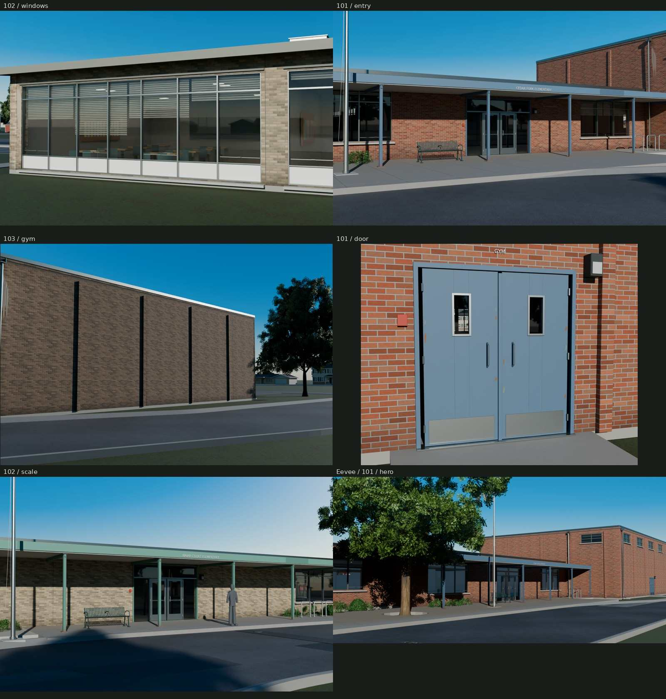

# Neighborhood elementary schools

Three original American public-school campuses, maintained in 2010 after
construction in the 1950s, 1960s and 1970s and later additions. Every mesh and
texel is generated by scripts in Blender 5.2. Stock glTF uses shared external
PBR images; no reference photograph is used as a texture.

| Cedar Fork / 1956 | Briar Court / 1964 | North Vale / 1976 |
| --- | --- | --- |
|  |  |  |




The heroes are Cycles views of the exported campuses at 42mm, with procedural
clear-sky light and raking sun. The last details panel is Eevee. Cars and the
surrounding neighborhood are native library presentation actors; the school,
plants and static parcel come from the exported glTF and its shipped images.
[REVIEW.md](REVIEW.md) records full-size critique, rejected views and remaining
CG tells. [REFERENCE.md](REFERENCE.md) and [refs/SOURCES.md](refs/SOURCES.md)
separate published dimensions, original decisions and reference rights.

| Seed / school | Plan and decades | Parcel / entry | Building triangles | Static campus triangles |
| --- | --- | --- | ---: | ---: |
| 101 / Cedar Fork | 1956 fingers; 1963 gym/service; 1984 cross wing | Mid-block / south | 82,199 | 293,874 |
| 102 / Briar Court | 1964 courtyard pods; 1988 rear row | Corner, two frontages / east | 81,619 | 298,589 |
| 103 / North Vale | 1976 compact media core; 1991 addition | Park behind / north | 67,780 | 273,712 |

## Dimensions and construction

All 35 classrooms retain **30 × 32 ft / 9.144 × 9.7536 m** clear wall dimensions,
960 sq ft, and 10 ft ceilings. Structural pitch is 30 ft + 6 in; the floor
surface is 0.1524 m, ceiling 3.2004 m, single-loaded corridors 8 ft clear and
spines 10 ft clear. Source-wall rays measure the room size independently of
export comparison. References and the limits of those measurements are in
REFERENCE.md.

| Seed | Building export bounds, m | Classrooms |
| --- | --- | ---: |
| 101 | 86.935 × 61.937 × 8.228 | 12 |
| 102 | 87.530 × 68.933 × 8.178 | 11 |
| 103 | 75.933 × 59.296 × 8.328 | 12 |

Bounds include roof projections, covered walks, boiler stacks and drain discharge blocks. Earlier
classroom decks are at 3.81 m; later wings 4.12–4.27 m, the media core 4.88 m
and gyms 6.706–7.315 m. The court school's gym/kitchen/office group is recomposed
on the other side of its pods without changing the accepted room graph.

Early wings have broad steel-sash walls, hopper bays, low spandrels and deep
sunshades; finger corridors have clerestories. The courtyard originals begin
at a low sill, while replaced upper panels and smaller inserted sash remain
visible. The compact school's original windows are narrow; its later addition
has a wider yard-facing bay. Openings have returns, lintels, projecting sills,
frames and actual separate glass, not a texture painted over a solid wall.

Roofs vary between longitudinal low-slope gables, shallow sheds, flat ballast
and framed clerestory monitors. Equipment count and size follow the wing's
age and use. Curbs have sloping bottoms measured against the actual pitched
roof surfaces. Coping, scuppers, downspouts and splash blocks remain modeled.
Drains stand on clear masonry piers, away from operating door leaves.

## Plan grammar and placement

`src/plans.py` has no Blender dependency. `school(seed, plan_type=None,
bays=None)` selects `finger`, `courtyard` or `compact`; the seed controls the
plan family, colors and construction dates, and `bays` accepts three or four
30ft classroom bays. Additions grow by whole modules. `siteplan.py` supplies
the bounded parcel layout, frontage, heading, loading routes, parking, field,
blacktop, playground reservation and planting. The default seeds preserve
three distinct circulation graphs rather than stretching one building.

Each lot is **210 × 184m / 9.548 acres**. Original site relationships follow
the CDE 2000 site guide's corner-school diagram and LAUSD's published 1956/1974
plans and 1960/1977 aerials; the McDowell nomination describes planted mature
frontages. The inspected figures and interpretation limits are in REFERENCE.
24ft bus lanes meet the entry plaza along a straight loading curb. Parent
traffic passes an independent staff-lot curb. Aprons meet the native crowned
street through lowered sidewalk/curb openings. Native tree rows follow the
frontage; entry trees have cut planting wells or grass-island groundings,
with foundation beds, a marquee bed and child shortcut wear.

The large blacktop touches the teaching wings and carries basketball keys,
four-square, hopscotch, an original illustrative states map, an oval track,
tetherball and hoops. The **70 × 50ft / 21.336 × 15.24m** playground reservation
contains its fence and access gate but no equipment. The practice ballfield
and backstop lie beyond. The 101/102 portables retain supported ramps and
landings. These are small neighborhood schools with eleven or twelve general
classrooms; circulation, storage and the wider architectural program remain
schematic.

A game can import `export/Campus-<seed>.gltf` with its matching `.bin`,
retaining the repository-relative shared image paths, or remap those URIs
into a content-addressed material cache. Place its root on the town's ground
plane and align the street apertures using the bus/parent entry sockets.
Its origin is the center of the parcel at grade; its root already carries
the selected 0/90/180° campus heading. `School-<seed>.gltf` supplies only the
building in its canonical −Y-front frame, centered on the building footprint.
Blender uses meters and +Z up; glTF converts to +Y up and +Z front. Preserve
these transforms when attaching objects. No collision meshes or engine LODs
are supplied; generate them per project.

## Rooms, construction and maintained age

The visible classroom volumes contain ceiling planes and diffusers, paired
work tables, chair backs, boards and display sheets. Blinds are varied in
height by room and sash group. These inexpensive meshes provide genuine
view parallax through transmissive glass, rather than photo cards. They
support exterior views; they are not complete playable interiors. Small
chair panels deliberately use thin two-sided sheets at this viewing distance.

The district repainted blue, green and olive trim. More recent fascia repair
sections retain a darker coat, while rust stays at wet column feet and sash
junctions. Splash follows the bottom of masonry; sill-end deposits follow
openings. Scuppers and downspouts explain vertical runoff/mineral traces,
including the front gym drain. Wall color stations retain these marks through
export. Concrete pour joints follow the graded entry plaza; curbs and slab
edges have outward returns to grade and exposed route ends are capped. Asphalt service reinstatements, crack seals,
patched yard areas and faded game/parking paint retain distinct causes.

## Shared textures and memory

| Surface | Existing set | Shipped size | GPU MiB, full-mip three-map set |
| --- | --- | --- | ---: |
| Brick | CommercialBrick / RanchBrick buff or tan | 512 | 1 |
| Painted block | CommercialCMU | 1024 | 4 |
| Sills and concrete | CommercialConcrete | 1024 | 4 |
| Painted trim and metal | CommercialEquipment | 2048 | 16 |
| Granular roof | Same CommercialConcrete maps, rescaled | 1024 | 0 additional |
| Glass | Uniform transmissive stock PBR | No image | 0 |

Manufacture is generated and GPU-baked by the original library recipes at
4096, shipped at their native resolutions. BaseColor is sRGB; Normal is
OpenGL +Y; ORM packs occlusion, roughness and metallic. No new school PBR set
is introduced. One **8 × 8 original emission mask** selects ceiling diffusers
through UV1 on the existing Equipment material: **76 PNG bytes**, about
**85 GPU bytes** at the same 8bpp full-mip estimate. Other trim samples its
black region, independently of its ordinary UV0 manufacture charts.

Each building uses **six materials, 13 images and 25.00008 MiB**. A campus
uses **22 materials, 34 images and 113.00008 MiB**, including native ground,
two tree atlases, shrubs and chain-link. The three campuses share **38 unique
images / 114.33 MiB / 74,509,973 PNG bytes** together. A renderer must cache
shared images to obtain that reuse. These are BC7/BC5-equivalent 8bpp full-mip
estimates, not Blender's uncompressed residency. Cars and neighborhood
presentation load their own materials outside these costs.

| Seed | Building glTF + BIN | Campus glTF + BIN | Shared campus PNG bytes |
| --- | ---: | ---: | ---: |
| 101 | 12,097,830 B | 25,024,739 B | 73,600,796 B |
| 102 | 12,132,444 B | 25,544,864 B | 73,755,731 B |
| 103 | 9,908,139 B | 21,931,642 B | 73,745,177 B |

Furnished rooms, planted beds, turf color stations and closed flatwork add
15.7k–18.0k triangles over the accepted site checkpoint. All three remain
within the brief’s 300k static-campus cap; the image increase is the tiny
emission selector above.

Counts include placed static instances. Native pickup, crossover and
hatchback actors use their original bodies and different original paints;
vehicles, neighboring houses, continuing streets, utility poles/wires and
distant trees are presentation context outside the campus triangle budget.
No school-specific car decimation or body conversion is performed.

Meter-scaled tile UVs intentionally overlap/repeat; this is not a unique
lightmap unwrap. Equipment uses guarded swatches. Brick is about 420px/m,
painted block 420px/m and concrete 672px/m. Independent exported area-weighted
percentiles, image hashes and intentional reuse are in
`build/delivery-audit.json`. Fine manufacture remains in the shared maps;
placement-owned corner colors carry broad weathering. UV1 only selects light.
The glass and lights use standard KHR transmission/IOR and emissive-strength
extensions; retain those material bindings on import.

## Moving parts and sockets

| Part | Pivot / authoring axis and range | Placement use |
| --- | --- | --- |
| Exterior and entry door leaves | Physical jamb, local Z; −90–0° left leaf / 0–90° paired right leaf | Separate named leaves and hardware; no baked motion clip |
| Dumpster enclosure gates | Physical hinges, local Z, ±110° | Service access |
| Playground gate | Native library hinge | Equipment reservation access |
| District flag | Halyard corner; local Z ±60°; lowering on Z by 6.2m | Authored cloth rest shape with rigid yaw/lowering |

Blender Z axes become glTF Y axes. No armature is required. Names retain
`School_<seed>__<block>_Door_<opening>_<leaf>` and documented pivot/range extras.
Entry, walk, footprint, flag halyard, service, blacktop, field, portable ramp,
bus entry and parent entry empties provide attachment frames. Each
`Campus_<seed>__Playground` socket centers its clear reservation; attach the
playground family there without duplicating fences. `Bus_loading_0` and,
on 101/102, `Bus_loading_1` reserve 11m vehicles on the loading side. 103 also
has a waiting `Bus_queue` socket. No school bus mesh is supplied.

## Rebuild and verification

```sh
make                       # refs, native dependencies, six exports, checks, final views/pairs/crops
make check                 # physical construction, raw glTF, UVs, import, preservation, repository rules
make repeat                # deterministic glTF/BIN/image rebuild, byte for byte
make check-texture-repeat  # independently regenerated mask; canonical GPU maps remain immutable
make render                # Cycles views of exports, default 1400px / 48 samples
make matches               # three neutral-balanced export/source photographic pairs
make fixes                 # native-size before/after crops from identical cameras
make docs                  # only after the current full-size visual-review receipt exists
make clean                 # remove rebuildable school outputs
```

All Blender jobs run serially; Cycles acquires the shared GPU lock. Existing
library deliveries are immutable inputs and are hash-checked. Missing context
is rebuilt under this asset's `build/` from unchanged native scripts. The
accepted b638448 comparison is rebuilt from tracked history into an isolated
local archive. No other worktree is used. No kit files are changed.

`renders/final/<seed>/` contains hero, above, orthographic plan, front, side,
rear/service yard, blacktop, window wall, entry, gym, hardware, roof and scale,
plus the retained accepted hero camera. `renders/final/contact.jpg` and
`plans.jpg` collect those views. `renders/final-matches/` holds the gym,
classroom and covered-walk comparisons; two source photographs show daily use.
`renders/fixes/` holds native-size identical-camera evidence, plus separately
labeled old/new compositions. The ribbon refit has about 35.6px native RMS:
it compares an original school type, not a measured replica of that bay.
The solver-to-Blender projection check is a separate correctness check.

Source checks measure 35 room clear dimensions, door sweeps and completed
paving clearance, roof-curb seating, drive separation, grounded tree bases
and program reservations. Curb backs are checked against their actual adjoining paving segment; slab returns face outward and exposed ground triangles face up. Raw accessors check triangles, normals and UVs;
fresh import checks counts, bounds and pivot serialization. Those geometric
checks do not certify accessibility, engineering or architectural compliance.
The visual review and photographic pairs judge the exported appearance.

## Credits and known limits

Planning and construction sources: Colorado's Mid-Century Schools National
Register submission, CDE 2000 site guide, Idaho 1996 rules, BIA 2007 handbook,
LAUSD historical survey and HABS LA-368. Photograph credits and licenses are
in `refs/SOURCES.md`; reference images remain ignored. All names, lettering,
geometry and graphic marks are original. Lettering uses installed DejaVu Sans
(Bitstream Vera/DejaVu licenses). Lighting is procedural sun/sky; no HDRI.

The most visible remaining simplifications are repeated furniture layouts,
reused vegetation silhouettes, simple rooftop machinery and schematic office
interiors. Tile repetition can be seen close to brick, shortcut edges remain
coarse, and the classroom type-fit does not reproduce the photographed bay's
aspect. The distant neighborhood has repeated houses and simplified lots.
Eevee shows less room depth through the glass than Cycles despite its local
probe/refraction setup; retain transmission/IOR support in the target engine.
This is an exterior game family, not a full school interior or civil model.
