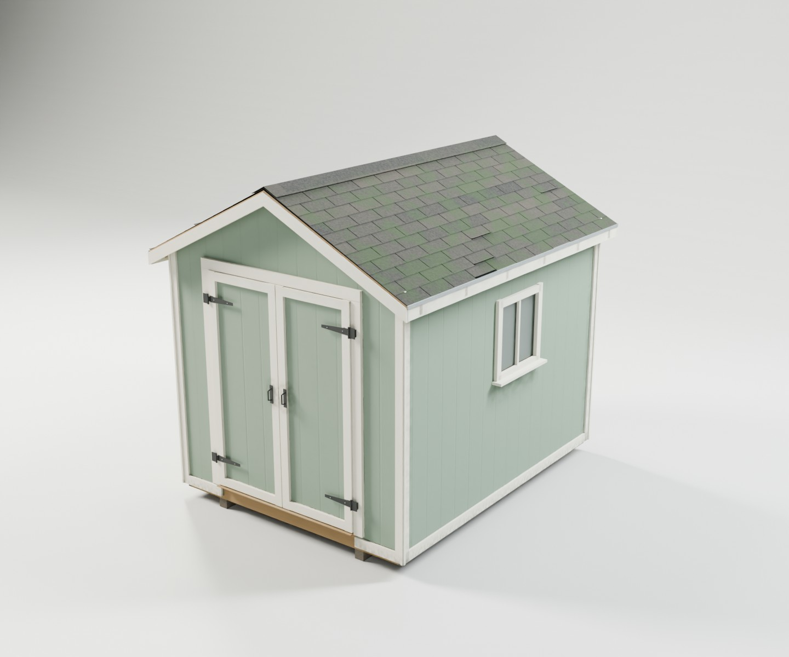
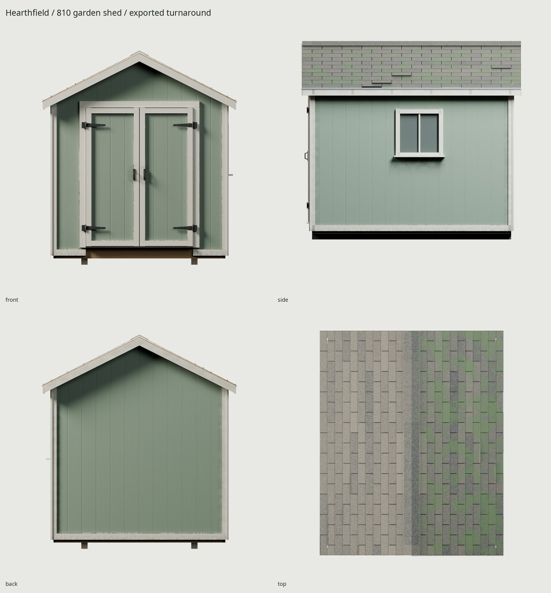
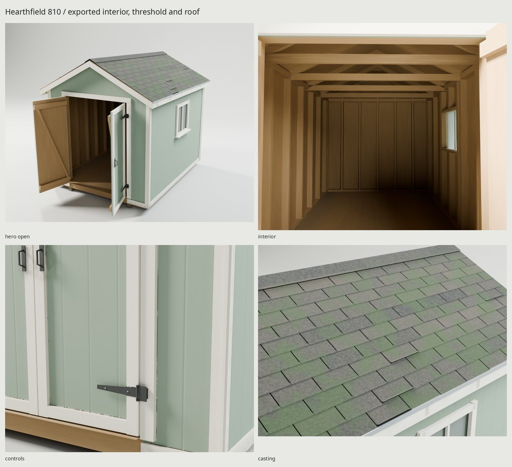

# Hearthfield 810

An original, script-built 8×10 ft wooden garden shed: chalked sage T1-11, warm white trim, a shingled gable roof and a genuinely framed interior. The double doors open on external iron pintles. Fictional design; no downloaded geometry, materials, lighting or texture pixels.





## Dimensions and construction

| Element | Dimension |
| --- | --- |
| Floor footprint | 2.4384 × 3.048 m / 8 × 10 ft |
| Finished deck above grade | 0.24765 m |
| Wall framing above deck | 2.1336 m / 7 ft |
| Structural ridge | 2.99085 m |
| Roof pitch / overhang | 6:12 / 152.4 mm |
| Measured clear framed opening | 1.524 × 1.9805 m |
| Nominal door height / fitting gap below | 1.9685 m / 12 mm |
| Window | 609.6 × 609.6 mm / 24 × 24 in |
| Studs / floor joists / skids | 38.1 × 88.9 / 38.1 × 139.7 / 88.9 × 88.9 mm |
| Siding / roof deck / floor | 15.875 / 12.7 / 19.05 mm |

Two pressure-treated skids carry a rim/joist floor and three plywood deck sheets. Wall framing includes top/bottom plates, door king/jack studs and a doubled header, window king/cripple studs, sill and header. Six trusses carry gauged roof plywood; the roof underside and unpainted siding backs remain modeled. Each door has a plywood skin, back rails and a compression brace. Shingles have real lap edges and sparse lifted tips; zinc eave edging covers the fascia. See [REFERENCE.md](REFERENCE.md) and [reference credits](refs/SOURCES.md) for measurement sources and original design choices.

## Delivery

The game mesh and high source are generated separately. One atlas contains sRGB BaseColor, OpenGL +Y Normal and non-color ORM (R AO, G roughness, B metallic), baked at 4096 and shipped at 2048. Estimated block-compressed GPU allocation is about **16 MB** including mipmaps; a glass material shares those same images. No alpha tile or additional glass texture is allocated. Unique UV islands cover the interior as well as the exterior, so density is intentionally lower than a handheld prop; the independent acceptance band is documented in `src/config.py`.

**9,700 triangles**, two materials, three shared 2048² images; GLB **12,018,652 bytes** (12.02 MB). The fixed mesh is 8,628 triangles; each door is 536. Unique UV coverage is 64.88%, with zero measured overlap pairs, outside triangles or degenerate UV triangles. Density p5 / median / p95 is 123.18 / 123.18 / 123.89 px/m. The triangle spend covers the full interior and real shingle laps, rather than an exterior-only shell.

`make` and `make check` run source/game audits, independent UV/normal/scale checks, GLB re-import, hinge sweeps, evaluated-surface support measurements and repository policy. Support checks measure the skid/joist and rafter/deck intersections and a 0.24 μm sampled upper bound at the jack/header contact; they do not merely compare nominal constants. Re-import measures zero rest-vertex and pivot-transform error. Detailed machine reports are `build/{delivery-check,motion-game,motion-high,construction-check,dimensions-check,uv-report}.json`.

`export/Shed.glb` contains the fixed assembly and two moving doors. Coordinates are meters, Blender +Z up / −Y front, origin at footprint center on grade. Export converts to glTF +Y up / +Z forward. All scales are applied.

| Part | Blender pivot position (m) | Axis / range |
| --- | --- | --- |
| Door_L | (−0.760, −1.597, 0.25965) | Z, −110° to 0° |
| Door_R | (+0.760, −1.597, 0.25965) | Z, 0° to +110° |

Both start closed; each opens outward. The header and threshold are static. Doors are independent but carry their own braces, trim, sleeves and pulls. A five-degree sampled sweep checks both source and game solids; that is physical collision evidence, distinct from GLB serialization/pivot verification. It is not a continuous mathematical collision guarantee.

## Materials and aging

`WEAR=.8` is a few outdoor seasons. Soil splash stays below 230 mm above grade, reaching only the lowest siding and skirt. Mildew follows shaded +X/+Y exposure, T1-11 grooves, sheltered corners, rake/eave trim and the window sill; sunny faces chalk while the siding retains its green. Door handling grime follows the pulls in each leaf’s rest frame. The skids and floor rim use the kit’s `weathered_wood()` with per-timber grain and a separate grade frame: gray-brown fibers, checks and ground dirt. Asphalt has twelve half-tab-staggered courses, three-tab strip granule blends, dark course edges, dark felt beneath the cutouts and soft shaded-slope moss. Sparse lifted tips remain geometry; the rest enters BaseColor, roughness and normal. A foot-worn threshold remains exposed plywood. Roof and siding detail are entirely original node fields. Metal mounts are zinc and dark painted iron. Window transmission is a uniform shared-atlas override.

## Rebuild and inspect

```sh
make
make check
make match PASS=source-final WIDTH=1100 SAMPLES=32
make match-final PASS=delivery-review WIDTH=1100 SAMPLES=32
make WEAR=.2  # cleaner variant; deterministic geometry and weather controls
```

Outputs: `build/lookdev.blend`, `build/finalized.blend`, `textures/{bake,ship}/`, `export/Shed.glb`. Final Cycles views, open-door/interior details, turnaround and scale shot are in `renders/final/`; Eevee is in `renders/final-eevee/`. The complete contact sheet is `renders/final/contact.jpg`. These rebuildable outputs are ignored by git. Only the three final JPGs above are tracked.

[REVIEW.md](REVIEW.md) records critique and limitations. Reference photos remain local comparison material; none appears in the delivered maps or committed docs. No real brand is reproduced.
