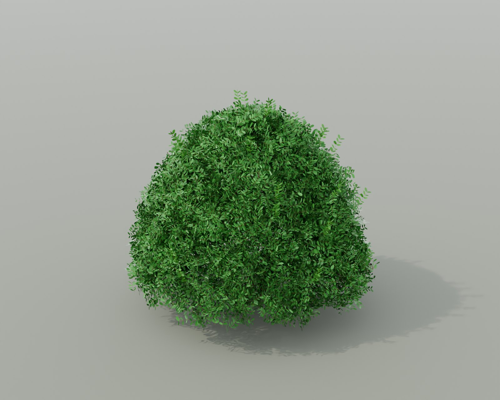
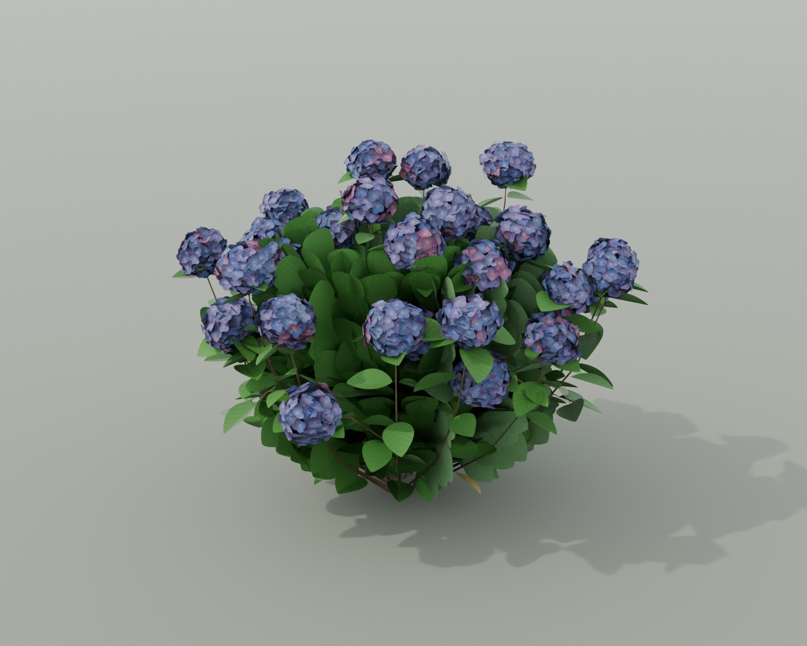
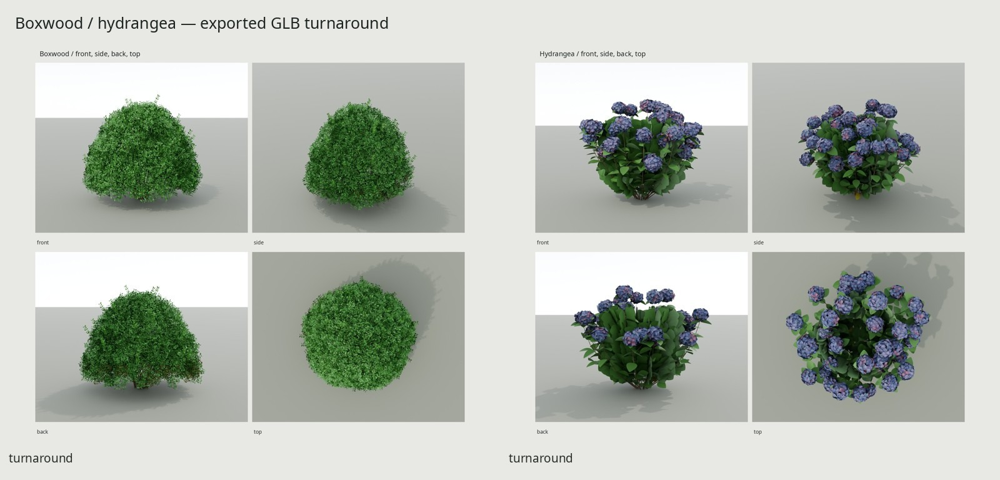
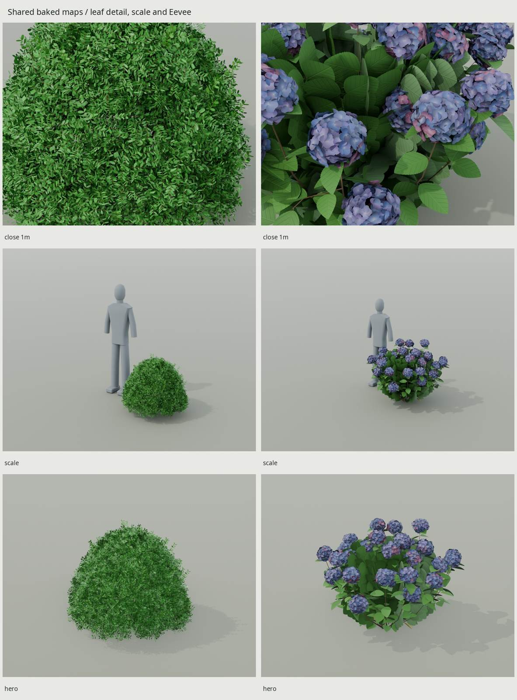
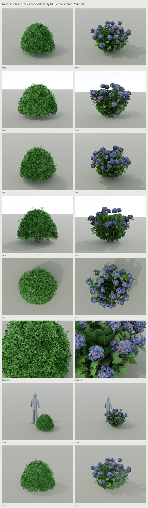

# Foundation shrubs

Two original scripted summer shrubs: a sheared hybrid boxwood and a blooming
bigleaf hydrangea. One shared baked atlas and one stock glTF library.







Cycles renders of the exported GLB with its embedded maps; the last two views
in the detail sheet use Eevee. Full images and local reference comparisons are
under `renders/`. Critiques and rejected candidates are in [REVIEW.md](REVIEW.md).

| Specimen | Boxwood | Bigleaf hydrangea |
| --- | --- | --- |
| Design size | About 0.9 m high × 1.0 m across | About 1.2 m high × 1.4 m across |
| Triangles / cap | **5,588 / 6,000** | **5,908 / 6,000** |
| Wood / foliage and sepals | 936 / 4,652 | 900 / 5,008 |
| Meshes / shared family materials | 2 / 2 | 2 / the same 2 |
| Rooted basal stems / daughters | 24 / 32 | 22 / 18 |
| Construction | Short 6–10-leaf sprigs; low clipped dome | 408 cupped broad blades; 124 interior branchlets; 36 mopheads |

Published species/cultivar ranges and the authored size choices are separated
in [REFERENCE.md](REFERENCE.md). The measured retained-alpha dimensions and
final display values are reported below. These are original specimens,
compared with unsurveyed living plants; photographs never supply vertices or
texture pixels.

Blender −Y faces front, +Z is up; glTF is +Y up, +Z forward. Each root is at the
footprint center on grade. Stem ends meet the receiving ground, with no soil
polygon. Static plants have no pivots, armature or animation clips.

The accepted boxwood retains its dome, fine sprig grain, low uneven skirt and
24 thin stems. Its geometry, normals and Wind hash match the accepted source.
Old brown-green leaves are localized low on the shaded +Y side.

Hydrangea has opposite pairs on alternating nodes, 8–15 cm broad blades with
physical cup, recessed pinnate veins and coarse serration. Three green blade
variants and a few yellow low leaves break repetition. Interior crossed
branchlets fill tiers around the stems; their individual petiole attachments
are a sprite approximation. Thirty-six dusty blue/lavender/mauve heads spread
through the upper two-thirds and sides; fifteen nod, and some sit behind leaves.
Sepal patches have uneven rims, pale centers and rib/crinkle normals.

## Delivery and engine loading

`export/Shrubs.glb` is the delivery: two root nodes, **Boxwood** and **Hydrangea**,
each with one wood mesh and one double-sided MASK foliage mesh. Both roots
are at the origin for independent placement. Load this GLB once as a library;
create a prefab/scene from the selected root and instance that root wherever
needed, retaining the imported mesh, material and image resources. The library
scene displays both overlapping until a root is selected or hidden. Avoid
loading separate copies of the library as unrelated texture resources.

The two materials reference the **same three image identities**, embedded once:

- `T_Shrubs_BaseColor.png`: sRGB RGBA, alpha cutoff .45.
- `T_Shrubs_Normal.png`: non-color tangent normals, OpenGL +Y.
- `T_Shrubs_ORM.png`: non-color R occlusion, G roughness, B metallic.

Wood is GPU Cycles baked at 4096. Original analytic leaf/sepal tiles are
composited into that bake at 4096, then color/coverage, vector normals and
roughness are filtered to **2048²**. The unique stem region has no accidental
UV overlaps; repeated UVs are intentional only in the declared botanical tiles.

BC7 BaseColor-alpha, BC5 normals and 8-bpp ORM with full mip chains total
**16 MiB for both shrubs and all their instances**. Engine buffers and overhead
are additional. Uncompressed RGBA8 + RGB8 + RGB8 maps with full mips would
consume about 53.3 MiB. PNG file size is unrelated to that GPU allocation.

Stock glTF carries ordinary two-sided MASK PBR and the shared images. For the
shown thin-leaf appearance, port [src/materials.py](src/materials.py) and
[kit/foliage.py](../kit/foliage.py) to the engine foliage shader: .12 diffuse
transmission, .12 specular, authored normals, and true-normal glancing coverage
over cosine .10–.26. Broad-leaf backs are paler, desaturated and rough (.88);
the UV mask excludes accepted boxwood tiles. The final renderer reconstructs
this documented response using **only imported embedded maps**. It loads no
source geometry or procedural wood shader. An unmodified stock PBR material
shares the textures correctly but cannot express the entire thin-leaf response.

All vertices export linear RGBA **`_WIND`**, with no `COLOR_0` albedo multiplier.
Keep that custom attribute in the engine importer and route it to the wind shader:

| Channel | Meaning |
| --- | --- |
| R | Height sway; wood scaled by .38, foliage up to 1; zero at grade |
| G | Stem hierarchy (.25 primary, .5 daughter); .75 broad blades/core, 1 sprigs/sepals |
| B | Seeded stable branch phase in [0,1] |
| A | Leaf/sepal flutter; wood zero |

Wind is a mask, not a baked animation. The engine supplies deformation,
instance variation and distance LODs/impostors. Keep the authored foliage
normals when importing.

## Rebuild and verification

```sh
make -C shrubs                 # refs → sources → UV → bake → family GLB → finals/docs/checks
make -C shrubs check           # source construction, GLB/PBR/UV, Wind, bake, repository
make -C shrubs preview         # quick boxwood Eevee source study
make -C shrubs hydrangea-render hydrangea-match HYD_PASS=study WIDTH=1100 SAMPLES=32
```

Requires installed Blender 5.2, Python/NumPy/Pillow, fontconfig and flock.
All Cycles jobs hold the kit GPU lock. Default finals use 1600 px / 48 samples;
4096 bakes use 32 samples. Everything is deterministic, generated from a clean
scene. `make refs` restores only the ignored reference photos/PDFs, with rights
and direct image URLs in [refs/SOURCES.md](refs/SOURCES.md).

`build/botanical-check.json` and `build/hydrangea/botanical-check.json` measure
actual stems, closed positive wood solids, parent penetrations, leaf attachment
starts, alpha-supported bounds, head extents and normalized Wind. The family
source/game audits compare actual geometry independently. Hidden caps remain
inside intersecting daughter attachments; the economical fine stems are not a
Boolean union.

`build/delivery-check.json` independently verifies embedded PBR/MASK state,
UV overlap/density and fresh GLB re-import. `build/botanical-delivery-check.json`
compares actual positions, split normals and Wind through raw accessors and
fresh import, then verifies root budgets and shared image identities. These
are serialization checks; the photo pairs establish appearance. Final image
metadata and `render-check.json` reject stale or source-scene renders.

## Final measurements and limitations

Measured retained-alpha dimensions:

| Measurement | Boxwood | Hydrangea |
| --- | ---: | ---: |
| X × Y width | 1.035 × 1.004 m | 1.492 × 1.430 m |
| Lowest / highest retained foliage | .060 / .867 m | .030 / 1.135 m |
| Head maximum retained extents | — | .167–.209 m |

The largest floret tips extend about 9 mm beyond the nominal 20 cm head size;
most of the head mass is smaller. Head dimensions come from actual retained
alpha support, not configured radii. All 408 measured outer petiole starts are
inside actual parent wood, with all three parity rays agreeing. Core branchlet
attachments remain the stated sprite approximation.

The family GLB is **6,066,148 bytes**, including **4,621,210 bytes** of embedded
images. Actual geometry accessors total **1,437,872 bytes** (about 1.37 MiB);
with the 16 MiB compressed maps, the estimated combined allocation is
**17.37 MiB** before engine overhead. There are four mesh primitives in the
library, two per selected shrub. Source and delivered triangle counts agree. Shipped PNG sizes are 1,052,212 /
3,297,050 / 271,948 bytes for BaseColor / Normal / ORM. The actual unique stem
UV pack covers 2.95% of the atlas (the rest is reserved/shared or padding), with
p5/median/p95 density 363/386/402 px/m and zero measured overlaps.


Final marked display-value measurements (0–1 weighted display RGB, not linear
luminance or calibrated reflectance):

| Patch | Export median Y | Photo median Y |
| --- | ---: | ---: |
| Green Velvet lit foliage | .348 | .361 |
| Second clipped boxwood lit foliage | .359 | .291 |
| Hydrangea house foliage / heads | .220 / .396 | .101 / .372 |
| Hydrangea bed foliage / heads | .213 / .375 | .376 / .526 |
| Hydrangea house shaded foliage | .112 | .075 |
| Hydrangea bed shaded foliage | .103 | .126 |

The brightest projected head-window median over all nine hydrangea views is
**.527**, below the .53 photo target; these windows can include neighbors and
are not isolated head IDs. Individual highlights are not clamped to .53.
No measured model color channel clips. Broad leaves remain darker than the
sunlit bed photo, while the house camera has less deep shaded area than its
photo. The two photographs differ greatly in light/exposure and specimen;
those differences are retained, not averaged into a false albedo calibration.
The final Eevee shot uses ray tracing and screen-space ambient occlusion;
its interior shadows remain shallower than Cycles.

Full-resolution evidence:
[family contact](renders/family-final/contact.jpg),
[boxwood contact](renders/final/contact.jpg),
[hydrangea contact](renders/hydrangea-final/contact.jpg),
[Green Velvet pair](renders/final/match_green_velvet-pair.jpg),
[hydrangea bed pair](renders/hydrangea-final/hyd_match_bed-pair.jpg).
Each shrub has `hero`, `front`, `side`, `back`, `top`, `close_1m` and `scale`
PNGs; Eevee heroes are in `renders/final-eevee` and `renders/hydrangea-eevee`.

The independent bake-loss report compares four actual source/export camera
pairs: whole-surface display-RGB RMSE is .0218–.0223 for boxwood and
.0063–.0066 for hydrangea. Global selected-leaf medians differ by at most .0015.
These errors include shading/sample variation and the wood reprojection;
all 3,670,016 tested analytic-region pixels per map are byte-identical inside
the GLB. Wood baking misses zero checked interior texels. No foliage blur is
concealed by comparing only the source scene.

Close views still reveal repeated sprites, card intersections and simplified
sepal geometry. The mound is more orderly than a free-grown specimen and the
reference lighting/exposure differences remain visible. These limitations are
recorded rather than described as a perfect photographic match.

Shared kit changes: botanical serialization auditing was moved from the maple
into `kit/botanical_delivery.py`, retaining the maple entry point and checks.
Finalization now honors the existing `UV_MIN_COVERAGE` setting, with its absent
setting default unchanged. Both changes are backward compatible and covered
by the real botanical/atlas fixtures. Existing shared foliage, photo framing
and curved-card helpers are reused.

Reference photographs stay local and never enter committed docs. Public author
credits and rights are in the source register; committed files contain no
private-home address, owner identity or listing link. Every asset vertex and
texel is original scripted output.
