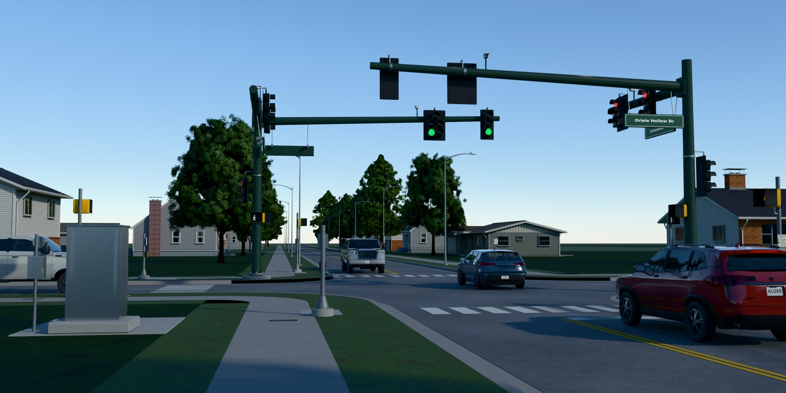
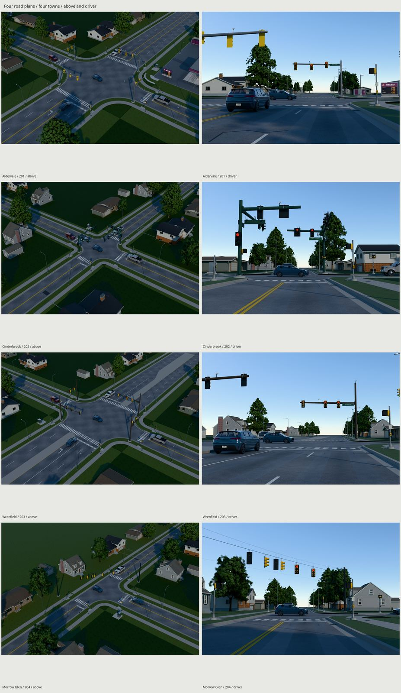
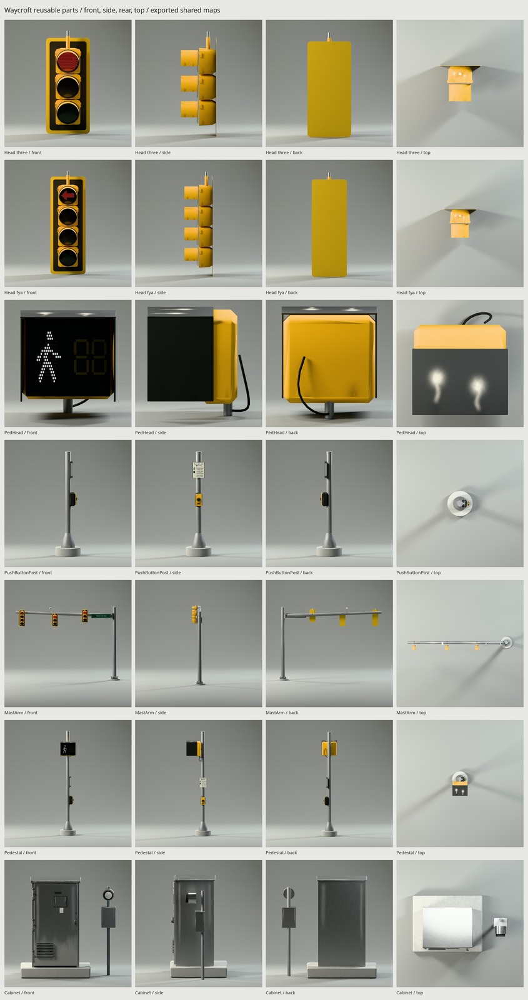
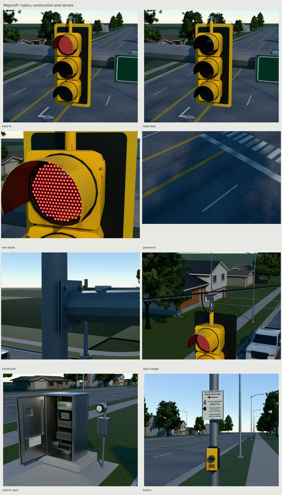
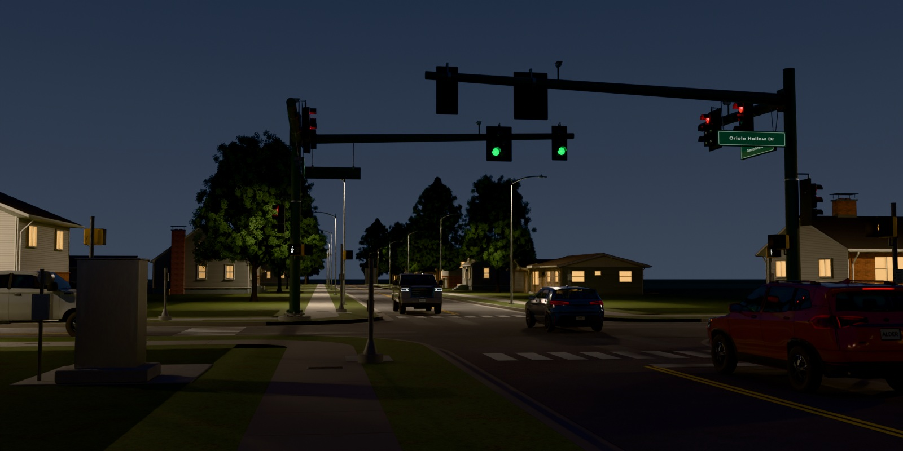
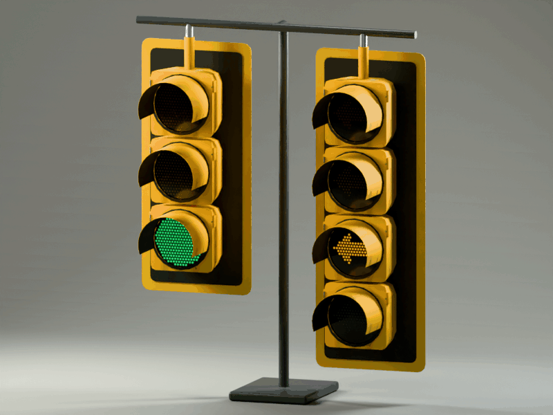

# Waycroft traffic signals



| Four towns | Reusable equipment |
| --- | --- |
|  |  |
|  |  |



Original, maintained 1995–2015 American signal equipment, with four road-derived
installations and one shared baked surface set. Finals and the state demonstration
load the exported game parts. Houses, vehicles and landscaping are presentation
only. Every vertex, graphic and material field is generated by our scripts.

[REFERENCE.md](REFERENCE.md) records measured standards and authored choices.
[TEXTURES.md](TEXTURES.md) explains the atlas, material references and age.
[REVIEW.md](REVIEW.md) records rejected views and remaining weaknesses.
[refs/SOURCES.md](refs/SOURCES.md) credits photographs and engineering drawings.

## Four towns

| Seed | Road plan and support |
| --- | --- |
| 201 / Aldervale | Five-lane 55 ft arterial crossing a 22 ft street; center turn lane, 35 ft corner returns and a channelizing island; four galvanized mast supports, yellow cases and FYA on the arterial; commercial corner with the library gas station |
| 202 / Cinderbrook | Two 22 ft streets, 15 ft corner returns; two diagonal dark-green poles with paired arms reaching the lanes each serves; black cases, doghouse left treatment and supplemental near-side faces |
| 203 / Wrenfield | 66 ft divided boulevard: four 11 ft through lanes and a 22 ft median, with an 11 ft left-turn bay cut into each end; 22 ft cross street, rounded noses, tapers and 25 ft returns; four bronze masts, yellow cases, protected arrows and Rill luminaires |
| 204 / Morrow Glen | Two-lane T with 20 ft returns and a continuous walk on its closed side; two black strain poles, catenary/messenger, lashed cable, lower tether and six faces serving the three actual approaches |

The cabinet corner, pedestrian arrangement, pole corners and arm reaches follow
the road grammar. Native ground deliveries remain untouched. The additive
`ground/export/ArterialSites.glb` contains four separate junction modules built
by `ground/src/junction.py` and `junction_surfaces.py`; it is independent of Ground.glb and the earlier
ArterialCheckpoint.glb. Houses, trees, street lights, the gas station and the
pickup/crossover/hatchback are presentation only and never enter signal exports.

## Construction and dimensions

| Feature | Dimension / construction |
| --- | --- |
| Vehicle indication | 304.8 mm / 12 in nominal clear circle; 370 mm section pitch |
| Cases / visors | Original compound Waycroft shoulders, separate retaining rim, hinge and latch; 1.6 mm sheet visors, 205 / 245 mm reach |
| Pole | 25 ft from plate bottom; 16 → 12.53 in across flats, twelve-sided taper |
| Base | 30 × 2½ in plate, six 1¾ in anchors on 23 in circle, hollow nut covers, 4 ft round foundation |
| Arm | Brake-formed taper, 2° camber, flange/box connection; reach derived from controlled lanes, within the brief's 20–45 ft range |
| Pedestrian case / post | 444.5 × 419.1 × 180 mm, 150 mm hood; 4 in pedestal |
| Accessible button | Axis 1.0668 m / 42 in above the actual landing; raised tactile arrow and separate instruction sign |
| Cabinet | 2,964 | 1 | 180,579 | 16.168 |
| Cabinet interior | Rack controller, conflict monitor, detector inputs, load-switch bay, breakers, harness, switched service-light socket and document pocket; perimeter gasket and folded inner-door stiffeners |

MUTCD 2009 and FDOT 2014 establish the period convention and chosen support
construction. The installation is a game asset, without structural, electrical,
traffic-study or accessibility certification. Lane widths, tapers, plans and
fictional makes are authored choices, distinguished from published dimensions.

Mast wiring enters the head's top boss through its bracket into the hollow arm.
The detector lead is clipped to its riser. Span clamps follow the messenger;
overlapping extension bars and balance adjusters support the heads, with short
gravity-hanging entry loops and one drip loop at each pole. FDOT 17727 sheets
1–2 inform that construction. There are no large rings or airborne mast handles.

## Game parts and state control

`export/Signals-201…204.gltf` are complete equipment-only installations.
`export/parts/` supplies MastArm, Pedestal, PushButtonPost, Cabinet, PushButton,
PedHead, Head_three, Head_fya, Head_five, Head_protected and SpanSet. Their .bin
files carry geometry; every referenced image resolves to `export/textures/`.

Meters, Blender +Z up / −Y front, glTF +Y up / +Z forward. Ground sockets retain
placement frames. Main support origins sit at the pole foundation; the span
set's origin is its installation center. Each head's origin is its indexed
hanger. The main door uses local Z, −110…0°. Its separate `Controller__PoliceDoor`
uses local Z, −95…0°; the access aperture passes through both door skins. Heads retain local Z ±15° aiming and
X ±4° limited movement. A game moving a head must update its flexible cable
and tether ends; a static service loop is not a cable simulation.

Every indication retains its stable `signal_lens` / `signal_kind` / `powered`
extras and name, such as `Mast_0__Head0__S00_red`. Swap that mesh's reference
between SharedLens_Off and SharedLens_Lit. Never modify a shared material to
change only one head. FYA S02 carries `flashing_yellow_arrow`; S01 is the steady
yellow arrow. The README GIF demonstrates green, steady yellow and red on a through face beside
a flashing yellow arrow. It swaps only those named exported material references.
A game supplies its own legal phase timing; the GIF is not an installation timing plan.

Pedestrian hand, walk and `Countdown_{Tens,Ones}_{A…G}` remain independent parts.
Use the ordinary seven-segment table, suppress countdown during walk as needed,
and control legal phases in the game. The demonstration keeps protected arrows
red while opposing through traffic runs; the T has no face aimed at its missing
branch. The optical fixture shows lit/dark copies at measured 30 m and 100 m.

## Budget and verification

One 2048 BaseColor / +Y Normal / ORM set, a 1024 indication sheet and 512 × 256
name sheet cost about **17.5 MiB** with 8-bpp compression and complete mips.
They are allocated once for the whole family. A mast uses atlas, two state
references and names; a cabinet uses only the atlas. See TEXTURES.md for details.

The actual per-part triangles, primitive/material references, per-intersection
bytes, map hashes and UV density are generated in `build/budget-report.json`
and `build/budget-report.md`. Every vehicle-head variant stays at or below
1,500 triangles; complete mast assemblies stay under 14,000, cabinets under
3,000 and pedestals under 4,000. The two halves sharing a Cinderbrook pole are
also reported together as one complete dual-arm support.

Measured equipment totals (ground and presentation excluded). First-use memory
includes referenced shared maps at 8-bpp/full mips plus geometry buffers; subsequent
family parts share the maps and add only geometry. Engine overhead is excluded.

| Intersection | Triangles | Materials | glTF + geometry bytes | First use MiB |
| --- | ---: | ---: | ---: | ---: |
| Signals-201 | 47,200 | 4 | 2,515,831 | 19.706 |
| Signals-202 | 42,408 | 4 | 2,283,221 | 19.479 |
| Signals-203 | 51,520 | 4 | 2,737,839 | 19.919 |
| Signals-204 | 31,504 | 3 | 1,617,259 | 18.738 |

| Reusable part | Triangles | Materials | glTF + geometry bytes | First use MiB |
| --- | ---: | ---: | ---: | ---: |
| Cabinet | 2,964 | 1 | 180,579 | 16.168 |
| Head_five | 1,500 | 3 | 76,553 | 17.399 |
| Head_fya | 1,340 | 3 | 68,873 | 17.392 |
| Head_protected | 964 | 3 | 50,686 | 17.376 |
| Head_three | 1,060 | 3 | 55,314 | 17.380 |
| MastArm | 8,174 | 4 | 411,715 | 17.876 |
| PedHead | 464 | 3 | 45,621 | 17.361 |
| Pedestal | 1,564 | 3 | 101,727 | 17.413 |
| PushButton | 408 | 1 | 25,780 | 16.023 |
| PushButtonPost | 1,044 | 1 | 54,005 | 16.049 |
| SpanSet | 17,456 | 3 | 770,206 | 18.040 |

Shared PNGs total **3,633,325 bytes**. All fifteen glTF/bin deliveries
plus that single map copy total **14,628,534 bytes**. Complete dual-arm
Cinderbrook supports remain 13,380 triangles. The full family map allocation is
17.5 MiB; parts without names or indications reference smaller subsets of it.
The separate ArterialSites GLB is 48,499,676 bytes and
its four full road assemblies contain 6,243 / 4,050 / 6,448 / 2,770 triangles.
Each consists of several approaches, corners, walks and medians; the largest
individual approach is 1,993 triangles. They reuse canonical Ground maps,
with no new image allocation. Full per-map/per-buffer records and measured
piece counts are in `build/budget-report.json` and `build/arterial-check.json`.

`make` rebuilds fields, locked Cycles bakes, game parts, external glTFs,
arterial modules, checks, outdoor finals, source/game photo pairs, reusable-part
turnarounds, the 1.8 m scale view, Eevee view, state demonstration and docs.
The button turnaround uses the exported PushButtonPost assembly so its sign
and button retain their real mounting support.
Defaults are 1600 px / 32 samples; gallery turnarounds are 1200 px. Each town
runs in a fresh Blender process, serially. Presentation images are capped at
512–1024 in memory; signal maps retain their full delivered resolution. Source
files are never resaved by that cap. `WEAR=.8` controls service age.

```sh
make
make check
make repeat
make arterial
make WIDTH=1200 SAMPLES=24 render
make finals
make docs
```

Checks distinguish source-surface contacts and sampled motion from raw glTF
accessors, UV trim domains and fresh-import serialization. An additional layout
check measures actual pole counts, face aiming toward existing roads, primary
face separation and a conservative 20° horizontal view cone at the stop bar.
They prove construction and serialization, not photographic realism.

Verification receipts are generated under `build/`: `checks.json` covers
source/export serialization, `construction.json` measures actual contacts and
sampled motion, `layout-check.json` checks lane serving/view cones, and
`arterial-check.json` probes imported loop edges, lead-ins, pull boxes and repairs.
`delivery-check.json`, `budget-report.json` and `repeat-check.json` cover the
external-image bundle, actual budgets and deterministic model replay. Visual
calibration is documented separately in REVIEW.md; checks do not prove realism.

## Inspection artifacts

| Path | Evidence |
| --- | --- |
| renders/final/202/hero.png | Raking-sun intersection hero |
| renders/final/<seed>/{above,driver}.png | Four road plans and driver's approaches |
| renders/final/gallery/<part>/{front,side,back,top}.png | Seven reusable parts in the gallery studio |
| renders/final/{details,turnarounds,four-towns}.jpg | Full review sheets |
| renders/final/201/{lens_detail,pavement,cabinet_open,button,connection}.png | Exported optics, service equipment, wearing course and connection |
| renders/final/204/span_hanger.png | Clamp, balance adjuster, lashing, entry slack and tether |
| renders/final/scale/MastArm/scale.png | Measured 1.8 m human beside a complete mast assembly |
| renders/final/eevee/202/hero.png | Same delivery in Eevee |
| renders/final/202/dusk.png | Gradient sky, lit signals, visor bounce and street-light pools |
| renders/final/motion/signals-cycle.gif | Named exported through/FYA states |
| renders/final/{contact,photo-pairs}.jpg | Complete final sheet and photo comparisons |
| renders/matches/, renders/source-matches/ | Same cameras/light before and after delivery filtering |
| renders/final-fixes/ | Native-pixel before/after crops for every requested fix |
| build/final-values.json | Balanced photo/render asphalt and yellow measurements |

## Wearing course and service age

The arterial modules reuse Ground's exact images. Stock glTF vertex color
carries dark absorbed engine drips approaching the bars, wheel-path aggregate
and abraded paint. Tire-polished asphalt has scalar roughness .74; dry pavement
is .96. Short routed seals follow unequal cracks, and one repaired utility
trench appears per site. These are road surfaces, with no floating alpha film.
The [FHWA 2006 Traffic Detector Handbook, volume II](https://www.fhwa.dot.gov/publications/research/operations/its/06139/06139.pdf)
informs the 1.8288 m square detector cuts, diagonally relieved corners, sealed
lead-in slots and flush roadside pull boxes. The road plan and slot placement
are original demonstrations, not a traffic engineering design.

Shared trims carry sun-side coating fade, unequal under-visor runoff, perch
residue on exposed tops, wet-edge base/nut corrosion, zinc oxide where water
sits, cabinet rain patina and lower-door splash, and button handling wear.
Mill-finish cabinet aluminum keeps its metal channel and fine draw lines.
Molded cover normals reflect the procedural sky; the off material leaves the
LED packages faintly visible behind that reflection. Lit emission remains the
accepted value; extra dusk fixture lights are attached to exported positions.
Street lamps and the cabinet's door-switched lamp need engine lights at their
`engine_light` sockets. Their preview powers are presentation settings, not
photometric certification. Shared trims repeat some wear, and the finest pole
and optical detail remains limited by the family atlas.

## Photo calibration

Native display values, after balancing the photographs on the close head’s
stainless latch and Maryland’s bare near-curb concrete. These are image values,
not physical albedos. The head JPEG clips red; the pavement camera is estimated,
with a documented half-stop exposure correction checked against white paint.

| Comparison / three native samples | Balanced photograph | Final export |
| --- | --- | --- |
| Asphalt Y′ | 0.401 / 0.435 / 0.406 | 0.440 / 0.417 / 0.418 |
| Yellow hue, degrees | 41.7 / 39.8 / 40.9 | 39.4 / 40.6 / 40.9 |
| Yellow Y′ | 0.743 / 0.704 / 0.733 | 0.698 / 0.716 / 0.723 |

The original yellow hue samples were 34.1 / 34.8 / 34.9°. Actual imported
asphalt hits and clear sun paths validate the three pavement rectangles.
`build/final-values.json` retains the rectangles, gains, clipping fractions,
contrast and scope; `renders/final-values/` marks the sample locations.

## Credits

Dimensions: MUTCD 2009 Part 4 and FDOT 2014 indices 17743, 17745, 17727,
17784 and 17841, linked with exact adopted/author-chosen dimensions in
[REFERENCE.md](REFERENCE.md). Pavement markings: MUTCD Part 3; detectors:
FHWA-HRT-06-139 (2006). Photo authors, dates, URLs and licenses are in
[refs/SOURCES.md](refs/SOURCES.md). Neutrals are marked in ignored reading aids:
the Oregon sign reverse, the close head's stainless latch and Maryland's bare
near-curb concrete. JPEG clipping, product differences and provisional neutrals
limit value comparisons; no photo supplies asset pixels.

Waycroft, Morrow Controls, Cress and all street names and markings are fictional.
Graphics use installed DejaVu Sans (Bitstream Vera/DejaVu licenses). The shared
kit and the local procedural rifle establish the build/bake/export workflow.
No kit code or canonical neighboring delivery is changed by this family.

Other signal kinds retain LOD0 pending their own comparisons and checks.
See [the LOD review](REVIEW.md).

<!-- LOD checkpoint cabinet: begin -->
## Controller cabinet LODs

`make lod` builds additional core glTF/BIN files and a manifest under `export/lod/cabinet/`; `make check-lod` checks them. The existing delivery is immutable LOD0. Default `make` and `make check` retain their original build graph.

| Level | Triangles / target | Materials / draw calls | Geometry bytes | PNG bytes | Total load bytes | GPU unique textures + mesh, MiB | Switch height / distance |
| --- | ---: | ---: | ---: | ---: | ---: | ---: | --- |
| LOD0 | 2,964 / — | 1 / 3 | 180,579 | 3,539,302 | 3,719,881 | 16.000 + 0.1681 | near |
| LOD1 | 2,676 / 445 | 1 / 3 | 171,389 | 3,539,302 | 3,710,691 | 16.000 + 0.1594 | 9.0% / 19.36 m |

Chain check: True; image check: True; normal check: True.


Whole-chain resident GPU estimate: **16.328 MiB**, versus LOD0 alone **16.168 MiB**. Unique textures 16.000 MiB = 16.000 MiB original + 0.000 MiB proxy/impostor; all meshes 0.3275 MiB. Increase over LOD0 0.159 MiB = 0.000 MiB far maps + 0.1594 MiB additional mesh buffers. Intermediate new images: 0. Bind intermediate primitives to the canonical LOD0 material resources; the manifest records full image hashes and source image indices. Identical embedded/external PNG bytes require this resource binding to share GPU allocations, including duplicate original image entries. GPU columns deduplicate complete image hashes within each row; PNG/dependency bytes retain physical payload copies. Optional camera-facing impostor is a separate alternative; engine overhead is excluded.

Distances are to the bound center at 60° vertical FOV / 1080p. GPU figures estimate 8-bpp block-compressed textures with full mips plus raw accessor mesh bytes, before engine overhead. Per-level map bytes describe dependencies, including reused originals. The whole-chain estimate deduplicates canonical image resources. Targets and achieved counts are reported separately; a count alone does not establish visual acceptance.

Load these files as alternatives and configure Godot visibility ranges, Unity LODGroup renderers, or Unreal mesh/component LODs. Keep matching near pivots in the same pose during switching. [Engine sources, pixel thresholds and texture policy](../kit/LOD.md).

Near levels consolidate static parts by material and simplify moving parts while retaining names, pivots, sockets and animation data. Intermediate levels preserve original charts, attributes and LOD0 materials. Only the proxy receives new charts baked from the immutable delivered maps and shaders. Intermediate levels allocate no additional images.

Native-pixel LOD0/adjacent strips, amplified differences, close views and measured image status: `renders/lod/cabinet/` (`contact.jpg`, `metrics.json`). Raw checks: `export/lod/cabinet/check.json` and `export/lod/cabinet/normals-vs-lod0.json`; per-level construction/pruning decisions: `build/lod-uv/archive/signals/cabinet-final/simplification.json` and manifest assembly receipts. [Critique, target misses and known failures](../kit/LOD_REVIEW.md).

Shipped PNG dimensions: LOD0: 3 × 2048×2048; LOD1: 3 × 2048×2048.

LOD1 separate moving meshes: `Controller__Door__Fixed`, `Controller__PoliceDoor__Fixed`.

Whole default chain:

| Stored mesh triangles | Material resources | Stored primitive placements | Distinct payload bytes | Resident GPU, MiB |
| ---: | ---: | ---: | ---: | ---: |
| 5,640 | 1 | 6 | 3,891,270 | 16.3276 |

Stored counts include the full immutable source container once and every default level; optional impostor alternatives are excluded. Near materials use their canonical source bindings. Physical payload files are counted once by path. Only one level is drawn per instance: active draw calls range from 3 to 3 across these kinds/levels. Stored primitive placements are not simultaneous runtime draw calls.

<!-- LOD checkpoint cabinet: end -->

Keep LOD0 during cabinet-door interaction; the new cabinet comparison proves its closed rest pose.
