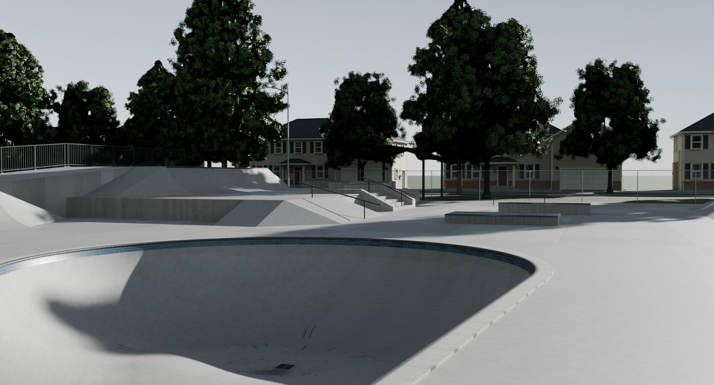
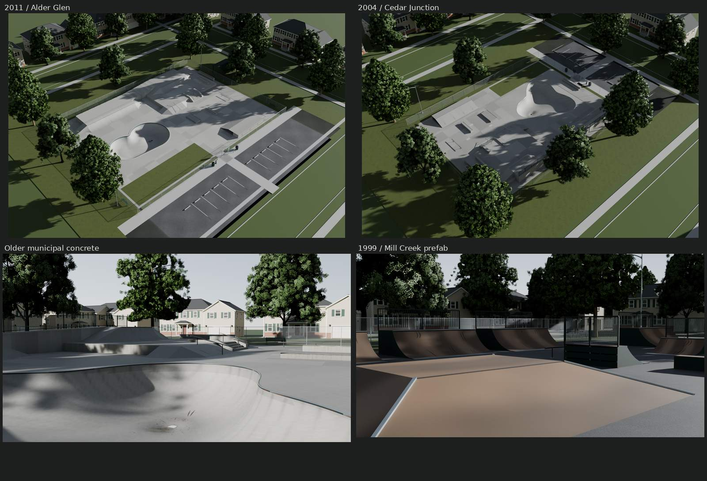
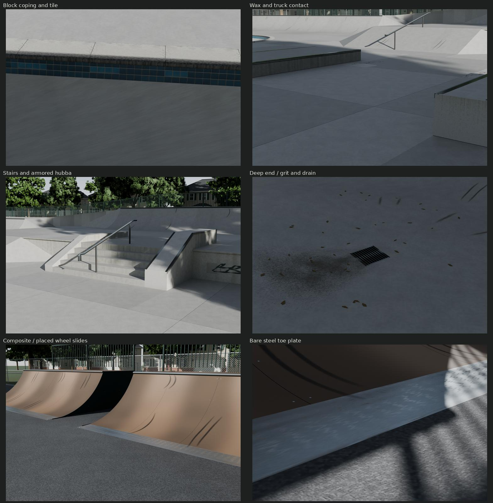
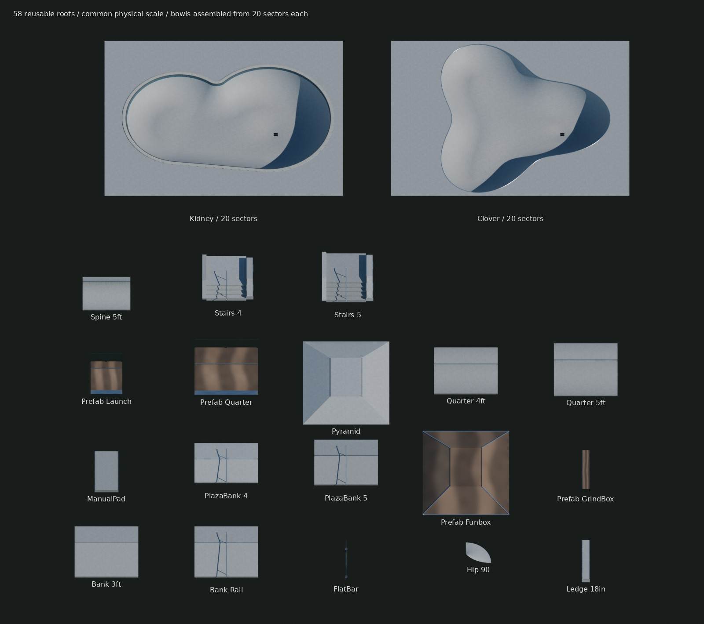
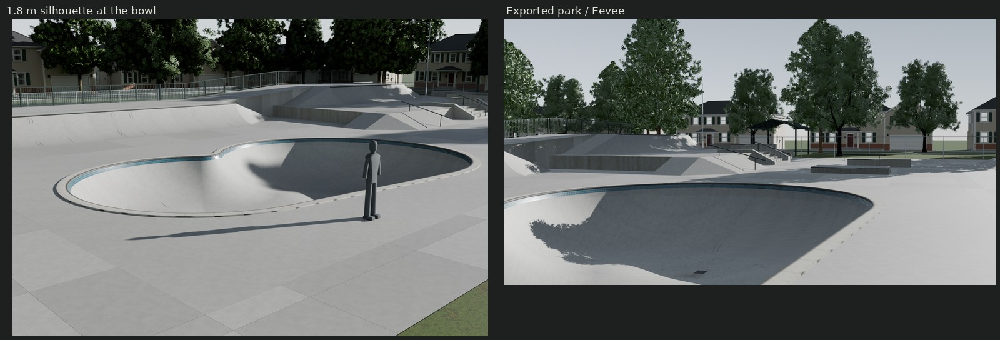

# Alder Glen / modular municipal skateparks



| | |
| --- | --- |
|  |  |
|  |  |

Original scripted poured terrain, framed prefab ramps and three fictional
American city parks. All gallery views use freshly imported external glTF and
its baked textures. Heroes are at 1.65 m with 35–40 mm lenses and an 18.2° sun.
The town beyond is presentation context; it is not part of the park exports.

## Delivery and cost

| Seed / town / installation | Riding pad | Nominal site paving envelope | Skating / whole-site triangles | glTF + BIN bytes | Placed primitive draws / materials |
| --- | --- | --- | ---: | ---: | ---: |
| 101 / Alder Glen / 2011 | 45.720 × 33.528 m | 70.104 × 64.008 m | 52,030 / 289,716 | 10,882,814 | 399 / 19 |
| 202 / Cedar Junction / 2004 | 36.576 × 27.432 m | 67.056 × 51.816 m | 50,334 / 276,640 | 9,901,805 | 368 / 19 |
| 303 / Mill Creek / 1999 | 36.576 × 27.432 m | 60.960 × 57.912 m | 48,087 / 274,789 | 11,646,348 | 272 / 19 |

101 is the newer block-coping kidney park with a five-riser street terrace
and pavilion. 202 is older, darker concrete with extra joint repairs, a clover,
four risers, a different terrain arrangement, entry and lot. 303 is the hard-used
1999 asphalt/prefab park, with opposed quarter lanes, launch pair, funbox,
grind boxes and bleacher. These are bounded original compositions, not copies
of the cited parks.

Every park uses the same **24 canonical image files**, 71,866,588 disk
bytes and **104 MiB** with 8-bpp block compression and full mips. That is one
shared allocation across all three parks when images are cached by URI:
20 MiB new, 48 MiB Ground and 36 MiB trees/fence. BIN sizes are serialized
geometry, not a promise of a particular engine's vertex-buffer allocation.
Placed primitive counts are unbatched; engines may instance/batch repeated
library pieces. Native fixtures retain some constant-color materials.

| Path | Contents |
| --- | --- |
| `export/final/Park_101.gltf`, `Park_202.gltf`, `Park_303.gltf` and matching `.bin` | Complete seeded park scenes, meters, centered on their site at grade |
| `export/final/SkateparkPieces.gltf` and `.bin` | 58 selectable module roots; 5,374,862 geometry/JSON bytes |
| `textures/ship/T_SkateTrim_*.png` | Shared 2048² BaseColor (sRGB/coverage alpha), OpenGL +Y Normal, ORM; 16 MiB |
| `textures/ship/T_Prefab_*.png` | Historical filename: the 1024² concrete manufacture triple; 4 MiB |
| `build/embedded/*.glb` | Embedded verification mirrors, not the delivery format |
| `build/Skatepark.json`, `park-*.json`, `costs.json` | Actual dimensions, parts, ports, placement wear and allocation receipts |
| `renders/final/contact.jpg` | All final scene views and the three photo comparisons |
| `renders/final/matched-contact.jpg` | Full photo-pair sheet; individual pairs in `renders/final-matches/` |

Preserve the relative image URIs when importing or packaging. They point to
one shared copy in this family and the canonical `ground/`, `trees/` and
`fences/` image folders. The module library references seven images (25⅓ MiB),
including Ground's concrete normal. No engine-specific shader is required.

## Dimensions and construction

Published dimensions, original choices and reference rights are separated in
[REFERENCE.md](REFERENCE.md) and [refs/SOURCES.md](refs/SOURCES.md).

| Feature | Real dimensions / basis |
| --- | --- |
| Quarters | 4 / 5 ft heights (1.2192 / 1.524 m); 7 / 8 ft circular radii (2.1336 / 2.4384 m); Columbia construction-book transition vocabulary |
| Bowls | 4–7 ft depth, 8 ft normal-section radius; original waist/pockets and clover lobes, constrained sloping floors and actual drain openings; Alondra/municipal-plan comparators |
| Coping | 2⅜ in / 60.325 mm pipe OD, nominal 2 in Schedule 40; Los Altos record detail |
| Pool-style blocks | 304.75 mm overall modeled profile, 63.5 mm bullnose height, radial end planes and recessed 3 mm mortar; Federal Stone SBN comparator |
| Tile | Three 52 mm courses, a 156 mm band following the transition; grouted individual faces |
| Banks / stairs | 20° banks with 180 mm tangent toe fillets; 152.4 mm risers and 304.8 mm treads; upper grades 609.6 / 762 mm |
| Ledge / hubba armor | Actual 50.8 × 50.8 × 4.7625 mm angle edges, concrete visible between; hubba top 558.8 mm wide, an original proportion checked against Burnham |
| Ledge / manual pad | 3.6576 × .6096 × .4572 m / 3.6576 × 1.8288 × .3048 m |
| Prefab | 50.8 mm frame, separate 6 mm riding sheets, real seams/fixings and 3 mm flush toe plates; Rhino/Rockville/Techramps construction comparators |
| Site | 1.8288 m municipal fence at native wire pitch, 3.048 m post grid, 2.4384 m walk; 2011 NCPC description and library construction |

Poured features have shared decks, wing returns and connected upper/lower
circulation. Saw cuts have recessed backing; thickened slab edges meet mow
strips and lawn. Buried fill/rebar is not exported. Prefab framing is hollow,
side skins close the enclosure, rear slots ventilate it and the plates land
flush. Terrain is exposed riding skin, with no hidden flat through a bowl.

Both shipped bowls are **gray municipal concrete**. `pool` selects the block
coping/tile treatment; it does not mean warm plaster. No shipped seed is a
plastered backyard pool. Memorial is used for coping/tile, not wall pigment.

## Modules and triangles

Counts are measured in serialized/imported geometry. Flat pieces deliberately
stay below 500 rather than acquire subdivisions that do not change silhouette.
Every reusable root stays below 4k and at most three material states.

| Module | Triangles |
| --- | ---: |
| `Quarter_4ft` | 252 |
| `Quarter_5ft` | 252 |
| `Bank_3ft` | 68 |
| `Bank_Rail` | 288 |
| `Ledge_18in` | 180 |
| `ManualPad` | 84 |
| `Stairs_4` | 456 |
| `Stairs_5` | 464 |
| `FlatBar` | 324 |
| `Pyramid` | 34 |
| `Spine_5ft` | 408 |
| `Hip_90` | 1,170 |
| `Prefab_Quarter` | 3,304 |
| `Prefab_Launch` | 3,280 |
| `Prefab_GrindBox` | 244 |
| `Prefab_Funbox` | 262 |
| `PlazaBank_4` | 288 |
| `PlazaBank_5` | 288 |
| Block-coping kidney wall/deck sectors, 16 | 2,200–2,204 each |
| Steel-coping clover wall/deck sectors, 16 | 2,108–2,112 each |
| Kidney floor sectors, 4 | 1,093 / 674 / 485 / 638 |
| Clover floor sectors, 4 | 1,210 / 435 / 695 / 432 |

The library is unplaced construction. Per-park use history is added only after
placement. The whole-site counts include six native red maple/pin oak instances,
fence/gate, fixtures, walks and parking. Geometry for benches, bins, rack, light,
road/curb/walk and houses comes from this repository's scripts; canonical trees
and fence/ground images remain read-only. Houses and continuing streets only
appear in renders. New family fixtures are the fountain, pavilion, bleacher,
three-town rules print and park flatwork/parking connections.

## Wear, materials and reproducibility

Concrete uses a 1.524 m manufacture repeat, pour/panel tints, troweled rides,
broom walks and dirty joints. Paste is .67 sRGB before variation/tint. Its
albedo was constrained by Burnham's neutral-balanced concrete/lawn linear-Y
ratios 2.6618–4.0268, not by raising exposure to a target pixel value. With the
unchanged lawn at .072459, that bounds effective concrete at .192875–.291779.
These are within-photo comparators with unknown camera response, not recovered
reflectances. Actual exported area statistics are in `build/external-check.json`.

Wheel transfer is placement-owned geometry projected onto actual riding
triangles. Four shared soft smears provide centimeter-scale dark cores inside
45–70 mm envelopes. Approaches, lips and toes choose contact; bowl toe slides
use the actual placed `Approach` sockets. Repeated pocket carving polishes a
route without outlining it in black. Ledge-face truck scrapes stay just below
armor. Width, pressure, path, starts, ends and individual wheel contact vary
by seed and placed piece. No reusable sector or retaining chart carries wheel
stamps. Dirt follows the floor toward the drain; leaves collect on the low flat.
Wax, coping crowns, tile grime, joint repairs, sprayed fictional tags and bare
scuffed toe plates retain their separate causes.

| Park | New placement-strip triangles | Net triangle change from ed8953f | Added wear draws / net draw change | Net BIN-byte change |
| --- | ---: | ---: | ---: | ---: |
| 101 | 3,792 | +3,336 | +12 / -4 | +71,864 |
| 202 | 5,088 | +4,883 | +17 / +1 | +223,448 |
| 303 | 5,088 | +3,720 | +2 / +2 | +27,364 |

Wear adds **zero texture files or texture memory** and uses the existing BLEND
state. Removing the bowl-only wall state offsets the added wear primitives in
the poured parks. [TEXTURES.md](TEXTURES.md) lists the shared sets and bindings.

`make repeat` regenerates the fields, context geometry, real GPU bakes,
filtering and parks in isolation. It compares deterministic geometry, source
measurements, procedural/bake-input PNGs, context GLBs/receipts and stamps byte
for byte. Canonical shared inputs stay read-only. The six shipped GPU maps use
the kit's maximum channel delta **2/255** and byte-domain **RMSE .02** per map;
coverage alpha is exact. Latest proof: **56 exact files**,
maximum map delta **1/255**, maximum byte RMSE **0.000846**. Image-dependent
hash/size receipts, embedded GLB containers and stochastic renders are not
claimed byte-identical. `build/repeat-check.json` records both results and
confirms the original exports stayed unchanged.

## Placement, ports and motion

Instance a complete `Park_<seed>.gltf` scene at grade, keeping its transforms
and materials. To assemble another park, select roots from `SkateparkPieces`
and place them using their named ports; its coincident unplaced library roots
are not intended as one visible scene. Meters, Blender +Z up and canonical
approach from -Y toward +Y; glTF is +Y up. Quarters/stairs use the midpoint of
their run at grade; bowl sectors share one bowl construction frame. Scene
props use footprint/ground origins.

`Grid_SW` / `Grid_NE` reserve an outward-rounded 152.4 mm / 6 in grid envelope.
`Approach`, `Deck`, `Landing`, `Ride_*`, `Line_In` / `Line_Out`, bowl `Seam_A/B`
and `Drain` retain actual surface/line datums. The grid reservation is not a
claim that every curved lip lies on a rectangular grid. Spawns describe rider
foot positions/directions; this pipeline does not simulate skate dynamics.

`src/plan.py::plan(seed, type=None, size=None)` selects poured/prefab,
compact/large, arrangement, installation/age, coping, entry, shade/bleacher and
mirroring. `src/build.py --seeds ...` exports selected seeds. The proof seeds
are fixed compositions within this bounded grammar. Reuse the placement pass
when generating wear for a new layout; duplicating bare library roots does
not copy another park's wear.

Gate leaf and fork latch remain separate pivoted parts, with no armature or
baked animation. Leaf: Blender local Z (glTF local Y), -110…0°; latch: Blender
local Y (glTF local -Z), -95…0°. Imported solid-surface checks sample the 202
entry gate at 2° increments: 56 poses, measured maximum penetration zero at
.5 mm tolerance. This is a sampled sweep. Actual sections/supports/mark contacts
prove construction; corner/texture equivalence proves serialization separately.

## Rebuilding and review

Needs Blender 5.2, GNU make, Python/Pillow/NumPy, fontconfig and the repository's
fonts/tools. All Blender calls use the serial GPU-lock wrapper; lighting is a
procedural sky and sun. No downloaded model, texture, HDRI or code is used.

```sh
make -C skatepark WIDTH=1440 SAMPLES=40
make -C skatepark check
make -C skatepark repeat check-texture-repeat
python3 kit/repo_check.py
```

`make` builds context, 4096 bakes, 2048/1024 delivery maps, the library and all
three parks, independent checks, exported-scene Cycles views, scale, Eevee,
module sheet, three calibrated photo comparisons, contact sheets and docs.
[REVIEW.md](REVIEW.md) records the rejected candidates and final native-size
critiques. Fixed-camera corrections are in `renders/gate-fixes/`; the 303
artifact pair documents its +12° sun-azimuth change at unchanged elevation,
exposure, sky and camera. All other correction lighting remains fixed.

Photos are comparators, not textures or scans. Alondra's outline fit is the
weaker one (28.33 px at 866 px, inferred contour phases); Burnham has six
identified corners (1.84 px at 400 px); Memorial is 6.78 px at 580 px. Exact
rights and balancing neutrals are in SOURCES and the calibration receipts.

The weakest remaining cues are uniform formed-wall manufacture, angular leaf
fragments, flat turf and repeated presentation houses. The wear is simpler
than years of real accumulation. No kit or top-level README change is needed.
Marks, signs and towns are fictional; signs use the installed open-license
DejaVu Sans. Every asset vertex and texel is generated by our scripts.
