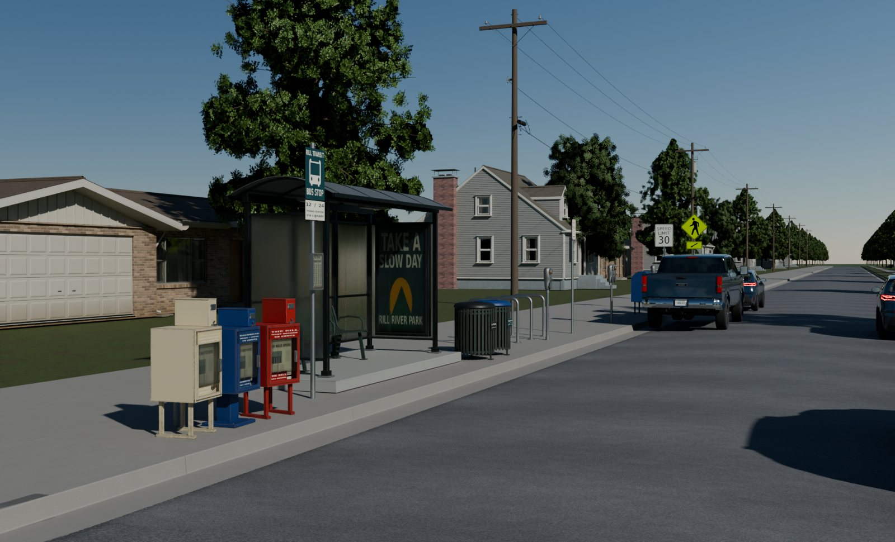
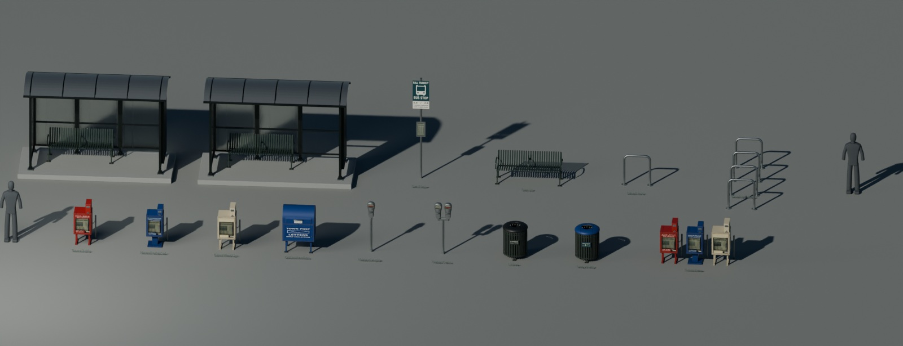
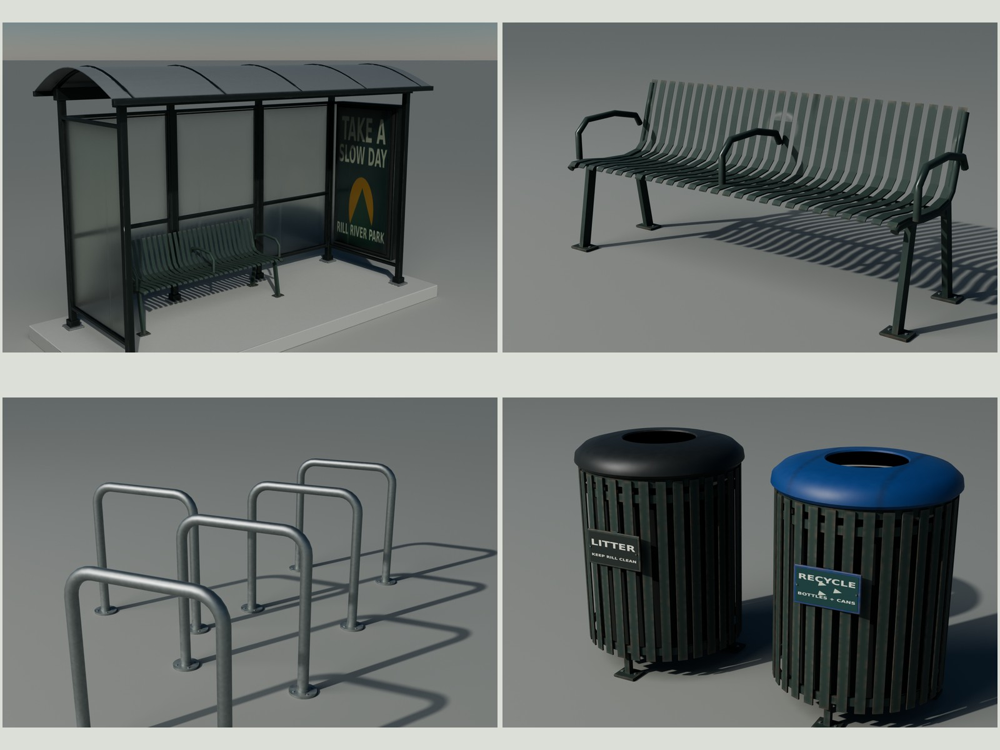
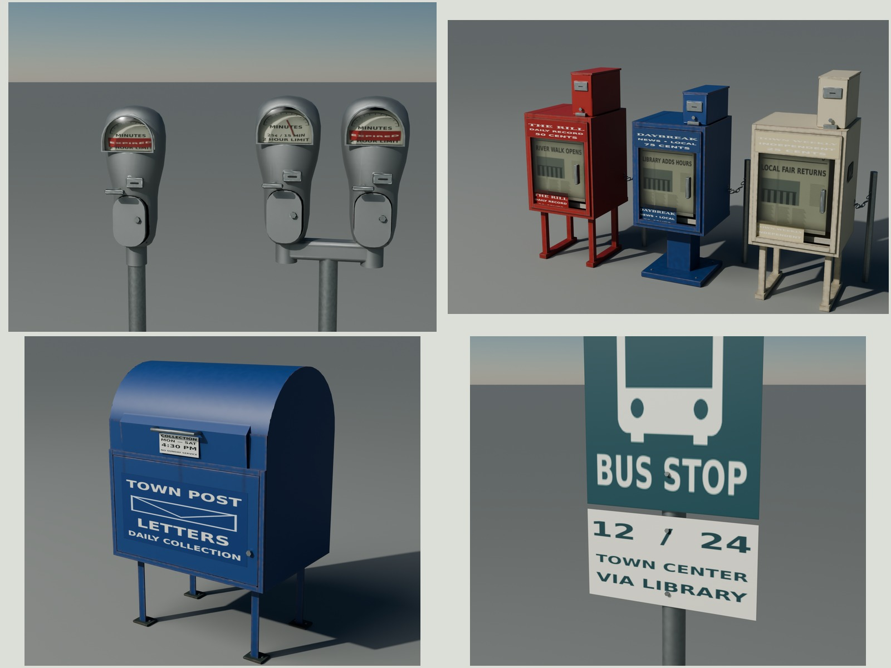

# Rill street furniture

An original, used American sidewalk family for 1995–2015: transit stop and
shelter, steel-strap bench, galvanized U rack, three mechanical newspaper
cabinets, blue collection box, single/twin mechanical meters, and paired
litter/recycling receptacles. Every vertex, finish and fictional graphic is
scripted in Blender 5.2. No reference pixels, downloaded asset or HDRI is used.



The hero uses a 40 mm lens at 1.65 m, raking procedural sun/sky, and the
library's Ground, houses, trees, cars and utility construction. Those are
presentation only and never ship in the furniture. [REFERENCE.md](REFERENCE.md)
lists measured anchors and authoring estimates; [REVIEW.md](REVIEW.md) records
the form and export critiques. [Credits](refs/SOURCES.md) identify all sources.
The accompanying [2009 sign set](../street-signs/README.md#2009-regulatory-and-warning-set)
shares this final presentation and adds no texture per sign instance.



## Delivered modules and costs

Each root is at the center of its footprint on finished walk grade, meters,
Blender +Z up / −Y front; glTF +Y up / +Z front. The shelter's root is its slab
underside. Rows are prefabs of independent members. Individual glTF/BIN files
sit in `export/`; all resolve canonical shared images in `export/textures/`.
`StreetFurniture.gltf` is an inspection library with the modules spread apart.
Replace its module transforms when placing them in a scene.

| Module | Triangles | Materials | Measured W × D × H, m | glTF + BIN bytes | Images / GPU MiB¹ |
| --- | ---: | ---: | --- | ---: | ---: |
| BusStop | 574 | 2 | 0.4572 × 0.1130 × 3.0500 | 66,073 | 4 / 17.333 |
| Shelter | 7,730 | 2 | 4.2672 × 1.8288 × 2.7420 | 767,665 | 4 / 17.333 |
| Bench | 3,436 | 1 | 1.8550 × 0.6218 × 0.8050 | 320,858 | 3 / 16.000 |
| BikeRack | 1,020 | 1 | 0.8684 × 0.1524 × 0.9144 | 62,505 | 3 / 16.000 |
| BikeRackRow | 4,080 | 1 | 0.8684 × 2.8956 × 0.9144 | 241,125 | 3 / 16.000 |
| NewsDaily | 1,578 | 2 | 0.5905 × 0.6105 × 1.2442 | 182,268 | 4 / 17.333 |
| NewsPedestal | 1,626 | 2 | 0.5616 × 0.6055 × 1.1660 | 183,934 | 4 / 17.333 |
| NewsWeekly | 1,816 | 2 | 0.6016 × 0.6255 × 1.2860 | 195,492 | 4 / 17.333 |
| CollectionBox | 1,152 | 2 | 0.8814 × 0.7068 × 1.3303 | 129,308 | 4 / 17.333 |
| MeterSingle | 1,449 | 2 | 0.2123 × 0.2087 × 1.5197 | 110,871 | 4 / 17.333 |
| MeterTwin | 2,916 | 2 | 0.4857 × 0.2084 × 1.5550 | 230,300 | 4 / 17.333 |
| Litter | 2,966 | 2 | 0.7000 × 0.7021 × 0.9600 | 207,549 | 4 / 17.333 |
| Recycling | 2,966 | 2 | 0.7000 × 0.7021 × 0.9600 | 207,478 | 4 / 17.333 |
| ShelterMissingPanel | 7,718 | 2 | 4.2672 × 1.8288 × 2.7420 | 766,807 | 4 / 17.333 |
| NewsRow | 5,020 | 2 | 2.0361 × 0.6255 × 1.2860 | 556,927 | 4 / 17.333 |

¹ Full mip chains at 8 bpp per map, loaded once per family, not once per
instance. Uncompressed PNG disk bytes are different from GPU memory. Furniture
shares **three 2048² maps (16 MiB)** plus **one 1024² graphics map (1⅓ MiB)**.
The separate 2048² sign sheet is **5⅓ MiB**: **22⅔ MiB total added** for both
families, as planned. Opaque-only pieces bind the three-map subset. Reuse the
canonical image/material identities in the engine; importing many separate
files without a cache can duplicate their allocations.

| Canonical shared image | Pixels | PNG bytes | GPU MiB¹ |
| --- | ---: | ---: | ---: |
| T_StreetFurniture_Normal.png | 2048² | 2,323,812 | 5.333 |
| T_StreetFurniture_ORM.png | 2048² | 4,011,771 | 5.333 |
| T_StreetFurniture_BaseColor.png | 2048² | 2,845,968 | 5.333 |
| T_StreetFurniture_Graphics.png | 1024² | 344,870 | 1.333 |
| T_RoadSigns_Faces.png | 2048² | 674,885 | 5.333 |

Both additions use 10,201,306 canonical PNG bytes. The furniture
inspection library is 89,982 glTF + 3,564,800 BIN bytes;
the sign library is 80,703 + 1,211,760 bytes. These
library geometry files are alternatives to the standalones, not extra scene loads.

Individual ceilings: shelter 8k; bench/receptacle 4k; meter/rack/box 3k.
Rows are charged per member. Cast relief and fine manufacturing grain are
baked at 4096 and filtered to 2048. The shared opaque atlas has modest density
because it serves the whole family; close-up lettering instead uses the
independent graphics sheet. Zero measured accidental opaque UV overlap;
reused graphic/glazing cells and prefab mesh data are intentional.

## Dimensions and construction

| Piece | Published anchor and realized construction |
| --- | --- |
| Bus stop | TARC seven-foot clearance: lower route edge **2.1336 m** above walk; 18 × 24 in main blank, 18 × 9 in route plate, 60.3 mm OD post, 3.05 m overall. Fictional RILL TRANSIT routes 12/24 and a 250 × 440 mm timetable holder. |
| Shelter | 7,730 | 2 | 4.2672 × 1.8288 × 2.7420 | 767,665 | 4 / 17.333 |
| Bench | 3,436 | 1 | 1.8550 × 0.6218 × 0.8050 | 320,858 | 3 / 16.000 |
| Rack | Madrax 2⅜ in / **60.32 mm OD** pipe, **.9144 m** overall, individual 152.4 mm flanges, weld collars and four anchors. Four-U row at .9144 m pitch. |
| News cabinets | Museum anchor: daily nominal **1.23825 × .48895 × .434975 m H/W/D**. Original pedestal .460 × .430 × 1.160 m; weekly .500 × .450 × 1.280 m. 1.2 mm sheet, returns, coin lid/slot/return, lower hinged access leaf, window, display copy, stack and slack linked chain. One localized weekly impact dent. |
| Collection box | USPS historical large-box envelope: **.879475 × .635 × 1.330325 m W/D/H**. 1.9 mm skin, rolled roof, angle legs/feet, service leaf and independent pull-down chute. TOWN POST is fictional; no USPS identity. |
| Meters | Original compact mechanical head in the published POM/Duncan size class: .480 m nominal housing; 60.3 mm post; single/twin tops **1.520 / 1.555 m**. Subdivision/voxel cast source baked to a reduced game skin, separate domed lens/bezel, cast coin boss/crank and vault leaf. Mechanism internals are authored estimates. |
| Receptacles | Agency/Victor Stanley size class; original .700 m lid diameter × .960 m overall, 32 steel slats, retaining hoops, anchored feet, black liner and separate spun open-center lid. Recycling uses the same construction. |

Exact foot/handle/chain envelopes are in the cost table and generated
`build/manifest.json`. [REFERENCE.md](REFERENCE.md) links each dimension to its
primary source and distinguishes it from an estimate. These are original
constructions, not engineering-certified supplier replicas.



## Materials, age and variation

One opaque PBR state reads BaseColor (sRGB), OpenGL +Y Normal and ORM
(R occlusion, G roughness, B metallic). A second state handles printed graphics
and glazing: Graphics uses UV1; UV0 selects reserved ORM cells. That state omits
occlusion and uses ORM.R for stock-glTF transmission. No custom shader is
needed. The engine must support per-texel transmission. Eevee presentation
uses an equivalent opaque state for print faces to satisfy its per-material
refraction sorting; vertices, UVs and PBR maps stay identical to the import.
Its screen-space refraction still loses detail through stacked panes.
Glass has edge deposits and rougher retaining margins; the frame,
painted steel, cast alloy and galvanized stock keep different reflectance and
roughness responses. The lighting hardware is retained; fixture/light sockets
let an engine supply the actual lamps.

Used, maintained street furniture: fading follows upper exposure, chips and
corrosion folds/feet/fasteners, grime low splash and gravity tracks below real
seams, polish the pull and bench contact areas. Rust is restricted to damaged
painted steel; galvanized and aluminum parts retain their own oxidation colors.
The weekly box has a sparse original F9 adhesive tag. Graphics use installed
open DejaVu Sans/Serif; agencies, mastheads, paper headlines and advertising are
fictional and generated independently of photographs.

Default seed 11 gives the single meter's expired flag; the twin has one paid
and one expired head. Shelter seed 12 removes the right rear pane as actual
missing geometry. Newspaper seeds 11/12/13 select the three authored colors
and headlines: RIVER WALK OPENS, LIBRARY ADDS HOURS, LOCAL FAIR RETURNS.
`src/pieces.py` exposes these seeds/states and physical dimensions; newspaper
`kind` chooses construction and `seed` chooses an existing color/edition; original
paper/poster generation lives in `src/graphics.py`. Variants share the same maps.



## Pivots, sockets and sidewalk placement

| Moving node | Local axis / range | Rest pivot |
| --- | --- | --- |
| NewsDoor (each cabinet) | X, 0…75° outward/down | Bottom front pin |
| NewsCoinLid | X, −105…0° | Rear edge of coin compartment |
| CollectionServiceDoor | Z, −105…0° | Front left jamb |
| CollectionPullDownChute | X, 0…50° | Lower chute edge, .925 m above root |
| MeterCoinDoor / Twin0CoinDoor / Twin1CoinDoor | Z, −95…0° | Vault left edge |
| LitterLid / RecyclingLid | X, −100…0° | Back rim, (0,.31,.86) m |

The table uses Blender axes: X remains X in glTF; Z becomes glTF Y.
A separate sampled physical sweep is available with `make check-motion`.
The accepted newspaper/collection returns and receptacle rear rims intersect
by up to 9.1 mm during their documented ranges; their accepted geometry and
pivots have been retained pending owner approval to relieve those contacts.
The corrected meter vaults show no penetration above 0.5 mm at the sampled angles. The passing default `make check` proves
serialization, UVs, channels and budgets; it does not certify these mechanisms.

No armature or baked animation is required. Node extras retain the Blender axis/range;
child geometry is in the pivot's rest frame with applied scale. Exact local
coordinates are in the manifest. `*_SidewalkSocket` marks footprint center;
`*_Anchor` sockets mark real mounting points; the shelter has two light sockets.
Ground uses a **.1524 m / six-inch construction grid**. Snap the sidewalk
socket to that grid in plan, then place it at the actual sloped walk height.
The shelter includes its .150 m slab and its bench is raised to slab top.
Keep a walking route behind the furnishing zone; the hero demonstrates three
stock five-foot panels for a broad transit sidewalk. Its illustrative layout
is not a surveyed or legally certified bus stop. Buried footings are omitted.

## Rebuild and evidence

```sh
make                         # refs, source, 4K bake, shared glTF, checks, export finals/pairs/contact
make check                   # raw/import bounds, counts, channels, UVs, prior delivery hashes, sign set
make repeat                  # rebuild geometry/UV/graphics/export with retained accepted baked maps
make match                   # four neutral-balanced, matched-light export/photo pairs
make docs                    # only after opening/auditing every full-size final
make clean && make           # clean furniture rebuild, including the 4096 GPU bake
make -C ../street-signs set-clean
make -C ../street-signs set-all # clean added sign set plus this shared presentation; keeps STOP/blades
```

Blender jobs run serially; Cycles uses the kit GPU lock and OptiX/CUDA.
Dependencies: Blender 5.2, Python/Pillow/NumPy, installed DejaVu/Noto fonts,
fontconfig, GNU make, curl and flock. Scratch files stay under `build/`.
No existing family is rebuilt for context; utility construction is generated
inside this family's build tree, and imported presentation deliveries are read-only.
No kit source changed.

`renders/final/` contains the exported hero, every-piece/1.8 m lineup,
regulatory/warning lineups, face/back/base/band details, frame/bench, heads,
boxes, collection, receptacles, rack and four turnaround views.
`renders/eevee/hero.png` is Eevee. `renders/final/contact.jpg` includes them all
and the four pairs from `renders/match/`. Receipts hash the actual glTF, BIN,
canonical maps, context and image. `build/check.json`, `delivery-check.json`,
`uv.json`, `color-review.json` and `hero-range.json` separate measured evidence
from the aesthetic judgments in REVIEW. Before/after crops are under
`renders/comparison/`; reference/book comparison images remain local only.

Limits: the shared atlas softens submillimeter relief and small close-up type;
low-cost circular silhouettes can facet at extreme close range. The mechanical
dial internals and hardware are authored estimates. Photo camera fits remain
comparisons between different original products, with their residuals reported.
Stock glTF does not reproduce headlight retroreflection for the separate signs.
