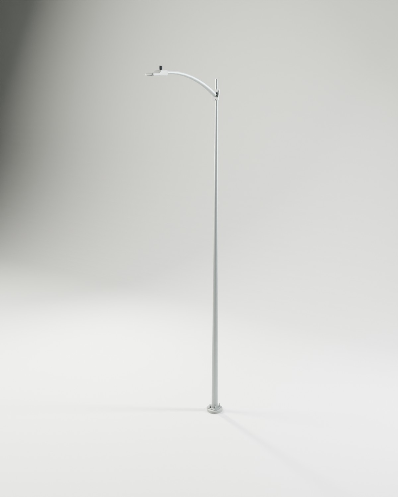
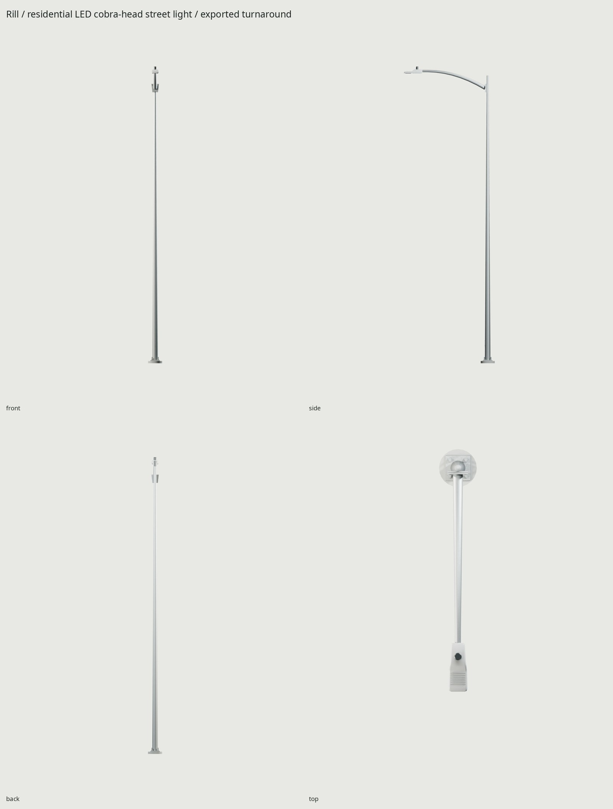
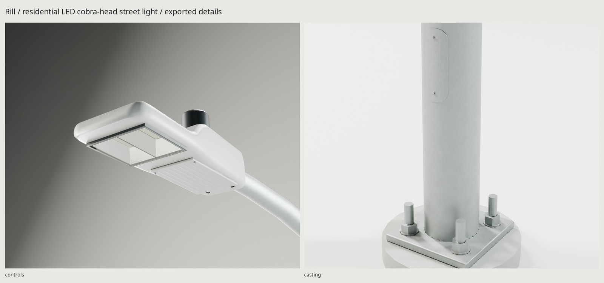

# Rill / residential LED cobra-head street light

An original compact LED cobra head on a galvanized round tapered steel pole,
six-foot curved mast arm and anchored base. The fixture has a stepped die-cast
housing, folded aluminum reflector wells, transmissive glass, compression gasket,
retaining rails and ceramic-backed emitters. The curved handhole cover follows
the pole's actual taper. Fine threads, pressed tray ribs and zinc crystallization
are normal-map detail.



A municipal metal-pole installation with underground wiring was chosen from the
Woodland/Portland examples. Durham documents a wooden-pole residential norm;
there is no universal American suburban support. [REFERENCE.md](REFERENCE.md)
records those distinctions and the manufacturer dimensions used here.

| Component | Real-scale dimensions |
| --- | --- |
| Tapered shaft | 7620 mm / 25 ft; 149.86 → 60.96 mm outside diameter |
| Anchor plate | 254 mm square × 22.225 mm; 228.6 mm bolt circle |
| Anchor rods | 25.4 mm diameter; visible projection 104.9 mm above plinth |
| Mast arm | 1828.8 mm / 6 ft reach, 457.2 mm / 18 in rise |
| Compact casting | 489 × 191 mm; 108 mm rear body datum |
| Photocontrol housing | 69.9 mm high, authored 76.2 mm diameter |
| Whole assembly | 380 × 2439 × 7956.1 mm, including 60 mm ground plinth |

Origin is the center of the plinth footprint at ground level. Blender +Z is up,
front/arm faces −Y; glTF uses +Y up and +Z forward. Underground anchors, cable
runs and the full structural footing are omitted. The 380 mm round plinth is an
above-grade placement aid. The assembly is static; covers are bolted service
parts, with no in-use animation or armature.



**3,180 triangles**, one static mesh, **three materials sharing one 1024² set**:
atlas metal/coating/concrete, glass, and emissive tiles. The three maps are
BaseColor (sRGB), OpenGL +Y Normal, and ORM (linear; R occlusion / G roughness /
B metallic), GPU-baked at 4096². Approximate compressed memory with BC7/BC5-class
formats and mipmaps: **4 MiB total**, rather than a set per material. Glass uses
`KHR_materials_transmission`; emission reuses the same BaseColor image with
`KHR_materials_emissive_strength`. One mesh has three material primitives/draws. The GLB is **1,472,732 bytes**;
its three texture views reference exactly three embedded images.

UV coverage is **37.94%**, with zero measured overlaps. Density p5 / median / p95
is **128 / 600 / 775 pixels/m**. The long smooth shaft gets less density than the
fixture and optics; improving that allocation raised coverage from 25.7% without
adding another texture. `WEAR=.45` adds ground splash, exposure and edge/cavity
deposits; `WEAR=0` retains manufactured zinc and coating structure only.



For engine lighting, keep the emissive material for visible LED brightness and
place a real light at **LightEmitter**, Blender position **(0, −2.135, 7.7692) m**.
Use the imported node's position; aim toward the ground using the engine's down
axis. Start with a warm **3000 K**, roughly **4800 lumen** light and a broad
90–110 degree beam, then tune against the project's exposure and street width.
An asymmetric distribution needs the project's own lighting setup; this prop
does not embed a manufacturer's IES profile. Mesh emission is an artistic
multiplier, not a calibrated lumen value. Set its strength to zero for daytime.
Enable transmission/refraction on the glass when the engine supports it; an
opaque glass fallback hides the reflector detail. The shipped atlas remains
shared in either case.

```sh
make                         # complete scripted delivery
make check                   # geometry, UV, GLB, physical supports and optics
make PASS=review match       # source / publisher photograph
make PASS=review match-final # exported GLB / same calibrated photograph
make WEAR=.8                 # more weathered rebuild
make clean && make           # reproduce from scripts
```

Needs installed Blender 5.2, Python/Pillow/NumPy, flock and Poppler pdfimages.
All geometry, material texels and procedural lighting are generated here.
Publisher photographs never enter Blender materials. See [refs/SOURCES.md](refs/SOURCES.md)
for author/rights and reading aids; Rill is fictional and carries no real marks.

`build/delivery-check.json` tests serialization, scale, normals and UVs;
`build/assembly-check.json` separately measures physical support surfaces.
`build/optics-check.json` inspects actual GLB transmission, emission and image
sharing. The handhole cover is baked in an isolated static module, then merged
into the single delivered mesh. The source and game arm share bend stations to
keep the projection cage clear of the closely spaced optics. Cycles hero, four-view turnaround, two close-ups, 1.8 m human scale and
lit optics are in `renders/final/`; Eevee is in `renders/final-eevee/` and the
complete sheet is **`renders/final/contact.jpg`**. Metadata records the GLB hash.
[REVIEW.md](REVIEW.md) logs source and shipped critique.

The weakest details are the distant shaft's texel density, tiny baked fasteners
and threads, and the simplified original reflector/casting layout. The sparse
photo anchors constrain the camera imperfectly; the pair compares construction
and material realism rather than reproducing the reference product exactly.
