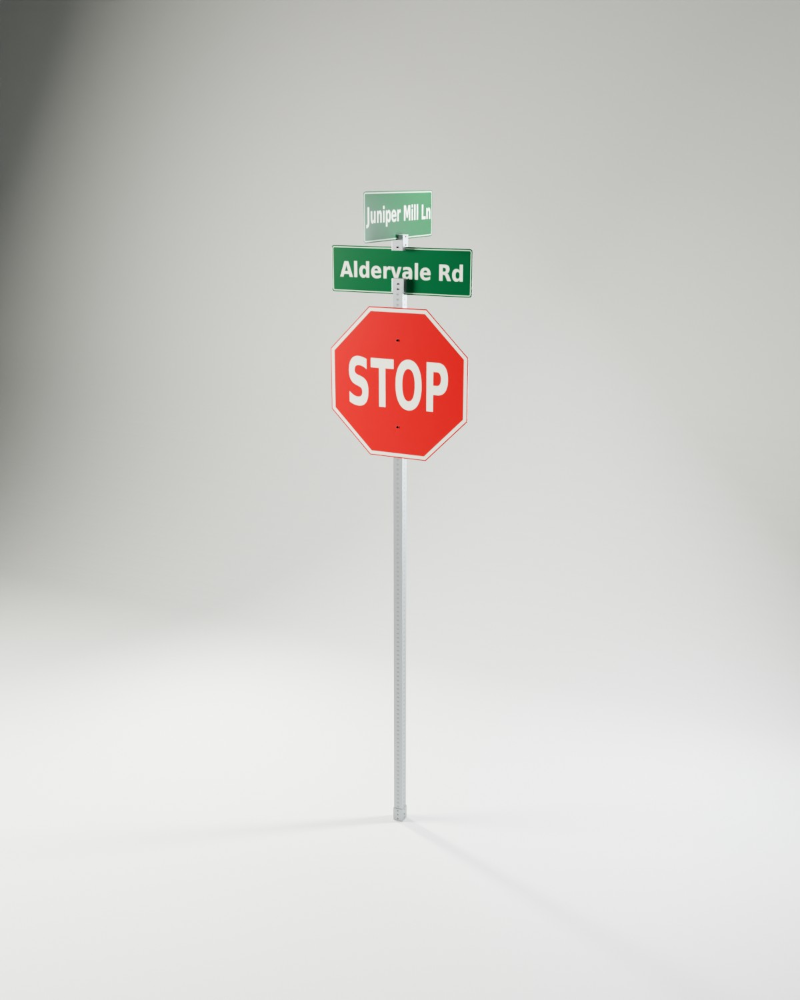
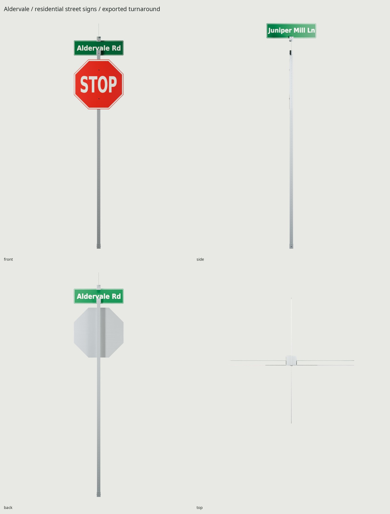
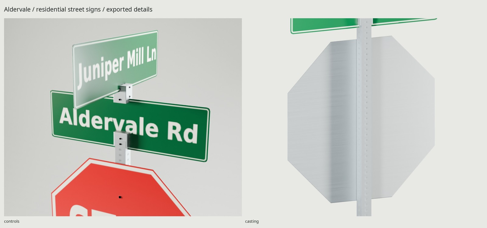

# Aldervale / street signs

A residential 30-inch stop sign and two crossed street-name blades on a hollow,
galvanized square perforated post. The slotted cast saddles, mounting bolts,
back spacers and pinned anchor sleeve form a supported assembly. Fictional names,
mathematical sign shapes, original graphics and materials are scripted here.



[REFERENCE.md](REFERENCE.md) separates published dimensions from construction
estimates. The STOP is **762 × 762 × 2 mm**, bottom **2133.6 mm / 7 ft** above
grade; names are **762 × 228.6 × 2 mm**; post **50.8 mm square**, **3000 mm** high.
Overall envelope **762 × 762 × 3448.2 mm**. Origin is at the post's ground center;
Blender +Z up, STOP toward −Y; glTF +Y up, +Z forward. No moving parts or pivots.

The repeatable pole and bracket details stay lean; perforations and small
hardware edges use the normal map. Mild sun fading and lower-edge grime are
controlled by `WEAR` (default .35). Zinc remains metallic, sheeting dielectric.
Reflective sheeting has a satin PBR approximation; true retroreflection needs
an engine shader. Open DejaVu Sans Condensed Bold is a recognizable substitute
for the regulated highway alphabet. This is not certified road hardware.



One **1024² BaseColor / OpenGL +Y Normal / ORM** set serves every name variant,
baked at 4096². ORM is R occlusion, G roughness, B metallic. Approximate compressed
GPU memory including mipmaps: **4 MiB**. Parked name-face templates reserve atlas
space but do not ship. Each selected GLB has one static mesh and one material.
Its atlas coverage is therefore a measured subset of the family atlas.

| Variant | Street pair |
| --- | --- |
| 0 | Aldervale Rd / Juniper Mill Ln |
| 1 | Cinderbrook St / Oriole Hollow Dr |
| 2 | Wrenfield Ave / Hazel Run Ct |
| 3 | Morrow Glen Rd / Foxmeadow Ln |

```sh
make                            # complete default variant, final studio and checks
make NAME_VARIANT=2              # select an alternate without rebaking shared textures
make variants                   # export all four using the same baked atlas
make check                      # geometry, UV, scale, GLB, camera, repo and physical support
make PASS=review match           # source/photo comparison
make PASS=review match-final     # exported-GLB/photo comparison
make clean && make              # reproduce delivery from scripts
```



`export/StreetSigns.glb` is the selected variant; `StreetSigns_0.glb` through
`StreetSigns_3.glb` are the shared-atlas alternatives from `make variants`.
`textures/bake/` and `textures/ship/` hold the 4096 bake and 1024 delivery maps.
`renders/final/contact.jpg` contains hero, four orthographic views, two close-ups,
1.8 m scale figure and Eevee last. The exact GLB SHA-256 is in every shot record.
`build/delivery-check.json` proves serialization, channels, normals and UVs;
`build/assembly-check.json` separately checks physical contacts on actual game
surfaces. [REVIEW.md](REVIEW.md) records source and shipped photo comparisons.

The principal compromises are normal-represented post holes, softened small
lettering at long distance, an approximate retroreflective response, and a
standard-font substitute. Reference photos/PDFs are external, credited in
[refs/SOURCES.md](refs/SOURCES.md), and never used as texture input.

Final delivery: **568 triangles**, **912,484 byte GLB**, **1 material**. Selected atlas coverage **34.67%**, zero measured UV overlap; all four variants pass re-import and contain identical texture bytes. `make`, `make check`, `make variants`, and the four independent variant checks pass. Physical support checks pass; saddle/blade sampled clearances are 0.10 mm.

Standalone GLBs embed identical maps for portability. Reuse the shared material/textures across imported variants to retain the 4 MiB family memory cost.
