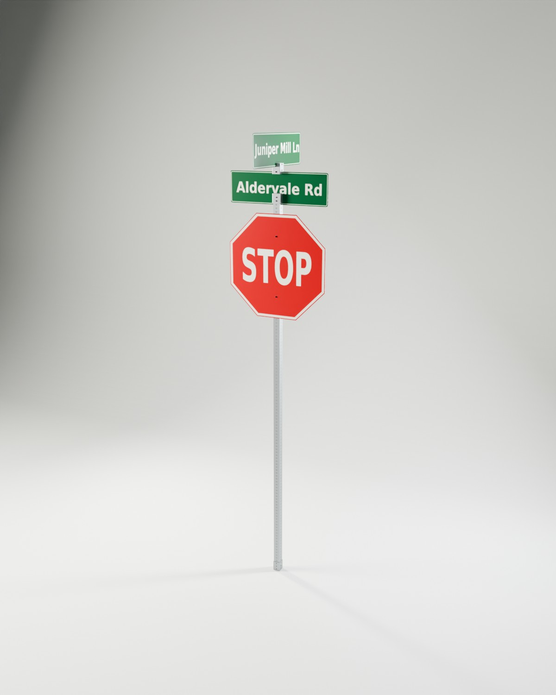
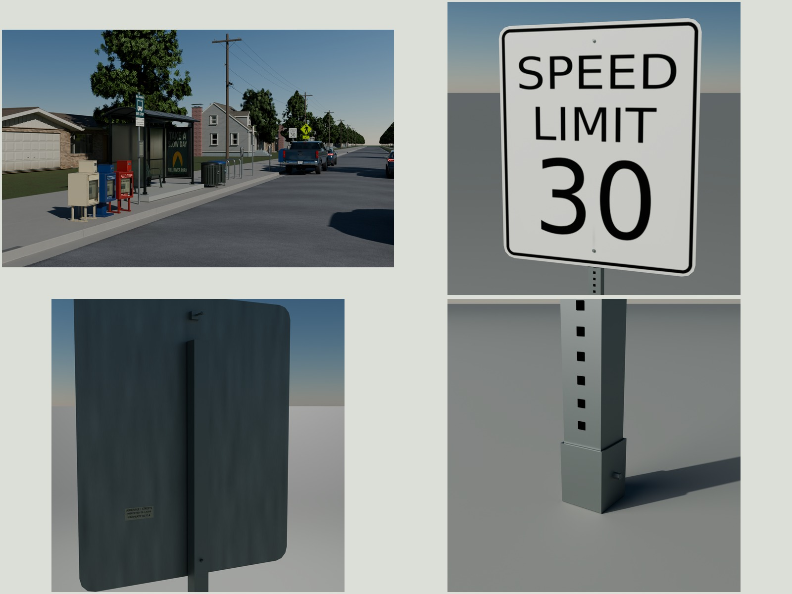
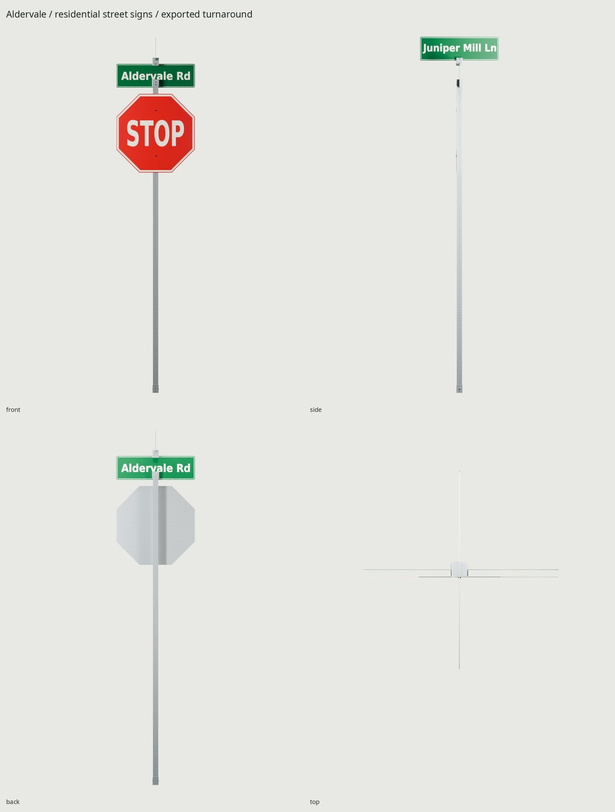
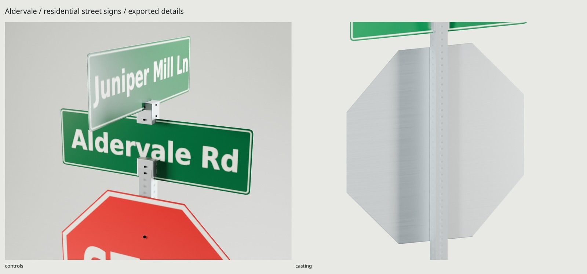
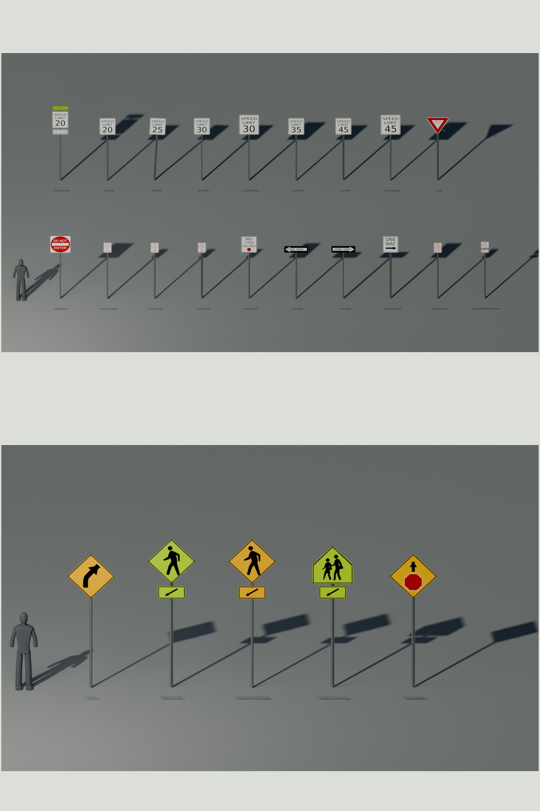

# Aldervale / street signs

A residential 30-inch stop sign and two crossed street-name blades on a hollow,
galvanized square perforated post. The slotted cast saddles, mounting bolts,
back spacers and pinned anchor sleeve form a supported assembly. Fictional names,
mathematical sign shapes, original graphics and materials are scripted here.

<table><tr>
<td align="center" width="50%"><br><b>Stop assembly</b><br>30-inch stop sign with crossed street-name blades</td>
<td align="center" width="50%"><a href="#2009-regulatory-and-warning-set"></a><br><a href="#2009-regulatory-and-warning-set"><b>2009 sign set</b></a><br>regulatory and warning signs on their posts</td>
</tr></table>

[REFERENCE.md](REFERENCE.md) separates published dimensions from construction
estimates. The STOP is **762 × 762 × 2 mm**, bottom **2133.6 mm / 7 ft** above
grade; names are **762 × 228.6 × 2 mm**; post **50.8 mm square**, **3000 mm** high.
Overall envelope **762 × 762 × 3448.2 mm**. Origin is at the post's ground center;
Blender +Z up, STOP toward −Y; glTF +Y up, +Z forward. No moving parts or pivots.

The repeatable pole and bracket details stay lean; perforations and small
hardware edges use the normal map. Mild sun fading and lower-edge grime are
controlled by `WEAR` (default .35). Zinc remains metallic, sheeting dielectric.
Reflective sheeting has a satin PBR approximation; true retroreflection needs
an engine shader. Open DejaVu Sans Condensed Bold is a recognizable substitute
for the regulated highway alphabet. This is not certified road hardware.



One **1024² BaseColor / OpenGL +Y Normal / ORM** set serves every name variant,
baked at 4096². ORM is R occlusion, G roughness, B metallic. Approximate compressed
GPU memory including mipmaps: **4 MiB**. Parked name-face templates reserve atlas
space but do not ship. Each selected GLB has one static mesh and one material.
Its atlas coverage is therefore a measured subset of the family atlas.

| Variant | Street pair |
| --- | --- |
| 0 | Aldervale Rd / Juniper Mill Ln |
| 1 | Cinderbrook St / Oriole Hollow Dr |
| 2 | Wrenfield Ave / Hazel Run Ct |
| 3 | Morrow Glen Rd / Foxmeadow Ln |

```sh
make                            # complete default variant, final studio and checks
make NAME_VARIANT=2              # select an alternate without rebaking shared textures
make variants                   # export all four using the same baked atlas
make check                      # geometry, UV, scale, GLB, camera, repo and physical support
make PASS=review match           # source/photo comparison
make PASS=review match-final     # exported-GLB/photo comparison
make clean && make              # reproduce delivery from scripts
```



`export/StreetSigns.glb` is the selected variant; `StreetSigns_0.glb` through
`StreetSigns_3.glb` are the shared-atlas alternatives from `make variants`.
`textures/bake/` and `textures/ship/` hold the 4096 bake and 1024 delivery maps.
`renders/final/contact.jpg` contains hero, four orthographic views, two close-ups,
1.8 m scale figure and Eevee last. The exact GLB SHA-256 is in every shot record.
`build/delivery-check.json` proves serialization, channels, normals and UVs;
`build/assembly-check.json` separately checks physical contacts on actual game
surfaces. [REVIEW.md](REVIEW.md) records source and shipped photo comparisons.

The principal compromises are normal-represented post holes, softened small
lettering at long distance, an approximate retroreflective response, and a
standard-font substitute. Reference photos/PDFs are external, credited in
[refs/SOURCES.md](refs/SOURCES.md), and never used as texture input.

Final delivery: **568 triangles**, **912,484 byte GLB**, **1 material**. Selected atlas coverage **34.67%**, zero measured UV overlap; all four variants pass re-import and contain identical texture bytes. `make`, `make check`, `make variants`, and the four independent variant checks pass. Physical support checks pass; saddle/blade sampled clearances are 0.10 mm.

Standalone GLBs embed identical maps for portability. Reuse the shared material/textures across imported variants to retain the 4 MiB family memory cost.

## 2009 regulatory and warning set


Twenty-eight original face charts, twenty-four installed assemblies and a
separate pole-band bracket extend the library for 1995–2015. The earlier STOP,
street blades, their atlas and their three documentation JPGs remain unchanged.
This addition uses **2009 MUTCD with 2012 revisions**, **2004 SHS** and the
**2012 SHS supplement**. [SET_REFERENCE.md](SET_REFERENCE.md) gives page-level
dimensions; [SET_REVIEW.md](SET_REVIEW.md) records manual/photo comparisons and
finish limits. Federal sign forms are standards; names/stencils are fictional.



| Face | MUTCD code | Nominal W × H, inches |
| --- | --- | --- |
| SPEED LIMIT 20 | R2-1 | 24 × 30 |
| SPEED LIMIT 25 | R2-1 | 24 × 30 |
| SPEED LIMIT 30 | R2-1 | 24 × 30 |
| SPEED LIMIT 35 | R2-1 | 24 × 30 |
| SPEED LIMIT 45 | R2-1 | 24 × 30 |
| SPEED LIMIT 30 / larger | R2-1 | 30 × 36 |
| SPEED LIMIT 45 / larger | R2-1 | 30 × 36 |
| yield | R1-2 | 36 × 31.177 |
| onewayR | R6-1 | 36 × 12 |
| onewayL | R6-1 | 36 × 12 |
| onewayVertical | R6-2 | 24 × 30 |
| doNotEnter | R5-1 | 30 × 30 |
| noParkingL | R7-1 | 12 × 18 |
| noParkingR | R7-1 | 12 × 18 |
| noParkingBoth | R7-1 | 12 × 18 |
| parkingTime | R7-2 | 12 × 18 |
| parkingTimedHead | R7 series / agency split R7-2 | 12 × 12 |
| parkingTimePlate | R7 series / time plaque | 12 × 6 |
| noTurnRed | R10-11 | 24 × 30 |
| schoolPlaque | S4-3 | 24 × 8 |
| schoolTime | S4-1 | 24 × 10 |
| curve | W1-2 | 30 × 30 |
| stopAhead | W3-1 | 30 × 30 |
| pedestrian | W11-2 | 30 × 30 |
| pedestrianYellow | W11-2 | 30 × 30 |
| schoolCrossing | S1-1 | 36 × 36 |
| arrowfyg | W16-7P | 24 × 12 |
| arrowyellow | W16-7P | 24 × 12 |

Diamond sizes are measured on their unrotated square side; their installed
envelope is √2 larger. YIELD is a 36 in equilateral triangle, 31.177 in high.
Related W16-7P arrows accompany pedestrian/school crossings. School speed uses
S4-3 over R2-1 20 over S4-1. The two-blank timed parking variant is an authored
agency R7 layout, not an invented federal plaque designation.

Physical blanks are **.080 in / 2.032 mm aluminum** with real rounded corners,
3/8 in punches, carriage bolts, rear spacers/nuts and inspection/date label.
Supports are 60.32 mm round hollow pipe, 50.8 × 2 mm square perforated tube
with 57.15 mm sleeve, or an authored 2/3 lb-ft rolled U section, sized by its
measured area. The band bracket is two continuous 19 × 1 mm straps for a
nominal .320 m host; the host is presentation only. Tiny post perforations are
color indications; the blank's bolt holes are actual openings.

Every straight assembly's lowest plate starts at **2.1336 m / seven feet**.
The 25 mph U post has an intentional impact bend, independently measured at
about 3° from imported geometry, so its damaged edge dips below that datum.
The hero demonstrates a .650 m support-center curb offset and one sign turned
8°. Origins are support feet, Blender +Z up / −Y front. There are no moving
parts. `socket_grid_m=.1524` records Ground's six-inch placement grid; set the
foot origin on actual finished walk grade and face the approaching lane.
Placement is an illustrative visual layout, not regulatory certification.

Installed open **DejaVu Sans Condensed / Book** is fit to the published cap
heights/line widths for Series C/D/E proportions. Individual glyph outlines
remain a substitute. Pedestrian and school figures use original grid-measured
primitives/curves checked beside SHS Appendix **6-10 / 6-58**; no PDF paths,
reference raster or downloaded highway font enters the artwork.

A single **2048² face/back/hardware sheet** is shared by every added glTF:
**5⅓ MiB** at 8 bpp with full mips. Each assembly uses one sheeting grade plus
plain-metal state (two materials); the standalone band uses metal alone.
Engineering-grade is satin, high-intensity prismatic smoother. These stock
PBR responses reproduce daylight sheen, not a headlamp's retroreflective
return; add an engine shader for that behavior. Plain aluminum backs and zinc
hardware remain metallic. Upper exposure fading, lower-edge film and bolt
tracks preserve the sheeting's own color; damaged/turned supports are geometry.
No material or image is allocated per seed or sign instance.

At 1920 horizontal pixels, 40 mm focal length and a 36 mm sensor, front-on
4 in caps project to **21.7 / 7.2 px at 10 / 30 m**; 10 in digits to
**54.2 / 18.1 px**. The shared chart provides about 42 cap / 106 digit source
pixels before mipmapping. Numbers remain readable at both distances; small
words are marginal at 30 m, especially oblique. This is a projection estimate,
not an engine antialiasing guarantee.

`export/set/RoadSigns.gltf` is the inspection library. Each
`RoadSign_<name>.gltf` and BIN is reusable at its foot origin and references
the same canonical `textures/T_RoadSigns_Faces.png`. Never charge that image
once per sign. Triangles include support, blank(s), spacers and fasteners:

| Assembly | Triangles | glTF + BIN bytes | Materials / primitives | Shared image GPU MiB |
| --- | ---: | ---: | ---: | ---: |
| PoleBandBracket | 712 | 44,880 | 1 / 1 | 5.333 |
| curve | 446 | 34,713 | 2 / 2 | 5.333 |
| doNotEnter | 648 | 57,751 | 2 / 2 | 5.333 |
| noParkingBoth | 628 | 55,720 | 2 / 2 | 5.333 |
| noParkingL | 446 | 33,969 | 2 / 2 | 5.333 |
| noParkingR | 584 | 51,943 | 2 / 2 | 5.333 |
| noTurnRed | 446 | 33,962 | 2 / 2 | 5.333 |
| onewayL | 446 | 33,960 | 2 / 2 | 5.333 |
| onewayR | 618 | 54,671 | 2 / 2 | 5.333 |
| onewayVertical | 604 | 54,001 | 2 / 2 | 5.333 |
| parkingTime | 446 | 33,980 | 2 / 2 | 5.333 |
| parkingWithTimePlate | 796 | 58,418 | 2 / 2 | 5.333 |
| pedestrian | 994 | 83,224 | 2 / 2 | 5.333 |
| pedestrianYellow | 796 | 59,159 | 2 / 2 | 5.333 |
| schoolCrossing | 1,000 | 83,329 | 2 / 2 | 5.333 |
| schoolSpeed | 1,400 | 113,009 | 2 / 2 | 5.333 |
| speed20 | 446 | 33,952 | 2 / 2 | 5.333 |
| speed25 | 628 | 57,888 | 2 / 2 | 5.333 |
| speed30 | 648 | 57,729 | 2 / 2 | 5.333 |
| speed30large | 658 | 59,071 | 2 / 2 | 5.333 |
| speed35 | 446 | 33,958 | 2 / 2 | 5.333 |
| speed45 | 604 | 53,966 | 2 / 2 | 5.333 |
| speed45large | 446 | 33,976 | 2 / 2 | 5.333 |
| stopAhead | 616 | 55,963 | 2 / 2 | 5.333 |
| yield | 614 | 55,748 | 2 / 2 | 5.333 |

The canonical 2048² sheet is **674,885 PNG bytes**. The inspection library
is **80,703 glTF + 1,211,760 BIN bytes** and 16,116 triangles.
All are within 1,500 triangles per assembly. The independent furniture
[delivery table](../street-furniture/README.md#delivered-modules-and-costs)
and generated `street-furniture/build/delivery-check.json` report shared map
bytes/memory. `build/set/check.json` records actual imported bounds, raw
normals, image identity and the bent-post regression. Intentional chart reuse
is distinct from the furniture atlas's unique-UV overlap check.

```sh
make set-model                # build only these added glTFs / shared image
make set-check                # raw/import bounds, budgets and bend measurement
make set-all                  # final shared furniture/sign presentation and checks
make set-clean && make set-all # clean added set, leaving legacy STOP/blades untouched
```

The final hero, complete lineups, sign face/back, post base, band close-up,
turnarounds, Eevee and contact sheet are generated under
`../street-furniture/renders/final/`; four neutral-balanced photo pairs are in
its `renders/match/`. Their receipts hash the actual exported glTF/BIN/image.
The full-size visual audit precedes `make -C ../street-furniture docs`.
[Source credits](refs/SOURCES.md) include FHWA, suppliers and open fonts;
photographs remain research-only and never enter a committed image/texture.

## LOD rollout status: blocked

The largest multi-plate kind was tested first. Its school-speed trial below
passes the switch images but fails the independent UV/tangent audit. The
printed primitive gains three/two zero-area UV triangles at LOD1/2; LOD2
also gains a zero-length tangent. No sign chain is adopted. The other
assemblies and legacy name variants retain their original LOD0 deliveries;
their measured costs remain in the tables above. This failure does not approve
or reject an untested kind's appearance.

`make lod` and `make check-lod` currently reproduce this blocked trial only.
The two original checks, `make check set-check`, pass before and afterwards
with accepted generated inputs explicitly frozen. The literal tool/recipe and
all original delivery/map/docs bytes remain unchanged.
[Two LOD critiques and raw per-material evidence](REVIEW.md#lod-rollout-2026-11-09).

<!-- LOD checkpoint school-speed: begin -->
## School speed assembly LODs

`make lod` builds additional core glTF/BIN files and a manifest under `export/lod/school-speed/`; `make check-lod` checks them. The existing delivery is immutable LOD0. Default `make` and `make check` retain their original build graph.

| Level | Triangles / target | Materials / draw calls | Geometry bytes | PNG bytes | Total load bytes | GPU unique textures + mesh, MiB | Switch height / distance |
| --- | ---: | ---: | ---: | ---: | ---: | ---: | --- |
| LOD0 | 1,400 / — | 2 / 2 | 113,009 | 674,885 | 787,894 | 5.333 + 0.1035 | near |
| LOD1 | 722 / 560 | 2 / 2 | 69,397 | 674,885 | 744,282 | 5.333 + 0.0631 | 25.0% / 11.97 m |
| LOD2 | 512 / 210 | 2 / 2 | 49,461 | 674,885 | 724,346 | 5.333 + 0.0441 | 9.0% / 33.24 m |

Chain check: True; image check: True; normal check: False.


Whole-chain resident GPU estimate: **5.544 MiB**, versus LOD0 alone **5.437 MiB**. Unique textures 5.333 MiB = 5.333 MiB original + 0.000 MiB proxy/impostor; all meshes 0.2108 MiB. Increase over LOD0 0.107 MiB = 0.000 MiB far maps + 0.1073 MiB additional mesh buffers. Intermediate new images: 0. Bind intermediate primitives to the canonical LOD0 material resources; the manifest records full image hashes and source image indices. Identical embedded/external PNG bytes require this resource binding to share GPU allocations, including duplicate original image entries. GPU columns deduplicate complete image hashes within each row; PNG/dependency bytes retain physical payload copies. Optional camera-facing impostor is a separate alternative; engine overhead is excluded.

Distances are to the bound center at 60° vertical FOV / 1080p. GPU figures estimate 8-bpp block-compressed textures with full mips plus raw accessor mesh bytes, before engine overhead. Per-level map bytes describe dependencies, including reused originals. The whole-chain estimate deduplicates canonical image resources. Targets and achieved counts are reported separately; a count alone does not establish visual acceptance.

Load these files as alternatives and configure Godot visibility ranges, Unity LODGroup renderers, or Unreal mesh/component LODs. Keep matching near pivots in the same pose during switching. [Engine sources, pixel thresholds and texture policy](../kit/LOD.md).

Near levels consolidate static parts by material and simplify moving parts while retaining names, pivots, sockets and animation data. Intermediate levels preserve original charts, attributes and LOD0 materials. Only the proxy receives new charts baked from the immutable delivered maps and shaders. Intermediate levels allocate no additional images.

Native-pixel LOD0/adjacent strips, amplified differences, close views and measured image status: `renders/lod/school-speed/` (`contact.jpg`, `metrics.json`). Raw checks: `export/lod/school-speed/check.json` and `export/lod/school-speed/normals-vs-lod0.json`; per-level construction/pruning decisions: `build/lod/<source stem>/simplification.json` and manifest assembly receipts. [Critique, target misses and known failures](../kit/LOD_REVIEW.md).

Shipped PNG dimensions: LOD0: 1 × 2048×2048; LOD1: 1 × 2048×2048; LOD2: 1 × 2048×2048.

Whole default chain:

| Stored mesh triangles | Material resources | Stored primitive placements | Distinct payload bytes | Resident GPU, MiB |
| ---: | ---: | ---: | ---: | ---: |
| 2,634 | 2 | 6 | 906,752 | 5.5441 |

Stored counts include the full immutable source container once and every default level; optional impostor alternatives are excluded. Near materials use their canonical source bindings. Physical payload files are counted once by path. Only one level is drawn per instance: active draw calls range from 2 to 2 across these kinds/levels. Stored primitive placements are not simultaneous runtime draw calls.

<!-- LOD checkpoint school-speed: end -->
